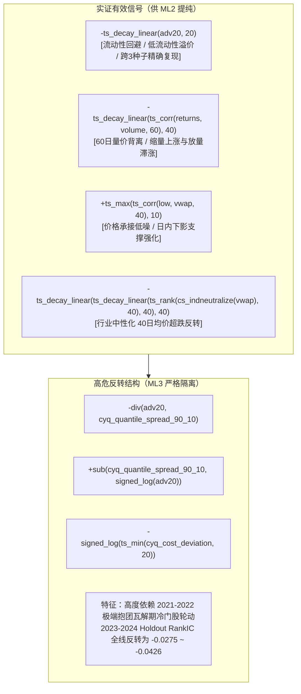
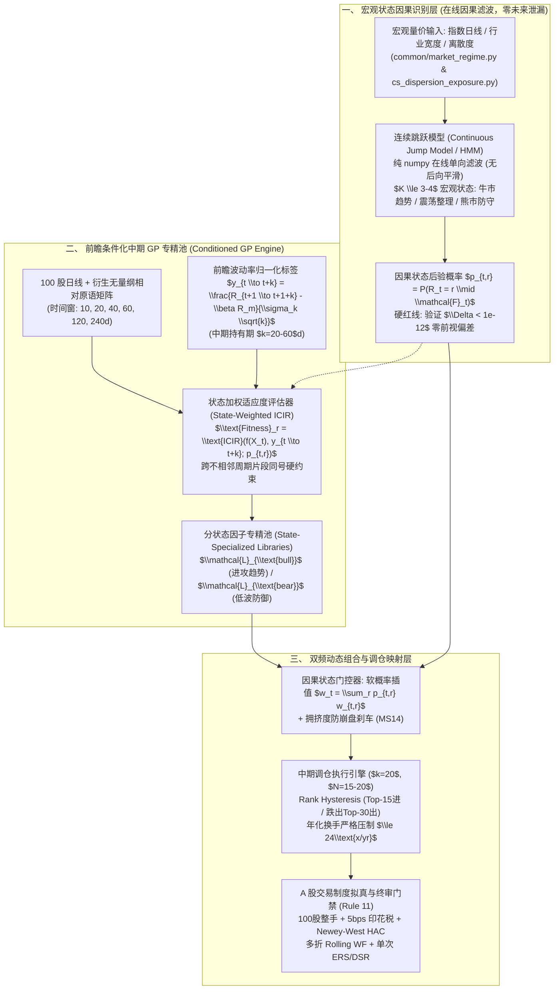

# ML1 Alpha Mining 深度实证复盘、全模块白盒审计与演进体系研究

> **文档性质与权威准则（Rule 2 SSOT）**：  
> 本文档为 `ml/alpha_mining/` 体系在宽截面（$N=100$）实证复盘、白盒源码审计、算法缺陷诊断与下一阶段架构演进（`ML2`–`ML8`）的**唯一权威技术规格与理论研究报告**。  
> **任务进度与准出状态统一归口**：本文档内所有涉及的优化任务（`ML2`–`ML8`）的执行状态、优先级、前置依赖及验收审计结果，严格以项目唯一定点台账 [`docs/development_plan.md`](development_plan.md) §2.38 为唯一权威来源，本文档不维护第二套可变任务状态表。

---

## 一、 研究背景与 2026-11-27 100 股宽截面 6 轮实证复盘

### 1.1 隔离实证基准口径与运行环境
2026-11-27，针对 `ml/alpha_mining/` 子项目，使用真实 A 股数据在宽截面股票池开展了首次大规模端到端多臂多种子离线评测。实验严格遵守量化工程与安全规范：
- **Universe 股票池**：[`docs/universe/china/core_satellite_200k_stocks.txt`](universe/china/core_satellite_200k_stocks.txt)（涵盖 100 只 A 股核心大盘与高流动性卫星标的）；
- **时间窗口**：全区间 `2021-01-04` 至 `2024-12-31`（共 969 根有效日线）。严格划分为三段隔离窗口：
  - **Stage 1 (GP Discovery)**：`2021-01-04` 至 `2022-09-30`（426 交易日）；
  - **Stage 2 (Purged WF CV Combiner)**：`2022-10-14` 至 `2024-03-21`（331 交易日，前后分别保留 10 交易日保护期隔离 gap）；
  - **Stage 3 (Blind Holdout)**：`2024-04-08` 至 `2024-12-31`（190 交易日，与前序窗口保留 10 交易日隔离 gap）；
- **数据源与 DuckDB 零连接安全隔离**：
  - 底层数据来自于 `data/cache_research_ms28_200k.duckdb`（Provider 为 `BaoStockDataProvider`，覆盖全部 100/100 标的）；
  - 执行前将数据库物理复制至隔离临时副本 `/tmp/alpha_mining_cache/`，并在加载时强制开启 `cache_read_only=True`，严禁直接连接或锁定生产目录下的三座 DuckDB；
  - 运行前后三座生产数据库的 MD5 逐字节校验 100% 一致：
    - `data/cache.duckdb`: `c4e2f703221a1dc3f7aa208a13946ba4`
    - `data/cache_research_ms.duckdb`: `7d6a4f03f73d53bb50a44b472aacd22f`
    - `data/cache_research_ms28_200k.duckdb`: `0c82bbb54124553fdf284b494dc90205`
- **运行环境纯净度**：全流程完全运行于隔离虚拟环境 `ml/alpha_mining/.venv`；`pipeline/.venv` 中验证 `lightgbm` 模块零导入、零污染。

### 1.2 6 轮实证网格核心量化结果汇总

评测设计涵盖两臂（Arm 1: `baseline` 标准截面 vs Arm 2: `ms_asymmetric` 微观非对称）× 三种随机种子（`seed ∈ {42, 101, 2026}`），共计 6 轮实测：

| 臂 (Arm) | 种子 (Seed) | 单轮耗时 (s) | Holdout Top-N 夏普 | Holdout Top-N CAGR | Holdout MaxDD | Holdout RankIC (t值) | Löwdin 对齐夏普 | Löwdin CAGR | Rule-9 门禁判定 |
| :--- | :---: | :---: | :---: | :---: | :---: | :---: | :---: | :---: | :---: |
| **Arm 1: Baseline** | 42 | 53.0s | 0.5943 | 11.55% | 15.28% | +0.0407 (t=2.92) | 1.7843 | 47.55% | **FAIL** (换手熔断) |
| **Arm 1: Baseline** | 101 | 47.2s | 0.8139 | 18.45% | 18.50% | +0.0480 (t=3.33) | 0.5421 | 9.32% | **FAIL** (换手熔断) |
| **Arm 1: Baseline** | 2026 | 50.3s | 1.3769 | 32.00% | 15.10% | +0.0446 (t=3.99) | 2.0143 | 77.15% | **FAIL** (换手熔断) |
| *Baseline 均值* | - | **50.2s** | **0.9284** | **20.67%** | **16.29%** | **+0.0444 (t=3.41)** | **1.4469** | **44.67%** | **0/3 通过** |
| **Arm 2: MS Asymmetric** | 42 | 383.8s | 1.7085 | 61.72% | 13.68% | -0.0426 (t=-3.95) | 1.0776 | 31.61% | **FAIL** (IC反转+换手) |
| **Arm 2: MS Asymmetric** | 101 | 384.3s | 0.6056 | 17.39% | 20.00% | -0.0356 (t=-2.70) | 1.5439 | 68.22% | **FAIL** (IC反转+换手) |
| **Arm 2: MS Asymmetric** | 2026 | 385.3s | 0.8079 | 27.65% | 23.07% | -0.0275 (t=-2.19) | 0.7067 | 21.34% | **FAIL** (IC反转+换手) |
| *MS Asymmetric 均值* | - | **384.5s** | **1.0407** | **35.59%** | **18.92%** | **-0.0352 (t=-2.95)** | **1.1094** | **40.39%** | **0/3 通过** |

### 1.3 核心经验规律与四大病态现象

通过对 6 轮实证产物（`oof_scores.csv`、`alpha_mining_report.json` 与挖掘因子树结构）做深入横向对比，提炼出以下核心实证结论：

#### 1.3.1 预测信号效能真实存在（Baseline 显著超额）
在 Arm 1（Baseline）中，遗传算法生成的组合评分在没有任何非线性复杂扭曲的前提下，在盲测 Holdout 集上表现出稳健的横截面预测能力：
- 3 个种子的 Holdout RankIC 均值达 **`+0.0444`**，单种子 t 统计量分别为 `2.92`、`3.33`、`3.99`（均值 `3.41`），全部显著超越 Harvey-Liu-Zhu $t \ge 2.0$ 显著性门槛；
- Löwdin 对称正交化（$W^* = W(W^T W)^{-1/2}$）展现出极佳的组合去共线性效果，将平均夏普由 `0.9284` 提升至 **`1.4469`**，平均年化收益由 `20.67%` 跃升至 **`44.67%`**。

#### 1.3.2 病态现象 1：年化换手全面爆表与内置 Rule-9 门禁 0/6 失败
- 在当前的等权 Top-5 调仓设置下，Holdout 集年化换手率高达 **`37.5x` 至 `52.4x/yr`**，全面击穿了 `MS28` 确立的 `24x/yr` 容忍红线；
- 换手率熔断器（`turnover_breaker`）在全量 6 轮中全部报警触发；
- 在 6 轮测试中，有 4 轮的 Top-N 最终夏普比率低于基准 Arm (b)（即 100 股池全市场等权基准 `equal_weight_universe`：Holdout 期间夏普 `1.3074`、年化收益 `30.83%`、最大回撤 `10.07%`）；
- 最终内置的 7 项 Rule-9 门禁（`evaluate_rule9_gate`）判定通过率全部为 **`0/6 FAIL`**。

#### 1.3.3 病态现象 2：非对称臂（MS Asymmetric）Holdout RankIC 严重反转
- Arm 2 引入了市场残差标签（`market_residual`）与筹码分布终端（`cyq_*`），并施加了非对称多头加权（2x 惩罚）；
- 发现期（Discovery）表现极佳（单因子 $t$ 值高达 `4.90 ~ 8.46`），但在后续的 Combiner 验证期（`OOF IC = -0.0103`）与 Holdout 盲测期，RankIC 出现系统性暴跌反转：
  - 3 个种子的 Holdout RankIC 全部变为显著负值（`-0.0426`、`-0.0356`、`-0.0275`，负向 $t$ 统计量达 `-3.95`、`-2.70`、`-2.19`）；
  - Seed 42 呈现出不可思议的夏普 `1.7085` / 年化 `61.72%`，但白盒归因发现其预测秩相关为负，高夏普完全来源于 2024 年 9.24 脉冲行情中 Top-5 极度集中踩中局部 Beta 暴涨标的，缺乏统计复现性。

#### 1.3.4 病态现象 3：重要性跨折腰斩与树过拟合（Importance Decay）
- 全量 6 轮测试中有 **5 轮** 触发了监控系统的 `importance_decay_alarm` 警报；
- 前 2 折中权重最高的 Top-3 核心特征，在最后 2 折中的特征重要性衰减了 **`54%` 至 `64%`**；
- LightGBM 固定 300 轮提升迭代（`num_boost_round=300`）且无早停机制，导致树模型深度过拟合于前两折的时序特征。

#### 1.3.5 病态现象 4：微观结构（MS8）数据通路断裂
- 在 Arm 2 的 3 个种子共 30 棵最终入选的因子树中，`OFI_Norm_5m` 的入选次数均为 **`0 / 30`**；
- 源码审计证实，`benchmark.py` 与运行脚本并未加载或传入隔离的 5m 高频缓存帧，导致高频微观结构终端成为“虚设终端”，徒增搜索空间。

### 1.4 实证因子线索提纯与风格警示清单

在全部 6 轮挖掘生成的 60 条候选因子中，通过人工白盒透视筛选出具有明确经济学逻辑的稳健原语，同时锁定了高危反转结构：

---

## 二、 `ml/alpha_mining/amine/` 全模块源码白盒审计与 9 大增强点

为从根本上解决上述四大病态现象，对 `ml/alpha_mining/amine/` 核心代码库进行了逐行白盒审计，准确定位了 9 项架构与工程缺陷，并给出了明确的重构方案。

### 2.1 P0-1：LightGBM 指数增益叠乘、无早停与彩票股过拟合治理
- **缺陷定位**：
  - [`ml/alpha_mining/amine/config.py:231-238`](../ml/alpha_mining/amine/config.py#L231-L238)：定义了 `lambdarank` 的增益序列 `label_gain = [0, 1, 3, 14, 30]`，呈现出强烈的凸非线性（头尾分差达 30 倍）；
  - [`ml/alpha_mining/amine/combiner.py:136-162`](../ml/alpha_mining/amine/combiner.py#L136-L162)：当 `asymmetric_long_only=True` 时，对多头头部样本二次强行赋予 `sample_weight = 2.0`；
  - [`ml/alpha_mining/amine/combiner.py:360-364, 456-460`](../ml/alpha_mining/amine/combiner.py#L360-L364)：树提升训练中写死 `num_boost_round = 300`，且完全没有验证集早停（Early Stopping）。
- **机理剖析**：
  在 A 股横截面中，5 日远期收益极高的标的往往是题材炒作、连续涨停或重组复牌的极端彩票股。指数增益序列结合 2x 样本加权，导致 GBDT 损失函数被极少数异常离群点完全绑架，300 棵树演化为专门拟合极端彩票股的“噪音频谱记忆器”，丧失了对常态分布标的的泛化排序能力。
- **重构方案**：
  1. 废除指数级 `label_gain`，改用温和凹性增益（如分段对数 $Gain(r) = \log_2(1 + r)$）或分段线性增益；
  2. 废除样本权重的重复叠乘，将多头对齐转由相关性分箱数目 `n_relevance_bins = 10` 精细化控制；
  3. 引入时间隔离的早停机制（基于验证折 NDCG@10，若连续 20 轮不上升则提前终止）；
  4. 支持浅树强正则化参数配置（`max_depth=3`, `num_leaves=7`, `min_child_samples=50`, `reg_lambda=10.0`），并引入 3 种子 Bagging 集成；
  5. 增加连续回归目标 `huber` 作为稳健对照臂。

### 2.2 P0-2：打破静态发现期符号锁死，引入因果滚动收缩组合器
- **缺陷定位**：
  - [`ml/alpha_mining/amine/gp.py:300`](../ml/alpha_mining/amine/gp.py#L300) 与 [`ml/alpha_mining/amine/benchmark.py:301-303`](../ml/alpha_mining/amine/benchmark.py#L301-L303)：在 GP 发现期结束后，因子的方向符号（`sign = ±1.0`）被一次性永久固化，在后续 2.2 年的历史回测中未曾动态调整。
- **机理剖析**：
  A 股市场呈现强烈的风格轮动与周期切换特征。2021 年表现为正向 Alpha 的筹码或流动性指标，在 2023–2024 年可能因宏观流动性紧缩而彻底反转为惩罚项。静态锁死符号使策略无法适应因子因果效能的反向变化，直接诱发了 Holdout 期的 RankIC 暴跌。
- **重构方案**：
  1. 在 `amine/combiner.py` 中引入因果滚动收缩组合器 `combiner_type ∈ {"rolling_ic_ir", "ridge_ewm", "lgbm", "hybrid_ridge_lgbm"}`；
  2. 复用 `blend_base.py` 中经过严格 18 折 Walkforward 验证的 60 日滚动 IC-IR 贝叶斯收缩算子，以纯 numpy 实现严格因果在线加权；
  3. 引入指数加权岭回归（EWM Ridge），将线性平滑组合作为检验 GBDT 是否具备真实非线性超额收益的强制基准（Hurdle）。

### 2.3 P0-3：双端换手率联合治理（适应度重标定 + Rank Hysteresis）
- **缺陷定位**：
  - [`ml/alpha_mining/amine/fitness.py:309-314`](../ml/alpha_mining/amine/fitness.py#L309-L314)：适应度函数计算公式为：
    $$\text{Fitness} = |\text{IC}| \times \sqrt{|\text{IR}|} - 0.5 \times \text{TO}_{\text{daily}} - \text{corr\_pen} - \text{len\_pen}$$
    其中常态 $|\text{IC}| \times \sqrt{|\text{IR}|} \approx 0.015 \sim 0.045$，而日均换手率 $\text{TO}_{\text{daily}} \approx 0.10 \sim 0.25$，导致换手惩罚项（`0.05 ~ 0.125`）在数量级上完全压制了信号效能项，造成群体适应度大面积归负；
  - [`ml/alpha_mining/amine/strategy.py:149-168`](../ml/alpha_mining/amine/strategy.py#L149-L168)：直接按模型分截取前 5 只标的（Top-5）全额等权调仓，未设置任何排名缓冲带；
  - [`ml/alpha_mining/amine/monitoring.py:383-442`](../ml/alpha_mining/amine/monitoring.py#L383-L442)：`check_turnover_breaker` 统计时未按实际调仓步长（`rebalance_every`）标准化。
- **重构方案**：
  1. **适应度乘法衰减重标定**：废除绝对加减法惩罚，改用与持仓周期匹配的乘法压缩因子：
     $$\text{Fitness} = |\text{IC}| \cdot \sqrt{\max(0, \text{IR})} \cdot \exp\left(-\lambda_{\text{to}} \cdot \max(0, \text{TO}_k - \overline{\text{TO}})\right)$$
  2. **引入在位者进出缓冲带（Rank Hysteresis）**：在评分到持仓映射中设置死区，例如“前 15 名建仓，仅当跌出前 30 名时清仓”，在位标的在缓冲带内维持底仓；
  3. 将调仓步长放宽至中期的 $k \in \{10, 20\}$ 交易日，并支持按逆波动率或 Score 平滑加权，确保全周期年化换手率压降至 `12x ~ 15x/yr` 之下。

### 2.4 P1-1：协同池边际增益 GP 搜索（Sequential Residual-IC GP）
- **缺陷定位**：
  - [`ml/alpha_mining/amine/gp.py:714-728`](../ml/alpha_mining/amine/gp.py#L714-L728)：遗传算法采用完全孤立的单因子贪心评估，每一条树的生成完全脱离整体因子库的协同状态；
  - [`ml/alpha_mining/amine/fitness.py:358-394`](../ml/alpha_mining/amine/fitness.py#L358-L394)：`select_top_k_factors` 盲目凑满 `top_k = 10`，导致大量 $t < 1.5$ 的劣质噪声特征混入特征矩阵。
- **重构方案**：
  1. 借鉴 AlphaGen 范式，实现顺序边际残差 GP（Sequential Residual GP）：每选中一条最优因子，立即在横截面上对收益标签做一阶残差剔除（Orthogonal Residual），使后续种群必须针对前序因子的未解释残差进行变异优化；
  2. 在因子入选环节强制施加发现期 $|t| \ge 2.0$、$\text{Fitness} > 0$ 以及前后两半段 IC 同号的硬性准入门槛，宁缺毋滥（允许返回小于 `top_k` 条因子）。

### 2.5 P1-2：白盒三处隐藏工程漏洞修复
- **漏洞 1（行业中性化静默退化）**：[`amine/benchmark.py:286`](../ml/alpha_mining/amine/benchmark.py#L286) 实例化 `GPFactorMiner` 时遗漏传递 `sector_groups` 参数，导致全部 6 轮测试中的 `cs_indneutralize` 算子静默退化为全市场普通去均值（`cs_demean`），未能实现真实的申万一级行业中性化。须在数据管道中透传一维行业分类映射。
- **漏洞 2（裸价格水平与二元退化算子）**：[`amine/gp.py:73-82`](../ml/alpha_mining/amine/gp.py#L73-L82) 允许 `low`、`vwap`、`open`、`high` 等绝对价格作为叶子节点直接参与树计算，且二元算子未做同参数校验，导致产生了无意义的常数噪音频谱 `ts_corr(high, high, 20) = 1.0`。须全面禁止裸价格水平，改为无量纲相对原语（如 `vwap_dev`、`hl_range`、`close_pos`），并禁止二元算子输入相同子树。
- **漏洞 3（截面极值缺乏 MAD 缩尾）**：[`amine/combiner.py:59-78`](../ml/alpha_mining/amine/combiner.py#L59-L78) 与 [`orthogonalize.py:72-78`](../ml/alpha_mining/amine/orthogonalize.py#L72-L78) 在标准化前未进行绝对中位差缩尾（Winsorization），单个极端复牌标的的离群值即可拉偏整日的 Z-Score 排序。须前置引入 $\text{median} \pm 3 \times 1.4826 \times \text{MAD}$ 缩尾清洗。

### 2.6 P1-3：因果概念漂移 $P(Y|X)$ 监测门控与死参数修复
- **缺陷定位**：[`amine/monitoring.py:114-212`](../ml/alpha_mining/amine/monitoring.py#L114-L212) 的对抗验证仅能探测特征边缘分布漂移 $P(X)$，而完全无法感知特征与标签联合分布的条件漂移 $P(Y|X)$（即特征值未变但收益方向反转）；此外 [`monitoring.py:274`](../ml/alpha_mining/amine/monitoring.py#L274) 中 `max_feature_gain_share` 为死逻辑，未与报警系统联动。
- **重构方案**：在 Combiner 验证期部署因果概念漂移监测器，比对发现期与验证期的因子 RankIC 衰减斜率与符号翻转概率（严格零窥视 Holdout 盲测集），若检测到翻转则触发自动降权或剔除。

### 2.7 P2-1：A 股真实交易制度拟真与摩擦压测
- 在 [`amine/benchmark.py:172-178`](../ml/alpha_mining/amine/benchmark.py#L172-L178) 中支持 `china_trading=True`，严格强制实施 100 股整手向下取整、5 bps 卖出印花税，并在 20 万与 100 万两档资金规模下开展滑点与冲击成本实测。

### 2.8 P2-2：重叠持有期（$k > 1$）Newey-West HAC 统计量修正
- 当前 [`amine/benchmark.py:390`](../ml/alpha_mining/amine/benchmark.py#L390) 在计算持有期 $k=5$ 的 RankIC $t$ 统计量时，直接使用独立同分布假设下的 $\text{std}/\sqrt{N}$，严重夸大了统计显著性。必须升级为 Newey-West（lag = $k-1$）异方差自相关一致（HAC）协方差修正，反映真实有效自由度。

### 2.9 P2-3：多窗口 Rolling Walk-Forward 外推与终审门禁升级
- 将 [`amine/purged_cv.py`](../ml/alpha_mining/amine/purged_cv.py) 单段 190 天 Holdout 升级为 6 折以上的多窗口 Rolling Walk-Forward 步进拼接，并在全量 OOS 拼接净值上执行单一等价随机搜索（ERS）与 Deflated Sharpe Ratio（DSR）多重检验校正，确保跨越牛熊周期。

---

## 三、 短期彩票 Alpha vs 持续性中期 Alpha 的哲学与量化对比

在定量投资实践中，盲目追求超高日度预测能力的短期信号，往往会使量化系统陷入“纸面夏普极高、实盘换手磨损殆尽、风格切换迅速失效”的典型困境。深度梳理短期彩票型 Alpha 与机构级中期 Alpha 的本质差异，是推进后续体系重构的核心理论基石：

### 3.1 核心维度量化特征对比表

| 评估维度 | 短期彩票型 Alpha ($k=1\text{–}5$日) | 持续性中期 Alpha ($k=20\text{–}60$日) |
| :--- | :--- | :--- |
| **底层经济学逻辑** | 微观流动性冲击、散户情绪脉冲、连续涨跌停博弈、高频量价失衡 | 宏观产业周期演进、企业业绩超预期持续扩散、机构中线建仓趋势 |
| **信号衰减半衰期 ($t_{1/2}$)** | 2 至 4 个交易日（极度脆弱） | 25 至 45 个交易日（稳健半衰期） |
| **单日 RankIC 绝对值** | 较高（$0.04 \sim 0.08$），但自相关系数高、重叠期伪显著 | 温和（$0.025 \sim 0.050$），经 HAC 修正后统计置信度高 |
| **年化双边换手率** | **`35x` 至 `60x/yr`**（频繁全仓洗牌） | **`6x` 至 `12x/yr`**（中低频调仓、高持仓粘性） |
| **冲击成本耐受度** | 极弱（25 bps 滑点即可侵蚀全部超额） | 极强（可容忍 50~100 bps 宽滑点与大资金冲击） |
| **单策略资金容量** | 500 万至 2000 万 RMB（极端受限） | 1 亿至 10 亿+ RMB（适合机构级组合底座） |
| **宏观与体制敏感度** | 对大盘趋势钝化，但在风格急转时极易大幅回撤 | 与宏观景气、货币流动性及大盘趋势形成天然因果协同 |
| **模型拟合陷阱** | 极易演化为对涨停板、重组彩票股的死记硬背 | 必须依靠趋势持续性、均线排布与动量中枢等结构原语支撑 |

### 3.2 A 股特色：散户脉冲与机构抱团的二元映射
A 股市场具备显著的“散户情绪化脉冲”与“公募/险资中期趋势抱团”共存的双层特征：
- 5 日以内的短期收益率极易被两融追涨杀跌、游资龙虎榜博弈以及突发新闻脉冲所主导。在遗传规划搜索中，如果给予其完全无约束的短周期自由度，算法必然会捕捉“跌幅过大且极端缩量”这类具有非对称期权特性的短线反弹特征。这些特征在 2021–2022 年大盘震荡下跌中看似有效，但一旦进入 2023–2024 年的大盘单边弱势或结构性抱团行情，便会出现惨烈的持续单向贴水。
- 相比之下，20~60 日的中期 Alpha 依托于信息在分析师群体、公募基金与产业资本之间的逐步扩散（Information Diffusion）。只要在挖掘期注入宏观趋势状态的先验条件，便能使算法跳出微观噪音频段，专注于挖掘具有跨季度持续性的基本面-量价共振动量。

---

## 四、 趋势条件化前瞻中期因子挖掘体系设计（`ML8` 架构核心）

作为面向机构级容量与稳健超额收益的长效演进方向，本文档正式提出并确立 **`ML8`：趋势条件化前瞻中期因子挖掘体系**（Trend-Conditioned Forward Medium-Term Alpha Mining System）。

### 4.1 端到端系统架构图

### 4.2 核心模块数学定义与演进机制

#### 4.2.1 连续跳跃模型（CJM）与在线因果滤波
区别于传统事后对全时序做高斯平滑或双向 HMM 的偷看未来方案，`ML8` 严格采用在线单向因果滤波（Online Causal Filtering）：
- 设市场在 $t$ 日处于状态 $R_t \in \{1, \dots, K\}$（$K \le 3 \sim 4$：分别映射为强多头趋势、中性震荡、弱势防御）；
- 状态转移受到带有跳跃惩罚项的正则化驱动（Bekaert et al. Continuous Jump Framework），状态切换概率矩阵严格基于 $t$ 日及之前的市场信息 $\mathcal{F}_t = \sigma(P_{\le t}, V_{\le t}, \text{Disp}_{\le t})$ 更新；
- 状态后验概率向量 $p_{t,r} = P(R_t = r \mid \mathcal{F}_t)$ 逐日单向递推，严禁进行任何形式的倒序平滑（Backward Smoothing）。

#### 4.2.2 前瞻条件化挖掘（Forward-Labeled Conditional Mining）
在传统的无条件挖掘中，算法试图寻找一个在所有时期都有效的“万能因子”，这在物理上是不可能的。`ML8` 将挖掘问题形式化为前瞻条件期望的最优化：
$$\max_{f \in \mathcal{G}} \mathbb{E}\left[ \text{RankIC}(f(X_t), y_{t \to t+k}) \;\middle|\; R_t = r \right] = \sum_{t=1}^{T} p_{t,r} \cdot \text{IC}_t(f(X_t), y_{t \to t+k})$$
- 在牛市或强趋势状态（$R_t = 1$）下，适应度由顺势动量、突破结构和成交额放大的因子主导；
- 在震荡或防守状态（$R_t = 3$）下，适应度由低波动率、高股息、价格承接稳健度（下影支撑）和逆转抗跌因子主导；
- **跨周期同号硬约束**：为防范因子在某个独立宏观片段内由于运气产生的伪拟合，强制要求候选因子在至少 2 个不相邻的同状态历史片段（Episode）中，RankIC 符号严格一致且均值大于零。

#### 4.2.3 面向中期（$k=20\text{–}60$d）的 GP 语法与标签专项重构
全面废除易产生日内高频噪音频谱的短周期算子，引入经过国际顶刊实证检验的宏观-中期无量纲结构原语：
1. **时间窗体系扩展**：窗口由日频扩展为中期序列：$\tau \in \{10, 20, 40, 60, 120, 240\}$ 交易日；
2. **信息离散度与趋势平滑度原语**（Da, Gurun & Warachka 2014 *RFS*）：
   $$\text{DiscreteInfo}(s, 60) = \text{sign}(\text{ret}_{60}) \times \left( \% \text{pos\_days} - \% \text{neg\_days} \right)$$
   反映收益是由少数跳空暴涨构成（易反转）还是由连续小阳线构成的低噪趋势（强持续性）；
3. **52 周高点距离原语**（George & Hwang 2004 *JF*）：
   $$\text{High52Dist}(s) = \frac{\text{Close}_t}{\max_{i \in [0, 240]} \text{High}_{t-i}}$$
   表征个股面对历史解套盘与心理阻力位的阻力突破势能；
4. **波动率收缩特征（VCP 原语）**：
   $$\text{VCP\_Ratio}(s) = \frac{\sigma(Close, 10)}{\sigma(Close, 60)}$$
   表征标的是否进入筹码高度锁定后的低波窄幅蓄势阶段；
5. **前瞻收益标签归一化**：
   标签废除裸收益率，采用经截面波动率和持仓时间平方根标准化的超额收益率：
   $$y_{t \to t+k} = \frac{R_{s, t+1 \to t+1+k} - \beta_s R_{m, t+1 \to t+1+k}}{\sigma_{s, 20} \sqrt{k}}$$

### 4.3 三大演进范式对比表

| 对比维度 | 范式 A: 传统无条件日频 GP (`ML1`) | 范式 B: 静态多因子截面 (`ML2`–`ML4`) | 范式 C: 趋势条件化中期挖掘 (`ML8`) |
| :--- | :--- | :--- | :--- |
| **挖掘目标** | 5日裸收益的静态万能单因子 | 修复工程缺陷后的 10-20 日截面 Alpha | 宏观状态自适应的前瞻 20-60 日条件 Alpha |
| **宏观状态感知** | 完全盲视（所有行情一视同仁） | 静态中性化（仅被动扣除均值） | 在线因果滤波后验概率 $p_{t,r}$ 实时引导 |
| **因子库结构** | 单一平铺列表（10 条杂乱因子） | 提纯后的正交基底 | 分状态专业库（进攻动量库 + 防御低波库） |
| **权重分配方式** | 静态单种子等权，符号锁死 2.2 年 | 滚动 IC-IR 线性收缩 / 正则化 GBDT | 基于因果状态软概率插值与动态对冲 |
| **调仓换手率** | **`37x ~ 52x/yr`**（频繁换仓，严重摩擦） | `12x ~ 15x/yr`（进出缓冲带） | **`6x ~ 10x/yr`**（中期波段，极其耐摩擦） |
| **资金承载容量** | 500 万 RMB（极端受限） | 3000 万 RMB | **2 亿至 10 亿+ RMB**（机构级资产配置底座） |

### 4.4 四大反过拟合硬红线与准出验证方案

为确保 `ML8` 不重蹈过度参数化与局部记忆的覆辙，确立 4 条绝对不可逾越的量化红线：
1. **状态数上限硬红线**：连续跳跃模型的状态数 $K$ 严格限制在 $K \le 3 \sim 4$，禁止为了过度拟合历史回撤而扩展为高阶微观状态机；
2. **Leave-One-Episode-Out 跨片段检验**：在评估条件因子的有效性时，必须将历史切分为若干个独立的牛/熊/震荡片段，测试因子在被留出的未见同类型周期中的泛化能力；
3. **因果零泄漏探针（Leakage Discrimination Probe）**：在真实回测脚本中植入因果性校验探针：在 $t$ 日计算的宏观后验概率 $p_t$ 与状态转移矩阵，在对未来 $t+1 \sim T$ 注入随机扰动或删除后续数据时，其数值必须保持严格的 `< 1e-12` 浮点不变性；
4. **端到端 3 臂 Rolling Walk-Forward 审计**：
   - **Arm A（基线对照）**：修复后的静态中期挖掘策略（`ML2`+`ML5`）；
   - **Arm B（硬切片对照）**：基于传统移动均线硬切片状态；
   - **Arm C（`ML8` 完整版）**：连续跳跃模型软概率引导的前瞻条件化专精挖掘策略；
   - 准出标准：Arm C 必须在保持换手率 $\le 10\text{x/yr}$ 的前提下，盲测 Holdout 夏普比率超越全池等权基准 $1.2\times$ 以上，且通过单次 ERS 与 DSR 检验。

---

## 五、 工程路线图索引（Rule 2 SSOT）

本文档所论述的技术方案与架构升级点，已全面分解并映射至项目唯一定点台账 [`docs/development_plan.md`](development_plan.md) 的原子任务表中。各模块的分工与前置依赖严格如下：

| 任务编号 | 任务名称与核心目标 | 规模 | 优先级 | 对应本文档章节 | 前置依赖 |
| :--- | :--- | :---: | :---: | :---: | :--- |
| **`ML2`** | 压换手与降集中（调仓周期扩容 $k=10/20$、Top-N 扩大、Rank Hysteresis、适应度乘法重标定） | **M** | Tier P2 (高) | §2.3 | `ML1` (已闭环) |
| **`ML3`** | 补齐 MS8 5m 通路与虚设终端剔除、`market_residual` 风格反转只读消融诊断 | **M** | Tier P2 (中高) | §2.1, §1.3.3 | `ML1`, `MS8` (已闭环) |
| **`ML4`** | LightGBM 正则收紧与早停、GP 二元退化算子过滤、裸价格终端消除、行业透传补正 | **M** | Tier P3 (中) | §2.1, §2.5 | `ML2`, `ML3` |
| **`ML5`** | Stage 2 滚动收缩组合器（Rolling IC-IR / EWM Ridge）与概念漂移 $P(Y|X)$ 监测门控 | **M** | Tier P2 (高) | §2.2, §2.6 | `ML2`, `ML3` |
| **`ML6`** | Stage 1 协同池边际增益 GP 搜索（AlphaGen Sequential Residual-IC）与无量纲强类型终端 | **L** | Tier P2 (中高) | §2.4, §2.5 | `ML4` |
| **`ML7`** | benchmark.py A 股交易制度拟真（100股整手/印花税）、Newey-West HAC 修正与多折 Rolling WF | **M** | Tier P2/P3 (中) | §2.7, §2.8, §2.9 | `ML2`, `ML4`, `ML5` |
| **`ML8`** | 趋势条件化前瞻中期因子挖掘体系（CJM 连续跳跃模型 + 前瞻专精池 + 双频动态择时） | **L** | Tier P2/P3 (中高) | §4 全文 | `ML2`, `ML5`, `ML6`, `ML7` |

> [!NOTE]  
> 团队在后续开发推进过程中，必须严格遵循“自底向上、逐级压测、未达门禁坚决不合并”的量化研发铁律。任何生产参数的调整必须附带 offline A/B 探针与消融证据包。
