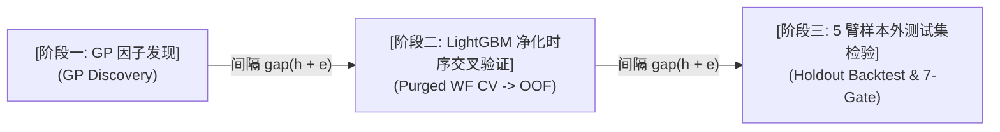

# ml/alpha_mining (ML1) 跨截面两阶段 GP + LightGBM Alpha 因子挖掘体系与投研实操指南

> **单一真实信源（SSOT）说明**：
> 本指南为 `ml/alpha_mining`（`ML1` 族）跨截面 Alpha 挖掘子项目的架构、算法理论、挖掘流程、
> 命令行实操与准入门禁指南。所有量化研发任务拆解、状态追踪与排期一律集中于
> [`docs/development_plan.md`](file:///home/stone/Work/github/quant/docs/development_plan.md)
> （见 §2.15 Track M 模块及相关章节），本文件不维护任何平行的任务列表。

---

## 1. 概述与核心架构隔离

`ml/alpha_mining` 是本量化工程在 `ml/` 目录下构建的独立跨截面 Alpha 挖掘子项目（代号 `ML1`），
采用**两阶段流水线架构**：
- **阶段一（符号化遗传规划因子挖掘，GP Formulaic Discovery）**：
  基于强类型表达式树自动挖掘高秩 IC、低相关性、抗拟合的显式 Alpha 公式。
- **阶段二（原生 LightGBM 决策树非线性融合，Native LightGBM Combiner）**：
  利用原生 `lightgbm.train`（支持 `lambdarank` 排序学习与高斯排序 `regression` 目标），
  在严格净化交叉验证与时空禁运下，融合多项弱相关符号化 Alpha。



### 1.1 独立 `uv` 环境与绝对零污染生产护栏

1. **环境完全隔离**：
   `ml/alpha_mining/` 拥有独立的 `pyproject.toml`、`uv.lock` 与 `.venv` 虚拟环境。
   引入 `lightgbm>=4.3` 专用于非线性融合，**绝不安装进主投研环境 `pipeline/.venv`**。
   跨目录复用 `common/*` 基础设施时，通过 `common.cli_utils.bootstrap_project_paths`
   注入 `sys.path`，与 `ml/bnn_forecaster/` 保持完全一致的物理隔离标准。
2. **生产路径解耦护栏**：
   `ml/alpha_mining` 为独立的离线因子挖掘与策略研发引擎，**严禁直连**以下生产路径：
   - 不挂入全流水线调度器 `pipeline/run_pipeline.py`；
   - 不直连策略配置中心 `pipeline/research_strategy/rs/strategies_config.json`；
   - 不修改静态模板注册表 `common/strategy_spec.py`；
   - 不接入基本面选股器 `run_screener.py` 与实盘下单器 `scripts/run_live_strategy.py`。
   仅当挖掘所得因子在独立的 `AlphaMiningStrategy` 中通过全套门禁后，才允许作为独立
   配置项进行后续工程化考量。

### 1.2 三段严格时空隔离（Zero Selection Leakage）

为从机制上彻底根除「从因子发现到组合学习」的选择性未来函数（Selection Leakage），
整段历史数据在时间轴上被机械切分为互不相交的三大区间，且区间之间必须插入宽度为
`gap = h + embargo` 个交易日（其中 $h = \text{holding\_period} + \text{exec\_lag}$，
默认 $5 + 1 = 6$；$\text{embargo} = 5$）的时空禁区：
- **第一段：`[GP Discovery]`**：仅用于阶段一符号化因子池的进化与适应度评估。
- **中间隔离带：`gap(h + e)`**：防止前瞻收益标签回流覆盖。
- **第二段：`[Purged WF CV]`**：仅用于阶段二 LightGBM 组合器的因果推演与袋外分数生成。
- **中间隔离带：`gap(h + e)`**：防止交叉验证测试集泄漏至样本外。
- **第三段：`[Holdout]`**：最终的盲测样本外对比窗口，严禁参与任何超参数调整或因子发现。

---

## 2. 算子库、终端特征与内置 7 项 Rule-9 门禁

### 2.1 基础终端与 MS8 微观结构终端

阶段一 GP 表达式树的输入终端（Terminals）覆盖横截面基础价量与微观流动性：

| 终端类别 | 终端符号 | 物理含义与构建规则 | 树深约束 |
| :--- | :--- | :--- | :--- |
| **基础终端** (8 个) | `open`, `high`, `low`, `close` | 每日 OHLC 未复权/前复权基础价格 | 默认 $\le 6$ |
| | `volume` | 每日成交量（股/手） | 默认 $\le 6$ |
| | `vwap` | 成交量加权均价代理（`vwap_proxy`） | 默认 $\le 6$ |
| | `returns` | 当日日度收益率 (`close / ts_delay(close, 1) - 1`) | 默认 $\le 6$ |
| | `adv20` | 20 日平均成交金额 (`adv(20)`) | 默认 $\le 6$ |
| **微观结构终端** (MS8, 4 个) | `ofi_norm_5m` | 5 分钟盘口订单流不平衡归一化均值 | 强制约束 $\le 4$ |
| *(需开启 `--include-ms-terminals`)* | `cyq_cost_deviation` | 筹码平均持仓成本偏离度 | 强制约束 $\le 4$ |
| | `cyq_quantile_spread_90_10` | 筹码 90% 与 10% 分位数跨度（集中度） | 强制约束 $\le 4$ |
| | `peer_mom` | 申万行业/同行截面动量均值 | 强制约束 $\le 4$ |

> [!IMPORTANT]
> **微观特征抗过拟合深度剪枝**：当传入 `--include-ms-terminals` 时，`amine/config.py`
> 会自动将 GP 树最大深度由 6 强制压低至 $\le 4$（`min(base.gp.max_depth, 4)`）。微观结构
> 特征自身信噪比高且极易过拟合，限制嵌套层数可防止生成高度复杂退化的公式。

### 2.2 核心算子复用与单元级有效性掩码

本子项目直接复用 `common/alpha101_operators.py` 中的全部经典算子，零重复实现：
- **时序时相算子**：`ts_delay`, `ts_delta`, `ts_mean`, `ts_min`, `ts_max`, `ts_sum`,
  `ts_std`, `ts_rank`, `ts_decay_linear`, `ts_argmax`, `ts_argmin`
- **时序关联算子**：`ts_corr`, `ts_cov`
- **截面变换算子**：`cs_rank`, `cs_demean`, `cs_zscore`, `cs_scale`, `cs_indneutralize`
- **非线性数学映射**：`signed_power`, `sigmoid`, `signed_log`

**单元级有效性掩码机制（Validity Masking）**：
为防止算子中性填充（如 `cs_rank` 产生中位数 0.5、`ts_corr` 产生 0.0）掩盖真实的无效数据，
每个 GP 节点在计算时不仅将 $\pm\infty \to \text{NaN}$，还对其子节点的输入有效性执行
严格的按位与（AND）校验。若某个股票某日的 `volume` 缺失，则任何消费 `volume` 的子树在该格
强制置为 `NaN`，彻底隔绝虚假中性信号。

### 2.3 5 臂 Holdout 对照实验设计

样本外 Holdout 窗口通过 `common.allocation_backtester.run_allocation_backtest` 同步
跑通 5 个对照臂，严格计入真实滑点与佣金摩擦：
- **Arm (a) `lgbm_top_n`**：主实验臂。LightGBM 组合器模型打分 Top-N 等权持仓。
- **Arm (b) `equal_weight_universe`**：基准臂。全标的池等权买入持有。
  *注：常数打分截面不计算假 IC，报告中如实返回 `ic_summary: null`。*
- **Arm (c) `best_single_seed`**：单因子对照臂。阶段一在发现期表现最优的单一种子因子。
- **Arm (d) `equal_weight_gp_combo`**：线性组合对照臂。挖掘所得 Top-K 个 GP 因子 z-score 简单等权。
- **Arm (e) `lgbm_lowdin_on`**：正交消融臂。在输入 LightGBM 前施加 Löwdin 符号对称正交化变换。

### 2.4 内置 7 项 Rule-9 实证门禁（`evaluate_rule9_gate`）

根据 `AGENTS.md` Rule 9（策略或交易代码变更前必须证明正向增益），本引擎将准出门禁下沉至
`amine/benchmark.py`，必须同时通过以下 7 项硬指标（全 True 判定为 `passed: true`）：

```text
┌─────────────────────────────────────────────────────────────────────────────┐
│                      ML1 内置 Rule-9 实证检验准出 7 门禁                     │
├───────────────────────────────┬─────────────────────────────────────────────┤
│ 1. holdout_t_stat_ge_2        │ 样本外 RankIC t 统计量 >= 2.0 (HLZ 门槛)    │
│ 2. beats_seed_ic              │ 组合器 RankIC >= 最佳单因子 (a >= c)        │
│ 3. beats_seed_sharpe          │ 扣费后净夏普比率 >= 最佳单因子 (a >= c)     │
│ 4. beats_eq_gp_ic             │ 组合器 RankIC >= GP 因子简单等权平均 (a >= d)│
│ 5. beats_eq_gp_sharpe         │ 扣费后净夏普比率 >= GP 因子简单等权 (a >= d)│
│ 6. non_starvation             │ 总调仓次数 > 0 且成交笔数 > 0 (反饥饿硬门禁) │
│ 7. no_monitoring_alarm        │ 对抗漂移 AUC <= 0.70、特征无衰减、无熔断告警 │
└───────────────────────────────┴─────────────────────────────────────────────┘
```

---

## 3. 四阶段系统化挖掘推进计划

### 阶段 0：独立环境初始化与离线隔离校验

确保工程完全在 `ml/alpha_mining/` 专属环境运行，并验证宿主 `pipeline/.venv` 未受污染：

```bash
# 1. 激活并同步独立环境
cd /home/stone/Work/github/quant/ml/alpha_mining
uv sync

# 2. 运行快速离线单元测试
uv run pytest tests -v -m "not slow"

# 3. 严格验证 pipeline/.venv 零 lightgbm 污染 (退出码须为 0)
cd /home/stone/Work/github/quant/pipeline
uv run python -c "import importlib.util as u, sys; sys.exit(u.find_spec('lightgbm') is not None)"
```

### 阶段 1：样本池配置、多头非对称增益与标签构造

1. **标的池规模**：
   - 避免使用 $N \le 20$ 窄池，建议采用宽截面标的池（$N \ge 50 \sim 100$，例如
     `docs/universe/china/core_satellite_200k_stocks.txt` 或 A 股中证 500/800 宽池），
     保证截面排序学习有充分的样本深度。
2. **纯多头非对称增益（`--asymmetric-long-only`）**：
   - A 股融券做空受限，标准排序损失对空头端排序惩罚与多头端对等，导致模型浪费容量优化空头。
   - 开启 `--asymmetric-long-only` 与 `--long-leg-weight-multiplier 2.0`，使 LightGBM
     在排序学习时重点向 Top 20% 分位股票倾斜权重。
3. **对抗漂移特征过滤（`--filter-adversarial-drift`）**：
   - 开启 `--filter-adversarial-drift`，系统在拟合前自动比对“发现期”与“验证期”的特征分布；
   - 若某因子在验证期出现分布偏移（Mann-Whitney 对抗验证 AUC $> 0.65$），将在 Stage 2
     前置剔除，且该过程严格不窥探 Holdout 测试集。
4. **预测周期与延迟**：
   - 设定调仓周期 `--k 5` 或 `--k 10`，必须保持 `--exec-lag 1`（T 日收盘选股、T+1 日收盘执行），
     防止引入未来盘中点价偏差。可选用 `--label-mode market_residual` 剥离大盘 Beta 噪音。

### 阶段 2：多种子对照网格与表达式稳健性筛选

为防止遗传算法的随机性引入虚假 Alpha，必须运行多种子网格对照：

1. **种子对照网格**：
   - 纯量价基线：`--seed 42`、`--seed 101`、`--seed 2026`（基础 8 终端）；
   - 微观结构增强臂：相同 3 个随机种子，附加 `--include-ms-terminals`。
2. **稳定因子筛选标准**：
   - **跨种子复现度**：核心算子结构（如量价背离、波动率加权反转）在至少 2 个种子中自发涌现；
   - **紧凑性原则（Parsimony）**：公式节点数 $\le 15$，拒绝树深膨胀的冗余长公式；
   - **无漂移警报**：无对抗验证告警，且袋外（OOF）RankIC 与训练集无断崖式衰减（$< 50\%$）。

### 阶段 3：双层严格准出与 MS28 红线防范

挖掘所得候选方案必须历经“内置门禁 + 深度复审”双层过滤：

1. **第一层：ML1 内置 Rule-9 门禁**：
   - 必须在生成的 `alpha_mining_report.json` 中达到 `rule9_gate.passed == true`。
2. **第二层：`backtest-deep-review` 6-Gate 准出复审**：
   - 利用 `amine/strategy.py` 中的 `AlphaMiningStrategy`（该类拥有 `version = "1.1.0"`，
     且借助 PEP 562 延迟加载实现了**对 `lightgbm` 的零依赖**）；
   - 驱动其进入 `common/allocation_backtester.py` 与 18 折因果步进回测框架，接受
     Option B 步进配对 $t$ 检验（$t \ge 2.0$）、ERS 等效随机搜索（$\ge 80\%$）、0/25/50 bps
     成本压力测试以及 5 票 LOO 脆弱性测试。
3. **MS28 红线教训警示（The Boundary Churn Trap）**：
   - 详见 `docs/version.md` §66：硬性将无滞后缓冲的高频/短周期微观因子嵌入长周期
     组合（如 CFSB），极易导致调仓边界反复震荡（Flip-Flop），换手率剧增至 $>24\times/\text{yr}$，
     最终被交易印花税与滑点彻底吞噬超额。
   - **铁律**：严禁未经平滑缓冲直接将短周期微观 Alpha 因子与主航道波段策略生硬融合。

---

## 4. 可直接执行的命令行实操手册

所有命令执行均应在 `ml/alpha_mining/` 目录下完成。

### 4.1 100% 离线合成数据极速冒烟验证

使用内置紧凑配置 `--small-data`，完全断网运行端到端流水线（约 15~30 秒完成）：

```bash
cd /home/stone/Work/github/quant/ml/alpha_mining

uv run python run_alpha_mining.py \
  --data-provider synthetic \
  --small-data \
  --seed 42 \
  --output-dir results/smoke_test
```

### 4.2 本地缓存 A 股宽截面研究运行命令（纯量价基线臂）

使用本地已同步的 DuckDB 缓存数据（`fuyao`），显式限定起止时间与参数：

> [!CAUTION]
> **本地缓存安全与写库防范**：
> 1. 本地研究必须显式指定 `--start 2021-01-01 --end 2024-12-31` 等确切历史窗口，避免触发无界同步；
> 2. 若仅进行只读因子挖掘，可附加 `--no-cache` 避免并发写库引发 DuckDB 锁冲突。

```bash
cd /home/stone/Work/github/quant/ml/alpha_mining

uv run python run_alpha_mining.py \
  --data-provider fuyao \
  --universe-file /home/stone/Work/github/quant/docs/universe/china/core_satellite_200k_stocks.txt \
  --start 2021-01-01 \
  --end 2024-12-31 \
  --k 5 \
  --exec-lag 1 \
  --label-mode raw_return \
  --gp-population 200 \
  --gp-generations 20 \
  --top-k-factors 10 \
  --objective lambdarank \
  --seed 42 \
  --output-dir results/china_core200k_baseline
```

### 4.3 本地缓存 A 股微观结构与非对称多头挖掘臂

启用 MS8 微观特征、非对称多头增益与对抗漂移过滤的高级挖掘：

```bash
cd /home/stone/Work/github/quant/ml/alpha_mining

uv run python run_alpha_mining.py \
  --data-provider fuyao \
  --universe-file /home/stone/Work/github/quant/docs/universe/china/core_satellite_200k_stocks.txt \
  --start 2021-01-01 \
  --end 2024-12-31 \
  --k 5 \
  --exec-lag 1 \
  --label-mode market_residual \
  --include-ms-terminals \
  --asymmetric-long-only \
  --long-leg-weight-multiplier 2.0 \
  --filter-adversarial-drift \
  --gp-population 200 \
  --gp-generations 20 \
  --top-k-factors 10 \
  --objective lambdarank \
  --seed 42 \
  --output-dir results/china_core200k_ms_asymmetric
```

### 4.4 自动化报告解析脚本

运行后利用 Python 快速提取评估核心指标与门禁裁决：

```bash
python -c '
import json, sys
report_path = "results/china_core200k_baseline/alpha_mining_report.json"
with open(report_path) as f:
    r = json.load(f)

print("=== 1. 窗口对齐情况 ===")
print(json.dumps(r.get("window_alignment", {}), indent=2))

print("\n=== 2. 挖掘出的 Top 因子 ===")
for fac in r.get("stage1_gp", {}).get("selected_factors", []):
    print(f"[{fac.get(\"name\")}] IC: {fac.get(\"mean_ic\"):.4f}, IR: {fac.get(\"ic_ir\"):.2f} -> {fac.get(\"formula\")}")

print("\n=== 3. Holdout 5 臂核心表现 ===")
for arm_name, arm in r.get("holdout_arms", {}).items():
    ic = (arm.get("ic_summary") or {}).get("mean_ic", "N/A")
    print(f"Arm {arm_name:22s} | Sharpe: {arm.get(\"sharpe_ratio\"):.4f} | CAGR: {arm.get(\"cagr\")*100:.2f}% | IC: {ic}")

print("\n=== 4. Rule-9 准出门禁裁决 ===")
gate = r.get("rule9_gate", {})
print(f"Final Status: {\"PASS 🟢\" if gate.get(\"passed\") else \"FAIL 🔴\"}")
for k, v in gate.get("checks", {}).items():
    print(f"  - {k:22s}: {v}")
'
```

---

## 5. CLI 核心参数速查表

| 参数名称 | 命令行参数 | 默认值 | 作用说明与调优建议 |
| :--- | :--- | :---: | :--- |
| **标的池指定** | `--universe` / `--universe-file` | 12 US tickers | 支持直接传代码列表或 `txt` 文件路径 |
| **数据源** | `--data-provider` | `synthetic` | 默认离线测试；实盘研究使用 `fuyao` |
| **历史日期** | `--start` / `--end` | `2018-01-01` / `2024-12-31` | 格式 `YYYY-MM-DD` |
| **前瞻预测周期** | `--k`, `--holding-period` | `5` | 收益标签跨度（交易日） |
| **执行延迟** | `--exec-lag` | `1` | 隔夜下单设为 1，确保次日收盘进入，防盘中偷价 |
| **时空禁运天数** | `--embargo-days` | `5` | 交叉验证与阶段切割时的禁运天数 |
| **收益标签模式** | `--label-mode` | `raw_return` | 可选 `market_residual`、`specific_residual` |
| **行业中性化** | `--sector-neutral` | `False` | 是否在行业截面内通过 `cs_indneutralize` 去均值 |
| **融合目标函数** | `--objective` | `lambdarank` | 可选 `lambdarank`（排序学习）或 `regression` |
| **种群规模** | `--gp-population` | `200` (`30`)* | GP 每一代个体数量 |
| **进化代数** | `--gp-generations` | `20` (`3`)* | GP 迭代轮数 |
| **精选因子数** | `--top-k-factors` | `10` (`5`)* | 经去重与低相关约束后入选的最大因子数 |
| **净化 CV 折数** | `--n-splits` | `5` (`3`)* | 时序步进交叉验证折数 |
| **持仓标的数** | `--top-n` | `5` | 回测时等权持有的前 N 只标的 |
| **Löwdin 正交化** | `--lowdin-combiner` | `False` | 组合器输入前是否施加对称正交化 |
| **微观结构终端** | `--include-ms-terminals` | `False` | 纳入 4 个 MS 微观特征，自动锁树深 $\le 4$ |
| **纯多头增益** | `--asymmetric-long-only` | `False` | 开启多头偏向权重，适合做空受限市场 |
| **多头增益倍数** | `--long-leg-weight-multiplier` | `2.0` | 多头端标签权重放大系数 |
| **对抗漂移过滤** | `--filter-adversarial-drift` | `False` | 自动剃除发现期与检验期漂移明显的特征 |
| **轻量冒烟配置** | `--small-data` | `False` | 快速离线冒烟参数缩减配置 |
| **确定性种子** | `--seed` | `42` | 随机数发生器种子，保证 100% 实验可复现 |

*\*注：括号内为开启 `--small-data` 时的自动覆盖值。*

---

## 6. 常见陷阱与避坑清单

1. **绝对禁止在主环境安装 LightGBM**：
   切记不要在项目根目录或 `pipeline/` 下运行 `pip install lightgbm`。所有涉及 LightGBM 的
   命令必须通过 `cd ml/alpha_mining && uv run ...` 调用。
2. **Holdout 测试集与 IC 统计窗口的末尾差分（Disclosed Mismatch）**：
   由于前瞻回报标签需要 $h = \text{holding\_period} + \text{exec\_lag}$ 天进行未来收益结算，
   Holdout 窗口最后 $h$ 个交易日的标签为 `NaN`。因此，回测净值曲线会走到最后一天，而
   RankIC 计算会比回测少 $h$ 个有效 Bar。报告中的 `window_alignment` 已完全披露该差异，
   此为数学固有特性，绝非时间轴对齐 Bug。
3. **等权基准 Arm (b) 报 `ic_summary: null` 属预期行为**：
   全市场等权基准的打分截面为恒定值，数学上不存在相关性。系统如实赋予 `null`，避免伪造
   零 IC；Rule-9 门禁仅比较 (a)、(c)、(d)，不读取 (b)。
4. **DuckDB 跨源写库锁冲突**：
   多 Agent 或并发脚本在同一数据目录运行时，避免在未加参数的情况下同时发起 DuckDB 写操作。
   离线因子挖掘推荐使用 `--no-cache` 读取现有数据，防止锁争用。
5. **MS28 红线重申：绝不硬融未平滑的高频因子**：
   在挖掘微观结构 Alpha 时，切记高频因子的生命周期与换手损耗。未经过进出缓冲带（Hysteresis）
   和低频滤波的因子，绝不可直接接入中低频波段体系。
