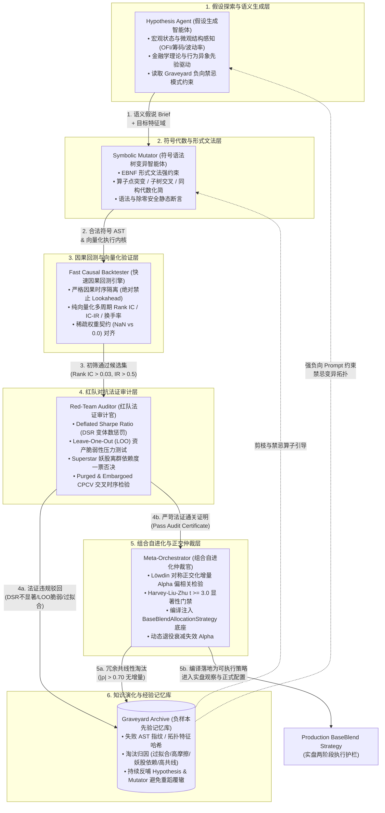

# AutoResearch 自动投研系统与选股策略符号自进化体系架构方案
# (AutoResearch Autonomous Investment Research & Symbolic Alpha Self-Evolution Architecture Specification)

> [!IMPORTANT]
> **唯一权威开发任务与路线图总表 (Single Source of Truth)**：
> 本架构方案文档旨在系统性阐述**自动投研系统（AutoResearch）**与**符号化选股策略自进化系统（Symbolic Alpha Evolution）**的理论数学建模、多智能体协同机制、抽象语法树（AST）文法规范、统计法证防过拟合护栏以及在当前代码库（`quant`）中的模块落地蓝图。
> 
> 依据本代码库 [`AGENTS.md`](file:///home/stone/Work/github/quant/AGENTS.md) 核心开发规范：**所有定量研发任务的原子拆解、优先级队列排布、实施波次规划与进度状态跟踪，均统一且唯一由 [`docs/development_plan.md`](file:///home/stone/Work/github/quant/docs/development_plan.md) 集中维护与更新**。本文档专注于架构与技术规范，不作为任务跟踪的替代凭据。

---

## 一、 核心立项背景与阿尔法半衰期危机 (Alpha Half-Life Crisis & Paradigm Shift)

### 1.1 阿尔法半衰期衰减危机 (Alpha Half-Life Compression)
在现代定量金融市场（尤其是流动性高度博弈的 A 股与美股市场）中，量化投资正面临空前的“超额收益半衰期衰减危机”。
随着多因子模型、机器学习选股以及量化私募管理规模（AUM）的指数级扩张，经典因子（如 Fama-French 三因子/五因子、传统动量、换手率反转、简易量价振幅）被全市场参与者过度挖掘与同质化配置：
1. **衰减速度剧烈加速**：2010 年前一个具备稳健 Rank IC 的微观结构因子半衰期 $\tau_{1/2}$ 普遍在 12～24 个月以上；而在当下高频量化与深度学习策略普及的宏观环境下，纯量价因子的有效半衰期已缩短至 2～6 周乃至数天（$\tau_{1/2} \le 10$ 交易日）。
2. **同质化踩踏与流动性挤兑（Crowding Stampede）**：全市场策略高度重合导致在特定宏观流动性紧缩或风格切换节点，微小扰动便会引发大规模的多因子反向平仓，造成断崖式回撤。
3. **“静态策略即死亡”定律**：任何由人工硬编码、参数固定的选股策略，自其上线实盘的第一天起，便步入熵增衰竭的下行通道。

```
经典因子衰减时钟 (Alpha Half-Life Compression):
┌─────────────────────────┐      ┌─────────────────────────┐      ┌─────────────────────────┐
│  2010 传统手工多因子     │      │  2020 统计机器学习因子   │      │  2026+ 符号自进化 Alpha  │
│  半衰期: 12 ~ 24 个月    │ ───► │  半衰期: 1 ~ 3 个月     │ ───► │  自适应自愈: 持续动态演进│
│  手工假设、线性回归拼接 │      │  GBDT/NN非线性黑盒拟合  │      │  AST闭环进化 + 法证护栏  │
└─────────────────────────┘      └─────────────────────────┘      └─────────────────────────┘
```

### 1.2 传统暴力因子挖掘与数据窥探的死亡螺旋 (The Multiple Testing Trap & Snooping)
为应对 Alpha 衰减，量化界过去十年普遍转向“暴力因子挖掘”（Brute-force Genetic Programming 或纯网格遍历搜索）。然而，未经约束的穷举式探索不可避免地陷入 **数据窥探（Data Snooping）** 与 **多重假设检验陷阱（The Multiple Testing Trap）**：
- **$p$-Hacking 与假阳性泛滥**：根据经典统计学原理，若在显著性水平 $\alpha = 0.05$ 下测试 10,000 个随机合成的公式，即使底层数据纯属高斯白噪声，也将必然产生约 $10,000 \times 0.05 = 500$ 个在统计上“显著”的假 Alpha。
- **样本内夏普幻觉（In-Sample Overfitting Illusion）**：过度参数化和树深膨胀（Bloat）使得算法能够精准“记住”历史行情中的每一个噪音尖刺。回测报告呈现年化 Sharpe 3.0+、最大回撤 5% 的完美曲线，但在样本外（OOS）与实盘运行瞬间崩溃。
- **缺乏微观经济学机制**：盲目遗传算法产生的数学公式（如 $\log(\text{abs}(\text{close} - \text{volume})) \times \sqrt{\text{open}}$）缺乏金融学物理意义，本质是纯粹的过拟合数学垃圾，无法抵御宏观流动性与波动率冲击。

### 1.3 现有量化工程体系的痛点与瓶颈
审查当前量化工程与投研工作流，存在四大底层瓶颈：
1. **人工假设产生效率过低**：人类研究员受限于知识面与认知负荷，每日至多设计并测试 3～5 个新因子假说，无法对抗机器算法的搜索通量。
2. **人类认知偏见（Cognitive Biases）**：研究员往往固执于历史经验或特定学派（如迷恋单一指标金叉死叉），忽视了微观订单流不平衡（OFI）、筹码分布熵增与极值波动率的非线性动力学交互。
3. **缺乏组合级增量正交考量**：挖掘出的新因子往往与既有核心因子高度共线性（$|\rho| > 0.85$），在组合装配时不仅没有带来真实信息增益（Residual Alpha），反而放大了特定暴露的尾部风险。
4. **负样本先验严重流失**：99% 的失败回测因子被研究员随手丢弃，未能形成“失败经验档案（Graveyard）”。后续研究（或下一次遍历）依然在历史已证伪的错误空间内重复低效试错。

### 1.4 AutoResearch 自进化四阶范式 (Four-Stage Evolution Paradigm)
为了彻底击破上述死局，本方案引入基于大语言模型（LLM）语义先验、符号抽象语法树（AST）变异、因果严谨回测与红队统计法证的 **AutoResearch 自进化体系**。量化选股策略研发演进可划分为四个阶段：

| 范式阶数 | 范式名称 | 核心机制 | 优势 | 核心缺陷 | 代表形态 |
| :---: | :--- | :--- | :--- | :--- | :--- |
| **L1** | **静态因子模板** | 人工推导硬编码公式、固定周期与参数 | 逻辑清晰、可解释性极高 | 无法自我调整、衰减极快、通量低 | 传统技术指标、经典三因子 |
| **L2** | **符号回归/传统 GP** | 遗传算法随机交叉/突变、适者生存适应度淘汰 | 搜索通量大、可发现非线性组合 | 缺乏经济学语义、树膨胀严重、伪因子极多 | 传统 gplearn、纯数学符号树 |
| **L3** | **语义引导符号进化** | 引入 LLM 理解金融假说，指导 AST 结构化突变 | 兼具金融微观逻辑与符号探索创造力 | 缺乏端到端闭环自愈与红队法证检验 | DeepMind FunSearch 范式 |
| **L4** | **全闭环自进化投研飞轮** | **AutoResearch 闭环多智能体协同 + 负样本归档 + Löwdin 正交化入库** | **全自动假设推演、法证护栏防过拟合、零人工干预动态自愈** | 系统复杂度高、需强健的基础设施支撑 | **本文档所确立之终极架构** |

---

## 二、 AutoResearch 闭环多智能体协同架构设计 (Closed-Loop Multi-Agent Architecture)

### 2.1 整体拓扑与协同工作流 (Architecture Topology)
AutoResearch 架构由 **五大专业智能体（Five Specialized Agents）** 与 **负样本先验记忆库（Graveyard Archive）** 构成严密的环状因果自进化拓扑网络。系统拒绝单一 Prompt 直出代码的脆弱模式，采用“假说驱动 $\to$ 符号变异 $\to$ 极速计算 $\to$ 红队法证 $\to$ 正交仲裁”的分工制衡架构：



### 2.2 五大核心智能体深度规格定义 (Agent Specifications)

#### 1. 假设生成智能体 (Hypothesis Agent)
- **职责边界**：充当首席量化理论家，拒绝无意义的随机数学拼凑。基于当前宏观市场状态（由市场宽度、Zweig 冲力、波动率状态机刻画）与前沿金融微观理论，提出具备明确物理机制的选股猜想。
- **理论依据**：
  - 订单流失衡理论（Cont, Kukanov & Stoikov, 2014）：利用高频或日内微观代理指标，衡量主买主卖动能的结构性撕裂。
  - 行为金融学注意力溢价与羊群挤兑：利用换手率极值偏离度、上影线抛压比率捕捉散户狂热后的流动性枯竭。
  - 筹码分布动态（CYQ 获利盘比例与单峰突破）：锁定低换手浮筹锁定区间的加速破局。
- **输入输出规范**：
  - **Input**：当前市场宏观状态报告、既有生产库因子列表（已占有空间）、Graveyard 负向禁忌模式指纹。
  - **Output**：`HypothesisBrief` 结构体：
    ```python
    @dataclass(frozen=True)
    class HypothesisBrief:
        hypothesis_id: str
        economic_rationale: str          # 经济学/微观结构机制解释
        target_market_regime: str        # 预期生效的宏观状态 (如 high_vol_thrust)
        core_input_terminals: List[str]  # 指定使用的基础字段 (如 ["smart_money", "poc_level", "rv_5m"])
        expected_holding_days: int       # 预期持仓半衰期 (如 3, 5, 10)
        forbidden_patterns: List[str]    # 显式禁止的语法结构 (源自 Graveyard)
    ```

#### 2. 符号语法树变异智能体 (Symbolic Mutator)
- **职责边界**：充当严苛的形式符号编译器。接收 `HypothesisBrief`，依据扩展巴科斯范式（EBNF）形式文法生成初始 AST（抽象语法树），并在演化过程中执行合法子树重组、点突变、算子替换与代数化简。
- **核心算法设计**：
  - **受控变异机制**：非全随机替换，突变概率受假说约束（例如保护核心特征节点，变异外围平滑与截面排序算子）。
  - **同构化简器（Isomorphic Simplifier）**：在生成前置阶段，通过符号代数规则消除等价退化形态（如 $\text{cs\_rank}(\text{cs\_rank}(X)) \to \text{cs\_rank}(X)$；$X - X \to 0$），将无效表达式扼杀在萌芽期。
  - **输出契约**：输出满足纯因果性（Causal Purity）的标准 Python 向量化执行函数代码与 AST 拓扑哈希字典。

#### 3. 快速因果回测引擎 (Fast Causal Backtester)
- **职责边界**：基于 NumPy / Pandas / 向量化内核构建亚秒级极速回测器。以极端冷酷的态度执行因果时序隔离。
- **时序安全铁律 (Zero-Lookahead Guarantee)**：
  - 严格遵守 $T-1$ 数据可见性原则。日频特征计算仅能引用截至当天收盘的合法切片；若采用 5 分钟日内聚合特征，截断时点必须与实盘 Stage 1（14:00）或 Stage 2（14:15）完全同态对齐。
  - 严禁调用 `.bfill()`、反向窗口卷积或跨越未发生时间步的行业均值。
- **多维度度量矩阵输出**：
  - 截面 Spearman Rank IC 时序序列及均值 $\overline{\text{IC}}$。
  - 年化信息比率 $\text{IC-IR} = \frac{\overline{\text{IC}}}{\sigma(\text{IC})} \times \sqrt{250}$。
  - 多空分层单调性比率（Monotonicity Score，第 1 分组至第 5 分组单调性秩相关）。
  - 因子自相关衰减半衰期 $\tau_{1/2}$。
  - 组合日均双边换手率（Daily Turnover）。

#### 4. 红队法证审计官 (Red-Team Auditor)
- **职责边界**：系统的对抗审查者，预设所有初步入围的高夏普因子均为“通过数据窥探得到的欺诈性过拟合产物”，对候选者施加毁灭性压力测试。
- **四大红队审计重锤**：
  1. **DSR 变体数惩罚（Deflated Sharpe Ratio）**：统计自本轮探索开始累计尝试过的试验总数 $N$，依据非正态偏度 $\gamma_3$ 与峰度 $\gamma_4$ 压缩虚假夏普。
  2. **LOO (Leave-One-Out) 资产脆弱性检验**：逐一剔除股票池中的每一只股票，重跑回测。严惩依赖单一妖股单点爆发行情的“伪策略”。
  3. **Superstar Skewness 偏度审查**：若剔除收益前 1% 的交易日或前 1 只股票后策略夏普暴跌超 35%，直接出示红牌一票否决。
  4. **极限摩擦测试（Friction Stress Test）**：将滑点与双边交易成本加压至常规设置的 3 倍（如单边千分之三），考核因子的抗摩擦存活能力。

#### 5. 组合自进化与正交仲裁官 (Meta-Orchestrator)
- **职责边界**：组合层面的最高仲裁官。负责维持因子库的高纯度与低共线性。
- **核心仲裁逻辑**：
  - **Löwdin 对称正交化增量 Alpha 偏相关检验**：候选因子必须经过现有活跃生产因子库的 Löwdin 正交化投影；在剔除所有既有因子解释度后的正交残差，仍需满足 Harvey-Liu-Zhu $t \ge 3.0$（或 $t \ge 2.0$）统计显著性。
  - **动态生命周期状态机**：
    - `INCUBATION`（实盘前向影子观察期，累计 20 个交易日）
    - `ACTIVE_PRODUCTION`（正式注入 `BaseBlendAllocationStrategy` 权重分配）
    - `DEGRADED_PROBATION`（近 40 日 IC 衰减为负，触发警戒减仓）
    - `RETIRED_TO_GRAVEYARD`（彻底失效，剥离出底座并归档指纹至 Graveyard）

### 2.3 负样本先验记忆库 (Graveyard Archive / Failure Memory)
在复杂的量化空间探索中，“记住为什么失败”的价值往往大于“偶然发现一次成功”。
没有负样本记忆库的系统，会在同一个数学或逻辑陷阱中往复消耗数万次计算开销。

```
Graveyard 负样本记忆流向与知识提炼:
┌───────────────────────────────────────────────────────────────────────────┐
│                       Graveyard Archive 数据模型                          │
├───────────────────────────────────────────────────────────────────────────┤
│ • AST Hash: sha256("sub(cs_rank(ts_std(close,5)), ts_delay(volume,2))")   │
│ • Raw Expression: "cs_rank(ts_std(close, 5)) - ts_delay(volume, 2)"       │
│ • Hypothesis Brief ID: "hyp_20261018_vol_divergence"                      │
│ • Failure Reason Code: "LOO_FRAGILE_SINGLE_ASSET_DEPENDENCY"             │
│ • Audit Forensic Metrics: { "DSR": 0.04, "Max_LOO_Drop": 0.62 }          │
│ • Topology Fingerprint: ["cs_rank", "ts_std", "sub", "ts_delay"]        │
└───────────────────────────────────────────────────────────────────────────┘
                                      │
              ┌───────────────────────┴───────────────────────┐
              ▼                                               ▼
┌───────────────────────────────┐               ┌───────────────────────────────┐
│ 约束 1: 语义假说禁忌注入     │               │ 约束 2: 符号语法树结构剪枝   │
│ 向 Hypothesis Agent 明确注入  │               │ 向 Symbolic Mutator 注入      │
│ "近期此类价差-成交量简单线性  │               │ 结构黑名单，在 AST 生成阶段   │
│  对冲极度脆弱，严禁重复生成"  │               │ 直接拒绝同构子树生成          │
└───────────────────────────────┘               └───────────────────────────────┘
```

- **存储引擎选型**：利用代码库已有的 `common/duckdb_cache.py` 或轻量级 JSON Lines（`.system_generated/graveyard/`）实现无锁、持久化只追加存储。
- **检索与反哺机制**：当 Hypothesis Agent 准备发出新假说时，提取其关键词与特征向量，计算与 Graveyard 中历史失败因子的余弦相似度；若相似度 $> 0.85$ 且失败原因为“机制性过拟合”，直接触发前置拦截并要求重写假说。

---

## 三、 符号因子形式文法与 AST 语法树规范 (Formal Grammar & AST Specification)

### 3.1 形式文法规范 (Extended Backus-Naur Form, EBNF)
为了确保演化生成的符号公式在代数结构上绝对严格、维度自洽且无任何未定义行为，本体系建立严格的 **EBNF 因子形式文法**：

```ebnf
(* ========================================================================= *)
(* 符号因子形式文法 EBNF 规范                                                *)
(* ========================================================================= *)

FactorExpression   ::= CrossSectionalOp | ElementWiseOp ;

CrossSectionalOp   ::= "cs_rank" "(" TimeSeriesExpr ")"
                     | "cs_zscore" "(" TimeSeriesExpr ")"
                     | "cs_demean" "(" TimeSeriesExpr ")"
                     | "cs_scale" "(" TimeSeriesExpr ")"
                     | "cs_neutralize" "(" TimeSeriesExpr "," SectorGroup ")" ;

TimeSeriesExpr     ::= UnaryTsOp "(" TimeSeriesExpr "," IntParam ")"
                     | BinaryTsOp "(" TimeSeriesExpr "," TimeSeriesExpr "," IntParam ")"
                     | SafeMathBinaryOp "(" TimeSeriesExpr "," TimeSeriesExpr ")"
                     | UnaryMathOp "(" TimeSeriesExpr ")"
                     | Terminal ;

UnaryTsOp          ::= "ts_delay" | "ts_delta" | "ts_decay_linear" 
                     | "ts_zscore" | "ts_rank" | "ts_max" | "ts_min" 
                     | "ts_mean" | "ts_std" | "ts_argmax" | "ts_argmin" ;

BinaryTsOp         ::= "ts_corr" | "ts_cov" ;

SafeMathBinaryOp   ::= "add" | "sub" | "mul" | "safe_div" | "signed_max" | "signed_min" ;

UnaryMathOp        ::= "sign" | "abs_val" | "log_safe" | "sigmoid" | "signed_power" "(" TimeSeriesExpr "," FloatParam ")" ;

Terminal           ::= PriceTerminal | VolumeTerminal | MicroTerminal | FundamentalTerminal | MacroTerminal ;

PriceTerminal      ::= "open" | "high" | "low" | "close" | "vwap" | "typical_price" | "returns" ;
VolumeTerminal     ::= "volume" | "turnover" | "adv5" | "adv20" ;
MicroTerminal      ::= "rv_5m" | "smart_money_5m" | "poc_level" | "cyq_profit_ratio" | "curvature_kappa" ;
FundamentalTerminal::= "pe_ttm" | "pb" | "roe" | "gross_margin" ;
MacroTerminal      ::= "market_breadth" | "zweig_thrust" ;

SectorGroup        ::= "china_equity_sector" | "sw_l1" ;
IntParam           ::= 1 | 2 | 3 | 5 | 10 | 20 | 30 | 60 | 120 | 240 ;
FloatParam         ::= 0.5 | 1.5 | 2.0 ;
```

### 3.2 AST 抽象语法树节点数据结构 (Class Hierarchy)
基于 Python 标准库 `dataclasses` 构建类型安全、支持全量序列化与哈希指纹的 AST 树状数据结构：

```python
"""Symbolic Alpha Abstract Syntax Tree (AST) Type Hierarchy."""

from __future__ import annotations
from abc import ABC, abstractmethod
from dataclasses import dataclass, field
import hashlib
from typing import Any, Dict, List, Optional, Tuple, Union
import numpy as np
import pandas as pd


class ASTNode(ABC):
    """Abstract Base Class for all AST Expression Nodes."""

    @abstractmethod
    def evaluate(self, context: Dict[str, pd.DataFrame]) -> pd.DataFrame:
        """Vectorized execution against universe data context."""
        pass

    @abstractmethod
    def to_expression(self) -> str:
        """Serializes node to human-readable symbolic string."""
        pass

    @abstractmethod
    def depth(self) -> int:
        """Returns the maximum depth of this subtree."""
        pass

    @abstractmethod
    def node_count(self) -> int:
        """Returns the total number of operators and terminals in subtree."""
        pass

    def compute_hash(self) -> str:
        """Returns deterministic SHA256 fingerprint of the normalized expression."""
        expr_str = self.to_expression()
        return hashlib.sha256(expr_str.encode("utf-8")).hexdigest()[:16]


@dataclass(frozen=True)
class TerminalNode(ASTNode):
    """Leaf node representing an underlying data matrix (Time x Assets)."""
    name: str

    def evaluate(self, context: Dict[str, pd.DataFrame]) -> pd.DataFrame:
        if self.name not in context:
            raise KeyError(f"Terminal field '{self.name}' not found in universe data context.")
        return context[self.name]

    def to_expression(self) -> str:
        return self.name

    def depth(self) -> int:
        return 1

    def node_count(self) -> int:
        return 1


@dataclass(frozen=True)
class UnaryOpNode(ASTNode):
    """Unary mathematical or transformation node."""
    operator: str
    child: ASTNode

    def evaluate(self, context: Dict[str, pd.DataFrame]) -> pd.DataFrame:
        val = self.child.evaluate(context)
        if self.operator == "sign":
            return np.sign(val)
        elif self.operator == "abs_val":
            return np.abs(val)
        elif self.operator == "log_safe":
            return np.log(np.maximum(np.abs(val), 1e-8))
        elif self.operator == "sigmoid":
            return 1.0 / (1.0 + np.exp(-np.clip(val, -15.0, 15.0)))
        elif self.operator == "cs_rank":
            # kakushadze (2015) cross-sectional percentile rank across columns
            return val.rank(axis=1, pct=True, ascending=True)
        elif self.operator == "cs_zscore":
            mean = val.mean(axis=1)
            std = val.std(axis=1).replace(0.0, np.nan)
            return val.sub(mean, axis=0).div(std, axis=0).fillna(0.0)
        raise NotImplementedError(f"Unsupported unary operator: {self.operator}")

    def to_expression(self) -> str:
        return f"{self.operator}({self.child.to_expression()})"

    def depth(self) -> int:
        return 1 + self.child.depth()

    def node_count(self) -> int:
        return 1 + self.child.node_count()


@dataclass(frozen=True)
class BinaryOpNode(ASTNode):
    """Binary arithmetic operator node with strict zero-division protection."""
    operator: str
    left: ASTNode
    right: ASTNode

    def evaluate(self, context: Dict[str, pd.DataFrame]) -> pd.DataFrame:
        lhs = self.left.evaluate(context)
        rhs = self.right.evaluate(context)
        if self.operator == "add":
            return lhs + rhs
        elif self.operator == "sub":
            return lhs - rhs
        elif self.operator == "mul":
            return lhs * rhs
        elif self.operator == "safe_div":
            # Numerical guard: |rhs| < 1e-8 replaced by sign(rhs)*1e-8 or 0.0
            denom = rhs.where(np.abs(rhs) >= 1e-8, np.nan)
            return (lhs / denom).fillna(0.0)
        elif self.operator == "signed_max":
            return np.maximum(lhs, rhs)
        elif self.operator == "signed_min":
            return np.minimum(lhs, rhs)
        raise NotImplementedError(f"Unsupported binary operator: {self.operator}")

    def to_expression(self) -> str:
        return f"{self.operator}({self.left.to_expression()},{self.right.to_expression()})"

    def depth(self) -> int:
        return 1 + max(self.left.depth(), self.right.depth())

    def node_count(self) -> int:
        return 1 + self.left.node_count() + self.right.node_count()


@dataclass(frozen=True)
class TimeSeriesWindowNode(ASTNode):
    """Rolling temporal operator node along DatetimeIndex."""
    operator: str
    child: ASTNode
    window: int

    def evaluate(self, context: Dict[str, pd.DataFrame]) -> pd.DataFrame:
        val = self.child.evaluate(context)
        w = max(1, int(self.window))
        if self.operator == "ts_delay":
            return val.shift(w)
        elif self.operator == "ts_delta":
            return val.diff(w)
        elif self.operator == "ts_mean":
            return val.rolling(w, min_periods=max(1, w // 2)).mean()
        elif self.operator == "ts_std":
            return val.rolling(w, min_periods=max(2, w // 2)).std().fillna(0.0)
        elif self.operator == "ts_rank":
            # Rolling percentile rank over past w bars
            return val.rolling(w, min_periods=max(1, w // 2)).apply(
                lambda s: pd.Series(s).rank(pct=True).iloc[-1], raw=False
            )
        elif self.operator == "ts_decay_linear":
            weights = np.arange(1, w + 1, dtype=np.float64)
            weights /= weights.sum()
            return val.rolling(w, min_periods=w).apply(
                lambda s: np.dot(s, weights) if not np.isnan(s).any() else np.nan, raw=True
            )
        raise NotImplementedError(f"Unsupported time-series operator: {self.operator}")

    def to_expression(self) -> str:
        return f"{self.operator}({self.child.to_expression()},{self.window})"

    def depth(self) -> int:
        return 1 + self.child.depth()

    def node_count(self) -> int:
        return 1 + self.child.node_count()
```

### 3.3 语法合法性校验与安全修剪规则 (Legality Validation & Pruning)
在语法树生成与交叉变异阶段，变异器必须遵循四大约束守则，对非法树直接实行硬剪枝（Hard Pruning）：

1. **维度匹配原则（Dimensional Consistency）**：
   - 截面算子（`cs_*`）只能作为根节点或靠近顶层的降维变换，严禁在 `cs_rank` 内部再次直接嵌套同等无损的 `cs_rank`；
   - 时序算子（`ts_*`）窗口参数 $d$ 必须满足 $1 \le d \le 240$，禁止传入非正整数或浮点数。
2. **深度与复杂度惩罚（Parsimony Pressure）**：
   - 最大允许树深：$\text{Max Depth} \le 6$；
   - 最大允许节点数：$\text{Max Node Count} \le 25$。
   - 在适应度函数中增加复杂度惩罚项：$\text{Fitness} = \text{Rank IC-IR} - \lambda \cdot (\text{Node Count})$，其中 $\lambda = 0.015$。
3. **退化代数式同构化简（Isomorphic Redundancy Pruning）**：
   - 若出现 $A - A$ 或 $A / A$，直接剪枝化简为常量 $0.0$ 或 $1.0$；
   - 若出现 $\text{ts\_delay}(X, 0)$，自动退化为 $X$；
   - 若出现 $\text{ts\_corr}(X, X, d)$，自动判定为常量 $1.0$ 并出示退化警告。
4. **截面常量检测（Degenerate Variance Guard）**：
   - 在回测评估前，检查因子在任意时间步的截面方差 $\text{Var}_{\text{cross}}(F_t)$。若超过 15% 的交易日截面方差等于 0（即全截面输出相同值），直接判定该因子退化废弃。

### 3.4 除零防护与因果无前视安全约束 (Causal Guarantees & NaN Contract)
1. **数值安全除法规范（Safe Division Standard）**：
   在所有二元除法节点中，禁止使用原始裸除法操作符 `/`。统一采用带容差的截断保护函数：
   $$\text{safe\_div}(A, B, \epsilon) = \begin{cases} \frac{A}{B}, & \text{if } |B| \ge \epsilon \\ 0.0, & \text{if } |B| < \epsilon \text{ or } B \text{ is NaN} \end{cases}$$
   其中 $\epsilon = 10^{-8}$。
2. **时序因果律铁律（Strict Causal Boundary）**：
   - 严禁任何负向时移操作（如 `shift(-1)`）。
   - 对于日内 5 分钟数据聚合（Track T 基础设施），必须严格遵守截断时刻（`cutoff_time="14:15"` 为 39 根，或 Stage 1 门禁 `14:00` 为 36 根），严禁在日内提前计算包含尾盘 14:15~15:00 的聚合指标。
3. **严格遵守代码库稀疏权重 NaN vs 0.0 契约**：
   正如 [`AGENTS.md`](file:///home/stone/Work/github/quant/AGENTS.md) 核心警告：在回测底座中，行代表调仓时间戳，列代表标的资产代码。
   - `NaN` 意味着“维持原有持仓状态不变，不发生调仓”；
   - `0.0` 意味着“显式清仓或坚决不持有该资产”。
   - 符号因子在编译为 `AllocationTemplate` 的 `generate_weights` 输出时，**严禁自行调用 `.ffill()`**，且在决定排除某标的时必须显式写入 `0.0`，杜绝任何历史持仓的幽灵泄漏。

---

## 四、 防过拟合与统计法证护栏体系 (Forensic Guardrails & Anti-Overfitting)

```
四级严苛统计法证防过拟合护栏 (Four-Tier Forensic Shield):
┌───────────────────────────────────────────────────────────────────────────┐
│ 1. 变体数惩罚 DSR (Lopez de Prado 2018)                                  │
│    校正全周期探索试验总次数 N，粉碎大数据窥探产生的假阳性虚假夏普         │
└─────────────────────────────────────┬─────────────────────────────────────┘
                                      ▼
┌───────────────────────────────────────────────────────────────────────────┐
│ 2. Löwdin 对称正交化增量偏相关检验 (Harvey, Liu & Zhu 2016)              │
│    W* = W(W^T W)^(-1/2)，剔除既有 Alpha 库共线性，要求残差 t >= 3.0      │
└─────────────────────────────────────┬─────────────────────────────────────┘
                                      ▼
┌───────────────────────────────────────────────────────────────────────────┐
│ 3. Leave-One-Out (LOO) 资产脆弱性红队审计                                 │
│    逐一剔除股票池标的，若移除单一股票导致 Sharpe 衰减 > 35%，一票否决     │
└─────────────────────────────────────┬─────────────────────────────────────┘
                                      ▼
┌───────────────────────────────────────────────────────────────────────────┐
│ 4. 组合净化与隔离交叉验证 (CPCV) 与单次 ERS 随机基准抽样                   │
│    消除时序重叠泄露，仅对最终胜出候选运行 1 次 ERS 验证跑赢随机猴子       │
└───────────────────────────────────────────────────────────────────────────┘
```

### 4.1 试验次数与变体数惩罚：Deflated Sharpe Ratio (DSR)
在自动化投研（AutoResearch）中，智能体可能在数小时内测试上万次符号组合。传统单次检验统计量在此环境下彻底失效。本系统强制接入 Marcos Lopez de Prado (2018) 在《*Advances in Financial Machine Learning*》中提出的 **紧缩夏普比率（Deflated Sharpe Ratio, DSR）**。

#### 数学推导与公式
设在整个演化历史中独立测试了 $N$ 次不同变体（Trials），样本内观察到的最高年化夏普比率为 $\widehat{SR}$，样本历史交易时长为 $T$，组合收益率的偏度为 $\widehat{\gamma}_3$，超额峰度为 $\widehat{\gamma}_4$。
首先计算在纯随机独立试验下，由多重抽样最大值产生的**虚假夏普比率理论期望阈值 $SR_0$**：
$$SR_0 = \sqrt{2 \ln N} \left(1 - \frac{\gamma}{\ln N}\right) + \frac{\text{Euler}}{\sqrt{2 \ln N}}$$
其中 $\text{Euler} \approx 0.5772156649$ 为欧拉-马歇罗尼常数。
随后计算经偏度与峰度修正后的估计夏普标准误 $\sigma_{\widehat{SR}}$：
$$\sigma_{\widehat{SR}} = \sqrt{\frac{1 - \widehat{\gamma}_3 \widehat{SR} + \frac{\widehat{\gamma}_4 - 1}{4} \widehat{SR}^2}{T - 1}}$$
最终得出 Deflated Sharpe Ratio：
$$\text{DSR} = \Phi\left( \frac{\widehat{SR} - SR_0}{\sigma_{\widehat{SR}}} \right)$$
其中 $\Phi(\cdot)$ 为标准正态累积分布函数。

#### 准入门禁
系统硬性规定：**只有当 $\text{DSR} \ge 0.95$（即拒绝“该夏普由数据窥探产生”的原假设置信度达到 95% 以上）时，新符号因子才被允许进入候选池**。任何通过数千次尝试得到但 DSR $< 0.95$ 的高夏普因子，全部自动判定为过拟合垃圾并转入 Graveyard。

### 4.2 组合增量 Alpha 考核：Löwdin 对称正交化与偏相关检验
新挖掘出的因子往往是已有成熟因子（如经典短期反转或动量）的微调变体，它们在回测中表现优异，但对投资组合无法贡献任何真实超额收益，反而加剧了组合在特定风格上的隐性集中度。

#### 1. Löwdin 对称正交化数学表述 (Symmetric Orthogonalization)
依据 Löwdin (1950) 与 Tulchinsky 工业标准，设已有因子与新候选因子构成的特征矩阵为 $F \in \mathbb{R}^{T \times K}$，各列均经过标准化去均值。Löwdin 对称正交化变换为：
$$F^* = F (F^T F)^{-1/2}$$
**优良几何性质**：
- 严格正交：$(F^*)^T F^* = I_K$，因子间两两相关系数彻底化为 0；
- 最小扰动性：在 Frobenius 范数下，$\|F^* - F\|_F$ 达到全局最小，最大程度保留了每个因子的原始经济学与物理语义。

#### 2. 残差增量显著性检验与 Harvey-Liu-Zhu 门禁
将新候选因子正交化后得到的纯净残差序列 $\tilde{f}_{\text{new}}$，对未来收益率截面进行截面 Fama-MacBeth 回归：
$$R_{t+1, i} = \alpha_t + \lambda_t \cdot \tilde{f}_{\text{new}, t, i} + \sum_{k=1}^{K-1} \beta_{k, t} f_{k, t, i} + \epsilon_{t, i}$$
依据 Harvey, Liu & Zhu (2016)《*… and the Cross-Section of Expected Returns*》的多重检验校正准则：
- 严禁使用传统单次检验门槛 $t > 2.0$；
- **新因子残差的 $t\text{-statistic}$ 必须跨越 $t \ge 3.0$（或至少稳健 $t \ge 2.0$ 伴随置信区间上限），且与既有活跃生产因子的原始 Pearson 相关系数 $|\rho| \le 0.70$**。不满足此条件者直接剔除。

### 4.3 留一法 (Leave-One-Out, LOO) 资产脆弱性红队审计
许多选股策略表面夏普极高，实则全靠股票池中极少数“妖股”（Superstar Winners）的暴涨拉抬，其底层选股机制对 95% 以上的常规资产并无预测能力。

#### 1. LOO 敏感性度量公式
设全股票池资产集合为 $\mathcal{U} = \{S_1, S_2, \dots, S_M\}$。在排除资产 $S_k$ 后的子集 $\mathcal{U}_{-k} = \mathcal{U} \setminus \{S_k\}$ 上重跑全流程回测，获得子集夏普比率 $SR_{-k}$。定义资产脆弱性最大衰减率：
$$\Delta SR_{\max} = \max_{k \in \{1 \dots M\}} \left( \frac{SR_{\text{full}} - SR_{-k}}{SR_{\text{full}}} \right)$$

#### 2. 红队一票否决规则
- **单资产依赖红牌（Single-Asset Fragility Veto）**：若 $\Delta SR_{\max} > 0.35$（即哪怕仅仅剔除某 1 只股票，策略夏普比率便暴跌超 35%），判定为严重的“妖股绑架”，直接出示红牌一票否决。
- **赢家集中度偏度惩罚（Superstar Winner Skew）**：计算各资产对策略总累计 PnL 的贡献分布基尼系数（Gini Coefficient）。若前 5% 的股票贡献了超过 80% 的总超额收益，要求降低该因子置信等级，并在实盘配置中强制施加单标的头寸上限惩罚。

### 4.4 组合交叉验证：组合净化与隔离交叉验证 (CPCV)
传统 K 折交叉验证在金融时序数据中存在灾难性的未来信息泄露与重叠标签记忆。本系统引入 Lopez de Prado (2018) 的 **Combinatorial Purged & Embargoed Cross-Validation (CPCV)**：
1. **Purging（样本净化）**：在训练集与测试集的每个切割边界处，删除所有前向预测期与测试集产生重叠的样本条目，杜绝未来收益标签泄露。
2. **Embargoing（记忆隔离）**：在测试集之后设置等同于自相关半衰期（如 5~10 个交易日）的隔离缓冲带，消除市场微观记忆效应引起的时序自相关依赖。
3. **PBO 计算（Probability of Backtest Overfitting）**：在 $N$ 组组合路径中统计样本外性能劣于中位数的概率。要求新因子 $\text{PBO} < 0.20$。

### 4.5 单次 Equivalent Random Search (ERS) 随机基准检验
依据 [`AGENTS.md`](file:///home/stone/Work/github/quant/AGENTS.md) 核心红线准则：
> **Equivalent Random Search (ERS) 铁律**： winning template/params 通过与 N 个随机权重投资组合比对进行验证；仅在击败指定百分位（如 95 分位）且具备充足调仓样本时方可标记为 `trusted`。**每个搜索周期仅在最终胜出的单一候选者上运行 1 次 ERS**——严禁在候选搜索过程中对每个中间候选反复循环运行 ERS，否则将迅速耗尽随机抽样预算，彻底扭曲“跑赢随机机会”的统计学定义。

本自进化系统严格遵守该铁律：在五大智能体完成所有变异、DSR 检验、正交化筛选与 LOO 审计后，仅对最终产生的最优符号因子执行**唯一次 ERS 终局检验（$N=1,000$ 随机投资组合蒙特卡洛抽样）**，断言其显著超越随机猴子 baseline。

---

## 五、 在当前代码库中的模块映射与落地蓝图 (Codebase Mapping & Blueprints)

### 5.1 整体分层架构与现有模块映射关系 (Mapping Matrix)
AutoResearch 体系充分复用并深植于当前代码库现有的优秀基础设施中，具体模块映射拓扑如下：

```
代码库模块落地矩阵 (Codebase Mapping Matrix):
┌───────────────────────────────────────────────────────────────────────────┐
│ 1. 数据底座与行情缓存层 (Infrastructure & Data Layer)                    │
│    • common/data.py: SyntheticDataProvider, BaoStockDataProvider          │
│    • common/duckdb_cache.py: ohlcv_bars (日线) & intraday_ohlcv_bars (5m)│
└─────────────────────────────────────┬─────────────────────────────────────┘
                                      ▼
┌───────────────────────────────────────────────────────────────────────────┐
│ 2. 算子库与微观特征提取层 (Operator & Feature Layer)                     │
│    • common/alpha101_operators.py: 向量化时序/截面/代数原语               │
│    • common/intraday_features.py: VWAP, RV_5m, SmartMoney, UpVol_Ratio   │
│    • common/structural_factors.py: Volume Profile POC, CYQ 获利盘比例    │
└─────────────────────────────────────┬─────────────────────────────────────┘
                                      ▼
┌───────────────────────────────────────────────────────────────────────────┐
│ 3. 符号进化引擎核心层 (Symbolic Evolution Core - NEW)                     │
│    • pipeline/research_strategy/symbolic/grammar.py: EBNF 文法与 AST 节点 │
│    • pipeline/research_strategy/symbolic/mutator.py: 变异与代数同构化简   │
│    • pipeline/research_strategy/symbolic/evaluator.py: 向量化 IC 回测内核 │
│    • pipeline/research_strategy/symbolic/auditor.py: DSR, LOO, CPCV 审计  │
│    • pipeline/research_strategy/symbolic/graveyard.py: 负样本先验记忆库   │
│    • pipeline/research_strategy/symbolic/orchestrator.py: 多智能体控制流  │
└─────────────────────────────────────┬─────────────────────────────────────┘
                                      ▼
┌───────────────────────────────────────────────────────────────────────────┐
│ 4. 机构级组合底座与切面层 (Institutional Blend Base & Strategy Layer)     │
│    • pipeline/research/blend/blend_base.py: BaseBlendAllocationStrategy   │
│      - Löwdin 对称正交化引擎 (_apply_lowdin_orthogonalization)             │
│      - 动态滚动 IC-IR 贝叶斯自适应加权模式                                 │
│      - Garman-Klass 波动率管理、多级熔断断路器与自愈冷却                    │
│      - 资产级动态死区惰性调仓 (apply_asset_inertia)                        │
│    • common/strategy_aspects.py: 选股选择与权重配置切面解耦               │
└─────────────────────────────────────┬─────────────────────────────────────┘
                                      ▼
┌───────────────────────────────────────────────────────────────────────────┐
│ 5. 实盘两阶段执行护栏与无人值守守护层 (Production Execution & Daemon)     │
│    • scripts/check_live_portfolio_health.py: Stage 1 盘中门禁 (14:00)     │
│    • scripts/run_live_strategy.py: Stage 2 执行与订单生成 (14:15)         │
│    • /schedule 与离线 cron: 盘后及非交易时段自动调度自进化挖掘作业        │
└───────────────────────────────────────────────────────────────────────────┘
```

### 5.2 符号演化配置规范：`SymbolicAlphaConfig`
在 `pipeline/research_strategy/symbolic/config.py` 中定义完备的自进化配置类，遵循全量向后兼容与类型安全原则：

```python
"""Configuration Specification for Symbolic Alpha Evolution Engine."""

from dataclasses import dataclass, field
from typing import List, Optional, Tuple


@dataclass
class SymbolicAlphaConfig:
    """Master Configuration for AutoResearch Symbolic Evolution Run."""

    # 1. 种群与迭代超参数
    population_size: int = 100            # 每一代候选公式种群容量
    max_generations: int = 20             # 最大进化轮数
    tournament_size: int = 5              # 锦标赛选择算子规模
    mutation_rate: float = 0.35           # AST 变异发生概率
    crossover_rate: float = 0.45          # 子树交叉发生概率
    reproduction_rate: float = 0.20       # 精英直接复制保留率

    # 2. 语法树复杂度约束 (Parsimony Pressure)
    max_tree_depth: int = 5               # 树最大深度上限
    max_node_count: int = 18              # 节点总数上限
    parsimony_penalty_weight: float = 0.015  # 适应度函数中的复杂度惩罚系数

    # 3. 统计法证门禁与护栏 (Forensic Hurdle Thresholds)
    min_rank_ic: float = 0.035            # 准入最小截面 Rank IC
    min_ic_ir: float = 0.60               # 准入最小年化 IC-IR
    min_deflated_sharpe: float = 0.95     # DSR 紧缩夏普显著性门槛 (Lopez de Prado 2018)
    hlz_t_stat_hurdle: float = 3.0        # Harvey-Liu-Zhu 多重检验 t-stat 门槛
    max_loo_sharpe_drop: float = 0.35     # LOO 留一法允许的最大夏普衰减率 (一票否决线)
    max_pair_correlation: float = 0.70    # 与既有生产库因子的最大允许余弦相关性

    # 4. 算子与特征白名单控制
    allowed_terminals: List[str] = field(default_factory=lambda: [
        "close", "volume", "vwap", "returns",
        "rv_5m", "smart_money_5m", "poc_level", "cyq_profit_ratio",
        "pe_ttm", "pb"
    ])
    allowed_operators: List[str] = field(default_factory=lambda: [
        "cs_rank", "cs_zscore", "cs_demean",
        "ts_delay", "ts_delta", "ts_mean", "ts_std", "ts_rank", "ts_decay_linear",
        "add", "sub", "mul", "safe_div", "signed_max", "signed_min",
        "sign", "abs_val", "log_safe"
    ])

    # 5. 负样本记忆库集成
    enable_graveyard_memory: bool = True  # 是否启用 Graveyard 负向先验拦截
    graveyard_similarity_threshold: float = 0.85  # 触发负样本模式拦截的结构相似度阈值
```

### 5.3 从符号表达式/AST 到实盘可执行策略的无缝编译流程
本方案的核心优势在于：**演化出的符号因子不是孤立的数学公式，而是能直接编译为代码库标准构件的生产级实体**。编译执行流水线分为三步：

1. **Step 1: AST 编译为向量化内核 (Compile to Vectorized Kernel)**：
   AST 通过 `to_expression()` 输出标准向量化算子链，由 `common/alpha101_operators.py` 中的原生高性能 Pandas/NumPy 函数提供底层运算支持。
2. **Step 2: 封装为标准 `AllocationTemplate` (Wrap as Template)**：
   利用代码库的动态切面模板机制（`common/strategy_aspects.py`），将因子截面打分直接转换为长头截面权重（如 Top 10% 标的等权或逆波动率配资），并严格满足稀疏权重契约（未选中标的置 `0.0`，非调仓日置 `NaN`）。
3. **Step 3: 无缝注入 `GenericBlendStrategy` (Inject into Production Blend)**：
   只需在组合配置字典中注册新因子名称（例如 `{"symbolic_alpha_202610_01": 0.20, ...}`），即可瞬间无感继承 `BaseBlendAllocationStrategy` 的全部顶级基础设施：
   - 自动进行 Löwdin 对称正交化消除相关性；
   - 自动应用动态滚动 IC-IR 贝叶斯权重调整；
   - 自动受 Garman-Klass 波动率极值目标控制与回撤断路熔断器保护；
   - 自动经由 `apply_asset_inertia` 实施资产惰性死区过滤，大幅降低实盘交易磨损。

---

## 六、 演进路线图与开发任务指引 (Roadmap & Development Plan Directives)

> [!IMPORTANT]
> **开发任务集中管理规范**：
> 依据 [`AGENTS.md`](file:///home/stone/Work/github/quant/AGENTS.md) 规则，下述四个波次（Phase A 至 Phase D）仅作为系统演进的架构逻辑划分。**所有原子开发任务的代码实现、详细交付细节、测试用例编写与进度勾选，必须集中登记于主任务表 [`docs/development_plan.md`](file:///home/stone/Work/github/quant/docs/development_plan.md) 中统一跟踪。**

### 6.1 四大推进波次与核心里程碑

```
自进化系统实施演进四波次 (Four Progressive Phases):
┌───────────────────────────────────────────────────────────────────────────┐
│ Phase A: 形式文法与 AST 向量化计算内核基建 (Foundation Layer)              │
│ • 创建 pipeline/research_strategy/symbolic/grammar.py 与 AST 类继承体系    │
│ • 实现代数同构化简器与除零/无前视静态验证断言                             │
│ • 编写离线单测 test_symbolic_grammar.py 确保 100% 向量化精度与边界安全     │
└─────────────────────────────────────┬─────────────────────────────────────┘
                                      ▼
┌───────────────────────────────────────────────────────────────────────────┐
│ Phase B: 符号变异演化器与极速因果回测引擎 (Evolution Engine)              │
│ • 创建 mutator.py (受控交叉变异与锦标赛选择) 与 evaluator.py (多期 IC 计算)│
│ • 接入 common/factor_analyzer.py 提取 IC-IR 与自相关半衰期                │
│ • 编写 test_symbolic_evolution.py 验证闭环演化通量与收敛性                 │
└─────────────────────────────────────┬─────────────────────────────────────┘
                                      ▼
┌───────────────────────────────────────────────────────────────────────────┐
│ Phase C: 红队法证审计护栏与 Graveyard 负样本记忆库 (Forensic Shield)       │
│ • 创建 auditor.py: 实现 DSR 变体数惩罚、LOO 资产脆弱性检验与 CPCV 框架     │
│ • 创建 graveyard.py: 实现 DuckDB/JSON 持久化记忆库与强负向检索过滤        │
│ • 编写 test_symbolic_auditor.py 验证对妖股单点依赖策略的 100% 拦截率       │
└─────────────────────────────────────┬─────────────────────────────────────┘
                                      ▼
┌───────────────────────────────────────────────────────────────────────────┐
│ Phase D: 多智能体闭环协调与 BaseBlendAllocationStrategy 正交集成 (Live)   │
│ • 创建 orchestrator.py: 串联 Hypothesis、Mutator、Backtester、Auditor    │
│ • 打通从 AST 到 AllocationTemplate 与 GenericBlendStrategy 的自动编译注入  │
│ • 接入 /schedule 离线非交易时段无人值守跑批，落地实盘健康门禁监控          │
└───────────────────────────────────────────────────────────────────────────┘
```

### 6.2 总结与学术展望 (Summary & Academic Outlook)
本方案确立的《AutoResearch 自动投研系统与选股策略符号自进化体系》，标志着量化研发从“人工手工作坊”与“盲目暴力搜索”向**具备经济学语义先验、严谨形式文法、自动化代码演进与法证级防过拟合护栏**的现代智能量化范式跃迁。
通过与代码库既有的 `common/` 数据算子底座、`pipeline/research/blend/blend_base.py` 机构级混合底座以及 `scripts/` 两阶段实盘执行护栏的深度融合，系统不仅能以极高吞吐量持续自适应产生高质量 Alpha，更能确保每一滴被纳入投资组合的超额收益都经受住了苛刻的统计法证考验，在复杂的金融实盘博弈中构筑坚不可摧的量化护城河。
