# 回测测量设计：长窗口 / 连续净值 / 逐模块归因

> 状态：设计规格，**尚未执行**。文中折网格与 bar 数为引擎实测，回撤为代理口径（非策略实测）。
>
> 命令组：全文共 **三轮**（基础两轮 Round 1 / Round 2 + **全景解剖** + **逐模块归因**），全部**尚未执行**；后两组引入资金成本假设（现金计息 + 市场冲击），**不与归档结果可比**。
>
> 本文是**测量/实验规格**，不是结果报告。全部命令组（基础两轮 / 全景解剖 / 逐模块归因）**均未执行**；本文中唯一的"实测"是**日历与折网格**——用 `backtester/run_backtest.py` 自身的 `_resolve_master_calendar` / `_resolve_window_bars` 函数，对该 20 只标的的 `FuyaoDataProvider` 缓存（`data/cache.duckdb`，`read_only=True`）复算得到，逐项与归档 `pipeline/results/blend_17_baseline/1/batch_summary.json` 的 universe 与折表对得上。

术语约定：**bar** = 引擎主日历上的一个交易日；**折** = walkforward 的一次评测窗口；**NAV** = 组合净值；**毛敞口** = Σ 持仓权重。

---

## 1. 背景与动机

现有基线 `pipeline/results/blend_17_baseline`（`1/` 目录，6 策略 × 15 折 = **90** 个"策略×折"单元）用的是 `--window-years 0.25 --step-years 0.25`：**63 根 bar / 折、15 折、2022-01-04 → 2025-11-27**，且 **NAV 在折内重置**（每折重新从初始资金起跑）。这带来三个具体后果，全部是**结构性**的，不是策略好坏问题：

**后果一：回撤被切成小段。** 90 个单元的折级最大回撤最大只有 **0.1001**，均值落在 **4.4%–5.8%**（逐策略：`chan_risk_managed_blend` 4.36% / `chan_dual_hybrid_blend` 4.43% / `chan_four_state_blend` 5.01% / `chan_crisis_shield_blend` 5.03% / `chan_four_state_shield_blend` 5.17% / `generic_blend` 5.79%）。折内重置意味着 2022 年那段趋势性下跌被切成 4 段"各自还行"的窗口——**"冲高—回落—修复"的完整周期从未出现在任何一条净值曲线里**。

**后果二：多级熔断（10% / 15% / 20%）从未被有效触发。** 插桩实测（详见 `docs/development_plan.md` 的 `L2.50`）：15 折 × 315 根 bar = **4,725** 次 `_apply_portfolio_deleverage` 调用中，`scale < 1` 仅 **66** 次，其中 **63** 次落在**从不参与计量**的 252 根 warmup 缓冲内。真正落在评测 bar 上的只有 **3** 根——fold 7 的 `2023-10-25`（`s=0.9866`）、`2023-10-30`（`0.9967`）、`2023-10-31`（`0.9765`），最大毛敞口削减 **1.91pp**。也就是说：一套声明了三档阈值的熔断，其**行为正确性无法从业绩面证伪**。

**后果三：看不见连续演化。** 每折只评 63 根，看不到仓位、现金占比、换手率的**连续**演化，也看不到某个风险模块是在哪一天开始起作用的。均值会把这些信息全部抹平。

本文的三组测量，分别针对这三条：**Round 1** 拉长折长（看单折内部能否走出完整周期）、**Round 2** 改为连续净值 + 真实样本外（看回撤如何累积）、**解剖 / 归因两轮**改为带资金成本假设的连续 standard（看钱是怎么流的、谁在起作用）。

---

## 2. 日历与 bar 事实

数据侧（`FuyaoDataProvider`，20 只标的，只读查库 `data/cache.duckdb`，`provider='FuyaoDataProvider'`）：

| 事实 | 值 | 说明 |
|---|---|---|
| 引擎主日历定义 | 当日覆盖 ≥ `ceil(0.20 × 20) = 4` 只标的的日期 | `backtester/run_backtest.py:287-343`，`min_coverage=0.20`（`:291`、`:311`） |
| 停牌处理 | 靠 `ffill` 补价，**不扣日历** | 停牌日仍在主日历上 |
| 20 只标的真实数据末端 | **2026-10-22**（20/20 一致） | 逐标的 `max(date)` 实测 |
| `000300.SH` 数据末端 | **2026-10-16** | 比成分股早 **4** 根 ⇒ **不得用指数当日历** |
| `--end` 的硬上限 | **2026-10-22** | 越过会触发上游取数与写库路径，且 2026 年数据不完整会污染最后一折 |
| `--end` 默认值 | **2024-12-31**（`--start` 默认 2015-01-01） | `run_backtest.py:116-117`；**不显式传会静默丢掉 2025–2026** |

逐年 bar 数（引擎日历口径，实测）：

| 年 | 2021 | 2022 | 2023 | 2024 | 2025 | 2026 YTD |
|---|---|---|---|---|---|---|
| bars | 243 | 242 | 242 | 242 | 243 | 192 |

区间 bar 数（引擎日历口径，实测）：

| 区间 | bars |
|---|---|
| 2022-01-04 → 2024-12-31 | **726** |
| 2022-01-04 → 2026-10-22 | **1,161** |
| 2025-01-02 → 2026-10-22 | **435** |

两条必须记住的转换规则：

- **`--window-years` 是 bar 数换算，不是日历偏移。** `int(round(years × 252))`（`run_backtest.py:267-268`），折边界是**纯整数位置**算术（`:750-751`、`:791-800`）。⇒ `2.0y = 504 bar`，在 242 根/年的 A 股日历上实际跨 **≈2.08 个日历年**；`0.25y = 63 bar` 同理跨 ≈0.26 年。
- **warmup 不计入评测。** 每折载入 `window + warmup_bars` 根做信号，只有 `window` 根算 P&L（`run_backtest.py:422-447`：`buffer_start_idx = max(0, start_idx - warmup_bars)`，`eval_index = master_calendar[start_idx:end_idx]`）。`--start 2022-01-04` 时 252 根缓冲是**满的**——主日历自 2017-01-18 起，`2022-01-04` 之前有 **1,206** 根，远多于 252（实测四折 `warmup_avail` 全为 252）。**折网格与模板 warmup 无关**——`warmup_bars` 只影响每折的缓冲区（`:783`），不参与折边界枚举（`:789-800`）；warmup 取 0 / 120 / 252 / 400，折数与折日期完全相同。

---

## 3. 回撤可达性（关键负面结论）

在写任何"长窗口能否验证熔断"的命令之前，必须先回答一个更便宜的问题：**这个 universe 在这个区间里，回撤到底能到多深？** 用「70% 敞口等权篮子」代理（日收益 = 0.7 × 20 只等权日均收益，现金 **0% 收益**），无摩擦、无选股、无风控：

| 口径 | 2022-01-04 → 2024-12-31 全区间 | 折 1 | 折 2 | 折 3 | 折 4 |
|---|---|---|---|---|---|
| 70% 敞口代理 | **−9.5791%** | −9.5791% | −7.0466% | −5.6930% | −9.1224% |
| 100% 满仓代理 | **−13.5489%** | — | — | — | — |

两种口径的最大回撤段**同为 2022-03-03 → 2022-04-26**。折列为 Round 1 的四个评测窗口（见 §4）。

代理可信度校验：引擎实测的**满仓探针模板**折内 MaxDD 为 **13.4%**，与满仓代理 −13.5489% 相差 **0.15pp** ⇒ 代理忠实（差额来自整手取整、佣金、滑点与 ffill 边界）。

**结论（必须原样保留，不得软化）：**

1. **0.10 档只在满仓、且只在 2022-03 → 2022-04 这一段可达**（70% 敞口下连这一段都够不到，最深 −9.58%）。
2. **0.15 / 0.20 两档，在 2022-01 → 2026-10 全样本、任何敞口下都不可达**（满仓代理全区间最深 −13.55%）。
3. ⇒ **加长窗口救不了熔断验证。** 把 63 根拉成 504 根、把 2024 拉成 2026，都不会让 0.15 / 0.20 被触发——这是 **对"长窗口就能测到熔断"这一设想的证伪**，必须显式写出来，否则 Round 1 / Round 2 跑完看到"熔断没触发"会被误读成"熔断没用"。
4. 三档语义只能靠**离线合成压力带**证伪（`SyntheticDataProvider` 构造 −10% / −15% / −20% / −30% 路径，断言 `deleverage_scale` = 1.0 / 0.5 / 0.0），即 `docs/development_plan.md` 的 `L2.50` 交付项 (a)。**禁止**用"把阈值调低到 0.05"冒充 as-deployed 验证。

> 复现口径说明：上表数字按「等权日均收益 × 0.7、逐日复利、现金 0%、无摩擦」重算。折 1 / 折 2 与全区间**逐位复现**（−9.5791% / −7.0466% / −9.5791%）；折 3 / 折 4 独立重算得 −5.7555% / −9.1826%，与上表差 **0.06pp**（对折起点做 ±3 bar 平移后结果稳定）。**该 0.06pp 不改变任何结论**：四折全部远低于 0.10，最大仍为 −9.58%（发生在折 1 窗口内）。

---

## 4. Round 1｜长窗口行为轮（2022-01-04 → 2024-12-31，`--window-years 2.0 --step-years 0.25`）

`2.0y = 504 bar`、`0.25y = 63 bar`。引擎实测 **4 折**（与模板 warmup 无关，`:783` / `:789-800`）：

| 折 | eval_start | eval_end | eval_bars | warmup_start | 可用 warmup | 折后剩余 bar |
|---|---|---|---|---|---|---|
| 1 | 2022-01-04 | 2024-01-29 | 504 | 2020-12-21 | 252 | 222 |
| 2 | 2022-04-12 | 2024-05-10 | 504 | 2021-03-26 | 252 | 159 |
| 3 | 2022-07-14 | 2024-08-08 | 504 | 2021-06-30 | 252 | 96 |
| 4 | 2022-10-19 | 2024-11-14 | 504 | 2021-09-29 | 252 | 33 |

`warmup_start` = `master_calendar[start_idx - 252]`（`run_backtest.py:422`）；「可用 warmup」= `start_idx - buffer_start_idx`，四折均为满值 252。

**三条限制（缺一不可，写进任何引用这份结果的场合）：**

1. **4 折窗口重叠 ≈87%。** 相邻折只错开 63 根，窗口 504 根 ⇒ 重叠 `(504 - 63) / 504 = 87.5%`。它们**不是 4 个独立样本**，不得用来估置信区间、不得算折间 t 值。
2. **末折止于 2024-11-14，`2024-11-15 → 2024-12-31` 共 33 根 bar 不在任何折内。** 这不是 bug（`while start_idx + window_bars <= n_bars`，`:791`），但意味着"2022-01-04 → 2024-12-31 全区间"这句话对这组命令**不成立**，最后 33 根没被任何一折评过。
3. **折数太少，只用于行为观察，不用于统计推断。** 4 折、87% 重叠，任何"均值/标准差/t 值"都是伪统计量。

本轮的产出是**每折内部**的行为：在 504 根的窗口里回撤能否累积到 10%（见 §3：满仓口径下可以，70% 敞口口径下不行）、仓位与现金如何在中途演化、以及熔断是否真的被踩到。

---

## 5. Round 2｜连续净值 + 样本外打分

### 2a 连续 standard（观察行为的最佳产物）

`--start 2022-01-04 --end 2026-10-22 --mode standard`：**1,161 根 bar，NAV 全程不重置**。`--mode standard` **忽略 `window/step`**（`run_standard` 在 `run_backtest.py:690-730`，全函数不引用 `window_bars` / `step_bars`），所以这两个参数传了也无害、不传也无害。

这是观察「回撤如何累积、仓位 / 现金 / 换手如何演化」的**最佳单一产物**：一条曲线穿越 2022 年下跌、2023–2024 震荡、2025–2026 上行与回撤，中间没有任何人工接缝。

### 2b 样本外 walkforward（真实 OOS 打分）

`--start 2025-01-02 --end 2026-10-22 --window-years 0.25 --step-years 0.25`（63 / 63），引擎实测 **6 折**：

| 折 | eval_start | eval_end | eval_bars | 70% 敞口代理回撤 |
|---|---|---|---|---|
| 1 | 2025-01-02 | 2025-04-09 | 63 | −6.72% |
| 2 | 2025-04-10 | 2025-07-11 | 63 | −1.07% |
| 3 | 2025-07-14 | 2025-10-16 | 63 | −1.61% |
| 4 | 2025-10-17 | 2026-01-15 | 63 | −3.22% |
| 5 | 2026-01-16 | 2026-04-23 | 63 | −4.95% |
| 6 | 2026-04-24 | 2026-07-27 | 63 | −4.53% |

**三条必须写明的边界：**

1. **`2026-07-28 → 2026-10-22` 共 57 根 bar 不在任何折内**（`435 - 6 × 63 = 57`）。**OOS 从未为这三个月打分**——它不是"表现好/坏"，它是**没有数字**。
2. **满仓口径下 6 折也无一达到 0.10。** 同一代理改为 100% 满仓后逐折为 **−9.56% / −1.52% / −2.29% / −4.57% / −7.02% / −6.45%**，最大 −9.56%（折 1），全区间 −9.56%——仍全部 < 10%。⇒ 2b 同样**不能**用来验证熔断，只用来给"这 6 个季度赚没赚钱 / 回撤多深"打分。
3. **2b 的窗口是单边上行，不含熊市。** 该区间基准 `000300.SH` 6 折均值 CAGR **+19.11%**、Sharpe **1.43**，4/6 折正收益 ⇒ 任何"MaxDD ≈ 4%"的表述在 2b 里**没有熊市样本支撑**。补熊市样本见 §6.6（`07_r3_oos_bear`，`2021-06-01 → 2022-12-30`），实测结果见 `backtests_research/20261025_125300/BEAR_WINDOW_OOS.md`。

---

## 6. 可复制的命令

### 6.1 公共变量与环境准备

所有实验命令统一输出至项目根目录下的 `$BT_ROOT="$REPO_ROOT/backtests_research/$RUN_TS"`（`RUN_TS="$(date +%Y%m%d_%H%M%S)"`），严禁使用外部临时目录，并在 `$BT_ROOT` 根部生成自包含的 20 股池快照文件 `$UNIV`。

产物留档遵循**留档规范 (Committed Artifacts Policy)**（详见 [`docs/backtest_research_impl.md`](file:///home/stone/Work/github/quant/docs/backtest_research_impl.md) §4），每个叶子运行目录均自包含 `strategy_dump.json`（生效策略参数自审计核心）、`run_manifest.json`（环境与产物指纹清单）、`run.log`（完整执行日志），以及对应的回测 CSV/JSON 产物。**注意：自 2026-10-25 起这些运行产物不再提交入库** —— `.gitignore` 以 `/backtests_research/**` 排除该目录树（文件仍全量保留在磁盘上，可直接复查），入库的只有 `backtests_research/INDEX.md`、人工撰写报告 `.md`、股池快照（`universe_*.txt` / `pruned_universe.txt`）与 `_provenance/` 溯源脚本；上述叶子目录的自包含内容描述依然成立，只是它们留在磁盘而不进索引。

目录拓扑结构如下：

```mermaid
flowchart TD
    ROOT["<project_root>/backtests_research/<YYYYMMDD_HHMMSS>/"]
    ROOT --> U["universe_20_stocks.txt\n(自包含 20 股池快照)"]
    ROOT --> R1["01_r1_longwin/<strategy>/\n• strategy_dump.json\n• run_manifest.json\n• walkforward_summary.json\n• walkforward_report.csv\n• walkforward_weights.csv\n• walkforward_rebalances.csv\n• run.log"]
    ROOT --> R2A["02_r2a_std/<strategy>/\n• strategy_dump.json\n• run_manifest.json\n• backtest_equity.csv\n• backtest_weights.csv\n• rebalance_report.csv\n• run.log"]
    ROOT --> R2B["03_r2b_oos/<strategy>/\n• strategy_dump.json\n• run_manifest.json\n• walkforward_*.csv/json\n• run.log"]
    ROOT --> CB["04_r1_std_cb_compare/<arm>/chan_four_state_blend/\n(baseline vs no_circuit)\n• strategy_dump.json\n• run_manifest.json\n• backtest_*.csv\n• run.log"]
    ROOT --> ANAT["05_anatomy/<strategy>/\n• strategy_dump.json\n• run_manifest.json\n• backtest_*.csv & equity_curve.png\n• run.log"]
    ROOT --> ABL["06_ablate/<arm>/<strategy>/\n(13 arms × 3 strategies = 39 folders)\n• strategy_dump.json\n• run_manifest.json\n• backtest_*.csv\n• run.log"]
    ROOT --> ABLWF["08_ablate_wf/<arm>/<strategy>/\n(13 arms × 3 strategies, walkforward 0.25y/0.25y)\n• strategy_dump.json\n• run_manifest.json\n• walkforward_*.csv/json\n• run.log"]
    ROOT --> R3B["07_r3_oos_bear/<strategy>/\n(6 策略 × 熊市窗口 6 折)\n• strategy_dump.json\n• run_manifest.json\n• walkforward_*.csv/json\n• run.log"]
```



初始化脚本与自包含 Universe 构建：

```bash
cd /home/stone/Work/github/quant
REPO_ROOT="$(pwd)"
PY="$REPO_ROOT/pipeline/.venv/bin/python"
DUMPS="$REPO_ROOT/pipeline/research_strategy/results/strategy_dumps"
RUN_TS="$(date +%Y%m%d_%H%M%S)"
BT_ROOT="$REPO_ROOT/backtests_research/$RUN_TS"
mkdir -p "$BT_ROOT"

UNIV="$BT_ROOT/universe_20_stocks.txt"
cat > "$UNIV" <<'EOF'
601872.SH
601728.SH
601288.SH
601225.SH
601919.SH
600900.SH
601766.SH
000999.SZ
601857.SH
600941.SH
600028.SH
601088.SH
601398.SH
600362.SH
000157.SZ
300394.SZ
601899.SH
600584.SH
600660.SH
000938.SZ
EOF
grep -vc '^#' "$UNIV"    # 应为 20
```

六策略键（对应 `$DUMPS/${s}_strategy.json`，均已存在）：`chan_four_state_blend` `chan_risk_managed_blend` `chan_crisis_shield_blend` `chan_four_state_shield_blend` `chan_dual_hybrid_blend` `generic_blend`。

### 6.2 Round 1：长窗口（4 折）

```bash
: "${BT_ROOT:?run §6.1 first}"    # 新 shell 里 BT_ROOT 为空 ⇒ 立即报错，不要写到 /01_r1_longwin
for s in chan_four_state_blend chan_risk_managed_blend chan_crisis_shield_blend \
         chan_four_state_shield_blend chan_dual_hybrid_blend generic_blend; do
  out_dir="$BT_ROOT/01_r1_longwin/$s"
  mkdir -p "$out_dir"
  $PY backtester/run_backtest.py \
    --strategy-file "$DUMPS/${s}_strategy.json" \
    --universe-file "$UNIV" \
    --start 2022-01-04 --end 2024-12-31 \
    --mode walkforward --window-years 2.0 --step-years 0.25 \
    --data-provider fuyao --min-shares 100 --china-trading \
    --baseline-symbol 000300.SH \
    --results-dir "$out_dir" --n-jobs 1 \
    2>&1 | tee "$out_dir/run.log"
done
```

### 6.3 Round 2a：连续 standard（1,161 根）

```bash
: "${BT_ROOT:?run §6.1 first}"
for s in chan_four_state_blend chan_risk_managed_blend generic_blend; do
  out_dir="$BT_ROOT/02_r2a_std/$s"
  mkdir -p "$out_dir"
  $PY backtester/run_backtest.py \
    --strategy-file "$DUMPS/${s}_strategy.json" \
    --universe-file "$UNIV" \
    --start 2022-01-04 --end 2026-10-22 --mode standard \
    --data-provider fuyao --min-shares 100 --china-trading \
    --baseline-symbol 000300.SH \
    --results-dir "$out_dir" --n-jobs 1 \
    2>&1 | tee "$out_dir/run.log"
done
```

3 策略的选取口径：`chan_four_state_blend`（**实盘部署臂**，`scripts/run_live_strategy.py` 的 `DEFAULT_STRATEGY_FILE`）+ `chan_risk_managed_blend`（风控族代表）+ `generic_blend`（无 Chan 结构、用于分离"结构 alpha"与"风控 alpha"）。其余三只（`chan_crisis_shield_blend` / `chan_four_state_shield_blend` / `chan_dual_hybrid_blend`）由 6.4 与解剖轮覆盖；归因轮用 `chan_four_state_blend` / `chan_risk_managed_blend` / `chan_dual_hybrid_blend` 三列。

### 6.4 Round 2b：样本外（6 折）

```bash
: "${BT_ROOT:?run §6.1 first}"
for s in chan_four_state_blend chan_risk_managed_blend chan_crisis_shield_blend \
         chan_four_state_shield_blend chan_dual_hybrid_blend generic_blend; do
  out_dir="$BT_ROOT/03_r2b_oos/$s"
  mkdir -p "$out_dir"
  $PY backtester/run_backtest.py \
    --strategy-file "$DUMPS/${s}_strategy.json" \
    --universe-file "$UNIV" \
    --start 2025-01-02 --end 2026-10-22 \
    --mode walkforward --window-years 0.25 --step-years 0.25 \
    --data-provider fuyao --min-shares 100 --china-trading \
    --baseline-symbol 000300.SH \
    --results-dir "$out_dir" --n-jobs 1 \
    2>&1 | tee "$out_dir/run.log"
done
```

### 6.5 Round 1 同区间 Standard 熔断对照（仅 `chan_four_state_blend`）

为了在 `2022-01-04 → 2024-12-31` 区间内评估熔断模块的净效应，必须同时提供带熔断的基线臂（`baseline`）与关闭熔断的对照臂（`no_circuit`）成对运行，确保两者在完全同区间、同零息假设下可做逐日净值相减分析：

```bash
: "${BT_ROOT:?run §6.1 first}"
for arm in baseline no_circuit; do
  extra='{}'
  if [ "$arm" = "no_circuit" ]; then
    extra='{"cfsb_dd_reduce_thresh": 10.0, "cfsb_dd_defensive_thresh": 10.0, "cfsb_dd_stop_thresh": 10.0}'
  fi
  out_dir="$BT_ROOT/04_r1_std_cb_compare/$arm/chan_four_state_blend"
  mkdir -p "$out_dir"
  $PY backtester/run_backtest.py \
    --strategy-file "$DUMPS/chan_four_state_blend_strategy.json" \
    --universe-file "$UNIV" \
    --start 2022-01-04 --end 2024-12-31 --mode standard \
    --data-provider fuyao --min-shares 100 --china-trading \
    --baseline-symbol 000300.SH \
    --strategy-params "$extra" \
    --results-dir "$out_dir" --n-jobs 1 \
    2>&1 | tee "$out_dir/run.log"
done
```

**单位注意（不写清楚会误读成 bug）**：三档阈值在 dump 里是**小数**（`0.1` / `0.15` / `0.2`），比较侧是 `dd_mag >= dd_stop_thresh` 这类小数比较（`pipeline/research/blend/blend_base.py:585-587` 解析、`:1001` / `:1071` / `:1087-1093` 比较）。因此 `10.0` 不是"10%"，而是一个**不可达哨兵**（1000% 回撤）——语义上等于"把三档熔断全部关掉"，正是想要的对照臂。

### 6.6 Round 3：熊市样本外（`07_r3_oos_bear`）—— 补上 2b 缺失的下跌段

`03_r2b_oos` 的 6 折只覆盖 `2025-01-02 → 2026-07-27`（单边上行，且 `2026-07-28 → 2026-10-22` 的 57 根 bar 从未打分）⇒ **"MaxDD ≈ 4%" 的每一条结论都不含熊市样本**。本组用**完全相同的折规则**（`--window-years 0.25 --step-years 0.25`，63 / 63，与 §6.4 一致，故折数、折内口径可比）重跑一段**含 2022 年两波下跌**的窗口。

**本地缓存实测覆盖（`data/cache.duckdb`，provider `FuyaoDataProvider`，只读查询，不是假设）**：
- 20 只股票池的**最早** bar = `2017-01-18`，**最新** bar = `2026-10-23`（基准 `000300.SH` 为 `2016-01-04 → 2026-10-22`）。
- 窗口 `2021-06-01 → 2022-12-30` 内共有 **388 个交易日**；其中 18 只在窗口内全覆盖，`601728.SH`（IPO `2021-08-20`，331 根）与 `600941.SH`（IPO `2022-01-05`，241 根）仅有部分覆盖 ⇒ 折 1–3 的标的数少于 20，**这是 IPO 缺失，不是数据缺口**。
- `388 / 63 = 6 折余 10 根`（最后 10 根 bar 不进入任何折，规则同 §5 的边界 1）。折边界（按 bar 计）：折 1 `2021-06-01→2021-08-27`、折 2 `2021-08-30→2021-12-03`、折 3 `2021-12-06→2022-03-10`、折 4 `2022-03-11→2022-06-15`、折 5 `2022-06-16→2022-09-13`、折 6 `2022-09-14→2022-12-16`。**2022 年 1–3 月的主跌段落在折 3**（该折基准 CAGR **−39.840%**、折内回撤 **16.866%**），4 月余波落在折 4，**9–10 月下跌落在折 5–6**（基准 −12.752% / −10.314%）——两波下跌都被覆盖。

```bash
: "${BT_ROOT:?run §6.1 first}"
for s in chan_four_state_blend chan_risk_managed_blend chan_crisis_shield_blend \
         chan_four_state_shield_blend chan_dual_hybrid_blend generic_blend; do
  out_dir="$BT_ROOT/07_r3_oos_bear/$s"
  mkdir -p "$out_dir"
  $PY backtester/run_backtest.py \
    --strategy-file "$DUMPS/${s}_strategy.json" \
    --universe-file "$UNIV" \
    --start 2021-06-01 --end 2022-12-30 \
    --mode walkforward --window-years 0.25 --step-years 0.25 \
    --data-provider fuyao --min-shares 100 --china-trading \
    --baseline-symbol 000300.SH \
    --cash-sweep-rate 0.015 \
    --results-dir "$out_dir" --n-jobs 1 \
    2>&1 | tee "$out_dir/run.log"
done
```

> **口径披露（写进任何结论）**：本组带 `--cash-sweep-rate 0.015`（与 §7 解剖轮同口径），而 `03_r2b_oos` 是 **0% 现金收益**。⇒ 跨 `07` vs `03` 的差值**不是纯区间效应**，还混入了「闲置现金 1.5% 年化」这一项。方向上：熊市窗里策略普遍留现金，1.5% 计息会**抬高** 07 的数字，因此 **07 相对 03 的负向差值只会被低估、不会被高估**；反过来，若 07 的 MaxDD 仍显著更深，则该结论在 0% 现金口径下只会更强。**同时注意 07 的窗口与 03 完全不重叠，两者只能并排陈述，不得合并求均值（同 §11 解读纪律第 2 条）。**

### 6.7 Round 4：消融的 walkforward 复核（`08_ablate_wf`）

**为什么 standard 模式的消融不够用（结构性，不是精度问题）**：

1. **§8 的 standard 消融只有一条连续净值**（1,161 根 bar 全程不重置）。它只能回答"在这一整段里拆掉某模块后净值怎么走"，**结构上无法**回答"该模块在多数季度折里是否稳定贡献"：连续模式下 2022 年某模块抵掉的亏损与 2024 年让掉的收益会在全期 Sharpe 里**互相抵消**，而折级指标把这两件事分开记在折 1–2 与折 5/9 上——这是"看得见 vs 可判定"的差别（同 §10 第三条：样本量没有变，变的只是分辨率）。
2. **两种模式下的 `max_drawdown` 不是同一个量。** standard 是**全期单一回撤**；walkforward 是**折内回撤的 N 折均值**（每折净值重置）。对"按回撤档位触发"的模块（熔断三档、波动率目标、regime 迟滞）来说，**可达性本身会随模式改变**。实证：`chan_four_state_blend` 的 `no_circuit` 臂在 §8 的 standard 模式下与 `baseline` **逐点全等**（`max|Δ| = 0`，1,161 根全对齐），搬到 walkforward 后**不再全等**（442 个调仓日快照中 20 个有差异，全部落在折 4，最大相对差 0.1447%）。⇒ **standard 模式的"数值全等"只等于"连续路径上没触发"，不等于"该模块无效"。**
3. **§8 的 39 臂里有 7 臂与 `baseline` 数值全等**（§8 假阴性披露），这些臂在 standard 模式下**信息量为零**，且它们与"真的被消费但确实无贡献"的臂在输出上不可区分。walkforward 复核提供的第二条独立诊断（逐折分叉 + 折级符号计数）能把这两类分开。

```bash
: "${BT_ROOT:?run §6.1 first}"
pfx_of () {
  case "$1" in
    chan_four_state_blend)   echo "cfsb" ;;
    chan_risk_managed_blend) echo "crb"  ;;
    chan_dual_hybrid_blend)  echo "cdhb" ;;
    *) echo "blend" ;;
  esac
}

run_arm () {
  local arm="$1"
  for s in chan_four_state_blend chan_risk_managed_blend chan_dual_hybrid_blend; do
    local pfx; pfx="$(pfx_of "$s")"
    local extra
    case "$arm" in
      baseline)        extra='{}' ;;
      no_voltarget)    extra="{\"${pfx}_enable_vol_targeting\": false}" ;;
      no_orthogon)     extra='{"blend_enable_orthogonalization": false}' ;;
      no_structregime) extra='{"blend_enable_structural_regime": false}' ;;
      no_cyq)          extra='{"blend_enable_cyq_quality_gate": false}' ;;
      no_atrstop)      extra='{"blend_enable_adaptive_stop_atr": false}' ;;
      no_lowbeta)      extra='{"blend_enable_low_beta_inertia": false}' ;;
      no_sectorthrot)  extra='{"blend_max_assets_per_sector": 20}'
        if [ "$pfx" = "cdhb" ]; then
          extra='{"blend_max_assets_per_sector": 20, "cdhb_max_assets_per_sector": 20, "cdhb_adaptive_sector_throttle": false}'
        fi
        ;;
      no_hysteresis)   extra='{"blend_enable_regime_hysteresis": false}' ;;
      no_thrust)       extra="{\"${pfx}_dynamic_cash_deployment\": false}" ;;
      no_inertia)      extra="{\"${pfx}_adaptive_inertia\": false, \"${pfx}_min_weight_change\": 0.0, \"${pfx}_min_holding_bars\": 0, \"${pfx}_entry_threshold\": 0.0}" ;;
      bull_full)       extra="{\"${pfx}_target_bull_exposure\": 1.0}" ;;
      no_circuit)      extra="{\"${pfx}_dd_reduce_thresh\": 10.0, \"${pfx}_dd_defensive_thresh\": 10.0, \"${pfx}_dd_stop_thresh\": 10.0}" ;;
      *) echo "unknown arm: $arm" >&2; return 1 ;;
    esac
    local out_dir="$BT_ROOT/08_ablate_wf/$arm/$s"
    mkdir -p "$out_dir"
    $PY backtester/run_backtest.py \
      --strategy-file "$DUMPS/${s}_strategy.json" \
      --universe-file "$UNIV" \
      --start 2022-01-04 --end 2026-10-22 \
      --mode walkforward --window-years 0.25 --step-years 0.25 \
      --data-provider fuyao --min-shares 100 --china-trading \
      --baseline-symbol 000300.SH \
      --cash-sweep-rate 0.015 \
      --strategy-params "$extra" \
      --results-dir "$out_dir" --n-jobs 1 \
      2>&1 | tee "$out_dir/run.log"
  done
}

run_arm baseline
run_arm no_voltarget
run_arm no_orthogon
run_arm no_structregime
run_arm no_cyq
run_arm no_atrstop
run_arm no_lowbeta
run_arm no_sectorthrot
run_arm no_hysteresis
run_arm no_thrust
run_arm no_inertia
run_arm bull_full
run_arm no_circuit
```

**折网格实测（`chan_four_state_blend`，只读本地缓存）**：窗口 `2022-01-04 → 2026-10-22` 共 **1,161 根** bar（`ohlcv_bars` 表 `000300.SH` 区间计数）。`63 bar/折 × 18 折 = 1,134` 根进入评分，**尾部 27 根（`2026-09-08 → 2026-10-22`）不进入任何折**，规则同 §5 的边界情况。13 臂全部 `n_folds = 18`、`n_valid_folds = 18`、`actual_first_fold_start = 2022-01-04`、`actual_last_fold_end = 2026-09-07`。每臂产物含 `walkforward_summary.json` / `walkforward_report.csv` / `walkforward_weights.csv`（1,134 行 = 18 × 63 日度权重）/ `walkforward_rebalances.csv`，逐策略指标与 ≡ 检测见 `08_ablate_wf/<strategy>/_metrics.md`。

> **口径披露一（窗口）**：本组窗口 `2022-01-04 → 2026-10-22` **与 §8 的 standard 消融窗口完全相同（同为 1,161 根 bar）**。⇒ 本文与 `06_ablate` 的任何差值**纯粹来自评估模式（折内重置 vs 连续净值）**，不含区间差异。反过来，本文数字**不得**与 `01_r1_longwin`（2022-01-04→2024-12-31）、`03_r2b_oos`（2025-01-02→2026-10-22）、`07_r3_oos_bear`（2021-06-01→2022-12-30）的折均值并列或合并（同 §11 解读纪律第 2 条）。
>
> **口径披露二（折规则）**：`--window-years 0.25 --step-years 0.25` **与 `03_r2b_oos` / `07_r3_oos_bear` 完全相同**（63 bar / 折）。⇒ 折的粒度与折内重置方式可比，这是本文的"首个分叉折 / 折内回撤"能与 `03` / `07` 同类量对齐讨论的**唯一前提**；但折**数量**不同（本文 18 折 vs `03` / `07` 各 6 折），**不得**据此说本组"样本更大、更可信"——区间不同即口径不同。
>
> **口径披露三（现金计息）**：本组带 `--cash-sweep-rate 0.015`（与 §8 消融轮、§7 解剖轮、§6.6 熊市轮同口径），而 `03_r2b_oos` 是 **0% 现金收益**。⇒ 任何**跨本文与 `03` 的绝对数字比较都混入了「闲置现金 1.5% 年化」这一项**，不是纯区间/纯模式效应。方向上：本策略各折普遍留现金，1.5% 计息**抬高**本文净值，故本文相对 `03` 的差值**只会被抬高、不会被压低**。

---

## 7. 全景解剖轮（Anatomy）—— 一条连续曲线看清钱怎么流

63 根 bar 的折只回答"这个季度赚没赚钱"。它**结构上无法**告诉你：敞口是不是在漂、现金占比高不高、某一段的"稳"是策略主动降仓还是某个风控模块在压——因为折内重置把连续路径截断了，而且**现行回测里现金是 0 收益**。

四个开关把这层打开：

- **`--mode standard` 跑 2022-01-04 → 2026-10-22 = 1,161 根 bar，NAV 全程不重置。** 折内重置会把长回撤切成"每段都还行"的段落——那是 Round 1 / Round 2b 的固有形状，不是市场形状。
- **`--cash-sweep-rate 0.015`**：闲置现金按 1.5% 年化计息。现行回测里现金**零收益**（`cash_proxy=BIL` 不在该 20 只 A 股池内，见 `L2.50` 的混淆项 (i)）；去杠杆档与防御档把仓位扫进现金时，那部分是**沉默**的——现金赚 0，策略看起来"避险没成本"。计息后才能区分「避险」与「丢钱」：如果降仓后净值斜率没掉多少，那是避险；如果掉了一大截，那是白白丢钱。
- **`--market-impact --max-volume-participation 0.05`**：按 5% 成交量参与率承受冲击成本（`run_backtest.py:159-177`）。纸面换手 ≠ 真实摩擦；带冲击成本后，高换手策略的净值会**结构性**下移，这正是"换手到底值不值"的直接测量。
- **不传 `--no-plots`**：保留内置图（`run_backtest.py:1323-1333`，`plotting.plot_equity_curve`，有 baseline 时叠加对比曲线）。注意**内置图只有净值曲线**——回撤与仓位图需要自己从 `backtest_equity.csv` / `backtest_weights.csv` 画，不要以为产物里有。

```bash
: "${BT_ROOT:?run §6.1 first}"
for s in chan_four_state_blend chan_risk_managed_blend chan_crisis_shield_blend \
         chan_four_state_shield_blend chan_dual_hybrid_blend generic_blend; do
  out_dir="$BT_ROOT/05_anatomy/$s"
  mkdir -p "$out_dir"
  $PY backtester/run_backtest.py \
    --strategy-file "$DUMPS/${s}_strategy.json" \
    --universe-file "$UNIV" \
    --start 2022-01-04 --end 2026-10-22 --mode standard \
    --data-provider fuyao --min-shares 100 --china-trading \
    --baseline-symbol 000300.SH \
    --cash-sweep-rate 0.015 \
    --market-impact --max-volume-participation 0.05 \
    --results-dir "$out_dir" --n-jobs 1 \
    2>&1 | tee "$out_dir/run.log"
done
```

> **口径警告（硬性）**：这四个参数会**改变收益数字**（现金从 0% 变 1.5% 年化、摩擦变高），⇒ **本组结果不得与 `blend_17_baseline` 或归档 15 折并列比较**，只能在同一组内部横向比较、且只用于**观察行为**。任何跨组的"这个策略比归档好/差"都是口径错误。

---

## 8. 逐模块归因轮（Ablation）—— 把每个风控单独拆掉

行为差异来自**多个模块叠加**：波动率目标、正交化、结构 regime、筹码质量门、ATR 止损、低 beta 惯性、板块上限、regime 迟滞、广度推力加仓、惯性门、牛市目标敞口、熔断。只看总收益无法判断谁在起作用——而且它们可能**只在两段区间生效**，全期 Sharpe 的均值会把这些全部抹平。

所以归因的正确读法不是"哪一臂 Sharpe 最高"，而是**逐个关掉一个模块，看第一个显著分叉日**（口径见下一节「三个行为视角」的第 3 条）。

```bash
: "${BT_ROOT:?run §6.1 first}"
pfx_of () {
  case "$1" in
    chan_four_state_blend)   echo "cfsb" ;;
    chan_risk_managed_blend) echo "crb"  ;;
    chan_dual_hybrid_blend)  echo "cdhb" ;;
    *) echo "blend" ;;
  esac
}

run_arm () {
  local arm="$1"
  for s in chan_four_state_blend chan_risk_managed_blend chan_dual_hybrid_blend; do
    local pfx; pfx="$(pfx_of "$s")"
    local extra
    case "$arm" in
      baseline)        extra='{}' ;;
      no_voltarget)    extra="{\"${pfx}_enable_vol_targeting\": false}" ;;
      no_orthogon)     extra='{"blend_enable_orthogonalization": false}' ;;
      no_structregime) extra='{"blend_enable_structural_regime": false}' ;;
      no_cyq)          extra='{"blend_enable_cyq_quality_gate": false}' ;;
      no_atrstop)      extra='{"blend_enable_adaptive_stop_atr": false}' ;;
      no_lowbeta)      extra='{"blend_enable_low_beta_inertia": false}' ;;
      no_sectorthrot)
        # 前缀键必须真实存在：cfsb_/crb_ 的 max_assets_per_sector / adaptive_sector_throttle 根本不存在，
        # 写出来会被 StrategyConfig.from_dict 静默丢弃（run.log 只留一行 UserWarning），该臂在三策略中的两个
        # 上就退化为空操作。真实可用的只有全局 blend_max_assets_per_sector 与 cdhb 的两个前缀孪生键
        # （已按 strategy_dumps/chan_dual_hybrid_blend_strategy.json 核验：cdhb_max_assets_per_sector=2、
        # cdhb_adaptive_sector_throttle=true）。cdhb 必须同时覆盖前缀孪生键，否则 dump 里钉死的
        # cdhb_max_assets_per_sector=2 在 resolve_param 第 1 优先级压过 blend_20，上限仍是 2。
        extra='{"blend_max_assets_per_sector": 20}'
        if [ "$pfx" = "cdhb" ]; then
          extra='{"blend_max_assets_per_sector": 20, "cdhb_max_assets_per_sector": 20, "cdhb_adaptive_sector_throttle": false}'
        fi
        ;;
      no_hysteresis)   extra='{"blend_enable_regime_hysteresis": false}' ;;
      no_thrust)       extra="{\"${pfx}_dynamic_cash_deployment\": false}" ;;
      no_inertia)      extra="{\"${pfx}_adaptive_inertia\": false, \"${pfx}_min_weight_change\": 0.0, \"${pfx}_min_holding_bars\": 0, \"${pfx}_entry_threshold\": 0.0}" ;;
      bull_full)       extra="{\"${pfx}_target_bull_exposure\": 1.0}" ;;
      no_circuit)      extra="{\"${pfx}_dd_reduce_thresh\": 10.0, \"${pfx}_dd_defensive_thresh\": 10.0, \"${pfx}_dd_stop_thresh\": 10.0}" ;;
      *) echo "unknown arm: $arm" >&2; return 1 ;;
    esac
    local out_dir="$BT_ROOT/06_ablate/$arm/$s"
    mkdir -p "$out_dir"
    $PY backtester/run_backtest.py \
      --strategy-file "$DUMPS/${s}_strategy.json" \
      --universe-file "$UNIV" \
      --start 2022-01-04 --end 2026-10-22 --mode standard \
      --data-provider fuyao --min-shares 100 --china-trading \
      --baseline-symbol 000300.SH \
      --cash-sweep-rate 0.015 \
      --strategy-params "$extra" \
      --results-dir "$out_dir" --n-jobs 1 \
      2>&1 | tee "$out_dir/run.log"
  done
}

run_arm baseline
run_arm no_voltarget
run_arm no_orthogon
run_arm no_structregime
run_arm no_cyq
run_arm no_atrstop
run_arm no_lowbeta
run_arm no_sectorthrot
run_arm no_hysteresis
run_arm no_thrust
run_arm no_inertia
run_arm bull_full
run_arm no_circuit
```

### 13 臂 × 3 策略可达性矩阵 (Ablation Reachability Matrix)

| 消融臂 (Arm) | 覆盖参数键与目标值 | `cfsb` (`regime_ic_ir_hybrid`) | `crb` (`rolling_ic_ir`) | `cdhb` (`rolling_ic_ir`) | 机制与生效符号（按符号引用，不引行号，理由见 §4.2） |
| :--- | :--- | :---: | :---: | :---: | :--- |
| `baseline` | `{}` | ✓ 完全可达 | ✓ 完全可达 | ✓ 完全可达 | 策略 dump 默认基线 |
| `no_voltarget` | `{"${pfx}_enable_vol_targeting": false}` | ✓ 完全可达 | ✓ 完全可达 | ✓ 完全可达 | 关闭 Garman-Klass 波动率目标化：`blend_base.py` 中由 `resolve_param(p, "enable_vol_targeting", ...)` 解析出的 `enable_vol_targeting` 分支 |
| `no_orthogon` | `{"blend_enable_orthogonalization": false}` | ✓ 完全可达 | ✓ 完全可达 | ✓ 完全可达 | 参数键 `blend_enable_orthogonalization` 经 `resolve_param` 的 `blend_{name}` 分支解出局部符号 `enable_orthogonalization`；实际生效段为「该开关为真且子策略数 > 1 时调用辅助函数 `_apply_lowdin_orthogonalization`」（Löwdin 对称正交化 $W^* = W(W^T W)^{-1/2}$）。注意：`blend_base.py` 源码里出现的标识符是 `enable_orthogonalization`，`blend_` 前缀只是 CLI / dump 的参数键形态 |
| `no_structregime` | `{"blend_enable_structural_regime": false}` | ✓ 完全可达 | ✗ **结构性不可达** | ✗ **结构性不可达** | 消费符号 `enable_structural_regime`，其唯一实质消费点在 `_compute_adaptive_weights` 的 `weighting_mode in ("regime_adaptive", "regime_ic_ir_hybrid")` 分支内（另一处仅决定 `fractal_d_series` 是否预计算，结果同样只喂该分支）。`crb` / `cdhb` 默认 `rolling_ic_ir`，在 `if weighting_mode == "rolling_ic_ir":` 段落算完 IC-IR 权重即 `return`，结构性状态转移判定完全不执行 |
| `no_cyq` | `{"blend_enable_cyq_quality_gate": false}` | ✓ 完全可达 | ✓ 完全可达 | ✓ 完全可达 | 参数键 `blend_enable_cyq_quality_gate` 经 `resolve_param` 解出的局部符号 `enable_cyq_quality_gate` 门控段：筹码分布获胜率否决（`min_cyq_winner_ratio`，默认 0.20）与伪突破过滤（Track C Anchor 2） |
| `no_atrstop` | `{"blend_enable_adaptive_stop_atr": false}` | ✓ 完全可达 | ✓ 完全可达 | ✓ 完全可达 | 消费符号 `enable_adaptive_stop_atr`，实际作用仅一行：`eff_stop_mult = np.clip(stop_atr_mult * (med_vol / s_vol), 3.5, 7.5)`。关闭后 `eff_stop_mult` 恒为 `stop_atr_mult`（默认 4.5），**底层 ATR 追踪止损仍然存在** |
| `no_lowbeta` | `{"blend_enable_low_beta_inertia": false}` | ✓ 完全可达 | ✓ 完全可达 | ✓ 完全可达 | 消费符号 `enable_low_beta_inertia`：关闭后低波动资产（`s_vol < 0.22`）不再被抬高 `eff_min_holding` 至至少 10 bar 的防御性惯性豁免 |
| `no_sectorthrot` | 见下方「分策略覆盖键」：`cfsb`/`crb` 只有 `{"blend_max_assets_per_sector": 20}`；`cdhb` 为 `{"blend_max_assets_per_sector": 20, "cdhb_max_assets_per_sector": 20, "cdhb_adaptive_sector_throttle": false}` | ⚠ 仅全局行业上限（节流本就关着） | ⚠ 仅全局行业上限（节流本就关着） | ✓ 全局上限 + 唯一真实存在的节流前缀键 | 两个符号：`max_assets_per_sector`（默认 2，定基线行业上限）与 `adaptive_sector_throttle`（默认关闭，**仅 `cdhb` dump 设 `true`**）。**真实机制：自适应节流只在某行业 ROC 进入前 20% 分位时把该行业上限「抬高」到至少 2（`allowed_sec_cap = max(allowed_sec_cap, 2)`），从不向下压缩**。故本臂的真实意图是**把行业上限从 2 放开到 20**。**分策略可达性不同**：`cfsb`/`crb` 没有任何 `${pfx}_max_assets_per_sector` / `${pfx}_adaptive_sector_throttle` 键（`strategy_dumps` 中不存在），本臂在这两只上**只改全局行业上限**，节流参数保持默认 `false`；`cdhb` 是唯一有前缀孪生键（`cdhb_max_assets_per_sector` / `cdhb_adaptive_sector_throttle`）的策略 ⇒ 其行**额外显式关闭节流**。⚠ **三只策略的 `no_sectorthrot` 行互不可比**：只有 `cdhb` 行真正检验了节流开关，另两行只检验行业上限放宽，把它们当成「同一个消融臂的三次重复」是口径错误 |
| `no_hysteresis` | `{"blend_enable_regime_hysteresis": false}` | ✓ 完全可达 | ✗ **结构性不可达（且默认已为 False，该臂为 no-op / 假阴性）** | ✗ **结构性不可达（且默认已为 False，该臂为 no-op / 假阴性）** | 消费符号 `enable_regime_hysteresis`（**默认 `False`**；仅 `chan_four_state_blend` 的 dump 将其设为 `true`）：开启时动量冲刺走 0.62 / 0.58 施密特双阈值（`thrust_enter_thresh` / `thrust_exit_thresh`），关闭时退回单阈值 `thrust >= thrust_thresh`。该 `thrust_active` 会回流至 `_compute_adaptive_weights` 的线程化参数（仅制度分支可达时才真正参与选权），并经 `fast_recovery` / `dynamic_cash` 影响现金部署。`crb` / `cdhb` 的 dump **未**设该键 ⇒ 默认 `False`，基线本就走单阈值路径，故强制 `false` 后输出与 `baseline` 完全相同 |
| `no_thrust` | `{"${pfx}_dynamic_cash_deployment": false}` | ✓ 完全可达 | ✓ 完全可达 | ✓ 完全可达 | 消费符号 `dynamic_cash`（由 `resolve_param(p, "dynamic_cash_deployment", ...)` 解析）：关闭 `bull_active` 下的目标暴露度抬升与 `preemptive_thrust` 抢占式现金部署（现金部署 / breadth thrust 段） |
| `no_inertia` | `{"${pfx}_adaptive_inertia": false, "${pfx}_min_weight_change": 0.0, "${pfx}_min_holding_bars": 0, "${pfx}_entry_threshold": 0.0}` | ✓ 完全可达 | ✓ 完全可达 | ✓ 完全可达 | 必须**同时归零 `min_weight_change` 与 `min_holding_bars`**：`use_inertia = (min_weight_change > 0.0 or min_holding_bars > 0)`，而三份策略 dump 都钉了 `min_holding_bars: 2`，**只把 `min_weight_change` 归零无法让 `use_inertia` 变假**，`_step_asset_inertia` 的任期锁定（tenure lock，`if age < eff_min_holding … locked_incumbents.add(s)`）仍会压制卖出，臂将退化为假阴性。两键同时归零后 `use_inertia` 才为假、防抖阈值 `static_inertia_thresh` 也随之失效；`adaptive_inertia` 只影响 `inertia_thresh_df` 的自适应阈值构造，故一并关掉以消除残余分支。`_step_asset_inertia` 为内联调用、`apply_asset_inertia` 在本策略中仅为 import（本臂不改变这两处代码的存在性） |
| `bull_full` | `{"${pfx}_target_bull_exposure": 1.0}` | ✓ 完全可达 | ✓ 完全可达 | ✓ 完全可达 | 将牛市仓位上限从 0.85 提升至 1.00 全仓（`dynamic_cash` 段内 `target_exp = min(target_bull_exposure, …)`） |
| `no_circuit` | `{"${pfx}_dd_reduce_thresh": 10.0, "${pfx}_dd_defensive_thresh": 10.0, "${pfx}_dd_stop_thresh": 10.0}` | ✓ 完全可达 | ✓ 完全可达 | ✓ 完全可达 | 将回撤熔断降仓/防御/全停三档阈值同时抬到 10.0（`dd_mag` 为比例口径，10.0 即 1000%），等效彻底禁用熔断机制 |

> [!WARNING]
> **假阴性披露（消融矩阵最重要的一行）**：标 `✗` 的臂在该策略上输出将与 `baseline` **完全相同**，不得据此得出「该模块无效」的结论。这类臂只是绕过了代码路径、或本就与默认值相同，**不产生任何信息量**；引用它们与 `baseline` 的差值属于把「没跑」当成「跑出来是 0」。凡在报告中出现某臂与 `baseline` 指标逐位相同的行，必须先核 `strategy_dump.json` 确认覆盖键确实被消费，否则该行作废。
>
> **`⚠` 的语义（仅 `no_sectorthrot` 使用）**：该臂**部分可达**——覆盖键确实生效，但**生效的键少于标注为该列设计的键**，且**各行之间不可横向对比**。详见下方分策略覆盖键说明。

- **`no_sectorthrot` 是唯一一条「同一臂在不同策略上覆盖键不同」的臂（必须分策略看）**：`chan_dual_hybrid_blend` 在策略 dump 中显式设定了 `"cdhb_adaptive_sector_throttle": true` 与 `"cdhb_max_assets_per_sector": 2`；而 `cfsb` / `crb` 的 dump 里**既没有** `${pfx}_max_assets_per_sector`，**也没有** `${pfx}_adaptive_sector_throttle`。给不存在的键赋值不会报错，只会被 `StrategyConfig.from_dict` 静默丢弃（`run.log` 里仅一行 `UserWarning: ... ignoring unknown key(s)`），于是本臂在那两只策略上**只剩全局 `blend_max_assets_per_sector` 一个自由度**——而全局节流默认本就是 `False`，无所谓「关」。在 `blend_base.py` 的行业配额分配段中，自适应节流的唯一动作是 `allowed_sec_cap = max(allowed_sec_cap, 2)`：当某行业 21 日平均 ROC 不低于 `max(0.02, top_sec_thresh)`（行业 ROC 前 20% 分位）时，把该行业上限**抬高**到至少 2，**没有任何向下压缩分支**。在 cap=20 下它必然空转，故 `cdhb` 行显式关掉它只为消融语义单一（只改一件事：行业上限）。
  - ⇒ **读法约束**：`cfsb` / `crb` 的 `no_sectorthrot` 行相对 `baseline` 的差值，测的是「行业上限 2 → 20」；`cdhb` 行测的是「上限 2 → 20 且节流关」。**三行不是同一实验的三次重复，禁止横向互比、禁止合并求均值。**

- **`no_atrstop` 与 `no_cyq` 语义边界披露**：
  1. `no_atrstop`（`{"blend_enable_adaptive_stop_atr": false}`）所消融的仅为**波动率环境自适应 ATR 倍数动态缩放**（`blend_base.py` 中 `enable_adaptive_stop_atr` 为真时的 `eff_stop_mult = np.clip(stop_atr_mult * (med_vol / s_vol), 3.5, 7.5)`），关闭后回退至固定 4.5x ATR 追踪止损，**并不是**彻底关闭底层 ATR 止损机制本身（彻底关闭需设置 `"${pfx}_stop_mode": "none"`）。该消融臂旨在评估「环境自适应波动倍数」相对于「固定 ATR 乘数」的边际贡献。
  2. `no_cyq`（`{"blend_enable_cyq_quality_gate": false}`）所消融的为 Track C Anchor 2（`enable_cyq_quality_gate` 门控的 CYQ 获胜率与伪突破否决），而 Track C Anchor 3（筹码汇聚点加权 sizing，`enable_vp_confluence_sizing`）在默认配置下依然生效保持开启。另请注意 `enable_vp_confluence_sizing` 段内的筹码密集度硬编码阈值 `c_dens < 0.40`（`c_dens` 取自 `consolidation_density` 列）——该阈值不受任何消融臂覆盖。

- **`no_inertia` 必须同时归零 `min_weight_change` 与 `min_holding_bars`**：
  `use_inertia = (min_weight_change > 0.0 or min_holding_bars > 0)`，而三份策略 dump 均设置了 `min_holding_bars: 2`。若只将 `min_weight_change` 归零，`use_inertia` 仍为真，`_step_asset_inertia` 的任期锁定（tenure lock，`if age < eff_min_holding … locked_incumbents.add(s)`）仍会生效压制卖出。因此必须同时将两键归零，并设置 `"${pfx}_adaptive_inertia": false` 与 `"${pfx}_entry_threshold": 0.0`。

这 13 个键在各策略配置中均有映射（通过 `pfx_of()` 动态前缀解析与 `resolve_param` 前缀链生效）——**唯一例外是 `no_sectorthrot`**：它按策略分叉覆盖键（见上一条），`cfsb` / `crb` 只用全局键，不存在的前缀键一律不写。注意 `no_sectorthrot` 用 `20`（= universe 规模）而不是 `0`——`0` 的语义是"一只都不许持"，不是"关掉"。

**规模与取舍**：13 臂 × 3 策略 ≈ **39 次单段回测，约 40–60 分钟**。只想先看形状就只跑 `chan_four_state_blend` 一列（13 次，约 15 分钟）——把 `run_arm` 里 `for s in ...` 收成 `for s in chan_four_state_blend`。

> **参数与清单校验纪律（硬性）**：每次跑完，**必须通过每个运行目录下的 `strategy_dump.json` 与 `run_manifest.json` 核验生效参数与指纹**。`run_backtest.py` 会将命令行覆盖写入 `cli_strategy_params_override` 并将最终合并生效参数固化在 `params`。这条前缀链在本仓库发生过静默不匹配事故（见 `AGENTS.md` 的 `wq_alpha_id` 裸名碰撞记录）。禁止依赖脆弱的 `sed -n '2p' run.log` 文本行猜测，统一采用结构化 `jq` 校验：
>
> ```bash
> : "${BT_ROOT:?run §6.1 first}"
> # 1. 校验命令行覆盖与最终生效参数（以 no_voltarget 臂为例）
> jq '{cli_override: .cli_strategy_params_override, effective: .params.cfsb_enable_vol_targeting}' \
>   "$BT_ROOT/06_ablate/no_voltarget/chan_four_state_blend/strategy_dump.json"
> # 预期输出：cli_override 含 {"cfsb_enable_vol_targeting": false}，effective 为 false
>
> # 2. 校验运行清单元数据与产物列表完整性
> jq '{run_ts: .run_ts, group: .group, strategy: .strategy, artifacts_count: (.artifacts | length)}' \
>   "$BT_ROOT/06_ablate/no_voltarget/chan_four_state_blend/run_manifest.json"
>
> # 3. 校验没有任何参数键被静默丢弃（前缀键写错时 StrategyConfig.from_dict 只发 UserWarning 就丢掉，
> #    臂会变成空操作而不报错 —— 这是本仓库已发生过的静默失效形态）
> for d in "$BT_ROOT"/06_ablate/*/*/; do
>   n=$(grep -c "ignoring unknown key(s)" "$d/run.log")
>   [ "$n" -eq 0 ] || echo "BROKEN ARM: $d -> $n warning(s)"
> done   # 期望零输出；单目录版本：grep -c "ignoring unknown key(s)" "$out_dir/run.log"   # 必须打印 0
> ```

---

## 9. 从产物读出三个行为视角与入库留档

依入库留档规范（Committed Artifacts Policy，详见 [`docs/backtest_research_impl.md`](file:///home/stone/Work/github/quant/docs/backtest_research_impl.md) §4），所有运行产物均统一落盘在 `$BT_ROOT`（`backtests_research/<RUN_TS>/`）各实验组子目录中，并在 `backtests_research/INDEX.md` 追加追踪行。

每个叶子运行目录的标准产物包含：
- **自审计核心**：`strategy_dump.json`（全量生效策略定义，不可复现时唯一凭据）
- **两阶段运行清单**：`run_manifest.json`（Git 提交哈希、数据缓存指纹、产物清单与指标）
- **过程执行日志**：`run.log`（含数据截断、对齐、分位计算等过程告警）
- **指标与序列数据**：
  - standard 模式：`backtest_equity.csv`、`backtest_weights.csv`、`rebalance_report.csv`、`baseline_equity.csv`（若有）、`lifecycle_records.csv`（FSM 开启时）、`comparison_report.json`、`equity_curve.png`
  - walkforward 模式：`walkforward_summary.json`、`walkforward_report.csv`、`walkforward_weights.csv`、`walkforward_rebalances.csv`、`walkforward_lifecycle_records.csv`（FSM 开启时；每 fold 前置 `fold` 列）

从这些落盘产物中可萃取出三个核心行为视角：

1. **敞口与现金**：`backtest_weights.csv` 逐日按行求和 = **毛敞口**，`1 − Σw` = **现金占比**。两条曲线叠看，即可区分"**策略主动降仓**"（信号层就不想持）与"**风控压仓**"（信号想要、被波动率目标 / 熔断 / 惯性门压住）——后者会在同一天出现"敞口跳降而权重结构不变"。这是 `L2.50` 要的可观测性缺口的**穷人版替代**。
2. **换手与调仓节奏**：`rebalance_report.csv` 给出逐笔 `action` / `price` / `weight_change`。配合权重序列可算每只标的的**持有天数分布**与**买回间隔分布**——`L2.36` 的「恰为 6 个交易日」尖峰（1,026 对卖→买回配对中的 138 对，13.45%）就是这个视角发现的；其归因是 `asset_stop_cooldown_bars=5` + 1 根确认 bar，**加固**而非取代"2-bar 出场确认"的证伪（`docs/version.md` §16.15.15）。
3. **归因分叉点**：每个 ablation 臂的 `backtest_equity.csv` 与 `baseline` 臂**逐日相减**，取**第一个超过噪声带的显著分叉日**——那就是该模块开始起作用的时点。比"全期 Sharpe 差 0.02"有用得多：一个只在 2022-03 与 2025-01 各生效两周的模块，全期均值几乎不动，但分叉日会把它钉死。

---

## 10. 这组实验看不见什么（诚实边界）

- **看不到子策略权重。** `chan_four_state_blend` 内部 `chan_four_state_execution` / `chan_three_type` / `chan_vaa_compound` 三个子策略的权重演化**没有任何落盘通道**。ablation 只是"**用行为反推模块**"的替代品，不是直接观测。真正的直接观测要求 `blend_base.py` 落盘每期的子策略权重与 IC-IR 中间量——即遥测缺口，见 `docs/development_plan.md` 的 `L2.50`（第 4 条）与 `L2.48`（第 3 条 g）。
- **`--cash-sweep-rate` 与 `--market-impact` 是假设，不是事实。** 1.5% 年化与 5% 参与率是**人为选择的参数**，不是从数据里估出来的。任何结论只能写成"**在该假设下**"；换成 1.0% / 2.0%、2% / 10% 参与率，数字会变，方向未必变。禁止把这两个假设产出的数字当成"真实可实现收益"。
- **样本量没有变。** 1,161 根 bar 只提升"**看得见**"，不提升"**统计可判定**"。折间收益相关 **0.80–0.98**（均值 0.92）、折均值 Sharpe **t = 2.13–2.65**、策略间配对 **t ≤ 1.04** 的噪声下限依然成立（`docs/audit/blend_17_baseline_审计_20261024.md` §4.2）。解剖与归因两轮改变的是**分辨率**，不是**样本量**。

---

## 11. 验收与解读纪律

| 检查项 | 期望 | 不符时的含义 |
|---|---|---|
| Round 1 折数 | **4** | window/step 算错（`2.0y=504`、`0.25y=63`） |
| Round 2b 折数 | **6** | 同上（`0.25y=63/63`） |
| Round 3（熊市 OOS）折数 | **6**（`388 / 63 = 6` 余 10，`actual_last_fold_end` 应为 `2022-12-16`） | window/step 算错，或 `--end` 落在缓存覆盖之外 |
| 消融参数键真实存在 | `grep -c "ignoring unknown key(s)" "$out_dir/run.log"` == **0** | 前缀键写错（如 `cfsb_max_assets_per_sector`）被 `StrategyConfig.from_dict` 静默丢弃 ⇒ 该臂变空操作 |
| 2a 的 bar 数 | **1,161** | `--end` 没传或传错 |
| 2a 产物完整性 | `strategy_dump.json` / `run_manifest.json` / `run.log` / `backtest_equity.csv` / `backtest_weights.csv` / `rebalance_report.csv` | `--mode` 传成 walkforward 或命令被中断 |
| 归因臂参数生效 | `$out_dir/strategy_dump.json` 中目标前缀键=新值 | `--strategy-params` 静默未生效 ⇒ 结论反向 |
| 产物留档一致性 | `find "$BT_ROOT" -name strategy_dump.json \| wc -l` == `find "$BT_ROOT" -name run.log \| wc -l` == `find "$BT_ROOT" -name run_manifest.json \| wc -l` | 某组命令漏了 `tee` 或落盘异常 |
| 产物忽略校验 | `git check-ignore -v "$BT_ROOT/..."` **exit 0 且有输出**（命中 `.gitignore:/backtests_research/**`）；`git check-ignore -v backtests_research/INDEX.md` 则 exit 1 且零输出 | 产物**未被**忽略（会被 `git status` 拖脏）⇒ 违反 2026-10-25 反转后的 Committed Artifacts Policy（`docs/backtest_research_impl.md` §4.1）；INDEX.md 被忽略则说明白名单规则坏了 |
| 索引登记核准 | `backtests_research/INDEX.md` 追加对应行且字段与 `run_manifest.json` 一致（索引行仍**必须**入库；逐份产物本身不再入库） | 运行未完成或手工登记失真 |

解读纪律：

1. **Round 1 的 `max_drawdown` 若四折全 < 0.10，不得据此断言"熔断有效/无效"。** 只能说明**该 universe 该区间不可达**（§3 已用代理独立证伪）。要判熔断，走 `L2.50` 的离线合成压力带。
2. **2b 与归档 15 折只能并排陈述，不得合并求均值。** 时间段不同（2025-01-02→2026-07-27 vs 2022-01-04→2025-11-27，仅 2025-01-02→2025-11-27 重叠），合并即口径污染。
3. **差异小于噪声下限即判"不可判定"。** 门槛：折间收益相关 0.80–0.98、折均值 Sharpe t=2.13–2.65、策略间配对 t≤1.04（`docs/audit/blend_17_baseline_审计_20261024.md` §0.4、§4.2）。ablation 的"某臂 Sharpe +0.03"属于此类。
4. **版本轴 / 语义边界（2026-10-27 更新，原文已过期）**：本文全部命令组（含解剖 / 归因）记录的数字，是 **FSM（`common/position_lifecycle.py` 的 UPLSM）关闭**时的语义 —— 写作当时 `backtester/` 与 `common/allocation_backtester.py` 对 `step_position_lifecycle` / `PositionLifecycleConfig` **零引用**（`docs/development_plan.md` `L2.48` 第 1 条已实测留痕）。**该状态已结束**：`L2.48` 已按「默认 ON」落地（2026-10-27），`backtester/run_backtest.py` 的手臂现在是共享同一套状态机。因此：
   - **同样的命令会给出不同的数字**（开仓确认延迟、T+1 锁仓、非对称冷却、-8% 硬止损 / ATR 吊灯止损快路径全部真实生效，换手与持仓周期会变）；
   - **复现本文旧数字必须加 `--no-position-lifecycle`**（`--disable-position-lifecycle` 同义），该路径下既有标量与曲线**比特级不变**；
   - **任何跨这条边界的比较都无效**（ON 臂与 OFF 臂之间、本文旧数字与新跑数字之间）。
   - **同一仓库内当前并存三种开关口径，引用数字前必须先认清是哪一种**：①**搜索口径 OFF** —— `pipeline/strategy_generator/stratgen/generator.py` 的候选排名在 `enable_position_lifecycle=False` 下打分（保持不受约束的搜索景观，避免状态掩蔽造成候选间不对称），**这个分数不是绩效**；②**基线口径 OFF** —— `_run_baseline` 恒 `enable_position_lifecycle=False`（基准臂要的是不受策略风控影响的市场参照）；③**最终回测口径 ON** —— `backtester/run_backtest.py`、`pipeline/research_strategy/run_research_strategy.py` 与 `pipeline/instrument_selection/selectorbot/strategy_fit.py` 的默认值都是 ON，操作者读到的绩效一律出自这一口径。**跨口径比较（把搜索分当绩效、把基线臂当策略臂、把 OFF 旧数字当现值）都是无效的**；三者的逐条披露见 `docs/version.md` §21 第 9 条与 §23.2。
5. **归因轮的 `no_circuit` 臂不能当"熔断无效"的证据。** 它把阈值推成不可达哨兵，测的是"熔断缺席时的行为"。按 `L2.50` 的 C 臂实测，A/B 差异 **100% 来自 dd ≥ 20% 的止损档**（防御桶切换 + `is_emergency` 门控），**与 `deleverage_scale` 缩放无关**——报告里必须把**止损档**与**缓降档**分列。

---

## 12. 与计划书的关系（SSOT）

任务台账、状态与优先级**只在** [`docs/development_plan.md`](file:///home/stone/Work/github/quant/docs/development_plan.md) 维护；**本文只承载测量设计与日历事实**，不登记任务、不改状态、不排优先级。回测产物留档与工程落盘规范详见 [`docs/backtest_research_impl.md`](file:///home/stone/Work/github/quant/docs/backtest_research_impl.md)。

| 交叉引用 | 与本文的关系 |
|---|---|
| `docs/backtest_research_impl.md` | 本文回测工程落盘实现与入库留档规范（Committed Artifacts Policy）SSOT |
| `L2.48` 生命周期状态机回测同源启用 | 决定本文三套命令的**语义边界**：本文数字是 **FSM 关**的语义；`L2.48` 已于 2026-10-27 落地为**默认 ON**，故**同样的命令现在给出不同数字**，复现本文旧数字须加 `--no-position-lifecycle`。同仓库并存三口径：**搜索 OFF / 基线 OFF / 最终回测 ON**（`docs/version.md` §21 第 9 条） |
| `L2.50` 熔断可检验性 / 触发遥测 | §3 的负面结论与 §6.5 对照臂的服务对象；离线合成压力带是唯一可证伪通道 |
| `L2.49` 换手率削减研究 | 「三个行为视角」第 2 条（持有天数 / 买回间隔）是它的测量入口 |
| `L2.47` 基准臂同口径对照 | `--baseline-symbol 000300.SH` 的 `outperformance` **不是同口径超额**（基准臂刻意解除整手 / 涨跌停 / T+1 / 印花税，`run_backtest.py:952-961`），本文所有基准对比都受此限制 |
| [`docs/audit/blend_17_baseline_审计_20261024.md`](file:///home/stone/Work/github/quant/docs/audit/blend_17_baseline_审计_20261024.md) | §11 噪声下限与 §3 代理口径的事实来源 |

---

## 变更记录

- 2026-10-24 初版：两轮设计、日历与折网格实测、回撤可达性证伪、命令固化（两轮命令均未执行）。
- 2026-10-24 追加：全景解剖轮（连续 standard + 现金计息 + 市场冲击）与逐模块归因轮（13 臂 ablation），并补充三个行为视角与不可观测边界。
- 2026-10-24 结构整理：四个新增章节纳入连续编号（§7–§10），其后章节顺延为 §11/§12；未改任何内容。
- 2026-10-25 架构与留档规整（依 docs/backtest_research_impl.md §2 与 §4）：
  1. 输出路径全量收敛至仓库内 `$BT_ROOT="$REPO_ROOT/backtests_research/$RUN_TS"`，彻底移除 `/tmp/opencode` 与外部股池路径，构建自包含 `universe_20_stocks.txt`。
  2. 确立回测产物入库留档规范（Committed Artifacts Policy），叶子目录统一落盘自审计核心 `strategy_dump.json`、两阶段 `run_manifest.json` 与 `run.log`，并在根目录维护 `backtests_research/INDEX.md` 索引。**（同日反转：本条「产物一律入库」已被 commit `5500cc3` 推翻 —— 自 2026-10-25 起 `backtests_research/` 下运行产物由 `.gitignore` 的 `/backtests_research/**` 排除、不再入库，仅保留 INDEX.md / 人工报告 `.md` / 股池快照 / `_provenance/`；本条作为历史记录保留，现行口径见 `docs/backtest_research_impl.md` §4。）**
  3. 修复 §6.5 熔断对照臂，提供同区间 standard 下 `baseline` 与 `no_circuit` 成对运行，确保严格同区间逐日净值差分。
  4. 重构 §8 消融实验：引入 `pfx_of()` 动态前缀映射（`cfsb` / `crb` / `cdhb`），修复 `no_sectorthrot` / `no_inertia` / `no_hysteresis` 参数覆盖与假阴性风险，引入 13 臂 × 3 策略可达性矩阵与语义边界披露，升级为基于 `jq` + `strategy_dump.json` 的参数校验。
  5. 全文 6 组命令严格规整为每组 1 处 `tee .*run\.log`（合计恰为 6 处）。
- 2026-10-25 归因臂可达性修复 + 熊市 OOS 组新增：
  1. 修复 §8 `no_sectorthrot` 臂的**静默失效**：原命令对 `cfsb` / `crb` 写入 `"${pfx}_max_assets_per_sector"` 与 `"${pfx}_adaptive_sector_throttle"`，这两个键**在 `strategy_dumps` 中不存在**，被 `StrategyConfig.from_dict` 静默丢弃（`run.log` 仅留 `UserWarning: ignoring unknown key(s)`）；改为按策略分叉——`cfsb` / `crb` 只给全局 `blend_max_assets_per_sector: 20`，`cdhb` 另加其**真实存在**的前缀孪生键 `cdhb_max_assets_per_sector: 20` / `cdhb_adaptive_sector_throttle: false`。
  2. §8 可达性矩阵与释义段落同步改写：明确 `no_sectorthrot` 在 `cfsb` / `crb` 上**只改全局行业上限**（节流默认本就是 `false`），**三只策略的该行互不可比**，`cdhb` 行是唯一真正检验节流开关的一行。
  3. §8 参数校验纪律新增第 3 条：`grep -c "ignoring unknown key(s)"` 必须为 0（§11 验收表同步新增该检查项）。
  4. 新增 §6.6 `07_r3_oos_bear` 熊市样本外组（`2021-06-01 → 2022-12-30`，388 根 bar，`0.25y / 0.25y` ⇒ 6 折），填补 `03_r2b_oos` 只含单边上行、`"MaxDD ≈ 4%"` 无熊市样本的空白；同区间折边界与「2022 两波下跌分别落在折 4 / 折 6」的选择理由已实证写入，并披露 `--cash-sweep-rate 0.015` 与 2b 的 0% 现金口径差异。产物见 `backtests_research/20261025_125300/07_r3_oos_bear/` 与 `BEAR_WINDOW_OOS.md`。
  5. 命令组由 **6 组增至 7 组**（新增 §6.6），故 `tee "$out_dir/run.log"` 由 6 处增至 **7 处**；§5「两条边界」扩为三条（补"2b 不含熊市"）；§11 验收表新增 Round 3 折数与"消融参数键真实存在"两行。
- 2026-10-25 新增 §6.7 `08_ablate_wf`（消融的 walkforward 复核）：
  1. 新增 §6.7 `Round 4：消融的 walkforward 复核`，论证 standard 模式消融的**结构性不足**（①连续净值把"某模块在多数折是否稳定贡献"平均掉；②两种模式的 `max_drawdown` 不是同一个量——standard 是全期单一回撤、walkforward 是折内回撤均值；③§8 的 39 臂中 7 臂与 `baseline` 数值全等，standard 下信息量为零），并给出 13 臂 × 3 策略的**可整体复制循环**（`run_arm` + `--mode walkforward --window-years 0.25 --step-years 0.25`，`--results-dir "$BT_ROOT/08_ablate_wf/$arm/$s"`），臂的 `extra` JSON 与 §8 逐字一致。
  2. 折网格实测写入：窗口 `2022-01-04 → 2026-10-22` 共 **1,161 根** bar，`63 × 18 = 1,134` 根入折，**尾部 27 根（`2026-09-08 → 2026-10-22`）不入折**；13 臂 `n_folds = n_valid_folds = 18`、`actual_last_fold_end = 2026-09-07`。
  3. 三条口径披露并列写入：窗口与 `06_ablate` 完全一致（差值纯为"评估模式"）；折规则与 `03` / `07` 一致（但折数 18 vs 6，不得据此称"样本更大"）；`--cash-sweep-rate 0.015` 与 `03` 的 0% 现金不同口径。
  4. §6.1 目录拓扑新增 `ABLWF`（`08_ablate_wf/<arm>/<strategy>/`）节点；命令组由 **7 组增至 8 组**，`tee ... run.log` 的命令块计数同步由 7 处增至 **8 处**（全文匹配计数含变更记录引用时为 9）。
  5. 实测发现并写入：`chan_four_state_blend` 的 `no_circuit` 臂在 standard 下与 `baseline` 逐点全等（`max|Δ| = 0`），在 walkforward 下不再全等（442 个调仓日快照中 20 个有差异，全部落在折 4，最大相对差 0.1447%）⇒ **"数值全等"≠"模块无效"**，这是"同一模块在两种评估模式下可达性不同"的实证。
- 2026-10-27 语义边界更新（`L2.48` 落地为默认 ON）：
  1. §9 产物清单补 `lifecycle_records.csv`（standard，FSM 开启时）与 `walkforward_lifecycle_records.csv`（walkforward，FSM 开启时，每 fold 前置 `fold` 列）；FSM 关闭的运行**不写**这两个文件。
  2. §11 解读纪律第 4 条与 §12 交叉引用行改写：本文全部数字是 **FSM 关**的语义；`L2.48` 已默认 ON，**同样的命令会给出不同数字**，复现本文旧数字须加 `--no-position-lifecycle`（该路径标量与曲线比特级不变）；任何跨该边界的比较无效。
  3. 同处补「**搜索口径 OFF / 基线口径 OFF / 最终回测口径 ON**」三口径说明与「跨口径比较无效」的告警（`docs/version.md` §21 第 9 条 / §23.2）。
