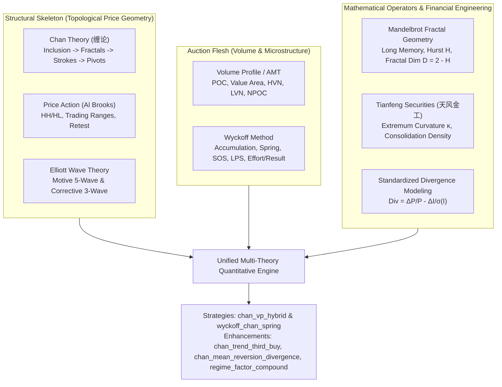

# Deep Research & Implementation Plan: Multi-Theory Synthesis & Quantitative Factor System

Based on the research document [`docs/缠论与筹码分布研究及量化对话全景整理.md`](file:///home/stone/Work/github/quant/docs/%E7%BC%A0%E8%AE%BA%E4%B8%8E%E7%AD%B9%E7%A0%81%E5%88%86%E5%B8%83%E7%A0%94%E7%A9%B6%E5%8F%8A%E9%87%8F%E5%8C%96%E5%AF%B9%E8%AF%9D%E5%85%A8%E6%99%AF%E6%95%B4%E7%90%86.md), this plan performs an exhaustive research synthesis across all theoretical schools mentioned in the document, extracts institutional-grade quantitative factors, and designs both new strategies and backward-compatible enhancements for existing strategies.

---

## I. Deep Research: Theoretical Homology & Quantitative Mappings

The document identifies four major theoretical systems that share mathematical and behavioral homology with Chan Theory (缠论), alongside modern financial engineering findings:



### 1. Wyckoff Method (威科夫量价结构)
* **Academic & Practical Grounding**: Richard Wyckoff (1930s); David Weis (*Trades About to Happen*); Jim Forte (CMT Association).
* **Core Mapping to Chan**:
  - **Accumulation / Distribution Range** $\Leftrightarrow$ Chan Zhongshu (中枢 $[ZD, ZG]$).
  - **Spring (弹簧效应 / 破底翻)** $\Leftrightarrow$ Zhongshu lower bound undercut & snapback / Chan First Buy (一买 / 盘整背驰底). Price penetrates below support ($ZD$), triggers stop-runs into liquidity, and immediately snaps back above $ZD$ with stopping volume / absorption.
  - **Sign of Strength (SOS) & Last Point of Support (LPS)** $\Leftrightarrow$ Breakout above $ZG$ and pullback holding above $ZG$ / Chan Second/Third Buy (二买 / 三买).
  - **Effort vs Result (努力与结果)**: High volume with narrow spread indicates institutional absorption or distribution; low volume with wide spread indicates liquidity vacuum.

### 2. Mandelbrot Fractal Geometry & Long Memory (分形几何学与长记忆性)
* **Academic Grounding**: Benoit Mandelbrot (*Fractals and Scaling in Finance*, 1997); Edgar Peters (*Fractal Market Analysis*, 1994); H.E. Hurst (1951).
* **Core Mapping to Chan**:
  - The recursive chain: Inclusion $\to$ Fractal $\to$ Stroke $\to$ Segment $\to$ Trend (K线包含 $\to$ 分型 $\to$ 笔 $\to$ 线段 $\to$ 走势类型) is an explicit **self-similar fractal hierarchy** governed by scale invariance.
  - **Hurst Exponent ($H$) and Fractal Dimension ($D = 2 - H$)**:
    - $H > 0.55$ ($D < 1.45$): Persistent, smooth directional trend expansion (ideal for Chan B3 / Trend Following).
    - $H < 0.45$ ($D > 1.55$): Anti-persistent, rough, range-bound oscillation (ideal for Chan Zhongshu swing / Mean Reversion).
    - **Multiscale Coherence**: $1.0 - |H_{short} - H_{intermediate}| \ge 0.85$ verifies fractal alignment across daily and weekly horizons.

### 3. Price Action (Al Brooks 价格行为学)
* **Academic Grounding**: Al Brooks (*Trading Price Action Trends / Trading Ranges / Reversals*, Wiley 2012).
* **Core Mapping to Chan**:
  - Top/Bottom fractals (顶分型/底分型) are micro price action rejection bars (Pin Bars / Outside Reversal Bars).
  - Higher Highs / Higher Lows ($HH/HL$) correspond to rising stroke sequences.
  - Trading Range Breakout & Pullback matches Chan Third Buy (三买).

### 4. Tianfeng Securities Financial Engineering Morphology (天风证券金工研报)
* **Research Citation**: 天风证券 ——《形态学视角下的动量与反转因子》.
* **Core Innovation**:
  - **Extremum Curvature Factor (极值点曲率因子 $\kappa$)**: Measures the second derivative / local quadratic curvature at turning points:
    $$\kappa = \frac{y''(t)}{\left(1 + (y'(t))^2\right)^{3/2}}$$
    where $y(t) = (P_t - \bar{P}) / \sigma_P$. Sharp V-bottoms have high positive curvature ($\kappa > 2.0$), identifying aggressive institutional absorption; flat rounding bottoms have low curvature ($\kappa < 1.0$).
  - **Consolidation Density Breakout Factor (震荡密集区突破因子)**: Ratio of price consolidation within the interquartile range to total swing range, multiplied by post-breakout volume expansion.

### 5. Standardized Dynamical Divergence Modeling (动力学背驰标准化建模)
* **Research Citation**: Document Section I.3.(2).
* **Core Formula**:
  $$\text{Divergence}_k = \frac{P_t - P_{t-k}}{P_{t-k}} - \frac{I_t - I_{t-k}}{\sigma_I(t)}$$
  Standardizes the divergence between price return and indicator momentum (e.g. MACD DIF or RSI) as a scale-free z-score metric, removing subjective visual MACD area estimation.

---

## II. Extracted Quantitative Factors

We standardize these concepts into an institutional factor library in [`common/structural_factors.py`](file:///home/stone/Work/github/quant/common/structural_factors.py):

| Factor Key | Mathematical Definition | Financial Interpretation | Factor Taxonomy Category |
| :--- | :--- | :--- | :--- |
| `wyckoff_spring` | $\mathbb{I}(L_{t-1} < S \land C_t > S) \times \frac{V_t}{\text{SMA}(V, 20)}$ | Undercut of support followed by sharp close reclaim on elevated volume (shakeout). | `mean_reversion` |
| `extremum_curvature` | $\kappa = \frac{2a}{(1 + b^2)^{3/2}}$ from local quadratic fit $y = at^2 + bt + c$ | Local turning point acceleration; distinguishes high-conviction V-reversals from drift. | `regime_trend_strength` |
| `standardized_divergence` | $\text{Div}_k = \frac{\Delta_k P}{P_{t-k}} - \frac{\Delta_k I}{\sigma_I}$ | Normalized z-score divergence between price trajectory and indicator momentum. | `mean_reversion` |
| `wyckoff_effort_result` | $\frac{\Delta_k P / \sigma_P}{\Delta_k V / \sigma_V}$ | Price movement achieved per unit of volume; detects absorption and exhaustion. | `relative_momentum` |
| `fractal_dimension` | $D = 2 - H(P)$ via rescaled-range Hurst | Measures price curve roughness; low $D$ indicates persistent trend, high $D$ indicates chop. | `regime_trend_strength` |
| `consolidation_density` | $\frac{\sum_{t \in W} V_t \cdot \mathbb{I}(P_t \in [ZD, ZG])}{\sum_{t \in W} V_t}$ | Volume concentration in pivot band $[ZD, ZG]$; verifies high volume node (HVN) consensus. | `regime_trend_strength` |

---

## III. Strategy Blueprint: New Strategies & Enhancements

### 1. Flagship Strategy 1: `ChanVolumeProfileHybridStrategy` (`chan_vp_hybrid`) [NEW]
* **Module**: `pipeline/research_strategy/rs/chan_vp_hybrid_strategy.py`
* **Core Philosophy**: Chan pivot as skeleton + Volume Profile auction density as flesh.
* **Key Mechanics**:
  1. **HVN Pivot Validation**: Only accepts pivots where `consolidation_density` $\ge 0.50$ and $POC \in [ZD, ZG]$. Filters out hollow/false pivots.
  2. **SanMai (Third Buy) Micro-POC Acceptance**: Breakout swiftly traverses LVN, pullback holds above $ZG$ and $VAH$, and post-breakout consolidation establishes a **new micro-POC above $ZG$**.
  3. **Dynamic Naked POC (NPOC) Target**: Targets overhead historical un-tested POCs across the LVN liquidity vacuum.

### 2. Flagship Strategy 2: `WyckoffChanSpringStrategy` (`wyckoff_chan_spring`) [NEW]
* **Module**: `pipeline/research_strategy/rs/wyckoff_chan_strategy.py`
* **Core Philosophy**: Solves the lower win rate and higher drawdown of pure Chan First Buy (B1 bottom fishing, as proven by GF Securities' research report) by requiring Wyckoff Spring shakeout absorption and positive Extremum Curvature ($\kappa$).
* **Key Mechanics**:
  1. Identifies downward exhaustion / pivot lower boundary $ZD$.
  2. Triggers only when `wyckoff_spring` fires (undercut below $ZD$ by $\le 3\%$, quick reclaim above $ZD$, with stopping volume $\ge 1.25\times$ or long lower wick $\ge 40\%$).
  3. Curvature check: confirms positive extremum curvature $\kappa > 1.5$ (V-reversal conviction).
  4. Dynamic stop loss placed strictly below the Spring low $L_{spring}$. Target set at pivot upper boundary $ZG$ or $1.5\times$ trading range.

### 3. Enhancement: `ChanTrendThirdBuyStrategy` (`chan_trend_third_buy`) [MODIFY]
* **Module**: `pipeline/research_strategy/rs/chan_advanced_strategies.py`
* **Changes**:
  - Add optional parameters to `StrategyConfig`:
    - `chan_b3_enable_vp_filter: bool = False` (default False for 100% backward compatibility)
    - `chan_b3_min_pivot_density: float = 0.50`
  - When enabled, filters out breakout signals that originate from low-volume hollow pivots.

### 4. Enhancement: `ChanMeanReversionDivergenceStrategy` (`chan_mean_reversion_divergence`) [MODIFY]
* **Module**: `pipeline/research_strategy/rs/chan_advanced_strategies.py`
* **Changes**:
  - Expand `entry_mode` options to include:
    - `'wyckoff_spring'`: requires Wyckoff spring shakeout confirmation.
    - `'curvature_v_bottom'`: requires bottom fractal extremum curvature $\kappa \ge 1.5$.
    - `'spring_curvature_combined'`: requires both Wyckoff spring and curvature.
  - Defaults to existing `'zero_axis'` mode (zero regression).

### 5. Enhancement: `RegimeFactorCompoundStrategy` (`regime_factor_compound`) [MODIFY]
* **Module**: `pipeline/research_strategy/rs/regime_factor_compound_strategy.py`
* **Changes**:
  - Integrate `fractal_dimension` and `extremum_curvature` into its factor vector, improving regime discrimination between choppy consolidation and strong trend breakouts.

---

## IV. Quality & Performance Principles

1. **Complete Backward Compatibility**: All 55 existing strategies in `strategies_config.json` retain their exact current default parameters and behavior. All new parameters on existing classes default to `False` or existing values.
2. **Performance & Offline Execution**: All newly created factor functions in `common/structural_factors.py` are fully vectorized using NumPy and SciPy/Pandas. They run 100% offline with zero network calls, matching the repo's testing policy.
3. **Sparse Weights & NaN-vs-0.0 Contract**: Any allocation templates strictly generate sparse weights (NaN on non-rebalance days, explicit 0.0 on position liquidation, sum $\le 1.0$, unallocated cash routed to cash proxy).

---

## V. Verification Plan

### Automated Tests
Run dedicated test suites plus the full pipeline regression:
```bash
# 1. Test the new structural factors library
uv run --project pipeline pytest pipeline/research_strategy/tests/test_structural_factors.py -v

# 2. Test the new Chan VP Hybrid Strategy
uv run --project pipeline pytest pipeline/research_strategy/tests/test_chan_vp_hybrid.py -v

# 3. Test the new Wyckoff-Chan Spring Strategy
uv run --project pipeline pytest pipeline/research_strategy/tests/test_wyckoff_chan_strategy.py -v

# 4. Test backward-compatible enhancements on Chan advanced strategies
uv run --project pipeline pytest pipeline/research_strategy/tests/test_chan_advanced_strategies.py -q

# 5. Full research strategy suite regression
uv run --project pipeline pytest pipeline/research_strategy/tests/test_run_research_strategy.py -q
```

### Manual Verification
Execute CLI backtests on synthetic universes:
```bash
uv run --project pipeline python pipeline/research_strategy/run_research_strategy.py --strategy chan_vp_hybrid --data-provider synthetic --n-days 300
uv run --project pipeline python pipeline/research_strategy/run_research_strategy.py --strategy wyckoff_chan_spring --data-provider synthetic --n-days 300
```
