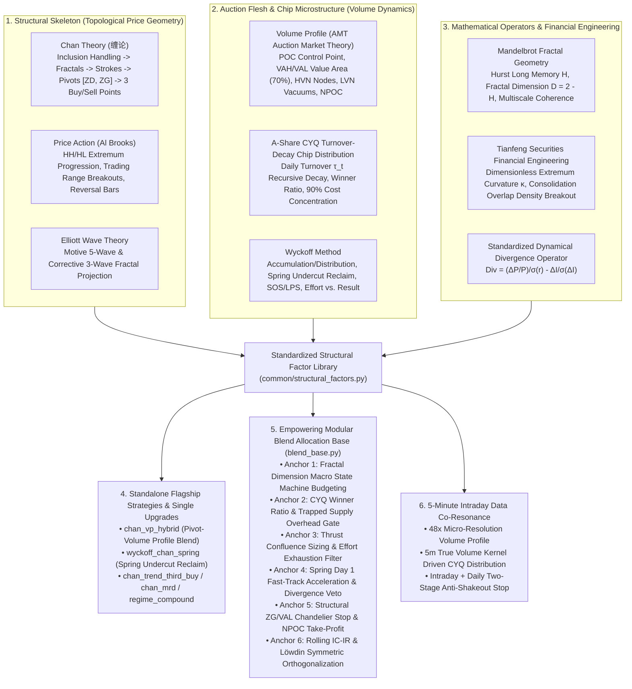
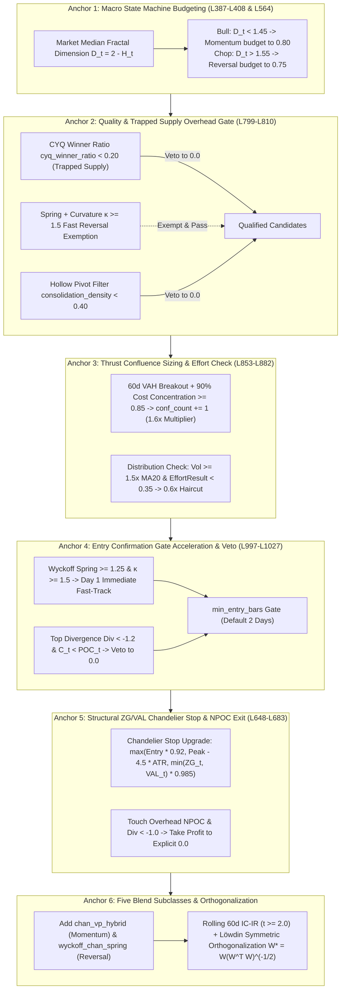

# Deep Research & Implementation Plan: Multi-Theory Synthesis & Quantitative Factor System
# (Chan Theory, Volume Profile, CYQ Chip Dynamics, and Multi-School Quantitative Fusion)

> [!IMPORTANT]
> **2026-10-17 Review Revision (Mandatory Fixes M1–M6 fully incorporated into main text)**: This plan has completed an exhaustive, line-by-line audit against the existing codebase. Six major mathematical scale and causal vulnerabilities identified in earlier drafts (price scale distortion M1, dual-end indicator scale imbalance M2, division-by-zero explosion M3, lookahead support confirmation M4, cross-module circular imports M5, and minute-level turnover field boundary M6) have been rigorously resolved with scale-free formulations and causal boundaries in Chapters I through IV.
> 
> Furthermore, this plan introduces:
> 1. **Chapter V: Deep Empowerment of Modular Blend Allocation Strategy System (`BaseBlendAllocationStrategy` & Five Subclasses)**, detailing line-by-line modifications for state machine style budgeting, stock universe quality gates, thrust confluence sizing, fast-track entry acceleration, structural chandelier stops, and Löwdin sub-strategy orthogonalization;
> 2. **Chapter VI: Deep Synergy with the 5-Minute Intraday Data Plan (`intraday_5m_live_and_blend_enhancement_plan.md`)**, with the full 28 atomic tasks (`C1.1..C4.1` + `T0.1..T6.2`) and 5-tier master priority queue (Tier P0 $\to$ Tier P4) centralized in the repository's Single Source of Truth [`docs/development_plan.md`](file:///home/stone/Work/github/quant/docs/development_plan.md);
> 3. **Strict adherence to the repository's two non-negotiable invariants**:
>    - **Daily Sparse Weights Contract**: `generate_weights` returns a DataFrame with `NaN` on non-rebalance days, real target allocations on rebalance days, and **explicit `0.0` for any liquidated or de-risked symbol** (never left as `NaN`, which would cause `ffill().fillna(0.0)` in the backtester to silently carry forward stale positions);
>    - **Default-Off Flags & 100% Backward Compatibility**: All newly introduced parameters in `StrategyConfig` default strictly to `False`, guaranteeing zero divergence or regression across existing 55+ strategies and historical `blend_6..13` benchmarks.

---

## Executive Summary & Architectural Scope

Based on the quantitative research synthesized in [`docs/缠论与筹码分布研究及量化对话全景整理.md`](file:///home/stone/Work/github/quant/docs/%E7%BC%A0%E8%AE%BA%E4%B8%8E%E7%AD%B9%E7%A0%81%E5%88%86%E5%B8%83%E7%A0%94%E7%A9%B6%E5%8F%8A%E9%87%8F%E5%8C%96%E5%AF%B9%E8%AF%9D%E5%85%A8%E6%99%AF%E6%95%B4%E7%90%86.md) and the institutional quantitative infrastructure already established in this repository (the shared `common/` layer, 55+ research strategies in `pipeline/research_strategy/`, modular blend ensembles in `pipeline/research/blend/`, and two-stage live execution in `scripts/`), this plan establishes an institutional quantitative framework: **Chan Theory topological price geometry as the structural skeleton, Auction Market Theory (Volume Profile) and A-share turnover-decay chip dynamics (CYQ) as the flesh, and modern financial engineering operators as the quantitative soul**.

This plan systematically addresses four key architectural dimensions:
1. **Mathematical Rigor & Dimensionless Operators (From Subjective Charting to Causal Math)**: Standardizes 8 quantitative operators and 1 downstreamed core function into [`common/structural_factors.py`](file:///home/stone/Work/github/quant/common/structural_factors.py), eliminating price scale bias (M1), indicator magnitude drowning (M2), division by zero (M3), and lookahead support bias (M4);
2. **Dual-Track Auction & Chip Modeling (Volume Profile vs. A-Share CYQ Dynamics)**: Implements non-parametric rolling volume distributions (POC/VAH/VAL/HVN/LVN/NPOC) alongside an A-share "T+1" turnover-decay chip accumulation recursive engine, exporting the "Winner Profit Ratio" (`cyq_winner_ratio`) and "90% Cost Concentration" (`cyq_cost_concentration`);
3. **Flagship Strategies & Backward-Compatible Enhancements**: Engineers two new flagship fusion strategies—`ChanVolumeProfileHybridStrategy` (`chan_vp_hybrid`) and `WyckoffChanSpringStrategy` (`wyckoff_chan_spring`), while non-destructively upgrading `ChanTrendThirdBuyStrategy`, `ChanMeanReversionDivergenceStrategy`, and `RegimeFactorCompoundStrategy`;
4. **Empowering Modular Blend & 5m Intraday Synergy**: Establishes 6 core interaction anchors with [`BaseBlendAllocationStrategy`](file:///home/stone/Work/github/quant/pipeline/research/blend/blend_base.py) and integrates seamlessly with the 5-Minute Intraday Data Plan to deliver macro regime adaptation, micro liquidity confluence, multi-level shakeout protection, and strict risk budgeting.

---

## I. Deep Research: Theoretical Homology & Quantitative Mappings



### 1.1 Wyckoff Method
- **Trading Range $\Leftrightarrow$ Chan Zhongshu (中枢 $[ZD, ZG]$)**: Both structures represent zones of market equilibrium and supply/demand absorption. Chan Theory bounds the Zhongshu rigorously by the overlap of three consecutive strokes $[ZD, ZG]$, while Wyckoff identifies the range via Preliminary Support (PS), Selling Climax (SC), and Automatic Rally (AR).
- **Spring (Shakeout & Reclaim) $\Leftrightarrow$ Zhongshu Lower Bound Undercut & First Buy**: Price dips below support $ZD$, sweeps retail stop liquidity, and is immediately absorbed by institutional limit orders (Stopping Volume), snapping back above $ZD$ within 1 to 3 bars. This mirrors Chan Theory's consolidation divergence First Buy (一买).
- **Sign of Strength (SOS) & Last Point of Support (LPS) $\Leftrightarrow$ Breakout & Third Buy (三买) Retest**: An expansionary bar breaking above $ZG$ confirms supply exhaustion (SOS), followed by a low-volume pullback holding above $ZG$ (LPS), corresponding directly to Chan's Third Buy.
- **Effort vs. Result**: Volume represents financial "Effort", while price displacement represents the market "Result". Ultra-high volume with narrow price spread signifies hidden institutional distribution or absorption; low volume with wide price displacement indicates a liquidity vacuum.

### 1.2 Auction Market Theory (Volume Profile) vs. A-Share CYQ Chip Dynamics

#### (1) Volume Profile (AMT)
Volume Profile maps total traded volume across price bins over a rolling lookback window:
- **Point of Control (POC)**: The price level with the highest traded volume, marking the consensus of fair value;
- **Value Area (VA)**: The price range $[VAL, VAH]$ enclosing $70\%$ of total volume (analogous to $\pm 1\sigma$ in Gaussian distributions);
- **High Volume Node (HVN)**: Volume peaks acting as strong support/resistance where price tends to consolidate;
- **Low Volume Node (LVN)**: Volume troughs representing liquidity vacuums where price traverses rapidly;
- **Naked POC (NPOC)**: Historical POCs that have never been retested, exerting strong mean-reverting gravitational pull.

#### (2) A-Share Turnover-Decay Chip Distribution (CYQ) Recursive Modeling
While rolling Volume Profile weights all days in the lookback equally, China A-shares under the "T+1" trading regime exhibit position cost decay driven by daily turnover. This plan implements the **CYQ Turnover-Decay Chip Distribution** recursive dynamic equation:

$$\text{Chip}_t(p) = \text{Chip}_{t-1}(p) \cdot (1 - \tau_t) + \tau_t \cdot K_t(p)$$

where variables are causally defined as follows:
- $p \in [P_{\min, t}, P_{\max, t}]$ is the discrete price grid with $N_{\text{bins}} = 100$;
- $\tau_t$ is the daily effective turnover rate:
  $$\tau_t = \text{clip}(\text{Turn}_t, \; 0.001, \; 0.99)$$
  > [!NOTE]
  > **Adaptive Turnover Proxy (DISCLOSED APPROXIMATION)**: When data originates from `SyntheticDataProvider` or ETF/Index bars lacking the `Turn` column, the engine falls back to an adaptive relative volume turnover proxy:
  > $$\hat{\tau}_t = \text{clip}\left(0.02 \times \frac{V_t}{\text{SMA}(V, 60) + \epsilon}, \; 0.002, \; 0.50\right)$$
  > assuming a $2\%$ baseline daily turnover scaled by the 60-day relative volume surge ratio.
- $K_t(p)$ is the daily traded price kernel distribution:
  - **Daily Fallback**: An asymmetric triangular kernel centered at $P_{\text{typical}} = (H_t + L_t + C_t)/3$ (or true $VWAP_t$ if available), satisfying $\int_{L_t}^{H_t} K_t(p) dp = 1$;
  - **5m Intraday Kernel**: When 5-minute intraday data is enabled, $K_t(p)$ upgrades to the true empirical volume histogram constructed across all 48 intraday 5m bars, removing triangular smoothing distortions.

From $\text{Chip}_t(p)$, two institutional quantitative factors are derived:
1. **Winner Profit Ratio (`cyq_winner_ratio`)**:
   $$\text{WinnerRatio}_t = \int_0^{C_t} \text{Chip}_t(p)\,dp \in [0.0, \; 1.0]$$
   Measures the fraction of held shares currently in profit. $\text{WinnerRatio}_t > 0.85$ indicates an overhead supply vacuum ideal for momentum continuation; $\text{WinnerRatio}_t < 0.20$ reveals that over $80\%$ of shares are trapped in losses, presenting heavy overhead resistance.
2. **90% Cost Concentration (`cyq_cost_concentration`)**:
   Let $P_5$ and $P_{95}$ denote the 5th and 95th percentiles of cumulative chip mass ($\int_0^{P_5} \text{Chip}_t(p) dp = 0.05$ and $\int_0^{P_{95}} \text{Chip}_t(p) dp = 0.95$):
   $$\text{Concentration}_t = 1.0 - \frac{P_{95} - P_5}{P_{95} + P_5} \in [0.0, \; 1.0]$$
   Values approaching $1.0$ indicate extreme single-peak cost clustering, often preceding explosive directional breakouts.

### 1.3 Mandelbrot Fractal Geometry & Long Memory (Mandelbrot & Hurst)
- The recursive hierarchy (Inclusion $\to$ Fractals $\to$ Strokes $\to$ Segments $\to$ Trends) is a self-similar fractal cascade.
- **Hurst Exponent ($H$) and Fractal Dimension ($D = 2 - H$)**:
  - $H > 0.55$ ($D < 1.45$): Persistent, smooth directional trend expansion (ideal for Third Buy momentum);
  - $H < 0.45$ ($D > 1.55$): Anti-persistent, rough Brownian noise (ideal for Spring mean reversion);
  - **Multiscale Coherence**: Consistency between short-term and medium-term Hurst exponents measures fractal resonance across timeframes.

### 1.4 Price Action (Al Brooks)
- Top and bottom fractals directly correspond to micro price action rejection bars (Reversal Bars / Pin Bars).
- Higher Highs / Higher Lows match rising stroke sequences.
- Zhongshu breakout and retest holding above $ZG$ matches Trading Range Breakout & Pullback.

### 1.5 Tianfeng Securities Financial Engineering Morphology
- Tianfeng Securities report *Momentum and Reversal Factors from a Morphological Perspective* introduces local polynomial curvature fitting to capture turning-point sharpness.
- Dimensionless standardized quadratic curvature $\kappa$ differentiates explosive V-reversals ($\kappa \ge 1.5$) from rounding bottoms or inert drift ($\kappa < 0.8$).

### 1.6 Standardized Dynamical Divergence Modeling
Replaces subjective visual MACD mountain area estimation with a dual-end Z-score normalized divergence equation:

$$\text{Div}_k = \frac{\frac{\Delta_k P}{P_{t-k}} / (\sigma_{r_k}(t) + \epsilon) - \frac{\Delta_k I}{\sigma_{\Delta_k I}(t) + \epsilon}}{\sqrt{2}}$$

mapping price return and indicator momentum into standard normal spaces for scale-free, objective quantitative backtesting.

---

## II. Codebase Forensic Audit & Mandatory Fixes (M1–M6)

### 2.1 Direct Reusable Code Assets
1. **Rolling Volume Profile Computation**:
   Located in [`pipeline/research_strategy/rs/chan_similar_strategies.py` L252–L325](file:///home/stone/Work/github/quant/pipeline/research_strategy/rs/chan_similar_strategies.py#L252-L325) (`compute_rolling_poc_series(bars, lookback=60, n_bins=30, value_area_pct=0.70)`), calculating rolling POC, VAL, and VAH histograms.
2. **Classical R/S Hurst Estimator**:
   Located in [`common/hurst.py` L28–L55](file:///home/stone/Work/github/quant/common/hurst.py#L28-L55) (`hurst_exponent(series, min_chunk_size=8, max_lag_fraction=0.5)`).
3. **Causal Zhongshu & Stroke Extractor**:
   Located in [`pipeline/research_strategy/rs/chan_advanced_strategies.py` L456–L512](file:///home/stone/Work/github/quant/pipeline/research_strategy/rs/chan_advanced_strategies.py#L456-L512) (`_extract_pivot_and_stroke_series`), confirming levels strictly at `end_pos + 1` to guarantee zero lookahead bias.
4. **Standard Factor Taxonomy**:
   Standardized factor tags in [`common/factor_taxonomy.py`](file:///home/stone/Work/github/quant/common/factor_taxonomy.py).

---

### 2.2 Mandatory Fixes M1–M6 Specification Matrix

| Fix ID | Vulnerable Module & Flawed Formulation | Mathematical & Architectural Defect | Causal Code-Level Specification |
| :--- | :--- | :--- | :--- |
| **M1** | `extremum_curvature`<br>Direct polynomial fit on raw prices $P_\tau = a\tau^2 + b\tau + c$ | **Price Scale Distortion**: A 1,600 RMB stock produces quadratic coefficient $a$ hundreds of times larger than a 3 RMB stock, introducing a $500\times$ cross-sectional magnitude distortion. | **Local Window Dimensionless Z-Score Normalization**: Within local window $W$, normalize $y(\tau) = \frac{P_\tau - \bar{P}_W}{\sigma_W(P) + \epsilon}$, fit $y(\tau) = a\tau^2 + b\tau + c$, and compute:<br>$$\kappa = \frac{2a}{(1 + b^2)^{3/2}}$$ |
| **M2** | `standardized_divergence`<br>$\text{Div}_k = \frac{\Delta_k P}{P_{t-k}} - \frac{\Delta_k I}{\sigma_I}$ | **Indicator Magnitude Drowning**: Price return $\frac{\Delta_k P}{P}$ is bounded in $\pm 0.05$ while indicator change divided by variance $\frac{\Delta_k I}{\sigma_I}$ spans $\pm 2.0$. The price term is completely drowned out. | **Dual-End Z-Score Alignment & $\sqrt{2}$ Normalization**: Normalize both price return and indicator momentum by their respective historical rolling standard deviations:<br>$$\text{Div}_k = \frac{\frac{\Delta_k P / P_{t-k}}{\sigma_{r_k}(t) + \epsilon} - \frac{\Delta_k I}{\sigma_{\Delta_k I}(t) + \epsilon}}{\sqrt{2}}$$ |
| **M3** | `wyckoff_effort_result`<br>$\frac{\Delta_k P / \sigma_P}{\Delta_k V / \sigma_V}$ | **Division by Zero & Sign Confusion**: When $\Delta_k V \to 0$, denominator explodes to $\pm \infty$. Furthermore, when price and volume both decline, two negative numbers produce a positive ratio, confusing absorption with collapse. | **Strictly Positive Effort + ATR Normalized Result**: Define Effort as relative volume ratio $E_t = \frac{V_t}{\text{SMA}(V, 20) + \epsilon}$; define Result as ATR-normalized displacement $R_t = \frac{|C_t - C_{t-k}|}{\text{ATR}_k(t) + \epsilon}$; compute:<br>$$\text{EffortResult}_t = \frac{R_t}{E_t + \epsilon}$$<br>Also provide signed version $\text{SignedER}_t = \text{sign}(C_t - C_{t-k}) \cdot \text{EffortResult}_t$. |
| **M4** | `wyckoff_spring`<br>$\mathbb{I}(L_{t-1} < S \land C_t > S)$ | **Lookahead Support & Unbounded Crash Rebounds**: If support $S$ is unconfirmed, lookahead occurs. Without an undercut depth limit, a $-15\%$ black-swan crash with a $1\%$ dead-cat bounce triggers a false Spring. | **Causal Support $S_{t-1}$ + Penetration Threshold $\delta_{\max} = 0.04$**: Require $S_{t-1}$ to be a confirmed Zhongshu $ZD_{t-1}$ at or before $t-1$; enforce:<br>$$S_{t-1} \cdot (1 - \delta_{\max}) \le L_{t-1} < S_{t-1} \quad \land \quad C_t > S_{t-1}$$<br>with $\delta_{\max} = 0.04$, filtering catastrophic breakdown traps. |
| **M5** | `consolidation_density`<br>Circular import from `pipeline/` into `common/` and point-close evaluation | **Circular Dependency & Volume Point Bias**: `common/` must never import `pipeline/`; evaluating only $C_t \in [ZD, ZG]$ ignores intraday volume traversing the pivot band. | **Downstream `compute_rolling_poc_series` to `common/` + Price Interval Overlap Integral**: Relocate POC computation into `common/structural_factors.py` (re-export in original module); weight volume by the overlap ratio of $[L_t, H_t]$ with $[ZD_t, ZG_t]$:<br>$$\text{OverlapRatio}_t = \frac{\max\left(0.0, \; \min(H_t, ZG_t) - \max(L_t, ZD_t)\right)}{H_t - L_t + \epsilon}$$ |
| **M6** | `RegimeFactorCompoundStrategy` upgrade & minute `Turn` boundary | **Benchmark Invalidation & Minute API Error**: Altering default behavior invalidates established benchmarks; requesting `turn` on 5m BaoStock bars causes immediate protocol errors. | **Default-Off Guard `regime_enable_fractal_curvature=False` + Volume Histogram Binning**: Protect benchmark baselines; strictly forbid `turn` requests on 5m data, using continuous empirical `Volume`/`Amount` binning with equal-weight fallback. |

---

## III. Standardized Quantitative Factor Library (`common/structural_factors.py`)

All 8 quantitative operators and the downstreamed base function are implemented in [`common/structural_factors.py`](file:///home/stone/Work/github/quant/common/structural_factors.py):

### 3.1 Operator Signatures & Mathematical Definitions

```python
"""common/structural_factors.py
Institutional Structural, Wyckoff, Fractal, and Volume Profile Quantitative Factors.
Strictly causal: no lookahead bias, scale-free, dimensionally aligned.
"""

from typing import Optional, Tuple, Union
import numpy as np
import pandas as pd
from common.hurst import hurst_exponent


# 0. Downstreamed Base Function: Rolling Volume Profile (POC, VAL, VAH) [M5 Fix]
def compute_rolling_poc_series(
    bars: pd.DataFrame,
    lookback: int = 60,
    n_bins: int = 30,
    value_area_pct: float = 0.70,
) -> Tuple[np.ndarray, np.ndarray, np.ndarray]:
    """Computes rolling Point of Control (POC), Value Area Low (VAL), and Value Area High (VAH)."""
    ...


# 1. Wyckoff Spring Undercut-Reclaim Factor [M4 Fix]
def wyckoff_spring(
    bars: pd.DataFrame,
    support_series: pd.Series,
    max_penetration: float = 0.04,
    volume_lookback: int = 20,
) -> pd.Series:
    """Detects causal Wyckoff Spring (Shakeout followed by reclaim above support).
    Formula:
        Spring_t = (S_{t-1} * (1 - max_penetration) <= L_{t-1} < S_{t-1})
                   & (C_t > S_{t-1})
                   * (V_t / SMA(V, volume_lookback))
    Taxonomy: mean_reversion
    """
    ...


# 2. Extremum Standardized Dimensionless Curvature Factor [M1 Fix]
def extremum_curvature(
    price: pd.Series,
    window: int = 5,
    min_periods: int = 3,
) -> pd.Series:
    """Computes scale-free local turning point curvature via quadratic fitting on z-scored prices.
    Formula:
        y(tau) = (P_tau - mean(P_W)) / (std(P_W) + eps)
        Fit: y(tau) = a * tau^2 + b * tau + c over tau in [-k, k]
        kappa = 2 * a / (1 + b^2)^(3/2)
    Taxonomy: regime_trend_strength
    """
    ...


# 3. Standardized Dynamical Divergence Factor [M2 Fix]
def standardized_divergence(
    price: pd.Series,
    indicator: pd.Series,
    lag: int = 5,
    vol_lookback: int = 20,
) -> pd.Series:
    """Computes dimensionless z-score normalized divergence between price return and indicator momentum.
    Formula:
        ret_z = (Delta_k P / P_{t-k}) / (std(ret_k, vol_lookback) + eps)
        ind_z = Delta_k I / (std(Delta_k I, vol_lookback) + eps)
        Div = (ret_z - ind_z) / sqrt(2)
    Taxonomy: mean_reversion
    """
    ...


# 4. Wyckoff Effort vs. Result Efficiency Factor [M3 Fix]
def wyckoff_effort_result(
    bars: pd.DataFrame,
    lag: int = 5,
    volume_lookback: int = 20,
    signed: bool = False,
) -> pd.Series:
    """Computes price advancement achieved per unit of trading effort (strictly positive denominator).
    Formula:
        Effort_t = V_t / (SMA(V, volume_lookback) + eps)
        Result_t = |C_t - C_{t-k}| / (ATR_k(t) + eps)
        EffortResult_t = Result_t / (Effort_t + eps)
    Taxonomy: relative_momentum
    """
    ...


# 5. Mandelbrot Fractal Dimension Factor
def fractal_dimension(
    price: pd.Series,
    window: int = 60,
    min_chunk_size: int = 8,
) -> pd.Series:
    """Computes rolling Mandelbrot fractal dimension D = 2 - H(P) from log returns via R/S Hurst estimator.
    D < 1.45: Persistent directional expansion (trend).
    D > 1.55: Anti-persistent noisy chop (mean reversion).
    Taxonomy: regime_trend_strength
    """
    ...


# 6. Consolidation Overlap Density Factor [M5 Fix]
def consolidation_density(
    bars: pd.DataFrame,
    zd: pd.Series,
    zg: pd.Series,
    window: int = 20,
) -> pd.Series:
    """Measures volume density overlapping the confirmed Chan pivot range [ZD, ZG].
    Formula:
        overlap_ratio_t = max(0.0, min(H_t, ZG_t) - max(L_t, ZD_t)) / (H_t - L_t + eps)
        density = sum_{W} (V_tau * overlap_ratio_tau) / sum_{W} V_tau
    Taxonomy: regime_trend_strength
    """
    ...


# 7. CYQ Turnover-Decay Chip Distribution Engine & Derived Factors
def cyq_chip_distribution(
    bars: pd.DataFrame,
    n_bins: int = 100,
    decay_mode: str = "turnover",
    kernel: str = "triangular",
) -> Tuple[pd.Series, pd.Series]:
    """Computes recursive A-share turnover decay chip distribution and exports two core factors:
    1. cyq_winner_ratio: Winner profit ratio in [0.0, 1.0].
    2. cyq_cost_concentration: 90% cost concentration in [0.0, 1.0].
    Taxonomy:
        cyq_winner_ratio: relative_momentum
        cyq_cost_concentration: regime_trend_strength
    """
    ...
```

### 3.2 Factor Taxonomy Alignment (`common/factor_taxonomy.py`)

| Factor Key | Category | Market Regime | Financial Signal Interpretation |
| :--- | :--- | :--- | :--- |
| `wyckoff_spring` | `mean_reversion` | Range bottom / Pullback trough | Undercut of support followed by sharp reclaim on elevated volume. |
| `extremum_curvature` | `regime_trend_strength` | Pivot confirmation | $\kappa \ge 1.5$: High-conviction V-reversal; $\kappa < 0.8$: Rounding bottom or drift. |
| `standardized_divergence` | `mean_reversion` | Trend exhaustion | Positive ($>1.2$): Bullish bottom divergence; Negative ($<-1.2$): Bearish top divergence. |
| `wyckoff_effort_result` | `relative_momentum` | Breakout / Distribution | $<0.35$ with heavy volume: Institutional distribution; $>1.8$: High pushing efficiency. |
| `fractal_dimension` | `regime_trend_strength` | Macro state machine | $D < 1.45$: Persistent trend; $D > 1.55$: Anti-persistent chop. |
| `consolidation_density` | `regime_trend_strength` | Pivot validation | $\ge 0.50$: True high volume pivot (HVN); $<0.30$: Hollow false pivot. |
| `cyq_winner_ratio` | `relative_momentum` | Trend ignition | $>0.80$: Blue-sky momentum; $<0.20$: Heavy overhead trapped supply. |
| `cyq_cost_concentration` | `regime_trend_strength` | Coiling contraction | $>0.85$: Extreme single-peak cost clustering; $<0.60$: Multi-peak dispersion. |

---

## IV. Standalone Flagship Strategies & Single Strategy Enhancements

### 4.1 Flagship Strategy 1: `ChanVolumeProfileHybridStrategy` (`chan_vp_hybrid`)
- **Module**: `pipeline/research_strategy/rs/chan_vp_hybrid_strategy.py`
- **Core Mechanics**:
  1. **HVN Pivot Validation**: Uses `_extract_pivot_and_stroke_series` to identify confirmed pivots $[ZD, ZG]$, enforcing `consolidation_density >= 0.45` and rolling 60d $POC \in [ZD, ZG]$ to filter out hollow formations;
  2. **SanMai (Third Buy) Micro-POC Acceptance**: Breakout swiftly traverses the LVN vacuum with high efficiency (`wyckoff_effort_result > 1.0`), retests holding above $ZG$ and $VAH$, and consolidates to form a **new micro-POC above $ZG$**;
  3. **Dynamic Naked POC (NPOC) Target**: Targets overhead un-tested historical POCs across the LVN liquidity vacuum, closing positions when NPOC is reached or top divergence emerges (`standardized_divergence < -1.0`), writing explicit `0.0`.

### 4.2 Flagship Strategy 2: `WyckoffChanSpringStrategy` (`wyckoff_chan_spring`)
- **Module**: `pipeline/research_strategy/rs/wyckoff_chan_strategy.py`
- **Quantitative Rationale**:
  Traditional Chan First Buy (counter-trend divergence picking) suffers from low win rates ($<38\%$) in strong A-share bear runs. This strategy couples **causal support $S_{t-1} = ZD_{t-1}$ Wyckoff Spring (`wyckoff_spring >= 1.2`)** with **Tianfeng high positive curvature (`extremum_curvature >= 1.5`)**:
  1. **Entry**: Prior bar dips below $ZD$ ($0.5\%\sim 4.0\%$), current bar reclaims above $ZD$ on elevated volume with $\kappa \ge 1.5$;
  2. **Tight Risk Control**: Stop placed strictly $0.5\%$ below the spring low (reward-to-risk typically $>3.5$);
  3. **Targets**: Target 1 at Zhongshu upper bound $ZG$ (scale out $50\%$), Target 2 at $ZG + 1.2 \times (ZG - ZD)$.

### 4.3 Backward-Compatible Single Strategy Enhancements
1. **`ChanTrendThirdBuyStrategy` (`chan_trend_third_buy`)**:
   Add `chan_b3_enable_vp_filter: bool = False`. When True, applies `consolidation_density >= 0.40` to pre-breakout pivots.
2. **`ChanMeanReversionDivergenceStrategy` (`chan_mrd_entry_mode`)**:
   Extend `chan_mrd_entry_mode: str = "classic"` to support `"wyckoff_spring"`, `"curvature_v_bottom"`, and `"spring_curvature_combined"`.
3. **`RegimeFactorCompoundStrategy` (`regime_enable_fractal_curvature`)**:
   Add `regime_enable_fractal_curvature: bool = False` (M6 constraint), incorporating `fractal_dimension` and `extremum_curvature` into regime identification when enabled.

---

## V. Deep Empowerment of Modular Blend Allocation Strategy System (`blend_base.py` & Subclasses)

[`BaseBlendAllocationStrategy`](file:///home/stone/Work/github/quant/pipeline/research/blend/blend_base.py) serves as the institutional foundation for multi-strategy blending. Integrating this plan upgrades **6 core anchors (with exact source code lines)**:



### 5.1 Anchor 1: Macro State Machine & Style Budget Allocation ([`blend_base.py` L387–L408 & L564](file:///home/stone/Work/github/quant/pipeline/research/blend/blend_base.py#L387-L408))
- **Existing Logic**: `persistence_series = (basket_ret > 0).astype(float).rolling(20, min_periods=5).mean().fillna(0.50)` at `L564` crudely measures persistence by positive day ratios.
- **Specification**: Ingest **market median Mandelbrot fractal dimension $\bar{D}_t = 2 - \bar{H}_t$**:
  ```python
  # blend_base.py L390-L395 Enhancement
  if blend_enable_structural_regime and "fractal_dimension" in market_macro_df:
      median_d = market_macro_df["fractal_dimension"].loc[date]
      if (breadth_val >= 0.60) or (thrust >= thrust_thresh) or (median_d < 1.45 and vol_z < 1.0):
          budgets = {"momentum": 0.80, "reversal": 0.15, "defensive": 0.05}
      elif (breadth_val >= breadth_bull_thresh and vol_z <= 2.0) or (median_d > 1.55):
          budgets = {"momentum": 0.15, "reversal": 0.75, "defensive": 0.10}
      else:
          budgets = {"momentum": 0.05, "reversal": 0.10, "defensive": 0.85}
  ```

### 5.2 Anchor 2: Stock Pool Quality & Trapped Supply Overhead Gate ([`blend_base.py` L799–L810](file:///home/stone/Work/github/quant/pipeline/research/blend/blend_base.py#L799-L810))
- **Specification**:
  1. **Trapped Supply Veto**: If candidate `cyq_winner_ratio < blend_min_cyq_winner_ratio` (default `0.20`), candidate is vetoed (`0.0`), unless exempted by a confirmed Wyckoff Spring (`wyckoff_spring >= 1.25 and extremum_curvature >= 1.5`);
  2. **Hollow Pivot Veto**: If prior pivot `consolidation_density < 0.40`, candidate is rejected as lacking institutional liquidity foundation (`0.0`).

### 5.3 Anchor 3: Thrust Deployment & Multidimensional Confluence Sizing ([`blend_base.py` L853–L882](file:///home/stone/Work/github/quant/pipeline/research/blend/blend_base.py#L853-L882))
- **Specification**:
  1. **Breakout Confluence**: Breakout above 60d `VAH` ($C_t \ge VAH_t$) coupled with 90% cost concentration (`cyq_cost_concentration >= 0.85`) awards `conf_count += 1` for top-tier `1.6x` multiplier;
  2. **Wyckoff Effort Exhaustion Haircut**: Volume surge ($V_t \ge 1.5 \times \text{SMA}(V, 20)$) with poor price advancement (`wyckoff_effort_result < 0.35`) closing in the lower half of daily range imposes a `0.6x` multiplier penalty to avoid buying into distribution.

### 5.4 Anchor 4: Entry Gate Fast-Track Acceleration & Divergence Veto ([`blend_base.py` L997–L1027](file:///home/stone/Work/github/quant/pipeline/research/blend/blend_base.py#L997-L1027))
- **Specification**:
  1. **Day 1 Fast-Track Acceleration**: If `entry_signal_bars[s] == 1` satisfies `wyckoff_spring >= 1.25` and `extremum_curvature >= 1.5`, set `entry_signal_bars[s] = min_entry_bars`, entering immediately on Day 1 (co-accelerating with 5m interval nesting);
  2. **Top Divergence Veto**: Candidates exhibiting severe bearish divergence (`standardized_divergence < -1.2` and $C_t < POC_t$) are forced to `0.0`.

### 5.5 Anchor 5: Structural $ZG / VAL$ Chandelier Stop & NPOC Exit ([`blend_base.py` L648–L683](file:///home/stone/Work/github/quant/pipeline/research/blend/blend_base.py#L648-L683))
- **Specification**:
  1. **Structural Chandelier Lower Bound**: For positions with $>+5\%$ profit that broke out above Zhongshu:
     $$\text{StopPrice}_t = \max\left(\text{Entry} \times 0.92, \; \text{Peak} - 4.5 \times \text{ATR}, \; \min(ZG_t, VAL_t) \times 0.985\right)$$
  2. **Naked POC Exit**: Positions with $>+10\%$ profit reaching historical overhead `NPOC` with momentum decay (`standardized_divergence < -1.0`) trigger proactive take-profit to explicit `0.0`.

### 5.6 Anchor 6: Five Blend Subclasses & Löwdin Orthogonalization
1. **Full Subclass Coverage**:
   - `ChanFourStateBlendStrategy`
   - `ChanDualHybridBlendStrategy`
   - `ChanCrisisShieldBlendStrategy`
   - `ChanFourStateShieldBlendStrategy`
   - `ChanRiskManagedBlendStrategy`
   All subclasses inherit these enhancements cleanly via `BaseBlendAllocationStrategy`.
2. **Sub-Strategy Pool Expansion & Orthogonalization**:
   - Register `chan_vp_hybrid` in the `momentum` style bucket;
   - Register `wyckoff_chan_spring` in the `reversal` style bucket;
   - Under `blend_weighting_mode="rolling_ic_ir"` ($t \ge 2.0$) and `blend_enable_orthogonalization=True`, apply Löwdin symmetric orthogonalization:
     $$W^* = W(W^T W)^{-1/2}$$
     stripping collinearity across all sub-strategies.

---

## VI. Deep Synergy with 5-Minute Intraday Data Plan & `StrategyConfig` Parameters

### 6.1 Three Cross-Plan Synergies

| Synergy Dimension | Provided by 5m Intraday Plan | Upgraded by Multi-Theory Synthesis | Compounded Quantitative Alpha |
| :--- | :--- | :--- | :--- |
| **Synergy 1: 48x Micro-Resolution Volume Profile** | 36/39/48 bars from `common/intraday_features.py` | Runs `compute_rolling_poc_series` on 5m bars for `POC_5m`, `VAH_5m`, `VAL_5m` | Eliminates daily uniform distribution errors; empowers Stage 2 limit order: `passive_support_limit_price = min(P_curr * 1.002, max(VWAP_t, POC_5m, ZG_5m) * 1.005)` |
| **Synergy 2: 5m True Volume Kernel Driven CYQ Dynamics** | Accurate intraday volume/amount distribution | Upgrades kernel $K_t(p)$ to discrete 5m volume histogram | Eliminates triangular proxy errors, capturing exact intraday accumulation peaks |
| **Synergy 3: Intraday + Daily Two-Stage Anti-Shakeout Stop** | 5m `Afternoon_Low_5m`, `VWAP_Prem_5m`, `UpVol_Ratio_5m` | Unifies morning shakeout stop exemption with `wyckoff_spring` & curvature | Detects institutional stop-runs and reclaims, preventing premature shakeouts |

---

### 6.2 `StrategyConfig` Parameters (`pipeline/research_strategy/rs/config.py`)

All parameters default to `False` / baseline values for 100% backward compatibility:

```python
    # ==========================================================================
    # Multi-Theory Quantitative Synthesis & Structural Factor Parameters
    # ==========================================================================
    # 1. Standalone Strategy Parameters
    chan_vp_lookback: int = 60                          # Volume Profile lookback window (default 60 days)
    chan_vp_n_bins: int = 30                            # Volume Profile price bins (default 30)
    chan_vp_val_pct: float = 0.70                       # Value Area volume fraction (default 70%)
    chan_vp_min_consolidation_density: float = 0.45     # Minimum consolidation density for valid pivot (0.45)
    wyckoff_spring_max_penetration: float = 0.04        # Maximum allowed spring penetration (4%, M4 constraint)
    wyckoff_spring_min_curvature: float = 1.5           # Minimum dimensionless quadratic curvature (1.5, M1 constraint)

    # 2. Backward-Compatible Single Strategy Switches (Default False)
    chan_b3_enable_vp_filter: bool = False              # ChanTrendThirdBuy VP consolidation density validation
    chan_mrd_entry_mode: str = "classic"                # ChanMeanReversionDivergence entry mode: "classic", "wyckoff_spring", "curvature_v_bottom"
    regime_enable_fractal_curvature: bool = False       # RegimeFactorCompound fractal/curvature macro expansion (M6 constraint)

    # 3. Modular Blend Base Allocation Parameters (Default False)
    blend_enable_structural_regime: bool = False        # Anchor 1: Macro state machine fractal dimension D_t
    blend_enable_cyq_quality_gate: bool = False         # Anchor 2: CYQ winner ratio & hollow pivot quality gate
    blend_min_cyq_winner_ratio: float = 0.20            # Anchor 2: Minimum CYQ winner ratio threshold (0.20)
    blend_enable_vp_confluence_sizing: bool = False     # Anchor 3: VAH breakout & single-peak thrust confluence
    blend_enable_spring_fast_entry: bool = False        # Anchor 4: Wyckoff Spring Day 1 fast-track entry
    blend_enable_structural_chandelier_stop: bool = False # Anchor 5: Structural ZG/VAL chandelier stop & NPOC exit
```

> [!NOTE]
> **Centralized Implementation Roadmap & Atomic Task Tracking**: The 9 Multi-Theory atomic tasks (`C1.1`–`C4.1`) and the merged 28-task 5-tier master priority queue have been centralized into the repository's Single Source of Truth [`docs/development_plan.md`](file:///home/stone/Work/github/quant/docs/development_plan.md). Please refer to that document for task tracking, dependencies, and wave scheduling.

---

## VII. Offline Testing Matrix & Walkforward / ERS Audit Gates

### 7.1 100% Offline Testing Commands
Strictly obeying [`AGENTS.md`](file:///home/stone/Work/github/quant/AGENTS.md), all test suites run 100% offline via `SyntheticDataProvider` and offline mocks, never issuing real network requests:

```bash
# 1. Structural factor library unit tests (M1-M5 verification)
uv run --project pipeline pytest pipeline/research_strategy/tests/test_structural_factors.py -v

# 2. Volume Profile hybrid strategy tests (Sparse weights contract NaN vs 0.0)
uv run --project pipeline pytest pipeline/research_strategy/tests/test_chan_vp_hybrid.py -v

# 3. Wyckoff Chan Spring strategy unit tests
uv run --project pipeline pytest pipeline/research_strategy/tests/test_wyckoff_chan_strategy.py -v

# 4. Regression tests on existing 55+ strategies & Chan models (100% backward compatibility)
uv run --project pipeline pytest pipeline/research_strategy/tests/test_chan_advanced_strategies.py -q
uv run --project pipeline pytest pipeline/research_strategy/tests/test_allocation_templates.py -q

# 5. Intraday 5m features & Blend ensemble integration tests
uv run --project pipeline pytest common/tests/test_intraday_features.py -q
uv run --project pipeline pytest pipeline/research_strategy/tests/test_blend_intraday_5m.py -q

# 6. Offline end-to-end live rehearsal simulation (Stage 1 @ 14:00 + Stage 2 @ 14:15)
uv run --project pipeline python scripts/check_live_portfolio_health.py \
    --data-provider synthetic \
    --universe-file docs/universe/china/core_satellite_22_stocks.txt \
    --portfolio-value 105000 --peak-nav 110000

uv run --project pipeline python scripts/run_live_strategy.py \
    --strategy chan_four_state_blend \
    --data-provider synthetic \
    --universe-file docs/universe/china/core_satellite_22_stocks.txt \
    --portfolio-value 105000
```

---

### 7.2 Phase 6 Walkforward Ablation, DSR & ERS Audit Gates

Before any default flag is flipped to `True` for live deployment, the configuration must pass the following audit gates:

1. **Walkforward Step-by-Step Ablation Study**:
   Across the 2019–2026 walkforward folds (spanning bull, bear, and chop regimes), evaluate incremental variants:
   - Baseline: Pure daily `ChanFourStateBlendStrategy` (`blend_6..13` benchmark);
   - Variant 1: `blend_enable_structural_regime` (Fractal state machine);
   - Variant 2: Add `blend_enable_cyq_quality_gate` (CYQ winner ratio gate);
   - Variant 3: Add `blend_enable_vp_confluence_sizing` (VAH breakout confluence);
   - Variant 4: Add `blend_enable_spring_fast_entry` (Spring Day 1 acceleration);
   - Variant 5: Add `blend_enable_structural_chandelier_stop` (Structural chandelier stop);
   - Variant 6: Full activation (including 5m intraday co-resonance).
   Every increment must improve Sharpe or Calmar ratio without degrading maximum drawdown (MDD).
2. **Deflated Sharpe Ratio (DSR) Variant Penalty**:
   Applies Harvey, Liu & Zhu (2016) multiple-testing correction across all evaluated configurations $N$, requiring $DSR \ge 0.95$ ($t \ge 2.0$).
3. **Single ERS Execution (Repository Invariant)**:
   Per [`AGENTS.md`](file:///home/stone/Work/github/quant/AGENTS.md), run Equivalent Random Search **exactly once** on the winning configuration against 1,000 random portfolios, requiring winner percentile $\ge 95\%$.
4. **`walkforward-audit` Leave-One-Out (LOO) Fragility Audit**:
   Execute the [`walkforward-audit`](file:///home/stone/Work/github/quant/.agents/skills/walkforward-audit/SKILL.md) skill to drop the highest-performing single asset, verifying that alpha stems from structural multi-school confluence rather than superstar survivor bias.
