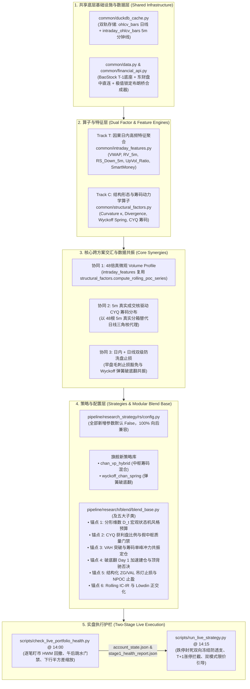

# 全局量化开发任务全量拆解与主优先级执行路线图
# (Master Development Plan & Unified Implementation Roadmap)

> [!IMPORTANT]
> **唯一权威开发任务与路线图总表 (Single Source of Truth)**：
> 本文档是整个代码库所有定量研究、基础设施升级、高频特征提取、多流派策略研发及实盘交易护栏工程的**唯一权威任务拆解、优先级队列、波次编排与执行进度跟踪总表**。
> 
> `docs/` 目录下的各个专项研究与架构设计方案（如 [`docs/intraday_5m_live_and_blend_enhancement_plan.md`](file:///home/stone/Work/github/quant/docs/intraday_5m_live_and_blend_enhancement_plan.md) 与 [`docs/缠论与筹码分布及多流派量化融合实施方案.md`](file:///home/stone/Work/github/quant/docs/%E7%BC%A0%E8%AE%BA%E4%B8%8E%E7%AD%B9%E7%A0%81%E5%88%86%E5%B8%83%E5%8F%8A%E5%A4%9A%E6%B5%81%E6%B4%BE%E9%87%8F%E5%8C%96%E8%9E%8D%E5%90%88%E5%AE%9E%E6%96%BD%E6%96%B9%E6%A1%88.md)）仅承载数学理论建模、代码库审计结论、因果边界推演与代码级详细规范——**所有现存及未来新增的原子任务拆解、进度勾选状态与路线图编排，必须且仅在此文档中集中维护与更新**。

---

## 一、 跨方案架构协同总览 (Cross-Track Architectural Synergy)

当前代码库正处于从“纯日线形态/中枢回测”向“**5分钟日内高频微观结构共振（Track T）** + **形态学/拍卖理论/A股筹码分布多流派量化融合（Track C）**”跨越的关键阶段。两大轨道并非割裂运作，而是深度共享底层基础设施，并在特征层、策略层与实盘层形成强烈的非线性 Alpha 乘数效应：



---

## 二、 原子任务全量拆解清单（共 28 个原子任务）

### 2.1 《5分钟高频日内数据方案》原子任务表（`T0.1`–`T6.2`，共 19 个任务）

| 任务编号 | 状态 | 任务名称 | 涉及核心文件与符号 | 核心交付内容与验收标准 (含 R1–R14 及工程细节) | 配套离线单测 | 规模 | 前置依赖 |
| :--- | :---: | :--- | :--- | :--- | :--- | :---: | :--- |
| **`T0.1`** | `[x]` | 修复 DuckDB 分钟线重采样规则映射 | [`common/duckdb_cache.py`](file:///home/stone/Work/github/quant/common/duckdb_cache.py)<br>`_INTERVAL_RULES`<br>`_get_resample_rule` | 1. 修复 `"1m": "ME"` 错误映射为月末 Bug；<br>2. 修复 `.endswith("m")` 将 `"5m"` 误判为月线 `"ME"` 的 Bug；<br>3. 增加 `is_intraday_interval(interval)` 判定，分钟级粒度直接返回 `None` 拒绝日线上采样。 | `test_intraday_features.py`<br>(测试 1) | **S** | 无 |
| **`T0.2`** | `[x]` | 修复 `Alpha101Data.from_universe` 的 VWAP 泄漏 | [`pipeline/research_strategy/rs/alpha101_factors.py`](file:///home/stone/Work/github/quant/pipeline/research_strategy/rs/alpha101_factors.py)<br>`Alpha101Data.from_universe`<br>[`common/alpha101_operators.py`](file:///home/stone/Work/github/quant/common/alpha101_operators.py)<br>`vwap_proxy` | 1. 废除 `.ffill().bfill()` 跨年反向填充未来 VWAP 的严重前视偏差；<br>2. 改为 `df["VWAP"].fillna(typical_price)`，在注释中添加 **HONEST CAVEAT** 说明过渡期；<br>3. 升级 `vwap_proxy` 接收真实 `vwap` 序列，惠及 `Alpha#41` 等因子。 | `test_alpha101_factors.py` | **S** | 无 |
| **`T0.3`** | `[x]` | 补齐 Stage 2 对门禁健康报告的实际读取 | [`scripts/run_live_strategy.py`](file:///home/stone/Work/github/quant/scripts/run_live_strategy.py)<br>`parse_args`<br>`main` | 1. 修复定义了 `--health-report-file` 却从未在流程中读取的缺陷；<br>2. 解析 `stage1_health_report.json` 与 `account_state.json` 中的 `gate_code` 与 `intraday_buy_scale`；<br>3. 识别到 `CAUTION_INTRADAY_DISTRIBUTION` 时打印告警并将买入仓位折半。 | `test_run_live_strategy.py` | **S** | 无 |
| **`T1.1`** | `[ ]` | 新建 DuckDB 分钟级双轨存储缓存表 | [`common/duckdb_cache.py`](file:///home/stone/Work/github/quant/common/duckdb_cache.py)<br>`_init_tables`<br>`store_intraday_bars`<br>`query_intraday_bars` | 1. 新建 `intraday_ohlcv_bars` 表（主键 `(symbol, timestamp)`，`timestamp TIMESTAMP`）；<br>2. 新建 `intraday_sync_metadata` 表，记录 `latest_close_ref` 用于除权漂移失效重刷 (R4)；<br>3. 修复日期型 `end="2026-10-16"` 查询截断丢失当天 48 根 K 线缺陷 (R13)，自动扩展至 `23:59:59`。 | `test_intraday_features.py`<br>(测试 1) | **M** | `T0.1` |
| **`T1.2`** | `[ ]` | 扩展 `SyntheticDataProvider` 极值锁定布朗桥 5m 生成器 | [`common/data.py`](file:///home/stone/Work/github/quant/common/data.py)<br>`SyntheticDataProvider` | 1. 废弃仿射布朗桥不可行假设 (R2)，实现随机极值时点 $j_H \ne j_L$ 的分段钉扎布朗桥；<br>2. 生成每日 48 根（`09:35..15:00`）5m K 线；<br>3. 单测断言按日聚合后的 `(Open, High, Low, Close, Volume)` 与日线输出比特级一致。 | `test_intraday_features.py`<br>(测试 2) | **M** | 无 |
| **`T1.3`** | `[ ]` | 新增 `BaoStockDataProvider` 深度历史底座 | [`common/data.py`](file:///home/stone/Work/github/quant/common/data.py)<br>[`common/financial_api.py`](file:///home/stone/Work/github/quant/common/financial_api.py)<br>`BaoStockDataProvider` | 1. 支持 `--data-provider baostock`，提供 1999 年至今 A 股及 2026 年起 ETF 前复权 5m 历史；<br>2. 解析 17 位 `time` 字符串并截断毫秒；<br>3. 5m 分钟线严禁请求 `preclose,turn,peTTM`，单次上限 10,000 条，按 180 天分块查询。 | `test_intraday_features.py`<br>(测试 3) | **M** | `T1.1` |
| **`T1.4`** | `[ ]` | 新增 `EastMoneyDataProvider` 盘中实时分钟线直连 | [`common/data.py`](file:///home/stone/Work/github/quant/common/data.py)<br>[`common/financial_api.py`](file:///home/stone/Work/github/quant/common/financial_api.py)<br>`EastMoneyDataProvider` | 1. 直连 `push2his.eastmoney.com`，提供 A 股/ETF/指数/北交所盘中实时 5m K 线；<br>2. 矫正 `O-C-H-L` 字段顺序为标准 `O-H-L-C`；<br>3. **强制量纲转换 `Volume = float(f56) * 100.0`（手 $\to$ 股）**，并做 `Amount/VWAP` 交叉核验。 | `test_intraday_features.py`<br>(测试 4) | **M** | `T1.1` |
| **`T1.5`** | `[ ]` | 新增本地批量快照守护与无锁落盘 | `scripts/record_intraday_5m.py`<br>Fuyao 批量快照差分合成器 | 1. 基于 `fuyao_client.prices_snapshot` 批量快照差分合成 5m 桶与精确 Tick VWAP；<br>2. 采用**无锁原子 Parquet（`data/intraday_5m/{date}.parquet`）**落盘，规避 DuckDB 单写进程锁冲突；<br>3. 缺桶时自动调用东财接口回补，内置 `0.2s` 节流与 `HTTP 429` 重试。 | `test_intraday_features.py`<br>(测试 5) | **L** | `T1.4` |
| **`T2.1`** | `[ ]` | 因果日内特征聚合引擎与截断器 | [`common/intraday_features.py`](file:///home/stone/Work/github/quant/common/intraday_features.py)<br>`compute_daily_intraday_features`<br>`enrich_universe_with_intraday_features` | 1. 统一回测历史与实盘截断时点（默认 `cutoff_time="14:15"` 为 39 根，Stage 1 为 36 根，R1/R6）；<br>2. 跨源复权比例对齐 $\kappa_t = C_{t,\text{1d}} / C_{t,M,\text{5m}}$ 消除价格基准错配 (R4)；<br>3. 盘中合成日线标记 `Is_Partial_Bar = 1`，完整收盘日线标记 `0` (R12)。 | `test_intraday_features.py`<br>(测试 6) | **L** | `T1.1`, `T1.2` |
| **`T2.2`** | `[ ]` | 剥离隔夜跳空聪明钱与有符号主买量能 | [`common/intraday_features.py`](file:///home/stone/Work/github/quant/common/intraday_features.py)<br>`SmartMoney_Q_5m`<br>`UpVol_Ratio_5m`<br>`Afternoon_Ret_5m` | 1. 计算剥离隔夜跳空的纯日内聪明钱 Q 因子；<br>2. 计算 5m 有符号主买上攻量占比 `UpVol_Ratio_5m`；<br>3. 以早盘收盘 `11:30` 为基准计算午后收益率 `Afternoon_Ret_5m`，用于识别午后跳水。 | `test_intraday_features.py`<br>(测试 7) | **M** | `T2.1` |
| **`T2.3`** | `[ ]` | 5m 缠论次级别结构因果截断与惰性计算 | [`common/intraday_features.py`](file:///home/stone/Work/github/quant/common/intraday_features.py)<br>`Chan_5m_Buy_Confluence`<br>`Chan_5m_Sell_Trigger` | 1. 窗口起点严格固定至 $t-4$ 日 `09:35` 首根 K 线（累计 240 根 5m 窗口）；<br>2. 严格在截断时刻前独立运行分型与笔构建，杜绝未来分型偏差；<br>3. 支持 `chan_candidate_dates` 候选日按需惰性求值 (R9)，降低 $85\%+$ 计算开销。 | `test_blend_intraday_5m.py`<br>(测试 8) | **M** | `T2.1` |
| **`T3.1`** | `[ ]` | Blend 缠论日线 $\times$ 5m 区间套与防狼术 | [`pipeline/research/blend/blend_base.py`](file:///home/stone/Work/github/quant/pipeline/research/blend/blend_base.py)<br>`L997-L1027` | 1. 开启 `blend_enable_5m_interval_nesting` 时，若标的具备 `Chan_5m_Buy_Confluence == 2` 且 `VWAP_Prem_5m >= 0.0`，在 Day 1 豁免 `min_entry_bars=2` 立即入场；<br>2. 若日线买点伴随 5m 顶背驰或三卖（`Chan_5m_Sell_Trigger == 1`），执行一票否决置 `0.0`。 | `test_blend_intraday_5m.py`<br>(测试 8) | **M** | `T2.3` |
| **`T3.2`** | `[ ]` | Blend 有符号量能共振与下行半方差配权 | [`pipeline/research/blend/blend_base.py`](file:///home/stone/Work/github/quant/pipeline/research/blend/blend_base.py)<br>`L535-L548`<br>`L854-L867` | 1. 升级 `vol_surge_matrix`：要求 `UpVol_Ratio_5m >= 0.58` 且 `VWAP_Prem_5m >= 0.0`（缺失历史日期安全退化）；<br>2. 冲力部署 `confluence_sizing` 叠加聪明钱置信度加权；<br>3. 单资产反波动率定仓接入 5m 下行半方差 $RS_{t}^-$，豁免右侧放量上涨标的被误降权。 | `test_blend_intraday_5m.py`<br>(测试 9) | **M** | `T2.2` |
| **`T3.3`** | `[ ]` | Blend 5m 防毛刺止损与三卖止盈保护 | [`pipeline/research/blend/blend_base.py`](file:///home/stone/Work/github/quant/pipeline/research/blend/blend_base.py)<br>`L648-L683` | 1. 早盘洗盘毛刺豁免：跌穿止损线但未超硬熔断（$\ge 0.97 \times \text{Stop}$）且午后最低价站回、收盘站上 VWAP 且 `UpVol_Ratio_5m >= 0.60` 时豁免当日止损；<br>2. 次级别三卖止盈：浮盈 $>8\%$ 且自最高点回撤 $>2\text{ATR}$ 且触发 5m 顶背驰/三卖时，提前止盈离场并置显式 `0.0`。 | `test_blend_intraday_5m.py`<br>(测试 9) | **M** | `T2.3` |
| **`T4.1`** | `[ ]` | Stage 1 门禁日内逐笔盯市回撤与午后跳水检测 | [`scripts/check_live_portfolio_health.py`](file:///home/stone/Work/github/quant/scripts/check_live_portfolio_health.py)<br>`inspect_portfolio_drawdown`<br>`evaluate_market_breadth_and_thrust` | 1. 14:00 提取持仓 5m 盯市净值路径，诊断盘中谷值回撤并标记 `CAUTION_INTRADAY_TROUGH`，**严禁回写抬高 `peak_nav` (R5)**；<br>2. 检测早盘冲高午后跳水（相对 11:30 放量下挫），触发 `CAUTION_INTRADAY_DISTRIBUTION` 并持久化至 `account_state.json`；<br>3. 接入下行半方差波动率目标缩放。 | 离线演练脚本 | **M** | `T2.1`, `T2.2` |
| **`T4.2`** | `[ ]` | Stage 2 卖单跌停封死双向冻结与买单涨停拦截 | [`scripts/run_live_strategy.py`](file:///home/stone/Work/github/quant/scripts/run_live_strategy.py)<br>`L1056-L1063`<br>`L1107-L1140` | 1. 分板块精确跌停判定 (R10) 识别跌停封死/停牌，标记 `LIMIT_DOWN_ILLIQUID_RISK`；<br>2. **在 Phase 2 计算可用购买力与 Phase 4 计算闲置现金归集时双向剔除该卖单 (R14)**，杜绝透支；<br>3. Phase 2 拦截涨停封板买单（`LIMIT_UP_LOCKED`）并对日内透支追高标的折半买入。 | `test_blend_intraday_5m.py`<br>(测试 10) | **M** | `T0.3`, `T2.1` |
| **`T4.3`** | `[ ]` | Stage 2 交割单新增双模式微观执行引导字段 | [`scripts/run_live_strategy.py`](file:///home/stone/Work/github/quant/scripts/run_live_strategy.py)<br>`generate_orders` | 1. 输出主动可成交限价 `suggested_limit_price`（`BUY` 为 $\min(P_{\text{limit\_up}}, P_{\text{curr}} \times 1.002)$，与回测假设一致，R11）；<br>2. 输出被动参考限价 `passive_support_limit_price`（$\min(P \times 1.002, \max(VWAP, ZG_{5m}) \times 1.005)$，R11）；<br>3. 输出 `intraday_vwap`, `vwap_premium_pct`, `chan_5m_state`。 | `test_blend_intraday_5m.py`<br>(测试 10) | **S** | `T4.2` |
| **`T5.1`** | `[ ]` | 编写 5m 缓存、数据源与日内特征全套单元测试 | `common/tests/test_intraday_features.py` | 100% 离线测试 1 至测试 7（分钟缓存读写、除权失效重刷、钉扎布朗桥极值守恒、BaoStock/东财/快照 Mock 解析、36/39/48 根因果截断断言、聪敏钱与 VWAP 偏离）。 | `pytest` 全绿 | **M** | `T1.1`..`T2.2` |
| **`T5.2`** | `[ ]` | 编写 Blend 5m 区间套与实盘双向防透支单元测试 | `pipeline/research_strategy/tests/test_blend_intraday_5m.py` | 100% 离线测试 8 至测试 10（5m 区间套首日加速与否决、稀疏权重 `NaN` vs `0.0` 契约保持、跌停卖单 Phase 2/4 双向购买力冻结与交割单限价输出）。 | `pytest` 全绿 | **M** | `T3.1`..`T4.3` |
| **`T6.1`** | `[ ]` | Phase 6 Walkforward 逐项消融实验 | `pipeline/research/blend/experiments/` | 统一 `blend_intraday_cutoff_time="14:15"`，对 4.1–4.5 增强及实盘门禁逐项进行 on/off 消融实验，验证 Sharpe/Calmar 提升与回撤稳健性。 | Walkforward 报告 | **L** | `T5.1`, `T5.2` |
| **`T6.2`** | `[ ]` | DSR 变体数惩罚、单次 ERS 检验与 LOO 终审 | `walkforward-audit` skill | 1. 计算尝试变体数校正的 DSR（$DSR \ge 0.95$）；<br>2. 遵循 `AGENTS.md` 对最终胜者跑**一次** ERS（前 5% 分位）；<br>3. 执行 LOO 超级明星股剔除脆弱性审计，确认上线评级。 | 审计报告制品 | **M** | `T6.1` |

---

### 2.2 《缠论与筹码分布及多流派量化融合方案》原子任务表（`C1.1`–`C4.1`，共 9 个任务）

| 任务编号 | 状态 | 任务名称 | 涉及核心文件与符号 | 核心交付内容与验收标准 (含 M1–M6 数学修正与 6 大 Blend 锚点) | 配套离线单测 | 规模 | 前置依赖 |
| :--- | :---: | :--- | :--- | :--- | :--- | :---: | :--- |
| **`C1.1`** | `[x]` | Volume Profile 算子下沉与分层解耦 | [`common/structural_factors.py`](file:///home/stone/Work/github/quant/common/structural_factors.py)<br>`compute_rolling_poc_series`<br>[`pipeline/research_strategy/rs/chan_similar_strategies.py`](file:///home/stone/Work/github/quant/pipeline/research_strategy/rs/chan_similar_strategies.py) | 1. 将 `compute_rolling_poc_series` 下沉至底层共享库 `common/structural_factors.py`；<br>2. 严禁 `common/` 反向导入 `pipeline/`（M5 约束）；<br>3. 在 `chan_similar_strategies.py` 中保留 `from common.structural_factors import compute_rolling_poc_series` 实现 100% 向后兼容。 | `test_structural_factors.py` | **S** | 无 |
| **`C1.2`** | `[ ]` | 实现 M1–M4 核心形态学与动力学算子 | [`common/structural_factors.py`](file:///home/stone/Work/github/quant/common/structural_factors.py)<br>`extremum_curvature`<br>`standardized_divergence`<br>`wyckoff_effort_result`<br>`wyckoff_spring`<br>`fractal_dimension`<br>`consolidation_density` | 1. **M1 修正**：局部窗口无量纲 Z-Score 标准化后拟合二次曲率 $\kappa = \frac{2a}{(1+b^2)^{3/2}}$，消除 500 倍价格量级失真；<br>2. **M2 修正**：双端 Z-Score 对齐并除以 $\sqrt{2}$，解决指标动量淹没收益率问题；<br>3. **M3 修正**：正定相对成交量 Effort + ATR 归一化 Result，根除除零爆炸与符号混淆；<br>4. **M4 修正**：因果支撑位 $S_{t-1} = ZD_{t-1}$ + 最大刺破深度 $\delta_{\max} = 0.04$ 截断；<br>5. **M5 修正**：价格区间 $[L_t, H_t]$ 与中枢 $[ZD_t, ZG_t]$ 线性重叠比例积分成交量。 | `test_structural_factors.py` | **M** | `C1.1` |
| **`C1.3`** | `[ ]` | 实现 A股 CYQ 换手衰减筹码分布递归引擎 | [`common/structural_factors.py`](file:///home/stone/Work/github/quant/common/structural_factors.py)<br>`cyq_chip_distribution`<br>`cyq_winner_ratio`<br>`cyq_cost_concentration` | 1. 实现递归方程 $\text{Chip}_t(p) = \text{Chip}_{t-1}(p)(1-\tau_t) + \tau_t K_t(p)$；<br>2. 缺失 `Turn` 时自适应切换相对成交量换手代理 $\hat{\tau}_t$（**DISCLOSED APPROXIMATION**）；<br>3. 支持日线三角核与 5m 真实成交核无缝插拔切换；<br>4. 输出获利盘比例（`WinnerRatio`）与 90% 筹码集中度（`Concentration`）。 | `test_structural_factors.py` | **M** | `C1.1` |
| **`C2.1`** | `[ ]` | 研发旗舰新策略一：`ChanVolumeProfileHybridStrategy` | [`pipeline/research_strategy/rs/chan_vp_hybrid_strategy.py`](file:///home/stone/Work/github/quant/pipeline/research_strategy/rs/chan_vp_hybrid_strategy.py)<br>[`pipeline/research_strategy/rs/config.py`](file:///home/stone/Work/github/quant/pipeline/research_strategy/rs/config.py) | 1. 策略标识 `chan_vp_hybrid`，集成 HVN 中枢校验（`consolidation_density >= 0.45` 且 $POC \in [ZD, ZG]$）；<br>2. 三买微观 POC 接受确认（离开段快速穿过 LVN，回踩站稳 $ZG$ 与 $VAH$ 并在上方沉淀新 POC）；<br>3. 动态锚定上方未测试控制点（Naked POC）止盈，严格恪守稀疏权重 `NaN` vs `0.0` 契约。 | `test_chan_vp_hybrid.py` | **M** | `C1.2`, `C1.3` |
| **`C2.2`** | `[ ]` | 研发旗舰新策略二：`WyckoffChanSpringStrategy` | [`pipeline/research_strategy/rs/wyckoff_chan_strategy.py`](file:///home/stone/Work/github/quant/pipeline/research_strategy/rs/wyckoff_chan_strategy.py)<br>[`pipeline/research_strategy/rs/config.py`](file:///home/stone/Work/github/quant/pipeline/research_strategy/rs/config.py) | 1. 策略标识 `wyckoff_chan_spring`，解决传统缠论一买胜率低、回撤大痛点；<br>2. 前一日最低价刺破 $ZD$（$0.5\%\sim 4.0\%$），当日放量收回 $ZD$ 之上且 $\kappa \ge 1.5$；<br>3. 止损精准设于弹簧最低点下方 $0.5\%$，目标位看至 $ZG$ 与 $1.2\times$ 箱体高度。 | `test_wyckoff_chan_strategy.py` | **M** | `C1.2` |
| **`C2.3`** | `[ ]` | 既有单策略向后兼容平滑升级 | [`pipeline/research_strategy/rs/chan_advanced_strategies.py`](file:///home/stone/Work/github/quant/pipeline/research_strategy/rs/chan_advanced_strategies.py)<br>[`pipeline/research_strategy/rs/regime_factor_compound.py`](file:///home/stone/Work/github/quant/pipeline/research_strategy/rs/regime_factor_compound.py) | 1. `chan_trend_third_buy` 增加 `chan_b3_enable_vp_filter=False` 前置中枢 VP 校验；<br>2. `chan_mean_reversion_divergence` 扩展入场模式 `chan_mrd_entry_mode="classic"`；<br>3. `regime_factor_compound` 增加 `regime_enable_fractal_curvature=False` 扩展宏观状态判别（M6 约束）。 | `test_chan_advanced_strategies.py` | **S** | `C1.2` |
| **`C3.1`** | `[ ]` | `BaseBlendAllocationStrategy` 宏观状态机、质量门禁与冲力共振升级 | [`pipeline/research/blend/blend_base.py`](file:///home/stone/Work/github/quant/pipeline/research/blend/blend_base.py)<br>`L387-L408`<br>`L799-L810`<br>`L853-L882` | 1. **锚点 1（状态机预算）**：全市场中位数分形维数 $\bar{D}_t < 1.45$ 提升动量预算至 $0.80$，$\bar{D}_t > 1.55$ 提升反转预算至 $0.75$；<br>2. **锚点 2（质量门禁）**：`cyq_winner_ratio < 0.20` 且无弹簧豁免者一票否决置 `0.0`，过滤无量假中枢；<br>3. **锚点 3（冲力共振）**：突破 60d VAH 且筹码单峰密集（$\ge 0.85$）赋予 1.6x 顶格共振，放量滞涨（EffortResult $<0.35$）0.6x 折减。 | `test_blend_intraday_5m.py` | **L** | `C1.2`, `C1.3` |
| **`C3.2`** | `[ ]` | `BaseBlendAllocationStrategy` 入场加速、结构化止损与正交化 | [`pipeline/research/blend/blend_base.py`](file:///home/stone/Work/github/quant/pipeline/research/blend/blend_base.py)<br>`L997-L1027`<br>`L648-L683`<br>[`pipeline/research/blend/`](file:///home/stone/Work/github/quant/pipeline/research/blend/) | 1. **锚点 4（入场加速/否决）**：弹簧 $\ge 1.25$ 且 $\kappa \ge 1.5$ 在 Day 1 豁免 `min_entry_bars` 立即加速建仓，极端顶背驰（$<-1.2$）立即否决；<br>2. **锚点 5（结构化止损/止盈）**：吊灯止损升级为 $\max(\text{Entry}\times 0.92, \text{Peak}-4.5\times\text{ATR}, \min(ZG, VAL)\times 0.985)$，触及上方 NPOC 且动能衰竭主动止盈置 `0.0`；<br>3. **锚点 6（正交化扩展）**：五大 Blend 子类全量接入，两只新策略纳入 Löwdin 对称正交化矩阵。 | `test_blend_intraday_5m.py` | **L** | `C3.1`, `C2.1`, `C2.2` |
| **`C4.1`** | `[ ]` | 100% 离线单元测试与既有策略回归套件 | `pipeline/research_strategy/tests/`<br>`test_structural_factors.py`<br>`test_chan_vp_hybrid.py`<br>`test_wyckoff_chan_strategy.py` | 1. 验证 M1–M5 全部算子在单序列与 DataFrame 上的数学收敛性与无 `NaN` 扩散；<br>2. 验证两只新策略独立运行 `generate_weights` 的稀疏权重契约；<br>3. 验证 55+ 既有策略与 allocation templates 回归测试 100% 通过。 | `pytest` 全绿 | **M** | `C2.1`..`C3.2` |

---

## 三、 五级主优先级执行路线图与并行波次编排（`Tier P0` $\to$ `Tier P4`）

```mermaid
flowchart TD
    subgraph WAVE0["Wave 0 (Tier P0: 基础设施独立修复与底层算子基石) - 立即并发执行"]
        T01["T0.1: DuckDB 分钟重采样映射修复\n(common/duckdb_cache.py)"]
        T02["T0.2: Alpha101 VWAP bfill 泄漏修复\n(rs/alpha101_factors.py)"]
        T03["T0.3: Stage 2 补齐读取 health-report\n(scripts/run_live_strategy.py)"]
        C11["C1.1: Volume Profile 算子下沉解耦\n(common/structural_factors.py)"]
    end

    subgraph WAVE1["Wave 1 (Tier P0/P1: 算子实现与数据底座扩展) - 双轨并行"]
        C12["C1.2: M1-M4 核心形态学动力学算子\n(Curvature, Divergence, Spring, Effort)"]
        C13["C1.3: A股 CYQ 换手衰减递归引擎\n(WinnerRatio & 90% Cost Concentration)"]
        T11["T1.1: DuckDB 分钟双轨缓存表\n(intraday_ohlcv_bars, R4/R13)"]
        T12["T1.2: Synthetic 钉扎布朗桥 5m 生成器\n(极值与日线 100% 严格对齐, R2)"]
    end

    subgraph WAVE2["Wave 2 (Tier P1/P2: 旗舰新策略研发与外部行情接口接入)"]
        C21["C2.1: 旗舰新策略 chan_vp_hybrid\n(HVN 中枢校验 + 三买微观 POC)"]
        C22["C2.2: 旗舰新策略 wyckoff_chan_spring\n(因果支撑破底翻 + 高曲率 V 反)"]
        C23["C2.3: 既有单策略向后兼容升级\n(ThirdBuy, MRD, RegimeCompound, M6)"]
        T13["T1.3: BaoStockDataProvider T-1 深度底座"]
        T14["T1.4: EastMoneyDataProvider 盘中直连"]
        T15["T1.5: scripts/record_intraday_5m.py 守护"]
    end

    subgraph WAVE3["Wave 3 (Tier P2/P3: 因果特征聚合与 Blend 底座宏观/质量增强)"]
        T21["T2.1: intraday_features 因果截断器\n(14:15 截断 + κ_t 复权对齐, R1/R4/R6/R12)"]
        T22["T2.2: 隔夜跳空剥离聪明钱与主买量能"]
        T23["T2.3: 5m 缠论次级别结构惰性计算 (R9)"]
        C31["C3.1: Blend 状态机、CYQ 门禁与冲力共振\n(blend_base.py 锚点 1, 2, 3)"]
    end

    subgraph WAVE4["Wave 4 (Tier P3: Blend 入场/出场全链路闭环与实盘微观护栏)"]
        T31["T3.1: Blend 缠论日线 × 5m 区间套"]
        T32["T3.2: Blend 有符号量能与下行波动率定仓"]
        T33["T3.3: Blend 5m 防毛刺止损与三卖止盈"]
        C32["C3.2: Blend 弹簧加速、结构止损与正交化\n(blend_base.py 锚点 4, 5, 6)"]
        T41["T4.1: Stage 1 盘中回撤与午后跳水门禁 (R5)"]
        T42["T4.2: Stage 2 卖单跌停双向冻结防透支 (R10/R14)"]
        T43["T4.3: Stage 2 交割单双模式限价引导 (R11)"]
    end

    subgraph WAVE5["Wave 5 (Tier P4: 100% 离线单测套件与 Walkforward 终审门禁)"]
        T51["T5.1: test_intraday_features.py (测试 1-7)"]
        T52["T5.2: test_blend_intraday_5m.py (测试 8-10)"]
        C41["C4.1: test_structural_factors.py 及新策略单测"]
        T61["T6.1: Phase 6 Walkforward 逐项消融实验"]
        T62["T6.2: DSR 校正 + 单次 ERS + LOO 脆弱性终审"]
    end

    WAVE0 --> WAVE1
    WAVE1 --> WAVE2
    WAVE2 --> WAVE3
    WAVE3 --> WAVE4
    WAVE4 --> WAVE5
```



### 优先级排序依据与阶段准出标准 (Priority Rationale & Exit Criteria)

| 优先级梯队 (Tier) | 执行波次与并行轨道 | 包含任务 ID 清单 | 优先级排序依据 (Why This Priority) | 阶段准出标准 (Exit Criteria) |
| :--- | :--- | :--- | :--- | :--- |
| **Tier P0**<br>(基础设施基石) | **Wave 0**<br>(零依赖独立快速修复) | `T0.1`, `T0.2`, `T0.3`<br>`C1.1` | **无依赖致命缺陷先行**：`T0.1`–`T0.3` 均为代码库既有致命 Bug（如 `1m` 误映射月末、VWAP 前视泄漏、实盘健康报告未读取），修复不仅零依赖，且能立即解除后续所有模块的底层隐患；`C1.1` 将 POC 下沉为共享库解除分层循环依赖。 | 修复通过代码审查与离线单测，`import common.structural_factors` 无警告，`Alpha101` 无前视。 |
| **Tier P1**<br>(数据与新策略) | **Wave 1 & 2**<br>(Track T 数据底座 + Track C 旗舰新策略) | `C1.2`, `C1.3`, `T1.1`, `T1.2`<br>`C2.1`, `C2.2`, `C2.3`<br>`T1.3`, `T1.4`, `T1.5` | **双轨并行解耦加速**：在有了 `T1.2` 钉扎布朗桥与 `C1.2`/`C1.3` 算子库后，两只旗舰新策略 `C2.1`/`C2.2` 可在纯日线与合成数据下完全独立研发，与外部网络行情源接入（`T1.3`–`T1.5`）互不阻塞。 | 钉扎布朗桥按日聚合与日线比特级一致；两只新策略跑通 `generate_weights`，严格遵守稀疏权重契约。 |
| **Tier P2**<br>(特征与宏观底座) | **Wave 3**<br>(高频特征聚合 + Blend 宏观/质量增强) | `T2.1`, `T2.2`, `T2.3`<br>`C3.1` | **自下而上驱动底座**：先由因果截断引擎输出标准的特征矩阵，再将特征注入 `BaseBlendAllocationStrategy` 的状态机（锚点 1）、质量门禁（锚点 2）与冲力共振（锚点 3）。 | `enrich_universe_with_intraday_features` 满足 $\kappa_t$ 复权对齐；Blend 在开关开启后准确过滤深套与空心标的。 |
| **Tier P3**<br>(全链路与实盘护栏) | **Wave 4**<br>(微观共振闭环 + 实盘 Stage 1/2 护栏) | `T3.1`, `T3.2`, `T3.3`<br>`C3.2`<br>`T4.1`, `T4.2`, `T4.3` | **高阶微观整合与实盘风控防护**：在入场端实现弹簧与 5m 区间套双通道加速，在出场端实现结构化吊灯止损；同时在实盘 Stage 1/2 筑牢跌停封死双向冻结（R14）与双模式限价单引导（R11）。 | 威科夫弹簧实现 Day 1 加速建仓；跌停卖单未成交资金在 Phase 2 与 Phase 4 彻底冻结，交割单无透支。 |
| **Tier P4**<br>(单测与终审验证) | **Wave 5**<br>(全套离线单测 + 严苛消融终审) | `T5.1`, `T5.2`<br>`C4.1`<br>`T6.1`, `T6.2` | **质量终审与防过拟合铁律**：全部代码合入后，默认配置严格保持 `False`。必须通过全套离线测试、逐项 Walkforward 消融实验、DSR 显著性惩罚与单次 ERS 检验，方可批准生产翻转。 | 100% 离线单测通过（0 网络请求）；DSR 显著；通过 `walkforward-audit` LOO 脆弱性审计并给出正式评级。 |

---

## 四、 离线验证命令与 Phase 6 Walkforward / DSR / 单次 ERS 终审门禁

### 4.1 100% 离线测试命令全集
严格遵守 [`AGENTS.md`](file:///home/stone/Work/github/quant/AGENTS.md) 铁律，全部测试套件 100% 离线运行于 `SyntheticDataProvider` 或离线 Mock，严禁发起任何网络请求：

```bash
# 1. 运行结构化算子库与数学量纲修正测试 (M1-M5, C1.1-C1.3)
uv run --project pipeline pytest pipeline/research_strategy/tests/test_structural_factors.py -v

# 2. 运行两只旗舰新策略独立单元测试 (稀疏权重 NaN vs 0.0 契约验证, C2.1-C2.2)
uv run --project pipeline pytest pipeline/research_strategy/tests/test_chan_vp_hybrid.py -v
uv run --project pipeline pytest pipeline/research_strategy/tests/test_wyckoff_chan_strategy.py -v

# 3. 运行 5m 日内缓存、数据解析与特征因果截断测试 (测试 1-7, T5.1)
uv run --project pipeline pytest common/tests/test_intraday_features.py -v

# 4. 运行 Blend 策略 5m 区间套加速、结构化止损与实盘跌停冻结测试 (测试 8-10, T5.2)
uv run --project pipeline pytest pipeline/research_strategy/tests/test_blend_intraday_5m.py -v

# 5. 回归测试既有 55+ 策略库与 Allocation Templates (100% 向后兼容)
uv run --project pipeline pytest pipeline/research_strategy/tests/test_chan_advanced_strategies.py -q
uv run --project pipeline pytest pipeline/research_strategy/tests/test_allocation_templates.py -q

# 6. 离线全流程实盘模拟演练 (Stage 1 @ 14:00 + Stage 2 @ 14:15)
uv run --project pipeline python scripts/check_live_portfolio_health.py \
    --data-provider synthetic \
    --enable-intraday-5m \
    --cutoff-time 14:00 \
    --universe-file docs/universe/china/core_satellite_22_stocks.txt \
    --portfolio-value 105000 --peak-nav 110000

uv run --project pipeline python scripts/run_live_strategy.py \
    --strategy chan_four_state_blend \
    --data-provider synthetic \
    --enable-intraday-5m \
    --cutoff-time 14:15 \
    --universe-file docs/universe/china/core_satellite_22_stocks.txt \
    --portfolio-value 105000
```

---

### 4.2 Phase 6 Walkforward 逐项消融、DSR 与 ERS 终审规范

在策略代码实现并合入主分支后，所有新增开关参数在 `StrategyConfig` 中严格保持默认 `False`。若需在生产环境中显式启用或翻转默认值，必须由量化审计员执行并通过以下四重终审门禁：

1. **Walkforward 逐项消融实验 (Step-by-Step Ablation Study)**：
   在标准跨周期样本集（2019–2026）上，保持统一截断时点 `blend_intraday_cutoff_time="14:15"`，对以下增量逐项进行独立消融：
   - 基础对照组：纯日线原版 `ChanFourStateBlendStrategy`（`blend_6..13` 既有基准）；
   - 增量 1：`blend_enable_structural_regime`（分形维数状态机）；
   - 增量 2：叠加 `blend_enable_cyq_quality_gate`（CYQ 获利盘门禁）；
   - 增量 3：叠加 `blend_enable_vp_confluence_sizing`（VAH 突破冲力共振）；
   - 增量 4：叠加 `blend_enable_spring_fast_entry`（弹簧破底翻首日加速）；
   - 增量 5：叠加 `blend_enable_structural_chandelier_stop`（结构化吊灯止损）；
   - 增量 6：叠加 5m 日内特征共振（`blend_enable_intraday_5m`, `blend_enable_5m_interval_nesting`）。
   **准入要求**：每一项增益必须在不劣质化最大回撤（MDD）的前提下显著增厚 CAGR 或提升夏普比率（Sharpe Ratio）。
2. **Deflated Sharpe Ratio (DSR) 变体数惩罚校正**：
   将全部消融测试中尝试过的变体总数 $N$ 纳入多重检验惩罚（Harvey, Liu & Zhu, 2016），要求最终胜出配置的 $DSR \ge 0.95$（对应 $t \ge 2.0$ 统计显著性）。
3. **单次 ERS 随机基准检验（遵照 `AGENTS.md` 铁律）**：
   严格恪守“**全流程仅对最终胜出配置运行一次 Equivalent Random Search (ERS)**”的底线原则，对比 1,000 组等权/随机基准组合，要求胜出配置的夏普分位数达到前 $5\%$（Percentile $\ge 95\%$）。
4. **`walkforward-audit` Leave-One-Out (LOO) 资产脆弱性审计**：
   调用 [`walkforward-audit`](file:///home/stone/Work/github/quant/.agents/skills/walkforward-audit/SKILL.md) 技能，剔除组合中收益贡献最大的超级明星股，验证策略在剩余池子中的胜率与夏普表现，防范幸存者偏差与收益集中度畸变，确认全绿后方可赋予生产就绪评级。
