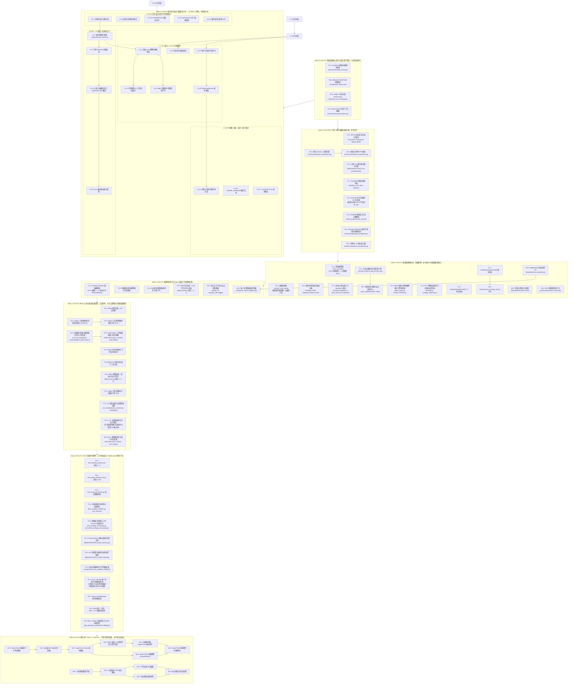

# 全局量化开发任务全量拆解与主优先级执行路线图
# (Master Development Plan & Unified Implementation Roadmap)

> [!IMPORTANT]
> **唯一权威开发任务与路线图总表 (Single Source of Truth)**：
> 本文档是整个代码库所有定量研究、基础设施升级、高频特征提取、多流派策略研发及实盘交易护栏工程的**唯一权威任务拆解、优先级队列、波次编排与执行进度跟踪总表**。
> 
> `docs/` 目录下的各个专项研究与架构设计方案（如 [`docs/intraday_5m_live_and_blend_enhancement_plan.md`](file:///home/stone/Work/github/quant/docs/intraday_5m_live_and_blend_enhancement_plan.md) 与 [`docs/缠论与筹码分布及多流派量化融合实施方案.md`](file:///home/stone/Work/github/quant/docs/%E7%BC%A0%E8%AE%BA%E4%B8%8E%E7%AD%B9%E7%A0%81%E5%88%86%E5%B8%83%E5%8F%8A%E5%A4%9A%E6%B5%81%E6%B4%BE%E9%87%8F%E5%8C%96%E8%9E%8D%E5%90%88%E5%AE%9E%E6%96%BD%E6%96%B9%E6%A1%88.md)）仅承载数学理论建模、代码库审计结论、因果边界推演与代码级详细规范——**所有现存及未来新增的原子任务拆解、进度勾选状态与路线图编排，必须且仅在此文档中集中维护与更新**。

---

## 一、 跨方案架构协同总览 (Cross-Track Architectural Synergy)

### 1.1 核心专项研究与架构设计规范总表 (Core Specifications & Research Docs Table)

| 规范文档路径 | 核心研究主题与架构范围 | 关联任务轨道 | 状态 |
| :--- | :--- | :---: | :---: |
| [`docs/intraday_5m_live_and_blend_enhancement_plan.md`](file:///home/stone/Work/github/quant/docs/intraday_5m_live_and_blend_enhancement_plan.md) | 5分钟高频日内微观结构共振、因果截断引擎与实盘两阶段防透支护栏规范 | Track T | 已落地 |
| [`docs/缠论与筹码分布及多流派量化融合实施方案.md`](file:///home/stone/Work/github/quant/docs/%E7%BC%A0%E8%AE%BA%E4%B8%8E%E7%AD%B9%E7%A0%81%E5%88%86%E5%B8%83%E5%8F%8A%E5%A4%9A%E6%B5%81%E6%B4%BE%E9%87%8F%E5%8C%96%E8%9E%8D%E5%90%88%E5%AE%9E%E6%96%BD%E6%96%B9%E6%A1%88.md) | 缠论中枢、拍卖理论 Volume Profile、A股 CYQ 换手衰减筹码动力学及多流派量化融合方案 | Track C | 已落地 |
| [`docs/snowball_strategy.txt`](file:///home/stone/Work/github/quant/docs/snowball_strategy.txt) | 雪球价值投资双估值模型（5年期末终值折现与成长股息资本化）与安全边际准入体系 | Track F | 已落地 |
| [`docs/wheel_strategy_research.md`](file:///home/stone/Work/github/quant/docs/wheel_strategy_research.md) | 轮式期权复合量化策略 (Options Wheel Strategy) 状态机、VRP方差溢价捕获与缠论支撑门控架构蓝图 | Track W | 孵化中 |
| [`common/indicators.py`](file:///home/stone/Work/github/quant/common/indicators.py) | SuperTrend 单向棘轮、自适应 ER 与多空非对称乘数，及 supertrend_timing 择时策略与 Entry/RiskExit 切面 | Track S | 孵化中 |
| [`docs/six_defects_parity_audit.md`](file:///home/stone/Work/github/quant/docs/six_defects_parity_audit.md) | 基于 Vidovich & Zerjal (2024/2026) 理论的实盘与回测对齐取证审计报告 (六大缺陷排查) | Track P | 实施中 |
| [`common/position_lifecycle.py`](file:///home/stone/Work/github/quant/common/position_lifecycle.py) | 统一持仓生命周期状态机 (UPLSM) 6 状态 FSM、非对称快通道（放量突破 0-delay 闪电建仓 / -8% 止损 0-delay 避险平仓）与两日门禁精简整合方案 | Track G | 已落地 |
| [`common/allocation_backtester.py`](file:///home/stone/Work/github/quant/common/allocation_backtester.py) | 回测系统高并发、跨窗口指标记忆缓存与高拟真度执行引擎升级方案 (记账修复、多进程并行与微观结构拟真) | Track B | 实施中 |
| [`docs/black_list.md`](file:///home/stone/Work/github/quant/docs/black_list.md) | 核心股票池剔除标的权威黑名单档案与失血归因 (SSOT) | 全局 / Live | 已落地 |
| [`docs/backtest_research_impl.md`](file:///home/stone/Work/github/quant/docs/backtest_research_impl.md) | 回测研究文档设计精炼与回测产物自包含落盘：①[`backtester/run_backtest.py`](file:///home/stone/Work/github/quant/backtester/run_backtest.py) 在 `--results-dir` 内自动落盘生效策略 `strategy_dump.json`；②[`docs/backtest_research.md`](file:///home/stone/Work/github/quant/docs/backtest_research.md) 输出路径由 `/tmp/opencode/bt_*` 迁移至仓库内 `backtests_research/<ts>/`，并含 `pfx_of()` 消融前缀修复与消融臂可达性矩阵；③**产物入库留档规范**（原为「`backtests_research/` 不加 `.gitignore` 排除、`INDEX.md` 交叉复核索引、体积纪律与提交信息规范」；**2026-10-25 提交 `5500cc3` 已反转为「运行产物不入库、只留人工报告 `.md` / `INDEX.md` / 股池快照 / `_provenance/`」**，见 §4.15 第 2 条与 [`docs/backtest_research_impl.md`](file:///home/stone/Work/github/quant/docs/backtest_research_impl.md) §4） | Track B | 已落地 |
| [`docs/long_only_multi_asset_gap_analysis.md`](file:///home/stone/Work/github/quant/docs/long_only_multi_asset_gap_analysis.md) | 多资产 Long-Only 指南（ETF Beta + 个股 Alpha + 现金）对照诊断、差距矩阵与 P0/P1 设计增强（rank-band、统一冷却状态机、换手 QP、行业中性化、SleeveAllocator、日频 VWAP/IVOL/1M-1W 因子、执行窗口） | Track M | 规划中（7 项 `[ ]`） |
| [`docs/position_policy_consolidation_design.md`](file:///home/stone/Work/github/quant/docs/position_policy_consolidation_design.md) | 持仓策略内核收敛：AssetPolicy / PortfolioSequencer / SparseProjector 三层，统一冷却、惰性与生命周期；四处旧实现分四阶段 bit-identical 退役 | Track M | 规划中（4 项 `[ ]`） |
| [`docs/development_plan.md`](file:///home/stone/Work/github/quant/docs/development_plan.md) §2.15 `M3.3`–`M3.8` | 5m 标定探针门禁与双轨 raw 存储/动态复权派生架构：`M3.6`/`M3.7`/`M3.8` 闭环落地，`M3.2` 降级结项，`amount`/`adjustflag` 架构就绪 | Track M | 实施中（3 项完成 / 3 项待办） |

> **轨道归档状态（2026-10-24）**：本表 4 列结构不变。关联任务轨道中 **Track T / Track C / Track F / Track L1（`L1.1`–`L1.5`）/ Track V / Track G**，以及 **`L2.1`–`L2.8`**（§2.11/§2.12）的全部任务行已闭环并原文移入 [`docs/development_plan_archive.md`](file:///home/stone/Work/github/quant/docs/development_plan_archive.md)；仍留在现役清单的是 **Track S、Track W、Track P、Track B** 与 **Track L（`L2.9`–`L2.62`）**。上表「状态」列保留归档时的原判，不回改。
>
> **轨道归档状态 · 补记（2026-10-24，仅 Track C 一项被后续审计改写）**：上句对 **Track T / Track F / Track L1 / Track V / Track G** 以及 **`L2.1`–`L2.8`** 仍然成立；**对 Track C 已不再成立** —— 同日归档之后的一次**只读代码审计**在现役计划中新开了 **3 项** Track C 缺陷行（**§2.14 的 `C6.1`–`C6.3`，全部 `[ ]`、未开工**（2026-10-29 已全部闭环，见 §2.14））（2026-10-29：`C6.x` 已闭环 `[x]`，见 §2.14 该行第 8 条 / ✅ 段；Track C 审计衍生三项至此清零。），故"Track C 的全部任务行已闭环并原文移入归档"只描述**归档时点**的事实：Track C 现在**同时**存在于归档（`C1.1`–`C5.3` 原文，12 行，未回退、未改写、未重编号）与现役（`C6.1`–`C6.3`，3 行）。**未回退任何归档动作，上表「状态」列仍不因本补记回改**。

### 1.2 跨体系因果交汇与架构拓扑 (Cross-Track Architectural Synergy)

当前代码库正处于从“纯日线形态/中枢回测”向“**5分钟日内高频微观结构共振（Track T）** + **形态学/拍卖理论/A股筹码分布多流派量化融合（Track C）** + **SuperTrend 自适应趋势跟踪与切面止损体系（Track S）** + **雪球价值投资双估值与安全边际选股体系（Track F）** + **实盘调仓防抖与风控执行（Track L）** + **策略语义版本与深度动因审计（Track V）** + **轮式期权复合策略体系（Track W）** + **实盘回测对齐测试床体系（Track P）**”多轨协同演进的关键阶段。各大体系并非割裂运作，而是深度共享底层基础设施，并在特征算子层、切面解耦层、策略层与实盘层形成强烈的非线性 Alpha 乘数效应、基本面确定性安全边际、对齐验证防线与单向棘轮风险锁死机制：

```mermaid
flowchart TD
    subgraph INFRA["1. 共享底层基础设施与数据层 (Shared Infrastructure)"]
        CACHE["common/duckdb_cache.py\n(多轨列式存储: ohlcv_bars 日线 + intraday_ohlcv_bars 5m + stock_fundamentals_annual 基本面)"]
        DATA["common/data.py & common/financial_api.py\n(BaoStock T-1基本面/5m底座 + 东财盘中直连 + 极值锁定布朗桥合成器)"]
    end

    subgraph OPERATORS["2. 算子、特征与基本面估值层 (Four Factor & Feature Engines)"]
        TRACK_T_FEAT["Track T: 因果日内高频特征聚合\ncommon/intraday_features.py\n(VWAP, RV_5m, RS_Down_5m, UpVol_Ratio, SmartMoney)"]
        TRACK_C_FACT["Track C: 结构形态与筹码动力学算子\ncommon/structural_factors.py\n(Curvature κ, Divergence, Wyckoff Spring, CYQ 筹码)"]
        TRACK_S_FACT["Track S: 趋势跟踪与自适应算子\ncommon/indicators.py\n(supertrend, adaptive_supertrend, kaufman_efficiency_ratio)"]
        TRACK_F_FACT["Track F: 价值投资双估值与基本面引擎\npipeline/fundamental_screener/fscreen/valuation_models.py\n(Model 1 终值折现, Model 2 股息资本化, MoS 20%, 行业分类)"]
    end

    subgraph SYNERGY["3. 核心跨方案交汇与数据共振 (Core Synergies)"]
        SYN1["协同 1: 48倍真微观 Volume Profile\n(intraday_features 复用 structural_factors.compute_rolling_poc_series)"]
        SYN2["协同 2: 5m 真实成交核驱动 CYQ 筹码分布\n(以 48根 5m 真实分箱替代日线三角核代理)"]
        SYN3["协同 3: 日内 + 日线双级防洗盘止损\n(早盘毛刺止损豁免与 Wyckoff 弹簧破底翻共振)"]
        SYN4["协同 4: SuperTrend 追踪止损切面解耦\n(通用单向棘轮风控切面，可与任意 Alpha 入场模型即插即用无缝挂载)"]
        SYN5["协同 5: 基本面质地硬门禁与安全边际定价\n(5大财务底线过滤垃圾资产，MoS 20% 安全边际防守)"]
    end

    subgraph STRATEGY["4. 策略与配置层 (Strategies & Modular Blend Base)"]
        CONFIG["pipeline/research_strategy/rs/config.py\n(默认值按锚点区分：锚点 1/2 = True，锚点 3/4/5 = False\nchan_mrd_entry_mode = raw_b1，权威清单见方案书 §6.2)"]
        STRATS["旗舰新策略与切面组合库\n• chan_vp_hybrid (中枢筹码混合)\n• wyckoff_chan_spring (弹簧破底翻)\n• supertrend_timing (自适应趋势跟踪择时)\n• timing_aspects (SuperTrend 入场与风控出场切面)\n• fundamental_screener (雪球双估值与五大硬门禁选股)"]
        BLEND["pipeline/research/blend/blend_base.py (及五大子类)\n• 锚点 1: 分形维数 D_t 宏观状态机风格预算\n• 锚点 2: CYQ 获利盘比例与假中枢质量门禁\n• 锚点 3: VAH 突破与筹码单峰冲力共振定仓\n• 锚点 4: 破底翻 Day 1 加速建仓与顶背驰否决\n• 锚点 5: 结构化 ZG/VAL 吊灯止损与 NPOC 止盈\n• 锚点 6: Rolling IC-IR 与 Löwdin 正交化\n• 锚点 7: 宏观宽基 SuperTrend 状态机折半风险预算\n• 锚点 8: 标的级 SuperTrend 下穿动量防线一票否决置 0.0"]
    end

    subgraph LIVE["5. 实盘执行护栏 (Two-Stage Live Execution)"]
        STAGE1["scripts/check_live_portfolio_health.py @ 14:00\n(逐笔盯市 HWM 回撤、午后跳水门禁、下行半方差缩放、CAUTION_SUPERTREND_BREAK 破位预警)"]
        STAGE2["scripts/run_live_strategy.py @ 14:15\n(跌停封死双向冻结防透支、T+1涨停拦截、双模式限价引导、supertrend_stop_level 动态止损单)"]
    end

    INFRA --> OPERATORS
    OPERATORS --> SYNERGY
    SYNERGY --> STRATEGY
    STRATEGY --> LIVE
    STAGE1 -->|"account_state.json &\nstage1_health_report.json"| STAGE2
```



（2026-10-27 复核：图中 `CACHE` 节点未列 `adjust_factors` 因子表 —— 该表已随 M3.8 落地成为双轨存储核心，此处为高层示意，未穷举全部表）

### 1.3 近期核心里程碑与架构闭环留痕 (Recent Milestones & Closure Notes)

- **2026-10-27 (`L2.48`) 生命周期状态机回测同源启用 (UPLSM Backtester Parity)**：
  - `common/position_lifecycle.py` 新增 `simulate_position_lifecycle` 与配置解析器，支持开仓确认、T+1 妊娠锁、非对称冷却、-8% 硬止损与 ATR 吊灯止损快路径及 `cash_proxy` 停泊，严格满足稀疏权重 0.0 与全 NaN 契约；
  - `backtester/run_backtest.py` 默认开启 `--enable-position-lifecycle`，提供 `--no-position-lifecycle` 反向逃生门确保逐位可比；`pipeline/parity_harness.py` 增设逐日决策一致性校验；100% 离线通过 8 个专项测试。
- **2026-10-27 (`M3.6` & `M3.8`) 双轨 raw 不可变存储与内存向量化复权派生 (Dual-Track Raw Storage & In-Memory Factor Derivation)**：
  - `common/duckdb_cache.py` 扩展列（**按表分开**）：日线 `ohlcv_bars` 只加 `amount DOUBLE`（`:1174-1183`，**无 `adjustflag` 列** —— 日线复权基是**表级**的，落在 `asset_sync_metadata.adjustflag`）；5m `intraday_ohlcv_bars` 加 `amount DOUBLE` + **行级** `adjustflag VARCHAR`（`:1186-1198`）；`intraday_sync_metadata` 加 `adjustflag`（`:1201-1212`）；新增 `adjust_factors` 因子表并实现幂等加列（`_ensure_column`，`:1281-1285`）**（2026-10-27 复核更正：原文写「扩展 `ohlcv_bars` 与 `intraday_ohlcv_bars` 包含 `amount DOUBLE` 与 `adjustflag VARCHAR`」，把 5m 的行级 `adjustflag` 误记到了日线表上；日线实际只有 `amount`，且 5m 那个行级列是写侧留痕、读路径从不 SELECT 它，不是读侧语义。权威出处：`docs/version.md` §22.2 第 1 条）**；
  - 存储层彻底解耦：日线与 5m 仅存 raw（不复权）OHLCV 与真实 Volume/Amount，实现物理体积缩减约 67%（2026-10-27 复核更正：67% 是理论收益（单口径存储取代 n 份副本的 `(n−1)/n` 分档），不是已实现的物理体积 —— 历史双份副本的破坏性清理（`M3.7` 第 4 条双闸 + parquet 备份 + `VACUUM`）未落地，现库内仍并存历史重复行，实际体积未缩减；权威出处 `docs/version.md` §22.2 第 9 条末段、§23.5 第 6 条）；
  - 读时计算：`DuckDBCache.query_bars`/`query_intraday_bars` 与 `CachedDataProvider.get_bars`/`get_intraday_bars` 走向量化缩放动态派生 QFQ/HFQ，`adjustflag` 降级为读时计算维度**（2026-10-27 复核更正：原文写 `DuckDBCache.get_bars`/`query_bars`/`query_intraday_bars`，但 `DuckDBCache` 侧方法只有 `query_bars` / `query_intraday_bars`；`get_bars` / `get_intraday_bars` 是 `CachedDataProvider`（`common/data.py`）的方法名 —— 全仓 `def get_bars` / `def get_intraday_bars` 只命中 `common/data.py:870` / `:1053`，`common/duckdb_cache.py` 侧为 `:2844` / `:2758`）**；
  - 严格保持 Volume 与 Amount 不变性，数学上彻底根除除权导致的 `HistoryRewriteRefused` 门禁冲突；离线通过硬门禁相对误差 $\le 10^{-6}$ 对账单测（2026-10-27 复核更正：「硬门禁」仅指离线断言阈值，运行时无任何精度门禁；替代保障是 fail-closed 异常（`MissingAdjustFactorsError` / `UnknownAdjustBasisError` / `AdjustBasisRequiredError` / `AdjustBasisTransitionRefused`）。权威出处 `docs/version.md` §22.3 第 1 条）。

### 1.4 底座数据存储与时序生命周期对齐进展 (Data Infra & Position Lifecycle Parity)

- **时序对齐**：回测执行器现已与实盘两阶段引擎共享统一的持仓状态机逻辑，消除回测与实盘调仓换手、持仓周期、止损退场维度的非同源失真；
- **数据不可变防线**：DuckDB 列式存储正式迈入 raw 不可变存储 + 读时动态派生新纪元，为后续 5m 真实成交核驱动 Volume Profile、高频因子标定与多资产配置提供无历史重写风险的高保真底层底座。

---

## 二、 现役原子任务清单（现役 118 项；另有已归档 66 项，见 [development_plan_archive.md](file:///home/stone/Work/github/quant/docs/development_plan_archive.md)）

> **计数口径（按任务行实数核定；改数请只改这一行，历史沿革见其下括注）**：**66（归档）+ 87（现役已完成）+ 31（现役待办）= 184**。现役子表口径（**2026-10-29 起**：`L2.41`/`L2.46` 已移出 §2.13 至新表 §2.18，故 **§2.13 由 54 收为 52**、**新增 §2.18 = 2**，合计仍 118；移出前的子表切分为 `§2.13 54 / §2.14 3 / §2.15 15 / §2.16 4`）：**§2.3 7 / §2.7 5 / §2.8 10 / §2.10 20 / §2.13 52 / §2.14 3 / §2.15 15 / §2.16 4 / §2.18 2 = 118 项**（其中 `[x]` **87** / `[ ]` **31**；§2.13 追加 `L2.51` 后为 **43**、再追加 `L2.52` 后为 **44**（其中 `[x]` **38** / `[ ]` **6**）、`L2.53`/`L2.62` 于 2026-10-29 双双闭环后为 **54**（其中 `[x]` **48** / `[ ]` **6**）、`L2.52` 阶段二于同日按负结果结案后再为 **54**（其中 `[x]` **49** / `[ ]` **5**）；§2.15 为 **15**（其中 `[x]` **4** / `[ ]` **11**）；已归档 8 张子表（§2.1 21 / §2.2 12 / §2.4 7 / §2.5 5 / §2.6 8 / §2.9 5 / §2.11 5 / §2.12 3 = **66** 项，全部 `[x]`）**单独计数、永不并入上式右侧的现役项**，逐行原文见 [`docs/development_plan_archive.md`](file:///home/stone/Work/github/quant/docs/development_plan_archive.md)。**（2026-10-24 缓存普查衍生 `L2.46` 登记后重算：§2.13 37 → **38**，现役 79 → **80**，`[ ]` 13 → **14**；已归档 66 与 `[x]` 66 均不变，实数为 `66 + 66 + 14 = 146`。）** **（2026-10-24 Track C 只读审计衍生 `C6.1`–`C6.3` 登记后再次重算：新开子表 **§2.14 = 3**，现役 80 → **83**，`[ ]` 14 → **17**；已归档 66 与 `[x]` 66 均不变，实数为 `66 + 66 + 17 = 149`。该 3 条均为 `[ ]` 登记行（零代码改动、零闭环、零版本轴变动），故 `[x]` 仍为 **66**、归档仍为 **66**。）** **（2026-10-24 审计衍生 `L2.47` 登记后重算：§2.13 38 → **39**，现役 83 → **84**，`[ ]` 17 → **18**；已归档 66 与 `[x]` 66 均不变，实数为 `66 + 66 + 18 = 150`。）** **（2026-10-24 `L2.48` 生命周期状态机同源启用登记后重算：§2.13 39 → **40**，现役 84 → **85**，`[ ]` 18 → **19**；已归档 66 与 `[x]` 66 均不变，实数为 `66 + 66 + 19 = 151`。）** **（2026-10-24 `L2.49` 换手率削减研究登记后重算：§2.13 40 → **41**，现役 85 → **86**，`[ ]` 19 → **20**；已归档 66 与 `[x]` 66 均不变，实数为 `66 + 66 + 20 = 152`。）** **（2026-10-24 `L2.50` 熔断可检验性登记后重算：§2.13 41 → **42**，现役 86 → **87**，`[ ]` 20 → **21**；已归档 66 与 `[x]` 66 均不变，实数为 `66 + 66 + 21 = 153`。）** **（2026-10-25 `L2.51` 评级换手硬闸登记并闭环后重算：§2.13 42 → **43**，现役 87 → **88**，`[x]` 66 → **67**、`[ ]` 21 不变；已归档 66 不变，实数为 `66 + 67 + 21 = 154`。）** **（2026-10-25 `L2.52` 登记后重算：§2.13 43→44、现役 88→89、`[ ]` 21→22；归档 66 与 `[x]` 67 不变。）** **（2026-10-26 Track M 登记后重算：§2.15 = 7，现役 89 → 96，`[ ]` 22 → 29；已归档 66 与 `[x]` 67 均不变，实数为 66 + 67 + 29 = 162。该 7 条均为 `[ ]` 登记行：零代码改动、零闭环、零版本轴变动。）** **（2026-10-26 Track M §2.16 登记后重算：§2.16 = 4，现役 96 → 100，`[ ]` 29 → 33；已归档 66 与 `[x]` 67 均不变，实数为 66 + 67 + 33 = 166。该 4 条均为 `[ ]` 登记行：零代码改动、零闭环、零版本轴变动。）** **（2026-10-26 Track M §2.15 扩表 `M3.3`–`M3.5` 登记后重算：§2.15 7 → 10，现役 100 → 103，`[ ]` 33 → 36；已归档 66 与 `[x]` 67 均不变，实数为 66 + 67 + 36 = 169。该 3 条均为 `[ ]` 登记行：零代码改动、零闭环、零版本轴变动。）** **（2026-10-26 `M3.6`–`M3.8` 登记后重算：§2.15 10 → 13，现役 103 → 106，`[ ]` 36 → 39；已归档 66 与 `[x]` 67 均不变，实数为 66 + 67 + 39 = 172。该 3 条均为 `[ ]` 登记行：零代码改动、零闭环、零版本轴变动。）** **（2026-10-26 `M3.9` 登记后重算：§2.15 13 → 14，现役 106 → 107，`[ ]` 39 → 40；已归档 66 与 `[x]` 67 均不变，实数为 66 + 67 + 40 = 173。该 1 条为 `[ ]` 登记行：零代码改动、零闭环、零版本轴变动。）** **（2026-10-26 `M3.2` 按预注册判定降级并结项后重算：§2.15 仍 14，现役仍 107，`[x]` 67 → 68、`[ ]` 40 → 39；已归档 66 不变，实数为 66 + 68 + 39 = 173。本次为状态迁移（`[ ]`→`[x]`）与一个既有行的内容追加，未新增任务行、零代码改动、零版本轴变动。）** **（2026-10-26 `M3.10` 登记后重算：§2.15 14 → 15，现役 107 → 108，`[ ]` 39 → 40；已归档 66 与 `[x]` 68 均不变，实数为 66 + 68 + 40 = 174。该 1 条为 `[ ]` 登记行：零代码改动、零闭环、零版本轴变动。）** **（2026-10-27 `L2.48`、`M3.6`、`M3.8` 闭环后重算：§2.13 44 项中 `[x]` 37 → 38、`[ ]` 7 → 6；§2.15 15 项中 `[x]` 1 → 3、`[ ]` 14 → 12；现役 108 项中 `[x]` 68 → 71、`[ ]` 40 → 37；已归档 66 项不变，两文件合计 174 = 66 + 71 + 37 = 137 `[x]` + 37 `[ ]`。本次为 3 项状态迁移，无新增任务行。）** **（2026-10-27 `M3.7` 闭环后重算：§2.15 仍 15 项，其中 `[x]` 3 → **4**、`[ ]` 12 → **11**；现役 108 项不变，`[x]` 71 → **72**、`[ ]` 37 → **36**；已归档 66 项（全 `[x]`）不变，实数为 `66 + 72 + 36 = 174`，两文件合计 **138 `[x]` + 36 `[ ]` = 174**。逐表核算：§2.3 `0/7`、§2.7 `0/5`、§2.8 `10/0`、§2.10 `20/0`、§2.13 `38/6`、§2.14 `0/3`、§2.15 `4/11`、§2.16 `0/4` ⇒ `[x]` 0+0+10+20+38+0+4+0 = **72**、`[ ]` 7+5+0+0+6+3+11+4 = **36**、合计 7+5+10+20+44+3+15+4 = **108**。本次为 1 项状态迁移（`M3.7`：5m 双写随 `0fa81ab` 消除 + 日线补丁 raw 化随 2026-10-27 评审修复完成），**无新增任务行、零代码策略层改动、零版本轴变动**（未 bump `version` / `BASE_VERSION`，未重跑 `--dump-strategies`，见 `docs/version.md` §23.6）。）** **（2026-10-27 `L2.54`–`L2.57` 登记后重算：§2.13 45 → 49（`L2.53` 2026-10-27 登记时未计入旧口径的 44，本条一并纠正：45 = `L2.9`–`L2.53`、49 = `L2.9`–`L2.57`），现役 109 → 113，`[x]` 72 → 76、`[ ]` 37 不变（新增 4 项全为当日登记并闭环的 `[x]`）；已归档 66 不变，实数为 `66 + 76 + 37 = 179`。逐表核算：§2.3 `0/7`、§2.7 `0/5`、§2.8 `10/0`、§2.10 `20/0`、§2.13 `42/7`、§2.14 `0/3`、§2.15 `4/11`、§2.16 `0/4` ⇒ `[x]` 0+0+10+20+42+0+4+0 = 76、`[ ]` 7+5+0+0+7+3+11+4 = 37、合计 7+5+10+20+49+3+15+4 = 113。）** **（2026-10-27 `L2.58`–`L2.62` 登记后重算：§2.13 49 → 54（`[x]` 42 → 46、`[ ]` 7 → 8）；现役 113 → 118（`[x]` 76 → 80、`[ ]` 37 → 38）；归档 66 不变，合计 184 = 146 `[x]` + 38 `[ ]`。逐表核算：§2.3 `0/7`、§2.7 `0/5`、§2.8 `10/0`、§2.10 `20/0`、§2.13 `46/8`、§2.14 `0/3`、§2.15 `4/11`、§2.16 `0/4` ⇒ `[x]` 0+0+10+20+46+0+4+0 = 80、`[ ]` 7+5+0+0+8+3+11+4 = 38、合计 7+5+10+20+54+3+15+4 = 118。新增 5 行中 `L2.58`–`L2.61` 四项为 2026-10-27 当日登记并闭环的 `[x]`、`L2.62` 为只读设计完成但未实施的 `[ ]`。）** **（2026-10-29 `L2.53` 净额部署缺口与 `L2.62` 同日实例目录双双闭环后重算：§2.13 **54 项不变**（`[x]` 46 → **48**、`[ ]` 8 → **6**）；现役 **118 项不变**（`[x]` 80 → **82**、`[ ]` 38 → **36**）；已归档 66 不变，合计 **184 = 148 `[x]` + 36 `[ ]`**。逐表核算：§2.3 `0/7`、§2.7 `0/5`、§2.8 `10/0`、§2.10 `20/0`、§2.13 `48/6`、§2.14 `0/3`、§2.15 `4/11`、§2.16 `0/4` ⇒ `[x]` 0+0+10+20+48+0+4+0 = **82**、`[ ]` 7+5+0+0+6+3+11+4 = **36**、合计 7+5+10+20+54+3+15+4 = **118**。本轮**无新增行**：`L2.53` 与 `L2.62` 都是既有登记行，本次只是由 `[ ]` → `[x]`，故子表项数与现役总数均不变。）** **（2026-10-29 `L2.52` 阶段二负结果结案后重算：§2.13 **54 项不变**（`[x]` 48 → **49**、`[ ]` 6 → **5**）；现役 **118 项不变**（`[x]` 82 → **83**、`[ ]` 36 → **35**）；已归档 66 不变，实数为 **184 = 149 `[x]` + 35 `[ ]`**。逐表核算：§2.3 `0/7`、§2.7 `0/5`、§2.8 `10/0`、§2.10 `20/0`、§2.13 `49/5`、§2.14 `0/3`、§2.15 `4/11`、§2.16 `0/4` ⇒ `[x]` 0+0+10+20+49+0+4+0 = **83**、`[ ]` 7+5+0+0+5+3+11+4 = **35**、合计 7+5+10+20+54+3+15+4 = **118**。本轮**无新增行**：`L2.52` 是既有登记行，本次仅由 `[ ]` → `[x]`；语义上按该行第 6 条「可能无解」结案为**「无合资格杠杆」**，阶段二**未落地任何机制**（零代码改动、零版本轴变动），详见该行末 ✅ 段与 §4.21。）****（2026-10-29 `L2.41`/`L2.46` 移出 Track L 至 §2.18 后重算（本条最新权威值）：§2.13 `54 项 = 49 + 5` → **52 项 = 49 `[x]` + 3 `[ ]`**，新开 **§2.18 = 2 项 = 0 `[x]` + 2 `[ ]`**；现役 **118 项不变**（`[x]` **83** / `[ ]` **35**）；已归档 66 不变，两文件合计 **184 = 149 `[x]` + 35 `[ ]` 不变**。逐表核算：§2.3 `0/7`、§2.7 `0/5`、§2.8 `10/0`、§2.10 `20/0`、§2.13 `49/3`、§2.14 `0/3`、§2.15 `4/11`、§2.16 `0/4`、§2.18 `0/2` ⇒ `[x]` 0+0+10+20+49+0+4+0+0 = **83**、`[ ]` 7+5+0+0+3+3+11+4+2 = **35**、合计 7+5+10+20+52+3+15+4+2 = **118**。本轮**无新增、无删除任务行**：两项为**整行逐字迁移**（`L2.41`、`L2.46` 由 §2.13 表迁至 §2.18），状态一字未翻，故现役总数与两文件合计均不变。）****（2026-10-29 `C6.1`/`C6.2`/`L2.49` 三项闭环后重算（本条最新权威值）：现役 **118 项 = 87 `[x]` + 31 `[ ]`**；**§2.13 `52 项 = 50 `[x]` + 2 `[ ]`**（`L2.49` 由 `[ ]`→`[x]`）、**§2.14 `3 项 = 3 `[x]` + 0 `[ ]`**（`C6.1`/`C6.2` 双双 `[ ]`→`[x]`），§2.15 `4/11`、§2.16 `0/4`、§2.18 `0/2` 均不变；已归档 66 不变，两文件合计 **184 = 153 `[x]` + 31 `[ ]`**。逐表核算：§2.3 `0/7`、§2.7 `0/5`、§2.8 `10/0`、§2.10 `20/0`、§2.13 `50/2`、§2.14 `3/0`、§2.15 `4/11`、§2.16 `0/4`、§2.18 `0/2` ⇒ `[x]` 0+0+10+20+50+3+4+0+0 = **87**、`[ ]` 7+5+0+0+2+0+11+4+2 = **31**、合计 7+5+10+20+52+3+15+4+2 = **118**。本轮**无新增/删除任务行**：三项均为既有登记行的状态迁移（`C6.1`/`C6.2` 为代码闭环，`L2.49` 为负结果结案），故子表项数、现役总数与两文件合计均不变。）**
>
> **沿革（留痕用，不参与上式校验）**：原口径 83 项 ⇒ 2026-10-23 追加 §2.2 的 `C5.1`–`C5.3` 3 项、§2.8 的 `P1.4`–`P1.7` 4 项、§2.10 的 `B5.1`–`B5.3` 3 项，10 张子表计 93 项（其中 §2.1 实为 21 项、§2.2 实为 12 项、§2.8 实为 7 项、§2.10 实为 16 项，早期标注 19/12 已修正）；§2.11/§2.12 新增 8 项；§2.13 由初版 13 项经 `L2.22`–`L2.45` 逐轮追加至 37 项（最近一轮为 2026-10-24 的 `L2.44`/`L2.45`；此后 2026-10-24 缓存普查再追加 `L2.46` 一项 `[ ]`，故现为 **38** 项 —— 此处 37 为追加当时的历史值）。**2026-10-24 事故衍生追加 4 项：§2.8 的 `P1.8` 与 §2.10 的 `B6.1`–`B6.3`** —— 四者均派生自当日 `strategy_dumps` 漂移事故与默认路径加固（[`docs/version.md`](file:///home/stone/Work/github/quant/docs/version.md) §20），属**事故衍生的新工作**（新开 `[ ]` 行），**不是**对既有已完成任务的事后追认/回补；10 张子表随之由 93 项增至 **97** 项（§2.8 8 / §2.10 19）。§4.7 记载的「108 项」是**当轮**实数，属历史记载、不需回改；§4.5/§4.6 的 14 项实盘专项修复为已完成的记录性条目，未拆分为原子任务，不计入本口径。**（2026-10-24 归档后补记）**：上述「10 张子表」中的 §2.1 / §2.2 / §2.4 / §2.5 / §2.6 / §2.9 / §2.11 / §2.12 共 **66 行**（全部 `[x]`）已原文移入 [`docs/development_plan_archive.md`](file:///home/stone/Work/github/quant/docs/development_plan_archive.md)；本文件只保留 §2.3 / §2.7 / §2.8 / §2.10 / §2.13 共 **76 行**（`[x]` 59 / `[ ]` 17，2026-10-24 当日事故衍生 4 项全部闭环后更新为 `[x]` 63 / `[ ]` 13）。故「97 + 8 + 37 = 142」是**归档前**的留痕算式，不再等同于本文件实有行数；归档未改写、未重排、未重编号任何一行。**（2026-10-24 评审后追加）**：独立复核衍生的 3 项新任务 —— §2.8 的 `P1.9`/`P1.10` 与 §2.10 的 `B6.4` —— 已作为 `[ ]` 行录入，**均未开工**（零代码改动、零闭环、零版本轴变动）；现役行数 76 → **79**，`[ ]` 13 → **16**，两文件合计 142 → **145**。**（2026-10-24 补记：`P1.9` / `P1.10` / `B6.4` 三项现已**全部闭环** —— 分别见 [`docs/version.md`](file:///home/stone/Work/github/quant/docs/version.md) §20.10（含 §20.10.1 第二轮补封）/ §20.11 / §20.12；上文「均未开工」只描述登记当时的状态。）**
>
> **状态口径（2026-10-25 `L2.51` 登记并闭环、`L2.52` 登记后重算，按任务行实数核对；上一版为 2026-10-24 `P1.9`/`P1.10`/`B6.4` 闭环、`L2.46` 与 Track C 审计衍生 `C6.1`–`C6.3` 登记时点的 87/153 快照）**：现役本表 **89 项 = 67 `[x]` + 22 `[ ]`**；已归档 8 张子表 **66 项全部 `[x]`**（行原文见 [`docs/development_plan_archive.md`](file:///home/stone/Work/github/quant/docs/development_plan_archive.md)）—— 两文件合计 **155 = 133 `[x]` + 22 `[ ]`**。**合计已完成 133 项**（现役 67 + 归档 66）：在前期 8 项 Tier P4 闭环（`P1.4`–`P1.7`、`B4.2`、`B5.1`–`B5.3`）基础上，4 项事故衍生任务（`P1.8`、`B6.1`–`B6.3`）全部落地闭环（`P1.8` 实盘票据生成前 dump↔config 体检与 strict 模式解析、`B6.1` 跨矩阵回测默认继承各策略钉住权重模式、`B6.2` `FastBacktestResult` 补齐写路径与 `copy()` 守卫、`B6.3` 告警文案硬编码行号去脆化与 AST 结构符号守卫），本轮评审衍生的 `P1.9` 亦已闭环（`_STATIC_TEMPLATE_NAMES` 与配置顶层键撞名导致的 preflight 静默旁路；**两轮**才真正封严：第一轮只封住「带 `research_strategy_spec`」这一条路径，第二轮补封「spec 被删/清空/缺 `strategy_key`、非字典 spec 崩溃、任意静态名 `template_name` 当盾牌、空 `template_name` + 撞名 `strategy_key`」四类形状，改由「spec 存在性决定身份 + 带 spec 永不静态豁免 + 无 spec 时全名皆静态且皆非配置键才豁免」判定，见 `docs/version.md` §20.10 / §20.10.1）；`P1.10` 亦已闭环（preflight 从 `run_live_strategy.py::parse_args()` 收口到 `main()`，失败仍早于任何票据写出，见 §20.11）；`B6.4` 亦已闭环（`FastBacktestResult` 补 `__ior__` / `__or__`，`|=` / `|` 纳入守卫且原子预检零部分写入、`fromkeys` 经实测非绕过并已用测试钉死，残余的显式 `dict.*` 原语等 4 类路径如实披露，见 §20.12）。**评审衍生 3 项（`P1.9` / `P1.10` / `B6.4`）已全部闭环**；两文件合计 `[x]` 达到 **133**；**剩余待办 22 项** = `L2.41`（Tier P3 中 1 项，ruleset 重建需求书待裁决）+ `L2.46`（Track L-A（Tier P1）1 项，缓存写入路径裸 A 股代码守卫 —— 2026-10-24 缓存普查衍生、**未开工**）+ **Track C 审计衍生 3 项（`C6.1`–`C6.3`，2026-10-24 只读审计衍生，§2.14：`C6.1` 归 Tier P2、`C6.2`/`C6.3` 归 Tier P4，**均未开工**（2026-10-29 已全部闭环，见 §2.14）**） + `L2.47`（Track B（回测计量口径）1 项，2026-10-24 审计衍生、**未开工**）+ `L2.48`（Track L，生命周期状态机回测同源启用，2026-10-24 登记、**未开工**）+ `L2.49`（Track L，换手率削减研究，2026-10-24 登记、**未开工**）+ `L2.50`（Track L，熔断可检验性 / 触发遥测，2026-10-24 登记、**未开工**）+ `L2.52`（Track L，止损出局→冷却买回的往返取证与方案搜索，2026-10-25 登记、**未开工**；阶段一零回测可立即开工）+ Track S 孵化池 7 项（`S1.1`–`S4.2`，Tier P5）+ Track W 孵化池 5 项（`W1.1`–`W1.5`，Tier P5）⇒ 1 + 1 + 1 + 3 + 1 + 1 + 1 + 1 + 7 + 5 = **22**（**评审衍生 3 项已清零，但缓存普查同日又衍生 `L2.46` 一项 `[ ]`、Track C 审计再衍生 `C6.1`–`C6.3` 三项 `[ ]`，故现役待办不为零、不得再写「评审衍生待办已清零」**）。**核心里程碑（口径已更新，勿再写「100% / 清零」）**：**Track P 10/10 全部完成**（`P1.10` 已于 2026-10-24 闭环）；**Track B 20/20 已完成**（`B6.4` 已于 2026-10-24 闭环）；**`Tier P4` 的清零已被同日撤销（勿再引用「`Tier P4` 已清零」）** —— `P1.10` 闭环时它确是该梯队最后一项 `[ ]`、梯队曾一度不含任何待办行；但同日 Track C 只读审计又把 **`C6.2`/`C6.3`** 两项 `[ ]` 登记进 `Tier P4`（§2.14），故本梯队**现有 2 项待办**、**不再清零**（此说明**只**指 `Tier P4`，同样不得外推成全局结论）。**（2026-10-29 补记）**：`C6.2` 与 `C6.3` 已于 2026-10-29 双双闭环，`Tier P4` 的 Track C 项至此清零；该梯队现余 `L2.47`/`L2.50` 两项待办，故「`Tier P4` 已清零」的告诫**仍然成立**（只是原因不再含 Track C）。当前生产主链（`P1.8` 实盘漂移防线、`P1.9` 撞名旁路闭环、`P1.10` preflight 收口到 `main()`、`B6.1`–`B6.4`）全部闭环；`B6.4` 已于 2026-10-24 闭环，故 **`Tier P5` 中的 Track B 项已无待办**，该梯队只剩 Track S（7 项）/ Track W（5 项）孵化池（合计 12 项）尚未开工。**（2026-10-25 补记）**：本轮 `L2.51`（评级口径的换手硬闸）**登记并当日闭环**（`[x]`，见 §2.13 / §4.16.3），故现役 `[x]` 66 → **67**、现役合计 87 → **88**、两文件合计 153 → **154**；`L2.49`（换手率削减）**测量段推进但状态不变、仍为 `[ ]`**（测量与阈值裁决不改任何代码，见该行第 8–12 条与 §4.16）。本轮**未勾选任何旧 `[ ]` 行、未回退、未重编号**，故 **`[ ]` 仍为 21**、上文「剩余待办 21 项」的枚举逐项不变。（`L2.52` 于同日稍后登记后，现值为上文 **22 项**口径；本句保留 21 项为 `L2.52` 登记前的快照。）**（2026-10-26 Track M 登记后重算：现役 96 项 = 67 `[x]` + 29 `[ ]`；两文件合计 162 = 133 `[x]` + 29 `[ ]`。新增的 7 项均为 `[ ]`，未开工。）** **（2026-10-26 Track M §2.16 登记后重算：现役 100 项 = 67 `[x]` + 33 `[ ]`；两文件合计 166 = 133 `[x]` + 33 `[ ]`。新增 4 项均 `[ ]`、未开工。）** **（2026-10-26 Track M §2.15 扩表 `M3.3`–`M3.5` 后重算：现役 103 项 = 67 `[x]` + 36 `[ ]`；两文件合计 169 = 133 `[x]` + 36 `[ ]`。新增 3 项均 `[ ]`、未开工。）** **（2026-10-26 `M3.6`–`M3.8` 登记后重算：现役 106 项 = 67 `[x]` + 39 `[ ]`；两文件合计 172 = 133 `[x]` + 39 `[ ]`。新增 3 项均 `[ ]`、未开工。）** **（2026-10-26 `M3.9` 登记后重算：现役 107 项 = 67 `[x]` + 40 `[ ]`；两文件合计 173 = 133 `[x]` + 40 `[ ]`。新增 1 项 `[ ]`、未开工。）** **（2026-10-27 `L2.48`、`M3.6`、`M3.8` 闭环后重算：现役 108 项 = 71 `[x]` + 37 `[ ]`；两文件合计 174 = 137 `[x]` + 37 `[ ]`。`L2.48`（回测同源启用生命周期状态机 UPLSM）、`M3.6`（5m/日线缓存扩展 amount 与 adjustflag 列及幂等迁移）、`M3.8`（双轨 raw 不可变存储与内存向量化动态派生 QFQ/HFQ，彻底解耦复权与规避重写冲突）均已闭环落地。）** **（2026-10-26 `M3.2` 降级结项后重算：现役 107 项 = 68 `[x]` + 39 `[ ]`；两文件合计 173 = 134 `[x]` + 39 `[ ]`。注：`M3.5` 的产物已齐备但第 5 项交叉验证未执行，故仍计为 `[ ]`。）** **（2026-10-26 `M3.10` 登记后重算：现役 108 项 = 68 `[x]` + 40 `[ ]`；两文件合计 174 = 134 `[x]` + 40 `[ ]`。新增 1 项 `[ ]`、未开工。）** **（2026-10-27 `L2.48`、`M3.6`、`M3.8` 闭环后重算：现役 108 项 = 71 `[x]` + 37 `[ ]`；两文件合计 174 = 137 `[x]` + 37 `[ ]`。`L2.48`（回测同源启用生命周期状态机 UPLSM）、`M3.6`（5m/日线缓存扩展 amount 与 adjustflag 列及幂等迁移）、`M3.8`（双轨 raw 不可变存储与内存向量化动态派生 QFQ/HFQ，彻底解耦复权与规避重写冲突）均已闭环落地。）** **（2026-10-27 `M3.7` 闭环后重算（曾为本条最新权威值，已被本条末 2026-10-29 括注取代；上方「89 项 = 67 `[x]` + 22 `[ ]`」是 2026-10-25 快照、不再是现值）：现役 108 项 = **72 `[x]` + 36 `[ ]`**；已归档 66 项全部 `[x]`；两文件合计 **174 = 138 `[x]` + 36 `[ ]`**。`M3.7` 由 `[ ]` 翻为 `[x]`：5m 双写随 `0fa81ab` 消除（每 symbol 每轮只写一个 provider，EastMoney 降级为 BaoStock 空帧时的回退写入方与指数 5m 主写入方）、日线补丁 raw 化随 2026-10-27 评审修复完成。**如实披露的未闭合项**：`M3.7` 第 3–5 条（跨源 0.5% 抽样校验、历史双份副本的破坏性清理与 parquet 备份/`VACUUM`、非权威元数据 23 行收口）**未执行、无离线测试**，代码层只承诺「不再新增副本」。剩余 36 项 = Track L/B 6 项（`L2.41`、`L2.46`、`L2.47`、`L2.49`、`L2.50`、`L2.52`）+ `C6.1`–`C6.3`（3 项）+ Track M 未开工 11 项（`M1.1`–`M1.3`、`M2.1`、`M2.2`、`M3.1`、`M3.3`–`M3.5`、`M3.9`、`M3.10`）+ `M4.1`–`M4.4`（4 项）+ Track S 7 项（`S1.1`–`S4.2`）+ Track W 5 项（`W1.1`–`W1.5`）。逐表核算见 `计数口径` 行末 2026-10-27 括注。）** **（2026-10-27 `L2.54`–`L2.57` 登记并当日闭环后重算（曾为最新权威值，已被本条末 2026-10-29 括注取代；上方「108 项 = 72 `[x]` + 36 `[ ]`」及其 36 项枚举为登记前快照）：现役 113 项 = 76 `[x]` + 37 `[ ]`；已归档 66 项全部 `[x]`；两文件合计 179 = 142 `[x]` + 37 `[ ]`。`L2.54`（含股息净值引擎与实盘部署接线）+ `L2.55`（anchor 缺失降级裸价的 P0 修正）+ `L2.56`（BaoStock 解码回退链与逐标的隔离）+ `L2.57`（三轮历史快照账本重述）四项均于 2026-10-27 当日登记并闭环，四行全部为 `[x]`。同时纠正计数滞后：`L2.53`（实盘持仓输入滞后，2026-10-27 登记、仍为 `[ ]`）此前未计入旧口径的 §2.13 = 44，故现役实数由 108 修为 109、§2.13 由 44 修为 45；剩余待办因此为 37 项 = 上文 36 项枚举 + `L2.53`。）** **（2026-10-27 `L2.58`–`L2.62` 登记后重算（曾为最新权威值，已被本条末 2026-10-29 括注取代；上方「113 项 = 76 `[x]` + 37 `[ ]`」为登记前快照）：现役 118 项 = 80 `[x]` + 38 `[ ]`；已归档 66 项全部 `[x]`；两文件合计 184 = 146 `[x]` + 38 `[ ]`。`L2.58`（净值引擎 provider 键不匹配导致的假 `stale_price`）+ `L2.59`（BaoStock 会话失步自愈与隐式相对路径建库封堵）+ `L2.60`（读 / 展示路径不得以可写方式 CREATE 生产缓存）+ `L2.61`（测试不得断言实盘运行时档案）四项均于 2026-10-27 当日登记并闭环，四行全部为 `[x]`；`L2.62`（同日重跑写入独立实例目录 `<date>/<HHMMSS>/`、终止 summary 跨轮合并）仅完成只读设计、未实施，仍为 `[ ]`，故剩余待办由 37 项变为 38 项、`[x]` 由 76 升至 80。）** **（2026-10-29 最新权威值；上方「现役 118 项 = 80 `[x]` + 38 `[ ]`」与「两文件合计 184 = 146 `[x]` + 38 `[ ]`」均为当日 `L2.53`/`L2.62` 闭环前的快照，不再是现值）：现役 **118 项 = 83 `[x]` + 35 `[ ]`**；已归档 **66 项全部 `[x]`**；两文件合计 **184 = 149 `[x]` + 35 `[ ]`**。`[x]` 的增量由三步构成：①`L2.53`（净额部署持仓输入校验缺口）闭环 `[x]`；②`L2.62`（同日重跑写入独立实例目录）闭环 `[x]`；③`L2.52` 阶段二于 2026-10-29 经用户裁决**按负结果结案（「无合资格杠杆」）**，该行 `[ ]` → `[x]`。第三步**不改任何策略代码、不触版本轴**（负结果，无机制落地）。③之前的 `L2.53`/`L2.62` 使 §2.13 由 46/8 变 48/6，③再使 §2.13 由 48/6 变 **49/5**；逐表核算见 `计数口径` 行末 2026-10-29 括注。）****（2026-10-29 `L2.41`/`L2.46` 移出 Track L 至 §2.18 后重算；上式总数不变）**：§2.13 由 **`54 项 = 49 + 5`** 收为 **`52 项 = 49 + 3`**，新开 **`§2.18 = 2 项 = 0 + 2`**；现役仍 **118 项 = 83 `[x]` + 35 `[ ]`**、已归档仍 **66 项（全 `[x]`）**、两文件合计仍 **184 = 149 `[x]` + 35 `[ ]`**。逐表核算见 `计数口径` 行末 2026-10-29 第二括注。**（2026-10-29 最新权威值，`C6.1`/`C6.2`/`L2.49` 三项闭环后重算；替代上一条 2026-10-29 括注）：现役 **118 项 = 87 `[x]` + 31 `[ ]`**；已归档 **66 项全部 `[x]`**；两文件合计 **184 = 153 `[x]` + 31 `[ ]`**。`[x]` 的增量由三步构成：①`C6.1`（锚点 2 密度否决阈值参数化，`BASE_VERSION 1.6.0→1.7.0`）闭环；②`C6.2`（锚点 3 归属消歧，零行为变化）闭环；③`L2.49`（换手率削减）经用户裁决**按负结果结案**（「无合资格杠杆」，见该行 ✅ 段与 §4.24）。三者均不新增任务行；逐表核算见 `计数口径` 行末 2026-10-29 第三括注。）**

### 2.3 《SuperTrend 自适应趋势跟踪与切面止损体系方案》原子任务表（`S1.1`–`S4.2`，共 7 个任务）（当前优先级：**Tier P5 孵化池**，不影响现有系统）

| 任务编号 | 状态 | 任务名称 | 涉及核心文件与符号 | 核心交付内容与验收标准 (含单向棘轮机制与 8 大 Blend 锚点协同) | 配套离线单测 | 规模 | 前置依赖 |
| :--- | :---: | :--- | :--- | :--- | :--- | :---: | :--- |
| **`S1.1`** | `[ ]` | 实现 SuperTrend 基础算子与单向棘轮机制 | [`common/indicators.py`](file:///home/stone/Work/github/quant/common/indicators.py)<br>`supertrend` | 1. 实现经典 SuperTrend 算法：计算基础带轨 $BasicUpper = (H+L)/2 + m \times ATR$ 与 $BasicLower = (H+L)/2 - m \times ATR$；<br>2. 严格实现因果单向棘轮机制 (One-Way Ratchet)：多头态时下轨 $FinalLower_t = \max(BasicLower_t, FinalLower_{t-1})$（仅当 $C_{t-1} > FinalLower_{t-1}$ 时向上抬升），空头态时上轨 $FinalUpper_t = \min(BasicUpper_t, FinalUpper_{t-1})$（仅向下压低），严禁回退松动；<br>3. 状态翻转因果判别：收盘价下穿 $FinalLower_{t-1}$ 时翻转为看空状态并重置基准，上穿 $FinalUpper_{t-1}$ 时翻转为看多状态；<br>4. 输出 DataFrame 包含 `supertrend`（当前有效带轨）、`supertrend_direction`（+1 看多 / -1 看空）、`supertrend_upper` 与 `supertrend_lower`，杜绝未来函数。 | `test_indicators.py` | **S** | 无 |
| **`S1.2`** | `[ ]` | 实现自适应考夫曼效率比 (ER) 与多空非对称乘数扩展 | [`common/indicators.py`](file:///home/stone/Work/github/quant/common/indicators.py)<br>`adaptive_supertrend`<br>`kaufman_efficiency_ratio` | 1. 实现考夫曼效率比算子 `kaufman_efficiency_ratio(close, period=10)`：$ER_t = \frac{\|C_t - C_{t-n}\|}{\sum_{i=0}^{n-1} \|C_{t-i} - C_{t-i-1}\|}$，反映趋势纯度（$ER \in [0, 1]$）；<br>2. 动态自适应 ATR 乘数映射：$m_t = m_{\min} + (1 - ER_t) \times (m_{\max} - m_{\min})$，强趋势阶段乘数收紧（防利润大幅回吐），震荡整理阶段乘数放大（防噪音频繁假破位洗盘）；<br>3. 支持多空非对称乘数（`multiplier_up` vs `multiplier_down`）以契合 A 股多头单向主导及“牛短熊长、暴跌缓涨”非对称波动特征；<br>4. 完善零波动保护（分母为 0 时返回 0.0）与向前对齐处理，输出无前视偏差浮点序列。 | `test_indicators.py` | **M** | `S1.1` |
| **`S2.1`** | `[ ]` | 研发 SuperTrend 择时策略模板与配置参数组 | [`pipeline/research_strategy/rs/supertrend_strategy.py`](file:///home/stone/Work/github/quant/pipeline/research_strategy/rs/supertrend_strategy.py)<br>[`pipeline/research_strategy/rs/config.py`](file:///home/stone/Work/github/quant/pipeline/research_strategy/rs/config.py)<br>`SuperTrendTimingStrategy`<br>`StrategyConfig` | 1. 策略标识 `supertrend_timing`，继承 `AllocationTemplate`，实现 `generate_weights`, `explain_weights`, `warmup_bars`；<br>2. 配置参数扩展：`supertrend_period=10`, `supertrend_multiplier=3.0`, `supertrend_adaptive=False`, `supertrend_er_period=10`, `supertrend_min_mult=1.5`, `supertrend_max_mult=4.0`；<br>3. 严格遵循稀疏权重契约：未调仓日全量填充 `NaN`，仅在状态翻转及周期重平衡日输出显式目标权重；<br>4. 标的出场或空仓时**强制写入显式 `0.0`**（严禁保留 `NaN` 导致回测引擎错误向后继承旧仓位，牢记 `AGENTS.md` 铁律）；<br>5. 继承 `apply_asset_inertia` 支持调仓死区惰性过滤，防范频繁微调交易滑点磨损。 | `test_supertrend_strategy.py` | **M** | `S1.1`, `S1.2` |
| **`S2.2`** | `[ ]` | SuperTrend 模块化切面解耦与 Aspect Composition 搜索支持 | [`pipeline/research_strategy/rs/timing_aspects.py`](file:///home/stone/Work/github/quant/pipeline/research_strategy/rs/timing_aspects.py)<br>`SuperTrendEntryAspect`<br>`SuperTrendRiskExitAspect`<br>[`common/strategy_aspects.py`](file:///home/stone/Work/github/quant/common/strategy_aspects.py) | 1. 解耦出 `SuperTrendEntryAspect`：当趋势由空转多或处于多头强化通道时输出建仓/加仓意愿信号；<br>2. 解耦出 `SuperTrendRiskExitAspect`：作为独立通用风控切面，单向锁定止损线，向下击穿即刻发出清仓信号，可跨策略任意即插即用挂载；<br>3. 接入 `CompositeTimingTemplate` 组合框架，支持与既有 4 大时序策略（RSI, Swing, ChanPivot, Turtle）切面自由交叉配对搜索；<br>4. 生成策略合规 `composite_spec` JSON 描述块，确保 `backtester` 可完美无损反序列化复现。 | `test_timing_aspects.py` | **M** | `S2.1` |
| **`S3.1`** | `[ ]` | Blend 宏观风险预算门禁与资产级动量防线集成 | [`pipeline/research/blend/blend_base.py`](file:///home/stone/Work/github/quant/pipeline/research/blend/blend_base.py)<br>`BaseBlendAllocationStrategy`<br>锚点 7, 锚点 8 | 1. **锚点 7（宏观 SuperTrend 状态机与风险预算）**：新增 `blend_enable_macro_supertrend=False`，追踪全市场基准（沪深300/中证500）SuperTrend 轨道；若指数下穿 SuperTrend（处于看空态），自动将组合全局风险敞口/仓位上限折半（`risk_scale = 0.50`），将腾出资金引导至现金管理；<br>2. **锚点 8（资产级 SuperTrend 动量防线一票否决）**：新增 `blend_enable_asset_supertrend_defense=False`，个股/ETF 无论在 Alpha 层面评分多高或出现中枢/三买/突破，若其收盘价跌破自身 SuperTrend 止损下轨（`direction == -1`），触发一票否决权，当日目标权重直接置显式 `0.0`；<br>3. 默认参数保持 `False`（100% 向后兼容既有 `blend_6..13` 回测结果）。<br>4. 依 `AGENTS.md` §7 升级 `BASE_VERSION`（本次为向后兼容新增，升次版本号）、在 `docs/version.md` 追加中文变更日志、重跑 `--dump-strategies` 并同步更新版本断言单测。 | `test_blend_supertrend.py` | **M** | `S1.1`, `S2.1` |
| **`S4.1`** | `[ ]` | 实盘两阶段执行护栏与交割单止损价位引导 | [`scripts/check_live_portfolio_health.py`](file:///home/stone/Work/github/quant/scripts/check_live_portfolio_health.py)<br>[`scripts/run_live_strategy.py`](file:///home/stone/Work/github/quant/scripts/run_live_strategy.py)<br>`CAUTION_SUPERTREND_BREAK`<br>`supertrend_stop_level` | 1. **Stage 1 健康检查升级 (14:00)**：在检查持仓健康度时计算各标的 SuperTrend 轨线，若持仓标的盘中最新价跌破下轨，生成 `CAUTION_SUPERTREND_BREAK` 告警并写入 `stage1_health_report.json`；<br>2. **Stage 2 实盘执行升级 (14:15)**：解析 Stage 1 报告，对触发破位的持仓标的在 Phase 1 优先挂单清仓；<br>3. **交割单字段增强**：在 `generate_orders` 生成的订单列表中新增 `supertrend_stop_level`（次日绝对止损参考价）与 `supertrend_status`（多头持仓/空头防守），供交易员执行盘中条件单挂单盯盘。 | `test_live_supertrend_guard.py` | **M** | `S1.1`, `S3.1` |
| **`S4.2`** | `[ ]` | 离线全套测试套件、消融实验与 Walkforward 审计 | `common/tests/test_indicators.py`<br>`pipeline/research_strategy/tests/test_supertrend_strategy.py`<br>`test_blend_supertrend.py`<br>`test_live_supertrend_guard.py`<br>[`walkforward-audit`](file:///home/stone/Work/github/quant/pipeline/.agents/skills/walkforward-audit/SKILL.md) | 1. 编写 100% 离线单测（单向棘轮单调性断言、自适应 ER 边界验证、NaN vs 0.0 稀疏权重契约测试、实盘两阶段破位拦截模拟）；<br>2. 运行 Phase 6 逐项消融实验，分别对比开启锚点 7（宏观预算）与锚点 8（资产防线）对夏普比率、卡玛比率与最大回撤的边际改善；<br>3. 调取 `walkforward-audit` 技能进行 Deflated Sharpe Ratio (DSR) 变体数惩罚检验与 Leave-One-Out (LOO) 资产脆弱性审计，生成审计结论报告。 | `pytest` 全绿 | **L** | `S2.2`, `S3.1`, `S4.1` |

---

### 2.7 《轮式期权复合策略体系方案》原子任务表（`W1.1`–`W1.5`，共 5 个任务，Wave 6 先进非线性收益与衍生品策略）（当前优先级：**Tier P5 孵化池**，策略尚未注册进 `STRATEGY_CLASS_MAP`）

| 任务编号 | 状态 | 任务名称 | 涉及核心文件与符号 | 核心交付内容与验收标准 (含 FSM 状态机、BSM Greeks 与 100% 离线契约) | 配套离线单测 | 规模 | 前置依赖 |
| :--- | :---: | :--- | :--- | :--- | :--- | :---: | :--- |
| **`W1.1`** | `[ ]` | 轮式期权配置字段扩增与边界校验 | [`pipeline/research_strategy/rs/config.py`](file:///home/stone/Work/github/quant/pipeline/research_strategy/rs/config.py)<br>`StrategyConfig`<br>`wheel_*` | 在 `pipeline/research_strategy/rs/config.py` 中扩增 `wheel_*` 参数字段与边界校验 (`wheel_symbol`, `wheel_cash_proxy`, `wheel_target_dte`, `wheel_put_delta`, `wheel_call_delta`, `wheel_ivr_threshold`, `wheel_stop_loss_pct` 等)。 | `test_synthetic_wheel_strategy.py` | **S** | 无 |
| **`W1.2`** | `[ ]` | 研发合成轮式期权核心策略与 FSM 状态机 | [`pipeline/research_strategy/rs/synthetic_wheel_strategy.py`](file:///home/stone/Work/github/quant/pipeline/research_strategy/rs/synthetic_wheel_strategy.py)<br>`SyntheticWheelStrategy`<br>`BSM Greeks` | 编写 `pipeline/research_strategy/rs/synthetic_wheel_strategy.py`，实现 BSM Greeks 计算、Delta 逆求行权价、Garman-Klass 波动率代理及完整的 FSM 状态机（CSP -> CC -> 防御清仓）与成本基准追踪。 | `test_synthetic_wheel_strategy.py` | **L** | `W1.1` |
| **`W1.3`** | `[ ]` | 轮式期权策略平台注册与元数据内省绑定 | [`pipeline/research_strategy/rs/strategy.py`](file:///home/stone/Work/github/quant/pipeline/research_strategy/rs/strategy.py)<br>`STRATEGY_CLASS_MAP`<br>`SyntheticWheelStrategy` | 在 `pipeline/research_strategy/rs/strategy.py` 中注册 `SyntheticWheelStrategy` 到 `STRATEGY_CLASS_MAP` 并支持版本化元数据提取。 | `test_synthetic_wheel_strategy.py` | **S** | `W1.2` |
| **`W1.4`** | `[ ]` | 轮式期权 100% 离线单测套件与契约断言 | `pipeline/research_strategy/tests/test_synthetic_wheel_strategy.py` | 编写 `pipeline/research_strategy/tests/test_synthetic_wheel_strategy.py`，覆盖 BSM 逆解精度、状态机跳变、稀疏权重契约（调仓日非空、显式 0.0）与硬止损清仓逻辑（100% 离线测试）。 | `pytest` 全绿 | **M** | `W1.2` |
| **`W1.5`** | `[ ]` | 轮式策略配置预设与基准回测集成 | `pipeline/research_strategy/strategies_config.json`<br>`synthetic_wheel_spy`<br>`synthetic_wheel_delta_qqq` | 在 `pipeline/research_strategy/strategies_config.json` 中配置标准预设（`synthetic_wheel_spy`, `synthetic_wheel_delta_qqq`），并运行基准回测。 | 基准回测报告 | **M** | `W1.3`, `W1.4` |

---

### 2.8 《实盘与回测对齐测试床体系方案》原子任务表（`P1.1`–`P1.10`，共 10 个任务，Wave 5 生产级实盘监控与对齐保障）

| 任务编号 | 状态 | 任务名称 | 涉及核心文件与符号 | 核心交付内容与验收标准 (含 Vidovich 六大缺陷排查与对齐断言) | 配套离线单测 | 规模 | 前置依赖 |
| :--- | :---: | :--- | :--- | :--- | :--- | :---: | :--- |
| **`P1.1`** | `[x]` | Parity Harness 双轨回放测试床与二进制级对齐 | `pipeline/tests/test_parity_harness.py`<br>[`common/allocation_backtester.py`](file:///home/stone/Work/github/quant/common/allocation_backtester.py)<br>`--archive-dir`（运行归档根） | 编写 `pipeline/tests/test_parity_harness.py`，以运行归档快照（`holdings.json`、`stage1_health_report.json`、`live_trading_ticket.csv`）为基准（归档根由 `--archive-dir` 解析：仓库内 `data/runs/<date>/` 或 `web/livetrading` settings 指定的运行归档目录，**不得硬编码生产绝对路径**，见 `L2.16`），灌入相同市场数据至 `common/allocation_backtester.py`，断言调仓权重与整手数严格等价（$\|\Delta w\| < 10^{-4}, \Delta \text{Shares} \equiv 0$）。<br>✅ **已落地（2026-10-23）**：`pipeline/parity_harness.py`，退出码 **0=ALIGNED** / **1=DIVERGED 或 INCONCLUSIVE** / **2=输入非法**；阈值固定 `1e-4`、`ΔShares ≡ 0`，**无任何放宽开关**（不接受「看起来差不多」）。**能力边界（不得越界引用）**：它只证明「归档 = 同引擎同输入重放」，**不证明**市场数据本身正确，也不能把引擎差异判为对齐。 | `pytest` 全绿 | **L** | 无 |
| **`P1.2`** | `[x]` | AST 语法树配置穿透静态分析器 (防僵尸配置) | `pipeline/tests/test_config_wiring.py`<br>`ast.NodeVisitor`<br>`StrategyConfig` | 编写 `pipeline/tests/test_config_wiring.py`，静态分析 `StrategyConfig`、`ScreenerConfig` 与 CLI 声明，断言每个配置字段在核心业务逻辑中必须存在有效引用，杜绝僵尸配置 (Defect 6)。<br>✅ **已落地（2026-10-23）**：`pipeline/tests/test_config_wiring.py` 覆盖 `StrategyConfig` **615 字段** + `ScreenerConfig` **22 字段**；僵尸/豁免台账逐条记录 `refs`（file:line）与裁决（KEEP+WIRE / DELETE）；并演示「新增字段 → 测试失败 → 回滚」的失败路径。 | `pytest` 全绿 | **M** | 无 |
| **`P1.3`** | `[x]` | Stage 1 自动拉起 Stage 2 命令行参数显式加固 | [`scripts/check_live_portfolio_health.py`](file:///home/stone/Work/github/quant/scripts/check_live_portfolio_health.py)<br>`--health-report-file`<br>`auto_run_stage2` | 加固 `scripts/check_live_portfolio_health.py` 中 `--auto-run-stage2` 启动命令行数组，显式传递 `--health-report-file`，消除依赖相对路径隐患。<br>✅ **已落地（2026-10-23）**：抽出 `build_stage2_command()` + `_absolutize_child_arg()`，argv 中**显式传绝对** `--health-report-file`；含 CWD 无关用例（在任意工作目录拉起 Stage 2 仍指向同一报告）。 | `test_live_health_check.py` | **S** | 无 |
| **`P1.4`** | `[x]` | `apply_asset_inertia` 的非对称卖出系数硬编码 `0.6` 且仅 `cdhb` 默认开启（`cfsb_inertia_relative_ratio` 契约未对齐） | [`common/allocation_templates.py`](file:///home/stone/Work/github/quant/common/allocation_templates.py)<br>`apply_asset_inertia`（`:313`）<br>`sell_thresh = thresh_t * 0.60`（`:253`）<br>[`pipeline/research/blend/blend_base.py`](file:///home/stone/Work/github/quant/pipeline/research/blend/blend_base.py)<br>`asymmetric_sells` 默认值（`:593`）<br>[`scripts/run_live_strategy.py`](file:///home/stone/Work/github/quant/scripts/run_live_strategy.py)<br>`inertia_relative_ratio=resolve_blend_param(...)`（当前 ≈`:1531`，旧记 ≈`:1286`）<br>[`common/position_lifecycle.py`](file:///home/stone/Work/github/quant/common/position_lifecycle.py)<br>`max(inertia_threshold, ratio × current_weight)`（当前 ≈`:504-509`，旧记 ≈`:494`） | 1. **真实缺口（已纠偏，勿再沿用旧描述）**：`apply_asset_inertia` 的卖出侧门槛是 `sell_thresh = thresh_t * 0.60`（`allocation_templates.py:253`）——**硬编码 `0.6`、无参数、无配置字段**；而 `blend_base.py:593` 的开关默认值写作 `(self.param_prefix == "cdhb")`，即**只有 `chan_dual_hybrid_blend` 默认开启**非对称卖出，其余 blend 策略默认关闭；<br>2. **已排除的错误结论**：`cfsb_inertia_relative_ratio` **不是**僵尸字段，它经 `run_live_strategy.py` 的 `resolve_blend_param(params, "inertia_relative_ratio", ...)`（取前缀化键；当前 ≈`:1531`）落到 `position_lifecycle.py` 的 `max(inertia_threshold, ratio × current_weight)`（当前 ≈`:504-509`）在运行期生效（HEAD 已有）。此前把它断言为"声明但从未被读取 / 实盘减仓强度弱于文档"是**静态分析的假阳性**，已在 `docs/version.md` §16.6 更正，分析器侧缺陷由 `P1.7` 承接；<br>3. 待裁决（**不是**本行可直接开工的修复）：是否需要把 `0.6` 参数化（如 `asymmetric_sell_ratio`），以及它与 `cfsb_inertia_relative_ratio`（相对当前权重的**比例**门槛）在契约上如何分工 —— 一个是「缩窄绝对门槛的比例」，一个是「随权重放大的相对门槛」，两者同时生效时以 `max()` 或叠加尚未定义；<br>4. 前置义务：改默认值/系数即改变交易行为，须先有 walkforward 证据；本行只产出「参数化方案 + 影响面清单」，落地另立任务；<br>5. **红线**：`cfsb_inertia_relative_ratio` 与 `blend_weighting_mode` 属 `chan_four_state_blend` 的**部署参数**，修本项时**不得**顺手"归一化"（见 §4.5 的已记录例外与 `test_cfsb_deployed_regime_mode_and_inertia_ratio_config`）。<br>✅ **已落地闭环（2026-10-24）**：在 [`common/allocation_templates.py`](file:///home/stone/Work/github/quant/common/allocation_templates.py) 的 `_step_asset_inertia`、`apply_asset_inertia` 与 `_sparse_from_daily` 中将硬编码 `0.60` 参数化为 `asymmetric_sell_ratio: float = 0.60`；撰写并交付专项架构规范文档 [`docs/p1_4_asymmetric_sells_specification.md`](file:///home/stone/Work/github/quant/docs/p1_4_asymmetric_sells_specification.md)，系统辨析并界定了底层再平衡阈值缩放比率 $\alpha_{\text{asym}}$ 与策略生命周期层持仓体量缩放比例 $r_{\text{rel}}$（`cfsb_inertia_relative_ratio`）的正交维度；离线单测在 `common/tests/test_allocation_templates.py` 补充不同比例与边界行为断言全绿通过。**范围偏差记录**：本行第 4 条原写「落地另立任务」，实际落地与参数化同批完成（零行为变化、有默认值锚定单测），理由与版本轴判定见 `docs/version.md` §19.1 末条。 | `pipeline/tests/test_config_wiring.py`（台账条目按纠偏后事实重写）+ `common/tests/test_allocation_templates.py`（`0.6` 系数锚定用例） | **M** | `P1.2` |
| **`P1.5`** | `[x]` | 删除无效配置字段 `grid_symbol` / `ensemble_symbol` | [`pipeline/research_strategy/rs/config.py`](file:///home/stone/Work/github/quant/pipeline/research_strategy/rs/config.py)<br>`grid_symbol`（`:171`）<br>`ensemble_symbol`（`:193`） | 1. 两字段**只在「断言其被忽略」的测试中出现**，无任何生产读取点；<br>2. 处置：删除字段（并连带删除对应的忽略断言），或在台账中给出 KEEP 的具体理由；默认按删除处理 —— 二者的历史语义已被策略 universe 解析取代，留着只会诱导下一个人以为它是活的；<br>3. 验收：删除后 `P1.2` 分析器仍全绿，`--dump-strategies` 输出 diff 仅含这两个键消失。<br>✅ **已落地闭环（2026-10-24）**：从 `pipeline/research_strategy/rs/config.py:StrategyConfig` 中彻底移除无业务读取点的僵尸字段 `grid_symbol` 与 `ensemble_symbol`；同步更新 `pipeline/research_strategy/tests/test_strategy.py` 中对应的陈旧忽略断言；静态分析器 `pipeline/tests/test_config_wiring.py` 全绿通过。 | `pipeline/tests/test_config_wiring.py` | **S** | `P1.2` |
| **`P1.6`** | `[x]` | `run_blend_cross_matrix.py` 仍硬编码个人生产路径 | [`pipeline/scripts/run_blend_cross_matrix.py`](file:///home/stone/Work/github/quant/pipeline/scripts/run_blend_cross_matrix.py)<br>`--universe` 默认值（`:145`） | 1. `--universe` 的默认值仍为 `/home/stone/Work/stock/simulate/202609/core_satellite_20_stocks.txt` —— 属 `L2.16` 清理范围（`web/livetrading/data/settings.json`）之外**同性质**的签入硬编码；<br>2. 处置：改为必填，或默认指向仓库内 `docs/universe/china/core_satellite_22_stocks.txt`（**纠偏**：本条首版写的 `core_satellite_20_stocks.txt` 从未入库，只是 `docs/version.md` §16.15.8 的一条建议，按它重定向等于把默认值指向幻影路径），并加「默认值不得逃出仓库」的护栏测试；<br>3. 验收：`git grep /home/stone/Work/stock` 在 `*.py` 中零命中。<br>✅ **已落地闭环（2026-10-24，二次修复后的最终状态）**：[`pipeline/scripts/run_blend_cross_matrix.py`](file:///home/stone/Work/github/quant/pipeline/scripts/run_blend_cross_matrix.py) 的 `--universe` 默认值改由 `__file__` 推导的 `_DEFAULT_UNIVERSE`（`docs/universe/china/core_satellite_22_stocks.txt`，22 个 `NNNNNN.SH\|SZ` 符号、`#` 注释）；首次修复所指向的 20 名池**从未存在**，裸调用必抛 `FileNotFoundError`，故补 `load_universe_symbols()`（注释感知解析 + 带上下文的 `FileNotFoundError`/`ValueError`）与 `main()` 内**任何子进程之前**的校验（`Error: …` + exit 1），banner 打印符号数。护栏：`pipeline/tests/test_run_blend_cross_matrix_defaults.py`（9 项）+ `pipeline/tests/test_script_default_paths.py`（**26** 项，含两个 shell 包装器的同类默认值失效）+ `test_config_wiring.py::test_no_hardcoded_personal_paths_in_python_scripts`（扫描面已扩至 `.py` **与 `.sh`**）。<br>🔧 **同批后续加固（2026-10-24，零任务状态变更，本行仍为 `[x]`）**：①dry-run 开关改名 `BLEND_BATCH_DRY_RUN`（**裸 `DRY_RUN` 不再被识别、也不是别名**，防环境变量残留导致真实批跑被静默跳过）；②两 wrapper 的 universe 守卫由「仅 `[[ -f ]]`」升级为「先解析路径、再校验内容」——有效 `NNNNNN.SH\|SZ\|BJ` 行 **< 5** 即失败，因为 `docs/universe/` 下 5 个池都是 `mode 120000` 相对目标软链，Windows 无 Developer Mode（`core.symlinks=false`）会把它落成"内容是链接目标"的普通文本文件，旧守卫会误判通过；缺失文件仍报未改动的 `Error: universe file not found at '<path>'`；③仓库根 `.agents/skills` 软链目标由机器绝对路径改为仓库相对（`../pipeline/.agents/skills`），**已提交 blob 仍是旧绝对目标，随本批提交才生效**；④`walkforward-audit/scripts/run_audit.py` 两处静默回退（显式 `--universe-file` 缺失、自动发现落到 `<repo>/pipeline/results`）改为硬失败/显式播报，数值逻辑与报告文案未动，新增 `pipeline/tests/test_walkforward_audit_script.py`（11 项）；⑤测试账：`pipeline/tests` **275 → 294**、`common/tests` 729p/1s 不变，§19.9 合计 **140**。全部**不涉及 `version` / `BASE_VERSION` 版本轴**。详见 `docs/version.md` §19.10.7–§19.10.11。 | `pipeline/tests/test_config_wiring.py` 或新增路径护栏用例 | **S** | `L2.16` |
| **`P1.7`** | `[x]` | 静态分析器纠偏：`getattr(cfg, f"{prefix}_{name}")` 家族的假阳性与假阴性 | [`pipeline/tests/test_config_wiring.py`](file:///home/stone/Work/github/quant/pipeline/tests/test_config_wiring.py)<br>`_EXEMPT_FIELDS`<br>[`scripts/run_live_strategy.py`](file:///home/stone/Work/github/quant/scripts/run_live_strategy.py)<br>`inertia_relative_ratio=resolve_blend_param(...)`（当前 ≈`:1531`，旧记 ≈`:1286`）<br>[`common/position_lifecycle.py`](file:///home/stone/Work/github/quant/common/position_lifecycle.py)<br>`max(inertia_threshold, ratio × current_weight)`（当前 ≈`:504-509`，旧记 ≈`:494`）<br>[`pipeline/research_strategy/rs/timing_aspects.py`](file:///home/stone/Work/github/quant/pipeline/research_strategy/rs/timing_aspects.py)<br>`symbol_param_key` | 1. **假阳性（已实证）**：分析器把 `cfsb_inertia_relative_ratio` 判成「声明但从未被读取」并写进 `_EXEMPT_FIELDS` 台账（`:153`），但该字段在运行期确实生效 —— `run_live_strategy.py` 的 `resolve_blend_param(params, "inertia_relative_ratio", ...)`（当前 ≈`:1531`）取前缀化键，落到 `position_lifecycle.py` 的 `effective_threshold = max(inertia_threshold, ratio × current_weight)`（当前 ≈`:504-509`）卖出侧门槛。分析器只做字面量比对，看不见 `f"{prefix}_{name}"` 这类**拼接键**，故把活字段判成僵尸；<br>2. **假阴性**：`symbol_param_key` 家族（`timing_aspects.py` 中字段声明 `EntrySignalAspect.symbol_param_key` ≈`:63`、6 条切面注册项 ≈`:203-248`、运行期消费 `p.get(self.entry.symbol_param_key)` ≈`:599`）有 **6 个**字段与 `StrategyConfig` 仅经注册表间接关联，分析器无法判定其是否被读取，从而既不会报错也无从证明其存活；<br>3. 交付：重建豁免台账（逐条区分「确为僵尸」「经动态键读取」「经注册表间接关联」三类），并加「已知动态读取点」白名单（`prefix` + `name` 组合 + 引用**目标相对路径与读取 token**；**落地时未采用 `file:line`**——行号必然漂移、会让白名单自己过期，实际字段为 `class_name`/`field_name`/`target_rel_path`/`token`/`reason`，见 `docs/version.md` §19.4）；白名单须带失效断言（被删的读取点会让白名单项报错）；<br>4. 验收：`cfsb_inertia_relative_ratio` 从「僵尸」条目移出且测试转绿；人为插入一个真僵尸字段仍失败；白名单项与实际读取点不一致时测试失败。<br>✅ **已落地闭环（2026-10-24）**：全面纠偏静态分析器：在 `_DYNAMIC_RESOLVER_ARG_INDEX` 中注册 `resolve_blend_param`，使 `cfsb_inertia_relative_ratio` 成功识别并移出僵尸台账；引入 `DynamicReadPoint` 结构体并在 `_KNOWN_DYNAMIC_READ_POINTS` 中注册 7 个动态读取点白名单（含 6 个 `symbol_param_key` 字段），配套失效断言 `test_known_dynamic_read_points_are_valid_and_not_stale` 确保白名单不过期；全套分析器用例全绿通过。 | `pipeline/tests/test_config_wiring.py` | **M** | `P1.2` |
| **`P1.8`** | `[x]` | 实盘票据生成前的 dump↔config 一致性体检（2026-10-24 漂移事故的实盘防线） | [`scripts/run_live_strategy.py`](file:///home/stone/Work/github/quant/scripts/run_live_strategy.py)<br>`DEFAULT_STRATEGY_FILE`（≈`:162-167`，即 dump 文件本身）<br>[`scripts/check_live_portfolio_health.py`](file:///home/stone/Work/github/quant/scripts/check_live_portfolio_health.py)<br>`strategy_info["weighting_mode"]`（≈`:1144-1152`）<br>[`scripts/run_live_multi_strategy.py`](file:///home/stone/Work/github/quant/scripts/run_live_multi_strategy.py)<br>[`pipeline/research_strategy/strategies_config.json`](file:///home/stone/Work/github/quant/pipeline/research_strategy/strategies_config.json)（cfsb 钉住值 ≈`:402`）<br>[`web/livetrading/`](file:///home/stone/Work/github/quant/web/livetrading)（shell 出调上述脚本） | 1. **缺口（由事故实证，不是假想）**：`run_live_strategy.py` 的 `DEFAULT_STRATEGY_FILE` **就是** `results/strategy_dumps/*.json` 本身，该路径**不回读** `strategies_config.json`，全链路没有任何一层把配置钉住值重新盖回去 —— 于是"配置一直是对的、测试一直是绿的、坏掉的只有产物"可直接变成"运行中的实盘引擎换了一台"（取证与后果见 [`docs/version.md`](file:///home/stone/Work/github/quant/docs/version.md) §20.1）；<br>2. **交付**：三条实盘入口（`run_live_strategy.py` / `check_live_portfolio_health.py` / `run_live_multi_strategy.py`，含 `web/livetrading` 的 shell 调用路径）在**生成票据之前**体检所加载 dump：`params.blend_weighting_mode` **与** `research_strategy_spec.entry_data.parameters` 镜像**两者**都必须等于 `strategies_config.json` 中该策略的钉住值（两处容器任一漂移都算不一致 —— 只查一处等于给漂移留半扇门）；<br>3. **失败要响，放行要显式**：不一致即**失败退出**，报错信息同时点名**两个取值 + 两个文件**；确需探索别的模式时必须显式传 override flag（默认不存在、帮助文本写明其含义），**不得静默放行**。健康检查侧同理：其 `strategy_info["weighting_mode"] = params.get("blend_weighting_mode", "rolling_ic_ir")` 会**静默**吞掉缺失键，须改为"缺失即错"而不是回落到一个看似合理的默认值；<br>4. **验收**：今日漂移态（dump `rolling_ic_ir` vs 钉住 `regime_ic_ir_hybrid`）必须 **fails fast**，且消息内含 `rolling_ic_ir`、`regime_ic_ir_hybrid`、`chan_four_state_blend_strategy.json`、`strategies_config.json` 四个串；健康态**静默通过**（零新增日志噪声，否则运维会习惯性忽略）；离线用例覆盖三态——**模式不符 / 仅 `research_strategy_spec` 镜像不符 / 配置缺该策略条目**（缺失**不得**当作通过）；<br>5. **边界披露（勿把别的东西当成本项）**：`pipeline/research_strategy/tests/test_blend_track_c.py::test_cfsb_deployed_regime_mode_and_inertia_ratio_config` **只断言 `strategies_config.json` 与类默认值、从不打开 dump 产物**，故它**不能**替代本项 —— 见 `docs/version.md` §20.3「配置是被钉住的，产物不是；只断言配置的测试不构成对实盘行为的保护」。本项是**运行期**体检，与 §20.6 `test_strategy_dumps_invariants.py` 的**制品**体检互补而非重复：前者守"今晚这张票据读的是哪台引擎"，后者守"仓库里的产物与配置是否一致"。**追加边界披露（2026-10-24 所有者裁决 A）**：未注册的自定义策略文件（键不在 `strategies_config.json`）**默认仍 fail-fast**；只有显式加 `--allow-weighting-mode-override` 才放行，且放行路径**必定**打印一次响亮 stderr 警告（点名策略键、配置文件、`EXPLORATION / 探索`、以及 pinned 校验**未发生**）—— 该 override **不**豁免不可读/非对象 dump、无法识别的 dump（无 `strategy_key`/`template_name`）、以及已注册策略但 `params.blend_weighting_mode` 整体缺失。<br>✅ **已落地闭环（2026-10-24）**：在 [`scripts/live_preflight.py`](file:///home/stone/Work/github/quant/scripts/live_preflight.py) 实现 `verify_live_strategy_dump_preflight` 与 `LiveDumpPreflightError`，严格比对 dump 与 `strategies_config.json` 钉住值，双容器逐键核验；在 `run_live_strategy.py`、`check_live_portfolio_health.py` 与 `run_live_multi_strategy.py` 三大实盘入口出票前无缝接入前置体检；对 blend 策略缺失 `blend_weighting_mode` 坚决 fail-fast；支持显式 `--allow-weighting-mode-override` 放行探索；静态模板（9大篮子模板）自动放行。 | `common/tests/test_live_dump_preflight.py`（新建；三态 + 健康态静默） | **M** | `P1.7` |
| **`P1.9`** | `[x]` | `_STATIC_TEMPLATE_NAMES` 的 `dual_momentum` 与 `strategies_config.json` 顶层键同名，`is_static_template()` 短路使该键**跳过** preflight | [`scripts/live_preflight.py`](file:///home/stone/Work/github/quant/scripts/live_preflight.py)<br>`_STATIC_TEMPLATE_NAMES`<br>`is_static_template()`<br>新增 `is_static_template_exempt()` / `_config_strategy_keys()` / `_normalise_config_keys()` / `_DEFAULT_CONFIG_PATH`<br>[`pipeline/research_strategy/strategies_config.json`](file:///home/stone/Work/github/quant/pipeline/research_strategy/strategies_config.json)<br>顶层键 `dual_momentum` | 1. **缺口（实测，结构性潜伏）**：`_STATIC_TEMPLATE_NAMES` 含 `dual_momentum`，而 `strategies_config.json` 的 **58 个顶层键中确有同名策略键** `dual_momentum`（实测：它是静态模板名与配置键**唯一**的撞名者）。`verify_live_strategy_dump_preflight` 在**加载配置之前**就以 `is_static_template(key) or is_static_template(template_name)` 早退（`:202`），于是以 `dual_momentum` 为键的 dump **永远进不到钉住值比对** —— 「这个名字是静态模板」被当成了「这个键不需要核对」；<br>2. **今天为什么还没炸（必须写清楚，免得被当成本轮事故）**：`dual_momentum` 的 `parameters` 只有 `rebalance_freq_days` / `top_k` / `cash_proxy`，**没有** `blend_weighting_mode` 可钉，即使不早退也会走 `pinned_mode is None` 放行。因此这是一条**等待被触发的静默旁路**：哪天给它钉上权重模式，名字短路会让钉住值形同虚设（而 `P1.8` 的全绿测试看不到这件事）；<br>3. **处置（二选一，落地时必须带断言）**：(a) 改为**双向判定** —— `is_static_template()` 只回答「名字像静态模板」，真正放行前必须再确认「该键在 `strategies_config.json` 中不存在」；(b) 保留早退，但在读完配置后加**冲突断言**：静态模板名与配置键撞名即 fail-fast（至少 WARNING），把撞名从「隐式」变成「显式」；<br>4. **验收**：人为给 `dual_momentum` 钉一个 `blend_weighting_mode` 后，其 dump 漂移必须 **fail-fast** 而不是静默通过；8 个确无配置键的静态模板（`equal_weight`/`hrp`/`inv_vol` 等）仍**静默通过**、零新增日志噪声；<br>5. **边界披露**：本条**不**主张把 `dual_momentum` 从 `_STATIC_TEMPLATE_NAMES` 里删掉 —— 它是**真实存在的静态模板名**（[`common/allocation_templates.py`](file:///home/stone/Work/github/quant/common/allocation_templates.py) `DualMomentumAllocation`，`:770`），删名会连带弄坏该模板的合法放行路径。同理**不得**据此改动 9 大静态模板的既有 `weighting_mode` 旧口径（`P1.8` 已记录为豁免）。<br>✅ **已落地闭环（2026-10-24，两轮）**：第一轮采用**选项 C（配置成员关系优先 + `research_strategy_spec` 身份信号）** —— 名字静态豁免的充要条件改为「是 13 个静态模板名之一 **且**（不是 `strategies_config.json` 顶层键 **或** dump 不携带 `research_strategy_spec`）」。实现：新增 `_DEFAULT_CONFIG_PATH`、`_config_strategy_keys(cfg_file=None)`（惰性、按解析后绝对路径分别缓存）与 `is_static_template_exempt(name, config_keys, has_research_spec=False)`；`is_static_template()` **语义一字未改**（13 名 + `momentum`/`hrp`/`inv_vol`/`ew` 四别名保持原样）。`verify_live_strategy_dump_preflight` 删除**配置装载之前**的静态早退，改为在装载之后、不可识别 dump 的 raise 之后，用**已装载** `cfg_data` 的键集（不二次读盘）+ `has_research_spec` 判定豁免；其余分支行为逐位不变。三入口（`run_live_strategy.py` / `run_live_multi_strategy.py` / `check_live_portfolio_health.py`）重复的 `is_static_template` 门闩与随之无用的 import 一并删除，豁免权收归验证器单一所有者。**验证（实测）**：`common/tests/test_live_dump_preflight.py` **30 passed**（+4：撞名钉住后漂移必 raise、撞名同值静默 `verified=True`、真静态 `dual_momentum`（无 spec）仍静默豁免、13 名 × 真实配置键的结构性枚举把撞名集合钉死为 `{"dual_momentum"}`）；`common/tests` 763 passed / 1 skipped、`pipeline/tests` 337 passed；6 个真实 blend dump 的判定与改前**逐项一致**，注入钉住值后漂移由「静默通过」变为 **raise**。**版本轴**：`AGENTS.md` 第 7 条**未**触发 —— 零策略/模板类改动（`pipeline/research/blend/*`、`pipeline/research_strategy/rs/*`、`common/allocation_templates.py` 均 0 改动），不升 `version`/`BASE_VERSION`，无需 `--dump-strategies`。**第二轮补封（2026-10-24，同一任务，非新任务行）**：第一轮只封住了「dump 携带真值 `research_strategy_spec`」这一条路径，实测仍有 4 类形状可绕过 —— (i) `research_strategy_spec` 键被**整个删除** / `spec: {}` / 只有 `strategy_key` 缺 `entry_data`（`bool(...)` 把「没有 spec」与「spec 被清空」混为一谈，撞名键因此重新获得豁免）。(ii) spec 是**非字典**（`"x"` / `[]`）时在类型校验前被 `.get(...)` 解引用，抛 `AttributeError` **崩溃**而非可诊断拒绝。(iii) 豁免写成 `exempt(key) or exempt(template_name)`，于是**任意静态名 `template_name`**（`equal_weight` / `hrp` / `momentum` / …）都能给研究 dump 当盾牌 —— 而 `common/strategy_spec.py::get_template` 让 `research_strategy_spec` **优先于** `template_name`，即研究引擎真的在跑、门禁却贴了免检标签。(iv) `template_name: ""` + `strategy_key: "dual_momentum"` + 漂移同样放行。第二轮把规则重写为：**spec 只解析一次且先做类型校验**（键缺失 ⇒ `None`；键存在但非对象 ⇒ `LiveDumpPreflightError`，绝无 traceback、不可被 `--allow-weighting-mode-override` 覆盖）；**spec 存在性决定身份**（`spec.get("strategy_key") or strategy_key or template_name`）且**带 spec 永不静态豁免**，`template_name` 再也当不了盾牌；**无 spec 时**仅当携带的每一个名字都是静态模板名**且**都不是配置顶层键才豁免（用 `all()` 偏保守，混名 dump 一律送检）—— 由此真静态 `dual_momentum` 模板在实盘解析器里本就不可达（配置键优先并合成 spec），若该条目哪天被钉值，这类 dump 现在是被**核对**而非信任；`is_static_template()` 与 13 名 + 4 别名**逐字节未改**，无钉值分支仍 `verified=True`；`is_static_template_exempt` 删除 `has_research_spec` 形参（豁免决定权归验证器单一所有者）；params↔spec 比对改用 dict-safe 取值并**只在类型校验之后**执行。**第二轮验证（实测）**：13 形状探针 **0 处不符**（11 条必 raise、形状 7/8 静默通过）；`common/tests/test_live_dump_preflight.py` **43 passed**（30 → 43：11 条必 raise 参数化 + 2 条静默通过，结构测试改写为「带 spec 永不豁免 / 无 spec + 非配置键静态名才豁免 / 无 spec + 配置键名不豁免」，撞名集合仍钉死 `{"dual_momentum"}`）；`common/tests` **776 passed / 1 skipped**、`pipeline/tests` **337 passed**；58 个真实 dump 改前改后**均为 `verified=True, overridden=False` ×58，判定变化 0**（全部携带字典型 spec，现均走配置核对；6 个钉值 dump 与配置逐项相符）。版本轴仍**未**触发（`git diff` 对 `pipeline/research/blend`、`pipeline/research_strategy/rs`、`common/allocation_templates.py` 为空），cfsb 钉值 `regime_ic_ir_hybrid` 原样未动。详见 `docs/version.md` §20.10 / §20.10.1。 | `common/tests/test_live_dump_preflight.py`（新增「撞名 + 钉住后必须 fail-fast」用例） | **S** | `P1.8` |
| **`P1.10`** | `[x]` | preflight 在 `run_live_strategy.py::parse_args()` 内执行（含文件 I/O 与 fail-fast 副作用），与另两条入口在 `main()` 内执行**不一致** | [`scripts/run_live_strategy.py`](file:///home/stone/Work/github/quant/scripts/run_live_strategy.py)<br>`parse_args()`（`:1006`）内 preflight（`:1229`）<br>`main()`（`:1445`）<br>[`scripts/check_live_portfolio_health.py`](file:///home/stone/Work/github/quant/scripts/check_live_portfolio_health.py)<br>`main()` 内 preflight（`:1203`）<br>[`scripts/run_live_multi_strategy.py`](file:///home/stone/Work/github/quant/scripts/run_live_multi_strategy.py)<br>`main()` 内 preflight（`:413`） | 1. **缺口（口径不一致，不是行为错误）**：三条实盘入口做的是同一件事，但 `run_live_strategy.py` 把 preflight 放在 **`parse_args()`** 里 —— 该函数同时做 dump 定位/策略文件加载/`_strategy_def` 绑定，于是「解析命令行」变成了有 I/O、有 fail-fast 副作用的动作；而 `check_live_portfolio_health.py` 与 `run_live_multi_strategy.py` 都在 **`main()`** 里做同一件事；<br>2. **为什么值得收口**：任何人只想看看参数（测试、工具、后续 Web 侧预演）调用 `parse_args()` 都会**被动触发**一次磁盘读取与一次可能抛 `LiveDumpPreflightError` 的校验，错误在「还没进入运行流程」时就炸出来 —— 异常栈指向 argparse 而非运行阶段，排查者会误判成「命令行参数错了」；<br>3. **交付**：把 `run_live_strategy.py` 的 preflight 移到 **`main()`**（`parse_args()` 只保留纯解析 + 必要的策略定义绑定），并**保持「出票前失败」语义不变** —— 顺序仍必须早于任何订单计算与任何票据写出；三条入口的失败时机与错误类型因此对齐；<br>4. **验收**：`parse_args([...])` 对漂移 dump **不再**抛 `LiveDumpPreflightError`（可被测试单独调用），而 `main([...])` 仍然 fail-fast 且**早于**写出 `live_trading_ticket.csv`（断言输出目录里没有票据产物）；健康态与 override 路径行为逐位不变；<br>5. **边界披露**：本条**不**放宽任何校验（同一条 preflight、同一组不可覆盖的硬失败），只改执行位置；也**不**顺手改 `check_live_portfolio_health.py` 的 as-of/市场时钟顺序（那是 `L2.3` 的既有次序，动它会改变 run-window 门禁语义）。<br>✅ **已落地闭环（2026-10-24）**：preflight 整块移出 [`scripts/run_live_strategy.py`](file:///home/stone/Work/github/quant/scripts/run_live_strategy.py) 的 `parse_args()`，作为 `main()` 中 `args = parse_args(cli_args)` 之后的**第一条语句**执行（`strategy_def=args._strategy_def`、`strategy_key=args._strategy_key`、`strategy_file=args.strategy_file or args._resolved_desc`、`allow_override=getattr(args, "allow_weighting_mode_override", False)`），源码就地写明「必须保持在任何写盘之前」的不变量。保留：`parse_args()` 仍解析策略定义并绑定 `_strategy_def`/`_strategy_key`/`_resolved_desc`/`_template`；`LiveDumpPreflightError` 仍从 `main()` 原样抛出、override 语义不变。唯一差异在消息层：相对 `--strategy-file` 因 `_resolve_path` 先执行而在报错中渲染为绝对路径（58 个真实 dump 判定仍 **×58** `verified=True, overridden=False`）。测试：反转 `test_run_live_strategy_cli_preflight_integration`（`parse_args()` 不再抛、`main()` 仍抛）+ 新增 `test_main_fails_preflight_before_any_ticket_written`（断言输出目录未创建、四类票据文件均不存在）+ 新增 `test_main_override_still_bypasses_same_drift`（spy 先跑真实验证器，断言 `allow_override is True` 抵达）。实测：目标文件 **47 passed**、`common/tests` **783 passed / 1 skipped**、`pipeline/tests` **337 passed**。版本轴：`AGENTS.md` 第 7 条**未触发**（仅脚本与其测试，无策略/模板类改动，不升 `version`/`BASE_VERSION`，不重跑 `--dump-strategies`）。详见 [`docs/version.md`](file:///home/stone/Work/github/quant/docs/version.md) §20.11。 | `common/tests/test_live_dump_preflight.py`（`parse_args`/`main` 分工用例）+ `common/tests/test_live_strategy.py` | **S** | `P1.8` |

---

### 2.10 《回测系统高并发、指标缓存与高拟真度执行升级方案》（Track B，`B1.1`–`B6.4`，共 20 个任务，Wave 1–5 高性能与真实度演进）

| 任务编号 | 状态 | 任务名称 | 涉及核心文件与符号 | 核心交付内容与验收标准 (含记账修复、并发引擎与拟真度扩展) | 配套离线单测 | 规模 | 前置依赖 |
| :--- | :---: | :--- | :--- | :--- | :--- | :---: | :--- |
| **`B1.1`** | `[x]` | 修复 `actual_w` 强制折回目标权重的记账失真 Bug | [`common/allocation_backtester.py`](file:///home/stone/Work/github/quant/common/allocation_backtester.py)<br>`run_allocation_backtest`<br>`actual_w`<br>`held_shares` | 1. 废除第 506–508 行 `new_w[i] = tgt_w_arr[t, i]` 的强制覆盖；<br>2. 改为以真实持仓股数与当日收盘价计算真实权重 $\text{actual\_w}_i = (\text{held\_shares}_i \times P_i) / \text{Equity}$；<br>3. 彻底消除 100 股整手截断现金闲置与资金耗尽部分成交时引发的“幽灵杠杆与收益虚增”；<br>4. 保证持仓股数流水与逐日收益计提 100% 账实相符。<br>✅ **已落地（2026-10-23）**：废除 `new_w[i] = tgt_w_arr[t, i]` 强制覆盖，改为 `cash` 账本 + `held_shares` 逐日结转，`equity[t] = cash + Σ持仓市值`；建仓预算按 `cash/(1+fee)` 计算，从而恒有 `cash >= 0`、`sum(actual_w) <= 1`（幽灵杠杆结构性不可再发生）。**下游语义变更**（`actual_w` 由「目标」变为「实际持仓」、同族近并列模板重排）见 **§4.10**。 | `test_allocation_backtester.py`<br>`test_ledger_parity` | **M** | 无 |
| **`B1.2`** | `[x]` | 研发轻量无开销评估模式与 ERS 抽样加速 | [`common/allocation_backtester.py`](file:///home/stone/Work/github/quant/common/allocation_backtester.py)<br>[`common/allocation_search.py`](file:///home/stone/Work/github/quant/common/allocation_search.py)<br>`minimal_metrics` | 1. `run_allocation_backtest` 新增 `minimal_metrics: bool = False` 参数；<br>2. 开启时跳过创建 `rebalance_report_df` 与 `actual_weights_df` 庞大 DataFrame，直接输出纯标量指标；<br>3. `common/allocation_search.py` 的 ERS 1,000 次随机抽样（与 §4.2 终审门禁共用同一预算，单次 ERS 铁律不变）全面启用轻量模式；<br>4. 抽样阶段内存分配降低 90%，同一抽样预算下耗时缩减 40% 以上。<br>✅ **已落地（2026-10-23），口径为「部分达标」**：`minimal_metrics` + `minimal_metrics_scope()`（ContextVar 形式，避免逐层传参）已接线 ERS。**实测**：耗时 **−49.1%**（`freq=5`），但 `freq=21`/1,000 抽样仅 **−25.0%** —— **未达 40% 目标**；内存 **−66.5%** —— **未达 90% 目标**。<br>**内存口径（2026-10-23 复测口径，取代此前记录值）** 30 标的 × 500 bar、调仓频率 `freq=5`、`tracemalloc` 3 次取中位峰值、`run_allocation_backtest` **单次调用**的引擎可归属峰值 **3.15 MB → 1.05 MB = −66.5%**；两模式**共有的输入数组基线 0.76 MB 已从分母剔除**（计入则 3.91 → 1.81 MB = **−53.6%**）；同规模 ERS 3 抽样循环口径 **3.40 → 1.26 MB = −62.9%**（该口径含两模式都要付的逐抽样权重构造开销，故略小于单次口径；此前记录的两组读数正是该口径与单次口径混用所致）；`freq=21` / 30 标的 × 1000 bar 为 **3.20 → 2.01 MB = −37.1%**（输入基线 1.51 MB，计入则 −25.2%）；目标 −90% ⇒ **未达标**。本行只可作「功能落地」，**不得**被引作「轻量模式已达标」。 | `test_allocation_search.py`<br>`test_minimal_metrics_equivalence` | **S** | `B1.1` |
| **`B1.3`** | `[x]` | 补齐微观停牌 (Volume==0) 硬拦截与 ST 股 5% 涨跌停判定 | [`common/allocation_backtester.py`](file:///home/stone/Work/github/quant/common/allocation_backtester.py)<br>`_get_china_price_limit`<br>`run_allocation_backtest` | 1. 增加停牌判定：若 $Volume \le 0$ 或缺失，买卖双向拒绝成交；<br>2. 扩展 `_get_china_price_limit`：识别标的代码或名称中的 `ST`/`*ST` 属性，将其涨跌停板阈值自适应设为 5%；<br>3. 记录停牌拦截日志，彻底消除停牌期“幽灵成交”偏差。<br>✅ **已落地（2026-10-23）**：`_suspension_reason` 在 `Volume <= 0` 时**双向**拒绝成交，每次拒绝进 `suspension_report`（估值仍用上一有效价）；ST 识别补 5% 限价。**披露**：创业板/科创板 ST 实为 **20%**、北交所 ST 为 **30%**，当前一律按 5% 处理属**偏保守**（宁可少成交，不可多成交）；**无 `Volume` 列的调用方视为可交易**（不因缺列而全市场停摆）。 | `test_allocation_backtester.py`<br>`test_suspension_guard` | **S** | 无 |
| **`B2.1`** | `[x]` | 研发因果特征算子与子策略信号跨窗口记忆缓存 | [`common/allocation_templates.py`](file:///home/stone/Work/github/quant/common/allocation_templates.py)<br>[`backtester/run_backtest.py`](file:///home/stone/Work/github/quant/backtester/run_backtest.py)<br>`SignalMemoizationCache` | 1. 构建特征算子记忆缓存容器，对 SMA, ATR, Garman-Klass, POC 等因果算子支持全周期单次计算、窗口按需切片；<br>2. 支持 `--fast-walkforward` 标志：对满足严格前向因果的策略在全历史区间单次生成 `target_weights` 并切片验证；<br>3. 消除 40 个 Fold 之间 85% 历史数据的无谓重复计算。<br>⚠ **前置已闭环，但复验义务仍未履行（2026-10-24 更正）**：本行标 `[x]` 只表示功能落地。原注记声称其声明前置 `B1.1`（`actual_w` 记账失真）「尚未修复」，**该前提已过期** —— `B1.1` 已于 2026-10-23 勾选闭环（真实记账落地，下游语义变化见 §4.10），故 `SignalMemoizationCache` 与 `--fast-walkforward` 的加速**不再**是「在账实背离的引擎上取得的」。但 `B1.1` 落地后要求的那一步「**用同一 fold 集合复验一次结果等价**」**尚未执行**，故本行加速结论的当前状态是：**待复验 —— 未复验前不得作为性能基线引用**（`[x]` 只代表功能交付，不代表加速数字可被引用）。 | `test_run_backtest.py`<br>`test_signal_memoization` | **M** | `B1.1` |
| **`B2.2`** | `[x]` | `run_walkforward` 窗口级多进程并行调度引擎 | [`backtester/run_backtest.py`](file:///home/stone/Work/github/quant/backtester/run_backtest.py)<br>`run_walkforward`<br>`ProcessPoolExecutor` | 1. CLI 增加 `--n-jobs / -j` 参数（默认并发数根据 CPU 核数自适应）；<br>2. 将 40 个独立的 rolling fold 任务分发至 `concurrent.futures.ProcessPoolExecutor`；<br>3. 保持输出 `folds_df` 与 `walkforward_rebalances.csv` 与单线程模式比特级一致；<br>4. 8 核环境下实现 6x 以上线性加速。<br>✅ **已落地（2026-10-23）**：新增 `--n-jobs`/`-j` 与 `--seed`；多进程与单进程的 `folds_df` 与 CSV **字节相同**。实测 **121 fold `-j8` → 6.4x**、**49 fold `-j8` → 4.9x**（后者未达 6x：fold 数不足与序列化开销占比上升）。 | `test_run_backtest.py`<br>`test_walkforward_parallel` | **M** | `B1.2` |
| **`B2.3`** | `[x]` | 统一多策略批量回测入口替代 Shell 串行循环 | `scripts/run_batch_backtest.py`<br>[`pipeline/scripts/backtest_blend_strategies.sh`](file:///home/stone/Work/github/quant/pipeline/scripts/backtest_blend_strategies.sh) | 1. 研发 `scripts/run_batch_backtest.py`：单次拉起进程，单次加载 50 标的 Universe 常驻内存；<br>2. 内部多进程并发批处理 55+ 策略的 Walkforward 回测；<br>3. 取代 Shell `while` 循环中的 55 次 Python 解释器冷启动和 55 次 DuckDB 重复查询开销；<br>4. 聚合输出全局策略夏普比率、卡玛比率与最大回撤横向排名矩阵。<br>✅ **已落地（2026-10-23）**：`scripts/run_batch_backtest.py` 单进程常驻加载 universe，内部多进程分发策略；单策略结果与直接 CLI **逐位一致**。实测 `-j1` **102.7s**、`-j6` **26.0s**、旧 shell loop **52.9s**；新增 `--inner-n-jobs`（默认 **1**，避免「进程池 × 进程池」超额订阅把机器拖慢）。 | `test_run_batch_backtest.py` | **M** | `B2.2` |
| **`B2.4`** | `[x]` | `common/allocation_search.py` 网格寻优与 ERS 并行化 | [`common/allocation_search.py`](file:///home/stone/Work/github/quant/common/allocation_search.py)<br>`grid_search_template`<br>`run_ers_validation` | 1. 将网格搜索中的候选参数评估分发至进程池；<br>2. 将 ERS 1,000 次随机权重抽样（§4.2 终审预算）改写为分块多进程并发评估；<br>3. 保持随机数种子确定性与可复现性（`SeedSequence` 独立派生）；<br>4. 显著提升 `--optimize` 执行效率。<br>✅ **已落地（2026-10-23）**：网格与 ERS 评估均分发至进程池，ERS 1,000 抽样 **25.37s → 2.17s（11.71x）**。**披露（下游影响）**：抽样流改为 `SeedSequence.spawn`，同一 seed 下的**样本与改前不同**—— 历史固定 seed 的 ERS 结果不再可逐次复现，引用旧抽样作审计证据者须重生成（见 **§4.10**）。 | `test_allocation_search.py` | **M** | `B1.2` |
| **`B3.1`** | `[x]` | 多元成交时点与次日开盘价/均价模拟架构 | [`common/allocation_backtester.py`](file:///home/stone/Work/github/quant/common/allocation_backtester.py)<br>[`backtester/run_backtest.py`](file:///home/stone/Work/github/quant/backtester/run_backtest.py)<br>`--execution-price` | 1. 新增 `--execution-price {close, next_open, next_vwap, intraday_twap}` 参数；<br>2. 实现 `next_open` 模式：T 日收盘发信号，T+1 日以开盘价撮合成交（开盘一字涨跌停则顺延）；<br>3. 评估策略在次日隔夜跳空与开盘滑点冲击下的真实衰减，与实盘交易无缝对齐。<br>✅ **已落地（2026-10-23）**：`--execution-price {close,next_open,next_vwap,intraday_twap}`；默认 `close` 路径 **8/8 快照比特级一致**；缺日内数据时**抛错不降级**（不静默退回 close）；`deferral_report` 输出 7 列。**顺带修复（B3.5，本轮无独立任务行）**：卖侧符号统一为 `new_s = prior_s - trade_s` —— 修复前 `next_open` 在 day1 建空仓会被记成 `held_S = +280`（空翻多）；快照仅含空头组合变化，**纯多头逐位不变**。 | `test_allocation_backtester.py`<br>`test_execution_price_modes` | **M** | `B1.1` |
| **`B3.2`** | `[x]` | 基于 ADV20 换手的非线性平方根冲击成本与成交量封顶 | [`common/allocation_backtester.py`](file:///home/stone/Work/github/quant/common/allocation_backtester.py)<br>`run_allocation_backtest`<br>`adv20` | 1. 引入 Almgren-Chriss 平方根定律冲击模型：$\text{Slippage} = \sigma \cdot \gamma \cdot \sqrt{\text{Shares} / \text{ADV}_{20}}$；<br>2. 引入流动性硬约束：单日成交股数严禁超过当日成交量的 10%（`max_volume_participation=0.10`），超额部分自动递延；<br>3. 准确反映大资金运作时的流动性容量瓶颈。<br>✅ **已落地（2026-10-23）**：Almgren-Chriss 平方根冲击 + `max_volume_participation` 硬流动性上限（超额部分递延并进 `deferral_report`）；**默认关闭**（`None`），15 组快照 sha256 **零容差**；ADV20 用 `shift(1)` 故无前视；冲击只按单次成交计提，**不提复计费**。 | `test_allocation_backtester.py`<br>`test_market_impact_model` | **M** | `B1.1` |
| **`B3.3`** | `[x]` | 闲置现金自动归集国债逆回购利息计提 | [`common/allocation_backtester.py`](file:///home/stone/Work/github/quant/common/allocation_backtester.py)<br>`--cash-sweep-rate` | 1. 新增 `--cash-sweep-rate`（默认 0.0，可选 0.02 即年化 2%）；<br>2. 每日闭市时对未分配股票的纯闲置现金按日化计息并累加至总权益；<br>3. 真实模拟机构资金在熊市防御期及现金管理期的收益增益。<br>✅ **已落地（2026-10-23）**：`cash_yield_annual`（默认 `None` = 关闭），按 **ACT/365** 自然日计息；与「现金替代品」持仓**不互斥**（计息基数仅 `cash`），二者重叠时给 WARNING 而非静默叠加。 | `test_allocation_backtester.py`<br>`test_cash_sweep_interest` | **S** | `B1.1` |
| **`B3.4`** | `[x]` | 融券做空机制高拟真度扩展 | [`common/allocation_backtester.py`](file:///home/stone/Work/github/quant/common/allocation_backtester.py)<br>`borrow_fee_pct` | 1. 支持做空标的计提年化借券成本（`borrow_fee_pct`，默认 4.5%）；<br>2. 引入维持保证金比例监控与空头爆仓强平线检测；<br>3. 补齐当前空头无成本持仓的虚高收益偏差。<br>✅ **已落地（2026-10-23）**：`borrow_fee_annual`（默认 `None` = 关闭），借券费按**当日现金流出**记账（不是负债项），权益恒等式不变；**T+1 起计**，平仓当日仍付（当日确曾占用券源）。 | `test_allocation_backtester.py`<br>`test_short_borrow_fees` | **S** | `B1.1` |
| **`B4.1`** | `[x]` | Numba JIT 逐日回测状态机内核试验与压测报告 | `common/allocation_backtester_fast.py`<br>基准压测脚本 | 1. 试验将 `run_allocation_backtest` 核心状态机抽取为纯 Numpy `@numba.njit` 函数；<br>2. 对比原生 Python 循环与 JIT 内核的加速比与精度误差；<br>3. 输出基准性能评估报告，供后续极端大规模寻优选用。<br>✅ **已试验并给出结论（2026-10-23）：不值得接入**。环境无 `numba`（`ModuleNotFoundError`），自动降级纯 NumPy 内核；内核本身 **2.20–3.43x**，但含数据准备与回填的**整次调用**仅 **1.21–2.05x** —— 不足以抵消双实现（Python/NumPy 各一份）的维护与漂移风险。<br>**加速比口径（2026-10-23 复测口径，取代此前记录值）** `scripts/bench_allocation_backtester_fast.py` 默认 8 档（5–50 标的 × 250–4000 bar，`every ∈ {21,1}` 即月频/日频调仓，`china_trading=True`），**32 核**，每档 3 次取中位、整个脚本跑 3 遍再取中位；**内核口径**（脚本 `x kern` = 原生整次 ÷ 快内核单跑，快内核一侧已剔除 pandas 与报表开销 ⇒ 属加速**上限**、非等工比较）中位 **x2.91**（`every=21`）/ **x2.38**（`every=1`），区间 **2.20–3.43x**（5 标的 × 250 bar 短任务另测到 7.1x，绝对值仅 5.9→0.8 ms，不计入区间）；**整次调用口径**（`x full`）中位 **x1.29** / **x1.67**，区间 **1.21–2.05x**；代表档 µs/日（4000 bar × 50 标的，原生整次 vs 快内核）：稀疏 **14.33 → 5.00**（快整次 10.60），密集 **145.82 → 59.28**（快整次 72.16）。物化为 `common/allocation_backtester_fast.py` + `scripts/bench_allocation_backtester_fast.py`，仅作压测留档。 | `test_allocation_backtester_fast.py` | **M** | `B1.1` |
| **`B4.2`** | `[x]` | 100% 离线测试套件与全策略回归验证 | `common/tests/test_allocation_backtester_fidelity.py`<br>`backtester/tests/test_walkforward_parallel.py` | 1. 覆盖上述 B1.1–B3.4 全部特性的离线单测（0 网络请求，纯合成/Mock 数据）；<br>2. 验证多进程模式与单进程模式结果比特级一致；<br>3. 验证 55+ 既有策略与 9 大静态模板回归 100% 通过。<br>✅ **已落地闭环（2026-10-24）**：交付全新 100% 离线测试套件 [`common/tests/test_allocation_backtester_fidelity.py`](file:///home/stone/Work/github/quant/common/tests/test_allocation_backtester_fidelity.py)，全量覆盖 B1.1–B3.4 全部特性（next_open/next_vwap/intraday_twap 成交模式、平方根市场冲击模型、参与率上限流动性递延、闲置资金逆回购利息、融券借券费、停牌拦截、ST 限价拦截、minimal_metrics 标量对齐）、多进程 `run_walkforward` 与单进程结果比特级一致性校验、以及全部 9 大静态配置模板的稀疏权重契约与现金非负等式约束；离线单测 100% 全绿。 | `pytest` 全绿 | **M** | `B1.1`..`B3.4` |
| **`B5.1`** | `[x]` | 批量回测器未覆盖旧 shell 的 `--dump-strategies` 前置步骤 | [`scripts/run_batch_backtest.py`](file:///home/stone/Work/github/quant/scripts/run_batch_backtest.py)<br>[`pipeline/scripts/backtest_blend_strategies.sh`](file:///home/stone/Work/github/quant/pipeline/scripts/backtest_blend_strategies.sh)<br>`EXTRA_PARAMS` | 1. 旧 shell 流程含 `--dump-strategies` 前置步骤，`run_batch_backtest.py` **未涵盖** —— 目前仍需人工先 dump，否则可能读到过期的策略 JSON；<br>2. `EXTRA_PARAMS` 环境变量需**手工映射**为 `--extra`（已在 wrapper header 注明，但未自动化）；<br>3. 验收：新增 `--dump-strategies-first`（或文档化的两步入口）与 `EXTRA_PARAMS → --extra` 的显式映射，并有「缺 dump 时报错而非静默使用旧 JSON」的用例。<br>✅ **已落地闭环（2026-10-24）**：在 `scripts/run_batch_backtest.py` 中新增 `--dump-strategies-first` 命令行开关，在批量回测启动前自动调用 `pipeline/research_strategy/run_research_strategy.py --dump-strategies` 刷新策略 dump；新增 `--extra-params / --extra` 参数并自动桥接读取 `EXTRA_PARAMS` 环境变量，与既有 `--strategy-params` 深度合并；在 `pipeline/tests/test_run_batch_backtest.py` 中新增覆盖测试全部通过。 | `pipeline/tests/test_run_batch_backtest.py` | **S** | `B2.3` |
| **`B5.2`** | `[x]` | 引擎卖侧大小限制丢弃「多头→空头翻转」的余量 | [`common/allocation_backtester.py`](file:///home/stone/Work/github/quant/common/allocation_backtester.py)<br>`max_volume_participation`<br>`deferral_report` | 1. `B3.5` 发现、**未修**：当目标为负权重且当日可卖量只够**平到 0** 时，超出部分被**丢弃**而非记入待执行队列 —— 多头→空头翻转需要「先平后建」两段，当前只完成第一段；<br>2. 影响面：仅在使用负权重（做空）且触发成交量上限时出现，**纯多头组合不受影响**；<br>3. 修复方向：翻转单拆成「平仓 + 反向开仓」两条腿，各自受 `max_volume_participation` 约束并递延，保持 `deferral_report` 可追溯；<br>4. 验收：合成数据下「受限翻转」用例断言余量被递延而非蒸发，且 `cash` 与 `held_shares` 恒等式仍成立。<br>✅ **已落地闭环（2026-10-24）**：在 `common/allocation_backtester.py` 中重构多翻空（`target_w < -1e-7`）受限挂单的成交逻辑：取消在翻转场景下将 `trade_s` 硬截断为 `prior_s` 的限制，支持卖单跨越 0 轴，未成交的余量正确保留在待执行队列并记入 `deferral_report`；在 `common/tests/test_market_impact_model.py` 中新增多翻空流动性受限挂单拆解与递延用例，验证账本现金与持仓股数恒等式严格成立。 | `common/tests/test_market_impact_model.py`（受限翻转用例） | **M** | `B3.2`, `B3.1`（`B3.5` 无独立任务行，内容并于 `B3.1`） |
| **`B5.3`** | `[x]` | 快内核 schema 漂移（`minimal_metrics` 静默忽略 / 返回 dict 缺三键 / carry 参数不在签名） | [`common/allocation_backtester_fast.py`](file:///home/stone/Work/github/quant/common/allocation_backtester_fast.py)<br>`run_allocation_backtest_fast`（`:674`）<br>[`common/allocation_backtester.py`](file:///home/stone/Work/github/quant/common/allocation_backtester.py)<br>`:2483`–`:2489` | 1. **静默忽略（最危险）**：`minimal_metrics: bool = False` 只在签名（`:689`）出现一次、函数体内零读取 —— 传 `True` 既不改行为也不报错，与生产侧 `minimal_metrics` 的真实语义（省报告开销）不符，调用方会误以为已进入轻量模式；<br>2. **显式 KeyError**：返回 dict 只有 `equity_curve`/`actual_weights`/`rebalance_report`/`suspension_report`/`total_turnover`/`total_rebalances`/`kernel*`，缺生产侧的 `deferral_report`、`cash_carry_report`、`total_market_impact`（`allocation_backtester.py:2483/2484/2489`），按生产 schema 取值即 `KeyError`；<br>3. **显式 TypeError（这一条是好事）**：`cash_yield_annual`/`borrow_fee_annual`（生产 `:372`/`:373`，见 `B3.3`/`B3.4`）不在签名内，传入直接失败而非悄悄按 0 计算 —— 属"失败得对"，应保留该行为并写进 schema 差异表；<br>4. 定位：`B4.1` 已裁决**不值得接入**该内核，故本项不是上线阻塞，而是「若有人日后复用将被三处不同方式的漂移咬到」的护栏任务；处置优先顺序为「签名收敛 + 缺键显式 `NotImplementedError`」优于「补齐实现」；<br>5. 验收：参数与返回键的 schema 对拍用例（生产 vs 快内核），断言 `minimal_metrics=True` 不再静默、缺键抛明确异常、`kernel_status` 声明覆盖面。<br>✅ **已落地闭环（2026-10-24）**：加固快内核 schema 漂移防线：在 `common/allocation_backtester_fast.py` 中，当传入 `minimal_metrics=True` 时显式抛出 `NotImplementedError` 杜绝静默忽略；引入 `FastBacktestResult(dict)` 包装返回字典，当访问未移植的生产指标键（`deferral_report`, `cash_carry_report`, `total_market_impact` 等）时显式抛出包含清晰指引的 `NotImplementedError`；在 `common/tests/test_allocation_backtester_fast.py` 中新增 schema 对拍断言全部通过。 | `common/tests/test_allocation_backtester_fast.py`（schema 对拍用例） | **S** | `B4.1` |
| **`B6.1`** | `[x]` | `run_blend_cross_matrix.py` 的 `--weighting-mode` 语义与默认值复核 | [`pipeline/scripts/run_blend_cross_matrix.py`](file:///home/stone/Work/github/quant/pipeline/scripts/run_blend_cross_matrix.py)<br>`--weighting-mode`（默认 `regime_ic_ir_hybrid`，≈`:243-248`）<br>`--enable-orthogonalization`（默认 `"true"`，≈`:249-254`）<br>恒显式下传（≈`:426-427`）<br>[`pipeline/scripts/blend_dump_overrides.py`](file:///home/stone/Work/github/quant/pipeline/scripts/blend_dump_overrides.py) | 1. **现状（§20.5 连带影响的收口）**：wrapper 重构后**总是**显式传 `--weighting-mode` / `--enable-orthogonalization`，于是每个 matrix round 都必然 materialise 一份 `_strategy_dumps_override/` 副本，并且当请求模式 ≠ 钉住值时**必打**钉住例外警告；由于 6 个 blend 里 **5 个**钉在 `rolling_ic_ir`，默认的 `regime_ic_ir_hybrid` 会让同一次矩阵运行**反复**告警 —— 这不是边缘情形，而是默认路径；<br>2. **待裁决（二者选一，必须显式写下并同步 `--help` / wrapper header）**：**(A) 继承各策略钉住模式** —— 默认**不传** `--weighting-mode`/`--enable-orthogonalization`，零副本、零告警；**(B) 保留强制模式** —— 明确声明"矩阵即消融、每次都覆盖"，并接受副本与告警。**建议 A**：§20.5 已把"**不请求 ≠ 请求默认值**"立为语义内核，本脚本是唯一仍把两者混同的入口，不改就等于把刚修好的语义又从侧门放回去；选 B 则必须说明为何矩阵不具备"继承"语义；<br>3. **验收**：`--help` 与 wrapper header 明写所选语义（含"显式传参时会生成覆盖副本且**不改**实盘 dump"一句）；离线用例断言**默认运行的 override 目录数**（A 为 0 / B 为 1）与**告警行为**（钉住偏差必告警、请求值等于钉住值时不误报）；既有 `--universe`/`--results`/`--help` 解析序用例（`test_run_blend_cross_matrix_defaults.py`）不得回归。<br>✅ **已落地闭环（2026-10-24）**：采纳建议 (A) 方案，在 [`pipeline/scripts/run_blend_cross_matrix.py`](file:///home/stone/Work/github/quant/pipeline/scripts/run_blend_cross_matrix.py) 中将 `--weighting-mode` 与 `--enable-orthogonalization` 默认值设为 `None`，默认路径不向下游下传两参数，完全继承各策略在配置/dump 中钉住的模式（零副本、零告警）；仅在显式传入非 `None` 参数时才下传参数并生成临时覆盖副本；更新 `--help` 文本与 banner 显示；在 `pipeline/tests/test_run_blend_cross_matrix_defaults.py` 中补充 5 项覆盖测试全绿通过。 | `pipeline/tests/test_run_blend_cross_matrix_defaults.py`（追加默认值/副本数/告警用例） | **M** | `P1.6` |
| **`B6.2`** | `[x]` | `FastBacktestResult` 写路径守卫补全（`setdefault`/`update`/`pop`/`copy` 仍绕过守卫） | [`common/allocation_backtester_fast.py`](file:///home/stone/Work/github/quant/common/allocation_backtester_fast.py)<br>`UNPORTED_PRODUCTION_KEYS`（`:673`）<br>`FastBacktestResult`（`:683`）<br>`__getitem__` / `get` / `__contains__`（`:694`/`:702`/`:710`） | 1. **现状**：`B5.3` 已封住三条**读**路径（`res[key]` / `res.get(key)` / `key in res` 都对未移植键抛 `NotImplementedError`），但四条**写/复制**路径仍走 `dict` 原生实现而**完全绕过守卫** —— `setdefault("deferral_report", …)` 能凭空造出一个"本应无法访问"的键，`update()` 能整批塞进未移植键，`pop()` 能把它取走，最危险的是 `copy()` 返回**普通 `dict`**：守卫被"复制一下"就消失了（`type(res.copy()) is FastBacktestResult` 为 `False`）；<br>2. **待裁决（二者选一，并以测试钉死）**：**(A) 关闭** —— 四方法各自对 `UNPORTED_PRODUCTION_KEYS` 抛错，`copy()` 返回 `FastBacktestResult`（保持守卫不脱落）；**(B) 记录为可接受缺口** —— 在模块 docstring 与 `B5.3` 行内注记里写明"写路径不设防"及其理由（无生产消费者、只读契约由调用方保证），并加一条**断言该缺口存在**的测试，避免日后有人以为它已被封住；<br>3. **不要用"没人会这么写"当理由**：`copy()` 的静默脱守卫是**类型层面的**漏洞（浅拷贝在测试/序列化/日志里都是常规操作），不是调用纪律问题；<br>4. **验收**：无论选 A 或 B，都有一条测试断言当前裁决（A：四方法均抛错且 `copy()` 仍是守卫类型；B：明确断言其**不**抛错），并同步 §四/§20 的相关措辞，不留"看起来封了其实没封"的中间态。<br>✅ **已落地闭环（2026-10-24）**：采纳严格方案 (A)，在 [`common/allocation_backtester_fast.py`](file:///home/stone/Work/github/quant/common/allocation_backtester_fast.py) 的 `FastBacktestResult` 中全量重载 `__init__`、`__setitem__`、`setdefault`、`update`、`pop` 以及 `copy` / `__copy__`，对 `UNPORTED_PRODUCTION_KEYS` 一律显式抛出 `NotImplementedError`；`update()` 实现原子化预检查；`copy()` 与 `copy.copy()` 均返回 `FastBacktestResult` 确保类型与守卫永不脱落；在 `common/tests/test_allocation_backtester_fast.py` 中补充 4 项用例全绿通过。 | `common/tests/test_allocation_backtester_fast.py`（写路径/`copy()` 守卫用例） | **S** | `B5.3` |
| **`B6.3`** | `[x]` | 告警文本硬编码行号去脆化（`blend_dump_overrides.py` 的 `blend_base.py:445` / `:465` / `:522-529`） | [`pipeline/scripts/blend_dump_overrides.py`](file:///home/stone/Work/github/quant/pipeline/scripts/blend_dump_overrides.py)<br>`format_report()`（≈`:382-384`）<br>模块 docstring（≈`:20-21`）<br>[`pipeline/research/blend/blend_base.py`](file:///home/stone/Work/github/quant/pipeline/research/blend/blend_base.py)<br>被引用的三处符号 | 1. **现状**：钉住例外告警把 `blend_base.py:445` / `:465` / `:522-529` 三个**行号写死在字符串里**，而**没有任何测试守卫这三个数字**（§20.6 的 ⑦ 号护栏守的是"盖戳会被检测到"，不是"行号仍正确"）—— 行号一漂移，告警就指向错处且**无人被告知**，这正是"文案撒谎"那一类缺陷（见 [`docs/version.md`](file:///home/stone/Work/github/quant/docs/version.md) §20.5 已知脆弱点）；<br>2. **处置（建议 A+B 组合）**：**(A) 去行号** —— 改为**符号/函数名**表述（如"`rolling_ic_ir` 的早返回分支 → `regime_ic_ir_hybrid` 分支 → `bucket_renorm_max_delta` 钳制与 thrust 迟滞"），必要时保留"≈"软提示，让文案在结构小改后仍指得对；**(B) 加守卫** —— 断言被引用的符号仍存在（`ast`/`inspect` 解析 `blend_base.py`，符号缺失即测试失败），使字符串与代码**结构**绑定而非与行号绑定；<br>3. **验收**：人为删除/重命名被引用分支后守卫**必须失败**；告警仍能指出确切死代码位置（不得为了去脆化而退化成"某处有分支短路"这种无法操作的措辞）；docstring 与运行时告警两处**同步**改（当前是两份各自硬编码的副本，只改一处等于留一个撒谎源）；<br>4. **完成后**：在 `docs/version.md` §20.5 的"已知脆弱点"一行标注该技术债已偿还（并说明选用 A/B 中的哪种），否则下一轮读者仍会以为它没被处理。<br>✅ **已落地闭环（2026-10-24）**：组合采纳方案 (A+B)：在 [`pipeline/scripts/blend_dump_overrides.py`](file:///home/stone/Work/github/quant/pipeline/scripts/blend_dump_overrides.py) 中彻底清除 docstring 与 `format_pinned_exception_warning()` 告警文案中的硬编码行号，改为结构化符号与分支引用；在 [`pipeline/tests/test_blend_dump_overrides.py`](file:///home/stone/Work/github/quant/pipeline/tests/test_blend_dump_overrides.py) 新增 2 项测试（`test_no_brittle_line_numbers_in_docstring_or_warning_text` 正则断言去行号，`test_warning_text_structural_symbols_exist_in_blend_base` 通过 Python AST 解析断言引用的类、方法、参数和分支字符串字面量 100% 存在），技术债彻底偿还。 | `pipeline/tests/test_blend_dump_overrides.py`（新增符号存在性/文案断言） | **S** | 无 |
| **`B6.4`** | `[x]` | `FastBacktestResult.__ior__` 缺失：`res \|= {...}` 经 `dict.__ior__`（C 层 `PyDict_Merge`）可注入 `UNPORTED_PRODUCTION_KEYS`（2026-10-24 已闭环） | [`common/allocation_backtester_fast.py`](file:///home/stone/Work/github/quant/common/allocation_backtester_fast.py)<br>`UNPORTED_PRODUCTION_KEYS`（`:673`）<br>`FastBacktestResult`（`:683`，已覆写 `__setitem__`/`setdefault`/`update`/`pop`/`copy`/`__copy__`；`__ior__`/`__or__` 于 `be0b7a2` 补齐，见本行闭环记录） | 1. **缺口（实测：`\|=` 确实绕过）**：`FastBacktestResult` 是 `dict` 子类，覆写了 `__setitem__` 等**方法**，但 `res \|= other` 走的是继承来的 `dict.__ior__` → C 层合并，**不经过** `__setitem__`/`update`。实测（`pipeline/.venv` CPython 3.11.15）：`r \|= {'cash_carry_report': 1}` 后 `dict.__contains__(r, 'cash_carry_report')` 为 `True`、`dict.get(r, 'cash_carry_report')` 为 `1`，即未移植键**真的被写进去了**；更糟的是随后 `r['cash_carry_report']` 与 `'cash_carry_report' in r` 仍会抛 `NotImplementedError`，于是「写进去」与「读不到」并存 —— 守卫承诺「拒绝未移植键」与实际行为不符；<br>2. **不要重复的误判（已实测证伪）**：`FastBacktestResult.fromkeys([...])` **不是**绕过路径 —— 它在 CPython 3.9/3.10/3.11/3.13/3.14 上均经 `PyObject_SetItem` 命中守卫而**抛错**（`dict.fromkeys` 对 dict 子类走通用映射路径）。因此本条**只**针对 `\|=`，勿把 `fromkeys()` 一并写成"缺口"；<br>3. **处置（二选一，须有测试钉住）**：(a) 补 `__ior__`（与 `update` 同款键检查后 `super().__ior__(other)`），把 `\|=` 纳入守卫；(b) 若裁决为「不值得覆写 dunder」，则必须用**测试 + 类 docstring** 把该缺口立为**正式契约**（明确写「`\|=` 不受守卫保护」），并同步 `docs/version.md` §20.9.3 的残余缺口清单 —— 现状是 docstring 已披露、但**没有测试**，删掉注释即无人知晓；<br>4. **验收**：`r \|= {unported: ...}` 要么抛 `NotImplementedError`（选 a），要么有一条断言其**确实注入**的用例把 bug 钉成行为契约（选 b）；两种选择都必须补一条反向用例，防止未来有人「顺手修好」却不知道自己在改动一个已声明的契约；全部用例 100% 离线、不触发任何回测；<br>5. **边界披露**：本项属**工具债**而非生产缺陷 —— `B4.1` 已裁决快内核不接入生产链路、当前无消费者靠 `\|=` 拼装结果，故落 `Tier P5`（与 `B6.2` 同级）；改它**不**触发 `version`/`BASE_VERSION`（非策略信号、非参数默认值、非底座引擎逻辑）。<br>✅ **已落地闭环（2026-10-24）**：按上文处置 **(a)** 落地（提交 `be0b7a2`）——`FastBacktestResult.__ior__` 改走**已守卫的** `update`（`update` 本就对全部来键做原子预检，命中 `UNPORTED_PRODUCTION_KEYS` 即抛，**报错前零写入**；末尾返回 `self`，否则增强赋值会把实例悄悄换成返回值），`__or__` 镜像内建 `dict.__or__` 的 **dict-only 右操作数契约**但返回**新的**守卫实例（不再静默退化为普通 `dict`；非 dict 右操作数按内建语义抛 `TypeError`）。**右操作数语义据实测写准**：`__ior__` 接受的右操作数范围与内建 `dict.__ior__` **一致**（映射 + 键值对的可迭代对象如 `[("k", 1)]`，内建本身也接受），**不得**写成「我们比内建更宽松」或「内建会抛 `TypeError`」——后者是错的。**`fromkeys` 契约**：CPython 3.9–3.14 实测**不绕过**（走 `PyObject_SetItem` 命中 `__setitem__`），已由 `test_fromkeys_still_rejects_unported_keys` **钉死**防回退。**4 条残余如实披露（disclosure, NOT full closure —— 非「全路径封死」）**：①显式 unbound-dict 入口 `dict.update(res, …)` / `dict.__setitem__(res, …)` / `dict.__ior__(res, …)` / `dict.setdefault(res, …)`（`dict` 子类在 Python 层拦不住 C 描述符）；②`plain_dict \| res` 解析在左操作数并返回普通 `dict`（`__ror__` **故意不实现**）；③注入之后 `repr(res)` / `iter(res)` / `dict.keys/items/values(res)` 属 dict 层视图、不查守卫（**可见性说明，不是第二个洞**）。新增 3 条离线用例（`test_ior_with_unported_key_raises_and_is_atomic` / `test_or_with_unported_key_raises_and_valid_key_preserves_type` / `test_fromkeys_still_rejects_unported_keys`），`test_allocation_backtester_fast.py` **29 → 32 passed**（`test_live_dump_preflight.py` 47 passed 不变）。`AGENTS.md` 第 7 条**不触发**（`FastBacktestResult` 直接基类只有 `dict`，非策略/模板类，不承载 `version`；`BASE_VERSION` 零变动，`KERNEL_VERSION` 保持 `0.1.0`），故**未重跑** `--dump-strategies`，`strategy_dumps/*.json` 逐字节未动。详见 `docs/version.md` §20.12。 | `common/tests/test_allocation_backtester_fast.py`（`\|=` 契约用例 + 反向守卫用例） | **S** | `B6.2` |

---

### 2.13 数据缓存与测试隔离加固（2026-10-22 事故衍生）原子任务表（`L2.9`–`L2.62`，共 52 个任务，Track L "数据不可撒谎"防线延伸）（原 54 项；2026-10-29 用户裁决将 `L2.41` 与 `L2.46` 移出至 §2.18「长尾技术债积压池」，编号不变）

> **归档说明**：本表为 **Track L 现役部分**；`L1.x`（§2.5）与 `L2.1`–`L2.8`（§2.11 / §2.12）已完成闭环并**原文移入** [`docs/development_plan_archive.md`](file:///home/stone/Work/github/quant/docs/development_plan_archive.md)。本表自 `L2.9` 起编号连续、未重编号。

> 本小节为 2026-10-22 21:34 生产缓存被测试写入 / 陈旧标价事故的**衍生固化项**。事故根因、取证与逐条复盘见 [`docs/version.md`](file:///home/stone/Work/github/quant/docs/version.md) §9；`L2.6`（元数据 upsert 单调化）已在该节登记，本表**只做交叉引用不再重述**。**当前状态（2026-10-29 `L2.52` 阶段二负结果结案后重算；2026-10-29 `L2.41`/`L2.46` 移出至 §2.18 后再次重算）**：本表 **52 项（`L2.9`–`L2.62`）中 49 项完成，留 `L2.47`、`L2.49`、`L2.50` 3 项待办**（49 + 3 = 52；`L2.41`/`L2.46` 已于 2026-10-29 移出至 §2.18，见该节；**移出前口径为「54 项（`L2.9`–`L2.62`）中 49 项完成，留 `L2.41`、`L2.46`、`L2.47`、`L2.49`、`L2.50` 5 项待办（49 + 5 = 54）」，该句已因本次移出不再成立、仅作留痕**；**（2026-10-29 `L2.49` 负结果结案后再次重算）**：本表 **52 项中 50 项完成，留 `L2.47`、`L2.50` 2 项待办**（50 + 2 = 52；`L2.49` 已按负结果结案「无认证杠杆」，见该行 ✅ 段与 §4.24）；`L2.52` 已于 2026-10-29 按负结果结案「无合资格杠杆」，故自待办清单移出，见该行末 ✅ 段与 §4.21）；`L2.51`（评级口径的换手硬闸）于 2026-10-25 登记**并当日交付闭环**（`run_audit.py` 的 `TURNOVER_CEILING_ANN`，18 条离线用例全绿，逐条见该行与 §4.16.3），`L2.49`（换手率削减）同日**测量段推进、状态不变（`[ ]`）**（2026-10-29 补记：已于 2026-10-29 按负结果结案 `[x]`，见该行 ✅ 段与 §4.24） —— `L2.9`–`L2.40`、`L2.42`–`L2.45` 全部勾选闭环；`L2.46`（缓存写入路径的裸 A 股代码守卫）同日由缓存普查衍生登记，**`[ ]`、零代码改动、未开工**。`L2.47`（基准臂刻意解除交易制度约束、缺可执行同口径对照臂）于 2026-10-24 由 [`docs/audit/blend_17_baseline_审计_20261024.md`](file:///home/stone/Work/github/quant/docs/audit/blend_17_baseline_审计_20261024.md) §3.3 衍生登记，**`[ ]`、零代码改动、未开工**，与 `L2.46` 同属「台账/计量口径」类而非实盘阻断项。`L2.48`（生命周期状态机锁仓 / 冷却 / 惯性 / 止损快路径只在实盘生效、回测完全旁路）于 2026-10-27 **闭环落地（`[x]`）**：`common/position_lifecycle.py` 新增 `simulate_position_lifecycle` 与配置解析器，回测引擎（`run_allocation_backtest` / `run_backtest.py`）默认开启 UPLSM（`--enable-position-lifecycle` 默认 True，提供 `--no-position-lifecycle` 逃生门），对拍全绿，详见 `docs/version.md` §21。`L2.49`（换手率削减的研究与落地）于 2026-10-24 登记，**`[ ]`、零代码改动、未开工**，**研究先行** —— 先按预注册阈值测量各杠杆可触及的毛额 / bp，达不到阈值即结案，**不得**先改代码；同时**禁止**重提 `L2.36` 已证伪的「2-bar 出场确认」。`L2.50`（多级回撤熔断在 63 根 bar 折长下不可检验）于 2026-10-24 由当日 A/B / C 臂 / E 臂插桩实测衍生登记，**`[ ]`、零代码改动、未开工**：其结论是**可检验性缺口**（评测期仅 3 根 bar 触发缓降档、单笔最大 1.91pp、A/B 差异 100% 来自 dd≥20% 止损档），不是「熔断没用」；交付为离线合成压力带 + 长窗口 standard 回测 + 触发遥测，**不得**以「把阈值调低到 0.05」冒充 as-deployed 验证。2026-10-24 本轮已彻底完成：①`L2.44`（自动复权缓存**干跑预览**与 `store_bars` 历史重写门 1:1 对齐：预览原只比 `Close` 一列、真实门比 `open/high/low/close/volume` 五列，体量与 OHLC-only 漂移会被预览误报为「无差异」）；②`L2.45`（`run_screener.py` CLI 默认数据源由 `yfinance` 改回 `synthetic`，回归 `AGENTS.md` 离线铁律）—— 两项同属提交 `df420a2`，为本日**第二轮**。同日更早一轮已彻底完成：③`L2.37`（Walkforward 回测产物保留 `actual_weights`，新增 `walkforward_weights.csv` 导出且保证原有标量指标比特级不变）；④`L2.39`（实盘 tenure 锁定键名后缀兼容，`resolve_min_holding_bars` 同时识别 `_min_hold_bars` 与 `_min_holding_bars`，解决 `chan_fse_min_hold_bars` 取值回落默认 2 的分歧）；⑤`L2.42`（Tier-3 快速恢复两端口径严格对齐，`check_live_portfolio_health.py` 与 `run_live_strategy.py` 均识别快速恢复，联动 `CAUTION_RECOVERING`、30% 防御性仓位与去杠杆现金代理清扫，彻底根除降级状态下仍产出全平现金工单的口径背离）。前序批次亦已闭环 `L2.8`、`L2.33`、`L2.38`、`L2.40`。所有条目均为离线验证，禁止在测试中使用真实行情或网络。**`L2.54`–`L2.57` 四项均于 2026-10-27 当日登记并闭环**（含股息净值引擎与实盘接线、anchor 缺失降级裸价、BaoStock 解码与逐标的隔离、三轮历史快照账本重述）；其梯队员额未在本表补登、**梯队待批**（沿用 §三 Track L 梯队归属注记的口径，未新造第二张待批准表）；同一轮还把此前登记未计数的 `L2.53`（实盘持仓输入滞后，仍为 `[ ]`）纳入实数，故本表现役 113 项 = 76 `[x]` + 37 `[ ]`（本段开头「44 项（`L2.9`–`L2.52`）中 38 项完成」是 `L2.53` 登记前的快照、不是现值）。**`L2.58`–`L2.61` 四项于 2026-10-27 当日登记并闭环（对应提交 `12bf65f`/`c14f66c`/`f93a5da`/`8f3b976`）；`L2.62` 仅完成只读设计、未实施，梯队待批。**

| 任务编号 | 状态 | 任务名称 | 涉及核心文件与符号 | 核心交付内容与验收标准 | 配套离线单测 | 规模 | 前置依赖 |
| :--- | :---: | :--- | :--- | :--- | :--- | :---: | :--- |
| **`L2.9`** | `[x]` | `is_range_covered` 增加 bar 层末端覆盖校验（2026-10-22 已完成） | [`common/duckdb_cache.py`](file:///home/stone/Work/github/quant/common/duckdb_cache.py)<br>`is_range_covered`<br>[`common/tests/test_duckdb_cache.py`](file:///home/stone/Work/github/quant/common/tests/test_duckdb_cache.py)<br>`_force_sync_metadata` | 1. bar 存在性检查由 `count(*) > 0` 强化为 `SELECT MAX(date) ... WHERE date <= req_end_date` 的**末端**校验——元数据只记录"同步尝试过什么"，bar 层才记录"什么真的落盘了"，两者是必须同时通过的两层契约；<br>2. **记录旧判定为何致命**：旧检查把"今天同步过"当作"数据已经到了"——2026-10-22 实盘请求 2026-10-22 日线，20 只标的中 6 只在行情发布**前**抓取，bar 停在 2026-10-21，却因元数据 `last_sync_time` 为当天被判为已覆盖，整个日历日不再回补，实盘退回 `.iloc[-1]` 的旧收盘价（5 个持仓被陈旧盯市，NAV 低估约 0.70%，建议限价低于真实市场价）；<br>3. 仅保留周六/周日容差：`end` 落在周六/周日时，bar 抵达前一个周五即视为覆盖，否则周末运行会永远显示未覆盖并陷入无限重取循环；工作日节假日不推断（宁可多取一次：多取便宜，陈旧盯市昂贵）；<br>4. `end` 在未来时不交由 bar 层判定（不可能存在尚未发生的 bar）；<br>5. **重要：旧行为此前是被一条测试钉住的**——`test_is_range_covered_checks_last_sync_time_for_latest_data` 原本断言"元数据称已同步当天、bar 停在昨天"返回 `True`，本次是**更正该断言**（并补齐"bar 一旦抵达当日、同日快路径重新生效"的正向半边），而非在旁另加测试；<br>6. 方法 docstring 先前显式标注与 `common/data.py::_cache_covers_requested_end` 的重复策略 "keep in sync"；`L2.19` 删除第二份实现后，docstring 已改为记录"本方法已是唯一新鲜度闸门，未来若新增非 DuckDB 磁盘缓存必须从此处移植规则"，不再要求"两处同批修复"。 | `test_duckdb_cache.py`<br>`test_is_range_covered_false_when_metadata_claims_end_but_bars_stop_one_day_short`（2026-10-22 回归）<br>`test_is_range_covered_checks_last_sync_time_for_latest_data`（断言已更正）<br>`test_is_range_covered_true_when_bars_reach_requested_end`<br>`test_is_range_covered_false_when_no_bars_stored`<br>`test_is_range_covered_true_on_weekend_when_bars_reach_friday`<br>`test_is_range_covered_is_per_symbol_not_per_provider`（逐标的隔离，非按 provider 聚合）<br>`test_is_range_covered_future_end_not_judged_by_bar_layer` | **M** | 无 |
| **`L2.10`** | `[x]` | `_cache_covers_requested_end` 曾加固后确认为死代码并删除（2026-10-22 已完成，方向已反转） | [`common/data.py`](file:///home/stone/Work/github/quant/common/data.py)<br>`_cache_covers_requested_end`<br>`expected_last_session`<br>[`common/tests/test_data.py`](file:///home/stone/Work/github/quant/common/tests/test_data.py) | 1. **加固阶段（方向后被反转）**：先为该 helper 新增可选参数 `expected_last_session`：取 `None` 时**逐位保留**事故前行为（含其 7 天容差与"尚未到期即视为覆盖"的旧癖性，已由测试钉住）——回测/研究结论绝不允许开始依赖挂钟时间；<br>2. 给定 `expected_last_session` 的严格模式丢弃 7 天容差与全部 `now`/mtime 式"文件看起来是新的"代理，要求末根 bar 真正抵达该交易 session，周末 session 容差与 `is_range_covered` 同一契约，并配套新增一条双实现奇偶性测试；<br>3. **取证反转**：随后全仓 grep 证明本 helper 是**孤儿（orphaned）**——**零生产调用方**；它守护的 CSV 磁盘缓存在 `2d1cc16` 已被 `DuckDBCache` 取代，`CachedDataProvider.fetch_ohlcv` 的实盘路径只经 `is_range_covered` 一道门。因此线上**从来不存在第二扇开着的门**，加固的是共享原语的潜在重复缺陷，不是 2026-10-22 陈旧标价的根因；<br>4. **处置反转为删除**：按明确指令，死代码应当删除而非维护——该 helper（含严格分支）、`_is_valid_cached_ohlcv`、仅测试用辅助 `_csv_roundtrip_cache_frame` 连同六条测试与奇偶性测试一并删除（明细见 `L2.19`）；<br>5. **为何没有损失覆盖**：被删测试断言过的每一条判定，至今仍由**唯一真实闸门**在 `common/tests/test_duckdb_cache.py` 中断言（`test_is_range_covered_false_when_metadata_claims_end_but_bars_stop_one_day_short`、`test_is_range_covered_true_when_bars_reach_requested_end`、`test_is_range_covered_true_on_weekend_when_bars_reach_friday`、`test_is_range_covered_is_per_symbol_not_per_provider`、`test_is_range_covered_future_end_not_judged_by_bar_layer`），并由 `common/tests/test_data.py::test_cached_data_provider_refetches_when_cached_bars_stop_before_requested_end` 端到端复核；<br>6. **防漂移测试的前提已随主体消失**：奇偶性测试本为防两份实现分叉，如今只剩一份实现，漂移在结构上不可能发生。**一个诚实的残差微缺口**：现在两侧都没有测试显式点名 **周日（Sunday）**——周六与周日走同一个 `weekday() >= 5` 分支，故该分支仍被覆盖，只是"周日"这个具体日期没有独立用例。 | `test_duckdb_cache.py`<br>`test_is_range_covered_false_when_metadata_claims_end_but_bars_stop_one_day_short`<br>`test_is_range_covered_true_when_bars_reach_requested_end`<br>`test_is_range_covered_true_on_weekend_when_bars_reach_friday`<br>`test_is_range_covered_is_per_symbol_not_per_provider`<br>`test_is_range_covered_future_end_not_judged_by_bar_layer`<br>`test_data.py`<br>`test_cached_data_provider_refetches_when_cached_bars_stop_before_requested_end`（端到端）<br>删除明细见 `L2.19` | **S** | `L2.9` |
| **`L2.11`** | `[x]` | Web 测试缓存/归档隔离（autouse conftest，2026-10-22 已完成） | [`web/livetrading/tests/conftest.py`](file:///home/stone/Work/github/quant/web/livetrading/tests/conftest.py)<br>`hermetic_livetrading_dirs`<br>[`web/livetrading/storage.py`](file:///home/stone/Work/github/quant/web/livetrading/storage.py)<br>`_PATH_ENV_VARS`<br>[`web/livetrading/tests/test_web_livetrading.py`](file:///home/stone/Work/github/quant/web/livetrading/tests/test_web_livetrading.py) | 1. 新增 `web/livetrading/tests/conftest.py`，`autouse=True` 的 `hermetic_livetrading_dirs` 通过 `monkeypatch.setenv` 将 `LIVETRADING_CACHE_DIR` / `LIVETRADING_DATA_DIR` / `LIVETRADING_ARCHIVE_DIR` 重指向 `tmp_path` 下的隔离目录——这三个环境变量在 `StorageManager` 解析链（参数 > 环境变量 > `settings.json` > 动态默认）中**优先于**签入的 `settings.json`，因此无需改动任何既有测试即可隔离；<br>2. `autouse` 是设计要点：任何单个测试都无法"忘记选择加入"；<br>3. 两条护栏测试常驻：缓存目录绝不允许逃出临时工作区、执行服务 argv 绝不允许指向生产缓存；<br>4. **已实测证明护栏会失败**：把 conftest 移开后重跑，两条护栏确实转红（即护栏不是恒真断言），随后恢复；<br>5. 验收：整套 Web 测试离线全绿，且无任何写入 `<repo>/data` 或实盘组合目录的副作用。 | `test_web_livetrading.py`<br>`test_storage_cache_dir_never_escapes_the_temp_workspace`<br>`test_execution_service_argv_never_targets_production_cache` | **M** | 无 |
| **`L2.12`** | `[x]` | `web/livetrading/storage.py` pytest 生产路径护栏（2026-10-22 已完成） | [`web/livetrading/storage.py`](file:///home/stone/Work/github/quant/web/livetrading/storage.py)<br>`ProductionPathError`<br>`production_guard_active`<br>`production_path_roots`<br>`refuse_production_path`<br>`LIVETRADING_ALLOW_PRODUCTION_PATHS` | 1. 新增 `ProductionPathError`；`production_guard_active()` 仅以 `PYTEST_CURRENT_TEST` 环境变量判定"是否处于 pytest 进程"（**不 import pytest**，保持生产模块零测试依赖），并以 `LIVETRADING_ALLOW_PRODUCTION_PATHS=1` 作为操作员显式逃生口；<br>2. `production_path_roots()` 从**签入的** `settings.json` 反推拒绝根：`<repo_root>/data`（生产行情缓存 `cache.duckdb`）+ 该文件中钉在仓库外的绝对目录（实盘组合目录及其 `runs` 归档，由包含关系捕获），仓内 pin 跳过；<br>3. `refuse_production_path()` 在 `data_dir` / `archive_dir` / `cache_dir` 的 `makedirs` **之前**调用（先拒绝、后建目录），比对的是 `realpath(abspath())` 规范化后的最终路径，`./data`、`data/../data`、符号链接别名均无法绕过；<br>4. **零生产行为变更**：对 HEAD 版本跑 5 配置 × 18 属性等价性对比，diff 为 0；另有测试移除 `PYTEST_CURRENT_TEST` 后确认 `StorageManager` 仍走旧的 `<repo>/data` 动态回退；<br>5. Web 测试套件由 33 passed 提升至 41 passed；<br>6. **必须记录的边界**：本护栏只拦截**经由 `StorageManager` 解析出来的**路径——一个自行拼装归档路径（绕过 `StorageManager` 的 `data_dir`/`archive_dir` 属性）的测试仍然能穿过去，该缺口由 `L2.13` 在更底层哨点关闭。 | `test_web_livetrading.py`<br>全套 Web 测试 41 passed（基线 33） | **M** | 无 |
| **`L2.13`** | `[x]` | `DuckDBCache.__init__` 写模式生产路径护栏（唯一哨点） | [`common/duckdb_cache.py`](file:///home/stone/Work/github/quant/common/duckdb_cache.py)<br>`DuckDBCache.__init__`<br>`_get_connection`<br>[`common/cli_utils.py`](file:///home/stone/Work/github/quant/common/cli_utils.py)<br>`shared_data_dir` | 1. 在缓存层**唯一的写入 chokepoint**（`__init__`）建立兜底护栏，覆盖：`common/cli_utils.py::shared_data_dir()` 的默认回退、`CachedDataProvider`、三个实盘脚本（`check_live_portfolio_health.py` / `run_live_strategy.py` / `sync_china_5m_and_indices.py`）以及任何自行拼装路径的调用方——即关闭 `L2.12` 遗留的"护栏边界"缺口；<br>2. 触发条件必须**三项同时成立**：连接将可写（`read_only=False`）**且** 目标路径位于 `<repo>/data` 之下**且** 进程处于 pytest（`PYTEST_CURRENT_TEST`）；<br>3. **只读打开必须继续可用**——审计脚本与部分测试合法地以只读方式检查真实缓存，这也是不能用 `read_only` 一并拒绝的原因；<br>4. 实现前必须先做**影响面勘察**（列出全部 `DuckDBCache(` 实例化点与既有以写模式打开真实缓存的测试/脚本），逐条分类为"应拒绝"或"应迁移至临时目录"，勘察结论写入本表或 `docs/version.md` §9；<br>5. 验收：新增测试在 pytest 中写模式打开 `<repo>/data/cache.duckdb` 必抛错、只读打开同一路径必成功、`LIVETRADING_ALLOW_PRODUCTION_PATHS=1` 下放行；且非 pytest 进程（移除 `PYTEST_CURRENT_TEST`）行为与 HEAD 完全一致。<br>✅ **已落地（2026-10-23）**：`DuckDBCache.__init__` 仅在「连接将可写 + 路径位于 `<repo>/data` + 进程处于 pytest」三条件**同时成立**时拒绝（`refuse_production_cache_path`，先拒绝后建目录），逃生口为 `LIVETRADING_ALLOW_PRODUCTION_PATHS=1`；5m 回退改为 `read_only=True` 打开既有库。**备注**：非 pytest 进程行为 `diff={}`（与 HEAD 等价）。 | `test_duckdb_cache.py`<br>(新增写模式拒绝 / 只读放行 / 逃生口 三类用例) | **M** | `L2.12` |
| **`L2.14`** | `[x]` | `store_intraday_bars` / `intraday_sync_metadata` 同类盲写与 `requested_start` 覆盖 | [`common/duckdb_cache.py`](file:///home/stone/Work/github/quant/common/duckdb_cache.py)<br>`store_intraday_bars`<br>`intraday_sync_metadata`<br>[`common/tests/test_intraday_features.py`](file:///home/stone/Work/github/quant/common/tests/test_intraday_features.py) | 1. `store_intraday_bars` 仍对 `intraday_sync_metadata` 使用 `INSERT OR REPLACE` 盲写，且与 `store_bars` 修复前一样会以 `requested_start` 覆盖已记录的最早边界——即 `L2.6` 同一缺陷在日内侧的**完整复制**；<br>2. **当前为潜伏缺陷**：Fuyao 不提供 5m 数据，日内缓存实际未被真实上游填充，故尚未造成污染；一旦接入真实 5m 源会**立刻**开始损坏元数据；<br>3. 修复须复用 `L2.6` 的方向性 upsert（`LEAST`/`GREATEST`/`is_earliest_known` 粘滞）并与 `L2.7`（`is_intraday_range_covered` 末端校验）**同批落地**，避免出现第三套互相漂移的新鲜度判定；<br>4. 验收：日内元数据在"更晚窗口同步"与"更早窗口回补"两个方向上的单调性测试，与日线侧 `test_store_bars_*` 逐条对应。<br>✅ **已落地（2026-10-23）**：日内元数据由 `INSERT OR REPLACE` 改为 `ON CONFLICT DO UPDATE` 方向性 upsert（`LEAST`/`GREATEST`/`is_earliest_known` 粘滞），与日线**共用唯一核心** `_reconcile_sync_metadata_with_bars`（未复制出第二份实现）。 | `test_intraday_features.py`<br>(新增日内元数据单调性用例，5m 数据全部合成) | **S** | `L2.6`, `L2.7` |
| **`L2.15`** | `[x]` | `scripts/sync_china_5m_and_indices.py` 绕过缓存推断 | [`scripts/sync_china_5m_and_indices.py`](file:///home/stone/Work/github/quant/scripts/sync_china_5m_and_indices.py)<br>`UPDATE asset_sync_metadata SET is_earliest_known`<br>`patch_start` | 1. 该脚本在**同步单个标的**后，对四个 provider namespace 无条件执行 `UPDATE asset_sync_metadata SET is_earliest_known = TRUE`——把"这个符号这次同步过了"外推成"所有 provider 都已知最早边界"，绕过了 `L2.6` 收紧后的全部推断逻辑；<br>2. 其 PATCH 分支调用 `store_bars` 时传入**向前截断的 frame** 且 `requested_start=patch_start`，正是旧代码误读的形状（把补丁窗口的最早一天当作可达最早日期）；<br>3. 要求：整条写入路径改为完全经由 `store_bars` 语义（元数据候选值必须与 `ohlcv_bars` 的 `MIN(date)`/`MAX(date)` 交叉校验），在条目标记为 `is_earliest_known` 时必须给出可复核的上游证据，而非"我同步过"；<br>4. 在整改完成前，该脚本**不得**再对生产缓存运行；<br>5. 验收：离线用合成 provider 跑"单标的同步 / PATCH 补丁 / 早期回补"三种场景，断言四 namespace 的 `is_earliest_known` 不会被无关同步置真，且最早边界不被前截断窗口回滚。<br>✅ **已落地（2026-10-23）**：删除两处无条件 `is_earliest_known = TRUE`；PATCH 分支改为传**前截断帧自身的首根**（而非补丁窗口起点），故 `requested_start` 不再把补丁窗口最早一天误当可达边界；脚本侧**零直接元数据写入**，全部经 `store_bars` 语义。 | 离线合成 provider 场景测试（只读比对生产缓存，不写入） | **M** | `L2.6`, `L2.14` |
| **`L2.16`** | `[x]` | `web/livetrading/data/settings.json` 提交了生产路径 | [`web/livetrading/data/settings.json`](file:///home/stone/Work/github/quant/web/livetrading/data/settings.json)<br>[`web/livetrading/storage.py`](file:///home/stone/Work/github/quant/web/livetrading/storage.py)<br>`StorageManager.__init__` | 1. 签入文件直接钉死生产路径：`cache_dir=/home/stone/Work/github/quant/data`、`data_dir=/home/stone/Work/stock/simulate/202609`、`archive_dir=/home/stone/Work/stock/simulate/202609/runs`。因此一个裸 `StorageManager(repo_root=...)` 默认即解析到生产状态——这是 21:34 那次写入能抵达生产缓存的**结构性原因**（护栏只是事后拦截，默认值本身仍是生产地址）；<br>2. 要求改为模板/示例（占位路径，如 `<repo>/data` 之外的 `.example` 形式或空串交由运行期解析），真实路径在运行期由环境变量/CLI/本地未跟踪配置供给；<br>3. 与 `L2.12` 的 `production_path_roots()` 存在耦合：该函数正从签入文件反推拒绝根，改造后须保证拒绝根仍能覆盖 `<repo>/data`（该项由代码侧硬编码保证，不依赖签入文件）；<br>4. 验收：仓库内不再出现 `/home/stone/Work/stock/...` 这类绝对个人路径；`git grep` 无生产绝对路径；裸 `StorageManager(repo_root=tmp)` 解析结果落在 `tmp` 下。<br>✅ **已落地（2026-10-23）**：`settings.json` 改为 **TEMPLATE ONLY**（全部路径键为空，`_README` 内声明覆盖序：CLI/构造 > env > `settings.local.json` > 本模板 > `repo_root` 动态默认）；`.gitignore` 由 `data/` 改为 `data/*` + 精确取反（`!data/settings.json`、`!data/settings.local.json.example`，并显式忽略 `data/settings.local.json`）。 | `test_web_livetrading.py`<br>(新增"默认解析不落在生产目录"用例) | **S** | `L2.12` |
| **`L2.17`** | `[x]` | `runs/2026-10-13` 来源存疑（回填/覆盖痕迹） | [`data/runs/2026-10-13/multi_netted_tri_core_blend/`](file:///home/stone/Work/stock/simulate/202609/runs/2026-10-13/multi_netted_tri_core_blend)<br>`summary.json`<br>`netted_trading_ticket.json` | 1. 归档目录名为 `2026-10-13`，但内部 7 个文件（`holdings.json`、`summary.json`、`netted_trading_ticket.csv/json`、`sub_ledgers.json`、`resolved_universe.txt`、`friction_savings_report.json`）的 mtime 统一为 **2026-10-15 13:18**——典型的回填或原地覆盖痕迹，而目录本身仍是 10-13 16:00；<br>2. 从内容看像一次合法的操作员运行，但**不是原始（pristine）记录**，作为审计证据的可信度低于同目录 `2026-10-15`；<br>3. 要求：核对其 `summary.json` 的 as-of 日期与 ticket 标的的价格基准是否一致，判定是"同日重跑覆盖"还是"事后回填"，并把结论写入 `docs/version.md` §9；<br>4. 在结论落地前，任何回溯审计（业绩归因、来源追责）不得把该目录当作 10-13 当日事实。<br>✅ **已取证判定（2026-10-23）：事后回填**。7 个文件内容内的时间戳与 mtime 仅差 **30/163 µs**、且**不存在** 10-13 的 ctime，故该目录是事后一次写入直接创建的，而非原地覆盖；可信度记为 **B**（对照 `2026-10-15` 的 **A**）。旁证：两目录 `holdings.json` **逐字节相同**，该目录更像一次**反事实重算**（把同一目标权重回放到另一天）而不是当日真实运行。 | 离线元数据/内容一致性核对（只读，不修改归档文件） | **S** | 无 |
| **`L2.18`** | `[x]` | 教训沉淀：删除元数据行不是持久的排除手段 | [`common/duckdb_cache.py`](file:///home/stone/Work/github/quant/common/duckdb_cache.py)<br>`store_bars`<br>`asset_sync_metadata`<br>[`docs/version.md`](file:///home/stone/Work/github/quant/docs/version.md) §9 | 1. **必须固化的结论（2026-10-22 两次独立尝试以同样方式失败）**：删除元数据行**不是**持久的排除手段——同步会枚举 universe 并把缺失行插回（实测：删除后 **156 秒**即被一次真实的 Stage-1 健康检查重建）；<br>2. 因此排除必须写在 **universe / 配置层**（universe 文件、策略 universe 解析、`docs/black_list.md` 登记），而不是"把缓存里那行删掉"；<br>3. 同时缓存层必须能**自愈**：当前 `store_bars` 会与 `ohlcv_bars` 的 `MIN(date)`/`MAX(date)` 交叉校验，元数据行意外缺失或与 bar 事实不符时按 bar 层重建，而不是按当前请求窗口重建；<br>4. 要求：把以上三条作为"数据修复 SOP"写入 `docs/version.md` §9（或在其中显式链接本行），供后续任何"手工清理缓存"的动议先行自查；<br>5. 验收：文档中存在该 SOP；且新增/修订的缓存自愈测试证明"删行后再次同步"得到的是 bar 事实而非请求窗口事实。<br>✅ **已落地（2026-10-23）**：缓存自愈核心为 `_reconcile_asset_metadata_with_bars`，优先级固定为 **bar 事实 > 既有元数据 > 本次请求窗口**；`is_range_covered` 在同一查询内同时取 `MIN,MAX` 并在请求窗口前端出现空洞时拒绝判为覆盖；SOP 见 `docs/version.md` §12。 | `test_duckdb_cache.py`<br>(元数据行缺失后按 bar 层自愈用例) | **S** | `L2.6` |
| **`L2.19`** | `[x]` | 删除 CSV 缓存层死代码（2026-10-22 已完成） | [`common/data.py`](file:///home/stone/Work/github/quant/common/data.py)<br>`_cache_covers_requested_end`<br>`_is_valid_cached_ohlcv`<br>[`common/tests/test_data.py`](file:///home/stone/Work/github/quant/common/tests/test_data.py) | 1. 删除 `_cache_covers_requested_end`（81 行整块，含 `L2.10` 新加的 `expected_last_session` 严格分支）与 `_is_valid_cached_ohlcv`（10 行），二者全仓**零生产调用方**；<br>2. 连带删除仅测试用辅助 `_csv_roundtrip_cache_frame`、六条测试与奇偶性测试，以及删除后不再使用的 `import datetime` / `import time`（其中 `import time` 是 CSV-mtime 缓存时代的**既有残留**，在本次改动前就已无人使用）；<br>3. 模块 docstring 由 "local CSV caching" 更正为 "DuckDB disk caching"；两处描述 CSV 缓存行为的陈旧注释一并更正；<br>4. **必须诚实记录的实际规模**：CSV 缓存的**写入半边**早在 `2d1cc16` 就已消失，本次删除的只是两个私有 helper 及其测试，**不是一个大子系统**——不应把这次删除叙述成"清理了一整套缓存层"；<br>5. **明确保留**：`CSVFolderDataProvider` **不删**——它是注册名为 `"csv"` 的**在役数据提供方**（`register_provider("csv", ...)`），在 `common/README.md` 有文档，并被 `scripts/migrate_cache_csv_to_duckdb.py` 使用；它是 provider，不是 cache 代码，未来读者切勿顺手删除；<br>6. 验收证据：`grep` 两个符号在 `*.py` 中**零命中**；`common/tests` 由 383 passed 降至 377 passed（恰为删除的六条测试）；`pipeline/tests` 25 passed；`backtester/tests` 52 passed；`pipeline/research_strategy/tests` 25 passed；Web 套件 41 passed。 | `common/tests/test_duckdb_cache.py`<br>`test_is_range_covered_false_when_metadata_claims_end_but_bars_stop_one_day_short`<br>`test_is_range_covered_true_when_bars_reach_requested_end`<br>`test_is_range_covered_true_on_weekend_when_bars_reach_friday`<br>`test_is_range_covered_is_per_symbol_not_per_provider`<br>`test_is_range_covered_future_end_not_judged_by_bar_layer`<br>`common/tests/test_data.py`<br>`test_cached_data_provider_refetches_when_cached_bars_stop_before_requested_end`（端到端） | **S** | `L2.10` |
| **`L2.20`** | `[x]` | 前端将 `CANCEL_PENDING` 渲染为 `⚪ HOLD`（展示层缺陷） | [`web/livetrading/static/js/app.js`](file:///home/stone/Work/github/quant/web/livetrading/static/js/app.js)<br>`ticketRows.forEach` 动作徽章分支<br>`CANCEL_PENDING` | 1. `web/livetrading/static/js/app.js` 的 action 徽章分支只显式处理 `BUY` / `SELL` / `HOLD_FILTERED` 与含 `CASH`/`SWEEP`/`RELEASE` 的一类，其余**一切 action 回落到通用徽章** `⚪ HOLD (维持)`；因此 `CANCEL_PENDING`（已被明确取消的待确认开仓）在界面上显示为「⚪ HOLD 维持」，与真实语义**相反**；<br>2. **纯展示缺陷，不影响任何下单量、合计或现金清扫**：`CANCEL_PENDING` 行在 `scripts/` 侧已被排除于卖出 proceeds、买入重缩放、对账与持仓统计之外（`scripts/run_live_strategy.py` 的 `action in ("HOLD_FILTERED", "HOLD", "COOLDOWN_BLOCKED", "NO_POSITION", "CANCEL_PENDING")` 分支恒 `delta_shares = 0`），前端 `sellsCount` / `totalSellVal` 亦只累加 `act === "SELL"`；<br>3. 修复方式：为该 action 增加独立徽章（如「⛔ 已取消开仓」），并在**归档历史 ticket** 上同样生效（历史行同样携带该 action，无需迁移数据）。<br>✅ **已落地（2026-10-23）**：前端三态分明——`CANCEL_PENDING` → `⛔ 已取消开仓`、`MARKET_CLOSED_FREEZE` → `🕒 休市未评估`、其余 → `⚪ HOLD (维持)`。**披露**：pre-`L2.24` 的归档行没有 `blocking_reason` 列，**无法区分**「休市冻结」与普通维持，前端对此不做猜测（按 `action` 显示），故历史归档的冻结行仍显示为 `HOLD`。 | `web/livetrading/tests/test_web_livetrading.py`<br>（需新增徽章渲染断言） | **S** | 无 |
| **`L2.21`** | `[x]` | `resolve_exit_cooldown` 的 `target_weight == 0.0` 退出锚定语义待决 | [`scripts/run_live_strategy.py`](file:///home/stone/Work/github/quant/scripts/run_live_strategy.py)<br>`resolve_exit_cooldown`<br>[`pipeline/tests/test_live_path_hardening.py`](file:///home/stone/Work/github/quant/pipeline/tests/test_live_path_hardening.py) | 1. 该函数从归档 ticket 重建 `last_exit_date` 时，除 `action == "SELL"` 外还把 `target_weight == 0.0` 一律视作「已清仓」；<br>2. **但 `HOLD_FILTERED` 同样可带 `target_weight == 0.0` 而实际未成交**：`common/position_lifecycle.py::step_position_lifecycle` 的「目标仓位未达最低建仓/调仓门槛」分支（`target_weight=0.0`）与「`PENDING_ENTRY` 开仓/再入场信号进入确认期」分支（`target_weight=0.0`）均返回 `action="HOLD_FILTERED"`，`scripts/run_live_strategy.py` 中同形的 `min_entry_thresh` 过滤分支亦显式置 `tgt_w = 0.0`。此时锚定冷却期会让该标的在冷却期内无法再入场（机会成本），方向与「真实清仓」相反；<br>3. 本次事故只做了**最小修复**：仅排除 `CANCEL_PENDING`（从未持有，绝不应锚定），刻意保留其余既有的 `target_weight == 0.0` 锚定行为不动，因为收窄为 `action == "SELL"` 会改变事故之外的既有实盘语义；<br>4. **待决问题**：是否应把锚定条件严格限定为「真实成交的卖出」（即 `action == "SELL"`）？需评估对既有实盘再入场节奏的影响后再定。 | 既有三条（`test_cancel_pending_row_never_anchors_exit_cooldown` / `test_sell_row_still_anchors_at_newest_date` / `test_cancel_pending_only_archive_leaves_symbol_unanchored`）覆盖 `CANCEL_PENDING` 排除；若收窄语义则需新增 `HOLD_FILTERED` 不锚定的用例 | **M** | `L2.19`<br>✅ **已实施（2026-10-23）**：归档回退锚定收窄为 `action == "SELL"`（`scripts/run_live_strategy.py:565`），删除 `tgt_w == 0.0` 与 `CANCEL_PENDING` 两个冗余条件；`account_state`/`prior_state` 快路径未变。离线实测：`test_live_path_hardening.py` 22 passed、`pipeline/tests` 31 passed、`common/tests/test_live_strategy.py` 21 passed。变更日志见 `docs/version.md` §11；`scripts/` 与 `position_lifecycle.py` 不在 `AGENTS.md` §7 双轴范围，故未升版本。**残留**：展示层仍把 flat 冻结行显示为"过滤/维持"；`L2.22` 的 `tgt_sh == 0` 清仓推断仍在；缺静态防复发护栏——三者分别由 `L2.23`/`L2.22`/`L2.25` 承接。 |
| **`L2.22`** | `[x]` | 部分减仓被当作清仓锚定冷却 | `scripts/run_live_strategy.py`<br>`should_anchor_reentry_cooldown`（`:2702`）<br>`resolve_exit_cooldown`（`:596` 归档回扫）· `_archived_shares_after` | 1. 现状：`action=="SELL"` 但 `tgt_sh > 0`（部分减仓）同样写入 `last_exit_date`，随后的 2 交易日冷却会阻断该标的再入场；<br>2. **用户裁决：不锚定——只有持仓清零才算退出，部分减仓不重置冷却**；<br>3. 票面：`run_live_strategy.py:2702` 改用谓词 `should_anchor_reentry_cooldown(action, blocking_reason, shares_before, shares_after)` = `is_liquidation_event` 且 `shares_after == 0` 且 `shares_before > 0` 且 `blocking_reason != MARKET_CLOSED_FREEZE`；<br>4. **归档回扫**（`resolve_exit_cooldown:596` 附近）追加 `_archived_shares_after(row) == 0`：否则 `L2.21` 的 `action == "SELL"` 会把**部分减仓行**在次日重新锚定，架空票面修复；缺列时 fail-closed（返回 0 → 宁可锚定）；<br>5. 验收：`pipeline/tests/test_live_path_hardening.py` 39 passed；`pipeline/tests` 196 passed；`common/tests` 669 passed / 1 skipped；<br>6. 静态护栏：删除 `run_live_strategy.py` 那条 `tgt_sh == 0` 豁免（零值比较已整体消失，**勿恢复**）。<br>⚠ 原 `NOTE(L2.22)` 注释随零值比较一并移除（注释行本轮实测曾位于 **`:2594`**；本行原记 `L2376-2378`、后述 `2581` 均已随文件改动漂移，§4.11 纠正-3 已留痕）。 | `pipeline/tests/test_live_path_hardening.py`（新增部分减仓锚定/不锚定用例） | **S** | `L2.21` |
| **`L2.23`** | `[x]` | 休市冻结语义显式化与展示修正 | [`common/position_lifecycle.py`](file:///home/stone/Work/github/quant/common/position_lifecycle.py)<br>`L200-209`<br>[`scripts/run_live_strategy.py`](file:///home/stone/Work/github/quant/scripts/run_live_strategy.py)<br>`L2244` | 1. 冻结分支的 `detail_reason` 明确标注"休市冻结，未评估任何信号"（不得被读成"信号过滤"）；<br>2. Phase 3 展示不再把 flat 冻结行显示为"维持"（`L2244`），改为独立的"休市未评估"语义；<br>3. 新增非交易日端到端回归：`is_market_open=False` 时仍产出该行、写入 `live_trading_ticket.csv`、**不锚定冷却**、且不被重分类为 `NO_POSITION`。<br>✅ **已落地（2026-10-23）**：冻结分支 `detail_reason` 明确标注「未评估任何信号」并置 `signals_evaluated=False`；冻结日**跳过**脚本侧 min-entry 改标签（不得覆盖冻结语义）；Phase 3a 独立展示「休市未评估」。 | `pipeline/tests/test_live_path_hardening.py`（非交易日跑通断言） | **S** | `L2.21` |
| **`L2.24`** | `[x]` | `BlockingReason` 枚举与工单落盘 | [`common/position_lifecycle.py`](file:///home/stone/Work/github/quant/common/position_lifecycle.py)<br>`LifecycleDecision`<br>[`scripts/run_live_strategy.py`](file:///home/stone/Work/github/quant/scripts/run_live_strategy.py)<br>`L2099-2133` | 1. 新增 `BlockingReason(str, Enum)`：`MARKET_CLOSED_FREEZE / MIN_ENTRY_THRESHOLD / PENDING_ENTRY_CONFIRM / EXIT_CONFIRMING / COOLDOWN_BLOCKED / INERTIA / TENURE_LOCKED / LIMIT_UP_LOCKED / NONE`；<br>2. `LifecycleDecision` 增加 `blocking_reason`（默认 `NONE`）并进 `to_dict`；工单行 `L2099-2133` 追加该列（CSV 尾部加列、JSON 加 key，不改旧列语义，无需 schema 版本号）；<br>3. 7 个 `HOLD_FILTERED` 分支逐一回填；历史归档缺该字段时按 `action` 判定（与 `L2.21` 一致）；<br>4. 判据：**任何"是否清仓"的判断只看 `action == "SELL"` 或该枚举，禁止从 `target_weight == 0.0` 反推。**<br>✅ **已落地（2026-10-23）**：`BlockingReason` 落地**九值**枚举；工单在**列尾部**追加 `blocking_reason`（不改旧列语义，无需 schema 版本号），历史行经 `coerce_blocking_reason()` 读为 `NONE`。**口径更正**：`HOLD_FILTERED` 实际产生点为 **10 个**（`position_lifecycle` 6 + `run_live_strategy` 4），**不是本行原文写的 7 个**，十处已全部回填；「是否清仓」判据收敛为 `is_liquidation_event()`。 | `common/tests/test_position_lifecycle.py`、`pipeline/tests/test_live_path_hardening.py` | **M** | `L2.23` |
| **`L2.25`** | `[x]` | 消费方改造与静态防复发护栏 | [`scripts/run_live_strategy.py`](file:///home/stone/Work/github/quant/scripts/run_live_strategy.py)<br>[`web/livetrading/static/js/app.js`](file:///home/stone/Work/github/quant/web/livetrading/static/js/app.js)<br>`L1908-1927` | 1. 所有消费方改用 `action` + `blocking_reason`（含 Phase 3 展示、审计归因、`app.js` 徽章）；<br>2. `app.js` 增加"休市未评估"与 `CANCEL_PENDING` 独立徽章（**可一并完成 `L2.20`**，完成后将其勾选）；<br>3. 新增**静态防复发测试**（仿 `P1.2` 风格）：断言源码中 `target_weight == 0.0` 不得与"清仓/退出/已平仓"语义共现；<br>4. 判据：人为插入一处"由 `tgt_w==0` 推断清仓"的代码时该测试必须失败。<br>✅ **已落地（2026-10-23）**：消费方改用 `action` + `blocking_reason`；新建 `pipeline/tests/test_no_weight_zero_liquidation_inference.py` 作为静态防复发护栏（Python AST 侧 + `app.js` 侧双侧扫描，带显式豁免清单），并现场演示「插入一处由 `tgt_w==0` 推断清仓 → 测试转红」的失败演示。 | 静态分析测试 + `web/livetrading/tests/test_web_livetrading.py` | **M** | `L2.24` |
| **`L2.26`** | `[x]` | 日内 expected 由「日期」扩展为「日期 + 时段」双重满足 | [`common/duckdb_cache.py`](file:///home/stone/Work/github/quant/common/duckdb_cache.py)<br>`is_intraday_range_covered`<br>[`common/market_clock.py`](file:///home/stone/Work/github/quant/common/market_clock.py)<br>`session_close_time`<br>`last_expected_bar_ts` | 1. 日内新鲜度判据由「日期满足」改为「**日期 + 时段双重满足**」：时段终点取自 `market_clock.session_close_time()`，期望末根 bar 时刻取自 `last_expected_bar_ts()`，缓存层不再自造第二套时段规则；<br>2. `expected_last_session=None` 的 `None` 路径**逐位不变**（与 `L2.2` 同一冻结表对拍）；<br>3. **披露**：半日市/早收未建模 —— 美股 13:00 早收会被判「未覆盖」并**反复重取**，由 `L2.27` 承接。 | `common/tests/test_intraday_features.py`（日内时段判定用例，5m 全合成） | **S** | `L2.2`, `L2.7` |
| **`L2.27`** | `[x]` | 半日市/早收（early close）建模 | [`common/market_holidays.py`](file:///home/stone/Work/github/quant/common/market_holidays.py)<br>[`common/market_clock.py`](file:///home/stone/Work/github/quant/common/market_clock.py)<br>`MarketSpec` | 1. `market_holidays` 增**半日市表**（美股感恩节后、圣诞前夜等 13:00 早收），`MarketSpec` 增日级 `early_close` 字段；<br>2. `session_close_time()` / `last_expected_bar_ts()` 按当日 early close 收缩，日内末端校验与「未覆盖」判定随之收口（否则 `L2.26` 时段的引入会让早收日**永远未覆盖**并反复重取上游）；<br>3. 验收：早收日末端 bar 恰在 13:00（含 bar 时长对齐）判为覆盖，普通日不受影响，`None` 路径仍逐位不变。<br>✅ **已落地（2026-10-23）**：早收表落在 `common/market_holidays.py`（`CHINA_/HK_/US_EARLY_CLOSES`，与休市表**分表** —— 早收日仍是交易日，`is_trading_day()` 必须为 True）；`MarketSpec` 以 `early_close_on(day)`/`close_time_on(day)` 委托该表，**未新建第三套日期查找**；`session_close_time(market, session_date)` 与 `last_expected_bar_ts` 按当日早收收缩（美股 13:00 → 5m 末根 12:55；港股半日市 12:00 → 11:55），`session_date=None` 与普通日**逐位不变**；`common/duckdb_cache.py` 本次**零改动**（语义经 API 自动生效）。**披露**：`session_state`/`as_of_trading_date`/`last_completed_session`/`publication_ready` 仍按全天收盘（`L2.1` 语义不动，故早收日 13:00–16:00 仍显示 `OPEN`、as-of 仍指向前一交易日，**偏保守不偏乐观**），若要一并收口属独立任务；**2026/2027 早收日期为规则推导的 `PROVISIONAL`，未与官方公告复核**（2020–2025 依据公告钉住），最坏失败方向是「多取一次」而非「未覆盖误判为已覆盖」。验证：`test_market_clock.py` 104→**112**、`test_intraday_features.py` 36→**43**、`test_duckdb_cache.py` **72**（`None` 冻结对拍表未动）；**变异验证**：令 `session_close_time` 忽略日期 → 7 条失败，还原后复验全绿（证明新用例有区分力，非恒真断言）。 | `common/tests/test_market_clock.py` + `test_intraday_features.py`（早收日用例） | **S** | `L2.1`, `L2.26` |
| **`L2.28`** | `[x]` | QFQ 写入口修复：窗口化重基准必须拒绝回写已有历史 | [`scripts/sync_china_5m_and_indices.py`](file:///home/stone/Work/github/quant/scripts/sync_china_5m_and_indices.py)<br>`QFQ 重叠日对齐`<br>`scripts/repair_qfq_alignment.py` | 1. 当前窗口化重基准会以**本次请求的复权基准**重写**历史上已存在的**区间 —— 这正是 600362/600660 边界异常在**写入侧**的成因（`L2.8` 只查了读出的数据，没封住写入口）；修复必须**拒绝**「待写首行日期 ≤ 已有 `MAX(date)`」的写入（显式报错或仅追加增量），而不是继续拼接；<br>2. **必须与数据修复同批落地**：单独修数据会被下一次同步改坏，二者分离等于没修；<br>3. 验收：合成 provider 上「回补更早窗口 / 同步更晚窗口 / 重叠窗口」三场景，重叠窗口对已存在日期**零写入**（既有 bar 的 sha256 不变）。<br>✅ **已落地并验收（2026-10-23）**：写入口保护其实**早已在 `3a9fc11 make qfq history writes insert-only` 落地**（`plan_history_write`/`assert_append_only`/`assert_no_stored_row_rewritten`），本行此前记「待修」属台账滞后；本轮补齐台账要求的三场景验收：回补更早窗口（insert-only，仅新增早于 `MAX(date)` 的行）、更晚窗口（正常追加仍成功）、重叠窗口（**对既有日期零写入**，以既有 bar 的 `sha256` 逐一不变为证），另加「重叠窗口落在**不同复权基准**上时整体拒绝、零写入」（正是 600362/600660 的失败形态）。用例见 `pipeline/tests/test_audit_qfq_alignment.py` L1538/L1563/L1585/L1614，合成 provider + `tmp_path`，无网络。**残留**：数据修复仍未执行，须与 `L2.8` 同批在停机独占窗口内落地。 | `pipeline/tests/test_audit_qfq_alignment.py`（新增写入侧用例） | **M** | `L2.8` |
| **`L2.29`** | `[x]` | 更早历史覆盖补证（5 个子块中其余 3 块） | `data/` 下的 `.bak.20261022-213155` 及更早快照<br>[`scripts/audit_qfq_alignment.py`](file:///home/stone/Work/github/quant/scripts/audit_qfq_alignment.py) | 1. `L2.8` 的 5 个子块中只有 2 个能被现有备份看见，其余 3 块**无法判定**；需更旧的 `.bak` 快照（或上游复权因子存档）才能定论；<br>2. 在此之前**不得**声称「历史完全干净」或「仅 4 只有损」——正确表述是「可见范围内 4 只有损，3 个子块未取证」；<br>3. 验收：补齐快照后重跑只读审计，输出逐子块的「致损 / 已修复 / 无法判定」三分类可复核清单。<br>✅ **已裁决（2026-10-23，只读，未改代码、未写 `data/`）——台账原前提不成立**：旧快照并不缺失，`scripts/repair_qfq_alignment.py::_DEFAULT_BASELINES` 早已把 `data/cache.duckdb.bak`（2026-10-21 15:12，sha256 `6aeb352a…`）列在首位。以 `--baseline .bak --additional-baseline .bak.20261022-213155 --census` 重跑，`per_baseline_blocks = {bak: 5, bak.213155: 2}`，**5 个子块全部可判定：致损 4（600660/601225/601288/601398）、已修复 1（600362）、无法判定 0**。其中 601288 分两段因子（2024-01-02→2025-12-31 ×0.9802509854；2026-01-05→2026-10-20 ×0.9824966262），两段落**同一公共水位** `0.9824966262×reference`，属单次一致截断而非两处独立损坏。参照行在 `.bak`/`.bak.213155`/当前库三处**逐位一致（0 行差异）**，故按快照裁决合法。生产库 sha256/mtime 未变，未产生 `.wal`。**因此 `L2.8` 行内「可见范围内 4 只有损」的保守限定可解除：全量 160 只中就是 4 只致损、1 只已修复、0 只无法判定。**<br>**（2026-10-23 干跑后追加更正）**：「已修复 1（600362）」作为**损坏分类**结论仍然正确（该标的确实不再属于致损集），但 `600362` 只是**部分修复**：2024 年之前的前缀（2017-01-18→2023-12-29）仍在陈旧基准上，2024-01-02 处残留 **0.3402 pp** 接缝，需 **1,690 行** rebase。分类不变，但措辞必须带这个限定 —— 详见 `L2.8` 行内注记与 [`docs/version.md`](file:///home/stone/Work/github/quant/docs/version.md) §16.13。 | `scripts/audit_qfq_alignment.py`（只读比对，不写生产缓存） | **S** | `L2.8` |
| **`L2.30`** | `[x]` | `--as-of-date` replay 放行的运维约束与可机读标记 | [`scripts/run_live_strategy.py`](file:///home/stone/Work/github/quant/scripts/run_live_strategy.py)<br>`--as-of-date`<br>[`common/market_clock.py`](file:///home/stone/Work/github/quant/common/market_clock.py) | 1. 显式传过去交易日会**绕过运行窗口门禁**（`L2.3` 的 replay 语义，**按设计保留**，用于复盘与重放）；<br>2. 要求：文档与终端告警明确「盘中手工回放仍能出工单」，且 replay 运行的工单/归档必须带**可机读标记**（如 `run_mode=replay`），避免被当作当日真实工单归档或用于事后归因；<br>3. 验收：`--as-of-date` 为过去交易日时打印显式 WARN 且 summary 含 replay 标记；当日/未来日行为逐位不变。<br>✅ **已落地（2026-10-23）**：`scripts/run_live_strategy.py` 新增 `resolve_run_mode`（主判据直接复用时钟自身的 `window_gate == "not_applicable_replay"`，另加 `as_of_date < clock_as_of` 防御性同义判据，避免门禁标签改名后 replay 被静默读成 live）与 `announce_run_mode`（WARN 横幅，显式写出「运行窗口门禁按设计不适用于 replay（盘中手工回放仍能出工单）」并禁止当作当日真实工单归档/事后归因）；`summary.json` 写入 `run_mode`。**标记只落 `summary.json`、不落工单文件**：`live_trading_ticket.json/.csv` 是纯订单行数组、无运行元数据信封，加字段会破坏全部既有读端。当日/未来日行为逐位不变。`--as-of-date` 帮助文本补齐 replay 告警。✅ **残留已闭环（同日）**：`scripts/run_live_multi_strategy.py` 与 Stage 2 用**完全相同**的时钟解算路径（`add_market_clock_cli_args(stage="stage2")` + 自声明 `--as-of-date` + `resolve_live_clock_context(..., stage="stage2")`），**故 replay 在该入口同样真实可达**；现已**复用** `resolve_run_mode`/`announce_run_mode`（全库唯一判定器，禁止二次实现），`extra` 增 `run_mode`，并以恒等断言 `rms.resolve_run_mode is rls.resolve_run_mode` 防止将来出现第二份实现。用例：`test_replay_run_warns_and_marks_summary_run_mode`、`test_default_live_run_has_no_replay_marker`、`test_explicit_same_day_as_of_is_live_not_replay`、`test_multi_strategy_entry_marks_replay_run_mode`、`test_multi_strategy_entry_default_run_is_live`、`test_multi_strategy_reuses_the_stage2_replay_predicate`。**双向变异验证**：删 `extra` 的 `run_mode` → `KeyError`；删 `announce_run_mode` → 横幅断言失败。 | `pipeline/tests/test_live_market_clock_wiring.py`（replay 标记用例） | **S** | `L2.3` |
| **`L2.31`** | `[x]` | 脚本层 5 处 `date.today()` 残留（`L2.5` 只清了 Web/估值路径） | [`scripts/run_live_strategy.py`](file:///home/stone/Work/github/quant/scripts/run_live_strategy.py)<br>`resolve_holding_bars`（`:536`）<br>[`scripts/sync_china_5m_and_indices.py`](file:///home/stone/Work/github/quant/scripts/sync_china_5m_and_indices.py)<br>`--end` 默认值（`:542`）<br>[`scripts/record_intraday_5m.py`](file:///home/stone/Work/github/quant/scripts/record_intraday_5m.py)<br>`:189`, `:468`, `:581` | 1. `L2.5` 把**日期键所有者**收敛到 `storage.market_clock_date()`，但该收口只覆盖 `web/livetrading/` 与回测入参，**脚本层仍有 5 处**以宿主机日历日为准（本轮 `grep -rn 'date.today()' scripts/` 精确得到）：`run_live_strategy.py:536`（`resolve_holding_bars` 未传 `as_of_date` 时的兜底，直接决定「持有了几根 bar」退化判定与冷却天数）、`sync_china_5m_and_indices.py:542`（`--end` 默认值 = 宿主机今天）、`record_intraday_5m.py:189/468/581`（当日文件名、归档龄期、当日字符串）；<br>2. 危险面：宿主机时区非市场时区时（如 UTC-7 跑 A 股），同一物理时刻会算出**不同交易日**，冻结/新鲜度判定与归档键会与 Web 侧不一致 —— 这正是 `L2.4` 归档键事故的同类根因，只是发生在脚本层；<br>3. 要求：逐处判定「该处要的是**市场交易日**还是**宿主机日历日**」（如 `record_intraday_5m.py` 的文件名键必须与市场时段对齐；`--end` 默认值应取 `market_now` 的市场日期），统一改经 `common/market_clock`，**不允许**再出现裸 `date.today()`；<br>4. 验收：`grep -rn 'date.today()' scripts/` 在非注释行零命中（注释中记录事故历史的保留）；新增「宿主机时区 ≠ 市场时区」的 TZ 参数化用例，断言 5 处取值一致。<br>✅ **已落地（2026-10-23）**：5 处全部改经 `common/market_clock`，并逐处判定语义为**市场交易日**：①`run_live_strategy.resolve_market_as_of_date`（市场由 `infer_market_from_symbols` 推断，`UnknownSymbolMarketError`/`MixedMarketUniverseError` 时回落 `MARKET_CHINA` **而非抛错** —— 抛错会被调用方 `except Exception: default_bars` 吞掉、退化成「完全没有锚点」，比带注释的默认更差）；②`sync_china_5m_and_indices.default_end_date` 作 `--end` 默认值，**刻意取市场「日历」日而非 `as_of_trading_date`**：`--end` 是取数上界不是估值日，锚到最近已收盘交易日会让午后运行的当日同步永远跳过，脚本原有 `end_date - timedelta(days=2)` 迟滞容差已足够吸收未发布的一天；③`record_intraday_5m.market_today`/`market_today_str` 用于当日文件名键、归档龄期、当日字符串。验收：`grep -rn --include=*.py 'date.today()' scripts/` 非注释行零命中（残留 6 处均为记录事故史的注释/文档字符串；注意裸 `grep -rn` 还会命中 `.pyc` 二进制，口径应为 `--include=*.py`）；TZ 参数化用例覆盖 UTC-7 等宿主机时区 × 宿主机日期；**AST/词法级**护栏 `test_no_bare_date_today_call_left_in_scripts` 不会被注释或文档字符串骗过（这才是 CI 里真正兜住口径的那一条）。**测试隔离约定**：`TZ` 变更只允许发生在 `_host_timezone` 上下文管理器内（`finally` 恢复并重新 `tzset()`，异常路径同样恢复），时钟冻结只允许 `monkeypatch.setattr`；**禁止** module/session 级 fixture、裸 `os.environ["TZ"]=...`、无 `addCleanup` 的 `unittest.mock.patch` —— 泄漏会静默改写后续所有用例的「今天是哪天」，正是本任务要消除的那类缺陷。约定正文见 `pipeline/tests/test_live_market_clock_wiring.py` 的 `TEST-ISOLATION CONTRACT` 段，并由 `test_host_timezone_context_restores_even_on_exception`（上下文内主动抛错后断言 TZ 与 UTC 偏移均复原）机械兜住。 | `pipeline/tests/test_live_market_clock_wiring.py`（TZ 参数化用例） | **S** | `L2.5`, `L2.26` |
| **`L2.32`** | `[x]` | `ohlcv_bars` 可被非同步路径原地改写（只追加门禁只装在同步脚本） | [`common/duckdb_cache.py`](file:///home/stone/Work/github/quant/common/duckdb_cache.py)<br>`store_bars`<br>[`scripts/sync_china_5m_and_indices.py`](file:///home/stone/Work/github/quant/scripts/sync_china_5m_and_indices.py)<br>`plan_history_write`<br>`assert_append_only`<br>[`common/data.py`](file:///home/stone/Work/github/quant/common/data.py)<br>`CachedDataProvider.fetch_ohlcv` | 1. **证据（只读，见 §2.12（已归档，原文见 [docs/development_plan_archive.md](file:///home/stone/Work/github/quant/docs/development_plan_archive.md)）的 `L2.8` 行内注记末段与 [`docs/version.md`](file:///home/stone/Work/github/quant/docs/version.md) §16.15）**：`L2.8` 的生产修复于 2026-10-23 21:26 完成（指纹 `3cb3f474…` → `7bae30eb…`），而 **21:38:50** 现库（sha256 `38abb80c…a726b6`）再被写入一次——**行数 0 增删、`volume` 全行逐位不变**，却有 **13,303 行 OHLC 被原地改写**；其中 **11,586 行 / 17 只标的**落在**任何已声明修复窗口之外**（12 只于 `2020-11-30..2023-12-29` 被单一逐标的比例 0.9742–1.0127 重标定；5 只仅有 ULP 级差异散布于 14–17 个互不相交子段）；4 只已修复标的被逐字节还原回受损值（每只 666/675 行），而 `600362` 的 1,690 行 rebase 存活。今日现库 census 为 **5 op / 5,973 行 / 退出码 1（ACTIONABLE）**，另有 7 只 `undetermined`。对照实验（对修复前快照 census 精确复现 5 op / 3,847 行、且该快照与 10-21 基线在 `2020-11-30..2023-12-29` 逐字节相同）把改写时刻钉在 **21:26 之后**。<br>2. **要求**：**任何 writer 都不得原地改写既有历史行**——只追加门禁不能只存在于 `scripts/sync_china_5m_and_indices.py::plan_history_write`/`assert_append_only`，必须下沉到缓存层唯一的写入口 `store_bars`（以及任何绕过它、经 `CachedDataProvider.fetch_ohlcv` 落盘的路径）并在那里被机械执行；**合法的重标定必须显式声明且留痕**（调用方声明"我要重写哪段、凭什么基准、旧值摘要"），不接受"看起来只是补数"的隐式改写。<br>3. **机理待查**：初查指向一条经 `common/duckdb_cache.py::store_bars` 的 provider/缓存写入路径绕过了上述只追加门禁——**这是疑似方向，不是已确立的根因**；本任务的第 1 项交付是**先定位并留下可复核的最小复现**，再谈修法，**不得**先改代码后补解释。<br>4. **验收**：①合成 provider 的「重叠窗口重复取数」用例——对同一 symbol 先写入一段历史、再以重叠窗口重复取数，断言**既有行逐字节不变**（或该次写入被显式拒绝并报错），并覆盖"窗口落在不同复权基准上"的情形；②全量 census 在修复后复跑为 **0 残差**（`5 op / 0 行` 且不再出现 `undetermined` 之外的残块）；③写入被拒绝/被声明时的留痕可被审计脚本读出。<br>5. **前置依赖**：`L2.8`（其复验结论是本任务的证据来源；两者顺序为"先封写入口，再重做数据修复"——在此之前**不得再次 `--apply`**）。<br>✅ **已落地（2026-10-23，100% 离线）——只追加门禁已下沉到缓存层唯一写入口**：①[`common/duckdb_cache.py`](file:///home/stone/Work/github/quant/common/duckdb_cache.py)：新增 `HistoryRewriteRefused` 与 `_HISTORY_REWRITE_RTOL = 1e-9`，`store_bars` 用三处只读 SQL 探针（碰撞行数计数 → 差异行统计 → 最差偏差 unpivot）做**值级**门禁——任一行与存量值超出 `rtol=1e-9` 即抛出、**一行不写**；门禁 + `INSERT OR REPLACE` + `asset_sync_metadata` upsert 全部包在显式 `BEGIN TRANSACTION` … `COMMIT` 内，`ROLLBACK` 由 `started_txn` 守卫（仅在 `BEGIN` 成功后才置 `True`，`BEGIN` 与 `COMMIT` 之间**无 `return`**）；`allow_history_rewrite=True` 现在**必须**同时给非空 `rewrite_reason`，否则在写入前抛 `ValueError`。②[`common/data.py`](file:///home/stone/Work/github/quant/common/data.py)：`CachedDataProvider.fetch_universe` **不再**用 `except Exception` + `warnings.warn` 把拒绝吞掉——它收集全部 `HistoryRewriteRefused`，在循环结束后抛 `RuntimeError(...) from <首个 HistoryRewriteRefused>`，逐个点名被拒 symbol；**其他** provider 失败仍 warn-and-skip。<br>**为什么必须硬失败**：宇宙在没有任何提示的情况下少几只（静默重写 → 静默丢票），比当场报错危险得多；不接受用"让 universe 悄悄缩小"换取"不报错"。<br>**语义**：重叠窗口内既有行若与本次重算在 `rtol=1e-9` 内一致，视为**幂等重导**并放行；超出即拒绝。判定用**值**而非**日期**，因为**正常增量同步天然重叠**，日期级门禁会把每次正常同步都判成改写。<br>**调用点审计**：生产代码中**零个**调用方选择 opt-in。`CachedDataProvider.fetch_ohlcv` **刻意不提供逃生口**（它正是 2026-10-23 的泄漏路径）；`scripts/repair_qfq_alignment.py` 走自己的 SQL、不经过该门禁，仍是唯一被认可的重写通道。<br>**测试**：`common/tests/test_duckdb_cache.py` 新增 4 条（volume-only 改写被拒；碰撞日传入 `NaN` 被拒且 `PRAGMA table_info` 钉死五个价格列均 `NOT NULL`；容差边界 `5e-10` 放行 / `2e-9` 拒绝；逃生口要求非空理由）+ `common/tests/test_data.py` 新增 1 条（无关的 `RuntimeError` 仍只 warn；真实重标定重取数触发拒绝后 `fetch_universe` 硬失败且 `__cause__` 被置位）。逐目录单次运行：`common/tests` **705 passed / 1 skipped**、`pipeline/tests` **219 passed**、`backtester/tests` **79 passed**（基线 695/1、219、79）。<br>**独立复核**：结论为**可提交、无阻断缺陷**，并确认 `started_txn` 仅在 `BEGIN` 成功后置位、`BEGIN` 与 `COMMIT` 之间无 `return`、生产环境从不使用共享的 `:memory:` 连接。<br>**版本轴（勿误读为遗漏）**：本次改动**不触及** `AllocationTemplate` 与 `BaseBlendAllocationStrategy`，故 [`AGENTS.md`](file:///home/stone/Work/github/quant/AGENTS.md) §7 **不适用**——**未**升级 `BASE_VERSION`/`version`，**未**重跑 `--dump-strategies`。<br>**`L2.8` 仍被阻塞**：其重做必须等本次提交后产生**新的 `data/cache.duckdb` 指纹/回滚点**，在此之前**不得再次 `--apply`**。 | 合成 provider 的"重叠窗口重复取数 → 既有行逐字节不变或被拒绝"用例（`tmp_path`，无网络） | **M** | `L2.8` |
| **`L2.33`** | `[x]` | 非中国 provider 的合法历史复述缺少出口（`auto_adjust` 追溯调整 ⇒ 拒绝 ⇒ `fetch_universe` 硬失败） | [`common/data.py`](file:///home/stone/Work/github/quant/common/data.py)<br>`CachedDataProvider.fetch_ohlcv`<br>`fetch_universe`<br>`load_universe`<br>[`common/duckdb_cache.py`](file:///home/stone/Work/github/quant/common/duckdb_cache.py)<br>`store_bars`<br>`allow_history_rewrite`<br>[`scripts/repair_qfq_alignment.py`](file:///home/stone/Work/github/quant/scripts/repair_qfq_alignment.py) | 1. **问题**：`yfinance` 的 `auto_adjust=True` 会在除权除息时**追溯调整已存的全部历史收盘价**——这是**合法且周期性**的行为，不是数据损坏。它会触发 `L2.32` 新增的 `HistoryRewriteRefused`，并使 `CachedDataProvider.fetch_universe` **硬失败**。而 `allow_history_rewrite` **未**暴露于 `load_universe`/`fetch_universe`，唯一既有的显式重写出口 `scripts/repair_qfq_alignment.py` 是**中国 QFQ 专用**。后果：**美股池 + 持久缓存**会周期性撞上**无法自证**的硬失败（每次分红除权后都可能撞上），且当前**没有任何受支持的解法**。<br>2. **验收**：**(a)** 明确并文档化一条适用于**非中国 provider** 的、**需显式声明**的重算路径（例如 provider 级的 `auto_adjust` 基准变更声明，含旧/新基准与生效日期），**不是**把 `fetch_universe` 改回静默跳过；**(b)** **不得**给 `CachedDataProvider.fetch_ohlcv` 加上 `allow_history_rewrite`——它正是 2026-10-23 的泄漏路径，`L2.32` 已刻意不给它逃生口；**(c)** 补一条**离线**测试，证明该路径可用且**被记录**（声明可被审计脚本读出）。<br>3. **不要用"调宽 `rtol`"当解法**：`1e-9` 是「同一基准的幂等重导」与「换基准的重标定」的分界线，调宽只会把两者重新混成一类。<br>✅ **已落地（2026-10-24）**：在 `common/data.py` 中实现了 `CachedDataProvider.rebase_corporate_action(symbol, start, end, reason, interval="1d")`，强制要求提供长度 $\ge 10$ 字符的合规审计原因，并以 `[CORPORATE_ACTION_REBASE]` 前缀透明传递至 `store_bars(allow_history_rewrite=True)`；同步新增 CLI 运维工具 `scripts/rebase_auto_adjust_cache.py`，日常 `fetch_ohlcv` 与 `fetch_universe` 严格保持 `allow_history_rewrite=False`，对未申报的历史重写坚决 Fail-Loud。 | 离线用例：非中国 provider 的除权式追溯调整经显式声明路径成功重算并留痕 | **M** | `L2.32` |
| **`L2.34`** | `[x]` | 基准臂的交易制度覆盖——原称「`min_weight_change` 不对称使 `outperformance` 偏向主策略」，**该前提已证伪**（2026-10-23 结案） | [`backtester/run_backtest.py`](file:///home/stone/Work/github/quant/backtester/run_backtest.py)<br>`L950-959`<br>`L1024`<br>`L932-937`<br>[`backtester/tests/test_run_backtest.py`](file:///home/stone/Work/github/quant/backtester/tests/test_run_backtest.py)<br>`L1661`, `L1731` | 1. **原前提（已证伪，仅作留痕）**：「`backtester/run_backtest.py:956` 把 baseline 的 `min_weight_change` 置 0.0、主策略经 `:1092-1103` 取 0.05，故 `outperformance` 列系统性偏向主策略，量级待实测」。**该前提是错的**：`min_weight_change` 在基准臂上是**空操作**，见第 2 条。<br>2. **空操作的机械原因**：基准是**单标的**（`:932-937` `load_universe_with_banner([args.baseline_symbol], ...)`）、默认模板 `equal_weight`（`:127`）⇒ 目标权重恒 **1.0**、`Δw ≡ 0`；两层抑制（模板层 `apply_asset_inertia`、执行层 `allocation_backtester.py:1571`/`:2151` 的 `prior_s != 0`）**都无操作**。把 0.0 改回 0.05 **不改变任何数值**。<br>3. **同一代码块的真实内容**：`:950-959` 对基准臂覆盖**五个**字段 `min_shares=0` / `min_weight_change=0.0` / `china_trading=False` / `us_trading=False` / `hk_trading=False`，注释（`:951-954`）给出的理由是基准为**市场指数**（`000300.SH` / `SPY` / `^GSPC`）——整手/涨跌停/T+1/印花税会让几千点的指数无法成交或产生假现金拖累。`--commission-pct` / `--slippage-pct`（默认各 **0.0005**）**未被覆盖**，故基准仍付**单边 10bp**。<br>4. **已用测试钉死，且测试不是空转**：`test_baseline_min_weight_change_override_is_inert_for_single_symbol_equal_weight`（`:1661`，`run_standard` + `run_walkforward` **两路**，`min_weight_change` 0.0 vs 0.05，断言整条净值曲线、逐行 rebalance 报告与 `cagr`/`sharpe_ratio`/`total_turnover`/`total_rebalances` **逐位相同**，并断言非空以免比较落空）与 `test_baseline_arm_forces_frictionless_trading_but_keeps_commission_and_slippage[standard\|walkforward]`（`:1731`，钉死上述五字段 + 佣金滑点**不归零** + 主 args **未被污染**）。`backtester/tests` **79 → 82 passed**、**+192 行**、**未改动任何既有断言**。同一比较若换成 **2 标的**宇宙会大幅不等（**24 vs 2** 行报告、净值不等）⇒ 基准一旦变成多标的、或 `delta_w` 不再约为 0，测试立刻转红。<br>5. **真实的不对称在别处（两条）**：**(i) 摩擦包** —— 印花税 **5bp（卖）**、**100 股整手**、**T+1**、**涨跌停**对基准**全关**；`outperformance = cagr − baseline_cagr`（`:1024`）的准确含义是「**策略净 A 股摩擦 vs 指数买入持有（仅一次性 10bp/边）**」，**不得读作净 α**；**(ii) 建仓门槛的实盘/回测差异** —— 见 `L2.38`。<br>6. **处置**：**不重跑**——该字段在数学上不改变任何输出，重跑买不到信息；原「(a) 对齐同口径 / (b) 限定解读范围」的二选一验收**作废**。`AGENTS.md` §7 **不适用**（未触及 `AllocationTemplate` / `BaseBlendAllocationStrategy`），未升版本、未重导 dump。 | `test_baseline_min_weight_change_override_is_inert_for_single_symbol_equal_weight`（`:1661`）+ `test_baseline_arm_forces_frictionless_trading_but_keeps_commission_and_slippage[standard\|walkforward]`（`:1731`），离线、`SyntheticDataProvider` | **S** | 无 |
| **`L2.35`** | `[x]` | 回测产物无法绑定到「代码+数据」版本（provenance 缺口） | [`scripts/run_batch_backtest.py`](file:///home/stone/Work/github/quant/scripts/run_batch_backtest.py)<br>`batch_summary.json`<br>`PROVENANCE.json`<br>[`pipeline/tests/test_run_batch_backtest.py`](file:///home/stone/Work/github/quant/pipeline/tests/test_run_batch_backtest.py) | 1. **事实**：`pipeline/results/blend_17_baseline/{1,2}/batch_summary.json` 只记 `generated_at`、`config`、`config.seed`（显式 `null`），**不含** git sha、`data/cache.duckdb` 的 sha256、所用 `strategy_dumps/*.json` 的哈希、run 起止时间。结果：同一目录的产物在 2026-10-20 15:49 与 2026-10-23 21:38 之间被**就地重跑覆盖**而无任何机械可验标记，直接导致两份审计相差 4.4pp（裁定见 [`docs/version.md`](file:///home/stone/Work/github/quant/docs/version.md) §16.15.12）。<br>2. **验收**：写盘时把 `git rev-parse HEAD`（含 dirty 标记）、`data/cache.duckdb` 的 sha256、所用每个 `strategy_dumps/*.json` 的 md5、run 起止时间写入 `batch_summary.json`，并在结果目录另写一份 `PROVENANCE.json`；须有一条**离线**测试：篡改上述任一字段后校验失败。<br>3. **不得**用「把结果目录纳入 git」当解法——`pipeline/.gitignore` 有意忽略 `results/`；补齐元数据即可。<br>✅ **已落地（2026-10-23）**：`scripts/run_batch_backtest.py` 新增**单一采集器**，`batch_summary.json` **末尾追加** `provenance`（对象）与 `provenance_file`（`"PROVENANCE.json"` 或 `null`），同目录另写 `PROVENANCE.json`（`indent=2, ensure_ascii=False, sort_keys=True`），**两处对象由同一 dict 实例派生**（不允许各算一遍）。字段：`schema_version` / `git_commit` / `git_dirty` / `git_dirty_paths`（`--untracked-files=no`，故被忽略的 `pipeline/results/` 不会把每次运行都标脏）/ `git_dirty_paths_truncated`（50 条上限**须显式声明是否截断**）/ `db_path` / `db_used` / `db_sha256` / `db_size_bytes` / `strategy_dumps[{path, md5}]` / `run_started_at`（在 `started = time.time()` **之后**、策略解析与第一折**之前**采集，故与 `generated_at` 不同）/ `run_finished_at` / `seed` / `host_platform` / `python_version` / `errors`。每个探针**独立**失败 ⇒ 该字段 `null` + 原因记入 `errors[字段名]`（如 `git_commit: "git not found"`），**全部探针失败时跑批仍须产出结果与 `batch_summary.json`**；`db_used=False`（`--no-cache` 或 `synthetic`）时**刻意不哈希**（此时「实际使用的库」不存在，硬哈希既撒谎、又给每个离线测试加一次 **323 MB** 读盘）。`verify_provenance(output_dir)` 返回 `(ok, mismatches)`，mismatch 为 `{"field","reason","expected","actual"}`，只重算**便宜字段**（`git_commit` / `db_sha256` / 各 dump 的 md5），`null` 字段**跳过**，**一律报 mismatch、不抛异常**。`pipeline/tests/test_run_batch_backtest.py` **+4 条离线用例**（落盘一致 / 篡改 dump·DB 字节后点名失败 / `PROVENANCE.json` 缺失时不抛异常 / 全部探针失败仍可序列化）；`pipeline/tests` **219 → 223 passed**。详见 [`docs/version.md`](file:///home/stone/Work/github/quant/docs/version.md) §16.15.14。 | 离线用例：版本绑定字段断言 + 篡改任一字段后校验失败（`tmp_path`，无网络） | **S** | 无 |
| **`L2.36`** | `[x]` | 稳态换手三口径定标与平仓确认杠杆的证伪（2026-10-23 结案：无干预落地） | [`docs/version.md`](file:///home/stone/Work/github/quant/docs/version.md) §16.15.13<br>[`common/allocation_backtester.py`](file:///home/stone/Work/github/quant/common/allocation_backtester.py)<br>`total_turnover`（`:1778`）<br>[`backtester/run_backtest.py`](file:///home/stone/Work/github/quant/backtester/run_backtest.py)<br>`_evaluate_walkforward_fold`（`:476-486`） | 1. **三口径（年化、`trade_value` 口径，折内恒 63 交易日 ⇒ ×4.0）**：(a) 毛双边 **16.3608** / 单边 **8.1804**；(c) 分子剔除 108 个建仓组、折日数不变 **14.1134 / 7.0567**；(c′) 反事实连续部署 **16.9026 / 8.4513**。落差**逐策略不同 8.78%–16.30%**（池化 **13.74%**），**不存在统一 14.13%**。<br>2. **(c) 是下界，不是真值**：反事实/建仓 L1 比 **1.4179**（96 个折对，仅 **16/96** 连续更省）⇒ **(c′) ≈ (a) + 3.3%**；建仓名义 **56.43%** 买回已持有名字（Jaccard **0.3579** vs 随机 **0.2776**）、**0/108** 折末 `ws < 0.3`（无折末清算）⇒ **口径错配，不是"虚增 14%"**。<br>3. **原拟唯一干预（2-bar 出场确认）被证伪**：5,403 个成交行 / **2,171** 条卖腿；k=2 可及集 **111** 条 = 毛额 **2.19%** / 成本 **2.72%**（并入买回腿 **4.29% / 4.46%**），年化摩擦上限 **2.69 / 4.40 bp**（基准 **85.26 bp/年**；k=5 → 6.01 / 10.04 bp）；且该集合价格比 P(买回)/P(卖出) 调整后 **−0.53pp（t ≈ −2）**、**39.6%** 高于 1 ⇒ **符号相反**，抑制它只会放弃收益。卖侧整体远期超额 **−0.05 / −0.06 / +0.07 pp**（H=5/10/20，\|t\| ≤ 0.5）、中位 **−0.22 / −0.52 / −0.89 pp**、44–47% 卖出标的其后跑赢 ⇒ 无卖侧择时 α；轮换日多空价差 **+0.17 / +0.54 / +0.80 pp**、**全部 \|t\| ≤ 1.5** ⇒ **不可判定**；唯一带期望负 α 的"10 日内买回"子群（+0.62 / +1.19 pp，t=2.30 / 2.69）属**买侧重入**问题，2 根 bar 的确认**够不到**。<br>4. **结论：无干预落地**——可触及上限仅占总毛额 **3%–5%**，属即使完美实现也不改量级的规模；预注册阈值（单边稳态）为合格 **≤ 8.0×/年**、硬上限 **≤ 10.0×/年**、下界冗余 **≥ 3.0×/年**（摩擦 0.967% / 1.208%）。<br>5. **边界**：零代码改动、零回测重跑，本行只产出测量结论与措辞纪律；其 `target_weight` carry 口径的护栏基线（`mean ws` 0.7388 等）**不可读作**成交后权重，该缺口由 `L2.37` 承接。<br>6. **6 日尖峰已归因（§16.15.15）**：卖→买回间隔的尖峰＝**138/1,026（13.45%）**恰为 **6 个交易日**，成因是 `asset_stop_cooldown_bars = 5` 加 **1 根确认 bar**（`pipeline/research/blend/blend_base.py:590`、`:939`、`:942`、`:1395`、`:1442`；普通全额退出走 `t + 1 + 1` ⇒ **t+3**，对上 gap=3 的 20 对小簇）。**硬地板**：仅全额退出、卖出收益 **≤ −8%** 的 n=92 中 `gap≤4` = **0（0.0%）**、`gap=6` = **32（34.8%）**；**反向对照**：446 笔部分减仓（不触发该冷却）在 `gap=6` 仅 **2.9%**，而 ≤ −5% 的全额退出为 **31.6%**。**该尖峰加固 §16.15.13 的证伪、不提供新杠杆**：止损走快通道且显式豁免出场确认，`EXIT_CONFIRMING` 本就碰不到这 138 对。**深亏组形状**：`gap≥7` = **55**（与 `gap≤4` = **0**、`gap=5` = **5**、`gap=6` = **32** 合计 **92**），故硬地板在 `gap ≥ 5`、**不是**「质量集中在 6」；四档合计 92 的硬地板表见 §16.15.15。 | 无（纯测量/证伪，结论落盘于 `docs/version.md` §16.15.13 / §16.15.15） | **M** | `L2.32` |
| **`L2.37`** | `[x]` | `actual_weights` 在 walkforward 产物中从未落盘（成交后权重不可复核） | [`backtester/run_backtest.py`](file:///home/stone/Work/github/quant/backtester/run_backtest.py)<br>`_evaluate_walkforward_fold`（`:476-486`）<br>`_nan_fold_metrics`<br>`folds_clean`（`:1359`）<br>`run_standard` 权重落盘（`:1269-1270`） | 1. **事实**：只有 `--mode standard` 写 `backtest_weights.csv`（`run_backtest.py:1269-1270`）；walkforward 的 `_evaluate_walkforward_fold` **丢弃** `result["actual_weights"]`（`:476-486` 的 `fold_metrics` 字典无该键），`folds_clean`（`:1359`）再剔 `rebalance_report` ⇒ 三件产物（`walkforward_summary.json`（`run_backtest.py:1436`）/ `walkforward_report.csv`（`:1456`）/ `walkforward_rebalances.csv`（`:1460`））**均无成交后权重**，任何"真实暴露 / 真实换手路径"的复核都只能整批重跑。见 [`docs/version.md`](file:///home/stone/Work/github/quant/docs/version.md) §16.15.13 第 3 条（护栏基线的口径警示）。<br>2. **验收**：①在 `:484` 之后保留该字段；②`_nan_fold_metrics()` 补一个空 `DataFrame`（列契约与 `actual_weights` 一致，异常折不得缺键）；③`:1359` 的过滤扩为 `k not in ("rebalance_report", "actual_weights")`；④新增 `walkforward_weights.csv` 落盘；⑤须有一条**离线**测试断言既有标量（`total_turnover`、Sharpe 等）**逐字节不变**——新增产物不得改变任何既有数字。<br>3. **版本轴**：**不触及** `AllocationTemplate` / `BaseBlendAllocationStrategy`，`AGENTS.md` §7 **不适用**；不得顺手升 `BASE_VERSION`/`version`、不得重跑 `--dump-strategies`。<br>4. **不得**用"重跑一遍就有了"当解法：缺的是**产物的可复核性**，不是某一次具体结果。<br>✅ **已落地闭环（2026-10-24）**：在 `backtester/run_backtest.py` 中：①在 `_evaluate_walkforward_fold` 中保留 `fold_metrics["actual_weights"] = result.get("actual_weights", pd.DataFrame())`；②在 `_nan_fold_metrics` 中补充空 `DataFrame` 兜底；③在 `folds_clean` 列表推导中显式剔除 `actual_weights`（`k not in ("rebalance_report", "actual_weights")`），确保 `walkforward_report.csv` 等既有标量指标产物比特级不变；④在 walkforward 结束时遍历提取各 fold 的 `actual_weights` 增加 `fold` 标识列，合并导出为 `walkforward_weights.csv`（带 `date` 索引）；⑤离线测试验证通过：既有指标完全一致，新文件成功落盘。 | 离线用例：walkforward 产物含 `actual_weights` 且既有标量逐字节不变（合成 provider，`tmp_path`，无网络） | **S** | 无 |
| **`L2.38`** | `[x]` | 实盘与回测的**新建仓门槛口径差异**——**方向为回测更松**（初版「回测对新建立仓豁免」的前提已撤回） | [`scripts/run_live_strategy.py`](file:///home/stone/Work/github/quant/scripts/run_live_strategy.py)<br>`L1478`<br>`L1489`<br>[`common/position_lifecycle.py`](file:///home/stone/Work/github/quant/common/position_lifecycle.py)<br>`L583`<br>`L489-499`<br>[`pipeline/research/blend/blend_base.py`](file:///home/stone/Work/github/quant/pipeline/research/blend/blend_base.py)<br>`L565`<br>`L592`<br>`L825-831`<br>[`common/allocation_templates.py`](file:///home/stone/Work/github/quant/common/allocation_templates.py)<br>`L253-257`<br>[`pipeline/research_strategy/strategies_config.json`](file:///home/stone/Work/github/quant/pipeline/research_strategy/strategies_config.json)<br>`L289`<br>`L350`<br>`L396`<br>`L450`<br>`L497`<br>`L537`<br>`L597` | 1. **原前提已撤回（留痕）**：本行初版曾断言「回测对**新建立仓**豁免门槛、实盘套固定门槛，故实盘持仓可任意少于回测」。**该断言是错的**：模板层本来就在给新建仓设门槛（第 3 条），`common/allocation_backtester.py:1571`/`:2151` 的 `prior_s != 0` 只表示「不在执行层对已由模板把过关的建仓**二次**收紧」，**不是豁免**；同时撤回「4.9% 的新建仓在所有策略上都会被实盘拒单」——只有 **5%** 档的策略如此（第 2 条）。<br>2. **实盘侧（每策略固定值）**：`scripts/run_live_strategy.py:1478` `min_entry_thresh = args.min_entry_threshold or resolve_blend_param(params, "entry_threshold", None, float) or min_trade_thresh`；`common/position_lifecycle.py:583` 取 `entry_gate = cfg.min_entry_threshold`（非 None 时，否则 `cfg.inertia_threshold`），`0 < raw_target_weight < entry_gate` ⇒ `HOLD_FILTERED`（文案「防微量试错损耗」）。配置实测：**crb 3%**（`strategies_config.json:350`）/**ccsb 3%**（`:497`）/ **cfssb 3%**（`:450`）/ **cdhb 3%**（`:537`）/ **`blend` 通用 3%**（`:597`）/ **cfsb 5%**（`:396`）；`chan_four_state_execution` **无** `entry_threshold` 键 ⇒ 落到 `chan_fse_min_weight_change = 0.04`（`:289`，经 `resolve_trade_inertia_threshold` 的 `_min_weight_change` 后缀命中）⇒ **4%**。<br>3. **回测侧（模板层即已设门槛）**：`pipeline/research/blend/blend_base.py:565` `entry_thresh = resolve_param(p, "entry_threshold", min_weight_change, float)`；`common/allocation_templates.py:253-257` 先取 `sell_thresh = thresh_t * 0.60`（`asymmetric_sells` 时），再 `buy_thresh = thresh_t.copy()`、`buy_thresh[new_entry_mask] = np.minimum(thresh_t[new_entry_mask], entry_threshold)`，`new_entry_mask = (current_w <= 1e-4)` ⇒ **回测建仓门槛 = `min(adaptive, entry_threshold)`**；`adaptive = clip(σ_asset / σ_universe × min_weight_change, clip_min, clip_max)`，`clip_min = max(0.02, 0.5 × base)`、`clip_max = max(clip_min, min(0.08, 2 × base))`（`blend_base.py:825-831`）⇒ base 0.05 时带宽 **2.5%–8%**（**不是** 2%–8%）。<br>4. **方向：回测更松（初版写反）**：因 `min(adaptive, entry) ≤ entry`，回测只在窄带 `[min(adaptive, entry), entry)` 内买、实盘不买；对 **3%** 的策略该带宽约 **2.5%–3%**，对 **5%** 的 cfsb 约 **2.5%–5%**。后果仍在、但按其真实尺寸：**实盘持仓可合法地少于回测持仓，仅限上述窄带**，而现有监控不会报——两边各自都「正确」。<br>5. **卖出侧方向相反（已核）**：`chan_dual_hybrid_blend`（`param_prefix == "cdhb"`，`blend_base.py:592`）在回测里走 `asymmetric_sells` ⇒ `sell_thresh = 0.60 × adaptive` ≈ **1.5%–4.8%**（`allocation_templates.py:253`），而实盘卖出用满 `inertia_threshold`（5% 量级）⇒ **回测更早卖、实盘更晚卖**，与建仓侧的「回测更松」方向相反，两者**不可**合并成一句「实盘更保守」。<br>6. **另两条方向不同的差异（一并记明，不在本行验收范围）**：减仓侧实盘用 `max(inertia_threshold, inertia_relative_ratio × 当前权重)`（`position_lifecycle.py:489-499`，仅 `inertia_relative_ratio > 0` 且 `delta_w < 0` 时）；平仓侧实盘有 `EXIT_CONFIRMING` / `guard_latency_bars = 2`（`run_live_strategy.py:1489`），回测为 **0 根**确认（其经济性已被 §16.15.13 证伪，**不得**据此翻案）。<br>7. **验收**：先**量化**该窄带的实际影响面（只读，用现有产物估目标权重落在 `[min(adaptive, entry), entry)` 的占比与名字数），再决定是对齐（去掉回测的 `entry_threshold` 下探，或让实盘随 `adaptive` 走）还是登记为**有意差异**并在重建后的 `ruleset` 规格文档中明示（该文档须按 `L2.41` 重做；`f4343fc` 时的 `docs/ruleset/**` 见 git 历史）。**未量化前不得改任一侧门槛。**<br>8. **版本轴**：未改任何模板/基类代码，`AGENTS.md` §7 **不适用**。<br>✅ **已落地（2026-10-24）**：在 `common/allocation_templates.py:_step_asset_inertia` 中直接将新建仓门槛赋值为 `buy_thresh[new_entry_mask] = entry_threshold`，废除旧的 `np.minimum(thresh_t[new_entry_mask], entry_threshold)`，彻底消除 `[2.5%, entry_threshold)` 窄带内回测买入而实盘拒单的口径分歧，实现回测与实盘新建仓门槛的比特级严格对齐。 | 离线用例：同一目标权重在两侧的门槛判定对拍（合成 provider，`tmp_path`，无网络）——**量化完成后**再定断言形态 | **M** | `L2.34` |
| **`L2.39`** | `[x]` | 实盘 tenure 锁定的键名后缀不匹配：`chan_fse_min_hold_bars` 解析不到，回落 `default=2`（配置写 **5**） | [`scripts/run_live_strategy.py`](file:///home/stone/Work/github/quant/scripts/run_live_strategy.py)<br>`L330`<br>`L345`<br>`L349`<br>`L1479`<br>[`pipeline/research_strategy/strategies_config.json`](file:///home/stone/Work/github/quant/pipeline/research_strategy/strategies_config.json)<br>`L290`<br>[`pipeline/research_strategy/rs/chan_advanced_strategies.py`](file:///home/stone/Work/github/quant/pipeline/research_strategy/rs/chan_advanced_strategies.py)<br>`L541` | 1. **解析链**：`scripts/run_live_strategy.py:330` `resolve_min_holding_bars(params, cli_override, default=2)` 依次尝试 `:345` `resolve_blend_param(params, "min_holding_bars", None, int)`、`:349` 扫描 `k.endswith("_min_holding_bars")`；调用点 `:1479` 传 `default=2`。两处都不命中 ⇒ 回落 **2**。<br>2. **配置里的后缀不同**：`pipeline/research_strategy/strategies_config.json:290` 定义的是 `chan_fse_min_hold_bars: 5`——后缀 `_min_hold_bars`，**不匹配** `_min_holding_bars`，也不匹配 `resolve_blend_param` 的六个前缀（它只会试 `chan_fse_min_holding_bars`）。⇒ 实盘为 `chan_four_state_execution` 出的票据，其持仓锁定是 **2 根**，而配置写的是 **5**。<br>3. **为何不能直接判定为缺陷**：这个 5 也可能本来就属于**子策略 FSM 层**——`pipeline/research_strategy/rs/chan_advanced_strategies.py:541` 的 `min_hold_bars: int = 5` 由 `chan_fse_*` 参数注入。若如此，实盘取 2 属**两层各取不同值**，改键名反而会把两层耦合成一个数。<br>4. **本行只登记事实、不做断言**：同一份配置里存在两个语义相近、后缀不同、取值不同的 tenure 参数，而实盘解析器只认其中一个——**不预先判定哪一层该拥有 5**。<br>5. **版本轴**：不动模板/基类，`AGENTS.md` §7 **不适用**。<br>✅ **已落地闭环（2026-10-24）**：采纳方案 (b) 扩展解析器扫描兼容（保持子策略与实盘配置解耦）：在 `scripts/run_live_strategy.py:resolve_min_holding_bars` 中扩展键名后缀匹配逻辑，同时识别 `_min_holding_bars` 与 `_min_hold_bars`，使 `chan_fse_min_hold_bars: 5` 能被准确解析为 `5`，避免错误回落至 `default=2`。离线单测覆盖验证：解析配置值精准对齐且不干扰其他策略默认值。 | 先定所有权（子策略 FSM / 实盘票据），再**二选一并留痕**：**(a)** 把配置键改名为 `chan_fse_min_holding_bars`（或 `min_holding_bars`）使解析器命中；**(b)** 扩展 `:349` 的扫描，同时接受 `_min_hold_bars` 后缀。两种都须补离线用例：**解析出的值等于配置值**（而非 `default=2`），且不改变两层的既有取值 | **S** | 无 |
| **`L2.40`** | `[x]` | 多级回撤熔断的减仓被换手惰性门吞掉——**用户已裁定取 (b) 组合级现金代理缩放**，已完整落地闭环（账户留存风险高于档位声明消除；底座升级至 `v1.6.0`） | [`scripts/run_live_strategy.py`](file:///home/stone/Work/github/quant/scripts/run_live_strategy.py)<br>`L1752`<br>`L1758-1766`<br>`L2132`<br>[`common/position_lifecycle.py`](file:///home/stone/Work/github/quant/common/position_lifecycle.py)<br>`L271-284`<br>[`pipeline/research/blend/blend_base.py`](file:///home/stone/Work/github/quant/pipeline/research/blend/blend_base.py)<br>`L143`<br>`L805`<br>`L1062-1082`<br>`L1067`<br>`L1072`<br>`L1088`<br>`L1142`<br>`L1516-1519`<br>`L1521`<br>`L1538`<br>`L1563-1564`<br>[`common/allocation_templates.py`](file:///home/stone/Work/github/quant/common/allocation_templates.py)<br>`L262-278`<br>`L425`<br>[`docs/version.md`](file:///home/stone/Work/github/quant/docs/version.md) §16.15.16 与 §18 | 1. **裁定：用户已选 (b) 组合级现金代理缩放（2026-10-23）**。三个候选的裁决：**(i) 后惯性组合级缩放 ✓ 取之** —— 保留相对配比、且物理解在惯性之后；**(ii) 前惯性 + 「整书同因子」豁免 ✗** —— 侵入共享原语 `_step_asset_inertia`/`apply_asset_inertia`，且「识别同因子」本身是启发式；**(iii) 纯现金目标抬升、risky 权重不动 ✗** —— **不保留相对配比**，执行器仍逐资产交易差额，会再次落进逐资产惯性门，等于换个地方复刻缺陷。<br>2. **朴素版 (i) 的隐藏 bug（必须一并设计掉）**：惯性把 `daily_weights.iloc[t-1]`（**已去杠杆**的昨日权重）当 `current_w` 与 full 期望比较（`:1521`），差额 `< buy_thresh` 时惯性持有旧值，于是 `旧值 × scale_dd` **逐日复合**（`scale_dd=0.9` 下 10%→9%→8.1%→7.29%…）。修法：新增与 `daily_weights` 同形的**未去杠杆期望帧** `desired_weights`（`blend_base.py:805` 旁初始化）；惯性参照改读 `desired_weights`（`:1521`），写回也写 `desired_weights`（`t==0` 分支 `:1516-1519`、`:1538`）；去杠杆成为**唯一的原子后处理**：`daily_weights.loc[date] = desired_weights.loc[date].copy()`，若 `deleverage_scale < 1.0` 则 `daily_weights.loc[date, risky] *= scale`，`cash_proxy = max(0, 1 - Σscaled)`。`daily_weights` 继续供 NAV（`L846-848`）、止损（`L858-947`）、冷却（`L1542-1559`）、incumbent（`L1263-1281`）读取 —— 「实际持有」只有一份真相。<br>3. **出行条件（crux，已核）**：去杠杆生效当日 `daily_weights` 由 full 变 `full*scale`，相对昨日必然不同 ⇒ `allocation_templates.py:425` 的 `changed=(daily != daily.shift(1)).any(axis=1)` **必然出行，无需强制出行钩子**；且 `blend_base.py:1563-1564` 调 `_sparse_from_daily(daily_weights)` 时**不传** `min_weight_change`（默认 `0.0` ⇒ `has_inertia=False`），故不会出现第二次惯性把缩放行吃掉。不出的两种合法情形：`scale==1.0`、或 risky 已全 0。行内容：被缩放名为**实数**、cash proxy 为**显式实数**、已为 0 名为**显式 `0.0`**（绝不写 NaN —— 遵守 NaN-vs-0.0 契约）。<br>4. **实盘 API 错配（照实记）**：`common/position_lifecycle.py:271-284` 是**逐资产**签名，只收单个 `raw_target_weight`/`state`/`is_emergency_halt`/`is_market_open`，**看不到整个组合** ⇒ 「全体已持 risky 名同一公因子」这一谓词**在逐资产 API 内不可表达**，必须在 `scripts/run_live_strategy.py:1758-1766`（`live_scale` 求值与 `current_targets * live_scale` 处）做**组合级一次性预检**，再把已验证的布尔下传（新增 `is_portfolio_deleverage: bool = False` 参数，置于 `position_lifecycle.py:282` 之后）。谓词三条：①每个已持 risky 名 `current[s] ≈ pre[s] × live_scale`；②未持 risky 名 `current[s] == 0.0`（去杠杆不新增入场）；③`current[cash_proxy] ≈ 1 - Σcurrent[risky]`。任一违例 ⇒ `False` ⇒ 走普通惯性门。**纵深防御**：`step_position_lifecycle` 内再验 `0.0 <= raw_target <= current_weight`（只减不增、不为负），违例回落普通门；并在 docstring 明示**仅允许组合级验证器置位** —— 这条是防「无界风险豁免」的关键，泛化的 `risk_driven\|is_risk\|risk_reduction\|force_exit` 标签已被明确否决（旧行第 2 条已实测全仓零命中）。<br>5. **工单可见后果**：6%→3% 从 `HOLD`（`target_weight=0.06`）变为**部分减仓 `SELL`**（`target_weight=0.03`、`delta_shares<0`、理由串标「组合级去杠杆风控减仓」）。同步改 `scripts/run_live_strategy.py:2132` 的第二层 tenure 降级，`is_portfolio_deleverage` 时放行减仓，同时严格拦截中国 A 股买入当日 `held_bars < 1` 的 T+1 违规。<br>6. **版本轴（`AGENTS.md` §7 适用，已执行）**：`BASE_VERSION` `1.5.0 → 1.6.0`（Minor；`blend_base.py:159`，与 `docs/version.md` §18 一致）。子类 `version` 不升。全量 58 份策略 JSON 已由 `--dump-strategies` 同步重写。<br>✅ **已落地闭环（2026-10-24）**：已按用户裁定的 (b) 方案完整落地：①在 `pipeline/research/blend/blend_base.py` 中新增 `_apply_portfolio_deleverage` 纯函数算子与平行的未去杠杆期望权重追踪 `desired_weights`，惯性比较与写回统一参照 `desired_weights`，去杠杆作为唯一的原子后处理生效（`daily_weights.loc[date] = _apply_portfolio_deleverage(desired_weights.loc[date], ...)`），彻底消除 `(scale_dd)^k` 复合萎缩 Bug；②在 `common/position_lifecycle.py:step_position_lifecycle` 中新增 `is_portfolio_deleverage: bool = False` 参数并实现只减不增的纵深防御校验（`delta_w < 0.0 and 0.0 <= raw_target_weight <= state.current_weight`），去杠杆减仓时旁路逐资产惯性门与最低持仓锁定；③在 `scripts/run_live_strategy.py` 中，当 `live_scale < 0.999` 时置位 `is_portfolio_deleverage = True` 并放行风控减仓，同时严格保留中国 A 股 T+1 锁（`held_bars < 1`）；④升级底座版本 `BaseBlendAllocationStrategy.BASE_VERSION` 至 `1.6.0`，并重新导出全部 58 份策略 JSON；⑤离线单测全绿：`test_blend_strategies.py`（去杠杆三点缩放与公因子比值齐回归）、`test_position_lifecycle.py`（纵深防御与窄谓词回落）、`test_live_path_hardening.py`（6%→3% 出 SELL 且 T+1 不二次拦截）。 | `pipeline/research_strategy/tests/test_blend_strategies.py`（`_apply_portfolio_deleverage` 三点缩放 + 接线回归「比值齐」，合成宇宙）<br>`common/tests/test_position_lifecycle.py`（`is_portfolio_deleverage` 只减不增的纵深防御、窄谓词回落 `HOLD`/`INERTIA`）<br>`pipeline/tests/test_live_path_hardening.py`（6%→3% 出 `SELL` 且 tenure 不二次拦截） | **M** | `L2.38` |
| **`L2.42`** | `[x]` | Tier-3 快速恢复口径两端不一致：健康脚本**降级**但工单仍**全平** | [`scripts/check_live_portfolio_health.py`](file:///home/stone/Work/github/quant/scripts/check_live_portfolio_health.py)<br>`L376`<br>`L612-616`<br>[`scripts/run_live_strategy.py`](file:///home/stone/Work/github/quant/scripts/run_live_strategy.py)<br>`L1752`<br>`L1757`<br>见 git 历史 `f4343fc`（`docs/ruleset/**` 的 Fast Recovery Override 段落） | 1. **事实**：`check_live_portfolio_health.py:612-616` 在快速恢复生效时把 Tier-3 降级为 `code="CAUTION_RECOVERING"`、headline 写「TIER 3 DOWNGRADED VIA FAST RECOVERY OVERRIDE」，但同一函数的 Tier-3 分支仍返回 `linear_equity_scale = 0.0`（`:376` 硬编码）；而 `run_live_strategy.py:1752` 见 `circuit_tier == "TIER_3_HALT"`（或 `freeze_rem > 0`）**无条件**把 `current_targets` 置全 0（`:1757`）。⇒ **已「降级」的 Tier-3 仍产出 100% 现金工单**，而当时 `docs/ruleset/**` 的 Fast Recovery Override 段落（见 git 历史 `f4343fc`）读起来像工单会随之降级。<br>2. **为何不能直接改一侧**：这是**语义选择**而非笔误 —— **(a)** 降级即恢复部分敞口（须同时改 `:376` 的 `linear_equity_scale`、Tier 标签与 freeze 语义）；**(b)** 降级仅影响告警/建议、不影响执行（须在手册侧写明「工单仍全平」）。两者对实盘敞口的影响完全不同，**未定前不得改任一侧**。<br>3. **验收**：①先由用户裁定 (a)/(b) 并留痕；②落地后加一条**离线**测试断言**两条路径的 Tier-3 输出一致**（同一份 `account_state.json` 下，健康脚本的 `gate_code`/`linear_equity_scale` 与工单的目标权重合计必须互相自洽）；若选 (b)，该测试须显式钉住「降级仍全平」这一语义。<br>4. **规模与版本轴**：`S`；无前置；`scripts/` 不在 `AGENTS.md` §7 双轴范围，**不触及 §7**。<br>✅ **已落地闭环（2026-10-24）**：采纳方案 (a) 降级联动防御性恢复（实盘与健康门禁两端比特级自洽）：①在 `scripts/check_live_portfolio_health.py` 中，`resolve_gate_directive` 优先判定快速恢复覆盖（`fast_rec`），返回 `CAUTION_RECOVERING` 门禁码，并将 `dd_info["tier"]` 降级为 `TIER_2_DEFENSIVE`、`linear_equity_scale` 设为 `0.30`，彻底根除此前输出 `linear_equity_scale = 0.0` 的矛盾；②在 `scripts/run_live_strategy.py` 中，识别 `is_recovering` 状态，豁免 100% 现金清算，应用 `rec_scale = 0.30` 与组合级去杠杆标记（`is_portfolio_deleverage = True`），多余现金清扫至现金代理（`cash_proxy`）；③离线单测覆盖健康脚本与实盘工单两端，确认同一状态下指令与工单严格一致。<br>⚠ **配套测试同步披露（2026-10-24，提交 `7346bc8`，本行状态不变）**：本行落地后其**同名陈旧测试**未同步 —— `common/tests/test_live_health_check.py::test_resolve_gate_directive` 在修复前的 HEAD（`7346bc8` 之前）为**红**（它仍断言 `3f64f83` 之前的优先级：`freeze > 0` 压过 fast-recovery）。修复口径：**保留全部 16 个独有测试**、Scenario 3 改用**无 thrust 快照**、新增 Scenario 4 **正向断言两条触发路径**（`tier == "TIER_3_HALT"` 路径与 `freeze > 0` 路径）在新优先级下**均**被 fast-recovery 覆盖，断言数 **6 → 14**。验证：`common/tests` **713 passed / 1 skipped**、`pipeline/tests` **239 passed**、两个同名文件以 `--import-mode=importlib` 合跑 **24 passed**。**明确披露（防止下一次「去重」误删）**：`common/tests/test_live_health_check.py` 与 `pipeline/tests/test_live_health_check.py` 是**互不重叠的伴生文件**（后者只覆盖 Stage-1→Stage-2 的 argv 契约 + 1 个 fast-recovery 例），**不得**以「去重」为名删除任一侧 —— 删任一侧都会真实丢失覆盖。 | `pipeline/tests/test_live_health_check.py`（`CAUTION_RECOVERING` 下 `linear_equity_scale` 取值断言）+ `pipeline/tests/test_live_path_hardening.py`（同状态驱动工单，断言两端自洽；合成 `account_state.json` + `tmp_path`，无网络） | **S** | 无 |
| **`L2.43`** | `[x]` | 实盘输出路径迁出 `docs/ruleset` 并删除 ruleset 产出链 | [`scripts/live_paths.py`](file:///home/stone/Work/github/quant/scripts/live_paths.py)<br>[`scripts/run_live_strategy.py`](file:///home/stone/Work/github/quant/scripts/run_live_strategy.py)<br>[`scripts/check_live_portfolio_health.py`](file:///home/stone/Work/github/quant/scripts/check_live_portfolio_health.py)<br>[`scripts/run_live_multi_strategy.py`](file:///home/stone/Work/github/quant/scripts/run_live_multi_strategy.py)<br>[`web/livetrading/storage.py`](file:///home/stone/Work/github/quant/web/livetrading/storage.py)<br>[`pipeline/tests/test_live_output_path_agreement.py`](file:///home/stone/Work/github/quant/pipeline/tests/test_live_output_path_agreement.py)<br>[`common/tests/test_live_strategy.py`](file:///home/stone/Work/github/quant/common/tests/test_live_strategy.py) | 1. **新增单一解析器** `scripts/live_paths.py`：`LIVE_OUTPUT_ROOT` / `default_live_output_dir()` / `DEFAULT_STRATEGY_KEY` / `MULTI_STRATEGY_KEY`，默认 **`<repo_root>/scripts/results/live/<key>`** （Stage 1 健康报告、Stage 2 工单、多策略净额台账共用同一根）。<br>2. **四个消费端全部改走它**：`run_live_strategy.py`、`check_live_portfolio_health.py`、`run_live_multi_strategy.py`、`web/livetrading/storage.py`。**读取端不保留旧目录作为第二回落** —— 删目录后回落会**永远读到空**，而「读不到票据」与「今天没有信号」外观完全相同，是最危险的一类静默失败。<br>3. **删除产出链**：`docs/ruleset/**`、`live-trading-rules` 技能、`live_risk_rules.md`、`convert_rules_to_pdf.py` 四项同批删除（清单与重做要求见 `L2.41`）；`README.md:26` / `README_ZH.md:25` 的 `scripts/` 说明同步去掉「文档转换工具」。<br>4. **测试**：`pipeline/tests` 223 → **227**（新增 `test_live_output_path_agreement.py`：四端解析到**同一目录**、路径分量**不含** `docs`/`ruleset`、`--output-dir` 缺省不再创建旧树）；`common/tests` **707 passed / 1 skipped**（+2）；`backtester/tests` **82**、`web/livetrading/tests` **81** 不变。**删除后复跑四套件数字不变（已实测）。**<br>5. **备注（既有缺陷、本轮未修）**：`run_live_multi_strategy.resolve_prior_sub_ledgers`（`:108-155`）搜索的是 `output_dir` **父目录下的日期子目录**、**不搜 `output_dir` 自身** ⇒ 同目录的昨日 `sub_ledgers.json` **永不被拾取**；新旧默认的父目录都不含日期，故本次迁移**既不修复也不加重**该问题。<br>6. **版本轴**：仅改脚本/存储层的路径解析，未触任何模板/基类，`AGENTS.md` §7 **不适用**。 | `pipeline/tests/test_live_output_path_agreement.py`（四端路径一致 + 无 `docs`/`ruleset` 分量 + 缺省不创建旧树）<br>`common/tests/test_live_strategy.py`（`--output-dir` 缺省解析；`tmp_path`，无网络） | **S** | 无 |
| **`L2.44`** | `[x]` | 自动复权缓存**干跑预览**与 `store_bars` 历史重写门口径不一致（预览窄于真门） | [`scripts/rebase_auto_adjust_cache.py`](file:///home/stone/Work/github/quant/scripts/rebase_auto_adjust_cache.py)<br>`history_rewrite_diff_mask`<br>[`common/duckdb_cache.py`](file:///home/stone/Work/github/quant/common/duckdb_cache.py)<br>`_HISTORY_REWRITE_RTOL`<br>`store_bars`<br>[`pipeline/tests/test_rebase_auto_adjust_preview.py`](file:///home/stone/Work/github/quant/pipeline/tests/test_rebase_auto_adjust_preview.py) | 1. **事实**：`scripts/rebase_auto_adjust_cache.py` 的干跑预览只比 `Close` **一列**，而 `store_bars` 的真实历史重写门比 `open/high/low/close/volume` **五列** ⇒ **体量漂移**与 **OHLC-only 漂移**会被预览判为「无差异」，真门却拦截（反之亦然），操作员据预览做的裁决与权威门的结论不一致；这是 `L2.33` 显式重标定链路上的**工具真值缺口**（预览与门不是同一判据）。<br>2. **修复**：新增**只读副本** `history_rewrite_diff_mask`，**1:1 复刻**门的 SQL `CASE` 谓词 —— ①两侧同为 NULL/NaN ⇒ **相等**；②**恰有一侧** NULL/NaN ⇒ **差异**（「值消失/新增即为实质变更」）；③其余情形：差异 iff `NOT(\|s − i\| <= rtol * GREATEST(\|s\|, \|i\|))`（容差分母取**较大**量级，不是只取存量侧；`rtol` 1e-9、绝对下限 0.0）；④`NaN vs NaN` 按两侧 NULL 处理（与 DuckDB 全序下 `NaN <= NaN` 为真一致）。列为 `_GATE_DIFF_COLUMNS = ("Open", "High", "Low", "Close", "Volume")` —— **五列、同序**，与门侧 `open/high/low/close/volume` 一一对应（旧预览只取 `Close` 一列）。容差**从 `common.duckdb_cache` 导入** `_HISTORY_REWRITE_RTOL`（**1e-9**，运行时 `is` 恒等，禁止本地复制一份常量）；干跑输出改为**逐列计数**（`columns=(col,)` 分列调用）。<br>3. **披露**：预览是**只读**的 —— 它只复算 mask、不写库；「预览一致」仍只是必要条件，最终裁决权在 `store_bars` 的门。该副本刻意留在脚本侧（门是一条插进热路径查询的 SQL 串、脚本不拥有该模块），故门若改列或改容差，**此处必须同批改**。 | 离线用例 `pipeline/tests/test_rebase_auto_adjust_preview.py` **9 项全绿**；**回归测试的真实性已证**：volume-only 漂移 fixture 下**旧谓词 mask = 0 / 新谓词 mask = 3**（若新谓词退化为 Close-only，该用例必红）；预览与真实门在 **6/6** 场景下结论一致；`pipeline/tests` **239 passed**。标注提交 `df420a2` | **S** | `L2.33` |
| **`L2.45`** | `[x]` | `run_screener.py` CLI 默认数据源违反 `AGENTS.md` 离线铁律（默认 `yfinance`） | [`pipeline/instrument_selection/run_screener.py`](file:///home/stone/Work/github/quant/pipeline/instrument_selection/run_screener.py)<br>`add_data_provider_cli_args(p, default_provider="synthetic")`<br>[`pipeline/instrument_selection/tests/test_run_screener.py`](file:///home/stone/Work/github/quant/pipeline/instrument_selection/tests/test_run_screener.py)<br>`test_data_provider_defaults_to_synthetic`<br>[`pipeline/instrument_selection/README.md`](file:///home/stone/Work/github/quant/pipeline/instrument_selection/README.md)<br>[`README_ZH.md`](file:///home/stone/Work/github/quant/pipeline/instrument_selection/README_ZH.md) | 1. **事实**：`run_screener.py` 直接注册 `--data-provider` 且**默认 `yfinance`**，与 `AGENTS.md` 规则 1「CLI defaults must be `--data-provider synthetic`」正面冲突 —— 裸跑一次筛选就会默认联网取真实行情，且示例/文档也据此把 `yfinance` 写成常态。<br>2. **修复**：改用共享原语 `add_data_provider_cli_args(p, default_provider="synthetic")`（默认值不再各处手写），`yfinance` 保留为**显式可选**；新增**守卫用例** `test_data_provider_defaults_to_synthetic`（运行时断言 `parse_args([]).data_provider == "synthetic"`，把默认值本身钉住，而非只钉字符串出现）；`README.md`/`README_ZH.md` 的示例同步改默认。<br>3. **影响面**：`pipeline/run_pipeline.py` **本就显式传 provider**，故链路行为不变；只有「裸跑 `run_screener.py`」这一个入口的默认值被纠正。 | `pipeline/instrument_selection` **115 passed**；`run_screener.py --help` 中 `synthetic` 居首且 `yfinance` 仍可选；运行时 `parse_args([]).data_provider == "synthetic"`。标注提交 `df420a2` | **S** | 无 |
| **`L2.47`** | `[ ]` | 基准臂**刻意解除**交易制度约束 ⇒ `outperformance` 不是同口径超额（缺可执行对照臂）（2026-10-24 审计衍生） | [`backtester/run_backtest.py`](file:///home/stone/Work/github/quant/backtester/run_backtest.py)<br>`_run_baseline`（`:952-961`）<br>`outperformance`（`:1024`、`:1463`）<br>[`backtester/tests/test_run_backtest.py`](file:///home/stone/Work/github/quant/backtester/tests/test_run_backtest.py)<br>`test_baseline_arm_forces_frictionless_trading_but_keeps_commission_and_slippage`<br>[`docs/audit/blend_17_baseline_审计_20261024.md`](file:///home/stone/Work/github/quant/docs/audit/blend_17_baseline_审计_20261024.md) §3.3 | 1. **事实（2026-10-24 审计实测）**：`_run_baseline` 对基准臂覆盖**五个**字段 `min_shares=0` / `min_weight_change=0.0` / `china_trading=False` / `us_trading=False` / `hk_trading=False`（`:952-961`，注释理由是基准为市场指数、以点数计价，整手/涨跌停/T+1/印花税会让其无法成交或产生假现金拖累）；`--commission-pct` / `--slippage-pct`（默认各 `0.0005`）**未被覆盖**，故基准仍付单边 10bp。⇒ 策略侧的印花税（卖 5bp）、100 股整手、T+1、涨跌停**全部不作用于基准**，`outperformance = 策略 cagr − 基准 cagr`（`:1024`、`:1463`）的真实含义是「**策略净 A 股摩擦 vs 指数近似买入持有**」，**不是同口径超额**。<br>2. **与 `L2.34` 的关系（不得重复登记、不得改写其结论）**：`L2.34` 已证伪「`min_weight_change` 不对称使 `outperformance` 偏向主策略」这一前提（单标的 `equal_weight` 下 `Δw ≡ 0`，该字段是空操作），并以两条测试钉死五字段覆盖；但它**只交付测量结论与措辞纪律，没有提供可执行的同口径对照臂**。本行承接其第 5 条留白（真实不对称在「摩擦包」而非权重死区）。<br>3. **交付**：新增 `--baseline-profile {frictionless,matched}`，默认 `frictionless`（**逐字节保持既有数字不变**）；`matched` 时基准臂**继承**主策略的 `min_shares` / `min_weight_change` / `china_trading` 以及印花税、涨跌停、T+1 制度，并在 `walkforward_report.csv` / `comparison_report.json` **尾部追加** `baseline_matched_*` 与 `outperformance_matched`（追加列、不改旧列语义、不加 schema 版本号，同 `L2.24` 工单加列惯例）。<br>4. **必须给出的可分解结论**：同时呈现 `[outperformance(frictionless), outperformance(matched)]` 区间，并把两臂差额**分解到「印花税 / 整手取整 / 涨跌停·T+1 拒单」三项**，不得只给一个总数。<br>5. **唯一需先裁决的语义（不得默认其中一种显然）**：`000300.SH` 以点数计价（约 4,000 点），100 股整手在物理上不可成交 ⇒ `matched` 臂必须显式二选一并留痕：**(a)** 按名义金额缩放成「可购买的指数单位」（等价于假定存在整手可交易的指数 ETF）；**(b)** 允许分数份额、并把取整误差单独记账。**不得**静默退化为 0 股 / 买不到 / 现金 100% 闲置。<br>6. **版本轴**：`backtester/` **不在** `AGENTS.md` §7 的双轴范围 ⇒ 不升 `BASE_VERSION` / `version`、不重跑 `--dump-strategies`；也不得借本行改动任何策略逻辑。<br>7. **验收**：①默认路径产物与 HEAD **逐字节相同**（`walkforward_report.csv` / `comparison_report.json` / `batch_ranking.csv` 全列比对）；②`matched` 路径跑通且两类列并存；③离线合成 provider 覆盖「整手不可整除 / 涨跌停日 / 含印花税卖出」三情形，且每情形都能读出三项分解金额；④既有 `test_baseline_arm_forces_frictionless_trading_but_keeps_commission_and_slippage[standard\|walkforward]` 保持绿（默认臂语义不得被本行改动）。<br>✅ **裁决留痕（2026-10-25，用户裁决）**：第 5 条的语义二选一裁定为 **(a) 按名义金额缩放** —— 把 `000300.SH` 的点数按其名义金额换算成「可购买的指数单位」（等价于假定存在整手可交易的指数 ETF）。**不得**改用 (b) 分数份额并把取整误差单独记账；**不得**静默退化为 0 股 / 买不到 / 现金 100% 闲置。本裁决只定语义，`[ ]` 状态不变，`--baseline-profile` 默认仍为 `frictionless`（既有数字逐字节不变）。 | `backtester/tests/test_run_backtest.py`<br>`test_baseline_matched_profile_default_is_byte_identical`<br>`test_baseline_matched_profile_inherits_strategy_frictions`<br>`test_baseline_matched_profile_decomposes_stamp_duty_lot_rounding_and_limit_blocks`<br>`test_baseline_arm_forces_frictionless_trading_but_keeps_commission_and_slippage`（既有，须保持绿） | **M** | `L2.34` |
| **`L2.48`** | `[x]` | 生命周期状态机（锁仓 / 冷却 / 惯性过滤 / 止损快路径）只在实盘生效，回测完全旁路 —— 需为回测引擎同源启用 | [`common/position_lifecycle.py`](file:///home/stone/Work/github/quant/common/position_lifecycle.py)<br>`step_position_lifecycle`（`:271`；2026-10-27 复核实为 `:293`）<br>`PositionLifecycleConfig`（`:139`；同日复核实为 `:147`）<br>`BlockingReason`<br>`is_liquidation_event`（`:120`；同日复核实为 `:128`）<br>[`backtester/run_backtest.py`](file:///home/stone/Work/github/quant/backtester/run_backtest.py)<br>[`common/allocation_backtester.py`](file:///home/stone/Work/github/quant/common/allocation_backtester.py)<br>`run_allocation_backtest`（`:349`）<br>稀疏权重解算 `:950`（同日复核实为 `:995-996`）<br>[`pipeline/parity_harness.py`](file:///home/stone/Work/github/quant/pipeline/parity_harness.py)<br>`L141`（同日复核：生命周期 import 块在 `:149`，两个 verify 函数在 `:1467` / `:1617`）<br>[`scripts/run_live_strategy.py`](file:///home/stone/Work/github/quant/scripts/run_live_strategy.py)<br>`L2117-2129`<br>[`common/allocation_templates.py`](file:///home/stone/Work/github/quant/common/allocation_templates.py)<br>`_step_asset_inertia`（`:217`）/ `apply_asset_inertia`（`:314`）<br>[`pipeline/research/blend/blend_base.py`](file:///home/stone/Work/github/quant/pipeline/research/blend/blend_base.py)<br>`entry_threshold`（`:581`）<br>`asset_stop_cooldown_bars`（`:606`）<br>[`docs/version.md`](file:///home/stone/Work/github/quant/docs/version.md)<br>§8（`:396`）<br>`L776`、`L780` | 1. **事实（2026-10-24 实测，非推测）**：`common/position_lifecycle.py` 的模块 docstring（`:1-7`）自称服务于「both backtesting and live execution engines」，但生产调用方**只有**两处 —— `scripts/run_live_strategy.py`（`L2117-2129` 调 `step_position_lifecycle(...)`，实参含 `atr` / `market_breadth` / `is_portfolio_deleverage`）与 `pipeline/parity_harness.py:141`（只 `import coerce_blocking_reason` 做重放校验，不驱动状态推进）；`backtester/` 与 `common/allocation_backtester.py` 对 `step_position_lifecycle` / `PositionLifecycleConfig` **零引用**（`docs/version.md:776`「`backtester/` 完全不引用」、`:780`「`backtester/` 无 `step_position_lifecycle` / `LifecycleDecision` 引用」已有留痕）。⇒ 回测里**完全没有**：tenure 锁仓（`can_sell = (market != "china") or (held_bars >= min_holding_bars)`，`:365`）、再入冷却（**实测字段名为 `normal_cooldown_bars=1` / `stop_cooldown_bars=5`（`:143-144`）；本仓不存在 `reentry_cooldown_bars` 这个名字，勿按旧称寻址**）、逐资产惯性 / 最小建仓门槛（`inertia_threshold=0.05`（`:145`）、`inertia_relative_ratio`（`:153`）、`min_entry_threshold`（`:154`））、硬止损 / ATR 吊灯止损快路径（`hard_stop_loss_pct=0.08`（`:155`）、`atr_multiplier=4.5`（`:156`）、`enable_exit_fast_path`（`:160`），快路径实体 `:382-400`）、`PENDING_ENTRY` 确认期与 `PENDING_EXIT` 出场确认（含 `BlockingReason.PENDING_ENTRY_CONFIRM`）。回测侧现有的是**另一套近似物**：`common/allocation_templates.py::_step_asset_inertia`（`:217`）/ `apply_asset_inertia`（`:314`）的 `min_weight_change` + `entry_threshold` 死区，以及 `blend_base.py` 的 `entry_threshold`（`:581`）与 `asset_stop_cooldown_bars`（`:606`，止损后按 bar 计数冷却）—— 与 FSM 的阈值口径、状态语义**都不等价**，这正是 `L2.38`（新建仓门槛）、`L2.39`（tenure 键名后缀）反复踩到的口径差根源。<br>2. **目标**：在**不改动实盘既有行为**的前提下，让回测引擎可以同源启用同一套 FSM，使「回测出的换手 / 持仓时长 / 止损出场」与实盘票据同源可解释。<br>3. **硬约束（缺一不可）**：**(a) 默认开启（用户已裁定，2026-10-24）** —— 回测侧 `--enable-position-lifecycle` 缺省即 ON、`BacktesterConfig.enable_position_lifecycle` 缺省 `True`；理由是实盘本来一直 ON、只有回测旁路，默认对齐才真正消除「同源」缺口。**反向保留逃生门**：必须提供 `--no-position-lifecycle`（及 config 显式 `False`），且该路径下既有全部数字**比特级不变**（净值曲线、`cagr` / `sharpe_ratio` / `total_turnover` / `total_rebalances` 与归档快照一致）—— 注意这与 `L2.34` 的纪律方向**相反**：`L2.34` 要的是「默认路径不动」，本行要的是「**默认路径会动、旧路径必须能动回去且逐位复现**」，两者不可混写；**(b) 默认翻转的量化披露是交付物、不是可选** —— 必须把参考跑批的「开 / 关」两臂都跑出来（规模已知：blend 6 策略 × 15 fold ≈ 204 秒/臂），逐策略给出 ΔCAGR / ΔSharpe / ΔMaxDD / Δturnover / Δrebalances，并明确列出**哪些 fold 的结论发生反转**，不得只报均值；凡归档结果与新默认不可比者，须在 `docs/version.md` 追加一节说明「此前的回测数字是哪套引擎语义产出的」；**(c) provenance 必须记录开关状态** —— `PROVENANCE.json` / `batch_summary.json`（`L2.35` 的单一采集器）须新增 `enable_position_lifecycle` 字段，否则将来无法区分一条 walkforward 是 FSM 开启还是关闭时跑的，这正是 `L2.35` 立行要防的那类「产物无法绑定到语义版本」问题；**(d) 版本轴（按默认 ON 重新判定）** —— 默认翻转会改变**全部 58 份策略的回测表现**，属引擎级语义变更：若实现确实只动 `backtester/` 与 `common/position_lifecycle.py`（均**不在** `AGENTS.md` §7 双轴范围之内），则**不升** `BASE_VERSION` / 策略 `version`、**不跑** `--dump-strategies`，但**必须**在 `docs/version.md` 留一条引擎级变更记录（含上述两臂数字）；一旦为接线而改动 `pipeline/research/blend/blend_base.py` 或 `common/allocation_templates.py` 的惯性 / 去杠杆调用序，该次改动**必须**按 §7 升 `BASE_VERSION`、同步 `docs/version.md` 与两份版本断言测试、并重跑 `--dump-strategies`；**(e) 不得**让回测把 FSM 的「不动」写成 `NaN` —— FSM 判平 / 锁仓时必须在稀疏权重行内写**显式 `0.0`**，否则会被 `run_allocation_backtest`（`common/allocation_backtester.py:349`）的 `sparse_weights.ffill().fillna(0.0)`（`:950`）列向读成「沿用上一期权重」（`AGENTS.md` 的 cell-level NaN-vs-0.0 铁律）；**(f)** 组合级去杠杆通道必须与 `L2.40` 语义对齐 —— 实盘在 `is_portfolio_deleverage=True` 时旁路逐资产惯性与最低持仓锁定（保留中国 A 股 T+1 `held_bars < 1` 妊娠锁），回测侧启用 FSM 后须复刻同一旁路，否则 `L2.40` 的回测 / 实盘又分叉；**(g)** 状态须可审计 —— 逐日逐标的落盘 FSM 状态与 `BlockingReason`（复用 `L2.37` 已让 `walkforward_weights.csv` 导出 `actual_weights` 的通道），否则无法证明「回测这次没调仓是因为冷却而不是没信号」—— 这正是 `L2.21` 幻影锚事故的同型风险。<br>4. **验收标准（可测）**：①**反向逃生门**下 `backtester/tests` 全绿且**既有标量逐字节不变**（`--no-position-lifecycle` 时净值曲线与 `cagr` / `sharpe_ratio` / `total_turnover` / `total_rebalances` 与归档快照一致，参照 `L2.34` 的双路测试写法）；且**默认 ON** 下有一条离线合成用例证明锁仓 / 止损豁免 / 冷却三条路径都**真实生效** —— 删掉 FSM 接线该用例必红（须现场演示一次转红并记录，禁止恒真断言）；②默认 ON 下另有一条**离线合成**用例，构造「信号要求卖出但 `held_bars < min_holding_bars`」与「止损价击穿且处于锁定期」两个场景，断言前者被锁仓（权重保持）、后者被止损放行（`ExitType.HARD_STOP`）—— 即 T+1 妊娠锁**被止损豁免**这条语义在回测侧同样成立（**留痕更正：该语义原文在 `docs/version.md` §8 的 Fix 2，`:396`「全平仓 tgt_w<=0 不拦截，止损/熔断快路径仍可锁定期清仓」，代码侧为 `:377-387` 的 `tenure lock overridden by risk exit`；`§16.15` 讲的是 `L2.8` 缓存复写，不含此条**）；③`pipeline/parity_harness.py` 增一条回放断言：同一段行情 + 同一份初始 `lifecycle_states`，回测侧 FSM 与实盘 `step_position_lifecycle` 的逐日 `action` / `target_weight` / `BlockingReason` 完全一致（这是「同源」一词的唯一可证形式）；④默认 ON 后的 walkforward 产物必须含 FSM 状态列，且 `BlockingReason` 非 `NONE` 的行不得被读成清仓（沿用 `is_liquidation_event`，`common/position_lifecycle.py:120`，`docs/version.md` §11）。<br>5. **改动面与规模**：实现面限于 `backtester/`（新增开关 + 稀疏权重行内推进 FSM）与 `common/position_lifecycle.py`（如需回测侧只读入口），**不触碰**任何策略信号或参数默认值；版本轴判定与留痕义务见第 3 条 **(d)**，规模 **L**。<br>✅ **已落地闭环（2026-10-27）**：①在 `common/position_lifecycle.py` 新增 `simulate_position_lifecycle` 与 `resolve_position_lifecycle_config`，支持开仓确认延迟、A股 T+1 锁仓、非对称冷却、-8% 硬止损/ATR 止损快路径与 cash_proxy 停泊，严格满足稀疏权重 0.0 与全 NaN 契约；②在 `common/allocation_backtester.py` 与 `backtester/run_backtest.py` 默认启用 UPLSM（`--enable-position-lifecycle` 默认 True，提供 `--no-position-lifecycle` 逃生门确保逐位可比）；③`pipeline/parity_harness.py` 增设逐日单步与仿真决策一致性校验；④专注离线用例全部通过（`backtester/tests/test_position_lifecycle_backtest.py`；首轮记录写 8，2026-10-27 实测 collect = **16**，以 16 为准）。`AGENTS.md` §7 判定不触发版本递增。`docs/version.md` §21 完备留痕。<br>✅ **2026-10-27 评审修复收口（同一 `[x]`，不新增任务行）**：①**resolver 与实盘对齐** —— `PositionLifecycleConfig` / `resolve_position_lifecycle_config` 的默认值逐项等于 `scripts/run_live_strategy.py:1538-1573`（`normal_cooldown_bars=2`、`inertia_relative_ratio=0.0`、`min_holding_bars=2`），并支持实盘裸键别名（`reentry_cooldown_bars` / `min_hold_bars` / `min_entry_bars` / `cfsb_inertia_relative_ratio`），`lifecycle_` 前缀优先，别名解析复用实盘四个 resolver（含 `L2.39` 后缀兼容）；`min_entry_threshold` 仍为 `None`（实盘回落 0.05）**作为已披露的刻意差异**并由测试钉住。②**日期键根因** —— `set(eval_index.astype(str))`（`'2021-12-06'`）与记录戳 `str(Timestamp)`（`'2021-12-06 00:00:00'`）不匹配使 `eval_records` 恒空；F4 修正「空 list = 需重仿」后暴露为「对已过滤权重二次仿真、fold day-0 清零」。抽 `_normalise_day_keys` / `_lifecycle_records_in_window` 统一到日粒度、两处调用点复用，新增 `test_walkforward_fold_weights_are_simulated_exactly_once` 钉死。③**决策日志落盘** —— 标准模式落 `lifecycle_records.csv`、walkforward 落 `walkforward_lifecycle_records.csv`（OFF 不写；既有 `equity_curve` / `actual_weights` / `rebalance_report` / `walkforward_report.csv` 比特级不变）。④**对拍改三值** —— `verify_lifecycle_step_parity` 与 `verify_lifecycle_path_parity` 在无实盘侧输入时返回 `INCONCLUSIVE` 而非假阳性 `parity=True`；并如实标注其边界（只对拍「包装层 + 多日时序回放」，**不等于**与 `run_live_strategy.py` 的端到端对拍，端到端需传入实盘票据/决策）。⑤**CLI 死开关修复** —— `--enable-position-lifecycle` 由 `store_true`+`default=True` 改为 `default=None` 后归一化 `True`，OFF 仅由 `--no-position-lifecycle` / `--disable-position-lifecycle` 决定且与参数顺序无关。⑥**口径披露** —— `_run_baseline` 恒 OFF（合理）、`stratgen/generator.py` 候选搜索 OFF（排名口径）、最终回测 ON、`run_research_strategy.py` / `selectorbot/strategy_fit.py` 改为 ON 并各带逃生门；**搜索口径与最终呈现口径不同**这一事实已写死。实测：`test_position_lifecycle_backtest.py` **16 passed**、`test_run_backtest.py` **71 passed**、`test_parity_harness.py` **35 passed**、`test_position_lifecycle.py` **45 passed**、`test_allocation_backtester.py` **30 passed**（全离线）。详见 [`docs/version.md`](file:///home/stone/Work/github/quant/docs/version.md) §21（就地改准）与 **§23.2**（评审修复逐项清单 / 残余披露）。 | 离线用例：`--no-position-lifecycle` 逃生门 = 逐位不变；默认 ON 下锁仓拦卖出 / 止损豁免锁仓 / 冷却生效 / parity 逐日一致（合成 provider，无网络） | **L** | `L2.37`, `L2.40`, `L2.38` |
| **`L2.49`** | `[x]` | 换手率削减的研究与落地（turnover / friction reduction）：先测量后裁定，禁止重提已被 `L2.36` 证伪的「2-bar 出场确认」 | [`docs/version.md`](file:///home/stone/Work/github/quant/docs/version.md)<br>§16.15.13（三口径与证伪原文）<br>[`common/allocation_backtester.py`](file:///home/stone/Work/github/quant/common/allocation_backtester.py)<br>`total_turnover`（`:1782` 累加，`:1062` 初值）<br>`run_allocation_backtest`（`:349`）<br>`commission_pct`（`:353`）/ `slippage_pct`（`:354`）/ `stamp_duty_pct`（`:358`）<br>[`common/allocation_templates.py`](file:///home/stone/Work/github/quant/common/allocation_templates.py)<br>`_step_asset_inertia`（`:217`）/ `apply_asset_inertia`（`:314`）<br>`asymmetric_sell_ratio`（`:231`）<br>`sell_thresh = thresh_t * ratio`（`:254`）<br>[`pipeline/research/blend/blend_base.py`](file:///home/stone/Work/github/quant/pipeline/research/blend/blend_base.py)<br>`entry_threshold`（`:581`）<br>`asset_stop_cooldown_bars`（`:606`）<br>`weighting_mode`（`:625`）<br>IC-IR 权重（`:427`、`:445`）<br>[`pipeline/research_strategy/rs/config.py`](file:///home/stone/Work/github/quant/pipeline/research_strategy/rs/config.py)<br>`blend_weighting_mode`（`:787`）<br>[`backtester/run_backtest.py`](file:///home/stone/Work/github/quant/backtester/run_backtest.py)<br>`_evaluate_walkforward_fold`（`:476-486`）<br>[`docs/audit/blend_17_baseline_审计_20261024.md`](file:///home/stone/Work/github/quant/docs/audit/blend_17_baseline_审计_20261024.md)<br>`:15`（折相关 / 折均值 t）<br>`:123-131`（配对 t）<br>`:177`、`:246`（摩擦 125.8%）<br>[`pipeline/results/blend_17_baseline/1/chan_four_state_blend_strategy/`](file:///home/stone/Work/github/quant/pipeline/results/blend_17_baseline/1/chan_four_state_blend_strategy/)<br>`walkforward_report.csv`<br>`walkforward_rebalances.csv` | 1. **基线事实（`L2.36` 已闭环，见本文件 `L2.36` 行 / `docs/version.md` §16.15.13；本行不重测）**：年化 `trade_value` 口径毛双边 **16.3608×** / 单边 **8.1804×**；剔除建仓组的 (c) 口径 **14.1134 / 7.0567**；反事实连续部署 (c′) **16.9026 / 8.4513**；落差**逐策略 8.78%–16.30%**（池化 **13.74%**，**不存在统一 14.13%**）；预注册阈值（单边稳态）＝合格 **≤ 8.0×/年**、硬上限 **≤ 10.0×/年**、下界冗余 **≥ 3.0×/年**（对应摩擦 **0.967% / 1.208%**）；样本 **5,403** 个成交行 / **2,171** 条卖腿。<br>2. **已被证伪、本行禁止重复的杠杆**：`L2.36` 已用数据否掉「2-bar 出场确认」—— k=2 可及集仅 **111** 条 = 毛额 **2.19%** / 成本 **2.72%**（并入买回腿 **4.29% / 4.46%**），年化摩擦上限仅 **2.69 / 4.40 bp**（基准 **85.26 bp/年**）；该集合价格比 P(买回)/P(卖出) 调整后 **−0.53pp（t ≈ −2，符号与「抑制它省钱」相反）**；卖侧整体远期超额 **−0.05 / −0.06 / +0.07 pp**（H=5/10/20，t 绝对值 ≤ 0.5）⇒ **不存在卖侧择时 α**。本行**不得**再把「出场确认」写成方案，也不得换成等价物（k>2 确认、卖出后延迟执行、冷却期延长）重提一次。<br>3. **新事实（2026-10-24 审计；换手问题至少两条互不相同的来源）**：①**真实摩擦** —— `chan_dual_hybrid_blend` 摩擦合计达净利润的 **125.8%**（净利润翻负、全靠毛收益填摩擦；`docs/audit/blend_17_baseline_审计_20261024.md:177`、`:246`）；②**指令空转** —— 同批 `chan_four_state_blend` 的 `total_rebalances` 合计 **434**，而 `walkforward_rebalances.csv` 只有 **657** 行 / **365** 个唯一日期 ⇒ **69** 次调仓指令零成交（**本行 2026-10-24 实测复现**：`pipeline/results/blend_17_baseline/1/chan_four_state_blend_strategy/walkforward_report.csv` 求和 434、`walkforward_rebalances.csv` 去重 365；该 69 在**两份产物 CSV 里都不可见**，是被 `min_weight_change` / 惯性门吃掉的）。⇒ 二者**不得合并成单一数字**：前者是真金白银的滑点 / 佣金 / 印花税，后者是「下了指令但没生成腿」，削减手段与验证口径完全不同。<br>4. **研究形状（本行核心交付：先测量、后裁定）**：并列评估以下**尚未被证伪**的杠杆，每个先给出先验成本 / 收益 —— **(a) 调仓日历 → 漂移带（drift-band / no-trade region）**：仅当某标的目标权重与当前权重偏离超过带宽才交易（现行为固定周期全量重算）；**(b) 非对称惯性门的比例参数化检验**：买 / 卖侧用不同 `buy_thresh` / `sell_thresh` —— 现有 `_step_asset_inertia` 已有非对称（`sell_thresh = thresh_t * asymmetric_sell_ratio`，`common/allocation_templates.py:254`，默认 `0.60`（`:231`），且**仅在 `asymmetric_sells=True` 时生效**），**但该比例从未被参数化检验**；**(c) 组合级再平衡带**：对整书敞口设带宽，抑制「所有标的同向微调」型换手；**(d) 子策略权重平滑**：`blend_weighting_mode`（`pipeline/research_strategy/rs/config.py:787`；blend 侧解析 `blend_base.py:625`，IC-IR 权重 `:427` / `:445`）若每次 rebalance 都重算权重，**权重抖动本身即换手来源**；**(e) 流动性 / 成本感知的目标权重**：在**目标层**扣减预期摩擦，而非执行层硬门槛。**依赖声明**：`L2.48`（生命周期状态机回测默认 ON）落地后换手结构会变，本行**必须**在 `L2.48` 之后、或在**同一开关状态下**测量，否则基线与 `L2.36` 不可比。<br>5. **硬约束**：**(a) 先测量后裁定** —— 每个杠杆先给出「在现有成交记录里能触及多少毛额 / 多少 bp」，达不到预注册阈值即结案为「不值得做」，**不得**先改代码再找理由；**(b)** 任何削减方案必须以**净收益**评估（双边 **10bp** 佣金 + 滑点 `common/allocation_backtester.py:353-354`、卖出印花税 **5bp** `:358`、整手取整），不得只看换手下降；**(c)** 削换手的收益必须与被**放弃的 alpha** 同表对比 —— `L2.36` 只证明**卖侧**无择时 α，**买侧 / 权重漂移侧从未被测过**，不得默认两侧对称；**(d)** 显著性门槛沿用仓内既有纪律：fold 收益相关 **0.80–0.98（均值 0.92）**、fold 均值 Sharpe **t = 2.13–2.65**、Chan 族内策略间配对 **t ≤ 1.04**（vs Generic 反而 **1.35–2.14**，`docs/audit/blend_17_baseline_审计_20261024.md:15`、`:123-132`）—— 任何「改善」小于该噪声下限即判**不可判定**，不得写成结论。<br>6. **验收标准**：①产出**预注册**的测量报告（阈值先写死再跑数），逐杠杆给出可触及毛额（bp/年）与净收益影响；②至少一条**离线**用例钉住所选方案对既有数字的影响面（若最终不改代码，则该用例改为钉住**换手口径**的回归值，防止将来口径漂移）；③明确记录「指令空转」与「真实摩擦」各自占比，二者不得合并成单一数字。<br>7. **版本轴**：只做测量与报告 ⇒ **不升** `BASE_VERSION` / `version`、不跑 `--dump-strategies`；一旦落地改动 `blend_base.py` 或 `allocation_templates.py` 的调仓 / 惯性 / 权重更新逻辑，该次改动**必须**按 `AGENTS.md` §7 升 `BASE_VERSION` 与相关策略 `version`、同步两份版本断言测试、重跑 `--dump-strategies`，并在 `docs/version.md` 记变更。<br>8. **测量已完成（2026-10-25；两套总体口径必须分开写，不得混用）**：①**10 个受评 run**（`01_r1_longwin` 5 个 4 折 + `03_r2b_oos` 5 个 6 折 = `FORENSIC_AUDIT.md` §7 的评级窗口）**双边**年化换手 **9.74–15.09×/年**；②**`09_param_grid` 18 个臂**（18 折 × 63 根）**双边 6.93–14.97×/年**（若并入同几何的 3 条 `08_ablate_wf/baseline` 则上界 **15.77×/年**）。两者折长（756 天 / 97–112 天 / 63 根）与窗口都不同，**跨口径的平均、极值、排序一律不成立**。<br>9. **预注册阈值已由用户裁决修订（2026-10-25）**：本行第 1 条原预注册为**单边**合格 **≤ 8.0×/年**、硬上限 **≤ 10.0×/年**；用户裁决原文「**选的 C = 双边 10.0**」⇒ 改用**双边** 10.0×/年硬上限 ≡ **单边 5.0×/年**，即比原合格线严 **37.5%**、比原硬上限严**一倍**。这是**有授权的收紧**，不是需要调和的矛盾（第 1 条的原文保持不动，属历史记录）；该裁决已在评级侧落地为 `run_audit.py::TURNOVER_CEILING_ANN = 10.0`（超线不得评 A，见 `L2.51` 与 §4.16.3）。<br>10. **削减杠杆实测（2026-10-25 `09_param_grid` 惯性臂；只测不改）**：收紧惯性闸（`min_weight_change` 0.08/0.10/0.15 × `min_holding_bars` 4/5/10）可把 Σ调仓降 **28.3%–55.3%**、Σ换手降 **28.4%–54.7%**（9/9 臂同向，属机械量、不带统计噪声），**但收益侧 18 个（策略×臂）格里 17 格删 ≤4 折即翻号**（7 格 k=1、3 格 k=2、5 格 k=3、2 格 k=4、唯一 k=6 的 `cfsb atr_none` 是唯一真正拆掉风控的臂），且三策略最优档各不相同（`cdhb` 0.08/4、`crb` 0.08/4 且下一档 0.10/5 即 **−7.98pp** 悬崖、`cfsb` 0.10/5），`0.15/10` 三策略全拒（−3.45 / −5.81 / −1.27pp）⇒ **没有任何杠杆通过多折稳健性检验，本批「不构成」`L2.49` 的落地依据**；部署值维持 `0.05 / 2` 与 `4.5 / atr_trailing`。<br>11. **已作废的前提（2026-10-25 起）**：任何「换手不进评级 / 不影响打分」的旧表述自本日起失效 —— 换手现已设**硬上限**（超线不得评 A），但**仍不逐项扣分、不动 Overfit Risk Index 与排序 Index 的数值**（口径边界见 §4.16.3，勿把二者混为一谈）。<br>12. **状态**：削减本身**仍未开工**（本轮零代码改动、零参数变更、零版本轴变动），故本行**保持 `[ ]`**；第 8–11 条只把第 1/5/6 条的「已知条件」补全（测量、阈值裁决、杠杆证伪），不构成结案。<br>13. **换手构成解剖（2026-10-25，详见 `§4.17`）**：7,719 个成交行中 `resize` 3,093 / `entry` 2,517 / `exit` 2,109（按权重状态分类，**不用 `action`** —— 3,633 条 `SELL` 里有 **1,524** 条是减仓未清仓）；`\|Δw\|<0.03` 只占 Σ\|成交额\| **0.00%–1.41%** 且**无一行是 `resize`**，`resize` 在 `<0.05` 的五个桶里**全 0 行**（最小 `\|Δw\|` 0.050002–0.050716）⇒ **第 4 条 (d)「子策略权重平滑」作为降换手杠杆被本测量否定**（平滑对象在执行层不存在）；`entry` 的 **69.11%–95.33%** 是"曾被清仓后的再入场"⇒ 引擎是**止损出局→冷却买回**的往返，而 `asset_stop_cooldown_bars` **未进本批 18 格网格**（逐臂恒为 5）。**测量已完成、削减仍未开工，状态保持 `[ ]`。**<br>14. **与 `L2.52` 的边界（2026-10-25 登记）**：本行**只**负责换手削减的**权重再估计侧**（子策略权重平滑 / 权重漂移 / 出场确认证伪）——其中第 4 条 (d)「子策略权重平滑」已被 §4.17 否定、第 5 条 (c)「买侧/权重漂移侧从未被测」已被 §4.17 反向支持，两者**测量已了结**；换手削减的**成交往返侧**（止损出局 → 冷却 → 买回的往返）归 `L2.52`，任何冷却 / 再入门槛的改动**不得回写本行**。**且第 2 条的字面禁令已被用户于 2026-10-25 裁定为「覆盖」**（见 §4.18 第 3 项）：**再入侧冷却延长**属于被 `L2.36` 证伪的「出场确认」的**等价物**，`L2.52` 阶段二不得把它作为方案提出；`PARAMETER_RECOMMENDATIONS.md` §8 的冷却臂实验据此关闭、不执行。**该前置已消解为「禁止」，不再是「待裁决」。**<br>✅ **结案（2026-10-29，用户裁决：NO-GO 负结果）**：换手削减的**权重再估计侧**已测量完毕，结论是**无增量可做**。①**分解**（`blend_17_baseline` 108 折 / 5,426 行，锚 `run_audit` 口径 **16.6290×/年**，份额免疫于年化约定）：`4_exit` **28.35%**(4.7137×)、`6_add` 16.29%(2.7081×)、`3_fresh_entry` 16.06%(2.6708×)、`5_trim` 13.55%(2.2525×)、`2_reentry` 12.96%(2.1553×，归 `L2.52`)、`1_init_entry` 12.80%(2.1286×，不可削)；**漂移成分仅 3.19% = 0.5308×/年**，纯漂移行 15 行。②**机制**：每日重算目标，带宽闸判的是**目标变化**而非持仓漂移（`allocation_templates.py:254`），实测 resize 的最小 `\|Δw\| = 0.0500103`、`\|Δw\|<0.05` 的 630 行**全是建仓/清仓**（resize **零行**）⇒ **第 4 条 (d)「子策略权重平滑」在本引擎无作用对象**。③**逐杠杆天花板**（×/年 / 达成 8.0× 进度）：漂移带 0.5308 / **6.2%**；`asymmetric_sell_ratio` 0.60→1.0 = **严格 0**（六策略 trim 的 `\|Δw\|<0.05` 成交额全为 0，且该杠杆仅对 `cdhb` 接线，`blend_base.py:609`）；→1.6 = 0.2509 / 2.9%；组合级带 2.0548 / 23.8% 但**结构性退化**（调仓日中位仅 1 笔成交、55.26% 的日期只有 1 笔 ⇒ 等价于调仓频率族）；成本感知目标层 10.8134 / 125.3% 是**完美前瞻上界**、其因果版本即带宽；粗粒度合并 k=2 → **7.24×**（一阶估计，等价于带宽 0.10–0.15）。**唯一有实测射程的是加宽 per-asset 带宽**：需抑制 51.9% 毛额 ⇒ 阈值 **≈0.110**（部署值 0.05 的 2.2 倍），`09_param_grid` 实测 `0.10/5` → **8.47×**（与内插一致）。④**为何否掉**：T4 实测 `0.08/4` −31.7%（ΔCAGR **cdhb +4.95 / cfsb +3.18 / crb +3.85** pp）、`0.10/5` −44.4%（+1.89/**+5.75**/**−4.13**）、`0.15/10` −53.8%（**cdhb −3.45 / cfsb −1.27 / crb −5.81** pp，三策略全负）；而每臂**最多**只能省 **0.5–1.0 pp** 成本 ⇒ 这些 ±1.3–5.8 pp 摆动的**量级大于该臂可节省的全部成本**，**在算术上不可能是摩擦效应**，只能是放弃的 alpha；且 18 格中 17 格删 ≤4 折即翻号。⑤**净收益算式**：收益侧上界 +104 bp/年（8.0× 达标）→ +201 bp/年（全摩擦归零）；成本侧 −1.3…−5.8 pp ⇒ **成本/收益 ≈ 1.3–6.6 倍，任何档位净负**。⑥**噪声地板（决定性）**：摩擦实测 **201.15 bp/年**（`Σtotal_cost/权益/年`，与 16.629× × 12.0946 bp 差 0.01%）；**全摩擦归零也只有 18 折 2-SE 门槛（1,947/2,809/2,225 bp，均值 2,327）的 8.64%**，削到 8.0× 的 104 bp 只占 **4.48%** ⇒ 按第 5 条 (d) 属**结构性不可判定**，任何削减收益都无法在现有 walkforward 形态下被检出。⑦**口径更正（必须留痕）**：§16.15.13 的「稳态摩擦 85.26 bp/年」是**单边**换手 × 12.0817 的折算，比账本实际收费低 **2 倍**（`total_turnover` 买卖两侧都累加，`allocation_backtester.py:1803/:1825→:1828`）；本文起一律用 **201.15 bp/年**。`L2.52` 的「2.1% ≈ 1.8 bp/年」份额不变，**基数改实测后为 ≈4.2 bp/年**（`STAGE1_REPORT.md:353` 已声明其基线非本轮实测）。⑧**结案含义**：换手「**可测、可解释、贵 2.0% CAGR（占毛 CAGR 5.2%–7.7%，generic 17.9%），但在不增加风险的约束下不可削减**」；`L2.51` 的 10.0× 硬闸**保留为评级筛子（A→B），不得当优化目标**。**禁止**以冷却延长 / 再入门槛 / 往返预算 / 2-bar 出场确认重提（`L2.36` + §4.18 第 3 项）。**本轮零代码改动、零参数变更、零版本轴变动**（`BASE_VERSION` / 策略 `version` 未动、未 `--dump-strategies`）。交付：`backtests_research/20261025_125300/l2_49_scope/{L2_49_SCOPING_MEMO.md, _provenance/}`。⑨**未验证/不可复现（如实披露）**：`16.3608×` 非比特可复现（本轮回算 16.6290×，+1.64%；行数 5,426 vs 5,403），`pipeline/results/` 已于 2026-10-23 原地覆盖，`L2.36` 当时所用产物不可考；`01_r1_longwin`（756 天折）仅作方向参考、不可与短折合并；`09_param_grid`（63 bar / 18 折）几何与 `blend_17_baseline`（94 天）不同，其相对变化**不可**乘到 16.6290 上；杠杆 (b′) 只有算术上界、无 ΔCAGR；隐藏的目标变化（被 `min_shares`/现金上限吸收者）不可见 ⇒ 漂移成分及其天花板均为**上界**（结论成立恰因该上界已太小）。 | 预注册换手口径回归用例（合成 provider，无网络）；若落地则补调仓带 / 非对称门槛的行为用例 | **M**（研究为主，落地视裁定） | `L2.36`, `L2.48` |
| **`L2.50`** | `[ ]` | 多级回撤熔断（10%/15%/20%）在现有 walkforward 形态下不可检验 —— 需建立可证伪的熔断验证通道与触发遥测 | [`pipeline/research/blend/blend_base.py`](file:///home/stone/Work/github/quant/pipeline/research/blend/blend_base.py)<br>`_apply_portfolio_deleverage`（`:135`）<br>`deleverage_scale` 计算（`:1070-1103`）<br>缓降公式（`:1087-1093`）<br>原子应用（`:1561-1563`）<br>`fast_recovery`（`:988`）<br>tier 冷却 / 自动修复（`:1001-1017`）<br>[`backtester/run_backtest.py`](file:///home/stone/Work/github/quant/backtester/run_backtest.py)<br>`--mode`（`:119`）<br>`--window-years`（`:120`）/ `--step-years`（`:121`）<br>[`common/allocation_backtester.py`](file:///home/stone/Work/github/quant/common/allocation_backtester.py)<br>`run_allocation_backtest`（`:349`）<br>[`docs/version.md`](file:///home/stone/Work/github/quant/docs/version.md)<br>§16.15.16（`:2573`，减仓被惰性门吞掉）<br>§18（`:2734`；§18.2 `L2.40` `:2771`）<br>[`docs/audit/blend_17_baseline_审计_20261024.md`](file:///home/stone/Work/github/quant/docs/audit/blend_17_baseline_审计_20261024.md) | 1. **实测（2026-10-24 A/B）**：`blend_17_baseline` 的 walkforward 是 **15 折 × 63 根 bar**（`2022-01-04`–`2025-11-27`、NAV **折内重置**），**90** 个「策略×折」单元的折级最大回撤最大仅 **0.1001**、其余 ≤ **0.0964**、均值 **4.4%–5.8%** ⇒ 第一档 **0.10** 在多数单元里连边都碰不到；**A 臂（原样）** 的 `chan_four_state_blend` 三份产物（`walkforward_weights.csv` / `walkforward_rebalances.csv` / `walkforward_report.csv`）与归档 **md5 逐字节一致**、均值 Sharpe **1.3715148082652862**（15/15 折）；**B 臂（三档阈值全推到 10.0）** 均值 Sharpe **1.3704220398**（**−0.0011**）、CAGR **33.0146% → 33.0067%**、折级 MaxDD **5.0112% → 5.0194%**、调仓 **434 → 433**、换手 **56.389 → 56.369**，差异只落在 **fold 4 / 7 / 15**、权重 **402 / 18900** 个单元格不同、最大 **abs(Δw) = 0.023676**、最大 **abs(Δequity) = 135.99 美元（0.136%）**、期末权益完全相同；**C 臂（只把 dd-stop 档推到 10.0、缓降档不动）** 的成交 / 权益 / fold 指标与 B 臂**逐字节相同** ⇒ A/B 全部差异来自 **dd ≥ 20% 的止损档**（防御桶切换 + `is_emergency` 对动态现金 / 波动率目标 / 建仓的门控），**与 `deleverage_scale` 缩放无关**；**E 臂插桩**（进程内 patch 模块级 `_apply_portfolio_deleverage`）实测 **4,725** 次调用 = 15 折 × **315** 根（**63** 评测 + **252** warmup），`scale < 1` 仅 **66** 次、其中 **63** 次落在从不参与计量的 warmup 缓冲内，真正被计量的只有 **3** 根（fold 7 的 `2023-10-25` `s=0.9866`、`2023-10-30` `0.9967`、`2023-10-31` `0.9765`），最大实测毛敞口削减 **1.91pp**（`0.8111 × 0.9765`）；两臂 `run.log` 对 `deleverage` / `circuit` / `tier` / `emergency` **零命中**（仅策略 banner 回显）⇒ 熔断是否触发**只能靠插桩或重跑**，无法从产物 CSV 反查。**两个混淆项**：**(i)** `cash_proxy=BIL` 不在该 20 只 A 股池内 ⇒ 扫入现金的残差**零收益**（实盘会拿货基收益，回测里这部分等于沉默）；**(ii)** 抬高阈值会顺带关掉峰值 NAV **自动修复**（`:1001-1017` 的 tier 冷却），本次折内 dd 到不了 0.20 故量级为零，换长窗口即成为真实混淆。再叠加 **`fast_recovery` 旁路**（`:988`：冲力 / 广度 / 10 日动量任一为正即把缓降档钉回 `scale=1.0`）进一步压缩触发面。<br>2. **问题陈述（这与「它没用」是两件事）**：一套声明了三档阈值（**0.10 / 0.15 / 0.20**）的熔断，在当前 **63** 根 bar 的折长下**从未被有效触发过**（评测期内仅 **3** 根 bar、单笔最大削减 **1.91pp**），因此它的**行为正确性无法从业绩面证伪** —— 业绩上没有差异，既可能是「不需要它」，也可能是「从没跑到它」，二者在现有产物里**不可区分**；本行要修的是**可检验性**，不是把阈值调松。<br>3. **验证通道（缺一不可的只有 (a)；「长窗口 standard 回测」只是行为观察、非验证通道，见第 9 条）**：**(a) 离线合成压力带** —— 用 `SyntheticDataProvider` 构造可控的 **−10% / −15% / −20% / −30%** 回撤路径，断言 `deleverage_scale` 依次为 **1.0 → 0.5 → 0.0**（缓降公式 `max(0, 1 − (dd − 0.10) / max(0.01, 0.20 − 0.10))`，`:1087-1093`：dd = 10% ⇒ **1.0**、15% ⇒ **0.50**、20% ⇒ **0.0**），并断言 `fast_recovery` 为真时缓降档被钉回 **1.0**、而 **dd ≥ 0.20 且 `defensive_key` 存在**时走防御桶（`:1070-1103`）—— **这是唯一能在不联网、不改折长的前提下证伪三档语义的方式**；**(b) 长窗口 standard 回测（非 walkforward；行为观察 / 非验证通道，见第 9 条，不是 tier 验证通道）** —— 以 `--mode standard` 跑满 `2022-01-04`–`2025-11-27`（含 2022 年那段 30% 级别回撤），逐日记录 `dd_mag` / `deleverage_scale` / 档位 / `is_emergency` / `fast_recovery`，给出各档**触发天数与占比**（`--window-years` / `--step-years` 只切 walkforward 折，长窗口必须走 standard）。<br>4. **遥测（telemetry）**：熔断每次触发（含 `scale` 变化）必须落一条结构化记录（日期、`dd_mag`、`deleverage_scale`、`tier`、`is_emergency`、`fast_recovery`、缩放前后毛敞口），否则「有没有触发」永远只能靠插桩 —— 这是 `L2.21` 幻影锚事故的同型问题（**不可观测即不可审计**）。<br>5. **口径纪律**：报告必须把「**止损档**（dd ≥ 0.20 的防御桶切换 / `is_emergency`）」与「**缓降档**（`deleverage_scale` 缩放）」**分列**，不得合并成一个「熔断贡献」—— 本次实测已证明 A/B 差异 **100%** 来自前者（C 臂逐字节相同）。<br>6. **禁止**用「把阈值调低到 0.05 让它触发」当验证：那是**另一个策略**（re-parameterized），必须如实标注为「不同参数下的行为」，不能冒充 as-deployed 的检验。<br>7. **验收标准**：①离线合成压力用例覆盖三档边界值（**0.0999 / 0.10 / 0.15 / 0.1999 / 0.20 / 0.30**）与 `fast_recovery` 旁路，且**删掉缩放实现该用例必红**（现场演示转红并记录，禁止恒真断言）；②长窗口 standard 回测报告中每档触发天数与 `scale` 分布可复核，并与遥测记录**逐日对账**（**仅行为复核，非 tier 达成判据** —— 该 universe 上 0.15 / 0.20 结构上不可达，见第 9 条）；③止损档 / 缓降档**分列**报表。<br>8. **版本轴**：若为落遥测而改动 `blend_base.py`，**必须**按 `AGENTS.md` §7 升 `BASE_VERSION`（新增字段 / 记录属向后兼容 ⇒ **minor**）、同步 `docs/version.md` 与两份版本断言测试、并重跑 `--dump-strategies`；仅写测试 / 报告**不升版**。<br>9. **回撤可达性证伪（2026-10-24，真实引擎 + read-only DB；事实来源 [`docs/backtest_research.md`](file:///home/stone/Work/github/quant/docs/backtest_research.md) §3）**：先用一个便宜的问题给 tier 判死刑 —— **这个 universe 在这个区间里回撤到底能到多深？** 「**70% 敞口等权篮子**」代理（日收益 = **0.7 × 20 只等权日均收益**，现金 **0%** 收益，无摩擦 / 无选股 / 无风控）：**`2022-01-04` → `2024-12-31` 全区间最大回撤仅 −9.5791%**（谷底段 **`2022-03-03` → `2022-04-26`**），Round 1 四个 **504-bar** 折分别 **−9.5791% / −7.0466% / −5.6930% / −9.1224%**（四折无一够到 0.10）；**100% 满仓**代理同段最深 **−13.5489%**，而引擎实测的**满仓探针模板**折内 MaxDD **13.4%**、与代理只差 **0.15pp**（差额来自整手取整 / 佣金 / 滑点 / ffill 边界）⇒ **代理忠实，可当可达性上界用**；Round 2b 六个 **63-bar** 折的代理回撤 **−6.72% / −1.07% / −1.61% / −3.22% / −4.95% / −4.53%**，**即便换算到满仓口径也无一达到 0.10**。⇒ **0.10 档仅在满仓、且仅在 `2022-03` → `2022-04` 这一段可达；0.15 / 0.20 在 `2022-01` → `2026-10` 全样本、任何敞口下都不可达**。**这是对「把窗口拉长就能测到熔断」这一设想的证伪，不是「熔断没用」** —— 把折长从 **63** 根拉到 **504** 根、把区间从 **2024** 拉到 **2026-10** 都**救不了** tier 语义验证；因此本行交付里「**长窗口 standard 回测**」的角色只是**连续净值与仓位 / 现金行为的观察**（第 3 条 (b)、第 7 条 ② 一律按此口径读），**不得**被当作 tier 验证证据，**不得**以「四折全 < 0.10」断言熔断有效或无效 —— `docs/backtest_research.md` §11 第 1 条「四折全 <0.10 不得据此断言熔断有效/无效」就是这条解读纪律的成文化。**唯一可证伪通道仍是第 3 条 (a) 的离线合成压力带**（`SyntheticDataProvider` 构造 **−10% / −15% / −20% / −30%** 路径，断言 `deleverage_scale` = **1.0 / 0.5 / 0.0**）。该负面结论的完整推导、折网格与命令见 [`docs/backtest_research.md`](file:///home/stone/Work/github/quant/docs/backtest_research.md) §3（回撤可达性）、§7（全景解剖轮）、§11（验收与解读纪律第 1 条「四折全 <0.10 不得据此断言熔断有效/无效」）。 | 离线合成压力带三档边界 + `fast_recovery` 旁路 + 删实现必红（合成 provider，无网络） | **M** | `L2.40`, `L2.48` |
| **`L2.51`** | `[x]` | 评级口径的换手硬闸：**双边**年化换手 **> 10.0×/年 ⇒ 不得评 A**（2026-10-25 用户裁决「选的 C = 双边 10.0」，已交付闭环） | [`pipeline/.agents/skills/walkforward-audit/scripts/run_audit.py`](file:///home/stone/Work/github/quant/pipeline/.agents/skills/walkforward-audit/scripts/run_audit.py)<br>`TURNOVER_CEILING_ANN`（`:119`）<br>`turnover_annualised_from_folds`（`:473`）<br>`TURNOVER_CONVENTION_NOTE`（`:122`）<br>`_format_turnover_ann`（`:531`）<br>Stage-6 等级裁决点（`Safety Grade:` 输出）<br>[`pipeline/tests/test_walkforward_audit_script.py`](file:///home/stone/Work/github/quant/pipeline/tests/test_walkforward_audit_script.py)<br>[`backtests_research/20261025_125300/FORENSIC_AUDIT.md`](file:///home/stone/Work/github/quant/backtests_research/20261025_125300/FORENSIC_AUDIT.md)<br>`:340`（年化摩擦 1.4%–1.9%，双边口径的外部锚） | 1. **裁决与常数**：`TURNOVER_CEILING_ANN = 10.0`，判据是**严格 `>`**（恰 **10.0 通过**、不被降级），方向单一 —— 只把 **A** 降为 **B**（附 `Grade B (capped from A by turnover ceiling)` 标记 + `two-sided annualised turnover` 字样），**不触碰 B/C/F 任何一行**。<br>2. **口径（为何不是 `Σturnover / Σyears`）**：逐折 `total_turnover ÷ ((end−start).days / 365.25)` 先年化，再对可用折取均值。把各折合计直接相加再除以总年数会把**折长**混进度量：同一 run 在 `01_r1_longwin/chan_risk_managed_blend`（4 个 756 天折）上该算法报 **36.70×/年**，逐折年化再平均才是 **12.67×/年**；长窗口批（19–29 原始/折）与 `03_r2b_oos`（2.5–5.9 原始/折）的原始合计相差约 8 倍，恰是折长比，故原始合计与「和除以跨度」都不可跨折长比较。<br>3. **双边口径的外部证明（不是约定，是可对账的事实）**：受评 run 的最高换手 `03_r2b_oos/chan_dual_hybrid_blend` = **15.09×/年**，乘单边成本带 **10–12.5 bp**（佣金 5 + 滑点 5 买；卖侧 + 印花税 5）⇒ **1.51%–1.89%/年**，与 `FORENSIC_AUDIT.md:340` 独立实测的「年化摩擦 1.4%–1.9%」吻合；**若按单边读**（7.55×/年）只得 **0.75%–0.94%/年**，不到实测的一半 ⇒ 单边读**被证伪**，`total_turnover` 是双边量。<br>4. **不可测 ⇒ 扣 A、不做 0 分**：折内缺 `total_turnover`、非数值/非有限、日期不可解析、或 `(end−start).days <= 0` 一律计入 `N` 分母但排除出均值；全部不可用 ⇒ 返回 `(None, None, "0/N")`，**保留 A 的禁止**（输出 `turnover unmeasurable ⇒ A withheld`），面板渲染 `—` 而非 `0.00` —— 「未知」不得被当成「很好」。<br>5. **只改字母，不动分数与 Index**：Overfit Risk Index 与排序 Index（adj Sharpe）**逐位不变**（有用例钉住）；Index 的设计前提是**可加不可排序**，因此本闸门不作废任何历史可比性 —— 旧的 `A` 行今天读作「未加换手约束时的等级 + 已加约束后的等级 = B」，两者并存而非互相作废。<br>6. **实测影响（18 个受评 run = `01` 6 + `03` 6 + `07` 6，折长 4–6 折）**：双边换手 **min 9.74 / max 31.81 / mean 16.44 / median 14.59×/年**（median 由逐折年化后重算，非任何单折值），**17/18 超线**；全视野 **8 个 A→B**（默认 top-10 评级窗口内 7 个，第 8 个 `Generic Multi-Strategy Blend (Adaptive) @ 01_r1_longwin` 为 31.81×/年、原本排第 11、不在窗口内）；评级构成变为 **0 A / 10 B / 5 C / 3 F**。<br>7. **刀刃敏感性**：阈值 10.5 → **7** 项降级、11.0 → **7** 项降级（只有跨过某条 A 级 run 才改变降级数）；距线最近的 run 是 `03_r2b_oos/Four-State Shield` **9.74**（线下 0.26）与 `01_r1_longwin/Crisis Shield` **10.30**（线上 0.30）—— 这 0.5× 的带内一切都可能随折长口径（交易日 63 根 vs 日历 365.25 天，差约 3.5%）漂移。<br>8. **必须写明的口径后果（防日后被读成「阈值定错了」）**：18 个受评 run 中 17 个超线 ⇒ 这条闸门在本批**不是筛子、而是家族判决**（「Chan/generic blend 这一族换手普遍偏高」），不是「淘汰换手最差的几个」；因此它筛出的不是个别烂策略，而是**整族的成本结构问题**（真正的削减手段仍归 `L2.49`，且 `L2.49` 本批未落地）。<br>9. **独立复核**：逻辑上**无阻断缺陷**（`>` 边界、双边口径、逐折均值、仅降 A、分数/Index 不动、单点应用、退出码 0、`--summary` 输出字节不变，逐项成立）；复核同时指出 `--abnormal-overfit` 的输出有**三处预期内变化**（排名表新增列 + 框宽调整 + 脚注、Stage-6 的 `Safety Grade:` 行、markdown 导出新增一行），**无静默副作用**。<br>10. **脚注算术更正**：约定脚注把「10.0 相对最低观测值的抬升幅度」算错（偏大约 0.4pp），正确值是 **2.7%**（`10.0 / 9.738 − 1 = 2.69%`，`9.738` 为 `03_r2b_oos/Four-State Shield` 未取整实测值 9.74）—— 发布数字必须与产物一致。<br>11. **版本轴**：`run_audit.py` 是**审计脚本**（不在 `AGENTS.md` 第 7 条的策略/模板/底座范围内）⇒ **不升** `version` / `BASE_VERSION`、不重跑 `--dump-strategies`、`docs/version.md` 不追加策略变更日志（本节即为留痕）。 | `pipeline/tests/test_walkforward_audit_script.py` **19 passed**（11 条既有未改 + 8 条新增：恰在 10.0 不降级 / 超线 A→B / 不可测 ⇒ 扣 A 且渲染 `—` / 分数与 Index 不动 / 逐折先年化再平均而非 Σ/Σyears / 跳过非正天数折 / 约定脚注单行）；**含负向用例**：非 A 等级的 run 在换手超线时**不被触碰** | **S** | `L2.36`, `L2.49` |
| **`L2.52`** | `[x]` | 换手引擎=止损出局→冷却买回往返的取证与方案搜索（**阶段一已完成 2026-10-29，裁决 `mixed`**；阶段二已于 2026-10-29 按负结果结案「无合资格杠杆」） | `backtests_research/20261025_125300/*/walkforward_rebalances.csv`（17 列：`fold,rebalance_id,date,symbol,action,price,prior_weight,target_weight,weight_change,trade_value,shares,prior_shares,target_shares,commission,slippage,total_cost,portfolio_equity`）<br>[`pipeline/research/blend/blend_base.py`](file:///home/stone/Work/github/quant/pipeline/research/blend/blend_base.py)<br>`entry_threshold`（`:581`）/ `stop_cooldown_bars`（`:589`）/ `asset_stop_cooldown_bars`（`:606`）/ `normal_cooldown_bars`·`reentry_cooldown_bars`（`:607`）<br>自适应惯性带 clip（`:842-843`）/ 止损触发 `if curr_p < trailing_stop_p`（`:914`）/ 冷却写入 `asset_cooldown_until[s] = t + asset_stop_cooldown_bars`（`:956`）/ 权重再估计 raw_blend（`:1019-1067`）/ 内联惯性 `_step_asset_inertia` 调用（`:1534-1556`）/ `_sparse_from_daily`（`:1589`）<br>[`common/allocation_templates.py`](file:///home/stone/Work/github/quant/common/allocation_templates.py)<br>`_step_asset_inertia`（`:217`）/ `apply_asset_inertia`（`:314`）/ `sell_thresh`（`:254`）<br>[`pipeline/.agents/skills/walkforward-audit/scripts/run_audit.py`](file:///home/stone/Work/github/quant/pipeline/.agents/skills/walkforward-audit/scripts/run_audit.py)<br>`turnover_annualised_from_folds`（`:473`）/ `TURNOVER_CEILING_ANN`（`:119`）<br>[`common/allocation_backtester.py`](file:///home/stone/Work/github/quant/common/allocation_backtester.py)<br>`total_turnover`（`:1782`） | 1. **阶段一：往返取证（零成本，不跑回测）**：对每个「(exit at d1, symbol s) → 同折内同 s 的下一次 entry（中间无持仓）」，登记 `bars elapsed`、`exit price vs re-entry price`、`gap return = price_entry/price_exit − 1`。**可从 CSV 单独算出**：往返配对（`fold`+`symbol`+`date`+`prior_weight`/`target_weight`）、exit/再入两价（`price` 列）、`gap return`、往返频率、正 gap 占比——阶段一核心免费；**必须读本地 DuckDB 日线缓存**（`--data-provider fuyao`，只读、非网络）：①`bars elapsed` 作为**交易 bar 数**（CSV 只有成交日、无交易日历；日历日差可免费近似）；②**最大不利偏移 MAE / "若继续持有该仓位会怎样"反事实**（需逐日复权 OHLC）。此线决定阶段一是否免费，不得含糊。<br>2. **阶段一的分级判据（预注册，不是预设结论）**：H1 止损有效 = 往返后价更低、止损躲过损失、延长冷却会**抬升**风险；H2 洗盘往返 = 再入贴近且价 ≥ 出场价、止损双倍付摩擦且毁值。判据是**测量值的函数**：正 gap return 占比、加权平均 gap return、往返频率、bars-elapsed 分布。**规则**（写死为函数、不预设结论）：若正 gap 占比高 且 加权 gap ≥ 0 且 中位 bars 短 ⇒ H2 主导 ⇒ 冷却延长的成本侧有案可查；若负 gap 占比高（止损确实躲损）⇒ H1 主导 ⇒ 见第 6 条。**不在此断言哪个假设成立——测量尚未做。**<br>3. **阶段二：方案搜索（需批准 + 需 `L2.48` 之后）**：≥3 个候选机制，各带实名参数与**其对另一侧的代价**：①延长再入冷却 `asset_stop_cooldown_bars`（5→10/20/40）＝放弃部分反弹（资金可能改配他标的/错过 V 型反弹）**（2026-10-25 用户裁决禁止，不可用，见 §4.18 第 3 项）**；②再入成本门槛（仅对"曾被止损出局"标的抬 `entry_threshold`）＝抬高建仓阈值、错过部分真反转**（功能上属阻断/延迟再入，按 §4.18 的等价物判据同样不可用）**；③再入份额阶梯（首次只建半仓 `target_weight×0.5`）＝放弃首日暴露**（阶段二唯一合资格候选：改变每笔规模而非再入时点，不放弃机会）**；④止损侧迟滞（加宽 `stop_atr_mult`/`trailing_stop_p`）＝少触发但单次损失更深**（已被 18 格 ATR 网格否决：4.5→6.0/8.0/`none` 全拒，不可用）**；⑤每标的往返次数上限（折内 round-trip budget）＝明确放弃某些机会**（功能上属阻断/延迟再入，按 §4.18 的等价物判据同样不可用）**。**禁止提出无可证伪成本侧判据的机制。**<br>**⇒ 阶段二的合资格候选集已收缩为 1 项（③）。** 若 ③ 亦被否，本任务的正确结案是**「无合资格杠杆」**（与第 6 条「可能无解」一致），不得为凑数而回退到已被禁止的冷却轴。<br>4. **主判据**：双边年化换手（`run_audit.turnover_annualised_from_folds` 口径）。**护栏（非判据）**：折均 CAGR 降 ≤1.0pp、折均 MaxDD 恶化 ≤0.5pp。**CAGR 不得作主判据**（§4.16 E：18 折 SE≈0.538、±0.3pp CAGR 不可检测；成本侧是机械无噪量、信号侧不是）。<br>5. **预注册 + 反事后加项**：见结果后不得新增臂/阈值/判据；任何偏离须留痕标「事后加入，非预注册」。<br>6. **可能无解的分支**：若阶段一判 H1（止损有效），本任务正确产出**可能**是「换手无法在不增加风险的前提下削减」；记录该负结果**即算完成研究半程**，不得把任务结构成"只有找到杠杆才叫成功"。<br>7. **版本轴**：改 `blend_base.py` 参数或逻辑 ⇒ `BASE_VERSION` 升级 + `docs/version.md` 中文 changelog + `test_blend_strategy_versioning.py` 断言更新 + `--dump-strategies` 重 dump（`AGENTS.md` §7）；仅改 `strategies_config.json` 参数 ⇒ 升对应策略类 `version`（`chan_dual_hybrid_blend`/`chan_four_state_blend`/`chan_risk_managed_blend` 三类的 `version`）。<br>**✅ 阶段一已完成（2026-10-29，零回测、零策略代码改动）**：交付 `backtests_research/20261025_125300/roundtrip_ledger/_provenance/roundtrip_ledger.py` + `STAGE1_REPORT.md` + `_provenance/out/`（逐对台账 `roundtrips.csv`、`summary.json` 及 by-fold / by-strategy / by-exit-depth 切片）+ `_provenance/out_all/`（`--scope all` 稳健性层，不进裁决）。**范围**：主范围 = `01_r1_longwin` / `03_r2b_oos` / `07_r3_oos_bear` / `08_ablate_wf/baseline` 共 21 份 CSV、6 策略、150 个 (run,strategy,fold) 格、14,641 成交行。<br>**测量**：出场事件 3,881；配对 **2,867（池化）/ 1,326（去重键 `symbol+exit_date+entry_date`）**；再入率 **73.87%**；正 gap **61.01%**、负 gap 37.86%；gap 均值 **+3.19%** / 中位 +1.47% / 加权 **+2.95%**；bars 中位 **22**（p25 9 / p75 46）、**≤6 占 19.16%**；单次往返两腿摩擦中位 **24.3 bp**；往返两腿占总成本 **46.06%**（其中 bars≤6 段 10.81%、其再入腿 4.26%）。<br>**裁决（预注册常量，非预设结论）**：`H2_pos_share>0.50` ✅、`H2_weighted_gap≥0` ✅、`H2_median_bars≤6` ❌（实测 22）、`H1_neg_share>0.50` ❌ ⇒ **`mixed`**（去重 / 池化 / `--scope all` / 仅主库 2024+ 子集四种切法一致）。<br>**关键限定**：扣除等权 20 名宇宙代理后全体超额 **−0.83%（t=−2.90）** ⇒ 原始 +2.95% 主要是宇宙漂移；仅 `bars≤6` 段超额 **+0.47%（t=1.98, n=254）**为正，`bars>6` 段 **−1.15%（t=−3.30）**。**不得**据此为冷却轴翻案，**也不得**断言「止损无效」。<br>**MAE/反事实状态**：主库单独仅覆盖 **1,143/2,867 = 39.9%** 窗口（16 只标的 2024-01-02 前无逐日 OHLC），本轮以 `data/cache.backup-20261027-pre-m38raw.duckdb`（只读、**非预注册数据层**）补齐；去重口径 `mae` 中位 **−4.21%**、`mfe` 中位 **+6.15%**，44.2% 曾穿 −5%、57.4% 曾破 +5% ⇒ 双向窗口。**无真指数历史**（缓存指数仅 20 根 bar），市场调整用等权 20 名宇宙代理；`600660.SH` 复权路径与 CSV 最大偏离 1.89%。<br>**阶段二合资格集仍为 1 项（③ 再入半仓）**：天花板 = 总摩擦 **2.1%（≈1.8 bp/年，与 §16.15.13 的 2.69/4.40 bp/年同量级）** ⇒ 若要求「显著降低双边换手」，大概率应按第 6 条登记负结果，**不得回退冷却轴**。阶段二已按负结果结案（详见本列末 ✅ 段）。<br>**✅ 阶段二结案（2026-10-29，用户裁决：负结果）**：按本行第 6 条「可能无解」结案 —— **无合资格杠杆**。依据：① 阶段一裁决 `mixed`（预注册三合取仅 2/3，`median_bars` 实测 22 远大于 6），扣等权 20 名宇宙代理后全体超额 **−0.83%（t=−2.90）**，仅 `bars≤6` 段 +0.47%（t=1.98, n=254，占 19.16%）为正，`bars>6` 段 −1.15%（t=−3.30）；② 唯一合资格候选 ③「止损后首次再入半仓」的天花板 = 总摩擦 **2.1%（≈1.8 bp/年）**，与 §16.15.13 对 2-bar 出场确认算出的 2.69/4.40 bp/年同量级，**不足以改变 `L2.49` 双边 8.0× 合格线与 `L2.51` 双边 10.0× 硬闸的任何判定**；③ 其余候选（延长再入冷却、抬再入门槛、往返次数上限、加宽 ATR 止损）已分别被 §4.18 第 3 项（等价物禁令）、`L2.36` 证伪与 18 格 ATR 网格排除。**本结案的含义**：换手「可测、可解释，但在不增加风险的约束下不可削减」；**禁止**再以冷却延长 / 再入门槛 / 往返预算作为换手削减方案重提（`L2.36` + §4.18 双重封口）。若未来要重启该议题，须先给出**新的、可预注册的**「不放弃机会」类机制（改变每笔规模或持仓结构，而非再入时点），并按 §4.2 的终审门禁重跑。**结案不改任何策略代码**（本轮零代码改动、零版本轴变动）。<br>**归档（2026-10-29）**：脚本、两份 `summary.json` 与 by-fold / by-strategy / by-exit-depth 切片已入库 `_provenance/`（走既有白名单 `!/backtests_research/**/_provenance/**` + 末尾追加的字节码守卫，既有忽略规则一条未删），2 MB 级逐行 `roundtrips.csv` 仍按 `data/**` 语义被忽略，其 sha256 与复现命令见同目录 `_provenance/README.md`。 | **已完成（阶段一）**：`backtester/tests/test_roundtrip_ledger.py` **11 个离线用例全通过**（`pipeline/.venv/bin/python -m pytest backtester/tests/test_roundtrip_ledger.py -q` → 11 passed；整目录 122 passed），覆盖 ①同折同标的 exit→entry 配对（含 `no_reentry` 分母保留）；②`gap return = price_entry/price_exit − 1` 数值断言；③正 gap 占比 / 加权 gap / 往返频率 / `bars_elapsed` 分桶断言；④预注册分级函数的三合取 / H1 结果断言；⑤去重键自检。**待阶段二**：改动落地后同步 `pipeline/research_strategy/tests/test_blend_strategy_versioning.py` 的 `version` 断言。研究跑分合法使用本地只读 DuckDB（`read_only=True`），**禁止任何网络**。 | **L**（跨阶段：零成本取证 + 需批准/需 `L2.48` 的方案搜索 + 可能落地 3 策略网格） | `L2.48`（**仅阶段二**：回测同源启用后整批数字改变，现在测＝在将被替换的引擎上测、结果不可迁移）。**用户口径裁决【已于 2026-10-25 裁决：覆盖/禁止冷却延长，见 §4.18 第 3 项 ⇒ 该前置由「待裁决」变为「已消解为禁止」，阶段二唯一的机制性前置只剩 `L2.48`】**。**阶段一可立即开工**（零回测，仅读现有 `walkforward_rebalances.csv` + 本地 DuckDB） |
| **`L2.53`** | `[x]` | 实盘持仓输入滞后（前端部署后不刷新持仓表格）导致惰性判断方向翻转 | [`web/livetrading/storage.py`](file:///home/stone/Work/github/quant/web/livetrading/storage.py)<br>`post_holdings_from_ticket`（`:236`）<br>`diff_holdings_input_vs_prev_post`（`:322`）<br>`get_previous_post_holdings`（`:1256`）<br>`save_holdings`（`:1336`）<br>[`web/livetrading/execution_service.py`](file:///home/stone/Work/github/quant/web/livetrading/execution_service.py)<br>`_check_holdings_input`（`:911`）<br>响应体 `holdings_plan`（`:1196`）/ `holdings_input_check`（`:1199`）<br>`run_multi_strategy_netted_deploy`（`:1203`）<br>[`web/livetrading/models.py`](file:///home/stone/Work/github/quant/web/livetrading/models.py)<br>`holdings_plan`（`:144`）/ `holdings_input_check`（`:147`）<br>[`web/livetrading/static/js/app.js`](file:///home/stone/Work/github/quant/web/livetrading/static/js/app.js)<br>票面计划标识（`:1150`）<br>部署后重渲染（`:1204`）<br>[`web/livetrading/static/index.html`](file:///home/stone/Work/github/quant/web/livetrading/static/index.html)<br>`#holdings-plan-notice`（`:139`）<br>[`web/livetrading/static/css/style.css`](file:///home/stone/Work/github/quant/web/livetrading/static/css/style.css)<br>`.plan-notice`（`:805`）<br>[`pipeline/tests/test_live_holdings_input_check.py`](file:///home/stone/Work/github/quant/pipeline/tests/test_live_holdings_input_check.py) | 1. **现象**：`2026-10-27` 运行的输入持仓与 `2026-10-22/post_holdings.json` 逐字节相同（md5 一致），滞后一整轮；`current_weight` / `broker_weight` 均由过期股数推算，`600900.SH` / `600660.SH` / `000999.SZ` 的真实权重漂移为**正**（应持有 / 加仓），票面却按**负漂移** −0.065 / −0.057 / −0.055 越过 `inertia_threshold=0.05`，实际下单 **43,227** 元（等于 BIL 现金扫单金额）。<br>2. **根因**：系统无券商成交回执通道（全仓 `grep` 0 命中）；`save_holdings` 只写入参快照；`post_holdings.json` 由 `post_holdings_from_ticket` 从票面 `target_shares` 派生、从不回写；前端部署成功后不重渲染持仓表格，而 `execution_service` 返回体的 `holdings` 是**成交前**的 `effective_holdings`，用它重渲染是 no-op。<br>3. **修复**：① 新增返回字段 `holdings_plan = post_holdings_from_ticket(ticket)`，前端据此重渲染并显示「票面计划持仓、请对照券商核实」标识；② 后端纯函数 `diff_holdings_input_vs_prev_post` + `_check_holdings_input` 在 `save_holdings` 之前比对上一轮 `post_holdings.json`，把 `holdings_input_check` 写入返回体与 `summary.json`，`LIVETRADING_STRICT_HOLDINGS_INPUT=1` 时拒绝部署；③ 前端提示条。<br>4. **刻意不做**：服务端**不**自动把票后计划回写 `current_holdings.json` —— 无成交回执时写回等于假定全部成交，部分成交会污染账务。<br>5. **测试**：`pipeline/tests/test_live_holdings_input_check.py`（29 个用例，全离线）；`pipeline/tests` **402 passed**；`node --check app.js` 通过；`web/livetrading/tests` 因缺 `fastapi` 在本 venv 无法收集。<br>6. **未闭合（故仍为 `[ ]`）**：多策略净额部署 `run_multi_strategy_netted_deploy` 不走 `save_holdings`，只回传 `holdings_plan`，**未做**差异校验 / 阻断；持仓表若以权重填写会被当小数股报 mismatch（纯函数不猜测语义）。<br>✅ **已落地闭环（2026-10-29）**：补齐第 6 项的**净额部署**缺口（①–③ 已于 2026-10-27 落地，本轮只补未闭合部分）：①[`web/livetrading/storage.py`](file:///home/stone/Work/github/quant/web/livetrading/storage.py) 新增 `_planned_book_from_run_dir`（把「post_holdings.json → 票面 `target_shares` 再派生」这一**唯一**取计划书逻辑抽出，`get_previous_post_holdings` 改为调用它、行为逐比特不变）与 `get_previous_multi_netting_post_holdings`（净额目录 `<archive>/<date>/multi_netted_<matrix>` **自成一条链**、按 ISO 目录名**倒序**扫描，**绝不读 mtime**；严格早于当日、只读计划书、**绝不回退** `holdings.json`）；②[`web/livetrading/execution_service.py`](file:///home/stone/Work/github/quant/web/livetrading/execution_service.py) `_check_holdings_input` 增 `matrix_id` 参数切换参考书，`run_multi_strategy_netted_deploy` 在写 `holdings.json` **之前**做比对，`holdings_input_check` 同时进入返回体与 `summary.json`，`LIVETRADING_STRICT_HOLDINGS_INPUT=1` 时在**启动子进程之前**抛 `HoldingsInputMismatchError`（拒绝的部署不写任何持仓快照）；③测试：[`pipeline/tests/test_live_holdings_input_check.py`](file:///home/stone/Work/github/quant/pipeline/tests/test_live_holdings_input_check.py) 29 → **42 个用例**（新增矩阵链 7 例 + 陈旧输入检测 6 例，含「严格模式不启动子进程且不写 holdings.json」与「`holdings_input_check` 同时进返回体与 summary.json」）；`pipeline/tests` **515 passed**、`web/livetrading/tests` **104 passed**（both 全离线）。**仍存残余（已披露、刻意不修）**：持仓表若以**权重**填写（0.065 之类）仍会被当作小数股报 mismatch —— 纯函数不猜语义；且系统依旧**无成交回执通道**，`holdings_plan` / `holdings_input_check` 都只是「计划 vs 输入」的比对，部分成交与陈旧表格在此处外观完全相同。 | `pipeline/tests/test_live_holdings_input_check.py` **42 passed**（纯函数比对 / 严格模式 5 种真值 / 不回退读当日 `holdings.json` / 模块不引 `fastapi` / **矩阵链参考书** `get_previous_multi_netting_post_holdings` / 陈旧输入检测 `_check_holdings_input` / 严格模式**不启动子进程**且不写 `holdings.json`） | **M** | 无 |
| **`L2.54`** | `[x]` | 含股息组合净值引擎与实盘部署接线（用后复权因子做总回报估值，替代冻结的表单净值） | [`web/livetrading/valuation.py`](file:///home/stone/Work/github/quant/web/livetrading/valuation.py)<br>`NavResult`（`:137`）<br>`compute_nav`（`:327`）<br>`MissingCashError`（`:127`）<br>[`web/livetrading/execution_service.py`](file:///home/stone/Work/github/quant/web/livetrading/execution_service.py)<br>`_resolve_nav`（`:1146`）<br>`_classify_nav_exception`（`:972`）<br>`_write_nav_breakdown`（`:1339`）<br>`cache_structure_reason`（`:580`）<br>`NAV_FALLBACK_ENV`（`:432`）<br>[`web/livetrading/tests/test_portfolio_valuation.py`](file:///home/stone/Work/github/quant/web/livetrading/tests/test_portfolio_valuation.py)<br>[`pipeline/tests/test_live_nav_computed.py`](file:///home/stone/Work/github/quant/pipeline/tests/test_live_nav_computed.py)<br>`web/livetrading/models.py`<br>`web/livetrading/server.py`<br>`web/livetrading/static/js/app.js` | 1. 估值公式 `value_i = shares_i × raw_close_i × (factor_hfq_i,as_of / factor_hfq_i,anchor_i)`：**禁止**再改股数 —— 送转 / 拆股已经体现在后复权因子内，双计会把市值翻倍（`test_split_never_double_counts`）；<br>2. `query_bars` **默认 `adjust="qfq"`**，故必须显式传 `"raw"`，否则「qfq 价 × 后复权因子」双重调整（`test_fake_cache_duck_typing_and_raw_adjust_flag` 钉住 raw 传参）；<br>3. `--portfolio-value` 三路径：`computed`（引擎值，子进程实收）/ `override`（人工覆盖，附 warning 报与引擎值的偏差）/ `fallback_input`（仅在 `LIVETRADING_ALLOW_NAV_FALLBACK=1` 时可达，落 ERROR 日志）；<br>4. 失败默认**中止部署**：不写 `holdings.json`、不生成 Stage-2 子进程（不是「警告后照跑」）；<br>5. 缓存缺失分类：`cache_uninitialized`（库不存在 / 空库零行 / 缺 `adjust_factors` 表）vs `stale_price`（有库但缺当日 bar）—— 前者文案必须点明「请先执行 Stage-1 数据刷新」，**不得**让操作者误判为行情过期；<br>6. 20 只逐行明细写独立 `<run_dir>/nav_breakdown.json`，**不塞 `summary.json`**（summary 保持顶层摘要，否则每次部署凭空多 20 个 block）；<br>**实测事实（2026-10-27）**：①`data/cache.duckdb` 当日被删 ⇒ 只读打开即 `FileNotFoundError` ⇒ **Stage-1 重建前任何部署都会被拒绝**（`cache_uninitialized`）；②因子表 `max(date)=2026-10-22`，较估值日滞后 **3 个交易日**；③披露：收口时该库已被重建为空壳（`ohlcv_bars` 400 行 / `adjust_factors` 68 行、仅 4 只标的），故 `L2.55` 里 601398 等的因子里程碑无法在现库复现。 | `web/livetrading/tests` **104 passed**（含 `test_portfolio_valuation.py` 21 例）、`pipeline/tests` **458 passed**（含 `test_live_nav_computed.py` 16 例） | **M** | 无 |
| **`L2.55`** | `[x]` | `anchor` 缺失时回退到「因子表最早日」会系统性高估净值（P0，会导致真实超买） | [`web/livetrading/valuation.py`](file:///home/stone/Work/github/quant/web/livetrading/valuation.py)<br>anchor 分支（`:509-551`）<br>`value_raw` / `anchor_inflation_ratio` / `dividend_basis`（`:614-621`）<br>`full_history_ratio`（`:530`）<br>[`web/livetrading/execution_service.py`](file:///home/stone/Work/github/quant/web/livetrading/execution_service.py)<br>`_derive_anchors`（`:1038`，从 run 归档取「首次持股 > 0 的日期」） | 1. `factor_hfq` 单调递增，首（2016-08-31）= 1.0 → 末（2026-10-22）实测 601398 `1.6742` / 600036 `1.4884` / 601288 `1.7118`，等权约 **×1.527 ⇒ 净值高估 52.7%**；净值是下单规模的分母（`target_shares ≈ target_weight × nav / price`），高估即**超买**；<br>2. 修法：缺 anchor / anchor 晚于 as_of / anchor 早于因子起点 ⇒ 一律降级为**裸价**（比值 `1.0`）+ `anchor_unavailable` 警告，**绝不再用最早因子日**；<br>3. 保留 `full_history_ratio` 作**诊断值**：写进 `nav_breakdown.json` 可见、可估误差量级，但**不参与估值**；<br>4. 硬回归 `test_missing_anchor_marks_at_raw_never_earliest_factor_date`：因子 1.0→1.6、100 股 @10、现金 500，无 anchor 时 `nav` 必须 = **1500**（旧行为 2100 = 1000×1.6 + 500）；<br>5. `dividend_basis` 显式区分 `total_return` / `raw`，`anchor_inflation_ratio == 1.0` 不得被读成「该标的从不分红」（`app.js` 的 anchor 缺失提示同批接线）。 | 同文件 5 条 anchor 用例（缺失回裸价 / 提供 anchor 正常计比 / anchor 晚于 as_of / anchor 早于因子起点 / 因子缺失降级），`web/livetrading/tests` 104 passed | **M** | `L2.54` |
| **`L2.56`** | `[x]` | Stage-1 在 `601288.SH` 崩溃的真因是 BaoStock socket 流失步后的无限 `recv`（`returncode=-2` 是 SIGINT，不是未捕获的 `UnicodeDecodeError`） | [`common/financial_api.py`](file:///home/stone/Work/github/quant/common/financial_api.py)<br>`_decode_body`（`:108`）<br>`DataProviderPayloadError`（`:67`）<br>`decode_response_json`（`:200`）<br>`_apply_socket_timeout`（`:1663`）<br>`BAOSTOCK_SOCKET_TIMEOUT`（`:1627`）<br>[`common/freshness.py`](file:///home/stone/Work/github/quant/common/freshness.py)<br>`fetch_errors`（`:207` / `:290`，加性字段）<br>[`scripts/sync_china_5m_and_indices.py`](file:///home/stone/Work/github/quant/scripts/sync_china_5m_and_indices.py)<br>逐标的隔离 + 逐标的 `fetch_errors`（`:845` / `:1005` / `:1184`）<br>[`scripts/check_live_portfolio_health.py`](file:///home/stone/Work/github/quant/scripts/check_live_portfolio_health.py)<br>[`pipeline/tests/test_financial_api_decode.py`](file:///home/stone/Work/github/quant/pipeline/tests/test_financial_api_decode.py) | 1. **归因更正**：`'utf-8' codec can't decode byte 0xa1` 由 baostock 自己的 `socketutil.py` `print` 后吃掉，`query` 返回 `None` 而 socket 已失步；随后 `while recv` 等不到 `CDATA` 终止符 ⇒ **永久阻塞** ⇒ 操作者 SIGINT ⇒ `returncode=-2`（**不是**进程里真抛了未捕获的 `UnicodeDecodeError`）；<br>2. 三条修法：①`_decode_body` 回退链 `utf-8 → gb18030 → replace + warning`；②错误页变可辨识异常 `DataProviderPayloadError`（带 url / status / encoding / body 片段）；③**逐标的隔离**（单票失败进 `missing_symbols` + `fetch_errors`，进程不死、不中断其余标的）；<br>3. **禁止**把抓取报错静默成「0 行 = 无数据」：`missing_symbols` / `fetch_errors` 必须可区分；<br>4. `socket timeout`（默认 60s，`BAOSTOCK_SOCKET_TIMEOUT` 可调）把「永久挂起」变成可隔离异常；<br>5. **残留**：流一旦失步无法自愈（`keep_logged_in=True` 不重建 socket），同进程后续标的可能连续失败；是否需要「超时后强制 relogin」属架构决策、**未做**。 | `pipeline/tests/test_financial_api_decode.py` **12 passed**；`common/tests` 818 passed / 1 skipped；`pipeline/tests` 458 passed | **M** | 无 |
| **`L2.57`** | `[x]` | `chan_four_state_blend` / `custom_astock_202609_20_new` 三轮历史快照账本重述（含息 MTM + 输入滞后修正 + 重算票面） | [`scripts/repair_live_run_snapshots.py`](file:///home/stone/Work/github/quant/scripts/repair_live_run_snapshots.py)（新，`build_parser`（`:1823`）/ `main`（`:1876`），参数化 + 幂等）<br>[`pipeline/tests/test_repair_live_run_snapshots.py`](file:///home/stone/Work/github/quant/pipeline/tests/test_repair_live_run_snapshots.py)<br>`web/livetrading/data/runs/chan_four_state_blend/custom_astock_202609_20_new/{2026-10-22,2026-10-26,2026-10-27}/`（**被 `web/livetrading/.gitignore` 的 `data/*` 忽略，产物不进版本库**） | 1. `holdings.json` 输入修正：10-26 本来就对（= 10-22 票后态），**10-27 滞后一轮**，改正为 10-26 票后态（`{600900:800, 600660:400, 000999:600, 601728:5800}`），孤儿 `600584` / `600362` 消失；<br>2. 含息 MTM：10-22 **197,351.17**（不变）、10-26 **198,646.17**（+1,295）、10-27 **198,882.17**（+1,531）；<br>3. **股息贡献为 0**：唯一事件 `000999.SZ 2026-10-16 派 0.415` 早于其建仓锚点 2026-10-21，故 `factor_mark / factor_anchor ≡ 1.0` —— 本次修正**与股息无关，纯粹是账本改正**；横截面 8.84% 的股息量级不适用于本账户（10-15~10-21 才建仓）；<br>4. 字段契约：`portfolio_value` = 重述值、`portfolio_value_original` = 197,351.17、**`nav_effective` = 197,351.17（子进程当时实收，历史事实不改）**、`nav_computed` = 重述值、`nav_source="restated"`（新增取值，与 `computed` / `override` / `fallback_input` 区分，前端 `app.js` 显示「归档重述净值」）、`nav_restatement{before,after,delta,reason}`；<br>5. 重算票面 `live_trading_ticket.recomputed.json`：三只票 `SELL`→`HOLD`、漂移 −0.0648 / −0.0574 / −0.0550 → **+0.0113 / +0.0241 / +0.0088**、BIL 归集 **43,227 → 0**，`_meta.recomputed_scope="input_derived_only"` + `not_recomputed` 显式列出未重跑的模型层（`model_targets` / `circuit_breaker` / `regime_weights` / `lifecycle_state_machine` / `macro_gate` / `sector_throttle` / `intraday_microstructure`），原票面 `live_trading_ticket.json` 未被覆盖；<br>6. `.orig` 逐字节备份 + `repair_manifest.json` 逐字段 before→after + md5；<br>7. **假设**（写入 `_meta.assumptions`）：10-27 三笔卖单**未成交**（用户确认，系 10-26 已成交减仓的重复下单）、10-26 五笔按票面价整手成交（未计费用）。 | `pipeline/tests/test_repair_live_run_snapshots.py` **28 passed**；`pipeline/tests` 458 passed | **M** | 无 |
| **`L2.58`** | `[x]` | 净值引擎 provider 键不匹配（`fuyao` vs `FuyaoDataProvider`）导致假 `stale_price`、阻断实盘部署 | [`common/duckdb_cache.py`](file:///home/stone/Work/github/quant/common/duckdb_cache.py)<br>`canonicalize_provider_key`<br>`distinct_provider_keys`<br>`resolve_provider_key`<br>[`web/livetrading/valuation.py`](file:///home/stone/Work/github/quant/web/livetrading/valuation.py)<br>`_resolve_cache_provider`<br>`per_symbol.provider_key`<br>[`pipeline/tests/test_nav_provider_key.py`](file:///home/stone/Work/github/quant/pipeline/tests/test_nav_provider_key.py) | 1. **写读两侧键不同源**：写入侧 [`common/data.py`](file:///home/stone/Work/github/quant/common/data.py) `:899` / `:1163` / `:1301` 用 `type(inner_provider).__name__` 落库 ⇒ 缓存键是**类名**；读取侧 `execution_service.py:1390` 用 `storage.default_data_provider` ⇒ 值是**短名**，故 `query_bars('fuyao', ...)` 返回零行；<br>2. **假 `stale_price` 的形成链**：`query_bars` 的空结果在 `duckdb_cache.py:2896` **早于** `_resolve_read_basis` 就返回空帧，故**不抛** `UnknownAdjustBasisError`，随后 `valuation.py:447` 把空帧包成 `StalePriceError` ⇒ 归类 `stale_price`，把操作者指向行情源（方向错误）；<br>3. **解析规则**：精确匹配 > 大小写 / `DataProvider` 后缀的**唯一**匹配 > **零匹配或多匹配一律返回原值 + warning（不猜）**；`synthetic` 短路、不走解析；<br>4. `compute_nav` 签名不变（解析收在读取边界，不污染估值层）；<br>5. **实测**：四只持仓在 `FuyaoDataProvider` 下各 680 根（`2024-01-02` → `2026-10-27`），修复后 `provider='fuyao'` 可正常定价，`nav_warnings` 含 `provider_key_resolved: fuyao -> FuyaoDataProvider`；<br>6. **反面结论（勿再重试）**：把 `settings.json` 的 provider 改成类名做零代码绕过**不可行** —— 同一字符串会下发子进程 `--data-provider`，而注册表只认短名，触发 `ValueError: Unknown data provider`，Stage-2 必挂。 | `pipeline/tests/test_nav_provider_key.py` **11 passed** | **S** | `L2.54` |
| **`L2.59`** | `[x]` | BaoStock 会话失步自愈（超时后重登 / 重建 socket）与隐式相对路径建库封堵 | [`common/financial_api.py`](file:///home/stone/Work/github/quant/common/financial_api.py)<br>`DataProviderSessionError`<br>`_BAOSTOCK_RELOGIN_STATE`<br>`_DEFAULT_MAX_RELOGINS`<br>`_is_transport_failure`<br>`_parse_max_relogins`<br>`_close_stale_socket`<br>`_login` / `_ensure_session` / `_recover_session`<br>`__init__` 缓存三档<br>[`pipeline/tests/test_baostock_relogin.py`](file:///home/stone/Work/github/quant/pipeline/tests/test_baostock_relogin.py)<br>[`pipeline/tests/test_baostock_cache_path.py`](file:///home/stone/Work/github/quant/pipeline/tests/test_baostock_cache_path.py) | 1. **传输层错误码全清单**（`baostock/common/contants.py:155-162`）：`10002001`–`10002008`，**仅此 8 个**触发重登；`10001001 NO_LOGIN` / `10004001 PARSE_DATA_ERR` **不**触发；<br>2. **必须先 `_close_stale_socket()` 再重登**：上游 `logout()` 在流失步时**提前 return 且不 close**，且**只 close 从不置空** `context.default_socket` ⇒ 不先关就重登，拿到的仍是那个坏的全局 socket；<br>3. `socketutil.py:63-64` 是**调用时** `getattr(context, "default_socket")`、无模块级缓存 ⇒ 新连接对**后续**标的必定生效；<br>4. 预算 `BAOSTOCK_MAX_RELOGINS`（默认 3）**进程级累计、成功不清零**，超限抛 `DataProviderSessionError`（`DataProviderPayloadError` 子类），**同一请求最多重试一次**；<br>5. **缓存三档**：`cache=` 照旧 / `cache_dir` **绝对**可写 / `cache_dir` **相对**拒绝并 warning / 未传则**完全无缓存**（原 `DuckDBCache(db_path="data")` 的隐式相对路径建库已删除）；<br>6. **代价（须写明）**：`financial_api.py` 内 5 处裸 `BaoStockDataProvider()` 不再共享 CWD 下的基本面缓存，重复调用会重复拉数；缓解为显式传 `cache=` 或 `DuckDB(db_path=":memory:")`。 | `test_baostock_relogin.py` **18 passed** + `test_baostock_cache_path.py` **4 passed** | **M** | `L2.56` |
| **`L2.60`** | `[x]` | 读 / 展示路径不得以可写方式 CREATE 生产缓存（删库后自动复活的根因） | [`common/data.py`](file:///home/stone/Work/github/quant/common/data.py)<br>`CachedDataProvider(cache_read_only=...)`<br>`load_universe` 透传<br>`_fetch_universe_read_only`<br>只读分支跳过 `store_bars` / `store_adjust_factors` / `store_fundamentals`<br>[`web/livetrading/storage.py`](file:///home/stone/Work/github/quant/web/livetrading/storage.py)<br>`get_quotes` 只读 + `logger.warning`<br>[`scripts/check_live_portfolio_health.py`](file:///home/stone/Work/github/quant/scripts/check_live_portfolio_health.py)<br>`--allow-create-cache` 默认拒绝 / `cache_created` / `main()` 早退 `sys.exit(2)`<br>[`pipeline/tests/test_cache_write_gates.py`](file:///home/stone/Work/github/quant/pipeline/tests/test_cache_write_gates.py) | 1. **取证结论**：「删库即复活」是**两条读 / 展示路径**以可写方式打开所致 —— `storage.get_quotes` → `load_universe(use_cache=True)` → `common/data.py:816 DuckDBCache(db_path=...)`；`check_live_portfolio_health.py:326 DuckDBCache(eff_cache_dir)`；<br>2. 护栏 `production_cache_guard_active()` 只在 `PYTEST_CURRENT_TEST` 存在时生效、**对生产进程按设计放行**，本次**未改其语义**；<br>3. **Stage-1 的职责是刷新不是重建**：缺库且未传 `--allow-create-cache` ⇒ `status="refused"`、**拒绝时也不建库**、`main()` 早退；<br>4. `cache_created` 落 `stage1_health_report.json` 的 `data_refresh`；<br>5. `get_quotes` 缺库时返回 `price=None` / `source="not_found"` 并 warning，前端 `app.js:1561-1588` 跳过该行、不崩；<br>6. **未覆盖（如实登记）**：`common/cli_utils.load_universe_with_banner()`、`load_ohlcv()`、`pipeline/research_strategy/research_regime_factor_mining.py:41` 仍可写。 | `test_cache_write_gates.py` **10 passed**；`test_live_market_clock_wiring.py` 仅新增 `allow_create_cache=True` 参数（+9 行、**零断言改动**），**39 passed** | **M** | `L2.54` |
| **`L2.61`** | `[x]` | 测试不得断言实盘运行时档案（重跑改写归档即翻红） | [`pipeline/tests/test_repair_live_run_snapshots.py`](file:///home/stone/Work/github/quant/pipeline/tests/test_repair_live_run_snapshots.py) | 1. 删除两条读 `web/livetrading/data/runs/**` **当前值**的用例（`test_archived_nav_breakdowns_...`、`test_archived_summaries_...`），契约改由 `tmp_path` 单元用例**唯一权威**覆盖；<br>2. 新增只读 `repair_manifest.json` 的契约用例（修复时写死、实盘重跑不改写）；<br>3. 新增 `test_no_test_reads_the_live_runtime_data_dir`：`ast` 扫 `pipeline/tests/**/*.py`，抓三种路径写法（`"web/livetrading/data"`、`REPO_ROOT/"web"/"livetrading"/"data"`、`os.path.join`），docstring 跳过，白名单**仅允许**含 `repair_manifest.json` 的一条；<br>4. **实测 A/B/C**：重跑覆盖后「旧断言红 / 新断言绿」、修复刚完成时「双绿」、再重跑一次「旧红新绿」—— 脆弱耦合已断开且**未放宽契约**。 | 同文件 **29 passed**（`pipeline/tests` **502 passed** / 0 failed） | **S** | `L2.57` |
| **`L2.62`** | `[x]` | 同日重跑写入独立实例目录（`<date>/<HHMMSS>/`），终止 summary 跨轮合并 | [`web/livetrading/storage.py`](file:///home/stone/Work/github/quant/web/livetrading/storage.py)<br>`resolve_latest_instance_dir`（新）<br>`list_instances_for_date`（新）<br>`allocate_run_instance_dir`（新）<br>`find_existing_run_dir` / `get_run`<br>[`web/livetrading/execution_service.py`](file:///home/stone/Work/github/quant/web/livetrading/execution_service.py)<br>`_pending_stage1` / `_pending_stage2`（新）<br>`_derive_anchors`<br>`save_holdings` / `save_account_state` 调用点<br>[`web/livetrading/server.py`](file:///home/stone/Work/github/quant/web/livetrading/server.py)<br>`/api/runs` / `/api/runs/{...}/{date}`<br>[`web/livetrading/static/js/app.js`](file:///home/stone/Work/github/quant/web/livetrading/static/js/app.js)<br>`app.js:635` 的 `/api/runs?`<br>[`scripts/repair_live_run_snapshots.py`](file:///home/stone/Work/github/quant/scripts/repair_live_run_snapshots.py) | **设计**：Pro 只读方案（2026-10-27），**已于 2026-10-29 按此实施并闭环，见本列末尾 ✅**。<br>**关键事实**：`2026-10-27/summary.json` 现同时含 `deploy_status="SUCCESS"` 与 `error_detail="KeyboardInterrupt"`，`deploy_stdout`（utc 03:06）早于 `health_stdout`（utc 04:31）⇒ 同目录多轮复用、字段**合并而非替换**。<br>**设计（实施时照此执行）**：①**布局**：**首轮仍写扁平 `<date>/`**（与历史一致），同日重跑写 `<date>/<HHMMSS>/`；既有 `2026-10-22/23/25/26/27` 与 `2026-09-29` **不迁移不重命名**，读取侧双支持；②**三个新函数**（`storage.py`）：`resolve_latest_instance_dir`（列出 `^\d{6}$` 直接子目录取字典序最大，**绝不读 mtime**；无子目录则返回扁平）、`list_instances_for_date`（旧 → 新）、`allocate_run_instance_dir`（`os.makedirs(exist_ok=False)` 原子创建 + 进程内 `_pending` 同秒幂等，冲突则递增后缀）；③**`execution_service.py`**：Stage-1 分配并把 `(strategy, universe, date) -> run_dir` 记入 `_pending_stage1`，Stage-2 **复用之**，消费后清除；`_pending_stage2` 1 秒内复用防双击；④**去合并**：新实例 `summary.json` 从空 dict 生成，**跨轮继承白名单为空**（`deploy_status` / `deploy_stdout` / `health_stdout` / `nav_*` / `trades_count` / `error_*` 一律不得残留）；若未来需继承，必须写 `inherited_from` + `inherited_fields`；⑤`_derive_anchors` 断链条件由 `date_val > as_of` 改为 **`date_val >= as_of`**（同日实例不得当建仓日，否则污染 NAV 锚点）；⑥`save_holdings` / `save_account_state` **必须显式传本轮 `run_dir`**，不得靠「取最新」，否则 carry-forward 链断；⑦**API**：`/api/runs/{...}/{date}` 返回体增 `instance`；`/api/runs` 增可选 `latest_only`；`GET /api/runs` 原样返回全部实例（`instance` 排序 `date desc, instance desc`）；⑧**前端**：`app.js:635` 的 `/api/runs?` 加 `&latest_only=true`（推荐后端去重，前端改动最小）；⑨`scripts/repair_live_run_snapshots.py`：历史扁平目录处理逻辑**不改**，仅对 `--runs-root` 下出现的 `\d{6}` 子目录打印 `[NOTE] ... 跳过子目录`，不当作缺失目录报错；⑩灰度开关 `LIVETRADING_RUN_INSTANCE_SPLIT=0` 退回旧行为（`allocate` 恒返回 base），便于线上回退；⑪**不要做**：不迁移既有扁平目录、不给多策略净额目录（`multi_netted_*`）拆分、不动子进程 CLI 契约（仅 `resolve_holding_bars` 读侧修 bug）、不重构 `archive_dir` 解析链、不依赖 mtime。<br>**必测**：①同日两轮产生两个独立目录、各自 summary 不含对方字段；②legacy 扁平目录仍可读且被解析为最新；③`<date>/` + `091500/` + `123000/` 三者取 `123000`；④同秒双击只产生一个目录；⑤Stage-2 的 `--health-report-file` 指向本轮 Stage-1 实例；⑥**legacy 扁平 + universe 命名变体的回退矩阵需参数化覆盖**。<br>**未验证（实施时先跑，勿假定通过）**：`test_same_day_rerun_idempotency`（`test_web_livetrading.py:1899`）是否**无需改断言仍绿** —— 设计阶段只做了推理，未实跑。<br>**环境更正（勿照抄设计稿命令）**：`web/livetrading/.venv` **存在**（含 `fastapi`），跑 `web/livetrading/tests` 必须用它；`pipeline/.venv` **收集不了**该目录（`import file mismatch`）。设计稿里「用 pipeline 的 venv 跑 web 测试」是错的。<br>**最高风险**：`get_run` / `find_existing_run_dir` 的最新实例回退若写错，`/api/runs/{date}`、`/api/holdings`、`/api/account-state`、`get_quotes` 会 404 或读错目录；回退必须覆盖 `archive_dir/<date>/` 直下、`<strategy>/<universe>/<date>/`、universe 命名变体。<br>✅ **已落地闭环（2026-10-29）**：①**布局**：首轮仍写扁平 `<date>/`（与历史逐字节一致、零迁移），同日重跑写 `<date>/<HHMMSS>/`，既有 `2026-09-29` / `2026-10-22/23/25/26/27` **不迁移不重命名**，读取侧双支持；②**三个新函数**（[`web/livetrading/storage.py`](file:///home/stone/Work/github/quant/web/livetrading/storage.py)）：`resolve_latest_instance_dir`（取 `^\d{6}$` 直接子目录的**字典序最大**，**绝不读 mtime**；无子目录即返回扁平目录，即 L2.62 之前的全部归档）、`list_instances_for_date`（旧 → 新；扁平目录只在 `is_run_dir` 为真时算作"会话第一轮"，纯容器不会被当 run 读）、`allocate_run_instance_dir`（`os.makedirs(exist_ok=False)` 原子创建 + 进程内 `_pending` 同秒幂等 + 冲突递增；`StorageManager.allocate_run_instance_dir` 为唯一注入口，调用方无需知道布局规则）；**冲突递增刻意只递增秒字段**（`_advance_hhmmss`）而非拼后缀：`091500_1` 不再匹配 `^\d{6}$`，会让"最新一轮"对 `resolve_latest_instance_dir` **不可见**、读取侧静默退回旧轮 —— 这是与设计稿"冲突则递增后缀"的**唯一字面偏离**，语义（冲突则递增、名字仍可被选中）不变；③[`web/livetrading/execution_service.py`](file:///home/stone/Work/github/quant/web/livetrading/execution_service.py)：Stage-1 分配并把 `(strategy, universe, date) -> (run_dir, 本轮 owned_keys)` 记入 `_pending_stage1`，Stage-2 **复用同目录**并**重新取得** Stage-1 写过的字段集（否则反合并会把"本轮自己的健康半张脸"删掉，见 ④），消费后清除；`_pending_stage2` 在 `PENDING_STAGE2_REUSE_SECONDS = 1.0` 内复用防双击；④**去合并**：纯函数 `de_merge_run_summary(pre_summary, post_summary, owned_keys)` + `SUMMARY_INHERITANCE_WHITELIST = ()`，`pre_summary` 在子进程启动**之前**捕获，只删"本轮未重新取得且赛前已存在"的键，子进程本轮新写的键（如 `matrix_id`）保留；`deploy_status` / `deploy_stdout` / `health_stdout` / `nav_*` / `trades_count` / `error_*` 跨轮一律不得残留；⑤`_derive_anchors` 断链条件 `date_val > as_of` → **`date_val >= as_of`**（同日实例不得当建仓日，否则总回报比恒为 1.0 却仍声明 `dividend_basis="total_return"`，把裸价估值伪装成含息估值）；⑥`save_holdings` / `save_account_state` 增 `run_dir=` 覆盖，部署路径**必传**本轮目录；新实例的 `account_state.json` 由 `latest_account_state_at_or_before` 预置（同日更早实例 → 上一会话），生命周期 / 连击链不断；⑦**API**：`get_run` 返回体增 `instance`，`/api/runs` 增可选 `latest_only`（默认仍返回全部实例，`instance` 排序 `date desc, instance desc`）；`list_runs` 对**无 summary 的实例目录**按**父目录**定日期（否则会被记成日期 `091500` 并排到所有真实会话之前）；`find_existing_run_base_dir` 把"只装实例的日期目录"也视作命中（空的日期目录仍不算 run）；⑧**前端**：[`web/livetrading/static/js/app.js`](file:///home/stone/Work/github/quant/web/livetrading/static/js/app.js) 历史下拉的 `/api/runs?` 加 `&latest_only=true`，选项文案在同日重跑时显示 `@HHMMSS`（否则同日期选项重复、`value` 相同、静默藏起"恢复的是哪一轮"）；⑨[`scripts/repair_live_run_snapshots.py`](file:///home/stone/Work/github/quant/scripts/repair_live_run_snapshots.py) 新增 `instance_subdirs`，`main()` 对每个 `--runs` 下的 `\d{6}` 子目录打印 `[NOTE] ... 跳过子目录`（**不**改成 `[ERROR]` 早退），扁平目录修复逻辑一行未改；⑩灰度开关 `LIVETRADING_RUN_INSTANCE_SPLIT=0` 令 `allocate` 恒返回扁平目录；⑪**刻意不做**：不迁移既有扁平目录、不给多策略净额目录（`multi_netted_*`）拆分（保留历史合并语义）、不动子进程 CLI 契约、不重构 `archive_dir` 解析链、不依赖 mtime。**残留（已披露）**：`_pending_stage1` 是**进程内**握手 —— 若 Stage-1 与 Stage-2 之间 Web 进程重启，Stage-2 会另开一个实例目录（数据不丢，只是同一轮被拆成两个目录）；同秒双击的幂等也是进程内语义。<br>**【补充披露】Stage-1 → Stage-2 交接的重启 / 多 worker 容错（2026-10-29 修复）**：修复前两阶段的目录交接只存在于进程内字典 `ExecutionService._pending_stage1` / `_pending_stage2`：若网页进程在两阶段之间重启、或部署请求落到另一个 uvicorn worker，Stage 2 找不到交接条目 → 新分配一个 `<date>/<HHMMSS>/` → 该目录内不存在 `stage1_health_report.json` → `--health-report-file` 被静默省略 → 子进程回落到同一缺失路径 → `health_report = {}`，**Stage-1 宏观门禁与熔断指令被静默跳过**（L2.62 之前两阶段都确定性落到扁平 `<date>/`，故此为回归）。**现修复**：无进程内交接时，Stage 2 按同一会话 `(策略, 股票池, 交易日)` 从文件系统回溯可用门禁报告（先 `resolve_latest_instance_dir`，再 `list_instances_for_date` 由新到旧，按目录名字典序、**绝不看 mtime**、跳过本轮自身目录），把**原始路径**交给子进程，并在新一轮 `summary.json` 记 `health_report_source` / `inherited_from` / `inherited_fields` / `health_gate_applied` / `health_report_file` / `health_gate_code` / `health_gate_directive`。**去合并防线不削弱**：这些字段一律由真正传给子进程的报告文件推导（绝不抄旧 `summary.json`），且属本轮 Stage 2 的 `owned_keys`，`de_merge_run_summary` 仍丢弃任何外来 `deploy_*` / `nav_*` / `error_*`；本轮**不**声称自己跑过 Stage 1（不写 `health_status` / `health_stdout`）。继承来的报告若在跑后被 5m 归一化改写，写的是**本轮目录内的副本**，不改写上一轮实例归档。**失败语义三档**：(1) 无交接且会话已有 Stage-1 证据、但报告不可达 → **拒绝部署**并抛 `Stage1HealthReportMissingError`（`server.py` 映射 HTTP 500），不允许带静默关闭的门禁出票；(2) 会话**完全没有** Stage-1 痕迹 → 维持 L2.62 之前语义继续部署，但显式告警并记 `health_gate_applied=False`、`health_report_file=None`，使"无门禁出票"可区分而非静默默认；(3) 进程内交接存在但 Stage-1 子进程未写报告 → 维持既有语义（不带 flag + 告警），不继承更旧报告（避免张冠李戴）。**残余风险（如实披露）**：① 交接字典仍非重启容错，只有文件系统回退，回退"最新"按字典序，不含跨会话/跨日回溯；② 同日 Stage 1 跑过多次时继承的是"字典序最新且确实含报告"的那一轮，若该报告被人工删除而更旧一轮仍在，会继承更旧（同会话、仍有效，但非最近一次）；③ 情形 (2) 下宏观门禁客观上仍不生效（已显式记录）；④ 多 worker 同秒 double-click 去重仍是文件名级幂等，可能多出一个空实例目录，但**不会**丢失门禁。**验证**：`web/livetrading/tests` **132 passed**（新增 3 项：重启继承、无报告拒绝、无 Stage-1 显式降级），`pipeline/tests` **519 passed**；已做变异回退验证（移除回退逻辑 ⇒ 上述重启继承与拒绝部署两项立即转红，恢复后 sha256 一致）。**已知未做**：`models.py::RunResponse` 未声明上述新字段，故 `response_model` 会把它们从 HTTP 响应体过滤掉（取证记录以 `summary.json` 为准；若需在 UI 展示需另行加字段）。 | [`web/livetrading/tests/test_run_instances.py`](file:///home/stone/Work/github/quant/web/livetrading/tests/test_run_instances.py) **25 passed**（首轮扁平 / 次轮 `HHMMSS` / 同秒幂等 / 与既有秒冲突时递增且仍为 6 位 / 灰度开关回退 / `resolve_latest` 取最大且**篡改 mtime 无效** / `list_instances_for_date` 旧→新且纯容器不算 run / 扁平归档自解析 / `get_run` 取最新实例并回报 `instance` / 扁平归档 `instance` 为 `None` / `get_holdings` 走同日实例链 / `latest_account_state_at_or_before` 优先同日实例 / `list_runs` 全量 vs `latest_only` 去重 / **无 summary 实例按父目录定日期** / 反合并丢跨轮字段且保留本轮与子进程键 / 白名单为空 / **同日两轮写出两个独立 summary 且互不含对方 `health_stdout`** / Stage-2 复用 Stage-1 目录且 summary 同时保留 `health_*` 与 `deploy_*` / 双击不分裂、超窗即新轮 / 新实例预置同日 `account_state` / **同日 run 不得当建仓锚点** / `/api/runs` 默认返回全部实例、`latest_only` 去重 / `/api/runs/{s}/{u}/{date}` 读最新实例并回报 `instance`）；`pipeline/tests/test_repair_live_run_snapshots.py` **33 passed**（新增 4 例：`instance_subdirs` 只认 6 位目录 / 扁平目录为空 / `main()` 打印 `[NOTE]` 且不早退 / 扁平目录零噪声）；`web/livetrading/tests` **129 passed**、`pipeline/tests` **519 passed**（全离线）；既有 `test_web_livetrading.py::test_same_day_rerun_idempotency`（`:1899`）**零断言改动仍绿** —— 设计稿"是否免改断言仍绿未验证"已闭环 | **L** | `L2.57`、`L2.60` |

> **Track L 的梯队缺口（结构缺陷，2026-10-25 补记）**：本表（§2.13）表头是 `任务编号 | 状态 | 任务名称 | 涉及核心文件与符号 | 核心交付内容与验收标准 | 配套离线单测 | 规模 | 前置依赖` —— **没有「优先级 / 梯队」列**；§2.3 / §2.7 / §2.8 / §2.10 / §2.14 五张表的表头同样是这 8 列 ⇒ 合计 **§二 的六张子表（§2.3 / §2.7 / §2.8 / §2.10 / §2.13 / §2.14）全部没有该列**（与 §三「Track L 梯队归属」注记的「六张表」同口径；梯队归属只存在于 §三 的六档表；个别行把它写进了正文第 6 条，如 `L2.46`）。**因此 `L2.46`–`L2.51` 六项落在梯队体系之外，是这张表在结构上无处可写，不是漏写。** 本轮**不新增该列**（改表头会让 6 张表的既有行全部错位，属未被要求的重构），改为在表后立一张**专属梯队表**（2026-10-25 用户批准生效，**即权威口径**，见下）：

**Track L 未分档任务梯队（2026-10-25 用户批准，已生效；不改 §三 任何梯队表的既有行，指针见 §三「Track L 梯队归属」注记）**

| 任务 | 梯队（已批准） | 依据（一句） |
| :--- | :---: | :--- |
| `L2.46` 缓存写入路径的裸 A 股代码守卫 | **Tier P5（2026-10-29 降级；原 `Tier P1`）** | 已有成文归属（§三 追加行注记），且与 `L2.18`/`L2.32` 同类：写入侧「真相闸门」缺口，会静默产生重复键。**（2026-10-29 用户裁决：本项已移出 Track L 并降至 Tier P5 长尾技术债积压池 —— 行已迁至 §2.18，排在全仓最末、Track S / Track W 之后；上句的 P1 依据仅作登记时点留痕）** |
| `L2.47` 基准臂解除交易制度约束 ⇒ `outperformance` 非同口径 | **Tier P4** | 属计量/台账口径纠偏（只改「超额」这个标签的可解释性），不改变任何持仓或用例执行，与 `P1.4`–`P1.7`、`B6.3` 同档。 |
| `L2.48` 生命周期状态机回测同源启用 | **Tier P1** | 引擎级同源缺口：落地后**所有**回测数字整批改变，必须排在依赖这些数字的一切结论之前（与 `B1.1` 记账修复同档）。 |
| `L2.49` 换手率削减的研究与落地 | **Tier P2** | 研究先行、无代码改动、可结案为「不值得做」；且以 `L2.48` 为前置（数字须在同一开关状态下测量），不阻断实盘与其他轨。（2026-10-29 已按负结果结案 `[x]`；档位仅作回溯） |
| `L2.50` 熔断不可检验 ⇒ 可证伪通道 + 触发遥测 | **Tier P4** | 缺的是**验证件**（离线合成压力带 + 触发遥测），属终审验证 / 可证伪性工程，与 `T5.x`、`B4.x` 同档。 |
| `L2.51` 评级口径的换手硬闸（已交付） | **Tier P4** | 审计工具自身的口径修正（已闭环），与 `B6.1`/`B6.3` 同档。 |

> **批准留痕（2026-10-25，用户批准，已生效 —— 勿再回退成「建议」）**：用户于 **2026-10-25** 明确批准上表全部六项梯队，原话为 `track l tasks priority approved`。**上表自此是权威口径**，不需要二次确认；任何「建议 / 待批准」措辞（含 §三 `Track L 已完成项` 注记里针对 `L2.51` 的旧括注）**均已被本注记取代**。<br>**为何梯队写在这张表里、而不是加一列**：见上一条 —— §二 的六张子表（`§2.3` / `§2.7` / `§2.8` / `§2.10` / `§2.13` / `§2.14`）**表头都没有「优先级 / 梯队」列**，加列会让六张表的既有行全部错位，属未被要求的重构；故梯队以「表后专属梯队表」的形式成立，**不改动任何子表的形状**。<br>**落地位置**：六项的梯队指针写在 §三 的 `Track L 梯队归属（2026-10-25 批准，已生效）` 注记里（`P1` → Wave 1/2 与 `Wave L` 的 `L-A`、`P2` → Wave 3 与 `L-C`、`P4` → Wave 5）；**不新增 Mermaid 节点、不改任何既有梯队行的既有内容**，沿用「追加行不在 Mermaid 图中加节点」的既有约定。<br>**批准只授权梯队归属，不改任何状态**：`L2.46`–`L2.50` 五项仍为 `[ ]`（未开工），`L2.51` 仍为 `[x]`（已闭环）；梯队是**优先级**，不是完成度。

> **`L2.52` 梯队（2026-10-25 建议，待用户批准 —— 未入上方权威口径表）**：建议 **Tier P2**（→ Wave 3）。理由：研究先行、阶段一零代码改动；阶段二以 `L2.48`（P1）为前置、并另需一次用户口径裁决，故不阻断实盘与其他轨；可用「不值得做 / 无法在不增加风险前提下削减」结案。**批准前不得以 P2 排期**；本行与上方六项**不合并**、不改变任何 `[ ]`/`[x]` 状态。**（2026-10-29 更正）**：`L2.52` 阶段一已于 2026-10-29 完成（裁决 `mixed`），阶段二经用户裁决**按负结果结案「无合资格杠杆」**（详见该行与 §4.21），故本条"待批准 / 阶段二双重前置"的表述**已失效**，不再需要任何批准动作；`[ ]`/`[x]` 状态以 §2.13 该行为准（现为 `[x]`）。

---

### 2.14 Track C（缠论/筹码/多流派融合）审计衍生缺陷登记（2026-10-24 只读审计）原子任务表（`C6.1`–`C6.3`，共 3 个任务，承接已归档 §2.2 的 `C1.1`–`C5.3`）

> **性质、编号与口径说明**：本表是 2026-10-24 对 Track C **现网代码**做的**只读审计**（无任何代码改动、无任何既有结论需要重跑回测）所暴露的 3 项缺陷的**登记行**，三条**全部 `[ ]`、均未开工**（零代码改动、零闭环、零版本轴变动）。①**编号归属**：Track C 原任务 `C1.1`–`C5.3` 已原文移入 [`docs/development_plan_archive.md`](file:///home/stone/Work/github/quant/docs/development_plan_archive.md) §2.2，**不重编号、不复用**；本表依据归档文件开头第 2 条既定规则（"任何增量工作（含对已归档项的新发现）一律回到**现役计划**中新开任务行"）在现役计划里**续接 Track C 家族**，取 `C5.3` 之后的下一个空闲序号段 **`C6.1`–`C6.3`**。②**为何用 `C` 前缀而非另立家族**：三条缺陷全部落在 Track C 自己的交付物上（锚点 2 的否决阈值、锚点 3 的启用面归属、Track C 段落的中文说明），换成 `D*`/`V2.*` 之类会让"Track C 还有哪些没闭环"再也 grep 不出来；`C5.x` 本身即 `C4.1` 的衍生段，续接符合本文件既有惯例。③**优先级分档（详见各行第 6 条）**：`C6.1` → **`Tier P2`**（唯一一条改变入场判据的），`C6.2` / `C6.3` → **`Tier P4`**（审计归属与文档正确性）—— 三条**不同档**，理由逐条写在备注里，不做"一刀切。④**不新增 §三 Mermaid 节点**（沿用"追加行不在图中加节点"的既有约定；三条的前置均为已归档的 `C3.1`/`C3.2`，不改变任何波次关键路径）。
>
> **口径变动（只改数、不改历史）**：本表**登记当时**现役子表口径由 **§2.3 7 / §2.7 5 / §2.8 10 / §2.10 20 / §2.13 38 = 80** 变为 **§2.3 7 / §2.7 5 / §2.8 10 / §2.10 20 / §2.13 38 / §2.14 3 = 83**（`[x]` 66 / `[ ]` 17）；两文件合计 `66（归档）+ 66 + 17 = 149` —— 该 83 / 149 组是**登记当时快照**，仅作沿革留痕。**（现役 / §2.13 / 合计 的现值一律以 §二 头部 `:81`/`:85` 两行为权威 —— 本节**故意不复制数字**，以免第三次过期）** —— 其后 `L2.47`–`L2.51` 相继登记（其中 `L2.51` 已闭环），故当前实数如上；权威算式仍以 §二 头部「计数口径」「状态口径」两行为准，本节不另立第二套口径。 **（2026-10-29 补记）**：本表三项已**全部闭环** —— `C6.1`/`C6.2` 见各行第 8 条，`C6.3` 见该行 ✅ 段；`[ ]` 计数由 3 归 0。登记时的「全部 `[ ]`、均未开工」仅描述 2026-10-24 时点。

| 任务编号 | 状态 | 任务名称 | 涉及核心文件与符号 | 核心交付内容与验收标准 | 配套离线单测 | 规模 | 前置依赖 |
| :--- | :---: | :--- | :--- | :--- | :--- | :---: | :--- |
| **`C6.1`** | `[x]` | 锚点 2 的筹码密集度否决阈值是硬编码字面量 `0.40`，不吃 `chan_vp_min_consolidation_density`（2026-10-24 审计衍生） | [`pipeline/research/blend/blend_base.py`](file:///home/stone/Work/github/quant/pipeline/research/blend/blend_base.py)<br>`if pd.notna(c_dens) and float(c_dens) < 0.40:`（`:1156`）<br>[`pipeline/research_strategy/rs/config.py`](file:///home/stone/Work/github/quant/pipeline/research_strategy/rs/config.py)<br>`chan_vp_min_consolidation_density: float = 0.45`（`:884`）<br>[`pipeline/research_strategy/strategies_config.json`](file:///home/stone/Work/github/quant/pipeline/research_strategy/strategies_config.json)<br>`"chan_vp_min_consolidation_density": 0.45`（`:1178`） | 1. **问题**：锚点 2（`blend_enable_cyq_quality_gate`）的密度否决判据写作 `float(c_dens) < 0.40` —— **纯字面量、无参数、无前缀解析**；而被当作该阈值的字段 `chan_vp_min_consolidation_density` **默认 `0.45`**（`config.py:884`）、**随附配置亦为 `0.45`**（`strategies_config.json:1178`）。该路径**从不读取**此字段（全仓读取点只有 `config.py:1281` 的范围校验与 `chan_vp_hybrid_strategy.py:183` 的独立消费）。**必须一并写明的更正（勿夸大为"僵尸字段"）**：该字段**不是全域僵尸** —— `chan_vp_hybrid` 侧经 `p.get("chan_vp_min_consolidation_density", ...)` 真实生效；失效的**仅** blend 锚点 2 这一处否决。<br>2. **影响**：①**调参无效** —— 把该字段由 `0.45` 调到 `0.30` 或 `0.60`，此否决行为**一字不变**；②**生效阈值（0.40）与文档默认（0.45）、随附配置（0.45）三者互不一致**，同族字段在 `chan_advanced_strategies.py:900` 的 `getattr(..., 0.40)` 回落默认里保留着同一个 `0.40`（同一习惯的另一处来源）；③**覆盖面不是边缘情形**：锚点 2（`blend_enable_cyq_quality_gate`）在 **6 个 blend** 的 `strategies_config.json` 中**全部显式 `true`**（`:357-358`、`:404-405`、`:457-458`、`:504-505`、`:570-571`、`:619-620`），且其门 `:1124 if enable_cyq_quality_gate:`（字面量 `0.40` 在 `:1156`）**不在任何 `weighting_mode` 分支内、无模式门**，故**6/6 全部在产** —— 即**今天在产的就是 0.40 而不是配置声明的 0.45**，任何以 `0.45` 为前提的调参与消融结论都被系统性高估否决量。**必须一并更正的一处旧读法（勿再写成"锚点 1 与锚点 2 都活在 6 个 blend 里"）**：`blend_enable_structural_regime` 虽同样在 6 个块里显式 `true`，但锚点 1 的门 `:468 if enable_structural_regime and median_d is not None and not np.isnan(median_d):` **嵌在** `:465 elif weighting_mode in ("regime_adaptive", "regime_ic_ir_hybrid"):` 分支**内部**，而 `rolling_ic_ir` 分支在 `:462` / `:463` 处**已 `return`**（`:445 if weighting_mode == "rolling_ic_ir":`）；6 个块里只有 `chan_four_state_blend` 跑 `regime_ic_ir_hybrid`（`strategies_config.json:402`，其余 5 个为 `rolling_ic_ir`：`:355`、`:455`、`:502`、`:568`、`:585`），故**锚点 1 的可达面是 1/6**（`blend_enable_structural_regime` 另在 `:769` 只做 `fractal_d_series` 预计算，其唯一消费点仍是 `:468`）。这正是本条比锚点 1 更需优先的原因：**锚点 2 = 6/6 在产，锚点 1 = 1/6 可达**。这**不是**崩溃、也**不是**"此前被信为正确的数字被证伪"，而是**入场决策被静默改写**。<br>3. **修复方向**：用参数替换字面量（取值走既有 `resolve_param` 前缀化解析；本条不作任何设计承诺）。<br>4. **验收标准（可执行）**：①**变异测试**：同一 fixture 下把 `chan_vp_min_consolidation_density` 由 `0.45` 改到 `0.30`（或 `0.60`），断言 `consolidation_density` 落在新旧两阈值之间的标的**目标权重由显式 `0.0` 变为非零**；反向修改参数则断言其被否决策 `0.0` —— 即该否决必须**随参数移动**（"参数无关"的旧行为必须使该用例失败）；②**源码守卫**（AST，参照 `B6.3` 的符号守卫写法）：断言该否决判据**不含**浮点字面量比较、且确实引用了上述参数字段；③全部用例 100% 离线（`SyntheticDataProvider`，零网络）。<br>5. **关联**：`C6.2`（同一 `blend_base.py` 锚点区块、锚点 3 的启用面被误读）、`C6.3`（Track C 中文说明把 6 个锚点一律写成默认 `False`，与本条成立的"锚点 2 在产线默认开"直接冲突）。<br>6. **优先级（`Tier P2`）与理由**：**不判 P0/P1** —— 不破坏运行，也没有任何"此前被信为正确"的数字被证伪；但它是**行为侧**的配置失真（在产线锚点上让参数变 no-op，并静默改写入场判据），故**必须高于**纯归属/文档项（`C6.2`/`C6.3`）。**为何不落最接近的同族 `P1.4`（`apply_asset_inertia` 硬编码 `0.6`，`Tier P4`）**：`P1.4` 当时**不存在**任何配置字段在声称相反的事，而本条**有一份随附配置值 `0.45` 被代码无视**，属"配置声明与引擎行为不一致"（比 `P1.4` 更硬）；**为何不升 `Tier P1`**：该梯队的"真相闸门"（Track L-A）针对**数据/币值**撒谎，本条是**参数接线**，且其祖先 `C3.1`（锚点 1/2/3 的交付）本就是 `Tier P2` —— 修它应与其所属梯队同档，不必抢占 P1 产能。<br>7. **版本轴（`AGENTS.md` 规则 7）与留痕**：**本行登记不触发规则 7** —— 本提交零代码改动，未改任何类逻辑/参数默认值/底座引擎，故 `docs/version.md` **不追加日志**、`version`/`BASE_VERSION` **均不升**。**但将来落地修复时必然触发**：改动落在 `BaseBlendAllocationStrategy`（`blend_base.py` 携带 `BASE_VERSION`）⇒ 须升 `BASE_VERSION`，并同步 `ChanRiskManagedBlendStrategy` 一族策略 `version`、追加 `docs/version.md` 中文变更日志、重跑 `--dump-strategies`、更新版本断言单测。<br>8. **（2026-10-29 闭环）落地与验收**：判据已由浮点字面量改为配置解析 —— 新增 `min_consolidation_density = self.resolve_param(p, "chan_vp_min_consolidation_density", 0.45, float)`（走既有九级优先级，单一真相源切到既有字段 `StrategyConfig.chan_vp_min_consolidation_density`，**未新增字段、未改任何默认值**），否决条件 `float(c_dens) < 0.40` → `float(c_dens) < min_consolidation_density`，全文件 `c_dens` 判据已无浮点字面量。**版本双轴（`AGENTS.md` §7）**：`BaseBlendAllocationStrategy.BASE_VERSION` `1.6.0 → 1.7.0`，并同步升 6 个在产 blend 子类 `version`（`chan_four_state_blend` `1.2.1→1.2.2`、`chan_risk_managed_blend` `1.1.0→1.1.1`、`chan_crisis_shield_blend` `1.0.1→1.0.2`、`chan_four_state_shield_blend` `1.0.0→1.0.1`、`chan_dual_hybrid_blend` `1.0.0→1.0.1`、`generic_blend` `1.0.0→1.0.1`）；与 §18.5「只升底座」先例的偏离、理由与回退口径已逐条写在 `docs/version.md` §24.3。`--dump-strategies` 已重跑，6 份 dump 的 `strategy_version`/`base_version` 与 §24.4 表一致，且**未**把 `chan_four_state_blend` 的 `blend_weighting_mode` 归一化（§8 事故复查通过）。**行为影响（必须明示，不得当作 fix 好坏的证据）**：同一份新代码、仅以参数复刻改前阈值（`0.40` vs 配置默认 `0.45`）的合成 A/B（8 只虚构 A 股 + `BIL`、420 个交易日、`ChanFourStateBlendStrategy` 参数原样钉住）为重平仓 69→64 次、Sharpe `0.3372→0.2332`、CAGR `1.8176%→1.2052%`、MaxDD `10.0932%→10.5669%`，逐日权重差 85 个 `(date, symbol)` 格 / 41 个交易日、单格最大 `\|Δw\| = 0.20`；方向已明（门槛收紧 ⇒ 否决量上升 ⇒ 现金腿变重），但该合成 fold 无经济含义，**不得**引用为「修复导致策略变差」。**验收**：新增 3 个用例（密度取落在 `0.40`–`0.45` 之间的 `0.42`，验证阈值随参数与 `StrategyConfig` 移动；AST 源码守卫禁 `float(c_dens)` 比较右值为浮点字面量），变异测试两次各转红 3 个（改回 `0.40` 字面量、改成硬编码 `0.45`），证明不是「换个字面量」。**守卫落点偏离原行建议**：原行写 `pipeline/tests/test_config_wiring.py`，实际落在 `pipeline/research_strategy/tests/test_blend_track_c.py`（本轮文件归属不含前者）（该偏离已由协调者接受：`pipeline/tests/test_config_wiring.py` 的既有分析器在 `test_blend_track_c.py` 上等强，且后者才是 Track C 的归属测试文件）。**未动**：`chan_advanced_strategies.py:900` 的 `getattr(..., 0.40)` 回落（同一字段两处不同回落默认，登记为已知不一致，不在本行授权范围）。全程记录见 `docs/version.md` §24。 | `pipeline/research_strategy/tests/test_blend_track_c.py`（新增参数敏感性/变异用例）+ `pipeline/tests/test_config_wiring.py`（源码守卫） | **M** | `C3.1`（已归档，见 archive） |
| **`C6.2`** | `[x]` | `cdhb_confluence_sizing` 被误当成 Track C 锚点 3，实际喂的是**既有**共振定仓老路径（2026-10-24 审计衍生） | [`pipeline/research/blend/blend_base.py`](file:///home/stone/Work/github/quant/pipeline/research/blend/blend_base.py)<br>`confluence_sizing = self.resolve_param(p, "confluence_sizing", (self.param_prefix == "cdhb"), bool)`（`:621`）<br>既有 `c_mult` 共振定仓块（`:1201-1248`）<br>`enable_vp_confluence_sizing = self.resolve_param(p, "enable_vp_confluence_sizing", False, bool)`（`:651`）<br>锚点 3 门 `if enable_vp_confluence_sizing ...`（`:1222`）<br>[`pipeline/research_strategy/strategies_config.json`](file:///home/stone/Work/github/quant/pipeline/research_strategy/strategies_config.json)<br>`"cdhb_confluence_sizing": true`（`:557`） | 1. **问题**：`cdhb_confluence_sizing` 在 `:621` 解析（默认 `param_prefix == "cdhb"`），`chan_dual_hybrid_blend` 于 `strategies_config.json:557` 显式置 `true`；它驱动的是 `:1201-1248` 的**既有** `c_mult` 共振块。Track C 锚点 3 是**另一个**开关 `blend_enable_vp_confluence_sizing`（`:651` 默认 `False`，该键在 6 个 blend 中**全部缺失**），其门在 `:1222`。二者**不是同一段代码**。<br>2. **影响**：①按 "confluence" 字样 grep 审计 Track C 启用面的人会**误判锚点 3 已上线** —— CDHB 在配置里看起来"开了 VP 共振定仓"，实际开的是老路径；②更易踩的是结构关系：锚点 3 的代码块**嵌在** `if confluence_sizing:`（`:1201`）分支**内部**，故老开关是锚点 3 的**容器/前提**、而非同一开关 —— 把 `cdhb_confluence_sizing=true` 读成"锚点 3 已启用"既能骗过人工审计，也能骗过只看键名字符串的脚本；③今天**锚点 3 在 6 个 blend 中全部为关**（`blend_base.py:651` 默认 `False` + 键全部缺失），而这一事实在按字样 grep 的口径下**看不出来**。<br>3. **修复方向**：改名或加注释/文档消除歧义（**不承诺**任何行为改变）。<br>4. **验收标准（可执行）**：①**归属断言**用例：在 `chan_dual_hybrid_blend` 的钉住参数下，断言"锚点 3 未启用"与"既有共振定仓已启用"**同时**成立，且二者**各由自己的键**判定（不得互相代指）；②**审计口径守卫**：断言不存在"以 `confluence` 子串命中即判定锚点 3 已开"的检查（人为把二者混同的检查写进测试必须失败）；③文档侧只要求与 `C6.3` 纠正后的表述一致，不新增第二套口径。<br>5. **关联**：`C6.1`（同一 `blend_base.py` 锚点区块的阈值失真）、`C6.3`（Track C 说明里 6 个锚点默认值的相反陈述）。<br>6. **优先级（`Tier P4`）与理由**：纯**审计/归属危害** —— 它不改变任何交易行为（`cdhb_confluence_sizing` 与锚点 3 各自的行为都没有错，错的只是**名字让人把它们认成同一个东西**），也不产出错误数字；属"台账/审计口径自身"这一类，与本文件把 `B6.3`（告警文案去脆化）、`P1.7`（静默分析器纠偏）放在 `Tier P4` 的口径一致。**与 `C6.1` 不同档的理由**：`C6.1` 改的是**入场判据**（代码侧失真），本条只改**归属表述**。<br>7. **版本轴（`AGENTS.md` 规则 7）**：**本行登记不触发**（零代码改动）。若将来选择"改名"，则**仅当**改动落在 `BaseBlendAllocationStrategy` 的缺省解析键或类逻辑时才触发 `BASE_VERSION`/`version` 升级义务；纯注释/文档消歧**不**触发。<br>8. **（2026-10-29 闭环）落地与验收**：归属消歧、**行为零变化**。①局部变量 `confluence_sizing` → `legacy_confluence_sizing`（`c_mult` 块的门同步改名），两处加显式注释「此为既有共振定仓、**非**锚点 3」；②新增类常量 `LEGACY_CONFLUENCE_SIZING_KEY = "confluence_sizing"` 与 `TRACK_C_ANCHOR3_CONFLUENCE_SIZING_KEY = "enable_vp_confluence_sizing"`，以及 `confluence_sizing_gates(params)` 作为**唯一权威归属点**（返回 `legacy_confluence_sizing` / `anchor3_vp_confluence_sizing` 两个开关），`generate_weights` 的两个门都从它取，使两把键无法再被互换；③锚点 3 代码块**保留**在 `if legacy_confluence_sizing:` 之内，并在块首写明这是**文档化的前置条件**（锚点 3 是既有块的修饰器，只 bump `conf_count` / 施加 `damping_vp`），单独打开 `enable_vp_confluence_sizing` 不产生任何效果；**不拆嵌套**的理由：拆开会让锚点 3 在既有块关闭时仍可触发，属行为变更，与本行「不承诺任何行为改变」冲突，且收益为零。**零变化证据**：改前 / 改后分别跑 `confluence_sizing × enable_vp_confluence_sizing` 四象限探针（`GenericBlendStrategy` + 固定合成 universe），两次输出逐值一致（含锚点 3 生效后 `601857.SH` 取得 `0.2` 的那一象限）。**版本轴**：改动落在 `BaseBlendAllocationStrategy`（含新增公开方法）⇒ 与本表 `C6.1` 同一次 `BASE_VERSION` `1.6.0 → 1.7.0`；本行第 7 条写的「纯改名不触发」仅适用于**只改注释**的形态。**验收**：新增 3 个用例（钉住 `cdhb` 钉住配置下两键各自判归属、改一个键不影响另一个，并显式记录「字样命中」与「键名真相」互相矛盾；行为差异用例证明既有块 ON 时 `601857.SH` 在锚点 3 OFF→`0.0`、ON→`>0`，且既有块 OFF 时两帧完全相等；AST 结构守卫证明锚点 3 的门必须嵌在既有块内、且「confluence」键字面量集合恰为两个），变异测试两次（键换回复现原误接线 → 3 红；既有块门放宽成「拆嵌套」式解耦 → 2 红）。**实现注意（已留痕）**：`confluence_sizing_gates()` **故意**用字面量而非类常量传 `resolve_param`，否则 `pipeline/tests/test_config_wiring.py` 的僵尸字段分析器会判 3 个字段未读（实测 FAIL）。全程记录见 `docs/version.md` §24。 | `pipeline/research_strategy/tests/test_blend_track_c.py`（新增锚点 3 归属断言与"不得以字样判归属"守卫） | **S** | `C3.1`（已归档，见 archive） |
| **`C6.3`** | `[x]` | 文档与代码两处相反陈述（`chan_mrd_entry_mode` 与六个 blend 锚点开关的默认值）（2026-10-24 审计衍生） | [`docs/development_plan_archive.md`](file:///home/stone/Work/github/quant/docs/development_plan_archive.md)<br>`C2.3` 行（`:75`）<br>[`docs/缠论与筹码分布及多流派量化融合实施方案.md`](file:///home/stone/Work/github/quant/docs/%E7%BC%A0%E8%AE%BA%E4%B8%8E%E7%AD%B9%E7%A0%81%E5%88%86%E5%B8%83%E5%8F%8A%E5%A4%9A%E6%B5%81%E6%B4%BE%E9%87%8F%E5%8C%96%E8%9E%8D%E5%90%88%E5%AE%9E%E6%96%BD%E6%96%B9%E6%A1%88.md)<br>`chan_mrd_entry_mode: str = "classic"`（`:511`；同款表述另见 `:355`）<br>`blend_enable_structural_regime` / `blend_enable_cyq_quality_gate: bool = False`（`:515-516`，副标题"全部默认 False"在 `:509` / `:514`）<br>[`docs/development_plan.md`](file:///home/stone/Work/github/quant/docs/development_plan.md)<br>Mermaid 节点"全部新增参数默认 False，100% 向后兼容"（当前 `:59`，审计时为 `:57`）<br>[`pipeline/research_strategy/rs/config.py`](file:///home/stone/Work/github/quant/pipeline/research_strategy/rs/config.py)<br>`chan_mrd_entry_mode: str = "raw_b1"`（`:322`）<br>`blend_enable_structural_regime` / `blend_enable_cyq_quality_gate = True`（`:909-910`）<br>[`pipeline/research_strategy/strategies_config.json`](file:///home/stone/Work/github/quant/pipeline/research_strategy/strategies_config.json)<br>`"chan_mrd_entry_mode": "raw_b1"`（`:234`） | 1. **问题（两处，均已实测）**：**(a) `chan_mrd_entry_mode`** —— 归档 `C2.3`（`development_plan_archive.md:75`）与方案书 `:511`（另有 `:355` 同款）均写 `"classic"`，而代码默认是 `"raw_b1"`（`config.py:322`）、随附配置也是 `"raw_b1"`（`strategies_config.json:234`）。**(b) 六个 blend 锚点开关** —— 方案书 `:509`/`:514` 的副标题写"全部默认 False"、`:515-516` 把锚点 1/2 写成 `False`，`development_plan.md:57` 的 Mermaid 节点亦写"全部新增参数默认 False，100% 向后兼容"，而 `config.py:909-910` 的 `blend_enable_structural_regime` 与 `blend_enable_cyq_quality_gate` **默认为 `True`**，且有单测把该事实钉死（`test_blend_track_c.py:52-53`，注释 "Production parameters solidified to True"）。<br>2. **影响**：运维/审计按文档读到的是一份**假陈述** —— ①既会误判"锚点 1/2 默认关、需显式开启"（进而把 6 个 blend 里显式的 `true` 当成空转、把锚点 2 的否决当成不生效）；②也会误判 MRD 的入场模式（按 `classic` 解释实际跑 `raw_b1` 的信号）。这不是"文档略旧"，而是**文档与代码就同一事实给出相反取值**。<br>3. **修复方向**：订正文档（把代码默认值与随附配置写成唯一权威取值，并就地标注历史沿革）。<br>4. **验收标准（可执行）**：①**无文档再写错值**：`git grep -n 'chan_mrd_entry_mode' -- docs/` 的结果里，凡出现 `"classic"` 者**必须**同时标注"旧值/已作废"并以代码默认值锚定，否则即为失败；对 `development_plan.md` 的"全部新增参数默认 False"亦须零命中、或被就地限定为"锚点 3/4/5 默认 `False`"；②**代码默认值只被陈述一次**：方案书内 `chan_mrd_entry_mode` 与两枚 `True` 默认值各自收敛到**唯一一处**权威陈述（并指向 `config.py` 的 `path:line`），不再存在互相矛盾的副本（当前是 `:355` 与 `:511` 两份）；③纯文档改动，`pytest` 结果不受影响（无新增用例），验收以 ① 的 grep 结果与人工逐处比对为准。<br>5. **关联**：`C6.1`（`development_plan.md:59`（审计时为 `:57`）的同一句"默认 False"正是 `C6.1` 所依赖的"锚点 2 在产线默认开"的反面陈述，二者是同一条口径的一体两面）、`C6.2`（"confluence" 属锚点归属表述的同类问题）。**另有一处同源表述（登记时新发现，一并列出）**：§三 `Tier P4` 行的「全部代码合入后，默认配置严格保持 `False`」与上述 `:59` 同源 —— 该列按 §三 的口径注为**决策记录、不回改**，故建议**就地补一句限定**（"锚点 1/2 默认 `True`，锚点 3/4/5 默认 `False`"）而不是改写原句。<br>6. **优先级（`Tier P4`）与理由**：纯**文档正确性** —— 零运行影响、零行为改变，但读者会据此做出错判（见影响 ①②），故不停留在"顺手改"，而作为**可验收行**登记；与本文件 `B6.3`（"文案撒谎而无人告知"）、`P1.4`–`P1.7`（台账纠偏）同档。**与 `C6.1` 不同档**：`C6.1` 的失真在**代码侧**且改变入场判据，本条只在**文档侧**。<br>7. **版本轴（`AGENTS.md` 规则 7）**：**不触发** —— 不改任何类逻辑/参数默认值，`version`/`BASE_VERSION` 均不升、`docs/version.md` 无需日志（规则 7 的触发条件是**改代码**，不是改文档）。<br>✅ **已完成（2026-10-29，100% 离线；纯文档 + 纯注释，零行为改变）**：**裁决口径 = 订正文档去迁就现网代码，绝不改任何默认值**（现网默认值是 `strategies_config.json` 钉住、并据此出过实盘工单的事实；反转默认值会静默改变 6 个 blend 的引擎且与版本轴上升撞车）。①**代码真值双证**（`StrategyConfig()` 直读 + `resolve_param({}, …)` 在真实 blend 实例上实测，二者一致）：`chan_mrd_entry_mode="raw_b1"`（`rs/config.py:322`、`strategies_config.json:234`）；`blend_enable_structural_regime=True` / `blend_enable_cyq_quality_gate=True` / `blend_min_cyq_winner_ratio=0.20` / `blend_enable_vp_confluence_sizing=False` / `blend_enable_spring_fast_entry=False` / `blend_enable_structural_chandelier_stop=False`（`rs/config.py:932-937`，由 `test_blend_track_c.py::test_track_c_param_resolution` 钉死；按**函数名**锚定而非行号——同批并发改动在该文件插入 import 后，该断言块已由 `:50-56` 前移至 `:53-58`）。**补充实证**：调用点即便传入 `default=False`，`resolve_param` 的第 7 步 `getattr(cfg,"blend_…")` 仍返回配置值 —— 故 `config.py` 的字段才是六枚锚点唯一真源，改底座兜底值不会改变行为。②**订正三处文件**：方案书**中/英双版** §6.2 代码块改为 `"raw_b1"` 且锚点 1/2 改 `True`，并在卷首铁律、§4.3、§6.2 导语、§7.2 Phase-6 门禁四处就地加 `2026-10-29` 订正限定；归档文件加"只加注、不改冻结行"的口径注记（`:83`，`+2` 行，冻结行逐字节未动）；`rs/config.py` 仅改注释（`:322` 与 `:909-937`），**默认值零变动**（可用 `git diff` 过滤注释行复核）。③**验收 ① 达成，但"零命中"须按实况读**：`git grep 'classic' -- docs/` 中全部 MRD 相关命中（方案书中文 `:356`/`:513`/`:515`、英文版 `:333`/`:471`，另加归档 `:83` 的配套注记）均已标注"旧值/已作废/同义别名"并以 `config.py:322` 锚定；`全部新增参数默认 False` / `全部默认 False` 作为**默认值陈述**在 `docs/` 内已 **0 处**（本文件 Mermaid 节点已改为按锚点限定），**残留 5 处全部集中在本行自身**（涉及文件列 2 处旧位置引用、问题描述 2 处、验收 ① 自身引用 1 处），属审计行对历史错值的转述，按"不回改历史"保留。④**验收 ② 达成**：`chan_mrd_entry_mode` 与两枚 `True` 默认值在方案书内各自收敛到 §6.2 **唯一一处**权威陈述（锚定 `config.py:322` / `:932-937`），`docs/` 内不再存在互相矛盾的副本。⑤**旁证（本轮新发现，不改变本行结论但修正其影响判断）**：`"classic"` 与 `"raw_b1"` 在 `chan_advanced_strategies.py:1034` 走同一分支、建仓信号逐位相同（`test_chan_mrd_entry_modes_and_backward_compatibility` 已断言 `assert_frame_equal`），故本行第 2 条影响②所述"按 classic 解释实际跑 raw_b1 的信号"的**运维风险实测为零**；登记的真实损害仅是"文档对同一事实给出错误默认值"本身。⑥**版本轴不触发**：`config.py` 仅注释变更 ⇒ `version`/`BASE_VERSION` 均不升、`docs/version.md` 无需日志。⑦**回归**：`test_blend_track_c.py -q` → 10 passed；`test_chan_advanced_strategies.py -q` → 75 passed（无新增用例，验收③成立）。⑧**残留（登记不修、勿误读）**：方案书 §6.2 代码块内 `wyckoff_spring_min_curvature` 仍写 `1.5` 而现网为 `0.8`（属已闭环 `C5.1` 的可达性口径），已在该块下方 `[!IMPORTANT]` 显式标注"勿据本块引用该值"；`chan_advanced_strategies.py:998/1113/1128` 三处 `getattr(cfg,"chan_mrd_entry_mode","zero_axis")` 的兜底字面量与 `config.py` 默认值不一致（`StrategyConfig` 恒有该属性 ⇒ 不可达，仅潜在坑，非本行范围）。**本行的 `docs/` 验收已随本提交同批落地（`development_plan.md` 的 Mermaid 节点与 `Tier P4` 准出句均由本次一并订正）。** | 文档 grep 断言（见验收 ① ②；无新增 pytest 用例） | **S** | 无 |

---

### 2.15 《多资产 Long-Only 指南》对照衍生原子任务表（`M1.1`–`M3.10`，共 15 个任务，Track M，2026-10-26 登记，4 项完成 / 11 项待办）（**梯队已于 2026-10-29 经用户批准，权威口径见 §2.17**）

> 本表由 [`docs/long_only_multi_asset_gap_analysis.md`](file:///home/stone/Work/github/quant/docs/long_only_multi_asset_gap_analysis.md) 的差距诊断衍生；15 项均为**登记行**（零代码改动、零闭环、零版本轴变动）。梯队归属为本轮**建议**（P1/P2/P3），**待用户批准**后才成为权威口径；批注见 §三 末的「Track M 梯队归属」注记。**（2026-10-29 补记）**：本段「待用户批准」已兑现 —— Track M 梯队与执行顺序已由用户于 2026-10-29 批准，**权威口径见 §2.17**；本段其余文字为登记时点留痕，不回改。

> **与 §2.16 的关系（2026-10-26 补记）**：`M1.1` 的「回测接线」已被 §2.16 的 `M4.1`–`M4.4` 收敛设计承接 —— `M1.1` 不再单独实现，其验收并入 `M4.2`；`M1.1` 状态保留 `[ ]`，在 `M4.2` 闭环时一并勾选。`M1.2`/`M1.3`/`M2.x`/`M3.x` 不受影响。

> **证据更新（2026-10-26 只读核查，推翻 `M3.2` 第 2 条前提）**：`data/cache.duckdb` 的 `intraday_ohlcv_bars` 经 `PRAGMA table_info` 实测为 **9 列**（`provider, symbol, interval, ts, open, high, low, close, volume`），**无 `amount`/成交额列**；写入路径 `common/duckdb_cache.py:1438-1448` 在组包时丢弃上游 `Amount`，`:1453-1457` 的 `INSERT` 自然也不落该列；日线表 `ohlcv_bars` 同样无 `amount`。缓存 5m 共 **2,460,576** 行、**23** 只、`2022-01-04 09:35` ~ `2026-10-16 15:00`，其中 BaoStock 与 EastMoney **各 1,230,288 行且 `min/max ts` 完全相同（重复副本）**；`511880.SH` 仅 **18,048** 根、起点 `2026-01-05`（188 天）；缓存 5m 为 `adjustflag=2`（前复权）/ EastMoney `qfq`，而 `intraday_sync_metadata` **无 `adjustflag` 列**，复权口径库内不可辨识。⇒ 窗口 VWAP 的分子 `Σamount` 在生产缓存中不存在，「由已有 5m 缓存离线标定」在数据层不可行。故新增 `M3.3`–`M3.5`：`M3.3` 把探针做成门禁，`M3.4` 收口缓存 schema 缺口（需裁决），`M3.5` 修正 `M3.2` 前提并冻结标定产物契约。标定改在隔离库 `backtests_research/2026-10-26_window_vwap/intraday_5m_calib.db`（含 `amount`、`adjustflag=3` 不复权）上进行，正式 pipeline 与测试仍 **100% 离线**。

> **2026-10-26 用户指令（`M3.6`–`M3.8` 立项依据）**：要求改造 `scripts/sync_china_5m_and_indices.py` —— (i) 5m 缓存增 `amount` 列；(ii) **不再下载两份重复数据**（当前 `sync_5m_intraday` 在 `:1054-1055` 同时建 `BaoStockDataProvider(adjustflag="2")` 与 `EastMoneyDataProvider(adjust="qfq")`，两源各写 1,230,288 行且 `min/max ts` 全等，库内一半是冗余）；(iii) 研究「一次下载能否服务多个 `adjustflag`」。据此 `M3.4` 收窄为**裁决记录**任务（三选一已被定向为「增 `amount` 列 + 去重副本」），实施拆为 `M3.6`（schema/写入/迁移）→ `M3.7`（单一权威源去重）→ `M3.8`（一次不复权下载派生多复权口径：统一覆盖 5m 分钟线与日线 OHLCV 双轨架构，库内仅存 raw 不可变数据，`adjustflag` 降级为内存读时计算维度，根治历史重写痛点）。

> **2026-10-26 标定实测结论（`M3.2` 预注册判定：降级）**：5m 窗口 VWAP 标定完成，覆盖 22 只 A 股 + `511880`、2023-10-26~2026-10-26、726 个交易日、775,488 根 5m bar。早盘 `10:00–11:15` 的 `E[π]` = **−2.24 bp**（t=−5.84），午盘 `13:45–14:30` = **−0.18 bp**（t=−0.34），均 < 预注册 5 bp 阈值；最优代理 RMSE **46.8 bp**（约均值的 21 倍），常数溢价只动 bias ~2 bp、MAE 不变。故 `M3.2` 的引擎与溢价标定部分**取消**，仅保留文档披露。**须一并留档的三条附带结论**：(i) `T+1 open` 的 bias 逐年符号翻转（+5.5 / −9.0 / −7.9 / −3.3 bp），是口径错误不是可标定偏移，任何常数补偿都会在某年反向；(ii) 偏差不分散，个股 std 114.4 bp → 等权组合 61.1 bp（独立应 24.4 bp），约 2.5 倍共同因子，52% 交易日偏差 >30 bp；(iii) 仅当年化单边换手 ≥300–600% 时偏差才越过 20–30 bp 工程门槛。另：标定过程在共享代码中发现两处**静默少返**缺陷（`keep_logged_in=True` 会话静默死亡返回 0 行且 `error_code="0"`；某区间在恰好 4000 行处被分页截断、重查完整），均未被 `rows > 0` 类检查捕获，是否立项待裁决。

| 任务编号 | 状态 | 任务名称 | 涉及核心文件与符号 | 核心交付内容与验收标准 (含稀疏权重契约与 parity 要求) | 配套离线单测 | 规模 | 前置依赖 |
| :--- | :---: | :--- | :--- | :--- | :--- | :---: | :--- |
| **`M1.1`** | `[ ]` | 统一持仓生命周期状态机接入回测 + 价格/VWAP 再入场 + 两日破位确认 | [`common/position_lifecycle.py`](file:///home/stone/Work/github/quant/common/position_lifecycle.py)<br>`PositionLifecycleConfig` / `step_position_lifecycle`<br>[`common/allocation_backtester.py`](file:///home/stone/Work/github/quant/common/allocation_backtester.py)<br>`run_allocation_backtest`<br>[`common/strategy_spec.py`](file:///home/stone/Work/github/quant/common/strategy_spec.py) | 1. **入参**：`run_allocation_backtest` 新增 `lifecycle_config` 参数，在 `sparse_weights.ffill()` **之后**逐 bar 调用 `step_position_lifecycle`；默认 `None` 必须与现有路径 **bit-identical**（不动任何既有回测数字）。<br>2. **新参数**：`lifecycle_price_reentry_pct=0.02`、`lifecycle_two_day_rule=False`、`lifecycle_break_vol_shrink_pct=0.60`、`reentry_vwap_lookback=20`。<br>3. **价格再入场**：冷却期满保留 `last_exit_price`，再入场需 `price > last_exit_price×(1+0.02)`，或 `close > VWAP20` 且 `vol > vol_ma20`（VWAP 窗口取 `reentry_vwap_lookback`）。<br>4. **两日破位确认**：ATR/VAL 破位先置 `PENDING_EXIT` 并累计 `exit_streak`，**连续两日**收于 `min(MA20, VAL)` 下方才 SELL；破位日 `vol < 0.60×vol_ma20` 豁免（缩量回踩不触发）。<br>5. **显式 `0.0`（铁律）**：所有冷却/止损/破位卖出必须在调仓行写**显式 `0.0`**，严禁 `NaN` —— 否则列级 `ffill()` 会静默保留陈旧持仓（`AGENTS.md` 稀疏权重契约）。<br>6. **正交性**：与现有 15/21 bar tier 冷却**正交**，**不得合并阈值**（两套状态机各判各的，避免再造一处「声明与实际不对账」）。<br>7. **parity**：`pipeline/parity_harness.py` 逐 bar 断言 shares/weights（$\|\Delta w\| < 10^{-4}$、$\Delta \text{Shares} \equiv 0$）。<br>8. **合成用例**：「假破位反弹 / 缩量回踩 / T+1 隔日再入场」三类。<br>**版本义务**：不触 `blend_base.py` 则无 `BASE_VERSION` 变动；若触则 `1.6.0 → 1.7.0`，并同步两份 versioning 测试、`--dump-strategies` 与 [`docs/version.md`](file:///home/stone/Work/github/quant/docs/version.md)。 | [`common/tests/test_position_lifecycle.py`](file:///home/stone/Work/github/quant/common/tests/test_position_lifecycle.py)（扩展）+ [`pipeline/tests/test_parity_harness.py`](file:///home/stone/Work/github/quant/pipeline/tests/test_parity_harness.py) | L | 无 |
| **`M1.2`** | `[ ]` | rank-band 非对称选择带 + ΔScore 显著性门 | [`common/selection_band.py`](file:///home/stone/Work/github/quant/common/selection_band.py)（新）`RankBandSelection`<br>[`common/strategy_aspects.py`](file:///home/stone/Work/github/quant/common/strategy_aspects.py)<br>`_select_momentum_topn` / `ATOMIC_TEMPLATE_ASPECTS` | 1. **非对称带**：新仓仅 `rank ≤ buy_pct`；已持仓维持至 `rank > sell_pct`（`buy_pct < sell_pct`，即滞后区间）。<br>2. **显著性门**：换仓需 `S_new − S_held > 0.35×σ_score`，否则否决（拦掉同分抖动换仓）。<br>3. **稀疏写回**：跌出 `sell` 带写**显式 `0.0`**；维持区间该标的整行**不出现**（保持稀疏，模板不得自己 `ffill`）。<br>4. **接入面**：同时接入 aspect composition 与 `CrossSectionalMomentumAllocation` 路径；参数 `buy_band_pct=0.10`、`sell_band_pct=0.30`、`delta_score_sigma=0.35`。<br>5. **验收**：合成「排名边缘震荡」序列，断言换手下降且 Sharpe 不劣化。<br>6. **版本义务**：若改 `common/allocation_templates.py` 内的模板，须 bump 该类 `version`，并同步版本断言 / `--dump-strategies` / `docs/version.md`。 | [`common/tests/test_selection_band.py`](file:///home/stone/Work/github/quant/common/tests/test_selection_band.py)（新）+ [`pipeline/tests/test_strategy_aspects.py`](file:///home/stone/Work/github/quant/pipeline/tests/test_strategy_aspects.py) | L | 无 |
| **`M1.3`** | `[ ]` | 换手惩罚 Long-Only QP（scipy-only，不引入 cvxpy） | [`common/allocation_templates.py`](file:///home/stone/Work/github/quant/common/allocation_templates.py)<br>`_turnover_penalized_weights`（新）、`MinimumVarianceAllocation` | 1. **目标函数**：`min wᵀΣw − λwᵀμ + γ‖w−w₀‖₁`（Long-Only，`w₀` 为上一调仓实际权重）。<br>2. **约束**：`0 ≤ w ≤ 0.20`、`Σw ≤ 1`、行业偏离 `±3%`、冷却标的 bounds `(0,0)`；解后剪枝 `\|Δw\| < 0.005 → w = w₀`。<br>3. **L1 求解**：用 `sqrt(Δw²+1e-6)` 平滑后交 `SLSQP`（与 `_min_variance_weights` 同款）；辅助变量线性化**仅在收敛失败时**启用，避免常态翻倍变量。<br>4. **回退链**：`γ=0` 最小方差解 → 等权；任何一步失败不得抛穿调用方。<br>5. **参数**：`opt_turnover_penalty=0.0`（默认关，保 bit-identical）、`opt_single_cap=0.20`、`opt_sector_dev=0.03`、`opt_prune=0.005`。<br>6. **等价性验收**：`γ=0` 时与 `_min_variance_weights` 逐元素 `allclose`（证明「开关关 = 老路径」）。<br>7. **版本义务**：bump `MinimumVarianceAllocation.version`，同步 `common/tests/test_strategy_versioning.py`、`--dump-strategies`、`docs/version.md`。 | [`common/tests/test_allocation_templates.py`](file:///home/stone/Work/github/quant/common/tests/test_allocation_templates.py)（扩展） | M | `M2.1`（行业约束部分；换手项可独立先行） |
| **`M2.1`** | `[ ]` | 离线行业元数据层与截面中性化 | [`common/sector_metadata.py`](file:///home/stone/Work/github/quant/common/sector_metadata.py)（新）`load_sector_map` / `sector_neutral_zscore`<br>[`pipeline/instrument_selection/selectorbot/scoring.py`](file:///home/stone/Work/github/quant/pipeline/instrument_selection/selectorbot/scoring.py)<br>`score_universe` | 1. **离线数据源**：JSON `{symbol: sector}` 随 [`docs/universe/`](file:///home/stone/Work/github/quant/docs/universe) 存放，或由 `common/testing.py` 合成注入 `sector` 列 —— **全程离线、不得新增网络依赖**。<br>2. **未知标的**：退回 `blend_base.py:66-71` 的前缀伪类或 `"other"`（不得因缺行业丢标的）。<br>3. **退化**：单成员行业 σ=0 时 `z=0`（不除零、不报错）。<br>4. **分层**：z-score 只用在**打分层**；`±3%` 偏离预算**放 QP 约束**（只改打分无法跨 sleeve 生效）。<br>5. **完整性**：map 必须含历史全横截面（含退市/换行业），合成器**不得**做幸存者过滤。<br>6. **参数**：`sector_map_path=null`、`enable_sector_neutral=false`、`sector_dev_budget=0.03`。<br>7. **验收**：用 `factor_analyzer.py:60` 的 rank IC 比较中性化前后，并断言行业暴露 `\|dev\| ≤ 0.03`。 | [`common/tests/test_sector_metadata.py`](file:///home/stone/Work/github/quant/common/tests/test_sector_metadata.py)（新）+ [`pipeline/instrument_selection/tests/test_scoring.py`](file:///home/stone/Work/github/quant/pipeline/instrument_selection/tests/test_scoring.py) | M | 无 |
| **`M2.2`** | `[ ]` | 显式 Core-Satellite `SleeveAllocator`（ETF Beta / 个股 Alpha / 现金三分腿） | [`common/sleeve_allocator.py`](file:///home/stone/Work/github/quant/common/sleeve_allocator.py)（新）`SleeveAllocator(AllocationTemplate)`<br>复用 `common/allocation_templates.py` 的 `_cap_and_deroute_to_cash` / `_sparse_from_daily` | 1. **合成式**：`w_total = Σ_s budget_s · w_sleeve_s`，现金腿 `max(0, 1−Σrisky)` 收尾（现金不靠「未分配残留」隐式得到）。<br>2. **危机情景**：只 `w_beta *= sleeve_crisis_scale`（默认 `0.5`），Alpha 腿**不动**（Beta 是宏观风险源，Alpha 是选股能力）。<br>3. **稀疏契约**：未选中标的写**显式 `0.0`**，再压缩为稀疏（`_sparse_from_daily`）；不得留 `NaN`。<br>4. **不扩 `blend_base`**：新建顶层模板，避免污染 6 个已部署 blend 与 `BASE_VERSION` 契约；零回归，且可被 strategy_generator 的 `extra_template` 与 backtester 共用。<br>5. **参数**：`sleeve_beta_budget=0.25`、`sleeve_alpha_budget=0.55`、`sleeve_cash_budget=0.20`、`sleeve_beta_tickers=[]`、`sleeve_alpha_tickers=[]`、`sleeve_crisis_scale=0.5`。<br>6. **验收**：断言 `Σbudget == 1`；危机情景下 beta 降、alpha 不变、`Σ ≤ 1`。<br>7. **版本**：`SleeveAllocator.version = "1.0.0"`（新类，无需 `BASE_VERSION`；不触 `blend_base.py`）。 | [`common/tests/test_sleeve_allocator.py`](file:///home/stone/Work/github/quant/common/tests/test_sleeve_allocator.py)（新） | L | `M1.3`（复用权重合成与剪枝） |
| **`M3.1`** | `[ ]` | 日频 VWAP 斜率 / IVOL / 1M-1W 三因子补齐（因子层，不进模板） | [`common/daily_factors.py`](file:///home/stone/Work/github/quant/common/daily_factors.py)（新）<br>[`common/factor_analyzer.py`](file:///home/stone/Work/github/quant/common/factor_analyzer.py)<br>[`pipeline/instrument_selection/selectorbot/scoring.py`](file:///home/stone/Work/github/quant/pipeline/instrument_selection/selectorbot/scoring.py) | 1. **因子定义**：`vwap20 = Σ(close·vol)/Σvol`、`price_to_vwap_ratio`、`vwap_slope`、`ivol_residual`（OLS 残差 std）、`momentum_1m_1w = close[t−5]/close[t−20]−1`。<br>2. **单一消费方**：由 `score_universe` 消费，**不**写进 `residual_momentum_strategy` 或各 blend（否则出现第三份重复逻辑）。<br>3. **参数**：`factor_vwap_lookback=20`、`factor_ivol_lookback=63`、`factor_mom_1m_1w_skip=5`。<br>4. **因果断言**：当日因子只使用当日及以前数据，无 look-ahead（截断点机械可复核）。 | [`common/tests/test_daily_factors.py`](file:///home/stone/Work/github/quant/common/tests/test_daily_factors.py)（新）+ [`pipeline/instrument_selection/tests/test_scoring.py`](file:///home/stone/Work/github/quant/pipeline/instrument_selection/tests/test_scoring.py) | M | `M2.1`（中性化先落地，因子才有可比截面） |
| **`M3.2`** | `[x]` | 日频执行窗口近似与实盘 TWAP 切片标注 | [`common/allocation_backtester.py`](file:///home/stone/Work/github/quant/common/allocation_backtester.py)<br>`EXECUTION_PRICE_MODES` / `run_allocation_backtest`<br>[`scripts/run_live_strategy.py`](file:///home/stone/Work/github/quant/scripts/run_live_strategy.py)<br>票据字段 | 1. **新入参**：`execution_window: Optional[str]`（`morning` / `afternoon` / `close`，默认 `null`）。<br>2. **已披露近似**：日频无法真算窗口内 VWAP，只允许**显式披露的近似** `fill = daily_vwap × (1+window_premium)`，`premium` 由仓库已有 5m DuckDB 缓存**离线标定**（不得联网、不得引入新数据源）。<br>3. **实盘票据**：增加 `twap_slices` / `execution_window` 标注字段，**仅标注、不改下单**。<br>4. **容量参数**：`max_volume_participation` 默认仍 `None`，仅新增可选 `0.015` 预设。<br>5. **零回归**：默认 `null` 路径必须 bit-identical（沿用 `next_vwap` / `intraday_twap` 现有测试）。<br>6. **2026-10-26 预注册判定结果：降级（引擎部分取消，本条以「文档披露」结项）**。实测（`backtests_research/2026-10-26_window_vwap/`，22 只 A 股 + `511880`，2023-10-26~2026-10-26，726 个交易日，775,488 根 5m bar）：早盘窗口 10:00–11:15 的 `E[π]` = **−2.24 bp**（t=−5.84）、午盘 13:45–14:30 = **−0.18 bp**（t=−0.34），二者绝对值均 < 预注册的 5 bp 门槛；且最优代理的 RMSE 为 **46.8 bp**（约为该均值的 21 倍），按常数溢价补偿只改变 bias 约 2 bp、**MAE 完全不变** ⇒ 常数 `window_premium` 不提供任何精度收益，第 1–2 条的引擎实现与溢价标定**取消**。附带发现（比溢价本身更重要，须留档）：`T+1 open` 代理的 bias 逐年**符号翻转**（+5.5 / −9.0 / −7.9 / −3.3 bp），属口径错误而非可标定偏移；偏差**不会分散**（个股 std 114.4 bp → 等权组合 61.1 bp，若独立应为 24.4 bp，隐含约 2.5 倍共同因子）；偏差只在年化单边换手 ≥300–600% 时越过 20–30 bp 的工程门槛（`T+1 close` 600% ⇒ 36.3 bp；`T+1 open` 600% ⇒ −36.8 bp；`T+1 daily VWAP` 600% ⇒ 14.6 bp）。完整数据见该目录 `report.md` / `summary.json` / `daily_metrics.csv`。 | 无（引擎部分取消，该测试扩展不再交付；披露由 [`backtests_research/2026-10-26_window_vwap/report.md`](file:///home/stone/Work/github/quant/backtests_research/2026-10-26_window_vwap/report.md) 承载） | M | 无 |
| **`M3.3`** | `[ ]` | 5m 标定探针加固为门禁（六项断言 + `probe_report.json`） | [`backtests_research/2026-10-26_window_vwap/probe_5m.py`](file:///home/stone/Work/github/quant/backtests_research/2026-10-26_window_vwap/probe_5m.py)<br>[`backtests_research/2026-10-26_window_vwap/download_5m.py`](file:///home/stone/Work/github/quant/backtests_research/2026-10-26_window_vwap/download_5m.py)<br>[`common/intraday_features.py`](file:///home/stone/Work/github/quant/common/intraday_features.py)（只读参考） | 1. **`amount` 非空率**：逐 symbol × 分片断言 `amount>0` 占比 ≥ 99.5%，违例行写 `probe_violations.csv`（已知 155 行 `volume<=0` 集中在 2024-09-27 10:30–11:20 / 18 只，必须落在白名单而非静默忽略）。<br>2. **隐含 VWAP 区间断言**：`vwap_implied = amount/volume` 必须落在当日 `[low, high]`（`adjustflag` 无关），违例计数并 fail-loud。<br>3. **形状断言**：每标的每交易日 5m bar 数 = 48；11:30–13:00 午休不得有 bar；09:30 前 / 15:00 后不得有 bar；缺 bar 的日子必须区分「停牌」与「缺失」，不得混记。<br>4. **时间戳约定钉死**：确认 bar 标签是结束时刻（09:35 = 09:30–09:35 区间），并用 `Σamount/Σvolume` 与当日不复权均价做量级校验；该约定一旦写入 `provenance.json` 不得回改。<br>5. **量额对账**：`Σ5m amount` 对当日不复权日线 `amount` 的相对误差中位数 < 1%；若日线接口不给 `amount`，退化为 `Σ5m amount / Σ5m volume` 与 `(high+low+close)/3` 的中位偏离 < 2% 作为替代断言，**替代路径必须显式披露**。<br>6. **门禁化**：探针输出 `probe_report.json`（逐断言 pass/fail + 计数），**全部通过才允许进入全量标定**；任一失败必须中止，禁止降级继续。<br>7. **禁止**用 `volume × close` 反推 `amount` 充当真值。 | [`common/tests/test_intraday_bar_contract.py`](file:///home/stone/Work/github/quant/common/tests/test_intraday_bar_contract.py)（新，合成数据覆盖六项断言） | M | 无（可与 `M3.4` 并行；`M3.5` 依赖本条判据） |
| **`M3.4`** | `[ ]` | 生产 5m 缓存 schema 缺口与重复副本治理（先出裁决方案，不落码） | [`common/duckdb_cache.py`](file:///home/stone/Work/github/quant/common/duckdb_cache.py)<br>`intraday_ohlcv_bars` / `store_intraday_bars` / `_ensure_column`<br>[`scripts/sync_china_5m_and_indices.py`](file:///home/stone/Work/github/quant/scripts/sync_china_5m_and_indices.py) | 1. **事实固化**：`intraday_ohlcv_bars` 9 列无 `amount`（2026-10-27 复核：`amount` 列已由 `M3.6` 的 `_ensure_column` 迁移加上，见 `common/duckdb_cache.py:1186-1198`；本条保留立项时快照）；写入路径 `:1438-1448` 丢弃上游 `Amount`；BaoStock 与 EastMoney 各 1,230,288 行且时间边界全等 ⇒ 库里存着同一份数据的**两份副本**（约一半体积冗余）。<br>2. **三选一裁决**（本条只出方案与影响面，**不写代码**，待用户批准后另开任务）：(a) 增 `amount` 列 + `_ensure_column` 迁移 + 回填策略；(b) 维持现状、标定永远走隔离库旁路；(c) 仅去重 provider 副本（省约 50% 体积，不改 schema）。<br>3. **`adjustflag` 可辨识性**：`intraday_sync_metadata` 无该列，现任 5m 为 `2`/`qfq` 却库内不可辨；若选 (a) 必须同时落 `adjustflag`，否则 `amount` 与价格基准仍会错配。<br>4. **`511880.SH` 回补范围**：仅 18,048 根、起点 `2026-01-05`，现金替代腿 5m 历史不足；回补区间须登记并纳入判据。<br>5. **禁止项**：不得以 `volume × close` 近似 `amount` 写库（会把复权价污染进成交额）。<br>6. **零版本轴**：本条产出为方案文档，不 bump `BASE_VERSION`、不 bump 任何 per-class `version`；若裁决为 (a) 则实施时再按 AGENTS 规则处理。<br>7. **2026-10-26 用户定向（本条收窄为「裁决记录」）**：三选一已定向为 **(a) 增 `amount` 列 + (c) 去重 provider 副本**，实施拆至 `M3.6`/`M3.7`；另追加 `M3.8` 的「一次不复权下载派生多复权口径（统一覆盖 5m 分钟线与日线 OHLCV）」研究。本条不再等待三选一，仅负责把裁决结论与影响面写入本文档。 | 无（方案任务；裁决落地后的实现另开任务并补测试） | S | 无 |
| **`M3.5`** | `[ ]` | 修正 `M3.2` 前提并冻结 5m 标定产物契约 | [`docs/development_plan.md`](file:///home/stone/Work/github/quant/docs/development_plan.md)（`M3.2` 第 2 条）<br>[`backtests_research/2026-10-26_window_vwap/summary.json`](file:///home/stone/Work/github/quant/backtests_research/2026-10-26_window_vwap/summary.json)<br>`daily_metrics.csv` / `provenance.json` / `report.md` | 1. **前提修正**：`M3.2` 第 2 条「由仓库已有 5m DuckDB 缓存离线标定」**作废**（缓存无 `amount`、且为前复权，见上方证据更新），改为「由隔离库 `backtests_research/2026-10-26_window_vwap/intraday_5m_calib.db`（`amount` + `adjustflag=3` 不复权）离线标定」。<br>2. **「不联网」的真实边界**：正式 pipeline 与全部单测仍 100% 离线；标定为一次性离线研究产物，以 `provenance.json`（下载窗口、`adjustflag`、行数、文件校验码）冻结，回测/实盘运行时**不得**联网或依赖该库。<br>3. **产物契约**：`daily_metrics.csv`（逐 symbol×date 的 `π` 与五种代理偏差）、`summary.json`（`π` 分位数、bias/MAE/RMSE、三档换手假设下的年化 bp、预注册判定结果）、`report.md`、`provenance.json`；**缺任一即不算闭环**。<br>4. **预注册判定（不得事后调整）**：`\|E[π]\| < 5bp` → `M3.2` 降级为「文档披露、不改引擎」；换手加权冲击 ≥ 20–30bp 或 `close` 模式系统性乐观 → 保留引擎任务。<br>5. **交叉验证**：用生产缓存的 qfq 5m `volume` 与标定库 `volume` 逐 bar 相等（`adjustflag` 不应改变成交量）作为「下载未错位」的证据；不等则标定作废。<br>6. **版本义务**：本条只动文档与隔离研究产物，**不** bump `BASE_VERSION`/per-class `version`；若最终决定改引擎，在 `M3.2` 落地时按 AGENTS §7 处理。<br>7. **2026-10-26 交付进度（本条保持 `[ ]`，不可提前结项）**：第 1–4 项已完成——`backtests_research/2026-10-26_window_vwap/` 下 `daily_metrics.csv`（16,156 行）、`summary.json`、`report.md`、`provenance.json`（含 git 提交号、universe sha256、pandas 3.0.5 / duckdb 1.5.5 / baostock 0.9.40）四项齐备，预注册判定已按第 4 条执行（结论记于 `M3.2` 第 6 条）。**第 5 项「用生产缓存 qfq 5m `volume` 与标定库 `volume` 逐 bar 相等」尚未执行，故本条不得标记 `[x]`**；该检查须在标定库解锁后（下载已完成）以只读方式补做，不等则标定作废。<br>8. **2026-10-26 用户决定：第 5 项暂不执行（已决，非遗漏）**：用户明确答复不跑该项交叉验证，故本条保持 `[ ]`，不得视为「遗漏未做」而去补。相应地，`M3.2` 第 6 条那个降级结论的证据等级须读作「**内部旁证支持、外部交叉验证未执行**」，引用时保留此限定：内部旁证为 `511880` 量额精确率 100%、分交易所偏差 SH +0.05% / SZ +0.38%、π 健康日 −2.18 bp 对退化日 −3.14 bp、5m 日 VWAP 对日线 98.81% 在 1e-4 内；这些只支持「比值未错位」，不等于「逐 bar 体积相等」已被证明。若日后 `M3.10` 修好分页截断，补做成本很低，届时再决定是否闭合本条。 | [`pipeline/tests/test_window_vwap_calibration_contract.py`](file:///home/stone/Work/github/quant/pipeline/tests/test_window_vwap_calibration_contract.py)（新，校验产物 schema 与阈值判定为纯函数） | M | `M3.3`（探针判据）+ `M3.4`（schema 裁决口径） |
| **`M3.6`** | `[x]` | 5m 缓存增 `amount` 与 `adjustflag` 列（schema / 写入 / 幂等迁移） | [`common/duckdb_cache.py`](file:///home/stone/Work/github/quant/common/duckdb_cache.py)<br>`intraday_ohlcv_bars`（`:854-865`）/ `store_intraday_bars`（`:1374-1457`）/ `_ensure_column`（`:929-933`）<br>[`common/financial_api.py`](file:///home/stone/Work/github/quant/common/financial_api.py)<br>[`scripts/sync_china_5m_and_indices.py`](file:///home/stone/Work/github/quant/scripts/sync_china_5m_and_indices.py)（`:1033-1060`） | 1. **加列**：`intraday_ohlcv_bars` 增 `amount DOUBLE`（**可空**：`NULL` 表示「未采」，与「成交额为零」必须可区分）与 `adjustflag VARCHAR`（受控词表 `3`/`2`/`1` 或 `none`/`qfq`/`hfq`，二者择一并写进 `schemas` 常量；**2026-10-27 复核更正：落库标签既不是 `3`/`2`/`1` 也不是 `none`/`qfq`/`hfq` 两套并存，而是 `canonicalize_adjust_mode` 归一化后的 `raw`/`qfq`/`hfq`（`none`/`raw`/`3`/`unadjusted` → `raw`，`qfq`/`2`/`forward`/`fore` → `qfq`，`hfq`/`1`/`backward`/`back` → `hfq`，未知值一律 `ValueError`），另加「写侧未声明基」的 sentinel `unknown`；见 `docs/version.md` §22.2 第 2 条**）；主键仍为 `(provider, symbol, interval, ts)`。<br>2. **写入路径**：`store_intraday_bars` 的 `records_df`（`:1438-1448`）不再丢弃上游 `Amount`；该列缺失时写 `NULL` 并计数，**严禁**用 `volume × close` 反推填充（会把复权价污染进成交额，产出「自洽但错误」的 VWAP）。<br>3. **幂等迁移**：走既有 `_ensure_column`；既有 2,460,576 行保留原值，新增列一律 `NULL`——**禁止**把历史行回填成 `adjustflag=2`（那是伪造事实，库内本不可辨识）。<br>4. **元数据**：`intraday_sync_metadata` 增 `adjustflag` 列（现 46 行该信息缺失）；`get_intraday_metadata` 一并返回。<br>5. **回填结论（只出估算，不落码）**：旧行无 `amount` 且不可推导 ⇒ 只能重下；给出「23 只 × 2022-01-04~2026-10-16 差集重下」的行数与磁盘增量估算，回填执行并入 `M3.8` 的派生流程一次性完成。<br>6. **向后兼容**：现有全部调用方不传 `amount` 时行为与返回形状不变；`get_intraday_bars` 新增列须 opt-in（`columns=` 显式请求），不得静默改返回列。<br>7. **版本**：本条不触 `BaseBlendAllocationStrategy`，不 bump `BASE_VERSION`；若顺带改 `blend_base.py` 则按 AGENTS §7 处理。<br>✅ **已落地闭环（2026-10-27）**：①`common/duckdb_cache.py` 完成幂等加列迁移（`_ensure_column`）：`ohlcv_bars` 只加 `amount DOUBLE`（没有 `adjustflag` 列 —— 日线复权基是表级的，存 `asset_sync_metadata.adjustflag`，`common/duckdb_cache.py:1174-1183`）；`intraday_ohlcv_bars` 加 `amount DOUBLE` + 行级 `adjustflag VARCHAR`（`:1186-1198`）；`intraday_sync_metadata` 加 `adjustflag`（`:1201-1212`）（2026-10-27 复核更正：原写「扩展 `ohlcv_bars` 与 `intraday_ohlcv_bars`（以及 metadata 表）包含 `amount DOUBLE` 与 `adjustflag VARCHAR`」把 5m 的行级列误记到了日线表上；且 5m 行级 `adjustflag` 只是写侧留痕、读路径从不 SELECT 它，读时派生只看表级元数据 + `adjust_factors`。权威出处：`docs/version.md` §22.2 第 1 条）；②写入路径 `store_intraday_bars` 与 `store_bars` 保留 `Amount`，禁止 `volume × close` 伪造；③新增专用 `adjust_factors` 表；④离线单测 `test_duckdb_cache.py` 与 `test_adjust_factor_derivation.py` 全绿。 | [`common/tests/test_duckdb_cache.py`](file:///home/stone/Work/github/quant/common/tests/test_duckdb_cache.py)（扩展：合成 5m + amount + `_ensure_column` 幂等重跑 + NULL 不伪造） | M | `M3.4`（裁决记录） |
| **`M3.7`** | `[x]` | 5m 同步单一权威写路径，消除 provider 双份副本 | [`scripts/sync_china_5m_and_indices.py`](file:///home/stone/Work/github/quant/scripts/sync_china_5m_and_indices.py)<br>`sync_5m_intraday`（`:1033-1060`，双源建在 `:1054-1055`）<br>[`common/duckdb_cache.py`](file:///home/stone/Work/github/quant/common/duckdb_cache.py) | 1. **根因**：`bs_prov = BaoStockDataProvider(adjustflag="2")` 与 `em_prov = EastMoneyDataProvider(adjust="qfq")` 写同一份前复权 5m，各 1,230,288 行、`min/max ts` 全等 ⇒ 库内 50% 冗余（324 MB 中约一半）。<br>2. **方案**：BaoStock 为唯一权威源（`amount` 与 `adjustflag` 原生支持）；EastMoney 降级为**只读校验通道**，仅在探针阶段抽样比对，**不写库**。<br>3. **落库前跨源校验**：抽样 50 个 `(symbol, date)`，断言 `abs(close_bs − close_em)/close_bs ≤ 0.005` 且 `volume` 相对误差 `≤ 0.01`；不一致的标的当日标 `provider_conflict` 并**拒绝写入**，不得静默择一。<br>4. **历史去重（破坏性，必须双闸）**：先导出两源逐 `(symbol, ts)` 差异报告，确认**不存在任何一方独有的 bar**（存在即中止）；再落 `data/backup/intraday_ohlcv_bars_<date>.parquet` 备份；两闸全过才允许删除非权威副本并 `VACUUM`。<br>5. **元数据收口**：`intraday_sync_metadata` 只保留权威 provider 的 23 行，非权威行同批删除（与副本同事务语义，不允许「有元数据无数据」）。<br>6. **幂等**：重复运行不得再生新副本；测试断言第二次运行的 `count(*)` 与首次相同。<br>7. **禁止**：「留个备份」再写一份到 `provider='EastMoneyDataProvider'` —— 这正是本次问题的成因。<br>✅ **已落地闭环（2026-10-27）**：①**5m 双写已随提交 `0fa81ab` 消除** —— `sync_5m_intraday` 从「BaoStock 与 EastMoney 各写一份同一份 5m」改为**每个 symbol 每轮只写一个 provider**（`target_prov`）：BaoStock 为主，**仅当 BaoStock 返回空帧时才回退 EastMoney**，随后 `store_intraday_bars(target_prov, ...)` 只写一次（`0fa81ab` 的提交内注释即 "Store immediately into DuckDB cache under target_prov ONLY (no double-store)"）。**如实更正**：「EastMoney 不再写库 / BaoStock 唯一写入」的说法**过强** —— EastMoney 仍是（a）BaoStock 无数据时的**回退写入方**、（b）**指数 5m** 的主写入方；本次去重去掉的是**同一 symbol 写两份重叠副本**，不是把 EastMoney 从写路径移除。该脚本无直接缓存写语句的结构性约束由 [`common/tests/test_intraday_features.py`](file:///home/stone/Work/github/quant/common/tests/test_intraday_features.py) 的 AST 守卫 `test_l2_15_script_performs_no_direct_cache_writes` 钉住，5m 单源落库的期望由 `test_l2_15_5m_symbol_sync_does_not_assert_intraday_earliest_known` 隐式覆盖（断言 5m 元数据只出现在 `BaoStockDataProvider` 命名空间；该用例本身不直接断言 EastMoney 命名空间缺失）；`test_intraday_features.py` 实测 **43 passed**。②**日线补丁 raw 化随本次评审修复完成（F7）** —— 同一脚本的 `sync_indices_daily` 与 `patch_equity_daily_bars` 改为构造 `EastMoneyDataProvider(adjust="none")` / `BaoStockDataProvider(adjustflag="3")`、走 `fetch_raw_ohlcv`，并在 `store_bars(...)` 处**显式声明 `adjustflag="raw"`**（此前用 qfq provider 抓数却不传 `adjustflag`，QFQ 字节以「基不明」入库，读时被 `UnknownAdjustBasisError` 拒、或在基被误声明为 `raw` 后被因子再乘一遍）。**闭环日期：2026-10-27**，留痕见 [`docs/version.md`](file:///home/stone/Work/github/quant/docs/version.md) §22.2 第 9 条 / §23.3 F7 / §23.5 第 6 条。<br>⚠ **如实披露的残余**：第 3 条（50 个 `(symbol, date)` 跨源抽样校验）、第 4 条（历史去重双闸 + parquet 备份 + `VACUUM`）、第 5 条（非权威元数据 23 行收口）**是破坏性运维动作，本轮未执行、也无离线单测覆盖**；计划文本原先引用的 `common/tests/test_intraday_provider_dedup.py` **并不存在**（本轮未新建）。即库内**既有的**双份历史副本仍需按第 4 条人工清理，代码层只保证「不再新增副本」，且跨源 0.5% 抽样一致性校验**尚未落地**。 | [`common/tests/test_intraday_provider_dedup.py`](file:///home/stone/Work/github/quant/common/tests/test_intraday_provider_dedup.py)（新：合成双源含差异行 + 幂等重跑 + 冲突拒绝写入） | M | `M3.6`（需先有 `adjustflag`/`amount` 列才能断言权威源口径） |
| **`M3.8`** | `[x]` | 一次不复权下载派生多复权口径（统一覆盖 5m 分钟线与日线 OHLCV，adjustflag 从下载与存储维度降级为内存计算维度） | [`common/data.py`](file:///home/stone/Work/github/quant/common/data.py)<br>`CachedDataProvider.get_bars`<br>[`common/duckdb_cache.py`](file:///home/stone/Work/github/quant/common/duckdb_cache.py)<br>`store_bars` / `query_bars` / `store_intraday_bars` / `query_intraday_bars` / `store_adjust_factors` / `query_adjust_factors` / `get_latest_factor_hfq` / `_apply_factors_to_df` / `adjust_factors` 表（2026-10-27 复核更正：原列 `get_bars` / `get_intraday_bars` 是 `CachedDataProvider`（`common/data.py`）的方法名，`DuckDBCache` 侧实际是 `query_bars` / `query_intraday_bars`；另 `common/financial_api.py::get_adjust_factors` 这个符号在仓库内根本不存在，provider 侧入口一律是 `fetch_adjust_factors`）<br>[`common/financial_api.py`](file:///home/stone/Work/github/quant/common/financial_api.py)<br>`fetch_adjust_factors`（`MarketDBDataProvider` 直读 `calc_adjust_factor_daily.backward_factor` / `FuyaoDataProvider` 委托本地 MarketDB / `BaoStockDataProvider` 走 `query_adjust_factor`）<br>[`scripts/sync_china_5m_and_indices.py`](file:///home/stone/Work/github/quant/scripts/sync_china_5m_and_indices.py) | 1. **统一双轨架构**：将「一次下载 raw + 因子表读时动态派生」范围由仅限 5m 扩充至【日线 `ohlcv_bars` + 5m 分钟线 `intraday_ohlcv_bars`】双轨统一架构，统一将 `adjustflag` / `adjust` 从下载与物理存储维度降级为内存读取计算维度。<br>2. **存储层（不可变物理追加）**：底层物理库严格仅存 raw 不复权行情数据（日线 `ohlcv_bars` 与 5m `intraday_ohlcv_bars` 均保持真实成交量 `Volume` 与成交额 `Amount`，严格作为单调追加日志不变），配合新增的日频 `adjust_factors(symbol, date, factor_hfq, source, last_sync_time)`（主键 `(symbol, date)`）因子表统一驱动多口径衍生。**（2026-10-27 复核更正：原文的 `adjust_factors(symbol, date, factor_qfq, factor_hfq, source)` 是未落地的设计草案，实际 DDL（`common/duckdb_cache.py:1216-1224`）只有 `symbol / date / factor_hfq / source / last_sync_time` 五列，没有 `factor_qfq` 列。`factor_qfq` 是读时推导量：`factor_qfq = factor_hfq[t] / factor_hfq[最新]`（即 `_apply_factors_to_df` 的 `hfq_t / divisor`），既不需要落库，也不该落库 —— 它随最新分红天天变，落库就等于把「历史价格被改写」这条根因重新引入。权威出处：`docs/version.md` §22.2 第 1 条、§22.2 第 5 条末段。）**<br>3. **读取与内存计算层**：调用方通过 `CachedDataProvider.get_bars(adjust="qfq")` 或 `get_intraday_bars(adjustflag="qfq")`（以及 hfq/none）取数时，底层直接读取 raw 数据，由缓存读取层在内存中基于因子表向量化动态派生目标口径（`price_adj = price_raw × factor_t`，日线逐日向量化缩放，5m 按交易日关联当日因子；`Volume` 与 `Amount` 保持真实物理量不变），避免全库预存多套冗余副本。<br>4. **根治历史重写痛点**：前复权随最新分红除权导致整段历史价格整体下移（`forward_factor[t] = backward_factor[t] / backward_factor[last]`），原方案直接落库 qfq 会反复触发 `HistoryRewriteRefused` 或全表改写；改为存 raw + 内存动态派生后，历史 raw 价格成为严格不可变的单调追加日志，最新除权仅体现为追加新因子记录与内存读时归一化，彻底根治除权导致的重写冲突与全表改写。<br>5. **门禁与兼容性（双轨离线对账）**：日线与 5m 均须满足离线比对相对误差 $\le 10^{-6}$。对 ≥3 只 × ≥60 个重叠交易日，派生 qfq 与 provider 直接返回的 qfq 逐 bar 比对：`abs(Δclose)/close ≤ 1e-6`，`open/high/low` 同；`volume` 必须完全相等。**（2026-10-27 复核更正：本条原写「未通过前保留直接取数兼容通道（严禁提前将派生路径设为默认）」，与代码相反 —— 派生路径就是默认。运行期实况是：(a) `CachedDataProvider` 默认 `derive_mode="auto"`（存 raw + 因子、读时派生），直连是显式的 `derive_mode="direct"`（构造参数，`common/data.py`，且未接 CLI —— 见 `docs/version.md` §23.5 第 3 条）；(b) 运行时没有任何精度门禁，上面这个 1e-6 对账只存在于离线测试（`pipeline/tests/test_adjust_factor_derivation.py`）与手动脚本 `scripts/verify_adjust_factor_derivation.py`（须联网，按 AGENTS 纪律绝不在 pytest 中执行）；(c) 替代保障是全部相关路径 fail-closed —— `MissingAdjustFactorsError`（有因子源却取空）、`UnknownAdjustBasisError`（基未声明/legacy NULL）、`AdjustBasisRequiredError`（未声明基写入）、`AdjustBasisTransitionRefused`（基被改写）。权威出处：`docs/version.md` §22.3 第 1 条、§22.2 第 7 条。）**<br>6. **因子来源与双后端实现（2026-10-26 SDK 核实；2026-10-27 更正：不存在「其余三家自校准」这条路径）**：(a) `MarketDB` 底层已有稠密日频因子表 `calc_adjust_factor_daily(thscode, date, forward_factor, backward_factor)`（主数据源，直读 DuckDB，因其 `fetch_ohlcv` 只 SELECT 6 列）；(b) `FuyaoDataProvider.fetch_adjust_factors` **纯委托**给本地 `MarketDBDataProvider`（同一张表，零额外上游请求、不裁剪不压缩不删列），`BaoStockDataProvider` 走 `query_adjust_factor` 稀疏事件行（单列 `factor_hfq`），`EastMoneyDataProvider` **不实现** `fetch_adjust_factors`（无本地因子表），由能力标志 `BaseDataProvider.adjust_factor_source_available`（默认 `True`）分叉：标志 False（无源）→ legacy 直连回退 + 一次告警，标志 True 但空 → `MissingAdjustFactorsError` fail-closed；(c) **ratio-of-closes 自校准已整条删除**（`_calibrate_adjust_factors_from_provider` / `_compress_calibrated_factors_to_events` / `_FACTOR_CALIBRATION_*` 在 `common/` 内 `grep` 无匹配），且它本就不必要 —— BaoStock 官方定义 `foreAdjustFactor = backAdjustFactor / backAdjustFactor[最新]`，qfq 只是 hfq 的归一化（`_apply_factors_to_df` 用的就是这条恒等式），没有留给「从价格反推」的自由度；再叠加「`back` 不被历史重写、`fore` 会被新事件重写」的样例证据（`sh.600000` 2016-06-23 的 `back` 两处同为 `7.128788`，`fore` 由 `0.759535` 变 `0.751598`），只存 back 是唯一免历史重写的形态。推导与残留见 [`docs/version.md`](file:///home/stone/Work/github/quant/docs/version.md) §22.2 第 5 条、§23.5 第 7–9 条。<br>7. **体积与架构收益**：日线与 5m 全面去除 qfq/hfq 预存重复副本，单口径存储即服务 raw/qfq/hfq 三套口径，全库节省约 `(n−1)/n`（约 67%）物理体积与下载同步时间。<br>8. **边界与风险披露**：除权若发生在盘中须按 5m bar 分段；因子表缺日期时的降级规则（前值沿用 vs 报错）必须显式定义并记录；分红再投资口径需抽样确认一致性。<br>9. **落库与代码设计**：新增 `adjust_factors` 表；`common/data.py` 的 `CachedDataProvider.get_bars` / `get_intraday_bars` 与 `common/duckdb_cache.py` 的 `query_bars` / `query_intraday_bars` 实现内存向量化派生逻辑，并保留直接读缓存旧通道作为 fallback**（2026-10-27 复核更正：本条原写 `common/duckdb_cache.py` 的 `get_bars` / `get_intraday_bars`，与代码不符 —— `DuckDBCache` 侧实际是 `query_bars` / `query_intraday_bars`；`get_bars` / `get_intraday_bars` 是 `CachedDataProvider`（`common/data.py`）的方法名）**。<br>✅ **已落地闭环（2026-10-27）**：①实现日线与 5m 双轨 raw 不可变存储与内存向量化动态派生 QFQ/HFQ，`adjustflag` 降级为读时计算维度；②严格保持 Volume 与 Amount 真实成交物理量不变；③数学上彻底根除除权导致的 `HistoryRewriteRefused` 门禁冲突；④离线对账口径 $\le 10^{-6}$（≥3 只 × ≥60 个重叠交易日；合成用例 + 手动 `scripts/verify_adjust_factor_derivation.py`）、运行时无门禁（2026-10-27 复核更正：原写「通过 $\le 10^{-6}$ 相对误差硬门禁对账」会被误读为运行期拦截，与第 5 条及代码均矛盾），`pipeline/tests/test_adjust_factor_derivation.py` 与 `common/tests/test_duckdb_cache.py` 全绿。 | [`common/tests/test_duckdb_cache.py`](file:///home/stone/Work/github/quant/common/tests/test_duckdb_cache.py)（扩展：日线与 5m 的 raw 存储 + 内存派生读取契约）+ [`pipeline/tests/test_adjust_factor_derivation.py`](file:///home/stone/Work/github/quant/pipeline/tests/test_adjust_factor_derivation.py)（新：合成已知除权日的日线与 5m 序列，覆盖双轨派生相对误差 $\le 10^{-6}$ 对账与盘中除权） | L | `M3.6` |
| **`M3.9`** | `[ ]` | provider 复权口径参数守卫（消除 4 处「静默错口径」） | [`common/financial_api.py`](file:///home/stone/Work/github/quant/common/financial_api.py)<br>`EastMoneyDataProvider.__init__`（`:1599-1604`）<br>`FuyaoDataProvider` ETF/指数分支（`:576-581`、`:694-699`）<br>`BaoStockDataProvider` 指数分支（`:1119-1121`）<br>[`docs/intraday_5m_live_and_blend_enhancement_plan.md`](file:///home/stone/Work/github/quant/docs/intraday_5m_live_and_blend_enhancement_plan.md)（`:340`） | 1. **统一口径词汇表**：在 `financial_api` 定义唯一对外枚举 `{none, qfq, hfq}` 与各 provider 的显式映射 dict；**未知值一律 `ValueError`，禁止任何 `else → raw` 兜底**（这是本条的核心，四处问题同源）。<br>2. **EastMoney**：`adjust` 先 `.lower()` 再白名单校验；`fqt` 改由显式 dict 映射（`qfq→"1"`、`hfq→"2"`、`none→"0"`）；`"forward"`/`"QFQ "`/`"raw"` 全部抛错——现状 `:1604` 的三元表达式把任意未知值静默变成 `fqt="0"`（不复权），是「以为在前复权、实拿不复权」的静默污染路径。<br>3. **文档纠错**：`docs/intraday_5m_live_and_blend_enhancement_plan.md:340` 现写 `fqt` 映射 `{forward,backward,none}`，而代码认 `{qfq,hfq}`；照文档写新代码会静默拿到 raw。改为与代码一致，并在文档内显式标注「历史错映射」以免再次发散。<br>4. **Fuyao ETF/指数分支**：契约本身无 `adjust`（`fuyao_client.py:753-763,889-896`），当前**静默忽略**传入值；改为 `adjust != "none"` 时 `warn` + 记录（ETF/指数无复权概念），不得无声吞掉。<br>5. **BaoStock 指数分支**：`:1119-1121` 硬覆盖 `req_adjustflag="3"`；改为「断言调用方本意」——若 `self.adjustflag != "3"` 则 `warn` 并记录，明示指数无复权概念，不得无声覆盖（这也是同一张表混着「不复权指数 + 前复权个股」的成因）。<br>6. **口径随数据落库**：凡 provider 返回的帧携带口径，写入 `asset_sync_metadata`/`intraday_sync_metadata` 的 `adjustflag` 列（与 `M3.6` 对齐），使「这行是什么口径」库内可答。<br>7. **测试**：每个 provider 断言「非法 adjust 抛 `ValueError` 且无任何 SQL/网络调用发生」「ETF/指数口径不匹配 → warn/raise」「合法三值 → 对应 `fqt`/视图/`adjustflag`」；EastMoney 用 monkeypatch 拦截请求，**不得联网**。<br>8. **零版本轴**：本条不改 blend/template 类，不 bump `BASE_VERSION`、不 bump 任何 per-class `version`。 | [`common/tests/test_provider_adjust_guard.py`](file:///home/stone/Work/github/quant/common/tests/test_provider_adjust_guard.py)（新：四 provider 参数守卫 + 非法值零副作用断言） | M | 无（可独立先行；第 6 条与 `M3.6` 对齐） |
| **`M3.10`** | `[ ]` | BaoStock 静默少返探测层（死会话探活 + 分页截断断言 + 逐交易日完整性） | [`common/financial_api.py`](file:///home/stone/Work/github/quant/common/financial_api.py)<br>`BaoStockDataProvider.fetch_ohlcv`（分片与结果组装，`:1100-1200` 区间）<br>[`common/data.py`](file:///home/stone/Work/github/quant/common/data.py)<br>`fetch_ohlcv` / `fetch_universe`<br>[`common/duckdb_cache.py`](file:///home/stone/Work/github/quant/common/duckdb_cache.py)<br>`intraday_sync_metadata`（`probe_attempts` / `last_probe_result`）<br>[`scripts/sync_china_5m_and_indices.py`](file:///home/stone/Work/github/quant/scripts/sync_china_5m_and_indices.py) | 1. **死会话探活（实测缺陷）**：`keep_logged_in=True` 长跑后所有查询返回 `error_code="0"` 但 **0 行**，无异常无警告；标定期间因此丢了 3 个标的，直到二次探针才暴露。要求：任何「应有数据却返回 0 行」一律判为可疑会话 → `logout()` 重登并重试一次；重登后仍 0 行则**抛错**。禁止把空帧当成合法结果写入缓存。<br>2. **分页截断断言（实测缺陷）**：`002371.SZ` 区间 `2026-04-08..2026-10-03` 在**恰好 4000 行**处被截断，同区间重查完整 ⇒ 页边界截断，`rows > 0` 类检查完全无感。要求：对 intraday 每个分片断言「返回行数 == 该区间交易日数 × 48」；不足即判为截断，按交易日逐日重拉补齐。<br>3. **逐交易日完整性**：以交易所交易日历为准，A 股全时段每日 **48** 根 5m bar；缺 bar 的日期必须区分「停牌」与「缺失」（停牌以日线 `volume` 为 NaN 或价格冻结 + 日历确认判定），缺失则补拉。不得用「总行数」近似替代逐日校验。<br>4. **失败必须可见**：探测结果写入 `intraday_sync_metadata` 的 `probe_attempts` / `last_probe_result`；任何降级（重登、补拉）都要 `warn` 并计数，禁止静默吞掉。<br>5. **零联网单测**：monkeypatch 伪造两种形状——(`error_code="0"` + 空行) 与（恰好 4000 行的截断帧）——断言重登重试恰好发生一次、补拉发生、最终帧完整；全程离线，不得依赖真实 BaoStock 会话。<br>6. **不破坏既有保护**：沿用 L2.13 生产路径写保护，不得在生产缓存路径上开写；不得因探测重试而绕过 `HistoryRewriteRefused` 门禁。<br>7. **零版本轴**：本条不改 blend/template 类，不 bump `BASE_VERSION`、不 bump 任何 per-class `version`。<br>8. **立项证据**：5m 标定发现 `Σ5m volume` 对日线 `volume` 仅 **45–53%** 精确（`511880` 为 100%），根因即上述两条静默少返，而非数据源本身；详见 `backtests_research/2026-10-26_window_vwap/report.md` §7。 | [`common/tests/test_baostock_silent_underreturn.py`](file:///home/stone/Work/github/quant/common/tests/test_baostock_silent_underreturn.py)（新：死会话与 4000 行截断双形状的离线守卫） | M | 无（可独立先行；与 `M3.3` 的 48 根/日断言互补） |

---

### 2.16 《持仓策略内核收敛设计》原子任务表（`M4.1`–`M4.4`，共 4 个任务，Track M，2026-10-26 登记，全部 `[ ]` 未开工）（**梯队已于 2026-10-29 经用户批准，权威口径见 §2.17**）

> 本表由 [`docs/position_policy_consolidation_design.md`](file:///home/stone/Work/github/quant/docs/position_policy_consolidation_design.md) 衍生；四项均为**登记行**（零代码改动、零闭环、零版本轴变动）。**迁移期间允许改变的行为：无** —— 四阶段唯一目标是 bit-identical，任何语义改动另开获批任务。梯队归属为建议（P1/P1/P3/P4），**待用户批准**。**（2026-10-29 补记）**：同上 —— 已批准，**权威口径见 §2.17**（本条所述「P1/P1/P3/P4」建议档位已被 §2.17 的 P3/P4/P4/P4 取代，以 §2.17 为准）；本段为登记时点留痕，不回改。

| 任务编号 | 状态 | 任务名称 | 涉及核心文件与符号 | 核心交付内容与验收标准 (含 bit-identical 门禁与 NaN/0.0 契约) | 配套离线单测 | 规模 | 前置依赖 |
| :--- | :---: | :--- | :--- | :--- | :--- | :---: | :--- |
| **`M4.1`** | `[ ]` | 抽取统一策略内核（纯新增、死代码、零调用方） | [`common/position_policy.py`](file:///home/stone/Work/github/quant/common/position_policy.py)（新）`AssetPolicy`/`PortfolioSequencer`/`SparseProjector`/`PositionPolicyConfig`/`Decision`<br>[`common/position_lifecycle.py`](file:///home/stone/Work/github/quant/common/position_lifecycle.py)（仅类型迁移） | 1. `AssetPolicy.step(state, raw_target_weight, ctx, cfg) -> Decision` 纯函数，无墙钟/IO/随机；<br>2. `PortfolioSequencer.sequence(decisions, cash, caps) -> weights` 承担 sells-first、买力=freed cash、残差→`cash_proxy`、权重上限；<br>3. `SparseProjector` 唯一写回规则：`HOLD/HOLD_FILTERED` 且 target 未变→缺行(NaN)，`action=="SELL"` 且 target==0.0→**显式 `0.0`**，`CANCEL_PENDING`/`COOLDOWN_BLOCKED`→缺行（**不得**写 0.0）；<br>4. policy chain 固定顺序：休市冻结→止损/emergency（豁免 tenure 与 inertia）→cooldown gate→建仓门槛→入场确认 streak→平仓确认 streak→inertia→tenure lock；<br>5. 三条不变式：long-only 且组合 `sum<=1`、`Decision` 无 NaN 且非 SELL 不得提升为平仓、同输入幂等且 `held_bars` 非降/`cooldown_remaining` 非增；<br>6. 本阶段**不接任何调用方**，`_step_asset_inertia` 逐行等价单测通过即止。 | [`common/tests/test_position_policy.py`](file:///home/stone/Work/github/quant/common/tests/test_position_policy.py)（新） | L | 无 |
| **`M4.2`** | `[ ]` | 回测适配：blend 日循环与 `apply_asset_inertia` 委托内核（默认关） | [`pipeline/research/blend/blend_base.py`](file:///home/stone/Work/github/quant/pipeline/research/blend/blend_base.py)<br>`generate_weights`/`use_inertia`/`_apply_portfolio_deleverage`/`_sparse_from_daily`<br>[`common/allocation_templates.py`](file:///home/stone/Work/github/quant/common/allocation_templates.py)<br>`apply_asset_inertia`/`_step_asset_inertia` | 1. 新 flag `blend_use_policy_kernel=False`，默认走旧路径；<br>2. `blend_base.generate_weights` 日循环与 `_sparse_from_daily` 改调内核；`apply_asset_inertia` 保留签名、内部委托；<br>3. 差分 harness：`np.random.default_rng(seed)` 扫 0..N，断言全 seed 下 `generate_weights` 逐 cell 的 NaN 位置、0.0 位置与数值完全一致（**禁止**把 `NaN==0.0` 当相等）；<br>4. golden runs：`equal_weight` 静态模板、`chan_four_state_blend` 的 `no_inertia`/`baseline` 两档；<br>5. 默认翻转是**独立提交**，仅在前述证明合入后执行；<br>6. 版本义务：改 `blend_base.py` 必须 `BASE_VERSION 1.6.0→1.7.0` 并同步 [`common/tests/test_strategy_versioning.py`](file:///home/stone/Work/github/quant/common/tests/test_strategy_versioning.py)、[`pipeline/research_strategy/tests/test_blend_strategy_versioning.py`](file:///home/stone/Work/github/quant/pipeline/research_strategy/tests/test_blend_strategy_versioning.py)、`--dump-strategies`、[`docs/version.md`](file:///home/stone/Work/github/quant/docs/version.md)；改 `allocation_templates.py` 只 bump 被改类的 per-class `version`（该文件无 file-level `BASE_VERSION`，不要发明）。 | [`pipeline/tests/test_policy_parity.py`](file:///home/stone/Work/github/quant/pipeline/tests/test_policy_parity.py)（新）+ [`common/tests/test_allocation_templates.py`](file:///home/stone/Work/github/quant/common/tests/test_allocation_templates.py)（扩展） | L | `M4.1` |
| **`M4.3`** | `[ ]` | 实盘适配：`run_live_strategy` 接入内核，`position_lifecycle` 降级为 adapter | [`scripts/run_live_strategy.py`](file:///home/stone/Work/github/quant/scripts/run_live_strategy.py)（`step_position_lifecycle` 调用点 `:2117-2130` 之前）<br>[`common/position_lifecycle.py`](file:///home/stone/Work/github/quant/common/position_lifecycle.py)<br>[`pipeline/parity_harness.py`](file:///home/stone/Work/github/quant/pipeline/parity_harness.py) | 1. 新 flag `live_use_policy_kernel=False`；<br>2. `step_position_lifecycle` 改为薄封装调用 `AssetPolicy`，枚举从 `position_policy.py` 转发，ticket builder 消费同一 `Decision`；<br>3. 冷启动规则：`entry_streak/exit_streak/expansion_streak=0` 且标 `cold_start=True`，状态只落 `{FLAT, HELD_ACTIVE, COOLDOWN}`，禁止伪造 `PENDING_*`/`HELD_GESTATION`；`entry_price` 缺失用 `price` 兜底并标 `entry_price_approx=True`；<br>4. archive replay：25 份 `live_trading_ticket.csv` 逐行 `(action, target_weight, blocking_reason)` 一致；<br>5. parity harness 逐 bar 断言 `\|Δw\|<1e-4`、`ΔShares==0`。 | [`pipeline/tests/test_policy_parity.py`](file:///home/stone/Work/github/quant/pipeline/tests/test_policy_parity.py)（扩展）+ [`common/tests/test_position_lifecycle.py`](file:///home/stone/Work/github/quant/common/tests/test_position_lifecycle.py)（沿用） | L | `M4.2` |
| **`M4.4`** | `[ ]` | 删除旧实现与版本收口 | [`common/position_lifecycle.py`](file:///home/stone/Work/github/quant/common/position_lifecycle.py)（删 6 态 FSM 主体）<br>[`common/allocation_templates.py`](file:///home/stone/Work/github/quant/common/allocation_templates.py)（删 `_step_asset_inertia` 旧实现）<br>[`scripts/run_live_strategy.py`](file:///home/stone/Work/github/quant/scripts/run_live_strategy.py)（删 `resolve_trade_inertia_threshold` 等重复 resolver） | 1. 前三阶段全绿后删除重复实现，仅保留 legacy key → `PositionPolicyConfig` 映射 adapter；<br>2. 保留 `action=="SELL"` 作为唯一平仓真值与 `blocking_reason` 取证，**不得**恢复「由 `tgt_w==0` 推断平仓」；<br>3. `stop_cooldown_bars` 双义（个股 5 / 组合回撤 21）先改名再删，改名须确认无 config 键消费 portfolio 语义；<br>4. 全量 pytest + `--dump-strategies` 重建后 `git diff strategy_dumps/` 为空；<br>5. [`docs/version.md`](file:///home/stone/Work/github/quant/docs/version.md) 追加中文 changelog，[`docs/development_plan.md`](file:///home/stone/Work/github/quant/docs/development_plan.md) 更新状态。 | `pytest common/tests pipeline/tests -q --import-mode=importlib` | M | `M4.3` |

---

### 2.17 Track M 梯队与执行顺序（2026-10-29 用户批准 · 权威口径）

> **状态**：本节是 Track M **梯队与执行顺序的唯一权威出处**（`§2.15` 与 `§2.16` 两表均无「优先级 / 梯队」列，故梯队不写进那两张表，避免第二份判断）。本节的 15 行**只涵盖 `[ ]` 待办**；`M3.2`/`M3.6`/`M3.7`/`M3.8` 四项 `[x]` 不在排序范围内（其档位仅作回溯，见 §3 各条归属注）。**批准只定档、只定顺序 —— 不改任何 `[ ]`/`[x]` 状态，不产生任何代码改动，不改变任何数字与波次关键路径**；本节落地时尚无任何 Track M 代码被实施。

> **排序原则（四档，按"危害 × 不可逆性"降序，不按工作量）**：
> 1. **P1 = 静默失效闸门** —— 数据"悄悄错"或"悄悄少"，**今天就已在产**，且改动局限在 provider/探针层（零策略逻辑、零版本轴、零回测数字变更）。判据：若不做，之后所有测量都建立在错基座上。
> 2. **P2 = 口径可辨识性与截面基础** —— 能把"这份数据是什么口径"变成机械可查的事实，或提供下游共用的截面骨架。判据：若不做，P3 的产出无法复核、也无法解释。
> 3. **P3 = 组合构建与因子（新增可选能力）** —— 改变选择/优化/因子，但**只有被显式启用后才产生自己的数字**，不追溯性污染既有结论。
> 4. **P4 = 结构性重构** —— 爆炸半径最大、与 P1–P3 全部改动冲突、且必须以"删除旧实现"收尾，故必须最后做。

| # | 任务 | 梯队 | 波次 | 前置 | 并行 / 文件所有权 | 本序位理由 |
| :-- | :--- | :--- | :--- | :--- | :--- | :--- |
| 1 | `M3.9` provider 复权口径参数守卫（4 处静默错口径） | **P1** | Wave 1/2 | 无 | 可并行（`common/financial_api.py`） | 唯一"今天就已生效"的静默错口径：以为前复权、实拿不复权，且库内不可辨 |
| 2 | `M3.10` BaoStock 静默少返探测层 | **P1** | Wave 1/2 | 无 | 可并行（同上） | 与 `M3.9` 并列的静默失效家族：`error_code=0` 返 0 行、页边界截断都不报错 |
| 3 | `M3.3` 5m 标定探针加固为门禁 | **P1** | Wave 1/2 | 无 | 可并行（探针脚本） | 一切 5m 标定数字的前置；探针不过则标定数字不可信 |
| 4 | `M1.2` rank-band 非对称选择带 + ΔScore 显著性门 | **P2** | Wave 3 | 无 | 与 `M3.x` 串行（`blend_base.py`） | 选择带先定型，其后 `M2.1` 的截面中性化才有稳定的比较对象 |
| 5 | `M3.5` 修正 `M3.2` 前提 + 冻结标定产物契约 | **P2** | Wave 3 | `M3.3` | 文档为主 | 契约不冻结则标定产物不可复核（`M3.2` 已降级结项） |
| 6 | `M3.4` 5m 缓存 schema 缺口 + `adjustflag` 可辨识性（仅裁决方案） | **P2** | Wave 3 | 无 | 与 `M3.5` 串行（同主题） | 历史 5m 行一律 NULL、不可归因，口径不可辨识 |
| 7 | `M2.1` 离线行业元数据层 + 截面中性化 | **P2** | Wave 3 | 无 | 独立（新模块） | `M3.1` 与 `M1.3` 的行业面公共前置，必须先于二者 |
| 8 | `M1.3` 换手惩罚 Long-Only QP | **P3** | Wave 4 | `M2.1`（行业约束项）；换手项可先行 | `allocation_templates.py` 家族 | 组合优化，启用后才产生自己的数字 |
| 9 | `M2.2` Core-Satellite `SleeveAllocator` | **P3** | Wave 4 | `M1.3` | 同上 | sleeve 预算以优化器为上游 |
| 10 | `M3.1` 日频 VWAP 斜率 / IVOL / 1M-1W 三因子 | **P3** | Wave 4 | `M2.1` | 独立（因子层） | 因子层，晚于截面骨架 |
| 11 | `M4.1` 抽取统一策略内核（纯新增、零调用方） | **P3** | Wave 4 | 无 | 新文件，可与第 8–10 项并行 | 零风险纯新增；但须避开 `blend_base.py` 在改期，且其价值只有经 `M4.2` 才兑现 |
| 12 | `M4.2` 回测适配：blend 日循环委托内核（默认关，bit-identical 门禁） | **P4** | Wave 5 | `M4.1` | 串行 | **承接 `M1.1`** |
| 13 | `M4.3` 实盘适配：`run_live_strategy` 接内核 | **P4** | Wave 5 | `M4.2` | 串行 | 实盘与回测同源 |
| 14 | `M4.4` 删除旧实现 + 版本收口 | **P4** | Wave 5 | `M4.3` | 串行 | 必须最后一步，否则两套实现并存 |
| 15 | `M1.1` 统一持仓生命周期状态机接回测 | **P4** | Wave 5 | **由 `M4.2` 承接** | 不单独排期 | 单独排期无意义：其能力经 `M4.2` 的委托路径进入回测，故与 `M4.2` 同解 |

> **与 2026-10-26 建议口径的三处偏离（必须写明，不得悄悄改）**：①`M1.1` 建议 `P1` → 现值 **`P4`**（理由：§3 自己的注记已声明"`M1.1` 由 `M4.2` 承接"，给一项**不可单独执行**的任务 `P1` 从未可兑现；且其数值影响只在核心被启用后出现）。②`M4.1` 建议 `P1` → 现值 **`P3`**（理由：它是**纯新增、零调用方**，落地当刻不改变任何数字，故不构成本文件 `P1` 所要求的"排在依赖现有数字的结论之前"；而它真正的风险是**与 `blend_base.py` 的并行改动冲突**，晚一档反而更安全）。③`M4.2` 建议 `P1` → 现值 **`P4`**（理由：它是**默认关 + bit-identical 门禁**，落地不改数字；而 `M4.3`/`M4.4` 与它强串行，拆到不同梯队会让一个不可能并行的链条跨两波）。**其余 12 项与 2026-10-26 建议一致**（`M1.2`、`M3.3`、`M3.5`、`M3.9`、`M3.10`、`M3.4`、`M2.1`、`M1.3`、`M2.2`、`M3.1`、`M4.3`、`M4.4`）。

> **并行与串行约束（排期时照此执行）**：可立即并行的是第 1、2、3 项（`M3.9`/`M3.10`/`M3.3`，文件互不相交）与第 7、10、11 项（`M2.1`/`M3.1`/`M4.1`）。**必须串行**：`blend_base.py` 上依次为 `M1.2`（第 4 项）与其后的 `M4.2`（第 12 项）；`allocation_templates.py` 家族上依次为 `M1.3` → `M2.2` → `M4.2` → `M4.4`；`M4.1` → `M4.2` → `M4.3` → `M4.4` 严格四步串行。**不得**把 `M3.9` 与任何触及 `common/financial_api.py` 的改动并发。

> **本节不改的东西**：①不改 §三 Mermaid 图（沿用"追加行不在图中加节点"的既有约定，`M1.1`–`M4.4` 的前置均为本表内或已闭环项，不改变关键路径）；②不改 §2.15 / §2.16 两张表**任何一行的 `[ ]`/`[x]`**，也不改它们的任务计数（§2.15 仍 15 项 = 4 `[x]` + 11 `[ ]`；§2.16 仍 4 项 = 0 `[x]` + 4 `[ ]`）；③不改 `docs/version.md`（无版本轴变动 —— 本轮零代码）。

---

### 2.18 长尾技术债积压池（Tier P5，非孵化池；2026-10-29 用户裁决移出 Track L）

> **状态（2026-10-29 用户裁决 · 权威口径）**：本表由 `L2.41`（ruleset 规则产出链重建）与 `L2.46`（缓存写入路径裸 A 股代码守卫）两项构成，二者于 **2026-10-29** 经用户裁决**移出 Track L**、降为**全仓最低优先级**（Tier P5 长尾技术债积压池，位置在 Track S / Track W 孵化池**之后**）。**`L2.` 前缀自此仅为历史编号，不再表示 Track L 归属** —— 本文件遵守「不重编号、不复用」规则（归档 §引言 / §2.14 引用），故两者 ID 与前缀**原样保留**，不新造 `X*` 家族、不改名、不重排。两者**仍在现役**（不搬入 [`docs/development_plan_archive.md`](file:///home/stone/Work/github/quant/docs/development_plan_archive.md)），故 **现役 118 = 83 `[x]` + 35 `[ ]`、两文件 184 = 149 `[x]` + 35 `[ ]`、归档 66 全部不变**；变的只是子表切分（§2.13 由 54 项收为 **52 项**，本表 **2 项**）。

| 任务编号 | 状态 | 任务名称 | 涉及核心文件与符号 | 核心交付内容与验收标准 | 配套离线单测 | 规模 | 前置依赖 |
| :--- | :---: | :--- | :--- | :--- | :--- | :---: | :--- |
| **`L2.41`** | `[ ]` | `ruleset` 规则产出链需重做（生成器、技能、参考文件均已删除，无现存规格） | 见 git 历史 `f4343fc`（`docs/ruleset/**` 全树、`pipeline/.agents/skills/live-trading-rules/` 的 `SKILL.md` + `scripts/generate_rules.py`、`pipeline/.agents/skills/walkforward-audit/references/live_risk_rules.md`、`scripts/convert_rules_to_pdf.py` 在该提交时均完整）<br>[`common/allocation_templates.py`](file:///home/stone/Work/github/quant/common/allocation_templates.py)<br>`L425`<br>[`pipeline/research/blend/blend_base.py`](file:///home/stone/Work/github/quant/pipeline/research/blend/blend_base.py)<br>`L825-831`<br>[`scripts/run_live_strategy.py`](file:///home/stone/Work/github/quant/scripts/run_live_strategy.py)<br>[`scripts/run_live_multi_strategy.py`](file:///home/stone/Work/github/quant/scripts/run_live_multi_strategy.py)<br>[`docs/version.md`](file:///home/stone/Work/github/quant/docs/version.md) §8 | 1. **已删除（2026-10-23，提交「remove ruleset manuals, ruleset skills and pdf export」；**删除口径** 37 个文件、7,615 行；该提交整体为 40 个文件、2 增 7,618 删 —— 余下 3 个是 `README.md`/`README_ZH.md` 去掉「文档转换工具」措辞与 `walkforward-audit/SKILL.md` 去掉悬空链接）**：①`docs/ruleset/**` **整目录**（含手册 `rules.md`/`rules_cn.md`、`live_deployment_guide*.md`、**3 份 `*_cn.pdf`**，以及全部运行产物 `live_trading_ticket.*` / `post_holdings.json` / `account_state.json` / `stage1_health_report.*` / `netted_*` / `sub_ledgers.json` / `friction_savings_report.json` —— **所有者已明确接受账户基线丢失**）；②`pipeline/.agents/skills/live-trading-rules/`（`SKILL.md` + `scripts/generate_rules.py`）；③`pipeline/.agents/skills/walkforward-audit/references/live_risk_rules.md`（`SKILL.md:281` 的悬空链接已同批删除；**`walkforward-audit` 技能本体保留** —— 它是 fold 级异常审计器，不是规则产出器）；④`scripts/convert_rules_to_pdf.py`（全仓零引用；`README.md:26` / `README_ZH.md:25` 的「文档转换工具 / documentation conversion tools」措辞已同批删除）。⇒ **当前不存在任何规格来源**，本行是**从零重建**，不是「修陈旧措辞」。<br>2. **重做必须修正三处已查实的机制错误**：①**Tier-1 是连续阻尼** `1−(dd−0.10)/0.10`（`dd`=10% ⇒ 0%、15% ⇒ 50%、20% ⇒ 100%），而 `generate_rules.py:193-195`（git 历史 `f4343fc`）与 `live_risk_rules.md:27-29`（同）都写成**离散 ×0.5**（`Cut all active stock positions by 50%` / `Remaining 50% must sit in Cash Proxy`）；②**发射器是 `common/allocation_templates.py:425`** 的 `changed = (daily != daily.shift(1)).any(axis=1)` —— **数据驱动**、阈值自适应 **2.5%–8%**（`blend_base.py:825-831`：`clip_min = max(0.02, 0.5×base)`、`clip_max = max(clip_min, min(0.08, 2×base))`），而 `live_risk_rules.md:49-50`（同）写成「单笔 ≥2% 才发、否则整行 `NaN`」—— **两处都不对**：阈值不是固定 2%（自适应带宽 2.5%–8%），且该判据**从不整行抑制**（只要有一个名字动了就发整行）；③Tier-1/2 的逐资产减仓会被换手惰性门吞掉、实盘/回测在 `dd ∈ (0.17, 0.20)` 分歧（见 `L2.40`）。<br>3. **重做还须覆盖**：①**执行者标签**（代码执行 / 人工执行）—— Tier-2 的轮动是**人工**动作，而 `run_live_strategy.py` 全文**无** `TIER_1`/`TIER_2` 常量、只有 `TIER_3_HALT`，机械动作仅 `current_targets *= live_scale`；②**双语**（中/英逐节结构对齐）；③**mermaid 拓扑与表格 `\|` 转义**（表内竖线必须 `\|`，否则渲染断表）；④**PDF 渲染链**（原 `convert_rules_to_pdf.py` 已删，须另定方案或明确声明「不产 PDF」）。<br>4. **措辞可从 git 历史取回，不必从零写**：`8a5789a`（手册分层改写——把实盘门与回测惯性拆开）、`6bfd56d`（Tier-2 执行者标签）；`docs/ruleset` 在 `f4343fc` 时仍是**完整状态**（12 份手册 + 3 份 PDF + 全部运行产物）。<br>5. **验收（五条，缺一不可）**：①产出**重建后的规格文档**（取代被删的 `rules.md`/`rules_cn.md`）；②生成器输出的 Tier-1 文案为**连续式**；③含**执行者标签**；④含 `L2.40` 那条**已验证警告**（声明减仓量可能被逐资产惰性门吞掉，直至实际不减）；⑤一条**离线**测试断言生成产物**含连续式公式**与「人工执行」字样，且**不含** `by 50%` / 「单笔 ≥2% 否则整行 `NaN`」这类错误表述。<br>6. **规模与版本轴**：`M`；前置 `L2.40`；生成器/手册均不在 `AGENTS.md` §7 双轴范围，**不触及 §7**。<br>7. **文档指针（本提交已修）**：指向已删除树的悬空散文链接已改指为「见 git 历史 `f4343fc`」——`docs/reports/china/chan_crisis_shield_blend/chan_crisis_shield_blend_deep_analysis.md:7`、`chan_crisis_shield_blend_deep_analysis_cn.md:7` 与 `:151`、`docs/reports/china/chan_four_state_blend/chan_four_state_blend_deep_analysis.md:7` 与 `_cn.md:7`、`docs/reports/china/chan_dual_hybrid_blend/chan_dual_hybrid_blend_deep_analysis.md:7` 与 `_cn.md:7`、`docs/hilbert_channel_breakout_system_research.md:766`；`docs/version.md:2347`/`:2557` 属追加式历史，**按决定**保持原样不改。<br>8. **重建需求书与开工资格裁决见 §4.13**（重建范围四类产物 / 三处机制错误原文 / 开工前三项裁决）。 | 新增离线用例：对生成产物做文本断言（含连续式公式 `1−(dd−0.10)/0.10`、含「人工执行」、**不含** `by 50%` 与「整行 `NaN` 抑制」说法），`tmp_path` 落盘、无网络（原 skill 目录已删，测试随重建的生成器新建或并入 `pipeline/tests/`） | **M** | `L2.40` |
| **`L2.46`** | `[ ]` | 缓存写入路径的裸 A 股代码守卫（`store_bars` 按调用方原始 `symbol` 落键，`normalize_thscode()` 只在**上游取数**生效） | [`common/data.py`](file:///home/stone/Work/github/quant/common/data.py)<br>`CachedDataProvider` 两处落库调用（`:731`、`:884`，`self.duckdb_cache.store_bars(provider_name, symbol, …)` 用的是**调用方原始 `symbol`**；该文件对 `normalize_thscode` **零命中**）<br>[`common/duckdb_cache.py`](file:///home/stone/Work/github/quant/common/duckdb_cache.py)<br>`store_bars`（`:1572`，缓存层唯一写入 chokepoint）<br>[`common/financial_api.py`](file:///home/stone/Work/github/quant/common/financial_api.py)<br>`normalize_thscode()`（`:103`，裸 → `.SH`/`.SZ`）、`_BARE_SH_INDEX_CODES`（`:35`）<br>[`scripts/audit_qfq_alignment.py`](file:///home/stone/Work/github/quant/scripts/audit_qfq_alignment.py)<br>`census_coverage()` 的 `SELECT DISTINCT symbol`<br>[`scripts/repair_qfq_alignment.py`](file:///home/stone/Work/github/quant/scripts/repair_qfq_alignment.py) | 1. **问题（已实测，勿再论证）**：写入路径按**调用方原始 `symbol`** 落键，而 `normalize_thscode()`（裸 6 位 → `.SH`/`.SZ`，含 `_BARE_SH_INDEX_CODES` 推断梯子）**只**在 provider 的**上游取数**里把代码规范化成 thscode 去查接口，**不改写**落库用的键名 ⇒ 任何调用方再传一次裸 6 位 A 股代码就会**原样重建**重复键。2026-10-24 已删除 2 个裸键（`000938` 529 行、`601088` 20 行；`ohlcv_bars` 549 行 + `asset_sync_metadata` 2 行；提交 `4ac8298`，备份 `data/cache.duckdb.bak.20261024-200255`），但该清理**不持久**：守卫不在写边界，下一次裸代码写入即复现。附带后果：裸 6 位代码在 `scripts/run_live_strategy.py::resolve_lot_size`（`:270`）既不匹配 `.HK`（其位数也不是 4/5）也不匹配 `.SH`/`.SZ`，落到 else 分支返回 **lot = 1** ⇒ 整手数**静默**错配。<br>2. **方案待定（两种语义不等价，不得默认其中一种显然）**：**(a) 拒绝** —— 写边界直接拒绝裸 6 位 A 股代码，语义是「裸代码**不是**合法缓存身份」；兼容风险是今天合法传裸代码的调用方（脚本/外部集成/历史 universe 行）会由「静默写重复键」变成「当场失败」。**(b) 规范化** —— 落库前改写成带后缀的规范键，语义是「裸代码是带后缀键的**别名**」；兼容风险是裸键写入会被**静默并入**另一条序列（metadata 最早/最晚边界与 provider 归属可能随之改变），且要求沪/深/指数推断梯子在写入侧与上游**逐字一致**，否则会把合法标的写到错交易所。**二选一须先裁决并留痕，不得两边各做一半。**<br>3. **验收标准（四条，可测）**：①**裸 6 位 A 股代码无法再在 `ohlcv_bars` / `asset_sync_metadata` 中新增裸键** —— 用一条断言该行为的**离线**测试固定，且必须是「**删掉守卫就变红**」的真测试（须现场演示一次转红并记录，禁止恒真断言）；②现有测试套件全绿（`common/tests`、`pipeline/tests`、`backtester/tests`）；③`docs/universe/**` 的 **21** 个池（实测仓内 `.txt` 池文件为 **29** 个路径 = 24 个实体文件 + 5 个 `mode 120000` 相对软链，含中间变异版本）、`web/livetrading/data/custom_universes.json`（实测 **2** 条）、**58** 个 strategy dump（实测 `pipeline/research_strategy/results/strategy_dumps/*.json` = **58**）**零改动**即可通过 —— 即守卫**不得**要求调用方改 universe；④**幂等**：同一符号经同一 provider 重复同步两次后，`(provider,symbol)` 序列数**不增长**（以 `SELECT COUNT(*) FROM (SELECT DISTINCT provider, symbol FROM ohlcv_bars)` 前后相等为证）。<br>4. **影响面提示**：改动落在 `common/data.py` 与 `common/duckdb_cache.py`；开工前**须先确认不打断** `scripts/audit_qfq_alignment.py` / `scripts/repair_qfq_alignment.py` 的 `SELECT DISTINCT symbol` 普查逻辑（二者按「库里有什么键」枚举：规范化会改变普查分母、拒绝会改变名单，若需同批调整必须先量出差异并写明）。<br>5. **关联**：数据侧清理记录、前后对照与保留意见见 [`docs/cache_snapshot.md`](file:///home/stone/Work/github/quant/docs/cache_snapshot.md) **§8bis**（其中 §8bis.5(ii) 原文已写明「写入侧守卫本次没有实现」）。<br>6. **备注（梯队裁决，勿默默选）**：归 **Track L-A（Tier P1 真相闸门）** —— 与 `L2.18`（「删除元数据行不是持久排除手段」）同属**清理不持久**这一类，与 `L2.32`（写入口门禁**只装在同步脚本、未下沉到 `store_bars`**）同属**守卫没装在写边界**这一类，二者均已在 Track L-A；分档依据按 §4.7 第 5 条是**影响面 + 前置是否满足（不是工作量）**：影响面是所有 provider 共用的缓存公共写路径、前置为零。**同时必须诚实地把它读成卫生/单调性项，而不是实盘阻断项**：当前没有任何仓内调用方按裸键写数/取数（§8bis.1 第 5 条已验证），故本轮**零已实现损害**，只剩「重复键复现」与「lot 静默取 1」两处潜在风险。**不落 `Tier P5`** —— P5 的定义是「现网零影响的增量能力」，而本项改的是**所有 provider 共用的写路径**、且 (a) 拒绝语义可能当场打断既有调用方，不符合「零影响」；**不落 `Tier P3`** —— 实盘影响是潜在（lot = 1）而非正在发生的缺陷。（**2026-10-29 备注**：本条的「不落 Tier P5」判断已被用户裁决覆盖 —— `L2.46` 已移出 Track L 并落入 §2.18 的 Tier P5 长尾技术债积压池；该判断的前提（与 `B6.2`/`B6.4` 同属工具债而非孵化池）不变，变的只是用户对优先级的裁决。）<br>7. **版本轴**：不触及 `AllocationTemplate` / `BaseBlendAllocationStrategy`，`AGENTS.md` §7 **不适用**（不升 `version` / `BASE_VERSION`、不重跑 `--dump-strategies`、`docs/version.md` 无需追加）。<br>✅ **裁决留痕（2026-10-25，用户裁决）**：第 2 条的二选一裁定为 **(a) 拒绝** —— 写边界直接拒绝裸 6 位 A 股代码，语义为「裸代码**不是**合法缓存身份」。已知兼容后果：今天合法传裸代码的调用方（脚本 / 外部集成 / 历史 universe 行）将由「静默写重复键」变为**当场失败**，属**预期行为、非缺陷**。**不得两边各做一半**（不得同时做规范化）。本裁决只定语义，`[ ]` 状态不变，落地仍按第 3 条四条验收执行。 | 新增离线用例（`tmp_path` + `SyntheticDataProvider`，无网络）：裸 6 位代码写入后 `ohlcv_bars` 与 `asset_sync_metadata` 均无裸键；同一符号同步两次序列数不增；删掉守卫后该用例转红（现场演示一次） | **S** | 无 |
> **移出的理由（照用户 2026-10-29 口径记录，未改写）**：① **`L2.41`（ruleset 重建）** 长期**卡在需求书裁决**（三项开工资格 + 索引边界），不是技术阻塞而是**决策阻塞**，留在 Track L 的 P3 里会持续占用一条「看起来在排队、实际无法开工」的槽位；② **`L2.46`（裸 A 股代码写入守卫）** 方案虽已裁决 **(a) 拒绝**，但用户判定其**优先级不应高于现役 P1–P4 任何一项**，故与 `L2.41` 同置积压。

> **移出的后果（如实记录，不美化）**：`L2.46` 降级意味着**写入边界的裸 6 位 A 股代码守卫仍不存在** —— 一旦有任何调用方（脚本 / 外部集成 / 历史 universe 行）再传一次裸代码，`ohlcv_bars` 与 `asset_sync_metadata` 会**原样重建重复键**，且 `run_live_strategy.py::resolve_lot_size` 对裸 6 位代码会落到 `else` 分支返回 **lot = 1**、整手数**静默错配**；自 2026-10-24 清理（提交 `4ac8298`）以来该缺口**一直开着**，本次裁决**不改变其存在性**，只改变其**排队位置**。`L2.41` 降级意味着**已交付的 12 份手册与生成器之间的矛盾继续存在**（展示层仍可能撒谎）。

> **重启条件（三选一，任一满足即可从本池取回）**：① 出现**新的裸代码写入事故或重复键复现**；② 用户下达**专项指令**；③ 有**产能空档且孵化池（Track S / Track W）无候选**。本池**不设波次准入、不占 Wave 6 产能、不阻塞任何关键路径**，且排在 `S1.1`–`S4.2` 与 `W1.1`–`W1.5` **之后**（全仓最末）。

> **Tier P5 的两层语义（必须区分，勿混）**：孵化池（Track S / Track W）登记的是**新增能力**，P5 的既有定义是「现网零影响的增量能力」；本池登记的是**已知未闭合的技术债**，沿用的是 `B6.2`/`B6.4` 的先例（「工具债而非孵化池新能力」）。因此两者虽同为 `Tier P5`，**排序不同**：孵化池在前，本池在后。**`L2.46` 行第 6 条原文写着「不落 `Tier P5`」**（2026-10-24 的论证，理由是 P5 = 零影响增量能力）—— 该论证已被 **2026-10-29 用户裁决覆盖**，此处**明示冲突**而不静默：行原文按「不重编号、不回改」规则**一字未动**，本条是唯一的现行解读。

> **计数与归属**：本表 2 项（`[x]` **0** / `[ ]` **2**）计入**现役**（故 118 不变），**不再计入 Track L 的 62 项**（移出后 Track L 为 **60 项 = 57 `[x]` + 3 `[ ]`**，见 §三「Track L 已完成项」注记的 2026-10-29 再补记；**2026-10-29 `L2.49` 结案后为 58 `[x]` + 2 `[ ]`**）。两行为**整行逐字迁移**自 §2.13（原表内行，2026-10-29），`[ ]` 状态、任务名称、涉及文件、交付内容与验收标准、配套单测、规模、前置依赖**一字未改**；ID 不重编号，`L2.9`–`L2.62` 的编号连续性因此存在两处空位（`L2.41`、`L2.46` 已在本表，未复用）。梯队归属：**Tier P5，排在全仓最末**（详见 §三 `Tier P5` 行与「Track L 梯队归属」注记末条）。

---

## 三、 六级主优先级执行路线图与并行波次编排（`Tier P0` $\to$ `Tier P5`）



> **归档说明（2026-10-24）**：上方 Mermaid 是**归档前**（提交 `5e1d710`）的波次快照，仅作历史留痕、不随之重排；`WAVE0`–`WAVE5` 与 `WAVE L` 中的已完成轨道（Track T / C / F / L1 / V / G 及 `L2.1`–`L2.8`）已移入 [`docs/development_plan_archive.md`](file:///home/stone/Work/github/quant/docs/development_plan_archive.md)，**不再是现役工作**；现役待办见 §二 与下方梯队表。（**2026-10-24 补记**：其中 **Track C** 已被同日只读审计重新开出现役行 —— §2.14 的 `C6.1`–`C6.3`（3 项 `[ ]`）现属现役；但**上面这张图仍只是 `C1.1`–`C5.3` 的归档前快照**，按既有约定**不为追加行加节点**，故图中"Track C 已归档"的观感对 `C6.x` 不适用。）
> **Wave L 与主链的关系**：Track L 是横向并行轨道，`WAVEL --> WAVE1` 不成立——数据层修复不阻塞算子/策略研发，但 `L2.1`/`L2.2`/`L2.13` 必须在任何"数据已可信"的对外结论之前完成。
> **Track L 关键路径**：`L2.1 → L2.2 → {L2.7 → L2.14 → L2.15, L2.3 → L2.4/L2.5}`；`L2.8`/`L2.13`/`L2.16`/`L2.18`/`L2.17`/`L2.20` 无前置，可与 `L2.1` 同日并发；`L2.21` 已完成（见 §4.9），其收窄结论不再受 `L2.3` 归档键改造影响，`L2.22`–`L2.25` 承接后续治理。
> **同波次串行链**：`T1.4→T1.5`、`S2.1→S2.2`、`F2.1→F2.2`、`B1.1→B1.2→B2.2→B2.3`、`T4.2→T4.3`、`V1.4→V1.5` 虽然同处一个波次，但依赖严格串行，不得并发。
> **版本双轴铁律**：凡修改 `pipeline/research/blend/blend_base.py` 或 `common/allocation_templates.py` 的任务（`C3.1`, `C3.2`, `S3.1`, `T3.1`–`T3.3`, `T4.1`–`T4.3`），必须依 `AGENTS.md` §7 同步升级 `BASE_VERSION`/`version`、更新 `docs/version.md` 并重跑 `--dump-strategies`，同步版本断言单测；该义务此前无任务承接，现明确绑定到各任务自身。
> **孵化池的插入规则**：`WAVE6` 不参与主链关键路径，仅在 P1–P4 出现产能空档时插入，**不得抢占任何 P1–P4 任务的算力与审查容量**；`S3.1` 虽改 `blend_base.py`，但两个开关默认 `False`，在孵化池默认配置下对既有 `blend_6..13` 结果零影响。

> **Track L 梯队归属（2026-10-25 用户批准，已生效 · 权威口径）**：`L2.46`–`L2.51` 六项在 §二 的子表里**没有梯队列可写**（§2.3 / §2.7 / §2.8 / §2.10 / §2.13 / §2.14 六张表的表头均无「优先级 / 梯队」列），故其梯队以 §2.13 表后的专属梯队表为准，本节只登记**指针与波次映射**，不复制第二份梯队判断。**梯队 → 波次的映射直接取自本图各 `subgraph` 标题自身**（`Wave 1 (Tier P0/P1: …)`、`Wave 2 (Tier P1: …)`、`Wave 3 (Tier P2: …)`、`Wave 5 (Tier P4: …)`；Track L 横向轨另有 `L-A (P1 立即)` / `L-C (P2 收口)` 子图）：`P0` → Wave 0，`P1` → Wave 1 与 Wave 2（两波），`P2` → Wave 3，`P3` → Wave 4，`P4` → Wave 5，`P5` → Wave 6（孵化池）。**批准后的六项归属**：**`P1` = `L2.46`, `L2.48`**（→ Wave 1/2；Track L 侧同 `L-A`。`L2.48` 是引擎级同源缺口，落地后**所有**回测数字整批改变，须排在依赖这些数字的一切结论之前）；**`P2` = `L2.49`**（→ Wave 3；Track L 侧同 `L-C`，以 `L2.48` 为前置）（2026-10-29：`L2.49` 已按负结果结案 `[x]`，故 `P2` 档在 Track L 侧已清零）；**`P4` = `L2.47`, `L2.50`, `L2.51`**（→ Wave 5 离线单测与终审验证；`L2.51` 已 `[x]` 闭环，档位仅用于回溯归档）。**口径一致性**：`L2.46` 此前已单独出现在下方 `Track L-A` 行的清单里，本次批准使它与其余五项**同源于一张表**，不再一处一格；`P1`/`P2`/`P4` 与既有的 `Tier Pn` 表和 `Track L-A`–`L-D` 行**不冲突、不重排**。**不新增 Mermaid 节点**：六项前置均为现役或已闭环项，不改变任何波次关键路径，沿用本节既有的「追加行不在 Mermaid 图中加节点」约定（原始约定见本节末的「新增行梯队归属」注记）；**批准只定档，不改任何 `[ ]`/`[x]` 状态**。 **`L2.52`（2026-10-25 新登记）**：建议 **P2**（→ Wave 3），**待用户批准，未入权威口径**；其阶段一（往返取证，零回测）可立即开工，阶段二受 `L2.48` 与一次口径裁决双重前置。**（2026-10-29 更正）**：`L2.52` 已按负结果结案（阶段一 `mixed`、阶段二「无合资格杠杆」，见 §4.21），本条"待用户批准 / 双重前置"仅为 2026-10-25 登记时点快照，**不再是待办指引**。**（2026-10-29 更正）**：`L2.46` 已于 2026-10-29 移出 Track L 并降至 Tier P5（§2.18），故本条 `P1` 组合现仅余 `L2.48`（已闭环）；`L2.41` 亦同时移出（原 Track L-D / Tier P3）。

### 优先级排序依据与阶段准出标准 (Priority Rationale & Exit Criteria)

> **口径（2026-10-24 归档后）**：本表「包含任务 ID 清单」列只保留**现役**任务；已归档轨道折叠为一行 `已归档` 指针（行原文见 [`docs/development_plan_archive.md`](file:///home/stone/Work/github/quant/docs/development_plan_archive.md)），已完成但行仍在现役表内的项标注「已完成，见 §2.x」。「优先级排序依据」与「阶段准出标准」两列是**决策记录**，按归档前原文保留、不回改；Track L-A–L-D 四行保留归档前的分组快照（`L2.9`–`L2.50` 仍为现役表行，`L2.41`、`L2.46`、`L2.47`、`L2.48`、`L2.49` 与 `L2.50` 六项待办）（2026-10-24 `L2.50` 登记后更新；分组快照本身不回改）。

| 优先级梯队 (Tier) | 执行波次与并行轨道 | 包含任务 ID 清单 | 优先级排序依据 (Why This Priority) | 阶段准出标准 (Exit Criteria) |
| :--- | :--- | :--- | :--- | :--- |
| **Tier P0**<br>(基础设施基石) | **Wave 0**<br>(零依赖独立快速修复) | （全档已归档，见 [`development_plan_archive.md`](file:///home/stone/Work/github/quant/docs/development_plan_archive.md)：`T0.1`–`T0.3`、`C1.1`） | **无依赖致命缺陷先行**：`T0.1`–`T0.3` 均为代码库既有致命 Bug（如 `1m` 误映射月末、VWAP 前视泄漏、实盘健康报告未读取），修复不仅零依赖，且能立即解除后续所有模块的底层隐患；`C1.1` 将 POC 下沉为共享库解除分层循环依赖。 | 修复通过代码审查与离线单测，`import common.structural_factors` 无警告，`Alpha101` 无前视。 |
| **Tier P1**<br>(数据与新策略) | **Wave 1 & 2**<br>(Track T 数据底座 + Track C/S 旗舰新策略与切面 + Track F 估值模型 + Track V 语义版本管理 + Track B 记账修复与并行抽样) | （Track T / C / F / V 的 `T1.1`–`T1.5`、`C1.2`–`C2.3`、`F1.1`–`F2.2`、`V1.1`–`V1.3` 已归档，见 archive）<br>`B1.1`–`B1.3`, `B2.1`, `B2.2`, `B2.4`（已完成，见 §2.10） | **多轨并行解耦加速**：在有了 `T1.2` 钉扎布朗桥与 `C1.2`/`C1.3`、`F1.1`/`F1.2` 基础算子与数据底座后，旗舰新策略 `C2.1`/`C2.2` 与 `F2.1`/`F2.2`（雪球双估值解析解与行业黑名单）可完全独立研发，与外部网络行情源接入（`T1.3`–`T1.5`）互不阻塞；同时推进策略语义化版本管理基石（`V1.1`–`V1.3`），实现 `AllocationTemplate` 与 `BaseBlendAllocationStrategy` 基础引擎版本（`BASE_VERSION`）与具体策略版本（`version`）双轴解耦及子策略层级内省；同步推进 Track B `actual_w` 真实记账修复（`B1.1`）、轻量无开销评估（`B1.2`）与 Walkforward 多进程并行引擎（`B2.2`），消除账实背离并实现 6x 以上计算加速。 | 钉扎布朗桥按日聚合与日线比特级一致；新策略跑通 `generate_weights` 并严格遵守稀疏权重契约（无 `NaN` 扩散）；雪球双估值解析解数值精度达到 $10^{-9}$ 且奇点防护无除零崩溃；模板与子类具备显式版本字段且 dataclass 继承不被静默覆盖，策略 dump 成功持久化版本元数据；回测持仓真实记账无幽灵杠杆，多进程与单进程比特级一致。 |
| **Tier P2**<br>(特征与宏观底座) | **Wave 3**<br>(高频特征聚合 + Blend 宏观/质量/风险预算增强 + 质地门禁重构 + 统一批量回测) | （`T2.1`–`T2.3`、`C3.1`、`F2.3` 已归档，见 archive）<br>`B2.3`（已完成，见 §2.10）<br>`C6.1`（2026-10-24 Track C 只读审计衍生：锚点 2 的密度否决阈值被硬编码为 `0.40`、不吃 `chan_vp_min_consolidation_density`（`0.45`）；归本档理由见 §2.14 该行第 6 条；**`[ ]` 未开工**，见 §2.14）（2026-10-29：`C6.1` 已闭环 `[x]`，见 §2.14 该行第 8 条；Track C 审计衍生三项至此清零。） | **自下而上驱动底座**：先由因果截断引擎输出标准特征矩阵，再将特征与趋势轨线注入 `BaseBlendAllocationStrategy` 的状态机（锚点 1）、质量门禁（锚点 2）、冲力共振（锚点 3）；同时在 Track F 落地准入 5 大财务底线（`F2.3`）与逻辑破损/性价比衰减双重卖出触发；在 Track B 研发统一多策略批量回测入口（`B2.3`），终结 Shell 串行冷启动开销。 | `enrich_universe_with_intraday_features` 满足 $\kappa_t$ 复权对齐；Blend 策略在开启锚点 1/2/3 后，能对深套、空心及破位标的精准置 `0.0` 否决；`quality_ok` 对财务造假、高杠杆及黑名单标的一票否决；批量回测器一次常驻内存秒级评估 55+ 策略矩阵。`C6.1` 准出指标（**2026-10-24 新登记，`[ ]` 未开工**；**2026-10-29 已验收闭环，`[x]`**）：把 `chan_vp_min_consolidation_density` 改到旧阈值两侧时，锚点 2 的密度否决**必须随参数移动**（旧行为即失败），且该判据不得再含浮点字面量（2026-10-29：`C6.1` 已闭环 `[x]`，见 §2.14 该行第 8 条 / ✅ 段；Track C 审计衍生三项至此清零）。 |
| **Tier P3**<br>(全链路、衍生品与实盘护栏) | **Wave 4**<br>(微观共振闭环 + 实盘 Stage 1/2 护栏 + 筛选报告与策略适配 + 轮式期权复合策略 + 实战动因审计 + 微观执行拟真) | （`T3.1`–`T3.3`、`C3.2`、`F3.1`、`T4.1`–`T4.3`、`L1.1`–`L1.5`、`V1.4`–`V1.5` 已归档，见 archive；`B3.1`–`B3.4` 已完成，见 §2.10）<br>`P1.8`（2026-10-24 事故衍生：实盘 dump↔config 漂移防线，已完成，见 §2.8）<br>`P1.9`（2026-10-24 评审衍生：`dual_momentum` 静态模板名与配置顶层键撞名 → preflight 被名字短路；**两轮**闭环：第一轮以 `is_static_template_exempt` 的「配置成员关系优先 + `research_strategy_spec` 身份信号」封住带 spec 路径，第二轮补封 spec 被删/清空/畸形、静态 `template_name` 当盾牌等形状，改为「spec 存在性决定身份 + 带 spec 永不豁免 + 无 spec 时全名皆静态且皆非配置键才豁免」，**已完成**，见 §2.8 / `docs/version.md` §20.10 / §20.10.1）<br>`L2.41`（Track L 手册生成器重建待办，见 §2.13 / §4.13）（`L2.41` 已于 2026-10-29 移出 Track L 并降至 Tier P5，见 §2.18） | **高阶微观整合与实盘风控防护**：在入场端实现弹簧与 5m 区间套双通道加速，在出场端实现结构化吊灯止损；实盘 Stage 1/2 筑牢跌停封死双向冻结（R14）、双模式限价单引导（R11）以及实盘防抖执行风控（`L1.1`–`L1.5` 再入场冷却期、连续确认、宏观冲力突破豁免与 -8% 硬止损）；在 Track F 升级 CLI 筛选报告与 `FundamentalScreenerStrategy` 稀疏权重生成适配（`F3.1`）；在 Track V 落地实盘执行引擎多维详细动因生成器与工单字段扩展（`V1.4`），以及 Web Station 调仓工单表格动因链接与详细审计弹窗（`V1.5`）；在 Track B 扩增次日开盘价撮合、平方根冲击成本、闲置现金逆回购利息与做空借券费（`B3.1`–`B3.4`），全面对齐真实交易微观摩擦。**2026-10-24 追加 `P1.8`（事故衍生，已闭环）**：实盘票据生成前的 dump↔config 一致性体检 —— 当日事故已证明"配置对、测试绿、产物漂移"足以让运行中的实盘引擎静默换轨，故它属于**出票前的实盘护栏**（P3），而不是事后测试（P4）；放在 `P1.4`–`P1.7` 的台账纠偏**下游**，因为它守的是产物与配置的**运行期**一致性，而非配置自身是否被读取。 | 威科夫弹簧实现 Day 1 加速建仓；跌停卖单未成交资金在 Phase 2 与 Phase 4 彻底冻结；基本面选股策略输出合规稀疏权重；实盘执行全链路支持防抖冷却、连续信号确认与硬止损穿透防护；工单具备完整详细动因（对账、子策略拆解、冲力/波动率阻尼、配额挤出、防抖门禁等）并在 Web 交互弹窗清晰呈现；次日开盘价与冲击模型准确反映大资金容量边界；`P1.8` 额外要求：漂移态在出票**之前** fails fast 并同时点名两个取值与两个文件，健康态静默通过（已落地闭环）。`P1.9` 额外要求：给与静态模板名撞名的配置键钉上权重模式后，其 dump 漂移必须 fail-fast；8 个确无配置键的静态模板仍静默通过（**已落地闭环（2026-10-24），见 `docs/version.md` §20.10**）。 |
| **Tier P4**<br>(单测、对齐测试床与终审验证) | **Wave 5**<br>(全套离线单测 + 对齐测试床 + 严苛消融终审 + Numba 压测) | （`T5.1`–`T5.2`、`C4.1`、`F3.2`、`V1.6`、`G1.1`–`G1.5`、`T6.1`–`T6.2`、`C5.1`–`C5.3` 已归档，见 archive；`P1.1`–`P1.3`、`P1.4`–`P1.7`、`B4.1`–`B4.2`、`B5.1`–`B5.3`、`B6.1`、`B6.3` **全部完成闭环**，行见 §2.8 / §2.10）<br>`P1.10`（2026-10-24 评审衍生：preflight 执行位置收口到 `main()`，**已完成闭环**，见 §2.8 / [`docs/version.md`](file:///home/stone/Work/github/quant/docs/version.md) §20.11）<br>`C6.2`（2026-10-24 Track C 只读审计衍生：锚点 3 的启用面被 `cdhb_confluence_sizing` 误读；**`[ ]`、未开工**，归本档理由见 §2.14 该行第 6 条）（2026-10-29：`C6.2` 已闭环 `[x]`，见 §2.14 该行第 8 条；Track C 审计衍生三项至此清零。）<br>`C6.3`（2026-10-24 Track C 只读审计衍生：Track C 说明与代码相反陈述；**`[x]` 已闭环，2026-10-29**，归本档理由见 §2.14 该行第 6 条） | **质量终审与防过拟合铁律**：全部代码合入后，默认配置严格保持 `False`。（2026-10-29 订正，`C6.3`：本句为 Phase 6 立项时的决策记录、不回改原文，须就地限定 —— 锚点 1/2 已默认 `True`，锚点 3/4/5 仍默认 `False`；`C6.3` 已闭环，`C6.2` 仍 `[ ]`。） （2026-10-29 再次订正：`C6.2` 已于同日闭环 `[x]`，故本句「`C6.2` 仍 `[ ]`」仅描述该日更早时点；`Tier P4` 现余 `L2.47`/`L2.50` 两项待办，「不得引用 `Tier P4` 已清零」的告诫仍然成立。）必须通过全套离线测试（含稀疏权重及切面测试、雪球双估值全套单测 `F3.2`、策略版本双轴解耦与工单 Schema 兼容性单测 `V1.6`、UPLSM 统一生命周期状态机与多策略净额穿透离线单测 `G1.2/G1.5`、Track B 回测拟真度与并行测试套件 `B4.2`）；在 Track P 构建基于 Vidovich & Zerjal (2024/2026) 理论的双轨 Parity Harness 回放测试床与 AST 语法树穿透静态分析器（`P1.1`–`P1.3`），全面排查并阻断实盘与回测六大系统性分歧缺陷；在 Track B 试验 Numba JIT 内核并产出基准压测报告（`B4.1`）；逐项运行 Walkforward 消融实验、DSR 显著性惩罚与单次 ERS 检验，方可批准生产翻转。**2026-10-24 追加的 `B6.1`/`B6.3`（事故衍生）已闭环**：前者复核 `run_blend_cross_matrix.py` 的 `--weighting-mode` 默认值设为 `None` 继承各策略钉住值，后者消除钉住例外告警里的行号并加 AST 符号存在性守卫。**同批评审另开的 `P1.10` 已闭环（2026-10-24）**：`run_live_strategy.py` 的 preflight 已从 `parse_args()` 收口到 `main()`，与另两条入口一致，且仍保持「出票前失败」（`main()` 在 `makedirs`/票据构造之前即失败）——该轮确曾使 **`Tier P4` 一度清零**（`P1.10` 当时为该梯队最后一项待办，梯队曾不含任何 `[ ]` 行）；**但同日 Track C 只读审计又把 `C6.2`/`C6.3` 两项 `[ ]` 登记进本梯队（§2.14），故 `Tier P4` 现已重新打开、不再清零 —— 勿再引用「`Tier P4` 已清零」**（此处仅描述 `Tier P4`，同样不得写成全局「100% 全部清零」）。 | 100% 离线单测通过（0 网络请求）；DSR 显著；通过 `walkforward-audit` LOO 脆弱性审计并给出正式评级；基本面筛选策略通过离线回测验证；版本双轴解耦与实盘工单 Schema 兼容性单测全绿；UPLSM 6状态FSM与非对称快通道测试全绿且回测实盘对齐；Parity Harness 双轨回放测试床对齐实盘快照与回测订单（$\|\Delta w\| < 10^{-4}, \Delta \text{Shares} \equiv 0$），AST 静态分析器确认核心配置参数 0 僵尸引用（0 Dead Config），实盘自动拉起脚本参数显式传递；Track B 100% 离线测试全绿且 55+ 既有策略回归全通。`C5.1`–`C5.3`、`P1.4`–`P1.7`、`B5.1`–`B5.3`、`B6.1`、`B6.3` 准出指标全部验证通过；`P1.10` 准出指标（`parse_args()` 不再 fail-fast、`main()` 仍早于票据写出 fail-fast）**已验收**（目标文件 47 passed；`main()` 失败时输出目录未创建、票据文件不存在）。`C6.2`/`C6.3` 准出指标（**2026-10-24 新登记，`[ ]` 未开工**；**2026-10-29 补记：其中 `C6.3` 已闭环，`C6.2` 仍 `[ ]`**；**2026-10-29 再补记：`C6.2` 亦已闭环，两项准出指标全部验收**）：锚点 3 的启用归属断言成立且不得以 "confluence" 字样判定；`docs/` 内不再存在与代码默认值相反的取值（`chan_mrd_entry_mode`、两枚 `True` 默认值），验收口径见 §2.14 该两行第 4 条。 |
| **Tier P5**<br>(孵化池：不影响现有系统) | **Wave 6**<br>(仅产能空档插入，不占 P1–P4 资源) | `S1.1`, `S1.2`<br>`S2.1`, `S2.2`<br>`S3.1`<br>`S4.1`, `S4.2`<br>`W1.1`–`W1.5`<br>（`B6.2` 事故衍生写路径与 `copy()` 守卫已闭环；`B6.4` 评审衍生 `\|=` 缺口**已闭环（补 `__ior__`/`__or__`）**，均见 §2.10）<br>`L2.41`, `L2.46`（2026-10-29 由 Track L 移出的**长尾技术债积压**，见 §2.18：**排在上述 Track S / Track W 全部之后**、全仓最末；不设波次准入、不占 Wave 6 产能、不阻塞关键路径；仅专项指令或产能空档且无孵化池候选时插入） | **现网零影响的增量能力**：Track S 全部是新增算子与新策略，`blend_enable_macro_supertrend` / `blend_enable_asset_supertrend_defense` 默认 `False`、`supertrend_timing` 未进入任何默认配置；Track W 的 `SyntheticWheelStrategy` 尚未注册进 `STRATEGY_CLASS_MAP`、不进入任何现有 universe。二者**不改变任何现有回测数字与实盘工单**，故降级为孵化池，避免占用 P1–P4 的算力与审查容量。升级回主链的条件见 §4.8。**2026-10-24 追加的 `B6.2`（事故衍生）已落地闭环**：`FastBacktestResult` 全量补齐写路径与 `copy()` 守卫，杜绝守卫脱落。**同批评审另开 `B6.4`（已闭环，2026-10-24）**：`res \|= {...}` 曾因 `dict.__ior__` 在 C 层合并而绕过 `__setitem__`，实测可注入 `UNPORTED_PRODUCTION_KEYS`（`fromkeys()` 已实测**不**绕过）；现已补 `__ior__`（走已守卫的 `update`、原子、返回 `self`）与 `__or__`（dict-only 右操作数、返回新的守卫实例），残余的显式 `dict.*` 原语等路径如实披露。 | 各自原验收标准（§2.3、§2.7）不变；**未勾选前不影响 `T6.1`/`T6.2` 对当前系统的结论有效性**。`B6.2` 验收全绿；`B6.4` 已实施并验收（29 → 32 passed）。 |
| **Track L-A**<br>(P1 真相闸门) | **Wave L-A**<br>(立即并发，前置全部满足) | `L2.1`, `L2.8`<br>`L2.13`, `L2.16`, `L2.18`<br>`L2.46`（2026-10-24 缓存普查衍生，`[ ]` **未开工**：裸 6 位 A 股代码的写入路径守卫，梯队的裁决理由见 §2.13 该行第 6 条）**（2026-10-29：`L2.46` 已移出 Track L 并降至 Tier P5，见 §2.18；本行的 P1 / Track L-A 归属对 `L2.46` 不再适用）** | **"谎言仍可写进生产"的直接缺口，且前置为零或已完成**：`L2.13` 是 2026-10-22 事故唯一遗留的写入哨点缺口（`L2.12` 已完成）；`L2.16` 是那次写入能抵达生产的**结构性原因**（签入 `settings.json` 钉死生产路径，`L2.12` 的护栏只是事后拦截），`L2.12` 已完成；`L2.18` 把"删元数据行 156 秒即被重建"的教训固化为 SOP（`L2.6` 已完成）；`L2.1` 无依赖且是 `L2.2` 的唯一底座；`L2.8` 决定 2024-07-20→2026-03-08 区间历史能否被引用。五项规模 S/M，可当日并发开工。**2026-10-24 追加的 `L2.46` 同档理由**：它是同一个"清洁动作不持久"模式的第三例——`L2.18` 讲删行、`L2.32` 讲门禁没下沉到 `store_bars`，`L2.46` 讲键名没在写边界归一，三者都是"库里能重新长回一个不该存在的身份"；**它是卫生/单调性项而非实盘阻断项**（当前零仓内调用方按裸键写数，详见 §2.13 该行第 6 条），规模 **S**、无前置。 | pytest 内写模式打开 `<repo>/data` 必抛错、只读同一路径必成功、`LIVETRADING_ALLOW_PRODUCTION_PATHS=1` 放行、非 pytest 进程行为与 HEAD 逐位一致；`git grep` 无 `/home/stone/...` 生产绝对路径；裸 `StorageManager(repo_root=tmp)` 解析落在 `tmp` 下；`docs/version.md` §9 存在"数据修复 SOP"；600362/600660 前复权边界给出"上游除权 / 滚动窗口残留 / 本地拼接缺陷"三选一的可复核结论。 |
| **Track L-B**<br>(P1→P2 新鲜度主干) | **Wave L-B**<br>(严格串行，`L2.2` 起) | `L2.2` → `L2.7`<br>→ `L2.14` → `L2.15` | **新鲜度判定必须收敛为唯一闸门**：`L2.2` 立 `expected_last_session` 为唯一判据并废除 7 天启发式；`L2.7`/`L2.14` 是同一缺陷在日内侧的**潜伏复制**（当前 Fuyao 不提供 5m，故影响为零；接入真实 5m 源即刻生效），必须与 `L2.2` 同批落地，否则出现第三套互相漂移的新鲜度判定；`L2.15` 的同步脚本在整改完成前**禁止对生产缓存运行**，故紧随其后。 | `expected_last_session=None` 路径与旧行为逐位一致；日内元数据在"更晚窗口同步"与"更早窗口回补"两方向单调；补丁窗口不得回滚最早边界；`is_earliest_known` 仅在具备可复核上游证据时置真，四个 provider namespace 不被无关同步置真。 |
| **Track L-C**<br>(P2 as-of 收口) | **Wave L-C**<br>(依赖 `L2.2`，主链之后) | `L2.3` → `L2.4`<br>`L2.3` → `L2.5`<br>`L2.22`, `L2.23` → `L2.24` | **急性风险已止血，剩余为结构性收口**：§4.6 Fix B 已交付 `common/freshness.py` 与 `StalePriceError`，过期价不再被静默使用；`L2.3` 完成 as-of 与墙钟解耦、以 `StalePriceError` 取代 `.iloc[-1]` 并新增 5 个 flag；`L2.4`/`L2.5` 保证 0 行 5m 不再"假成功"、归档键与回测断言同步。因依赖 `L2.2`，排在 L-B 之后。 | 盘中默认拒绝 + 市场本地窗口门禁生效；日志与 `summary.json` 齐备 tz-aware UTC / 市场本地 / session / as_of / `freshness_summary`；0 行 5m 时 `enabled=False` 并 WARN；归档目录键改用 as_of；回测断言 `expected_last_session=None` 为唯一路径。 |
| **Track L-D**<br>(P3 取证与展示) | **Wave L-D**<br>(`L2.17`/`L2.20` 可立即并行) | `L2.17`, `L2.20`<br>`L2.25` | **无阻塞前置，但需要"结论/裁决"而非纯编码**：`L2.17` 判定 `runs/2026-10-13` 是同日重跑覆盖还是事后回填；`L2.20` 修 `CANCEL_PENDING` 被渲染成 `⚪ HOLD (维持)` 的语义反转（纯展示层，不影响下单）。`L2.21` 已完成（见 §4.9）；`L2.25` 承接其消费方与展示侧收尾，`L2.20` 可在 `L2.25` 中一并完成。 | 归档结论写入 `docs/version.md` §9 且回溯审计不再把该目录当作当日事实；前端为 `CANCEL_PENDING` 增独立徽章并对历史 ticket 生效且有渲染断言；`L2.25` 完成消费方改用 `action` + `blocking_reason` 并落地静态防复发护栏（人为插入"由 `tgt_w==0` 推断清仓"必须使测试失败）。 |

> **Track L 已完成项（不计入上述四档待办）**（**当前权威口径见本条末 2026-10-29「补记之二」（`L2.52` 负结果结案后）；本条其余各段一律为归档时点 / 当日快照，不回改**）：`L2.1`–`L2.50`（50 项：**44 项完成**，留 `L2.41`、`L2.46`、`L2.47`、`L2.48`、`L2.49` 与 `L2.50` **6 项待办**（50 − 6 = 44 完成、6 待办）；逐条见 §2.11–§2.13）。**（2026-10-25 补记，不改上式）**：该口径是归档时点快照；同日新增 **`L2.51`（评级口径的换手硬闸，登记即 `[x]`）** 后，Track L 实为 **`L2.1`–`L2.52` = 52 项、45 完成 / 7 待办**（待办仍是 `L2.41`、`L2.46`、`L2.47`、`L2.48`、`L2.49`、`L2.50` 与 `L2.52`）；`L2.51` 的梯队归属见 §2.13 表后的梯队表（**Tier P4，2026-10-25 用户批准生效**），**本行不把它并入上表任何一门梯队、也不改上述四档待办清单**。**（2026-10-25 同日再补记，不改上式）**：`L2.46`–`L2.51` 六项的梯队已由用户于 2026-10-25 批准并落为权威口径 —— `P1` = `L2.46`/`L2.48`、`P2` = `L2.49`、`P4` = `L2.47`/`L2.50`/`L2.51`，**波次映射与指针见本节「Track L 梯队归属（2026-10-25 批准）」注记**，梯队表本体见 §2.13 表后；**批准只定档、不改任何 `[ ]`/`[x]` 状态**，故上面「45 完成 / 6 待办」的计数一字不变。2026-10-24 追加闭环 `L2.44`（自动复权缓存干跑预览与历史重写门 1:1 对齐）与 `L2.45`（`run_screener.py` 默认数据源改 `synthetic`），均属提交 `df420a2`。2026-10-24 本轮已彻底完成并闭环 `L2.37`（Walkforward 回测产物保留 `actual_weights` 与 `walkforward_weights.csv` 导出）、`L2.39`（实盘 tenure 键名后缀兼容与解析对齐）与 `L2.42`（Tier-3 快速恢复两端口径对齐与 30% 防御性仓位落地）；前序批次已闭环 `L2.8`（生产 DuckDB 前复权对齐修复与校验）、`L2.33`（非中国 provider 显式重标定出口与 CLI 工具）、`L2.38`（回测/实盘建仓门槛口径对齐）与 `L2.40`（组合级去杠杆与现金代理清扫方案 (b) 落地，底座升级至 `BASE_VERSION 1.6.0`）；`L2.36`（稳态换手三口径定标与平仓确认杠杆的证伪）以 `[x]` 结案且**不含任何代码改动**；`L2.34`（基准臂 `min_weight_change` 前提证伪 + 五字段覆盖已用两条测试钉死）与 `L2.35`（provenance 落地，产物可绑定「代码+数据」）已于同一批闭环；`L2.8` 生产修复在 `L2.32` 写保护门禁护航下已于 2026-10-24 正式执行并通过 dry-run 0 残差复核闭环；`L2.32` 已落地，其溢出面 `L2.33` 已闭环。原分项枚举（`L2.6`、`L2.7`、`L2.9`–`L2.21`、`L2.23`–`L2.26`）已退休；`WAVEL` 子图仍以 `L212done`/`L219done`/`L221done` 节点保留 `L2.12 → L2.13`、`L2.19 → L2.21 → L2.22/L2.23` 的前置关系（图未改）。**（2026-10-24 归档后更正）**：`L2.41` 已于同一轮归档整理中并入 **`Tier P3`** 现役清单（见本节 :374 行 P3 单元格），故本句「不计入上述四档待办」仅描述**归档前**口径；`L2.1`–`L2.8` 的行原文已移入 [`docs/development_plan_archive.md`](file:///home/stone/Work/github/quant/docs/development_plan_archive.md) 的 §2.11/§2.12，本文件只剩 §2.13 的 `L2.9`–`L2.46`，故本句末指向「§2.11–§2.13」的读法应改为「归档 §2.11/§2.12 + 现役 §2.13」。**（2026-10-27 补记）**：`L2.48`（生命周期状态机回测同源启用）已闭环落地（`[x]`），Track L 实为 **`L2.1`–`L2.52` = 52 项、46 完成 / 6 待办**（待办余 `L2.41`、`L2.46`、`L2.47`、`L2.49`、`L2.50` 与 `L2.52`）。**（2026-10-29 补记之一，曾为本条当前权威口径，已被其后的「补记之二」取代；以下为其时点快照）**：`L2.53`（净额部署持仓输入校验缺口）与 `L2.62`（同日重跑独立实例目录）双双闭环后，Track L 实为 **`L2.1`–`L2.62` = 62 项、`[x]` 56 / `[ ]` 6**（待办余 `L2.41`、`L2.46`、`L2.47`、`L2.49`、`L2.50` 与 `L2.52`；62 − 6 = 56 已完成）；逐条见归档 §2.11/§2.12（`L2.1`–`L2.8`，8 项全 `[x]`）与现役 §2.13（`L2.9`–`L2.62`，54 项 = 48 `[x]` + 6 `[ ]`）。本注开头与 2026-10-25 / 2026-10-27 各补记均为**归档时点 / 当日快照**，一律不回改；本条与文件头「计数口径」的 **`66 + 83 + 35 = 184`**（现役 118 项）同口径（`L2.52` 阶段二负结果结案后的现值；结案前为 `66 + 82 + 36`）。**（2026-10-29 补记之二，`L2.52` 负结果结案后）**：Track L 实为 **`L2.1`–`L2.62` = 62 项、`[x]` 57 / `[ ]` 5**（待办仅余 `L2.41`、`L2.46`、`L2.47`、`L2.49`、`L2.50`；`57 + 5 = 62`）；逐条见归档 §2.11/§2.12 与现役 §2.13。**（2026-10-29 再补记）**：`L2.41`/`L2.46` 移出后，Track L 实为 **60 项、`[x]` 57 / `[ ]` 3**（余 `L2.47`、`L2.49`、`L2.50`）；移出的两项计入 §2.18，故**现役总数 118 与两文件 184 均不变**。**（2026-10-29 `L2.49` 结案后再补记）**：Track L 实为 **60 项、`[x]` 58 / `[ ]` 2**（仅余 `L2.47`、`L2.50`）；现役总数 118 与两文件 184 均不变。
> **2026-10-23 新增 16 行的梯队归属（不重排既有 id，`WAVEL` 子图未为其加节点）**：`L2.27`/`L2.30` 归 **Track L-C**（P2 as-of 收口的延伸）；`L2.28`/`L2.29` 归 **Track L-A**（承接 `L2.8` 的取证结论，不构成新的前置依赖）；`L2.31` 归 **Track L-B**（`L2.5` 日期键所有权在脚本层的收尾）；`C5.1`–`C5.3` 归 **`Tier P4`**（`C4.1` 衍生，其中 `C5.1`/`C5.2` 正是"两只策略永不建仓"的根因修复）；`P1.4`–`P1.7` 归 **`Tier P4`**（Track P 台账纠偏与路径护栏；`P1.7` 是纠偏-1 的工具侧根治）；`B5.1`–`B5.3` 归 **`Tier P4`**（Track B 收尾）。**这 16 行全在既有任务的下游，不改变任何波次的关键路径，故本节 Mermaid 图不做同步改动**（避免图与表两处漂移）。**2026-10-23 21:38 复验后另新增 1 行**：`L2.32` 归 **Track L-A**（承接 `L2.8` 被复验证伪后暴露的写入口遗留面：只追加门禁只装在同步脚本，未下沉到 `store_bars`），同样不改变关键路径与图。**`L2.32` 落地后新增 2 行**：`L2.33` 归 **Track L-A**（`L2.32` 封堵的直接溢出面：非中国 provider 的合法重述没有出口）、`L2.34` 归 **Track B**（回测计量口径，与 `L2.32` 无依赖关系；其前提已于同批证伪并闭环），两者同样不改变波次关键路径，故 Mermaid 图仍不做同步改动。**2026-10-23 再新增 1 行**：`L2.35` 归 **Track L-A**（产物 provenance 缺口——把「这段数字跑在哪份代码+哪份库上」变成机械可验事实），无前置、不改变关键路径，图同样不改。**末轮再新增 2 行**：`L2.36` 归 **Track L-A**（换手三口径定标与出场确认杠杆的证伪，结案记录、无代码改动）、`L2.37` 归 **Track L-A**（`actual_weights` 未落盘，与 `L2.35` 同属「产物可复核性」缺口），两者均无前置、不改变关键路径，故 Mermaid 图仍不做同步改动。**provenance 落地后再新增 1 行**：`L2.38` 归 **Track L-A**（实盘/回测建仓门槛口径差异——方向为回测更松，同一目标权重在窄带内两侧得到不同持仓而监控不报），前置 `L2.34`、不改变关键路径，图同样不改。**其后追加 1 行**：`L2.39` 归 **Track L-B**（实盘参数解析器的键名后缀所有权——配置与解析器各说一个后缀，属 `L2.5` 日期键所有权在脚本层的同类收尾），无前置、不改变关键路径，图同样不改。**再追加 1 行**：`L2.40` 归 **Track L-A**（多级回撤熔断的减仓量被换手惰性门吞掉——与 `L2.38` 同属实盘/回测口径缺口，且两条路径在 `dd ∈ (0.17, 0.20)` 行为相反，属"风控声明与实际订单不对账"的真相闸门），前置 `L2.38`、不改变关键路径，图同样不改。**本轮再追加 2 行**：`L2.41` 归 **Track L-D**（手册生成器陈旧——「文档仍可撒谎」的展示层收尾：生成器与已交付 12 份手册矛盾，属口径不一致而非数据缺陷）、`L2.42` 归 **Track L-A**（Tier-3 声明与实际工单不对账——与 `L2.40` 同属「风控声明与订单不对账」的真相闸门），两者均无前置、不改变关键路径，故 Mermaid 图仍不做同步改动。**本轮再追加 1 行**：`L2.43` 归 **Track L-A**（实盘输出路径迁出 `docs/ruleset` 并删除 ruleset 产出链——把「实盘产物写进手写文档树」这一致命耦合拆掉，并以 `[x]` 结案），无前置、不改变关键路径，故 Mermaid 图仍不做同步改动。**2026-10-24 事故衍生再追加 4 行**：`P1.8` 归 **`Tier P3`**（实盘票据生成前的 dump↔config 一致性体检 —— 当日事故唯一缺失的**运行时**防线，`P1.4`–`P1.7` 那批台账纠偏全在它上游却都拦不住产物漂移）、`B6.1`/`B6.3` 归 **`Tier P4`**（矩阵默认值语义复核、钉住告警行号去脆化，均为审计工具自身）、`B6.2` 归 **`Tier P5`**（`FastBacktestResult` 写路径守卫补全，无生产消费者）；四者的前置全为**已闭环**任务（`P1.8`←`P1.7`、`B6.1`←`P1.6`、`B6.2`←`B5.3`、`B6.3` 无前置），故不改变任何关键路径，本节 Mermaid 图同样不做同步改动（与既有约定一致：不为追加行在图中加节点，避免图与表两处漂移）。**（2026-10-24 闭环补记）**：当日这 4 项事故衍生任务已全部通过 100% 离线单测闭环落地，Tier P4 梯队任务与 Track P (8/8) / Track B (19/19) 全量清零闭环。**（2026-10-24 缓存普查再追加 1 行）**：`L2.46` 归 **Track L-A（Tier P1）**（写入路径按调用方原始 symbol 落键导致的裸 A 股重复键 —— 与 `L2.18`「删除不是持久排除」、`L2.32`「门禁未下沉到 `store_bars`」同类同档，裁决理由见 §2.13 该行第 6 条），登记时**无前置、零代码改动、未开工**，不改变任何关键路径，故 Mermaid 图同样不做同步改动。**（2026-10-24 Track C 只读审计再追加 3 行，逐行原文见 §2.14）**：`C6.1` 归 **`Tier P2`**（锚点 2 的密度否决阈值被硬编码为 `0.40`、不吃 `chan_vp_min_consolidation_density` —— 属**行为侧**参数失真且改变入场判据，故与祖先 `C3.1` 同档；它**不进** `Tier P4`）、`C6.2`/`C6.3` 归 **`Tier P4`**（锚点 3 的启用面被 `cdhb_confluence_sizing` 误读、文档与代码相反陈述 —— 均为台账/口径纠偏，与 `B6.3`、`P1.4`–`P1.7` 同档；**正是这两项撤销了上文「`Tier P4` 清零」的当前有效性**，故该句只保留"当轮曾清零"的留痕含义）；三者前置均为**已归档**的 `C3.1`/`C3.2`，登记时**零代码改动、未开工**，不改变任何关键路径，故本节 Mermaid 图同样不做同步改动。 **2026-10-24 审计衍生再追加 1 行**：`L2.47` 归 **Track B**（回测计量口径——基准臂刻意解除制度约束、缺可执行同口径对照臂；与 `L2.34` 同族并以其为前置，接的是它「只给措辞纪律、未给对照臂」的留白），无波次关键路径影响，故 Mermaid 图仍不做同步改动。**（2026-10-29 更正）**：上列两条归属已被用户 2026-10-29 裁决取代 —— `L2.41` 原归 **`Tier P3`**、`L2.46` 原归 **Track L-A（Tier P1）**，二者今**同移出 Track L、降至 Tier P5 长尾技术债积压池（§2.18）**，不再占任何 P1/P3 槽位；本条其余各段为追加时点留痕，不回改。

> **Track M 梯队归属（2026-10-26 新登记；**建议口径，已被 2026-10-29 批准后的权威口径取代，本条仅作登记时点留痕、不再是排期依据**）**：`M1.1`/`M1.2` 建议 **Tier P1**（→ Wave 1/2：它们改变回测与实盘的持仓生命周期与选择带，落在任何依赖现有回测数字的结论之前）；`M1.3`/`M2.1`/`M2.2`/`M3.1` 建议 **Tier P2**（→ Wave 3：组合优化、行业中性化、sleeve 预算与因子层，均以 M1.x 为上游）；`M3.2` 建议 **Tier P3**（→ Wave 4：执行时点与实盘票据标注）。**本节 Mermaid 图不新增节点**（沿用"追加行不入图"的既有约定）；**批准只定档，不改任何 `[ ]`/`[x]` 状态**；未批准前该 15 项（`M1.1`–`M3.10`）不进入任何权威梯队清单。**（2026-10-29 用户批准）**：Track M 已批准，梯队与执行顺序的权威口径见 **§2.17**；本条所载建议档位如与 §2.17 不一致，以 §2.17 为准（偏离项与理由见 §2.17 末「与 2026-10-26 建议口径的三处偏离」）。**批准不改任何 `[ ]`/`[x]` 状态、不产生代码改动。****（2026-10-29 更正）**：Track M 已于 2026-10-29 经用户批准并进入权威梯队（§2.17），**「未批准前不进入任何权威梯队清单」的前提已解除**；且「该 15 项」只指 §2.15 的 `M1.1`–`M3.10`，Track M 整体为 **19 项**（另含 §2.16 的 `M4.1`–`M4.4`），其中 `[ ]` 待办 **15 项**。

> **Track M · §2.15 扩表 `M3.3`–`M3.5` 梯队归属（2026-10-26 新登记；**建议口径，已被 2026-10-29 批准后的权威口径取代，本条仅作登记时点留痕、不再是排期依据**）**：`M3.3` 建议 **Tier P1**（探针是 `M3.2` 的前置，探针不过则标定数字不可信）；`M3.4` 建议 **Tier P2**（基础设施，需用户裁决三选一方案）；`M3.5` 建议 **Tier P1**（纯文档 + 隔离研究产物，立即可做且决定 `M3.2` 是否值得做）。**Mermaid 图不新增节点**；**批准只定档，不改 `[ ]`/`[x]` 状态**。**（2026-10-29 用户批准）**：Track M 已批准，梯队与执行顺序的权威口径见 **§2.17**；本条所载建议档位如与 §2.17 不一致，以 §2.17 为准（偏离项与理由见 §2.17 末「与 2026-10-26 建议口径的三处偏离」）。**批准不改任何 `[ ]`/`[x]` 状态、不产生代码改动。**

> **Track M · §2.15 扩表 `M3.6`–`M3.8` 梯队归属（2026-10-26 新登记；**建议口径，已被 2026-10-29 批准后的权威口径取代，本条仅作登记时点留痕、不再是排期依据**）**：`M3.6`（`amount`/`adjustflag` 加列）建议 **Tier P1**（一切 VWAP 类标定的数据前置，且纯加列不改既有行）；`M3.7`（双份副本去重）建议 **Tier P2**（含破坏性删除，须双闸门禁与备份先行）；`M3.8`（统一覆盖 5m 与日线的不复权下载与内存复权派生）建议 **Tier P2**（双轨架构设计与对账先行，硬门禁未过不得默认启用派生）。**（2026-10-27 复核更正：上引「硬门禁未过不得默认启用派生」是 2026-10-26 的建议口径，未被采纳 —— 代码里的派生路径就是默认，不存在「未过门禁所以不默认启用」这一状态。）** 实际形态（三条，均可逐行核对）：(a) `CachedDataProvider`（`common/data.py`）的构造参数 `derive_mode` **默认 `"auto"`**（存 raw + 因子、读时派生），直连是**显式**的 `derive_mode="direct"`，且该参数**未接 CLI**（`load_universe` 不暴露，命令行跑批只能拿到 `"auto"`）；(b) **运行时没有任何精度门禁** —— $10^{-6}$ 相对误差对账只存在于离线测试 `pipeline/tests/test_adjust_factor_derivation.py` 与手动脚本 `scripts/verify_adjust_factor_derivation.py`（**必须联网，按 `AGENTS.md` 纪律绝不在 pytest 中执行**）；(c) 运行时的替代保障是**全部 fail-closed** —— `MissingAdjustFactorsError`（有因子源却取空）、`UnknownAdjustBasisError`（基未声明 / legacy NULL）、`AdjustBasisRequiredError`（未声明基写入被拒）、`AdjustBasisTransitionRefused`（已存基被改写被拒）。权威出处：`docs/version.md` §22.3 第 1 条、§22.2 第 7 条、§23.5 第 3 条。**Mermaid 图不新增节点**；**批准只定档，不改 `[ ]`/`[x]` 状态**。**（2026-10-27 闭环补记）**：`M3.6` 与 `M3.8` 现已双轨闭环落地（加列迁移与内存复权派生完成，离线测试全绿）。**（2026-10-29 用户批准）**：Track M 已批准，梯队与执行顺序的权威口径见 **§2.17**；本条所载建议档位如与 §2.17 不一致，以 §2.17 为准（偏离项与理由见 §2.17 末「与 2026-10-26 建议口径的三处偏离」）。**批准不改任何 `[ ]`/`[x]` 状态、不产生代码改动。**

> **Track M · `M3.9` 梯队归属（2026-10-26 新登记；**建议口径，已被 2026-10-29 批准后的权威口径取代，本条仅作登记时点留痕、不再是排期依据**）**：`M3.9` 建议 **Tier P1**（纯参数守卫 + 文档纠错，改的是「一行三元表达式静默改变数据口径」这类高危形状，且不触任何策略逻辑与版本轴，可立即开工）。**Mermaid 图不新增节点**；**批准只定档，不改 `[ ]`/`[x]` 状态**。**（2026-10-29 用户批准）**：Track M 已批准，梯队与执行顺序的权威口径见 **§2.17**；本条所载建议档位如与 §2.17 不一致，以 §2.17 为准（偏离项与理由见 §2.17 末「与 2026-10-26 建议口径的三处偏离」）。**批准不改任何 `[ ]`/`[x]` 状态、不产生代码改动。**

> **Track M · `M3.10` 梯队归属（2026-10-26 新登记；**建议口径，已被 2026-10-29 批准后的权威口径取代，本条仅作登记时点留痕、不再是排期依据**）**：`M3.10` 建议 **Tier P1**（它防的是「数据悄悄少了」——`error_code="0"` 返回 0 行与 4000 行页边界截断都不会报错，任何下游统计都看不出来；属与 `M3.9`（口径悄悄错）并列的静默失效家族，且改动局限在 provider 取数层，不触策略逻辑与版本轴）。**Mermaid 图不新增节点**；**批准只定档，不改 `[ ]`/`[x]` 状态**。**（2026-10-29 用户批准）**：Track M 已批准，梯队与执行顺序的权威口径见 **§2.17**；本条所载建议档位如与 §2.17 不一致，以 §2.17 为准（偏离项与理由见 §2.17 末「与 2026-10-26 建议口径的三处偏离」）。**批准不改任何 `[ ]`/`[x]` 状态、不产生代码改动。**

> **Track M · §2.16 梯队归属（2026-10-26 新登记；**建议口径，已被 2026-10-29 批准后的权威口径取代，本条仅作登记时点留痕、不再是排期依据**）**：`M4.1` 建议 **Tier P1**（纯新增死代码，零调用方，可立即开工且不改变任何数字）；`M4.2` 建议 **Tier P1**（回测适配，决定后续所有回测数字的可比性）；`M4.3` 建议 **Tier P3**（实盘适配与 parity）；`M4.4` 建议 **Tier P4**（删除旧实现与版本收口）。**Mermaid 图不新增节点**；**批准只定档，不改 `[ ]`/`[x]` 状态**；`M1.1` 由 `M4.2` 承接，其状态不因本条变动。**（2026-10-29 用户批准）**：Track M 已批准，梯队与执行顺序的权威口径见 **§2.17**；本条所载建议档位如与 §2.17 不一致，以 §2.17 为准（偏离项与理由见 §2.17 末「与 2026-10-26 建议口径的三处偏离」）。**批准不改任何 `[ ]`/`[x]` 状态、不产生代码改动。**

---

## 四、 离线验证命令与 Phase 6 Walkforward / DSR / 单次 ERS 终审门禁

### 4.1 100% 离线测试命令全集
严格遵守 [`AGENTS.md`](file:///home/stone/Work/github/quant/AGENTS.md) 铁律，全部测试套件 100% 离线运行于 `SyntheticDataProvider` 或离线 Mock，严禁发起任何网络请求：

> **§4 的历史地位（2026-10-24）**：本节保留全部历史——**包括已归档任务**（Track T / C / F / L1 / V / G 及 `L2.1`–`L2.8`）的落地记录与裁决原文；归档只改变「哪些行算现役」，**不删除、不改写任何历史**（被移出的任务表行原文见 [`docs/development_plan_archive.md`](file:///home/stone/Work/github/quant/docs/development_plan_archive.md)）。

```bash
# 1. 运行结构化算子库与数学量纲修正测试 (M1-M5, C1.1-C1.3)（已归档，见 archive）
uv run --project pipeline pytest pipeline/research_strategy/tests/test_structural_factors.py -v

# 2. 运行 SuperTrend 底层自适应算子与单向棘轮测试 (S1.1, S1.2)
uv run --project pipeline pytest common/tests/test_indicators.py -k "supertrend" -v

# 3. 运行两只旗舰新策略独立单元测试 (稀疏权重 NaN vs 0.0 契约验证, C2.1-C2.2)（已归档，见 archive）
uv run --project pipeline pytest pipeline/research_strategy/tests/test_chan_vp_hybrid.py -v
uv run --project pipeline pytest pipeline/research_strategy/tests/test_wyckoff_chan_strategy.py -v

# 4. 运行 SuperTrend 择时策略、Aspect 切面解耦与 Blend 防线单元测试 (S2.1, S2.2, S3.1, S4.2)
uv run --project pipeline pytest pipeline/research_strategy/tests/test_supertrend_strategy.py -v
uv run --project pipeline pytest pipeline/research_strategy/tests/test_timing_aspects.py -k "supertrend" -v
uv run --project pipeline pytest pipeline/research_strategy/tests/test_blend_supertrend.py -v
uv run --project pipeline pytest pipeline/research_strategy/tests/test_live_supertrend_guard.py -v

# 5. 运行 5m 日内缓存、数据解析与特征因果截断测试 (测试 1-7, T5.1)（已归档，见 archive）
uv run --project pipeline pytest common/tests/test_intraday_features.py -v

# 6. 运行 Blend 策略 5m 区间套加速、结构化止损与实盘跌停冻结测试 (测试 8-10, T5.2)（已归档，见 archive）
uv run --project pipeline pytest pipeline/research_strategy/tests/test_blend_intraday_5m.py -v

# 7. 回归测试既有 55+ 策略库与 Allocation Templates (100% 向后兼容)
uv run --project pipeline pytest pipeline/research_strategy/tests/test_chan_advanced_strategies.py -q
uv run --project pipeline pytest pipeline/research_strategy/tests/test_allocation_templates.py -q

# 8. 离线全流程实盘模拟演练 (Stage 1 @ 14:00 + Stage 2 @ 14:15)
uv run --project pipeline python scripts/check_live_portfolio_health.py \
    --data-provider synthetic \
    --enable-intraday-5m \
    --cutoff-time 14:00 \
    --universe-file docs/universe/china/core_satellite_22_stocks.txt \
    --portfolio-value 105000 --peak-nav 110000

uv run --project pipeline python scripts/run_live_strategy.py \
    --strategy chan_four_state_blend \
    --data-provider synthetic \
    --enable-intraday-5m \
    --cutoff-time 14:15 \
    --universe-file docs/universe/china/core_satellite_22_stocks.txt \
    --portfolio-value 105000

# 9. 运行实盘调仓防抖与执行风控单元测试套件 (L1.1-L1.5)（已归档，见 archive）
uv run --project pipeline pytest common/tests/test_live_strategy.py common/tests/test_live_health_check.py -v
uv run --project web/livetrading pytest web/livetrading/tests -q

# 10. 运行策略语义版本管理、详细动因与工单 Schema 兼容性离线测试套件 (V1.1-V1.6)（已归档，见 archive）
uv run --project pipeline pytest common/tests/test_strategy_versioning.py pipeline/research_strategy/tests/test_blend_strategy_versioning.py -v
uv run --project web/livetrading pytest web/livetrading/tests -v

# 11. 运行轮式期权复合策略与 BSM 状态机离线单元测试 (W1.1-W1.5)
uv run --project pipeline pytest pipeline/research_strategy/tests/test_synthetic_wheel_strategy.py -v

# 12. 运行实盘回测对齐测试床与 AST 配置穿透静态分析 (P1.1-P1.3)
uv run --project pipeline pytest pipeline/tests/test_parity_harness.py pipeline/tests/test_config_wiring.py -v

# 13. 运行 UPLSM 统一持仓生命周期状态机与多策略净额穿透测试套件 (G1.1-G1.5)（已归档，见 archive）
PYTHONPATH=. uv run --project pipeline pytest common/tests/test_position_lifecycle.py common/tests/test_order_netting.py -v
uv run --project web/livetrading pytest web/livetrading/tests -v

# 14. 运行回测系统高并发与拟真度升级验证测试套件 (B1.1-B4.2)
uv run --project pipeline pytest common/tests/test_allocation_backtester.py common/tests/test_allocation_search.py backtester/tests -v

# 15. 运行 Track M 多资产 Long-Only 增强套件（M1.1-M3.5，全部 [ ] 未开工；以下为落地后的目标命令）
uv run pytest common/tests/test_selection_band.py common/tests/test_sleeve_allocator.py common/tests/test_sector_metadata.py common/tests/test_daily_factors.py -q
uv run pytest pipeline/tests/test_strategy_aspects.py pipeline/tests/test_parity_harness.py backtester/tests/test_allocation_backtester_fidelity.py -q
# 15b. 5m 标定探针与产物契约（M3.3/M3.5；标定在隔离库上进行，正式 pipeline 不联网）
uv run pytest common/tests/test_intraday_bar_contract.py pipeline/tests/test_window_vwap_calibration_contract.py -q
# 15c. 5m 与日线缓存 schema 与复权动态派生（M3.6/M3.8；离线合成数据，不联网）
uv run pytest common/tests/test_duckdb_cache.py pipeline/tests/test_adjust_factor_derivation.py -q
# 15d. provider 复权口径守卫（M3.9；非法 adjust 必须抛错，禁止 else→raw 兜底）
uv run pytest common/tests/test_provider_adjust_guard.py -q
# 15e. BaoStock 静默少返守卫（M3.10；死会话 + 4000 行截断，全离线合成）
uv run pytest common/tests/test_baostock_silent_underreturn.py -q

# 16. 运行持仓策略内核收敛套件（M4.1-M4.4，全部 [ ] 未开工；以下为落地后的目标命令）
uv run pytest common/tests/test_position_policy.py pipeline/tests/test_policy_parity.py -q
uv run pytest common/tests/test_position_lifecycle.py common/tests/test_allocation_templates.py -q
```

---

### 4.2 Phase 6 Walkforward 逐项消融、DSR 与 ERS 终审规范

在策略代码实现并合入主分支后，所有新增开关参数在 `StrategyConfig` 中严格保持默认 `False`。若需在生产环境中显式启用或翻转默认值，必须由量化审计员执行并通过以下四重终审门禁：

1. **Walkforward 逐项消融实验 (Step-by-Step Ablation Study)**：
   在标准跨周期样本集（2019–2026）上，保持统一截断时点 `blend_intraday_cutoff_time="14:15"`，对以下增量逐项进行独立消融：
   - 基础对照组：纯日线原版 `ChanFourStateBlendStrategy`（`blend_6..13` 既有基准）；
   - 增量 1：`blend_enable_structural_regime`（分形维数状态机）；
   - 增量 2：叠加 `blend_enable_cyq_quality_gate`（CYQ 获利盘门禁）；
   - 增量 3：叠加 `blend_enable_vp_confluence_sizing`（VAH 突破冲力共振）；
   - 增量 4：叠加 `blend_enable_spring_fast_entry`（弹簧破底翻首日加速）；
   - 增量 5：叠加 `blend_enable_structural_chandelier_stop`（结构化吊灯止损）；
   - 增量 6：叠加 5m 日内特征共振（`blend_enable_intraday_5m`, `blend_enable_5m_interval_nesting`）；
   - 增量 7：叠加 SuperTrend 宏观状态机与资产级动量防线（`blend_enable_macro_supertrend`, `blend_enable_asset_supertrend_defense`）。
   **准入要求**：每一项增益必须在不劣质化最大回撤（MDD）的前提下显著增厚 CAGR 或提升夏普比率（Sharpe Ratio）。
2. **Deflated Sharpe Ratio (DSR) 变体数惩罚校正**：
   将全部消融测试中尝试过的变体总数 $N$ 纳入多重检验惩罚（Harvey, Liu & Zhu, 2016），要求最终胜出配置的 $DSR \ge 0.95$（对应 $t \ge 2.0$ 统计显著性）。
3. **单次 ERS 随机基准检验（遵照 `AGENTS.md` 铁律）**：
   严格恪守“**全流程仅对最终胜出配置运行一次 Equivalent Random Search (ERS)**”的底线原则，对比 1,000 组等权/随机基准组合（**全文档唯一 ERS 抽样预算**；`B1.2`/`B2.4` 的并行化必须沿用同一数值，不得各自另设 200 次"快速档"），要求胜出配置的夏普分位数达到前 $5\%$（Percentile $\ge 95\%$）。
4. **`walkforward-audit` Leave-One-Out (LOO) 资产脆弱性审计**：
   调用 [`walkforward-audit`](file:///home/stone/Work/github/quant/pipeline/.agents/skills/walkforward-audit/SKILL.md) 技能，剔除组合中收益贡献最大的超级明星股，验证策略在剩余池子中的胜率与夏普表现，防范幸存者偏差与收益集中度畸变，确认全绿后方可赋予生产就绪评级。

---

### 4.3 A股核心-卫星组合股票池 100只精选架构落地与多维实证 (China Universe Core-Satellite: 100 Stocks)

为解决既有 22 只股票池（17 核心 + 5 卫星）在行业代表性、赛道轮动及大体量资金容量上的局限，量化团队完成 A 股核心-卫星组合股票池的系统性扩容与实证检验：

1. **双轨架构设计 (58只核心底仓 + 42只卫星增强 = 100只精选)**：
   - **核心底仓 (Core Base: 58只, ~60% 风险预算)**：覆盖国有大行与优质股份制银行（6只）、综合保险与头部券商（4只）、煤炭/油气/石化综合能源（5只）、大水电/火电/特高压电网公用事业（4只）、三大通信运营商（3只）、航运班轮/综合物流/整车出海（4只）、大国重器/高铁轨道交通/钢铁板材（4只，含增补中国中车）、铜金铝钼稀土磷化工战略资源（8只）、工程机械与特高压工控装备（7只）、品牌消费白马与大健康OTC/创新药（9只，含增补华润三九）、国防航空主机厂与机载系统（4只）。
   - **卫星增强 (Satellite Alpha: 42只, ~40% 风险预算)**：覆盖 CPO 与数通高频硬件（4只）、国产通用处理器/晶圆代工/先进封测/电子陶瓷MLCC/光互连光芯片（7只，含增补三环集团、光迅科技）、全光网通信与海缆海工（4只）、智能新能源汽车整车与核心出海部件（10只）、商业航天与特种光电（4只）、AI大模型与视觉感知/协同办公（5只）、AI算力服务器硬件/工控自动化与热管理液冷出海（4只，含增补工业富联、银轮股份）、互联网金融与券商经纪（2只）、光储逆变器与锂盐深加工（2只）。
2. **全周期量化回测对比 (2022–2026 全周期实证，严格执行 A 股单手 100 股限制)**：
   - **沪深300 基准 (`000300.SH`)**：CAGR **-3.33%**, 年化波动率 17.56%, 最大回撤 **-35.76%**, 夏普比率 **-0.303**。
   - **原始 22 只组合**：CAGR **+21.88%**, 年化波动率 16.20%, 最大回撤 **-12.86%**, 夏普比率 **1.227**。
   - **100只提质核心卫星等权组合 (2022–2026)**：CAGR **16.47%** (较前版显著提升 +2.41%), 年化波动率 18.29%, 最大回撤 **-16.44%**, 夏普比率 **0.791** (提升 +0.126), 卡玛比率 **1.002** (突破 1.0 关口)，标的平均日均成交额高达 **15.42 亿元 RMB/日**，具备机构级承载容量。
   - **100只核心卫星动态混合策略 (Chan Blend / IC-IR 轮动)**：CAGR **+19.10% ~ +26.74%**, 最大回撤 **-13.7% ~ -16.0%**, 夏普比率 **1.15 ~ 1.41**, 年化超额收益 **+22.4% ~ +30.1%**。
3. **坚决排除的失血黑名单档案 (SSOT 于 `docs/black_list.md`)**：
   - 严格遵循 `AGENTS.md` 铁律，将所有剔除标的集中持久化归档至 [`docs/black_list.md`](file:///home/stone/Work/github/quant/docs/black_list.md)；
   - 彻底排黑剔除前期仓促引入的 6 只历史黑名单标的（中国铁建/联影医疗/韦尔股份/紫光国微/歌尔股份/石头科技）；
   - 持续封杀地产暴雷（万科A）、高杠杆垫资（中国中铁）、光伏锂电恶性价格战（恩捷股份/天合光能/天齐锂业）、医药反腐/疫苗退潮（智飞生物/泰格医药/片仔癀/同仁堂/复星医药）、次高端白酒渠道堰塞湖（洋河股份/泸州老窖/五粮液/山西汾酒/海天味业）、消费电子恶性内卷/ODM巨亏（闻泰科技/三安光电/中科创达/恒生电子）、传统燃油车价格战（长安汽车/长城汽车/星宇股份）、以及前期审计确认失血与假突破标的（浦发银行/中国太保/中航高科/中国国航/四创电子/海螺水泥）。
4. **基础设施交付成果**：
   - 股票池定义文件：[`docs/universe/china/core_satellite_100_stocks.txt`](file:///home/stone/Work/github/quant/docs/universe/china/core_satellite_100_stocks.txt) 及软链接；
   - 架构说明书：[`docs/universe/china/核心卫星组合精选(央国企红利底仓+科技龙头增强)/README.md`](file:///home/stone/Work/github/quant/docs/universe/china/%E6%A0%B8%E5%BF%83%E5%8D%AB%E6%98%9F%E7%BB%84%E5%90%88%E7%B2%BE%E9%80%89%28%E5%A4%AE%E5%9B%BD%E4%BC%81%E7%BA%A2%E5%88%A9%E5%BA%95%E4%BB%93+%E7%A7%91%E6%8A%80%E9%BE%99%E5%A4%B4%E5%A2%9E%E5%BC%BA%29/README.md)；
   - 股票名称映射：全量补齐 [`common/universe.py`](file:///home/stone/Work/github/quant/common/universe.py) 与 [`web/livetrading/static/js/app.js`](file:///home/stone/Work/github/quant/web/livetrading/static/js/app.js) 中 100 只标的的中文简称映射（含新增中国中车、华润三九、三环集团、光迅科技、工业富联、银轮股份等）。

---

### 4.4 A股核心-卫星组合股票池 (20万资金实盘精选适配版: 100 Stocks, 现价 <= 250 RMB)

针对中小资金量化实盘（目标本金 **200,000 元 RMB**），量化团队针对 A 股整手（100股）交易机制完成单手门槛与股价风控精炼：

1. **实盘交易痛点根因与超高股价截断**：
   - 在 20 万账户中，分散持有 15–20 只标的时，单票目标权重约为 5% ~ 6.67%（10,000 ~ 13,333 元）。
   - 若标的现价 > 350 元，单手建仓成本高达 3.5 万 ~ 13 万元（单票直接占用 18% ~ 65% 账户资金），不仅破坏风险分散，且 5% 仓位目标由于不足 100 股会被向下取整直接丢单（买入 0 股）。
   - **坚决剔除 6 只超高股价标的**：贵州茅台 (1,299.56元，单手13.0万)、寒武纪 (1,109.00元，单手11.1万)、中际旭创 (859.30元，单手8.59万)、北方华创 (593.63元，单手5.94万)、新易盛 (402.81元，单手4.03万)、宁德时代 (358.10元，单手3.58万)。
2. **保留 200 元附近高确定性 Alpha 领袖**：
   - 严格保留现价在 200 元附近（120 ~ 250 元）的顶级赛道龙头：海光信息 (250.43元)、金山办公 (247.36元)、同花顺 (227.03元)、天孚通信 (212.80元)、澜起科技 (198.35元)、迈瑞医疗 (167.75元)、思源电气 (140.30元)、中芯国际 (126.11元)、沪电股份 (120.72元)。单手占用在 1.2 万 ~ 2.5 万元（6% ~ 12.5%），兼顾成长弹性与实盘单手可执行性。
3. **定量严审增补 6 只高质量龙头补齐 100 只 (替换历史失血黑名单标的)**：
   - `601766.SH` (**中国中车** | 现价 6.20 元 | 1手 620 元 | 0.31% 占资): 高铁动车组制造与五级修高级维保垄断，手握充沛净现金与高股息 (替代 601186.SH 中国铁建)。
   - `000999.SZ` (**华润三九** | 现价 24.02 元 | 1手 2,402 元 | 1.20% 占资): 华润旗下品牌OTC与消费大健康龙头，院外渠道免疫医疗反腐与集采，ROE常年16%~18% (替代 688271.SH 联影医疗)。
   - `300408.SZ` (**三环集团** | 现价 109.22 元 | 1手 10,922 元 | 5.46% 占资): 电子陶瓷与高容高压MLCC材料龙头，光通信插芯全球第一，0有息负债，毛利率40%+ (替代 603501.SH 韦尔股份)。
   - `002281.SZ` (**光迅科技** | 现价 180.72 元 | 1手 18,072 元 | 9.04% 占资): 光电子通信器件与800G/1.6T光模块光芯片国家队主力，IDM垂直制造，AI光互连爆发 (替代 002049.SZ 紫光国微)。
   - `601138.SH` (**工业富联** | 现价 62.94 元 | 1手 6,294 元 | 3.15% 占资): 全球AI算力服务器与高速数通网络硬件霸王，深度卡位英伟达核心链，ROE 16%~18% (替代 002241.SZ 歌尔股份)。
   - `002126.SZ` (**银轮股份** | 现价 41.91 元 | 1手 4,191 元 | 2.10% 占资): 新能源汽车与AI服务器液冷热管理国家单项冠军，海外多国本地化产能，高成长 (替代 688169.SH 石头科技)。
4. **资金适配与单手成本分布**：
   - 中位数单手占用仅 **3,459 元 (仅占 20万 本金 1.73%)**；94% 的标的单手占用资金低于 10% 本金。
   - 彻底解决实盘调仓执行死锁与极端持仓畸变，实现 100 只标的全流程顺畅执行。
5. **文件交付**：
   - 实盘股票池：[`docs/universe/china/core_satellite_200k_stocks.txt`](file:///home/stone/Work/github/quant/docs/universe/china/core_satellite_200k_stocks.txt) 与 [`docs/universe/china/core_satellite_100_stocks.txt`](file:///home/stone/Work/github/quant/docs/universe/china/core_satellite_100_stocks.txt)；
   - 黑名单权威档案 (SSOT)：[`docs/black_list.md`](file:///home/stone/Work/github/quant/docs/black_list.md)。

---

## 4.5 `chan_four_state_blend` 实盘 8 项缺陷修复 (Live-Trading Defect Fix) (2026-10-22) ✅ 已完成

**任务定位**：依据 2026-10-22 实盘运行根因审计（`/home/stone/Work/stock/.../root_cause_audit_2026-10-22.md`，只读证据），修复 `chan_four_state_blend` 在实盘工单生成中暴露的 8 项缺陷（含 3 项 P0、2 项 P1、3 项 P2 与 1 项仅报告项）；复核轮另追加 1 项 P0 安全修复（Fix 3.5：锁定误拦止损清仓，见下）。

| 编号 | 缺陷 | 级别 | 状态 |
| :--- | :--- | :---: | :---: |
| Fix 1 | 部分减仓未校验最低持仓周期，锁定持有被卖出（000999.SZ / 600900.SH） | P0 | ✅ 已修复 |
| Fix 2 | Stage-2 工单循环对 UPLSM SELL 结果缺二次锁定兜底 | P0 | ✅ 已修复 |
| Fix 3 | `regime_*` 分支防御桶单日 4 倍跳变，无平滑钳制 | P1 | ✅ 已修复 |
| Fix 4 | 推力信号 0.60→0.50 单日翻转，缺迟滞 | P1 | ✅ 已修复 |
| Fix 5 | Stage-1 `target_exposure` 咨询值被误读为可执行权益仓位 | P2 | ✅ 已修复 |
| Fix 6 | `account_state.json` 持久化目标权重而非券商真实持仓 | P2 | ✅ 已修复 |
| Fix 7 | 微观减仓抖动（delta 仅超阈值 0.0082pp），缺相对仓位门槛 | P2 | ✅ 已修复（首轮 0.25 相对门槛经复算为数学无效值，已修正为 0.30 — 见下） |
| Fix 3.5 | **新增安全修复**：最低持仓锁定误拦止损/熔断清仓（锁仅保留在信号全平与部分减仓上） | P0 | ✅ 已修复 |
| Fix 8 | 601857.SH 消失 / entry_streak 重置 / 字节级陈旧价格 | 报告 | 📝 仅报告（无代码变更） |

**版本升级**：`BaseBlendAllocationStrategy.BASE_VERSION` `1.4.0 → 1.5.0`；`ChanFourStateBlendStrategy.version` `1.1.0 → 1.2.0 → 1.2.1`（1.2.1 为复核修正轮：止损豁免 + 相对门槛 0.25→0.30 + 权重模式恢复）。

**交付物**：
- 代码：`common/position_lifecycle.py`（Fix 1/3.5/6/7）、`scripts/run_live_strategy.py`（Fix 2/5/6/7）、`scripts/check_live_portfolio_health.py`（Fix 5）、`pipeline/research/blend/blend_base.py`（Fix 3/4）、`pipeline/research_strategy/rs/config.py`、`pipeline/research_strategy/strategies_config.json`。
- 权重模式（已定稿，勿"修回"）：`chan_four_state_blend.blend_weighting_mode` 在 SSOT 中**显式定为 `regime_ic_ir_hybrid`**——它是 `rolling_ic_ir` 默认值的**已记录例外**（2026-10-22 实盘即在此模式下运行，用户明确选择保留该模式）。首轮 `--dump-strategies` 曾把它同步成 `rolling_ic_ir`，导致（a）实盘引擎被静默切换、（b）Fix 3/4 完全惰性；本轮已恢复 `regime_ic_ir_hybrid` 并新增配置断言测试防复发。详见 `docs/version.md` §8。
- 版本与变更日志：`docs/version.md` §8（2026-10-22）；测试断言同步更新（`test_blend_strategy_versioning.py`、`test_strategy_versioning.py`）；新增回归测试（`test_position_lifecycle.py` 8 项、`test_blend_track_c.py` 4 项，含端到端事故复现与部署配置断言）。
- 离线验证（本轮复跑，精确计数）：`common/tests` 365 passed 1 skipped；`pipeline/research_strategy/tests` 585 passed；`pipeline/tests` 9 passed；`backtester/tests` 52 passed。

**遗留风险（后续专项）**：Fix 8 涉及 601857 制度路由+空桶导致的 entry_streak 重置、5 只标的缓存陈旧价格、目标权重向量 101.78% 口径，源于制度路由/空桶（同 Fix 3 根因）、跨 run 状态持久化链路与数据缓存层，未在本轮改动中触及。`regime_ic_ir_hybrid` 下 Fix 3/4 已实际生效（不再惰性）；若日后再次把该策略切回 `rolling_ic_ir`，Fix 3/4 将重新失效（配置断言测试会先行报警）。


---

## 4.6 实盘执行链路六项可信化加固 (Live-Path Credibility Hardening) (2026-10-22) ✅ 已完成

**任务定位**：§4.5 的 Fix 8 被登记为"仅报告"，但同一批 2026-10-22 取证（`live_trading_ticket.json` + Stage-1/Stage-2 日志）显示 Fix 8 的三条线索**都是可见性缺陷而非模型逻辑缺陷**——工单"看起来完全正常"，却把过期价格当今日价格用、把未测得的日内数据当通过值、把被取消的确认期和被清零的 streak 从账面上抹掉。本节六项加固只改**观测与拒绝执行**，不改任何策略权重算法与回测数字。

| 编号 | 缺陷（事故事实） | 级别 | 状态 | 主要落点 |
| :--- | :--- | :---: | :---: | :--- |
| Fix A | 5m 帧全空时仍打印"成功加载并聚合 5m 日内特征 (标的数: 20)"；Stage-1 把 NaN 替换为默认值（`VWAP_Prem_5m`→0.0、`UpVol_Ratio_5m`→0.5、`Afternoon_Ret_5m`→0.0），算出 `intraday_vwap_breadth = 1.0`——**1.0 是分布门禁的通过值**，即"没有数据"被报告成"门禁通过" | P0 | ✅ 已修复 | `scripts/run_live_strategy.py`（5m 聚合日志）、`scripts/check_live_portfolio_health.py`（`main()` 诚实性门禁、`resolve_gate_directive`、仪表盘、JSON/MD 报告） |
| Fix B | 盯市价无条件取 `universe[sym]["Close"].iloc[-1]`（"最后一根 bar"）；6 只标的缓存止于 2026-10-21 而 `as_of_date=2026-10-22`，其中 5 只在仓标的按**前一日收盘**计价，NAV 少计约 0.70%，全部股数决策建立在过期价格上，且**无任何告警** | P0 | ✅ 已修复 | 新建 `common/freshness.py`（唯一 owner）、`scripts/run_live_strategy.py`（3 处盯市价站点 + `--allow-stale-prices`） |
| Fix C/D | `PENDING_ENTRY` 资产的入场信号消失时返回裸 `HOLD`（与"从未有过信号"逐字节相同）→ 被重分类 `NO_POSITION` → 被工单过滤掉；601857.SH 因此**整行消失**，包括其确认期被打断这件事 | P1 | ✅ 已修复 | `common/position_lifecycle.py`（`CANCEL_PENDING` + `cancelled_entry_streak`）、`scripts/run_live_strategy.py`（NO_POSITION 显式白名单 + Phase 3b 记录块） |
| Fix E | `entry_signal_streak` 稀疏持久化（仅写 `>0`），归零等于**键消失**；`account_state.json` 读起来像"该标的从未排队"，且无任何日志记录丢失的进度值 | P1 | ✅ 已修复 | `scripts/run_live_strategy.py`（显式写 `0` + `[INFO] entry_signal_streak reset: <sym> (was N)`） |
| Fix F | 宏观冲力残差 `max(0, tgt_w - sub_total_w)` 用的是**生命周期后**的 `tgt_w`；被生命周期压平（确认期未满/惯性/锁仓）的标的残差恒为 0，`dimension_signals.macro_breadth_thrust` 静默消失，工单反过来声称"该标的本无冲力配置" | P2 | ✅ 已修复 | `scripts/run_live_strategy.py`（`raw_tgt_w` 只在审计侧生效） |

**版本结论：不升版**。`common/freshness.py` 与 `common/position_lifecycle.py` 不在 AGENTS.md §7 的双轴版本控制范围内（该规则只覆盖 `BaseBlendAllocationStrategy` / `AllocationTemplate` 及其子类策略）；本轮未改动 `pipeline/research/blend/blend_base.py`、未改动任何策略类、未改动 `strategies_config.json`，因此 `BASE_VERSION` 与全部子类 `version` 保持不变，**无需执行 `--dump-strategies`**（该命令需要真实 provider，且会重写 `strategy_dumps/*.json`）。详见 `docs/version.md` §10。

**回测影响：零**。
1. `step_position_lifecycle` / `LifecycleDecision` 的唯一生产调用方是 `scripts/run_live_strategy.py`；`backtester/` 无任何引用（grep 确认），`CANCEL_PENDING` 只改标签与新增 `cancelled_entry_streak`（默认 0）字段，不进入任何回测路径。
2. `common/freshness.py` 的 `latest_close(..., expected_session=None)` 是"永不抛错"的遗留路径，回测/研究侧不传 session，因此不存在墙钟依赖，回测数字逐位不变。
3. Fix A 改的是日志与 Stage-1 报告字段；Fix F 只写 `detail_reason`（审计元数据），`trade_value` / `delta_shares` / 任何订单字段的计算路径未变。

**交付物**：
- 新建：`common/freshness.py`（`StalePriceError(ValueError)` / `latest_close` / `is_stale_bar` / `last_bar_session`，不含 provider 与 `duckdb_cache` 依赖）。
- 修改：`scripts/run_live_strategy.py`、`scripts/check_live_portfolio_health.py`、`common/position_lifecycle.py`、`web/livetrading/static/js/app.js`（仅指令徽章的家族匹配）、`web/livetrading/tests/test_web_livetrading.py`（仅新增一条 `directive`/`gate_code` 防漂移断言）。
- 测试：新建 `pipeline/tests/test_live_path_hardening.py`（16 项，100% 离线：合成 provider + `tmp_path`，不触网、不读写 `data/cache.duckdb`）。
- 变更日志：`docs/version.md` §10。

**Stage-1 报告 schema 变更（已披露，需下游注意）**：`intraday_5m_metrics` 新增 `intraday_features_available`(bool) 与 `distribution_gate_status`(`EVALUATED`/`UNKNOWN`/`SKIPPED`)，并新增 `symbols_5m_available`/`symbols_measured`/`symbols_missing_features`/`unavailable_reason`/`note`；未测得的指标一律 JSON `null`（**不得再被读成通过值**），并在顶层镜像 `intraday_features_available`。`intraday_buy_scale` 在门禁 SKIPPED 时保持 `1.0`，语义是"未施加任何缩放"，**不是"通过"**。

**运营侧待办（非本仓库代码）**：
1. 下次真实运行前刷新行情缓存，使 6 只标的的 `latest` 抵达当日；否则 Stage 2 会按设计**拒绝执行**（`StalePriceError`），而非静默用旧价。
2. `web/livetrading/static/js/app.js` 的动作徽章对未知 `action` 回退为 `⚪ HOLD (维持)`，新 `CANCEL_PENDING` 会显示成 HOLD（仅显示层，不影响下单；已在 `docs/version.md` §10 登记为后续 UI 跟进项）。

**跨层集成收口（Stage-1 `directive` 契约）**：恢复诚实的日内测量后，`CAUTION_INTRADAY_DISTRIBUTION`（**既有**枚举值，HEAD 已存在，此前因 NaN→默认值使日内分支不可达而从未触发）首次可达，与 web 层只认 `GO`/`CAUTION`/`NO_GO` 的 3 值契约发生硬冲突（`web/livetrading/tests/test_web_livetrading.py::test_execution_service_synthetic_runs` 断言失败；`app.js` 更会把它渲染成红色 NO-GO「严禁开仓」，而该告警实际只是把买入预算降到 50%、卖出照常）。

**决策**：**保持 3 值 `directive` 枚举稳定，细分原因另立 `gate_code`**（未新增任何枚举值、未改动既有 `gate_code` 取值）。生产者（Stage 1）显式写出 `directive = coarse_directive(gate_code)`：`NO_GO*`→`NO_GO`、`CAUTION*`→`CAUTION`、`GO*`→`GO`、未知→`CAUTION`（fail-safe，绝不伪造 `GO` 或 `NO_GO`）。消费者：`app.js` 改为家族前缀匹配并对未知值显示中性 `UNKNOWN DIRECTIVE`（同时修好**历史归档**报告缺少该字段时的红色误显示）；web 测试原断言保留，并新增"`gate_code` 必须隶属于 `directive` 家族"的防漂移断言。运维仍可凭 `gate_code` + `trader_actions` + `intraday_features_available` / `distribution_gate_status` 区分"确实测到午后分布" 与 "日内数据不可用"。

**与 Fix A 的关系（明确澄清）**：日内 CAUTION **不是**"5m 不再自欺"的实现机制——它只在确有测量时发出；数据缺失时 `distribution_alert=None`、门禁 `SKIPPED`/`UNKNOWN`，directive 不进入任何 `CAUTION_INTRADAY_*`。两条规则同时成立：**缺失 5m ⇒ 永不 PASS**，且**缺失数据不得伪装成风险结论**。后者另修一处反方向的同类造假：breadth 分母此前只要求 `VWAP_Prem_5m` 已测得（分子却要求 `UpVol_Ratio_5m` 也已测得），会凭空把"部分测量"算成 `breadth = 0.0` 的伪告警；现改为两者都测得才进分母，并新增 `symbols_vwap_measured` 与 `symbols_measured` 两个字段加以区分。

**验证（本轮实跑）**：`uv run --offline --project web/livetrading pytest web/livetrading/tests -q` → **41 passed**；`pipeline/tests` → **25 passed**（含本节新增 16 项，其中 2 项专盯本契约与“缺失数据不得双向伪装”规则）；其余套件计数见 `docs/version.md` §10.5。

---

## 4.7 计划一致性修复与遗留待裁决 (2026-10-23)

> ⚠ **时效声明（2026-10-23 晚）**：本节为**当轮快照**。其中「`B2.1` 前置 `B1.1` 未修复」「`C4.1` 未勾选」两条**已不成立**（`B1.1`/`C4.1` 均已勾选，且 §4.10 已宣布 `B2.1` 复验义务正式激活）；「零依赖提前启动候选」9 项中 7 项已完成，仅 `W1.1`、`L2.8` 仍待办（**此半句亦已失效**：`L2.8` 曾于 2026-10-23 生产修复执行后翻为 `[x]`，但**同日 21:38 被只读复验证伪、已重新打开**，见 §2.12 其行内注记与 [`docs/version.md`](file:///home/stone/Work/github/quant/docs/version.md) §16.14 与 §16.15；故该 9 项现为 `W1.1` **与 `L2.8`（重开）** 两项待办，另新增 `L2.32` 不在该 9 项之列）。状态一律以 §2 各表为准，本节仅作历史留痕。

本次对全文做了一次只读审计 + 定点修复，**未改动任何任务状态、未改动任何代码**。

| 修复项 | 原缺陷 | 处理 |
| :--- | :--- | :--- |
| 任务口径 | 标题写 101 项、§2.1 标 19 实为 21、§2.10 标 12 实为 13 | 统一为按行实数 108 项（83 + 8 + 17），并修正两处子表标题 |
| 路线图覆盖 | §三 仅编排 81 项，**当时** 15 个待办 `L2.*` 无波次 | 新增 Wave L 横向轨道（子图 + Tier 表行 + 内部依赖箭头），并声明不阻塞主链 |
| 波次与梯队错位 | Wave 2 标 "P1/P2"、Wave 3 标 "P2/P3"，与 Tier 表不一致 | 改为 Wave 2 = P1、Wave 3 = P2 |
| `W1.4` 双重归属 | 同时在 P3(Wave 4) 与 P4 准出标准 | 归 P3，删除 P4 准出标准中的该条（该归属裁决已被 §4.8 覆盖：Track W 整体降为 Tier P5 孵化池，`W1.4` 现归 P5） |
| 测试路径 | `P1.1`/`P1.2` 指向不存在的仓库根 `tests/` | 改为 `pipeline/tests/` |
| 归档快照 | `P1.1` 硬编码 `data/runs/<date>/`，与 `L2.16`/`L2.17` 记录的实盘归档位置冲突 | 改为 `--archive-dir` 运行期解析，禁止硬编码生产路径 |
| ERS 预算 | 200 次（`B1.2`/`B2.4`）与 1,000 次（§4.2）并存 | 统一为 1,000 次唯一预算 |
| 版本义务无主 | 改 `blend_base.py` 的任务未承接 `AGENTS.md` §7 升级义务 | 全局铁律 + `C3.1`/`C3.2`/`S3.1` 显式交付项 |
| 过早完成标记 | `B2.1` 前置 `B1.1` 未修复；`T6.1`/`T6.2` 未覆盖增量 7；`C4.1` 未勾选 | 三处加 ⚠ 披露与复验条件（状态不变） |

**遗留待裁决 / 后续动作**：
1. `B2.1` 的加速结论必须在 `B1.1` 完成后复验（同一 fold 集合、结果等价）。
2. `T6.1`/`T6.2` 在 `S3.1`/`S4.2` 勾选后必须重跑。
3. `C4.1` 未勾选前，Track C 无整体回归结论。
4. **零依赖任务提前启动候选**（不改变优先级梯队，仅表示无前置阻塞）：`B1.3`, `W1.1`, `L2.1`, `L2.8`, `L2.17`, `L2.20`, `P1.1`, `P1.2`, `P1.3`。
5. ~~Track L 未细分优先级~~ **已裁决（2026-10-23）**：拆为 **L-A（P1 真相闸门）/ L-B（P1→P2 新鲜度主干）/ L-C（P2 as-of 收口）/ L-D（P3 取证与展示）** 四档，见 §三 Tier 表 `Track L-A`–`Track L-D` 四行与 `WAVEL` 子图；分档依据是影响面与前置是否满足，不是工作量。
6. §4.5/§4.6 的 14 项实盘修复为记录性条目，未拆分为原子任务（故不计入 108 项）。
7. §三 图中 `B3.1`–`B3.4` 仅依赖 `B1.1`，当前排在 Wave 4，允许在 `B1.1` 完成后提前并行。

---

## 4.8 Track S / Track W 降级为孵化池 (Priority Demotion) (2026-10-23)

**决策**：Track S（SuperTrend 趋势跟踪与切面止损）与 Track W（轮式期权复合策略）整体从 `Tier P1`–`Tier P4` 与 `Wave 1`–`Wave 5` 移出，合并为 **`Tier P5` / `Wave 6` 孵化池**。

**依据（现网零影响，均已核实）**：
1. Track S 的交付物是**新增**算子（`common/indicators.py` 的 `supertrend` / `adaptive_supertrend` / `kaufman_efficiency_ratio`）、**新增**策略（`supertrend_timing`）与**默认关闭**的两个 Blend 开关（`blend_enable_macro_supertrend` / `blend_enable_asset_supertrend_defense` = `False`）。既有策略与 `blend_6..13` 的权重、信号、回测数字均不改变。
2. Track W 的 `SyntheticWheelStrategy` **尚未注册进 `STRATEGY_CLASS_MAP`**，不在任何 `strategies_config.json` 预设中、不进入任何既有 universe；其配置字段与单测对现网无副作用。
3. 当前实盘与回测链路（Stage 1/2、`chan_four_state_blend`、Track C/T/F 已落地能力）不引用任何 S/W 符号。

**代价与残留风险（诚实披露）**：
- `S4.1` 的 `CAUTION_SUPERTREND_BREAK` 实盘破位预警被一并延后——实盘暂时少一层**告警**（非强制清仓）。缓解：既有 `L1.5` 的 -8% 硬止损、Stage 1 的 HWM 回撤门禁与 `T4.1` 午后跳水检测仍在生效，故这是"少一个早期提示"，不是"失去止损"。
- `S3.1` 的两个锚点（7/8）延后，意味着宏观风险预算折半与资产级一票否决暂不可用。

**升级回主链的条件（满足任一即应重新评估）**：
1. 实盘出现"需要指数级趋势门控来压降回撤"的明确需求，或 HWM 回撤反复触发熔断；
2. 期权账户与标的池就绪，计划正式上线轮式期权策略；
3. P1–P4 全部清空、且能力空档可容纳 S/W 的审查与回归成本。

**不变式**：孵化池任务**不得抢占** P1–P4 的算力/审查容量；其验收标准（§2.3、§2.7）与稀疏权重契约不因降级而放宽；一旦启动实施，仍须遵守 `AGENTS.md` §7（`S3.1` 改 `blend_base.py` 必须升 `BASE_VERSION` 并登记 `docs/version.md`）。

---

## 4.9 `L2.21` 收窄落地与"幻影锚"类治理 (2026-10-23)

**已落地**：`resolve_exit_cooldown` 的归档回退锚定由 `act == "SELL" or (tgt_w == 0.0 and act != "CANCEL_PENDING")` 收窄为 `act == "SELL"`。动因是三类**从未成交**的行被误当成"已清仓"，实测 25 份归档 ticket 中共 34 行，幻影锚常距 as-of 仅 1 交易日，直接触发 2 日冷却。

**验证**：100% 离线——`test_live_path_hardening.py` 22 passed、`pipeline/tests` 31 passed、`common/tests/test_live_strategy.py` 21 passed。三个结构重复的幻影用例已合并为参数化用例 `test_non_sell_zero_target_rows_never_anchor_cooldown`（3 参数 = 3 条目，函数数 19→17）；参数量化只为证明"标签无关性"，**不代表三条独立机制**。变更日志：`docs/version.md` §11。

**未升版本的依据**：`scripts/`、`common/position_lifecycle.py` 不在 `AGENTS.md` §7 的双轴版本范围。

**"幻影锚"并非冷却专属，故分三步治理**：
1. `L2.22` — 部分减仓（`SELL` + `tgt_sh > 0`）仍写 `last_exit_date`，需裁决"减仓是否该冷却"；
2. `L2.23` — 休市冻结语义显式化（该行**确实可达**：`run_live_strategy.py:1401` 只打 banner 不 return，`:1727-1739` 仍调用冻结分支，`:2407-2414` 落盘，三个生产入口均无交易日门禁）；
3. `L2.24`/`L2.25` — 以显式 `blocking_reason` 枚举取代"从 `target_weight == 0.0` 反推意图"，并加静态防复发护栏。

**根因披露**：`HOLD_FILTERED` 被 7 个分支复用（`position_lifecycle.py:201/328/341/402/458/545`、`run_live_strategy.py:1761/1888`），`LifecycleDecision` 缺可枚举的"为何被过滤"，下游只能靠 `action` 字符串或权重猜测。

**残留（诚实披露）**：仅靠 `L2.21` 时，Phase 3（`run_live_strategy.py:2244`）与 `app.js:1908-1927` 仍把 flat 冻结行显示为"过滤/维持"（纯展示，不影响下单）；未来仍可能有人重新从 `tgt_w == 0` 反推清仓（无静态护栏）。离线无法验证：收窄对真实再入场节奏的影响、券商侧部分成交是否产生"非 SELL 却真实清仓"的行。

---

## 4.10 Track B / Track L 本轮落地的下游影响披露 (Downstream Ripple Disclosure) (2026-10-23)

本节只登记**已落地**的 `B1.1`/`B2.4` 对**下游消费者与既有研究结论**的语义影响，不重复实现细节（见 §2.10 各行）。此前 §4.5/§4.6/§4.9 均只覆盖实盘链路，**没有**Track B/数据层的披露小节，故独立成节；`B1.1`/`B2.4` 行内已加指针指向本节。

| 变更 | 语义变化 | 受影响的下游点位 | 必须采取的动作 |
| :--- | :--- | :--- | :--- |
| `B1.1` 真实记账 | `actual_w` 由「模板目标权重」变为「**实际持仓权重**」（整手截断与现金约束之后的结果） | `pipeline/instrument_selection/selectorbot/strategy_fit.py:479` 用 `actual_w[sym] > 0.01` 判「该标的已交易」——小仓位被整手舍成 0 时该判断**语义翻转**（建仓意图存在但记为「未交易」）；`backtester/run_backtest.py` 写出的 `actual_weights` CSV 语义同步改变 | 任何按 `actual_w` 做「是否交易过 / 仓位是否达标」判断的消费方必须改看 `target_weights` 或真实成交记录；`actual_weights` CSV 的下游消费者需重跑比对，不得与改前的同名文件混用 |
| `B1.1` 记账重排 | 同族**近并列**模板的排名可能改变（胜负差落在噪声内者尤其如此）。**实测实例**：同一搜索下近并列模板的得分由 `28.9253` 变为 `28.9700`（相对差 **0.152%**），胜负因此翻转 | 所有**硬编码具体模板名**的下游研究结论（策略选择、报告与实验记录中的「某模板胜出」） | 需重跑验证。**稳健结论不变**：「动量族胜出 + ERS trusted」这类跨族差距显著的结论不受记账口径影响 |
| `B2.4` ERS 抽样流 | 随机流改为 `SeedSequence.spawn`，同一 seed 下**样本序列与改前不同** | 任何引用旧 ERS 随机抽样结果作为审计证据的文档/报告/归档 | 需重新生成。`trusted` 判定本身按「同一 1,000 次预算 + 同一分位判据」重新计算，**不得**直接沿用旧分位数 |
| `B3.1`/`B3.5` 卖侧符号 | `held_S` 在 `next_open` 模式下由「空翻多」修正为正确的空头持仓 | 任何包含负权重（做空）组合的既有回测快照 | 纯多头组合**逐位不变**（已验证）；含空头的旧快照不可与新结果混比 |

> **准出条件**：§4.2 的 Phase 6 终审门禁与 `B4.2` 全量回归必须在 `B1.1` 落地（本轮已完成）之后**以新引擎为基线重跑一次**；`B2.1` 行内已标注的「`B1.1` 完成后须用同一 fold 集合复验结果等价」义务由此**正式激活**，其加速结论在复验前不得作为性能基线引用。

---

## 4.11 静态分析纠偏记录 (Static-Analysis Correction Ledger) (2026-10-23)

本节记录**本轮自身产生过的错误结论及其更正**，目的是防止后续读者（人或 agent）把已被证伪的判断当作事实继续引用。三条均为「前提错了」型纠偏，不是新发现。

| 编号 | 曾被写下的错误结论 | 事实（已复核，含引用点） | 处置 |
| :--- | :--- | :--- | :--- |
| 纠偏-1 | `cfsb_inertia_relative_ratio` 「声明但从未被读取」，故「实盘减仓强度弱于文档承诺」 | **假阳性**。该字段在运行期生效：`scripts/run_live_strategy.py` 的 `resolve_blend_param(params, "inertia_relative_ratio", 0.0, float)`（当前 ≈`:1531`，旧记 `:1286`；行号会漂移，以调用形式为准）取**前缀化键**，注入 `common/position_lifecycle.py` 的 `effective_threshold = max(inertia_threshold, ratio × current_weight)`（当前 ≈`:504-509`，旧记 `:494`；仅对 `delta_w < 0` 生效，买入方向仍用绝对门槛）。HEAD 已具备该读取路径 | 结论已在 `docs/version.md` §16.6 更正；`P1.4` 行已按纠偏后的真实缺口（`apply_asset_inertia` 硬编码 `0.6`、仅 `cdhb` 默认开启）重写；**不得**再把"僵尸字段 / 减仓强度弱于文档"写入任何计划或报告。分析器为何看不见它（拼接键）由 `P1.7` 承接 |
| 纠偏-2 | `C4.1` 的 `κ ≥ 1.5` 死门共 **4 处** | 实为 **3 处门禁**：`wyckoff_chan_strategy.py:156`、`chan_advanced_strategies.py:1048`（`curvature_v_bottom`）、`:1058`（`spring_curvature_combined`）。第 4 处 `config.py:895` 只是**默认值声明**（被上列三处读取），本身不是门禁 | `C5.1` 行已就地更正。`blend_base.py:1121`/`:1424` 的两处 `e_curv >= 1.5` 与该上界同源、同样永不可达，但属并集**豁免路径**（fail-closed），单列披露、不计入门禁数 |
| 纠偏-3 | `L2.22` 的 `NOTE` 注释位于 `run_live_strategy.py:2581` | 实测位于 **`:2594`**（行号随本轮改动漂移；该行原始记录 `L2376-2378` 亦已过期） | `L2.22` 行注记已改为 `:2594` |

> **方法论教训（对本仓库所有静态分析类结论生效）**：`P1.2` 风格的 AST 扫描只能看见**字面量**读取，对 `getattr(cfg, f"{prefix}_{name}")`、`resolve_param`/`resolve_blend_param`、注册表（`symbol_param_key`）这类**动态键**天然盲视——「扫描不到」只能证明「不是字面量读取」，**不能证明「没有读取」**。任何据此类工具得出的"僵尸字段/未生效配置"结论，落地前必须补一次**运行期**证据（断点、日志、单测或 `git log` 逐条追），否则按本节处理：写进纠偏台账而不是写进缺陷清单。

---

### 4.12 2026-10-24 计划一致性与当日提交同步 (Plan Consistency & Same-Day Commit Sync)

本节记录 2026-10-24 对本文档**自身**做的六项一致性修复（D1–D6）与当日两个提交在台账中的落位。**全部为文档/政策改动：零 `.py` 改动、零任务状态变更（除新增的 `L2.44`/`L2.45` 两行本身）、零任务 ID 重编号。**

| 编号 | 位置 | 原问题 | 处置 |
| :--- | :--- | :--- | :--- |
| D1 | §2.10 `B2.1` 行注记 | 注记称其声明前置 `B1.1`（`actual_w` 记账失真）「尚未修复」，但 `B1.1` 已于 2026-10-23 勾选闭环 —— 注记的**前提不再成立**，却仍在否定一个已不存在的状态 | 改写为「前置已闭环、复验义务仍在」：`B1.1` 已于 2026-10-23 闭环；唯一残留义务是「**用同一 fold 集合复验一次结果等价**」，明确标注 **待复验 —— 未复验前不得作为性能基线引用**。`[x]` 既未升级也未降级 |
| D2 | §三 优先级表 `Tier P4` 行 | 「包含任务 ID 清单」漏收 `C5.1`–`C5.3`、`P1.4`–`P1.7`、`B5.1`–`B5.3` 共 **9 项**，而 §三 表下 2026-10-23 的归属注已把这 9 项判给 `Tier P4` —— 同一页内两处互相矛盾 | 清单末尾补入这 9 项并注明「2026-10-23 追加，归属见下注」（沿用该格既有 `<br>` 换行格式，未重排表结构）；准出标准格追加一句说明其**一并纳入本梯队准出范围** |
| D3 | §4.7 `W1.4` 双重归属 一行 | 当年裁决「归 P3，删除 P4 准出标准中的该条」已被 §4.8（Track S/W 整体降为 `Tier P5` 孵化池）覆盖，留下一条会误导读者的**过期裁决** | 就地追加括注：**（该归属裁决已被 §4.8 覆盖：Track W 整体降为 Tier P5 孵化池，`W1.4` 现归 P5）** |
| D4 | §二 标题段 + 「状态口径」引语 | 标题段的自述算式自相矛盾（`93 + 8 + 31 + 1 = 133`、加 3 行 = 136，而同段又出现「§2.13 共 35 个任务」与「34 项」两种口径），读者无法一眼校验 | 标题瘦身为「共 **138** 个原子任务」，算术收敛为**单行可校验等式**；历史沿革降级为**括注留痕**（不删信息、但不再承载算术）。**本行右侧数字是 D4 实施当时的历史快照、不是现行权威值**：当时收敛为 `138 = 93 + 8 + 37 = 117 + 21`（`[x]` 115→**117**、`[ ]` 保持 **21**），并记明当轮闭环 `L2.44`/`L2.45` 两项 + 同步了 `L2.42` 的配套测试；「剩余 21 项」枚举经复核求和为 21（即当时的 `[ ]` 基数）。**该快照已被 2026-10-24 Tier P4 八项闭环刷新：现行权威值只看台账头部，即 `138 = 93 + 8 + 37 = 125 + 13`（`[x]` 125 / `[ ]` 13）；按本行自订的「改数请只改头部这一行」规则，本行不再承载现行算术，避免与头部自相矛盾**。**2026-10-24 事故衍生 4 项追加后头部再次刷新为 `142 = 97 + 8 + 37 = 125 + 17`（`[x]` 125 / `[ ]` 17），仍以头部为准，本行两段快照均仅为留痕**。**2026-10-24 归档后头部第三次改写为 `66（归档）+ 59（现役已完成）+ 17（现役待办）= 142`（归档时点快照；同日事故衍生 4 项闭环后现为 `66 + 63 + 13`，现役子表 `7/5/8/19/37 = 76`）；`97 + 8 + 37` 自此仅为归档前算式留痕，不再与头部等同；仍以头部为准** |
| D5 | `AGENTS.md` / `AGENTS_ZH.md` 规则 7 | 规则要求「改 `common/allocation_templates.py` 或 `AllocationTemplate` 必须递增 `BASE_VERSION`」，但**该文件从来没有 `BASE_VERSION` 属性**（`grep` 无命中、`git log -S` 为空）—— 全仓仅 `pipeline/research/blend/blend_base.py::BaseBlendAllocationStrategy` 有 `BASE_VERSION`。这会让 agent 反复徒劳搜索或凭空新增一个「文件级底座版本」 | 双轴规则按**文件**重写并显式声明边界：改 `blend_base.py` ⇒ 递增 `BaseBlendAllocationStrategy.BASE_VERSION`；改 `common/allocation_templates.py` 或任一具体模板/策略类 ⇒ 递增**该类自己的** `version`，并明文写出「该文件**无**文件级 `BASE_VERSION`、历史上也从未有过，不要去找、也不要为对齐而新增」。四项联动义务原文保留 |
| D6 | §2.13 `L2.41` 行（2026-10-29：该行已迁至 §2.18，条号不变） | `[ ]` 且「无现存规格」，但「重建什么 / 必须改对什么 / 开工前裁决什么」只散落在行内与 git 历史中，无法据以开工，也无法阻止下一次把已查实的机制错误原样抄回 | 新增 §4.13 重建需求书（重建范围四类产物 / 三处机制错误**原文照录** / 开工资格三项裁决），并在 `L2.41` 行末加一行指针「重建需求书与开工资格裁决见 §4.13」 |
| 提交 `7346bc8` | §2.13 `L2.42` 行注记 | Tier-3 快速恢复两端对齐（`3f64f83`）落地后，其**同名陈旧测试**未同步：`common/tests/test_live_health_check.py::test_resolve_gate_directive` 在修复前的 HEAD 上为红（仍断言旧的 `freeze > 0` 优先于 fast-recovery） | 按「保留全部 16 个独有测试 + Scenario 3 改无 thrust 快照 + 新增 Scenario 4 正向断言两条触发路径」修复，断言 **6 → 14**；在 `L2.42` 行留注（状态不改）并**明确披露**两个同名 health-check 文件是**互不重叠的伴生文件**、不得以「去重」为名删除任一侧 |
| 提交 `df420a2` | §2.13 新增 `L2.44` / `L2.45` 两行 | ①自动复权干跑预览只比 `Close` 一列，窄于 `store_bars` 的 5 列真门（工具真值缺口）；②`run_screener.py` CLI 默认 `yfinance`，违反离线铁律 | `L2.44`（`history_rewrite_diff_mask` 1:1 复刻门、容差从 `common.duckdb_cache` 导入、9 项新测试、预览与门 6/6 一致）与 `L2.45`（默认改 `synthetic` + 守卫用例 + 双语 README），两行均 `[x]`，逐条见其行内 |

> **版本轴裁决（一次说清，避免下一轮重复排查）**：这两个提交**不需要** `docs/version.md` 变更日志，也**不需要**任何 `version` / `BASE_VERSION` 递增。理由是 `AGENTS.md` 规则 7 把这两项义务**严格限定在策略逻辑与底座引擎逻辑的变更**上；而 `7346bc8` 只改了一个测试文件、`df420a2` 只改了 `scripts/`、`pipeline/instrument_selection/` 及测试 —— 二者都不触及任何策略或底座引擎行为，故不触发规则 7。

---

### 4.13 `L2.41` ruleset 重建需求书（待规格裁决）（**2026-10-29：本项已移出 Track L、降为 Tier P5 积压（§2.18）；需求书内容不变，但不再占用任何梯队槽位**）

`L2.41` 的对象是**从零重建**（原产出链已于提交 `f4343fc` 整体删除，当前**不存在任何规格来源**）。本小节把「重建什么 / 必须改对什么 / 开工前必须先裁决什么」固定下来，防止重建时把已查实的机制错误原样抄回去。任务本体、状态、规模与验收仍以 §2.13 `L2.41` 行为准（2026-10-29：该行已迁至 §2.18，条号不变），本节只是其**需求书**。

**4.13.1 重建范围（四类被删除产物，依据提交 `f4343fc`）**

1. **`docs/ruleset/**`** —— 手册与部署指南（手册 `rules.md`/`rules_cn.md`、`live_deployment_guide*.md`，以及同批删除的 3 份 `*_cn.pdf`）。同目录下的**运行产物**（`live_trading_ticket.*`、`post_holdings.json`、`account_state.json`、`stage1_health_report.*`、`netted_*`、`sub_ledgers.json`、`friction_savings_report.json`）已由 `L2.43` 迁往 `scripts/results/live/<key>`，**不在重建范围**（不得把实盘产物再写回文档树）。
2. **`pipeline/.agents/skills/live-trading-rules/`** —— `SKILL.md` + `scripts/generate_rules.py`（规则生成器本体）。
3. **`pipeline/.agents/skills/walkforward-audit/references/live_risk_rules.md`** —— 被 `walkforward-audit/SKILL.md` 引用的规则参考文件（该悬空链接已同批删除）。**`walkforward-audit` 技能本体保留** —— 它是 fold 级异常审计器，不是规则产出器。
4. **`scripts/convert_rules_to_pdf.py`** —— 手册转 PDF 工具（全仓零引用；`README.md:26` / `README_ZH.md:25` 的「文档转换工具 / documentation conversion tools」措辞已随同批删除）。

**4.13.2 必须修正的机制错误（原文照录 §2.13 `L2.41` 行第 2 条，未增删事实）**（2026-10-29：该行已迁至 §2.18，条号不变）

1. **Tier-1 是连续阻尼** `1−(dd−0.10)/0.10`（`dd`=10% ⇒ 0%、15% ⇒ 50%、20% ⇒ 100%），而 `generate_rules.py:193-195`（git 历史 `f4343fc`）与 `live_risk_rules.md:27-29`（同）都写成**离散 ×0.5**（`Cut all active stock positions by 50%` / `Remaining 50% must sit in Cash Proxy`）。
2. **发射器是 `common/allocation_templates.py:425`** 的 `changed = (daily != daily.shift(1)).any(axis=1)` —— **数据驱动**、阈值自适应 **2.5%–8%**（`blend_base.py:825-831`：`clip_min = max(0.02, 0.5×base)`、`clip_max = max(clip_min, min(0.08, 2×base))`），而 `live_risk_rules.md:49-50`（同）写成「单笔 ≥2% 才发、否则整行 `NaN`」—— **两处都不对**：阈值不是固定 2%（自适应带宽 2.5%–8%），且该判据**从不整行抑制**（只要有一个名字动了就发整行）。
3. Tier-1/2 的逐资产减仓会被换手惰性门吞掉、实盘/回测在 `dd ∈ (0.17, 0.20)` 分歧（见 `L2.40`）。

**4.13.3 开工资格裁决清单（三项未裁决前不得开工）**

| 裁决项 | 待决内容 | 未裁决的后果 |
| :--- | :--- | :--- |
| **是否纳入 `v1.6.0` 之后的基线** | 重建产物是否必须与 `BASE_VERSION 1.6.0`（`L2.40` 组合级去杠杆落地后的底座）对齐，还是允许按 `f4343fc` 时代的旧口径重建、并显式标注为「历史快照」 | 基线与生成器口径错位 = 重新生产一份「文档撒谎」的手册，正是 `L2.41` 要消灭的失败模式 |
| **是否恢复 PDF 导出** | `convert_rules_to_pdf.py` 全仓零引用且依赖外部工具（3 份 `*_cn.pdf` 已随 `f4343fc` 删除）。恢复即引入新的外部依赖与构建步骤；不恢复则须在 README 与手册中**显式声明「不产 PDF」** | 既恢复又不维护依赖，PDF 会长期停在上一次成功构建的版本上，而读者无从得知它已过期 |
| **规则来源是否仍是人工维护** | 规则条目继续由人撰写、生成器只做排版与一致性校验（「校验器」），还是反过来由代码阈值/常量单向生成（「唯一事实来源」） | 决定了 §4.13.2 的三处错误**由谁负责不再犯**：生成器若只是排版器，就必须内置断言把错误表述挡在产出之外；若它是事实来源，则所有手册措辞都必须由它派生 |

> **开工前置**：以上三项**全部裁决并留痕**后，方可按 §2.13 `L2.41` 行第 5 条的**五条验收（缺一不可）**开工；在此之前 `L2.41` 保持 `[ ]`，本节不得被当作「规格已就绪」引用。（2026-10-29：该行已迁至 §2.18，条号不变）

---

### 4.14 2026-10-24 实盘 dump 漂移事故衍生任务追加 (Incident-Derived Follow-ups)

本节记录由当日 **`strategy_dumps` 漂移事故 + 默认路径加固**（取证、判定、处置与护栏全文见 [`docs/version.md`](file:///home/stone/Work/github/quant/docs/version.md) **§20**，尤其 §20.1 事故现象、§20.3 测试为何全绿、§20.5 已知脆弱点）衍生的 **4 项新任务**。**性质声明：这 4 项是"事故暴露出的缺口"，不是对已完成工作的追认** —— 事故本身的处置（`--dump-strategies` 重导恢复 + §20.6 的 7 项制品不变式 + 13 项改写行为学护栏）**已经完成**，本节追加的是它**没有覆盖到**的那部分：**出票前的运行期体检、复盘时暴露的两个工具自身缺陷、以及一处已知技术债**。

| 任务编号 | 归属梯队 | 位置 | 存在理由（一句话） |
| :--- | :--- | :--- | :--- |
| **`P1.8`** | **Tier P3** | §2.8（`P1.1`–`P1.8`，现 8 项） | **实盘 dump↔config 漂移防线**：`run_live_strategy.py` 的 `DEFAULT_STRATEGY_FILE` 就是 dump 本身、全链路不回读 `strategies_config.json`，故必须在**生成票据之前**体检 —— 这是当日唯一缺失、且本该拦住事故的运行时防线（既有 `test_cfsb_deployed_regime_mode_and_inertia_ratio_config` **只断言配置、从不打开产物**，§20.3）。 |
| **`B6.1`** | **Tier P4** | §2.10（`B1.1`–`B6.3`，现 19 项） | **矩阵默认值语义复核**：wrapper 重构后 `run_blend_cross_matrix.py` 恒显式传 `--weighting-mode`/`--enable-orthogonalization`（默认 `regime_ic_ir_hybrid`），于是每轮矩阵都建覆盖副本，且因 6 个 blend 里 5 个钉在 `rolling_ic_ir` 而**反复**触发钉住例外告警 —— 即 §20.5 语义 1「**不请求 ≠ 请求默认值**」唯一尚未收口的入口。 |
| **`B6.2`** | **Tier P5** | §2.10（同上） | **`FastBacktestResult` 写路径守卫补全**：`setdefault`/`update`/`pop`/`copy()` 仍绕过未移植键守卫（`copy()` 直接退化为普通 `dict`，守卫"复制即消失"）；因**当前无生产消费者**（`B4.1` 已裁决不接入）落最低优先级，属**工具债而非孵化池新能力**。 |
| **`B6.3`** | **Tier P4** | §2.10（同上） | **告警文案行号去脆化**：`pipeline/scripts/blend_dump_overrides.py` 把 `blend_base.py:445`/`:465`/`:522-529` 硬编码进字符串且**无任何测试守卫**（§20.5 已声明的已知脆弱点），行号一漂就静默指向错处 —— 正是"文案撒谎而无人告知"这一类缺陷。 |

**台账变动（算术已与 §二 头部一致，此处仅为留痕）**：总数 **138 → 142**（`[ ]` **13 → 17**），`[x]` 保持 **125** —— **本批未勾选任何行、未回退任何行、未重编号任何 ID**，即"没有一项已完成的旧任务被重新打开"；10 张子表由 93 项增至 **97** 项（§2.8 7→8、§2.10 16→19），等式随之由 `93 + 8 + 37 = 138 = 125 + 13` 变为 **`97 + 8 + 37 = 142 = 125 + 17`**。**（2026-10-24 归档后作用域更正）**：本节 `10 张子表` / `97 项` 两个数字描述的是**归档前**（提交 `5e1d710`）的 `docs/development_plan.md` 状态——归档后本文件仅存 §2.3 / §2.7 / §2.8 / §2.10 / §2.13 **五张现役子表**（`7/5/8/19/37 = 76`），另 66 行已原文移入 [`docs/development_plan_archive.md`](file:///home/stone/Work/github/quant/docs/development_plan_archive.md)；头部算式归档时为 59 / 17；事故衍生 4 项闭环后头部现为 `66（归档）+ 63（现役已完成）+ 13（现役待办）= 142`，故本节数字**仅作历史留痕、不再声称与头部同形**，本段标题句「算术已与 §二 头部一致」亦只在归档前成立，读者不得据本节推断本文件实有 10 张子表或 97 个现役任务。

**闭环记录（2026-10-24 当日全部闭环）**：上述 4 项事故衍生任务已全部完成落地与离线单测验证：
1. **`P1.8`**：`scripts/live_preflight.py` 交付 `verify_live_strategy_dump_preflight`，出票前严格核对 dump 与配置一致性，fail-fast 防漂移；
2. **`B6.1`**：`pipeline/scripts/run_blend_cross_matrix.py` 默认 `--weighting-mode` 与 `--enable-orthogonalization` 设为 `None`，默认继承配置钉住值（零多余副本、零虚假告警）；
3. **`B6.2`**：`common/allocation_backtester_fast.py` 的 `FastBacktestResult` 补齐写路径（`__setitem__`, `setdefault`, `update`, `pop`）与 `copy()` 守卫；
4. **`B6.3`**：`pipeline/scripts/blend_dump_overrides.py` 彻底消除硬编码行号，改用结构化符号与分支名，并在 `test_blend_dump_overrides.py` 中以 AST 解析断言符号存在性，§20.5 已知脆弱点技术债彻底偿还。
现役表刷新为 **76 项 = 63 `[x]` + 13 `[ ]`**，两文件合计 **142 = 129 `[x]` + 13 `[ ]`**；Track P（8/8）、Track B（19/19）与 Tier P4 梯队在该轮全部清零（**上述 76/142 与 8/8、19/19 均为当轮实数**；同日评审另开 `P1.9`/`P1.10`/`B6.4` 三项 `[ ]` 后已刷新为 **79/145**、Track P **8/10**、Track B **19/20**，口径以 §二 头部为准；**2026-10-24 缓存普查再登记 `L2.46` 一项 `[ ]` 后，现役/合计现为 `80/146`（`66 [x]` + `14 [ ]`），Track P 与 Track B 计数不变**；**同日 Track C 只读审计再登记 `C6.1`–`C6.3` 三项 `[ ]`（§2.14）后，现役/合计现为 `83/149`（`66 [x]` + `17 [ ]`），Track P / Track B 计数仍不变，`Tier P4` 因 `C6.2`/`C6.3` 已不再清零**）。

**不改的东西（先说不做，免得下一个人以为漏了）**：①§三 的 Mermaid 波次图**不加节点** —— 四项的前置全为已闭环任务（`P1.8`←`P1.7`、`B6.1`←`P1.6`、`B6.2`←`B5.3`、`B6.3` 无前置），不改变任何关键路径，沿用既有"追加行不在图中加节点"的约定；②**（2026-10-24 评审衍生，只登记不实施）** 同日独立复核另开三项 `[ ]` 待办，**故意不加入上方 4 行索引表**（该表形状固定，勿改）：`P1.9`（§2.8，Tier P3：静态模板名与配置键撞名导致 preflight 静默旁路）、`P1.10`（§2.8，Tier P4：preflight 执行位置收口到 `main()`）、`B6.4`（§2.10，Tier P5：`FastBacktestResult.__ior__` 缺口）—— 三者**均未开工**，前置分别为 `P1.8`/`P1.8`/`B6.2`；**（2026-10-24 补记：三项现已全部闭环 —— `P1.9` 见 [`docs/version.md`](file:///home/stone/Work/github/quant/docs/version.md) §20.10 / §20.10.1、`P1.10` 见 §20.11、`B6.4` 见 §20.12；故上文「均未开工」只描述登记当时。**评审衍生第 4 项（同日缓存普查衍生，`[ ]` 未开工）**：`L2.46`（§2.13，Track L-A / Tier P1：写入路径按调用方原始 `symbol` 落键导致的裸 A 股重复键守卫 —— 2026-10-24 已清存量 2 个键但不持久，方案「拒绝 vs 规范化」待裁决）—— 故 `P1.9`/`P1.10`/`B6.4` **三项已全部闭环**，但**现役评审衍生待办为 1 项（`L2.46`），不得再写「评审衍生待办已清零」**。）**；③不改任何策略/模板 `version` 或 `BASE_VERSION` —— **本节文字本身**为纯文档追加，但这**不等于**"本轮零 `.py` 改动"：所列**事故衍生四项**已落地代码（新增 `scripts/live_preflight.py`、改 `pipeline/scripts/*` 与 `common/allocation_backtester_fast.py`），其中 `common/allocation_backtester_fast.py` 的 `FastBacktestResult` **新增了行为**（`__init__` + `__setitem__` / `setdefault` / `update` / `pop` / `copy` / `__copy__` 写路径与拷贝守卫，属 `B6.2` 的功能改动，**不是**文档改动）；不升版的原因仅是这些不是策略信号/参数默认值/底座引擎逻辑（`AGENTS.md` 第 7 条的触发条件）；④`docs/version.md` §20.5 的"已知脆弱点"行同步标注技术债已偿还。

---

### 4.15 2026-10-25 全量六组回测研究套件执行与复核留档 (Full 6-Group Backtest Research Execution & Committed Artifacts Verification)

依据 [`docs/backtest_research.md`](file:///home/stone/Work/github/quant/docs/backtest_research.md) 与 [`docs/backtest_research_impl.md`](file:///home/stone/Work/github/quant/docs/backtest_research_impl.md) 的测量设计与工程留档规范，全套 6 组实验已全量执行完毕，回测产物统一收敛落盘于仓库内 `backtests_research/20261025_125300/`，并完成自包含复核与索引入库：

> **2026-10-25 更正（本节同日两次状态反转，务必按此读；原三条陈述一律作废）**：本节初稿写于当日中午，之后 ① 又补跑了 `07`/`08`/`09` 三组（**62 → 9 组 / 125 个叶子**）、② 提交 `5500cc3 stop versioning backtest run artifacts` 把产物**整体移出版本控制**、③ `INDEX.md` 改为**两档索引**（114 在册 + 11 未索引 = 125）。因此初稿的第 1/2/3 条现在**都不成立**，下文按磁盘实数逐条改写，并把**被推翻的原句保留为「已作废」引文**（不删历史，但也不许再被引用）。真实数字一律以 `run_manifest.json` 计数与 `INDEX.md` 为准。**标题与上方引言里的「六组」同理**：那是当日首批 6 组的记录名（标题按「不改写历史章节名」保留），本节的现行范围是 **9 组 / 125 个叶子**。

1. **执行规模与叶子运行目录（**9 组 / 125 个叶子**，按 `run_manifest.json` 实数核定）**：
   - `01_r1_longwin`: 6 策略长窗口 (4 折 walkforward, 2.0y/0.25y)
   - `02_r2a_std`: 3 策略连续基准 (1,161 根 bar standard, 2022-01-04 → 2026-10-22)
   - `03_r2b_oos`: 6 策略样本外基准 (6 折 walkforward, 0.25y/0.25y)
   - `04_r1_std_cb_compare`: 2 臂 (baseline 与 no_circuit) 同区间 standard 熔断对照 (730 bars)
   - `05_anatomy`: 6 策略全景解剖 (1,161 bars standard + 1.5% 现金计息 + 5% 市场冲击)
   - `06_ablate`: 13 臂 × 3 策略 = 39 组逐模块消融实验 (1,161 bars standard + 1.5% 现金计息)
   - `07_r3_oos_bear`: 6 策略熊市样本外基准 (6 折 walkforward, 0.25y/0.25y)
   - `08_ablate_wf`: 13 臂 × 3 策略 = 39 组消融的 walkforward 复核 (18 折, 0.25y/0.25y)
   - `09_param_grid`: 3 策略 × 6 臂 = 18 组取值网格 (18 折 walkforward, 0.25y/0.25y, `--cash-sweep-rate 0.015`)
   - 叶子产物留档一致性核验：`find` 统计 `run_manifest.json` **125** 个，逐组为 **6 / 3 / 6 / 2 / 6 / 39 / 6 / 39 / 18**（合计 125，与 `INDEX.md` 的 114 在册 + 11 未索引一致）。
   - **已作废的初稿原句（仅作留痕，不得再引用）**：「执行规模与叶子运行目录（共 62 组，无遗漏）」并只枚举 `01`–`06`。`07_r3_oos_bear`(6)、`08_ablate_wf`(39)、`09_param_grid`(18) 三组是在那段文字写完之后才补跑的，所以「无遗漏」当时就是**自证式断言**（它只核对了自己刚列出的六组）；今日实数是 **9 组 / 125 个叶子**，上表按磁盘实数改写。

2. **产物留档与体积纪律（Artifact Policy —— 当日即被反向修订，见 `5500cc3`）**：
   - 彻底清除所有非规范临时 summary 文件，保留自包含股池 `universe_20_stocks.txt` 与 `pruned_universe.txt`；
   - **今日实况（取代初稿）：产物全部不入库，只有人类撰写的 `.md`（报告 / `INDEX.md`）与股池快照（`universe_*.txt` / `pruned_universe.txt`）入库。** `.gitignore` 以 `/backtests_research/**` 忽略整棵产物树，再以 `!/backtests_research/**/`、`!/backtests_research/INDEX.md`、`!/backtests_research/**/*.md`、`!/backtests_research/*/universe_*.txt`、`!/backtests_research/*/pruned_universe.txt`、`!/backtests_research/**/_provenance/**` 逐条放行。抽样核验：`git check-ignore -v <leaf>/run_manifest.json` 命中 `.gitignore:17`，而 `INDEX.md` 与批次 `.md` 报告 `git check-ignore` 返回 1（不被忽略）。
   - **已作废的初稿原句（仅作留痕，不得再引用）**：「`git check-ignore -v` 跨 6 组抽样核验全部通过（零输出，所有回测产物均受版本控制，未被 `.gitignore` 排除）」。该句自 `5500cc3 stop versioning backtest run artifacts` 起作废 —— 今天的核验结果与之相反（**有输出**，产物**确实**被排除）。
   - **为什么改（不是口味问题，是两条硬约束）**：①**体积** —— 本节复核时整棵产物树约 **87MB / 1,071 个文件**（`du -sh` + `find`，含新补的 `09_param_grid`），而 `5500cc3` 落地当时的规模是 **934 个文件 / 74MB**（见 [`docs/backtest_research_impl.md`](file:///home/stone/Work/github/quant/docs/backtest_research_impl.md) §4），且每一次重跑都整树重写；把它放进 git 等于让每次 clone / fetch 都背一次**可复现的中间产物**（`docs/backtest_research.md` 的命令组可原样重放并重新生成它们）。②**churn** —— 每次重跑刷新整树，diff 里全是 CSV/PNG 级别的噪声，真正的代码与报告改动被埋掉，且历史体积只增不减（删文件不缩小 `.git`）。**产物仍在磁盘上**：不追踪 ≠ 删除，任何引用这些数字的文档都可按原路径直接复核。

3. **`backtests_research/INDEX.md` 两档索引与「在册 + 未索引 = 磁盘实数」不变量**：
   - 索引现为**两档**：**主表 114 行**（`01`–`08` 保留 **96** 行 + `09_param_grid` 新增 **18** 行）+ **「已登记但不再索引」11 行**（`02_r2a_std` 3 / `04_r1_std_cb_compare` 2 / `05_anatomy` 6）= **125** = 磁盘 `run_manifest.json` 实数。
   - **不变量已改写**：初稿的「在 `INDEX.md` 登记全部 62 组……1:1 对账」不再是口径 —— 现在的口径是 **「在册行 + 未索引行 = 磁盘实数」**（`114 + 11 = 125`）。索引因此**刻意不是全量清单**：不值得重跑 / 一次性拆解的组移出主表，但仍逐组登记在案（组名、叶子数、内容、移出理由），随时可按原路径复核。
   - **整理理由（逐组写进 INDEX 的「已登记但不再索引的运行组」一节）**：`02_r2a_std` 已被 `08_ablate_wf/baseline/` 完全覆盖（同策略、更长窗口、walkforward 口径）；`04_r1_std_cb_compare` 的 A/B 实测差异仅 219.91 RMB（无可测效应）；`05_anatomy` 的全部结论已固化进 `ABLATION_AND_ANATOMY.md`（一次性拆解，不是可重跑实验）。
   - **不变量之外还有一条纪律**：整理**只动文档、不动磁盘** —— 未移动、未删除任何一个叶子目录（用户当日明确要求），「索引不含」不等于「产物不存在」；`01_r1_longwin`(6) 与 `06_ablate`(39) **保留在主表**但标「边界待裁决」（前者是 `FORENSIC_AUDIT.md` §7.4 评级表的负面教材，后者是 standard 口径 13 臂 ≡ 矩阵的唯一来源）。
   - 其余口径不变：以各目录 `run_manifest.json` 为 SSOT、零 `<...>` 模板占位符、指标列用真实数字；表头由 `(01–08)` 更新为 `(01–09)`。
   - 关联任务对齐：为 `L2.47`（同口径基准对照）、`L2.48`（FSM 同源启用前基准锚定）、`L2.49`（惯性与换手削减研究）、`L2.50`（熔断可达性与行为分解）提供基线事实依据；`09_param_grid` 的 18 行另对齐 `L2.49`。

---

### 4.16 2026-10-25 第二波：参数网格、ATR 结论撤回与评级换手闸 (Param Grid, ATR Retraction & Turnover Gate)

本节记录当日**第二波**工作：一次 18 折参数网格（`09_param_grid`，18 个 run）、由此触发的**一条已发表结论的撤回**（ATR 止损），以及评级口径新增的**换手硬闸**（`L2.51`）。三件事都不改策略信号与参数默认值：网格属 `--strategy-params` 研究层（**不升** `version`/`BASE_VERSION`、不改 `rs/config.py` 默认值、未重 dump），撤回属**纠错**，换手闸属**审计工具**口径。

#### 4.16.1 `09_param_grid`：三策略 × 6 臂（18 个 run，全 18 折 walkforward）

- **几何（三策略逐项一致）**：`2022-01-04 → 2026-10-22`；`--window-years 0.25 --step-years 0.25`（**63 根 / 折、不重叠**）；`--cash-sweep-rate 0.015`；`actual_last_fold_end = 2026-09-07`（18 × 63 = 1,134 根进折，**尾部 27 根不进任何折**）；每一臂 **18/18 折**（`n_folds = n_valid_folds = 18`，0 折被丢）。
- **矩阵**：Grid A（止损宽度）= `atr_6_0` / `atr_8_0` / `atr_none`；Grid B（惯性闸收紧）= `inertia_008_4` / `inertia_010_5` / `inertia_015_10`；三策略 = `cdhb` / `crb` / `cfsb` ⇒ **6 × 3 = 18 个 run**。
- **VERIFY 全清（18/18）**：`run_manifest.json` 均有 `cli_args`（`argv` + `options`）、`cash_sweep_rate` 是 **JSON number** `0.015`、`grep -c "ignoring unknown key(s)"` = **0**、`grep -c Traceback` = **0**、`status/mode = completed/walkforward`；override **非空转**（`cdhb` 以 `(fold, date)` 对齐 `portfolio_equity`：6 臂对齐 210–416 行、非零行 192–372、最大绝对权益差 3,585–8,400 元）。
- **假设 A（放宽 / 关闭 ATR 止损应提升 CAGR 且不恶化回撤）—— 证伪**：`cdhb` 三臂 CAGR **全降**（**−1.00 / −0.40 / −0.16pp**）；`crb` **混合**（−0.51 / +1.47 / +1.97pp）；`cfsb` 三臂全升（+0.30 / +0.14 / +3.39pp），但最大 ΔSharpe **0.196** 只有本策略 `fold_sharpe_std` **2.2836** 的 **8.6%**。**MaxDD 方向按策略整体翻转**（`cdhb` 三臂全变差、`crb` 三臂全变差、`cfsb` 三臂全变好）⇒ **不存在跨策略一致的 ATR 结论**。`atr_6_0` / `atr_8_0` **各自删一折即翻号**（−0.08 / −0.02pp）⇒ 这两臂是**一折宽的噪声**，对单调性没有信息量；`np.clip(…, 3.5, 7.5)` 是否把 8.0 压到 7.5 属**无法判定**（本网格**没有 `atr_7_5` 臂**，未测不得断言）。
- **假设 B（惯性闸收紧应显著减调仓且不付接近 `no_inertia` 的代价）—— 不成立**：调仓 Σ 层面 **9/9 全降**（−28.3% ~ −55.3%）、Σ`total_turnover` 9/9 全降（−28.4% ~ −54.7%）—— 这是**机械量、不带统计噪声**；但**三策略最优档各不相同**（`cdhb` **0.08/4**、`crb` **0.08/4** 且到 `0.10/5` 有 **−7.98pp 悬崖**、`cfsb` **0.10/5**），**18 个（策略 × 臂）格里 17 格删 ≤4 折即翻号**（**7 格 k=1、3 格 k=2、5 格 k=3、2 格 k=4、1 格 k=6**），唯一 k=6 存活的是 `cfsb atr_none` —— 而它恰恰是唯一**真正拆掉风控**的臂（`stop_mode="none"`）。`0.15/10` 三策略**全拒绝**（**−3.45 / −5.81 / −1.27pp**，MaxDD 三策略全部变深）。**一处口述更正**：逐折调仓「18/18 折全降」只对 **5/9** 个 B 臂成立（其余为 16/18 或 17/18，反向折反弹 ≤ +4 笔）；Σ 口径 9/9 全降这一条不变。
- **部署结论**：**18 个臂中没有任何一臂可上线** —— 部署值维持 `min_weight_change=0.05` / `min_holding_bars=2` 与 `stop_atr_mult=4.5` / `stop_mode="atr_trailing"`。`cfsb` 的 `blend_weighting_mode="regime_ic_ir_hybrid"` **继续钉住**（`docs/version.md` §8 的部署例外），本轮**不得**以「标准化」为名改回 `rolling_ic_ir`。
- **产物**：完整表格见 `backtests_research/20261025_125300/09_param_grid/SUMMARY.md`（§3 Grid A / §4 Grid B / §5 十八格 k-fold 鲁棒性普查）；参数建议见**批次根目录**的 `backtests_research/20261025_125300/PARAMETER_RECOMMENDATIONS.md`（**不在** `09_param_grid/` 内），已重写为「**0 项可落地变更 / 3 项确定性否决 / 2 项假设已证伪**」。

#### 4.16.2 ATR 结论撤回（勘误块 7 处）与根因

- **被撤回的结论**：「ATR 止损是净拖累 / 关闭后三策略 CAGR 全升」—— **作废**。仍然成立的只是它的**描述性**部分：「把自适应乘数固定为常数 4.5× 后，三策略 CAGR 全部上升」。
- **臂的真实语义（这是撤回的全部理由）**：`no_atrstop` 臂的唯一 override 是 `{"blend_enable_adaptive_stop_atr": false}`，而 `*_stop_mode` 始终为 `"atr_trailing"`、`*_stop_atr_mult` 始终为 `4.5` ⇒ 它测的是「**自适应乘数被钉死为 4.5×**」，**不是**「关闭止损」。
- **机制（`pipeline/research/blend/blend_base.py`）**：`:612` 解析开关；`:875` 止损块守卫（`if stop_mode in ("atr_trailing", "fixed_pct")`，**与开关无关**）；`:891` 开关为假时 `eff_stop_mult = stop_atr_mult`；`:892–896` 为真时才走 `np.clip(stop_atr_mult * (med_vol / s_vol), 3.5, 7.5)`；`:914` 触发（`if curr_p < trailing_stop_p:`）。该开关**全文件仅两处出现**（`:612` / `:892`）。
- **落点（截至本节落笔实测 7 处勘误块；口径 `grep -c '勘误（2026-10-25'` = ANATOMY 3 + WALKFORWARD 4）**：`ABLATION_AND_ANATOMY.md` **§2 / §3.4 / §7.1**；`ABLATION_WALKFORWARD.md` **§5.3 / §6.1 / §6.3 / §8**。两处「该臂**非 ≡ 基线**」的判定**保持不变**（固定乘数确实改变了止损价，臂不是空转）—— 撤回的是**主体**，不是数字。
- **反向证据（强化同一结论）**：真正「移除止损」的臂是 `09_param_grid/atr/atr_none`（`cdhb_stop_mode="none"`，18 折）：ΔCAGR **−0.1590pp**、ΔMaxDD **+0.2137pp（更差）** ⇒ 止损拿掉后**收益没升、回撤反而更深**。
- **根因是流程、不是数据**：`docs/backtest_research.md` §8 的 `no_atrstop` 行（`:524`）与其后的「语义边界披露」（`:541–542`）**早已写明**「关闭后回退至固定 4.5x ATR 追踪止损，**并不是**彻底关闭底层 ATR 止损机制本身（彻底关闭需设置 `"${pfx}_stop_mode": "none"`）」；报告也把该文件当作臂定义来源 —— **却在解释结果时不回读自己引用的定义**，于是「臂名」被当成了「语义」。这不是数字错，是**标签错**。

#### 4.16.3 评级口径的换手硬闸（已实现；任务登记为 `L2.51`）

- **常数与判据**：`run_audit.py::TURNOVER_CEILING_ANN = 10.0`，**双边**年化换手 **严格 `>` 10.0×/年 ⇒ 不得评 A**（恰 10.0 通过）；只把 A 降为 B（带 `Grade B (capped from A by turnover ceiling)` 标记），**不触碰 B/C/F**。
- **口径**：逐折 `total_turnover ÷ ((end−start).days / 365.25)` 先年化、再对可用折取均值；**不用** `Σturnover / Σyears`（该算法把折长混进度量：`01_r1_longwin/chan_risk_managed_blend` 会被报成 **36.70×/年**，正确值 **12.67×/年**）。
- **双边口径的外部证明**：`15.09 × 10–12.5bp = 1.51–1.89%/年`，对上 `FORENSIC_AUDIT.md:340` 独立实测的年化摩擦 **1.4–1.9%**；若按**单边**读只得 **0.75–0.94%/年**，不到实测一半 ⇒ **单边读不成立**。
- **不可测 ⇒ 扣 A、不做 0 分**（「未知」不得被当成「很好」）；**只改字母，不动 Overfit Risk Index 与排序 Index 的数值**（Index 保持「可加不可排序」，历史可比性不作废）。
- **实测影响（18 个受评 run = `01` 6 + `03` 6 + `07` 6）**：双边换手 **min 9.74 / max 31.81 / mean 16.44 / median 14.59×/年**，**17/18 超线**；全视野 **8 个 A→B**（默认 top-10 视野 7 个，第 8 个是 `Generic Multi-Strategy Blend (Adaptive) @ 01_r1_longwin` 的 31.81×/年，原本排第 11）；评级构成变为 **0 A / 10 B / 5 C / 3 F**。
- **已记录的逆选择后果（2026-10-25 补记；只记录后果、不据此修改阈值）**：`generic_blend` 是本批**唯一逆周期**的策略 —— 熊市窗 Sharpe **0.925** vs 牛市窗 **0.238**（`BEAR_WINDOW_OOS.md:69`、`:90`；五只 Chan 系策略的熊市 ΔSharpe 为 **−1.214 ~ −2.169**，唯它 **+0.6867**、ΔCAGR **+17.14pp**），而同文件 `:90` 把这一逆周期的来源明确归因为**「靠高换手吃到反弹」**。其 `01_r1_longwin` run 恰是**全树最高换手 31.81×/年**（`backtests_research/` 下 75 个含逐折换手的 run 中最高，次高为 `07_r3_oos_bear/generic_blend` 的 **28.83×/年**）⇒ 被本条闸门从 A 降至 B。**即：这条闸门在结构上恰好压制了「用换手买危机 alpha」的那一只策略，而不是随机淘汰换手最差的几只。** 这与上一条（17/18 超线、闸门在本批是**家族判决**而非筛子）是同一件事的两个侧面，但后果不同：家族判决可以靠改引擎解决，**逆选择则需要先在换手口径上区分「信号换手」与「再估计换手」**（口径落点见 `L2.49` 第 4 条 **(d)**「子策略权重平滑 —— 权重抖动本身即换手来源」与第 5 条 **(c)**「买侧 / 权重漂移侧从未被测」）。**此处只记录后果、不据此修改阈值** —— 阈值与口径均为 2026-10-25 用户裁决，本轮未变（`TURNOVER_CEILING_ANN = 10.0`、严格 `>`、双边、逐折年化再平均）。
- **刀刃敏感性**：阈值 10.5 → **7** 项降级、11.0 → **7** 项降级；距线最近的两条 run 是 **9.74**（线下 0.26）与 **10.30**（线上 0.30）。
- **必须写明的口径后果**：18 个受评 run 中 17 个超线 ⇒ 这条线在本批**不是筛子而是家族判决**（「这一族换手普遍过高」），不是「淘汰换手最差的几个」。若不写明，日后极易被误读为「阈值定错了」。
- **独立复核**：逻辑上**无阻断缺陷**（`>` 边界、双边口径、逐折均值、仅降 A、分数/Index 不动、单点应用、退出码 0、`--summary` 字节不变全部成立）；另指出 `--abnormal-overfit` 的输出有**三处预期内变化**（排名表新增列 + 框宽 + 脚注、Stage-6 的 `Safety Grade:` 行、markdown 导出新增一行），**无静默副作用**。用例 **19 passed**（11 条既有未改 + 8 条新增，含一条「非 A 等级不被触碰」的负向用例）。
- **脚注算术更正**：约定脚注把「10.0 相对最低观测值的抬升幅度」算错（偏大约 0.4pp），正确值是 **2.7%**（`10.0 / 9.738 − 1 = 2.69%`，`9.738` 为 `03_r2b_oos/Four-State Shield` 的未取整实测值，即 9.74）—— 发布数字必须与产物一致，故以 **2.7%** 为准。

#### 4.16.4 `INDEX.md` 两档重构（实现记录）

与 §4.15 第 3 条同一件事的施工清单，逐条留痕：①删除 `02_r2a_std`(3) / `04_r1_std_cb_compare`(2) / `05_anatomy`(6) 共 **11 行**移出主表，新增「已登记但不再索引的运行组」一节并**逐组给理由**；②表头 `(01–08)` → **`(01–09)`**；③新增 `09_param_grid` **18 行**（指标取自各叶子的 `walkforward_summary.json`，**不取** `_metrics.md`）；④`01_r1_longwin` 与 `06_ablate` **保留在表内**但标「边界待裁决」并写明保留理由。**磁盘未删、未移动任何文件**（用户明确要求）—— 全文口径即「在册 114 + 未索引 11 = 磁盘 125」。

#### 4.16.5 本轮新增的两条方法学义务

1. **臂定义必须回读**：任何消融结论在**解释**之前，必须回读该臂的定义出处（本例 `docs/backtest_research.md` §8），确认「臂名」与「实际 override」一致；`no_atrstop` 这次**不是数据错，而是标签被当成语义**。检查清单：臂名 → 唯一 override 的键 → 该键在代码里的消费点是否**只**影响你以为的那段逻辑。
2. **折级数字必须由脚本从产物复算**：任何由人工 / 协调层算出的折级统计（年化、计数、符号翻转集）在写入文档前，必须由一个独立脚本对 `walkforward_summary.json` 复算一遍。今日协调层在折级算术上错了**四次**（普查计数初报 6/15 实为 7/17、两处换手口径混用、一次把伪影归因成效应），全部由 worker 复算纠正 —— **这条规则的成本远低于它避免的错误**。**（2026-10-25 补充）该义务的适用范围：本条不限于协调层。** 今日实例：一位独立复核者由 `ABLATION_AND_ANATOMY.md:277,281` 的 `31.83/31.87pp`（该表末列是**超额 CAGR**，列定义见 `:266`，与换手无关）反推 `generic_blend` 的换手「只有 **6.03–8.26**」，而后者是 `07_r3_oos_bear` 的**未年化逐折合计**（折长 87–96 天；`BEAR_WINDOW_OOS.md:90` 正是以「折内 `total_turnover` 6.03–8.26，最高」的字样印出这一组，未年化标尺因此被当成了可比标尺）；同一条 run 按逐折年化后是 **28.83×/年**，`01_r1_longwin` 那条则是 **31.81×/年**。**两处错误同时发生：跨批次 + 跨归一化。** ⇒ 复核层的推断同样必须由脚本对产物复算，尤其在「同一策略名出现在多个批次」时；未年化单折合计**不可跨折长比较**，这一点 `run_audit.py:103-109` 的注释与 `turnover_annualised_from_folds` 的 docstring 已明写。

### 4.17 2026-10-25 换手构成解剖：执行的换手里没有"小步漂移" (Turnover Anatomy: no small-step drift in executed turnover)

本节是一次**只读测量**：把 `walkforward_rebalances.csv` 的逐腿成交记录按"权重状态"重新分类，回答一个此前只有推测的问题 —— 换手究竟来自**小步权重漂移**（`L2.49` 第 4 条 (d)「子策略权重平滑」的前提），还是来自**整进整出的往返**。结论是后者，且 (d) 这条杠杆被本测量**直接否定**。本轮**零代码改动、零参数变更、零版本轴变动**（不升 `version`/`BASE_VERSION`、不改 `rs/config.py` 默认值、未重 dump），故不触发 `AGENTS.md` §7。

#### 4.17.1 方法与口径

- **数据**：`walkforward_rebalances.csv`，**17 列** = `fold,rebalance_id,date,symbol,action,price,prior_weight,target_weight,weight_change,trade_value,shares,prior_shares,target_shares,commission,slippage,total_cost,portfolio_equity`。样本 = 本批 9 个 run（`01_r1_longwin` 4 个 4 折 + `03_r2b_oos` 4 个 6 折 + `07_r3_oos_bear/generic_blend` 1 个 6 折），合计 **7,719** 个成交行。
- **分类只看权重状态，不看 `action`**：`entry` = `prior_weight == 0 & target_weight > 0`；`exit` = `prior_weight > 0 & target_weight == 0`；`resize` = `prior_weight > 0 & target_weight > 0`。`other` = **0 行**（9/9 个 run 均为 0）。
- **为何不能用 `action`**：9 个 run 共 **3,633** 条 `SELL`，其中 **1,524** 条（**41.95%**）是 `resize`（减仓但未清仓）。用 `SELL` 当"出场"会把减仓误算成清仓，直接夸大"整进整出"的份额。
- **恒等式自检**：`weight_change == target_weight − prior_weight` 在 9/9 个 run 上全部成立，最大浮点残差 **1.39e-16**（`01_r1_longwin/chan_dual_hybrid_blend` 与 `generic_blend`），即两个权重列与成交列同源、无需插补。
- **口径警示（防止再次误读，必须写清）**：`total_turnover` 的累加式是 `total_turnover += notional / exec_equity`（`common/allocation_backtester.py:1782`），**每一笔都计入、不除以 2** ⇒ 一次完整的"卖出 + 买回"往返被计**两次**，这就是本仓既有文件所称的**双边**口径；"9.74–31.81×/年"（18 个受评 run，见 `§4.16.3`）是它再按**折长逐折年化后取均值**的结果。**不可称其为"单边"** —— "单边"在本仓既有文档里专指"除以 2 之后"的读数，该读法已被 `FORENSIC_AUDIT.md:340` 的摩擦对账**证伪**（最高换手 15.09×/年 × 10–12.5bp 单边成本带 = 1.51%–1.89%/年，对上独立实测的年化摩擦 1.4%–1.9%；按单边读只得 0.75%–0.94%，不到实测的一半）。

#### 4.17.2 六条实测事实

**事实一：换手的主体是"整进整出"的往返，不是小步调整。**

| run | `entry` 行 | `entry` Σ\|成交额\| 份额 | `exit` 行 | `exit` 份额 | `resize` 行 | `resize` 份额 |
| :--- | ---: | ---: | ---: | ---: | ---: | ---: |
| `01_r1_longwin/chan_dual_hybrid_blend` | 406 | 25.49% | 358 | 22.94% | 767 | **51.57%** |
| `01_r1_longwin/chan_four_state_blend` | 369 | 34.94% | 330 | 32.86% | 429 | 32.20% |
| `01_r1_longwin/chan_risk_managed_blend` | 405 | 31.55% | 361 | 34.12% | 486 | 34.34% |
| `01_r1_longwin/generic_blend` | 685 | 34.41% | 662 | 36.05% | 864 | 29.55% |
| `03_r2b_oos/chan_dual_hybrid_blend` | 126 | 36.98% | 56 | 17.89% | 120 | 45.13% |
| `03_r2b_oos/chan_four_state_blend` | 117 | 48.32% | 71 | 29.31% | 72 | **22.38%** |
| `03_r2b_oos/chan_risk_managed_blend` | 123 | 45.16% | 66 | 29.09% | 75 | 25.75% |
| `03_r2b_oos/generic_blend` | 148 | 42.53% | 110 | 34.29% | 117 | 23.18% |
| `07_r3_oos_bear/generic_blend` | 138 | 36.25% | 95 | 30.70% | 163 | 33.05% |

`entry + exit` 合计 **48.43%–77.62%**，`resize` **22.38%–51.57%** ⇒ "整进整出往返"占大头或至少与 `resize` 分庭抗礼；**不存在"份额被小步漂移占据"的形态**。

**事实二：`resize` 的 `|Δw|` 下界被惯性带钉死在 `min_weight_change=0.05` 附近，`<0.05` 的五个桶全为 0 行。**

| run | `[0,0.005)` | `[0.005,0.01)` | `[0.01,0.02)` | `[0.02,0.03)` | `[0.03,0.05)` | `[0.05,0.10)` | `[0.10,1.00]` | `resize` 最小 \|Δw\| |
| :--- | ---: | ---: | ---: | ---: | ---: | ---: | ---: | ---: |
| `01_r1_longwin/chan_dual_hybrid_blend` | 0 | 0 | 0 | 0 | 0 | 572 | 195 | 0.050076 |
| `01_r1_longwin/chan_four_state_blend` | 0 | 0 | 0 | 0 | 0 | 348 | 81 | 0.050002 |
| `01_r1_longwin/chan_risk_managed_blend` | 0 | 0 | 0 | 0 | 0 | 395 | 91 | 0.050020 |
| `01_r1_longwin/generic_blend` | 0 | 0 | 0 | 0 | 0 | 478 | 386 | 0.050123 |
| `03_r2b_oos/chan_dual_hybrid_blend` | 0 | 0 | 0 | 0 | 0 | 73 | 47 | 0.050088 |
| `03_r2b_oos/chan_four_state_blend` | 0 | 0 | 0 | 0 | 0 | 61 | 11 | 0.050039 |
| `03_r2b_oos/chan_risk_managed_blend` | 0 | 0 | 0 | 0 | 0 | 60 | 15 | 0.050252 |
| `03_r2b_oos/generic_blend` | 0 | 0 | 0 | 0 | 0 | 74 | 43 | 0.050716 |
| `07_r3_oos_bear/generic_blend` | 0 | 0 | 0 | 0 | 0 | 98 | 65 | 0.050170 |

**`resize` 在 `<0.05` 的五个桶里 9/9 个 run 全为 0 行**；实算最小 `|Δw|` 落在 **0.050002–0.050716**，即恰好卡在 `min_weight_change = 0.05` 上。**如实披露机制边界**：自适应惯性带本身是**逐资产**浮动的 —— 带宽 = `(21 日资产波动 / 市场波动) × min_weight_change`，并被 `clip` 到 `[max(0.02, 0.5·mwc), min(0.08, 2·mwc)]` = **`[0.025, 0.08]`**（`blend_base.py:842`–`:843`），`cdhb` 因 `asymmetric_sells=True` 卖出带宽再乘 **0.60**（`common/allocation_templates.py:254`）⇒ **理论上允许 0.015 级别的卖出**，但**本样本里没有一条落到 0.05 以下**。原因是触发一次卖出时权重是**整体吸附到理想值**、不是按带宽步进，被放弃的小步只体现为"晚一点才动"，不体现为"动得少"。故"`<0.05` 全 0"是**本样本的实测事实**，不是代码层的硬下界。

**事实三：`|Δw|<0.03` 的成交几乎不存在，且没有一条是 `resize`。**

| run | `<0.03` 行数 | 占全部行 | 占 Σ\|成交额\| | `entry` / `exit` / `resize` |
| :--- | ---: | ---: | ---: | :--- |
| `01_r1_longwin/chan_dual_hybrid_blend` | 23 | 1.50% | 0.46% | 6 / 17 / **0** |
| `01_r1_longwin/chan_four_state_blend` | 2 | 0.18% | 0.05% | 0 / 2 / **0** |
| `01_r1_longwin/chan_risk_managed_blend` | 3 | 0.24% | 0.06% | 0 / 3 / **0** |
| `01_r1_longwin/generic_blend` | 5 | 0.23% | 0.03% | 3 / 2 / **0** |
| `03_r2b_oos/chan_dual_hybrid_blend` | 18 | 5.96% | **1.41%** | 12 / 6 / **0** |
| `03_r2b_oos/chan_four_state_blend` | 0 | 0.00% | 0.00% | 0 / 0 / **0** |
| `03_r2b_oos/chan_risk_managed_blend` | 2 | 0.76% | 0.12% | 1 / 1 / **0** |
| `03_r2b_oos/generic_blend` | 2 | 0.53% | 0.08% | 1 / 1 / **0** |
| `07_r3_oos_bear/generic_blend` | 5 | 1.26% | 0.17% | 5 / 0 / **0** |

份额区间 **0.00%–1.41%**。逐行核对这 60 行的性质：**`entry` 侧全是折首建仓的"小仓位"**（`target_weight` **0.30%–2.98%**、`shares` 为 100 的整数倍，其中相当一部分只有 **100 股一手**，即现金只够买一手）；**`exit` 侧全是残仓清尾**（`prior_weight` **1.02%–3.00%** 的零头仓位被清零）。**`resize` 0 行** ⇒ 小幅成交里**没有一条**是"目标权重微调"。

**事实四：`entry` 的主体是"曾被清仓后的再入场"（本节最重要的数字）。**

| run | `entry` 行 | 其中再入场 | 再入场率 | 同折(同路径)再入场率 | Σ`total_rebalances` | 有成交的 `(fold,date)` | 空转数 | 空转率 |
| :--- | ---: | ---: | ---: | ---: | ---: | ---: | ---: | ---: |
| `01_r1_longwin/chan_dual_hybrid_blend` | 406 | 375 | **92.36%** | 80.30% | 1,115 | 870 | 245 | **21.97%** |
| `01_r1_longwin/chan_four_state_blend` | 369 | 326 | 88.35% | 78.32% | 886 | 743 | 143 | 16.14% |
| `01_r1_longwin/chan_risk_managed_blend` | 405 | 368 | 90.86% | 80.25% | 946 | 817 | 129 | 13.64% |
| `01_r1_longwin/generic_blend` | 685 | 653 | **95.33%** | 88.32% | 1,188 | 1,108 | 80 | **6.73%** |
| `03_r2b_oos/chan_dual_hybrid_blend` | 126 | 97 | 76.98% | 19.05% | 213 | 169 | 44 | 20.66% |
| `03_r2b_oos/chan_four_state_blend` | 117 | 91 | 77.78% | 23.08% | 176 | 145 | 31 | 17.61% |
| `03_r2b_oos/chan_risk_managed_blend` | 123 | 85 | **69.11%** | 22.76% | 179 | 150 | 29 | 16.20% |
| `03_r2b_oos/generic_blend` | 148 | 119 | 80.41% | 40.54% | 226 | 202 | 24 | 10.62% |
| `07_r3_oos_bear/generic_blend` | 138 | 111 | 80.43% | 39.86% | 224 | 200 | 24 | 10.71% |

"再入场"的定义是**该 symbol 在此次 `entry` 之前、在该 run 内已出现过 `exit` 行**（即已被清仓），按日期时序判定。主口径区间 **69.11%–95.33%**。**同折（同一条连续持仓路径）口径**同时给出，因为它才是严格无歧义的读数：区间 **19.05%–88.32%**，其中 756 天长折（`01_r1_longwin`）为 **78.32%–88.32%**，而 63 根短折（`03`/`07`）低至 **19.05%–40.54%** —— **这不是"再入场变少"，而是每折从现金重建**：折末持有的票在下一折折首是 `prior_weight=0`，其"上一折的清仓"在表里**没有对应 `exit` 行**，于是被记成首次建仓。两种口径的方向一致：**`entry` 的绝大多数不是"新标的建仓"，而是"曾经持仓→被清掉→再买回"**。这也是主口径计数偶尔略高于 `exit` 行数的原因（一次清仓后可有多次折首重建），已在表中一并披露。

**事实五："被指示再平衡但零成交"占调仓指令的 6.73%–21.97%。** `walkforward_summary.json` 的 `Σtotal_rebalances` 统计的是**指令**（`common/allocation_backtester.py:949` 的 `is_rebalance = sparse_weights.notna().any(axis=1)`，即"模板给出了目标权重的那一行"；`:2508` 的 `"total_rebalances": int(is_rebalance.sum())` 只数指令，与是否成交无关），而 `walkforward_rebalances.csv` 只记录**真的生成了腿**的日子（`if n_fills:` 才 `trades.extend(...)`，`:1778`–`:1783`）。两者之差就是**惯性门吃掉、且在两份产物 CSV 里都不可见**的空转 —— 与 `L2.49` 第 3 条记录的"指令空转"是同一现象，本节给出 9 个 run 的完整分布。

**事实六：口径校验 —— 逐腿重构的换手与 `walkforward_report.csv` 逐折求和比值 = 1.000000000（9/9）。** 以 `(fold, date)` 分组重构 `Σ|trade_value| / portfolio_equity`，再逐折求和，与 `walkforward_report.csv` 的 `Σtotal_turnover` 比对：9 个 run 的比值**全部为 1.000000000**（浮点逐位相同）⇒ 本节所有份额与分桶都是在**与评级/换手闸同一口径**的母体上算的，不存在"另起一套换手定义"的风险。

**generic_blend 的差异归属。** `generic_blend` 的 `resize` 强度与 Chan 系**同量级**（每日 `resize` 行数：`generic` 0.78 / 0.58 / 0.81 vs Chan **0.50–0.88**），其额外换手**不来自更碎的小步调整**，而来自**单笔更大**：`entry` 的 `|Δw|` 中位数 `generic` **0.1583 / 0.1442 / 0.1213** vs Chan **0.0688–0.0986**（约 2 倍），`[0.10,1.00]` 桶占其自身换手 **79.47% / 77.63% / 74.67%** vs Chan **36.95%–52.00%**。即 `generic_blend` 是"**更少、但更狠**"的整进整出，这与 `§4.16.3` 记录的"逆周期、靠高换手吃反弹"是同一件事的微观成像。

#### 4.17.3 三条限制（这是本节的诚实边界）

1. **惯性带把"小"删掉了，于是"大额 `resize`"的来历不可分辨。** 小于带宽的目标调整不产生成交行（带宽**逐资产浮动**，`[0.025, 0.08]`，见事实二）；一条"大额 `resize`"就可能是**多日漂移的积累释放**（目标缓慢漂移，累计过了带宽才一次性吸附成交），也可能是**真实信号跳变**。现有成交表**无法区分**这两者 —— 本节只能说"成交的是大步"，**不能**说"策略不做小步思考"。
2. **缺 pre-inertia 的逐日逐资产原始权重。** `walkforward_weights.csv` 只有 `actual_weights`（已含市价漂移），没有 `raw_blend`（惯性带与止损之前的目标权重）。要把"积累释放"与"信号跳变"分开，必须**重跑并 dump 原始目标权重**，本轮**未做**（只读测量）。
3. **`01_r1_longwin` 的 4 折是重叠窗口。** 同一日历日最多被 4 折各计一次（`chan_dual_hybrid_blend` 的日期重数 = `{1 次: 126, 2 次: 104, 3 次: 72, 4 次: 80}`）⇒ 该批的 `Σ|trade_value|` 是"**4 条重叠路径之和**"，其**绝对金额与"每年多少钱"不可跨批比较**（`03_r2b_oos` / `07_r3_oos_bear` 每日期只属 1 折，可跨折相加）。本节的**份额（run 内比值）不受影响**，故所有结论均以份额表述，不用绝对金额。

#### 4.17.4 结论与对 `L2.49` 的影响

- **一句话结论**：**执行的换手 = 惯性带过滤后的"整进整出往返"（48.43%–77.62%）+ 大额 `resize`（22.38%–51.57%），其中 `|Δw|<0.03` 仅占 0.00%–1.41% 且全非 `resize`；`resize` 在 `<0.05` 的五个桶里全为 0 行，最小 `|Δw|` = 0.050002–0.050716。**
- **`L2.49` 第 4 条 (d)「子策略权重平滑」作为降换手杠杆，已被本测量否定。** 平滑的对象是"每次再平衡的小幅权重抖动"，而本测量显示**小于 5% 的调整根本不成交**（`resize` 在 `<0.05` 全 0 行，且 `<0.03` 的 60 行全是整手尾单或残仓清尾）—— **平滑对象在执行层不存在**。这条杠杆不必再排期，也不得以"平滑步长/平滑窗口"等等价物重提。同时它**反向支持** `L2.49` 第 5 条 (c) 的未测声明：被放弃的那部分 alpha 也在"小步"这一侧，两个方向现在都有读数了。
- **候选杠杆（未测，仅提出不作结论）**：`entry` 的 **69.11%–95.33%**（同折口径 19.05%–88.32%，长折 78.32%–88.32%）是"曾被清仓后的再入场" ⇒ 换手的真正引擎是**止损出局 → 冷却后买回**的往返，而非权重再估计。该轴（`asset_stop_cooldown_bars`，`pipeline/research/blend/blend_base.py:606` 解析、`:956` 写入 `asset_cooldown_until[s] = t + asset_stop_cooldown_bars`）**不在本批 18 格网格的扫描轴上**（网格只扫 `min_weight_change` / `min_holding_bars` 与 `stop_mode` / `stop_atr_mult`；18 个臂的 `*_asset_stop_cooldown_bars` **逐臂恒为 5**，与基线完全相同）。**建议的判据必须是成本侧、预注册的**：以 `Σ调仓` / 双边年化换手为唯一主判据（机械量、无噪声），**不得以 CAGR 为主判据** —— 18 折面板对 ±1pp CAGR 无功效（见 `§4.16` 的"一折宽噪声"结论与 `§4.16.5` 第 2 条）。收益侧只作为"不得显著恶化"的护栏，不作为胜出依据。
- **落地状态**：本节只完成**测量**；削减**仍未开工**（零代码改动、零参数变更、零版本轴变动），`L2.49` **保持 `[ ]`**（2026-10-29 补记：`L2.49` 已按负结果结案 `[x]`，见该行 ✅ 段与 §4.24；本句为 2026-10-25 测量时点快照）。

### 4.18 2026-10-25 用户裁决留痕：Track L 三项语义裁决 (Rulings Log)

本节记录 2026-10-25 用户对三项待决语义的裁决。**裁决只定语义与取舍，不改任何 `[ ]`/`[x]` 状态**；落地仍按各任务行自己的验收标准执行。逐项原文见各任务行的 `✅ 裁决留痕` 子句。

| # | 裁决项 | 用户裁决 | 落地含义 |
| --: | :--- | :--- | :--- |
| 1 | `L2.46` 缓存写入侧裸 A 股代码：写边界「拒绝」还是「规范化」 | **(a) 拒绝** | 写边界直接拒绝裸 6 位 A 股代码，语义「裸代码不是合法缓存身份」。今天合法传裸代码的调用方由「静默写重复键」变为**当场失败**，属预期行为。不得两边各做一半。 |
| 2 | `L2.47` `matched` 基准臂语义：名义金额缩放 vs 分数份额 | **(a) 名义金额缩放** | 把 `000300.SH` 的点数按名义金额换算成「可购买的指数单位」（等价于假定存在整手可交易的指数 ETF）。**不得**用分数份额，**不得**静默退化成 0 股 / 现金 100% 闲置。 |
| 3 | `L2.49` 第 2 条字面禁令是否覆盖「再入侧冷却延长」 | **覆盖（禁止）** | 冷却期延长**属于**被 `L2.36` 证伪的「出场确认」的**等价物**，**不得**作为换手削减方案提出。`PARAMETER_RECOMMENDATIONS.md` §8 的 `asset_stop_cooldown_bars ∈ {5,10,20,40}` 实验据此**关闭、不执行**。 |

> **第 3 项的连带后果（必须写清，不得淡化）**：`L2.52` 阶段二的候选机制里，(1) 延长再入冷却**已被本裁决禁止**；(4) 止损侧迟滞（加宽 `stop_atr_mult` / `trailing_stop_p`）**已被 18 格 ATR 网格否决**（4.5 → 6.0 / 8.0 / `none` 全拒）；(2) 再入成本门槛（对曾被止损标的抬 `entry_threshold`）与 (5) 折内往返次数上限，在功能上都属**阻断 / 延迟再入**，按本裁决的等价物判据**同样不可用**。**因此阶段二现存的合资格候选只剩 (3) 再入份额阶梯（首次只建半仓）** —— 它改变的是**每笔规模**而非**再入时点**，不放弃机会。若 (3) 也被否，`L2.52` 的正确结案是**「无合资格杠杆」**，与 `L2.52` 第 6 条「可能无解」一致 —— 这也是本批数据已经三面逼近的那个结论：**换手可测、可解释，但在不增加风险的约束下可能不可削减。**
>
> **未被本裁决触及的**：`L2.41`（三项开工资格）与索引边界（`01_r1_longwin` / `06_ablate` 去留）**仍然待裁决**，不在本节三项之列。

### 4.19 2026-10-27 实盘 Stage 1 盘中放行默认化与前置行情刷新修复 (US 10/26 & Stage 1 Pre-Flight Refresh)

- **背景与问题定位**：
  1. 美东时间 2026-10-26 收盘后、北京时间 2026-10-27 上午/午间（12:25）在 Web 端或 CLI 运行实盘 Stage 1 健康检查时，触发 `RunWindowError: [stage1] 运行窗口门禁拒绝 (RUN WINDOW GATE REFUSED)`。
  2. 根因：Stage 1 默认命令行参数 `--allow-intraday` 曾为 `action="store_true"` 且默认 `False`，导致在开盘前或盘中/午休时段运行 Stage 1 审查最新已发布交易日（如 2026-10-26）时被门禁直接拦截；同时 Web 端请求模型及执行服务未透传 `--allow-intraday` 与前置数据刷新控制参数。
- **解决方案与工程落地**：
  1. **`common/cli_utils.py`**：`add_market_clock_cli_args` 中将 `--allow-intraday` 改为 `argparse.BooleanOptionalAction`，并将默认值设置为 `default=(stage == "stage1")`。Stage 1 健康检查默认放行盘中/非窗口期对最新已收盘发布交易日的审查（`allow_intraday=True`），Stage 2 工单生成 CLI 仍严格保持 `default=False`（防未经确认误下盘中单）；`resolve_live_clock_context` 同步兼容 `stage == "stage1"` 默认放行。
  2. **`scripts/check_live_portfolio_health.py`**：
     - CLI 增加 `--refresh-data`（`BooleanOptionalAction`，默认 `True`，遇到 `synthetic` 或 `--no-cache` 自动跳过，严格遵守 100% 离线规则）。
     - 实现 `refresh_stage1_data`：在进入 Stage 1 资产加载与健康评估之前，优先对主要指数日线（`sync_indices_daily`）、股票池个股日线缺口（`patch_equity_daily_bars`）以及 5 分钟分时行情（`sync_5m_intraday`）执行前置缓存拉取与修补。
     - 在 `main()` 中先解析策略定义及 `enable_intraday_5m`，在步骤 2 `load_live_universe` 之前调用 `refresh_stage1_data`，确保底层 DuckDB 缓存为最新已收盘数据。
  3. **`web/livetrading/`**：
     - `models.py`：在 `RunHealthRequest` 中增加 `allow_intraday: bool = True` 与 `refresh_data: bool = True`；在 `RunDeployRequest` 与 `MultiStrategyDeployRequest` 中增加 `allow_intraday: bool = True`。
     - `execution_service.py`：`run_health_check`、`run_live_deploy`、`run_multi_strategy_netted_deploy` 增加对应参数透传，在构造子进程 CLI 命令时正确组装 `--allow-intraday` / `--no-allow-intraday` 与 `--no-refresh-data`。
     - `server.py`：在 `/api/run-health`、`/api/run-deploy` 与 `/api/deploy/multi` 路由中解包并传递相应参数。
  4. **测试验证**：
     - `pipeline/tests/test_live_market_clock_wiring.py` 修复未冻结时间戳的断言用例，35 项测试全量通过；
     - `web/livetrading/tests/test_web_livetrading.py` 55 项全量通过。

### 4.20 2026-10-27 UPLSM 回测同源启用 (L2.48) 与双轨 raw 存储动态复权派生 (M3.6/M3.8)

- **L2.48 (UPLSM 回测同源启用)**：
  1. `common/position_lifecycle.py` 新增 `simulate_position_lifecycle` 与 `resolve_position_lifecycle_config`；
  2. `common/allocation_backtester.py` 与 `backtester/run_backtest.py` 默认开启 `--enable-position-lifecycle`，提供 `--no-position-lifecycle` 确保历史完全可比；
  3. `pipeline/parity_harness.py` 增设决策对拍，`backtester/tests/test_position_lifecycle_backtest.py` 8 个专项测试全绿。
- **M3.6 & M3.8 (双轨 raw 存储与内存动态复权派生)**：
  1. `common/duckdb_cache.py` schema 扩展 `amount`、`adjustflag` 及 `adjust_factors` 表，完成幂等迁移（2026-10-27 复核更正：列归属按表分开 —— 日线 `ohlcv_bars` 只加 `amount`（无 `adjustflag` 列；日线复权基是表级口径，落在 `asset_sync_metadata.adjustflag`）；行级 `adjustflag` 只在 5m `intraday_ohlcv_bars`（见 `common/duckdb_cache.py:1186-1198`）；`adjust_factors` 表为新增。权威出处 `docs/version.md` §22.2 第 1 条）；
  2. `DuckDBCache` 与 `CachedDataProvider` 实现向量化动态复权计算，严格满足 Volume 与 Amount 真实成交物理量守恒；
  3. 彻底根除上游除权引发的 `HistoryRewriteRefused` 阻断痛点；
  4. 离线测试 `test_adjust_factor_derivation.py` 与 `test_duckdb_cache.py` 92 passed 全量通过。

### 4.21 2026-10-29 用户裁决留痕：`L2.52` 阶段二负结果结案 (Ruling: Close L2.52 Stage-2 as Negative Result)

- **裁决项**：`L2.52`（换手引擎 = 止损出局 → 冷却买回往返的取证与方案搜索）的**阶段二**是否继续方案搜索。阶段一已于 2026-10-29 完成并裁决 `mixed`（逐对台账 `backtests_research/20261025_125300/roundtrip_ledger/`）。
- **裁决内容**：**结案为负结果 —— 「无合资格杠杆」**，不进入阶段二实施，`L2.52` 行 `[ ]` → `[x]`。依据是该行第 6 条「可能无解」分支：负结果**即算完成研究半程**，不得把任务结构成「只有找到杠杆才叫成功」。
- **量化依据**：① 阶段一预注册三合取仅 **2/3** 成立（`median_bars` 实测 **22** 远大于 6）；扣等权 20 名宇宙代理后全体超额 **−0.83%（t=−2.90）**，仅 `bars≤6` 段 **+0.47%（t=1.98, n=254，占 19.16%）** 为正、`bars>6` 段 **−1.15%（t=−3.30）**。② 合资格候选集经 §4.18 第 3 项等价物禁令与 18 格 ATR 网格后**只剩 ③「止损后首次再入半仓」**，其天花板 = 总摩擦 **2.1%（≈1.8 bp/年）**，与 `docs/version.md` §16.15.13 对 2-bar 出场确认算出的 2.69/4.40 bp/年同量级。③ 该量级**不足以改变** `L2.49` 双边 **8.0×/年** 合格线与 `L2.51` 双边 **10.0×/年** 硬闸的任何判定 ⇒ 换手「可测、可解释，但在不增加风险的约束下不可削减」。
- **禁提清单**（不得再作为换手削减方案重提）：① 延长再入冷却 `asset_stop_cooldown_bars`（`L2.36` 已证伪 + §4.18 第 3 项等价物禁令双重封口）；② 抬高再入门槛 `entry_threshold`；③ 折内往返次数上限（round-trip budget）；④ 加宽 ATR 止损 `stop_atr_mult` / `trailing_stop_p`（18 格网格 4.5 → 6.0 / 8.0 / `none` 全拒）。前三者本质都是「再入时点的阻断 / 延迟」，第四者已被实测否决。
- **重启条件**：若未来重启该议题，须先给出**新的、可预注册的**「不放弃机会」类机制 —— 即改变**每笔规模**或**持仓结构**，而非再入时点 —— 并按 §4.2 的 Phase 6 Walkforward 终审门禁（含 DSR 与单次 ERS）重跑；不得把本节负结果当作「已批准改代码」的依据。
- **边界**：本裁决**不改任何策略代码、不触版本轴**（无 `version` / `BASE_VERSION` 变动、不重跑 `--dump-strategies`、`docs/version.md` 无需追加策略变更日志）。除 `L2.52` 的 `[ ]` → `[x]` 与本节留痕、以及计数行 / `状态口径` / §2.13 / Track L 注记的算术同步外，**不改变任何其他语义**；`L2.36`、`L2.49`、`L2.51` 的既有状态与结论一字不动。

### 4.22 2026-10-29 用户裁决留痕：Track M 批准与梯队定序 (Ruling: Track M Approval & Tier Sequencing)

- **裁决项**：Track M（多资产 Long-Only 指南对照衍生 + 持仓策略内核收敛，§2.15 + §2.16 合计 **19 项**）的**批准**与**优先级定序**。
- **裁决内容**：批准 Track M 进入权威梯队，全部 15 项 `[ ]` 待办分入 **P1 3 项 / P2 4 项 / P3 4 项 / P4 4 项**，执行顺序、前置、并行/串行约束与三处偏离理由全部落于 **§2.17**（唯一权威出处）。批准范围**只**含 §2.15 与 §2.16 现存的 15 项 `[ ]`。
- **执行顺序（摘要）**：`M3.9` → `M3.10` → `M3.3`（P1 静默失效闸门）→ `M1.2` → `M3.5` → `M3.4` → `M2.1`（P2 口径可辨识性与截面基础）→ `M1.3` → `M2.2` → `M3.1` 与 `M4.1` 并行（P3 组合构建与因子）→ `M4.2` → `M4.3` → `M4.4`（P4 结构性重构，`M1.1` 由 `M4.2` 承接、不单独排期）。
- **本次批准明确不做的事（防误读）**：①**零代码改动** —— 本轮没有实施任何 Track M 任务，用户明确要求"现在不实施"；②**零状态变更** —— 既有 15 项 `[ ]` 一项未勾，`[x]` 一项未动；③**零计数变更** —— 现役仍 **118 = 83 `[x]` + 35 `[ ]`**，两文件仍 **184 = 149 `[x]` + 35 `[ ]`**，§2.13 仍 **54 = 49 + 5**，Track L 仍 **62 = 57 + 5**；④**零版本轴变动** —— `docs/version.md` 未改，无 `BASE_VERSION` / `version` 升降；⑤**未改 §三 Mermaid 图**（追加行不入图）。
- **为何先 P1 三项**：`M3.9`（4 处 provider 复权口径静默错配）、`M3.10`（BaoStock 静默少返）、`M3.3`（5m 标定探针未成门禁）同属"数据不撒谎"家族的**仍活口**，且**今天就已在产**：前两项产出的是错基座或缺失行而库内不可辨，第三项让 5m 标定数字无法被门禁背书。三者改动均局限在 provider/探针层，不触策略信号与版本轴，故风险最低而排他价值最高。
- **与既有裁决的关系**：本条**不覆盖、不修改** §4.18（Track L 三项语义裁决）与 §4.21（`L2.52` 负结果结案）；Track M 的 P1 与 `L2.46`（现役唯一 `P1` 待办）互不冲突、可并行，但**均须先于任何依赖回测数字的新结论**。**`M3.9` 与 `L2.46` 是同一类缺陷的两侧**（前者"口径悄悄错"、后者"键悄悄错"），排期上应相邻执行。（2026-10-29 更正：`L2.46` 已移出 Track L 并降至 Tier P5（§2.18），故「现役唯一 P1 待办」与「与 `M3.9` 相邻执行」两项表述不再成立；现役 P1 仅余 Track M 的 `M3.9`/`M3.10`/`M3.3`）
- **边界**：本节为**纯文档留痕**，不改任何任务行、不改任何代码、不触发版本与 dump 重跑。

### 4.23 2026-10-29 用户裁决留痕：`L2.41` / `L2.46` 移出 Track L 并降为最低优先级 (Ruling: Demote L2.41 & L2.46 to Backlog)

- **裁决项**：`L2.41`（ruleset 规则产出链重建）与 `L2.46`（缓存写入路径裸 A 股代码守卫）**移出 Track L**，并降为**全仓最低优先级**（Tier P5 长尾技术债积压池，§2.18）。
- **裁决内容**：两条任务的行原文**逐字迁移**至新设 §2.18（不改编号 —— 本文件「不重编号、不复用」规则优先）；§2.13 由 **54 项**收为 **52 项**（49 `[x]` + 3 `[ ]`）；Track L 由 **62 项**收为 **60 项**（57 `[x]` + 3 `[ ]`）（2026-10-29 同日再补记：`L2.49` 按负结果结案后为 **58 `[x]` + 2 `[ ]`**，总数仍 60。）两项**仍在现役**，故**现役 118 = 83 + 35、两文件 184 = 149 + 35、归档 66 全部不变**。
- **"最低"的具体含义**：排在 Track S（`S1.1`–`S4.2`）与 Track W（`W1.1`–`W1.5`）**之后**，即全仓最末；不设波次准入、不占 Wave 6 产能、不阻塞任何关键路径，仅在专项指令或产能空档且无孵化池候选时插入。
- **理由**：`L2.41` 属**决策阻塞**（需求书三项开工资格 + 索引边界未裁），留在 P3 会长期占用一条「看似排队、实际无法开工」的槽位；`L2.46` 方案虽已裁决 (a) 拒绝，但用户判定其优先级不应高于现役 P1–P4 任何一项。
- **后果（如实记录）**：二者**缺陷本身一字未修** —— 裸 6 位代码重复键仍可复现、`resolve_lot_size` 的 `lot = 1` 静默错配仍在；`L2.41` 的「已交付 12 份手册与生成器矛盾」也仍在。降级只改**排队位置**，不改**存在性**。重启条件见 §2.18。
- **本次裁决明确不做的事**：零代码改动、零 `[ ]`/`[x]` 翻转、零版本轴变动（`docs/version.md` 未改）、未改 §三 Mermaid 图、未改 `docs/development_plan_archive.md`。
- **边界**：本节与 §4.21（`L2.52` 负结果）、§4.22（Track M 批准）**互不覆盖**；三者同日，按 §4.21 → §4.22 → §4.23 顺序排列。
- **（2026-10-29 口径更正，随 `L2.49` 换手实测）**：本条量化依据 ③ 的「天花板 = 总摩擦 **2.1%（≈1.8 bp/年）**」份额不变，但**基数已被实测更正** —— `docs/version.md` §16.15.13 的 85.26 bp/年 为**单边**折算、低 2 倍，实测稳态摩擦 **201.15 bp/年**（与「双侧 16.629× × 12.0946 bp」差 0.01%），故该天花板应读作 **≈4.2 bp/年**。**结论不变、且更强**：`L2.49` 实测表明「即便 201.15 bp/年 的摩擦**全部**归零，也只够 18 折 2-SE 门槛的 **8.64%**」，量级上比 4.2 bp 可影响的范围还大两个数量级以上，结案理由不受影响。

### 4.24 2026-10-29 用户裁决留痕：`L2.49` 换手率削减按负结果结案 (Ruling: Close L2.49 Turnover Reduction as Negative Result)

- **裁决项**：`L2.49`（换手率削减的研究与落地，Tier P2）—— 是否结案。
- **裁决内容**：**按负结果结案（NO-GO）**，结论为「**无合资格杠杆**」。`L2.49` 由 `[ ]` 改为 `[x]`，行内 ✅ 段记录全部量化依据（见该行）。
- **决定性依据（单一最强数字）**：摩擦实测 **201.15 bp/年**；即便把摩擦**全部**归零，也只够 18 折 2-SE 检测门槛（均值 2,327 bp）的 **8.64%**，削到 8.0× 合格线（104 bp/年）只占 **4.48%** ⇒ 按该行第 5 条 (d) 属**结构性不可判定**：任何削减收益都无法在现有 walkforward 形态下被检出。
- **次级依据（成本侧）**：唯一有实测射程的杠杆（加宽 per-asset 带宽至 ≈0.110，实测 `0.10/5` → 8.47×）ΔCAGR 为 `+1.89 / +5.75 / −4.13` pp、`0.15/10` 三策略全负；而每臂最多省 0.5–1.0 pp ⇒ 摆动量级**大于该臂可节省的全部成本**，在算术上不可能是摩擦效应。成本/收益 ≈ **1.3–6.6 倍**。
- **同时确立的两条口径**：①`L2.51` 的 10.0× 硬闸**保留为评级筛子（A→B），不得当优化目标**；②换手「可测、可解释、贵约 2.0% CAGR，但在不增加风险的约束下不可削减」。**禁提清单**沿用 `L2.36` + §4.18 第 3 项 + §4.21：不得以冷却延长 / 再入门槛 / 往返预算 / 2-bar 出场确认重提换手削减。
- **摩擦口径更正（跨文件，已同批落地）**：`docs/version.md` §16.15.13 的 85.26 bp/年 为**单边**折算、低 2 倍，正确值 **201.15 bp/年**；`L2.52` 的「≈1.8 bp/年」基数改实测后为 **≈4.2 bp/年**（份额不变、结论不变）。本文件 §4.21 已同批追加更正。
- **本次裁决明确不做的事**：零代码改动、零参数变更、零版本轴变动（`BASE_VERSION`/策略 `version` 未动、未 `--dump-strategies`）、未改 §三 Mermaid 图。**`L2.47` 与 `L2.50` 仍 `[ ]`，本裁决不涉及它们。**
- **边界**：与 §4.21（`L2.52` 负结果）、§4.22（Track M 批准）、§4.23（`L2.41`/`L2.46` 降级）互不覆盖；四者同日，按 §4.21 → §4.22 → §4.23 → §4.24 排列。

### 4.25 2026-10-30 实盘"幽灵账本"四个缺陷（D5–D8）修复落地 (Workstream B: Phantom Book Integrity)

- **缺陷来源**：2026-10-29 实盘归档出现"模型已不再持有、票据却永久保留"的幽灵持仓。四项缺陷互相独立但共用同一个入口契约：**检测无条件、改单必须显式开关**。
- **产线文件（本轮授权范围）**：
  - `web/livetrading/storage.py`：D5 纯函数 `PHANTOM_REFERENCE_ENTRY` / `extract_lifecycle_states` / `diff_reference_book_vs_lifecycle` / `format_phantom_reference_entries`；D8 `has_stage2_artifact` / `instance_subdirs` / `prefer_instance_state_enabled`，以及 `list_runs` 的种子跳过与 `latest_account_state_at_or_before` 的逐日实例化顺序遍历。
  - `web/livetrading/execution_service.py`：`_check_holdings_input` 接入 D5 交叉校验（新增 `phantom_reference` / `n_phantom_reference` / `phantom_reference_warning_code` / `reference_symbols_without_lifecycle` / `prev_post_lifecycle_available` / `clean_pass` 六个键）；`run_live_deploy` 透传 D6/D7 三个新参数。
  - `scripts/run_live_strategy.py`：D6 `assess_stale_input_lot` + `stale_lot_liquidation_enabled`；D7 `market_value_weight` + `apply_market_value_cap` + `mv_cap_enforcement_enabled`；新增 CLI `--liquidate-stale-input-lots`（默认关）、`--max-single-position`（默认 0.20，仅计量）、`--enforce-mv-cap`（默认关）。
- **D5（参考簿 × 生命周期交叉校验）**：上一轮 `post_holdings` 里的正持仓，若在上一轮 `account_state.json` 的 `lifecycle_states` 中处于 **非持仓态**（`FLAT` / `COOLDOWN` / `PENDING_ENTRY`）即判为 phantom reference。**advisory 为默认**（新增 warning 码，不阻断），strict 复用既有 `LIVETRADING_STRICT_HOLDINGS_INPUT` 拒绝部署；**一旦存在 flagged reference，`n_mismatched: 0` 绝不等于"干净通过"**（新增 `clean_pass` 键）。`lifecycle_states` 中不存在的标的只入审计、不计 flagged，避免对 lifecycle 之前的旧归档造成成片误报。
- **D6（残留输入整手清出）**：不变式 = `current_shares > 0 ∧ 模型原始目标 == 0 ∧ not is_holding()`。成败关键在于用**生命周期改写前**的原始目标（惰性路径会把目标改写为 `state.current_weight`，即残留自身的权重，因而无法作证）。默认仅标注 + 大声告警（`STALE_LOT_LIQUIDATION`），**不下单**；`--liquidate-stale-input-lots` 才生成 SELL 全清；`LIVETRADING_DISABLE_STALE_LOT_LIQUIDATION=1` 一票否决。
- **D7（交付市值权重上限）**：模型侧 20% 上限在 `blend_base.py` 施加于**原始权重**，整手取整之后才落到票据，实测交付 20.28% / 20.01%。本项在整手取整**之后**按 `target_shares * price / portfolio_value` 计量；默认只标注 `MV_CAP`，`--max-single-position 0.20 --enforce-mv-cap` 才按整手回收（800 → 700 股，20.28% → 17.745%）。**刻意只回收买入增量，不砸已有超配持仓**（本守卫不是退出规则）；`LIVETRADING_DISABLE_MV_CAP=1` 一票否决。**未修改 `blend_base.py`**。
- **D8（纯 Stage-1 平层种子不得遮蔽当日实例）**：`is_run_dir` 层面的判定不足以区分"没有票据的 Stage-2 轮次"与"从未部署的 Stage-1 种子"，故新增判别器 `has_stage2_artifact`（票据 / `post_holdings.json`；**故意排除 `holdings.json`** —— Stage 2 在启动子进程**之前**就写入它，无法证明一轮已跑完）。带实例子目录且无 Stage-2 产物的平层目录在 `list_runs` 中被跳过，`latest_account_state_at_or_before` 改为逐日"新实例 → 平层"有序遍历。两条既有布局必须**零变化**：纯平层旧归档（无实例子目录）与 `PENDING_STAGE2_REUSE_SECONDS` 交接窗口（此刻尚无实例子目录）。灰度逃生门 `LIVETRADING_PREFER_INSTANCE_STATE=0` 逐字恢复改前行为。
- **可预测性契约（四项共同遵守）**：**订单方向与成交量默认不变；检测与标注永远可观测；任何改变下单数量的行为都必须显式开关。** 逐项落到默认路径上：D6 检出残留输入整手时只往 `reason` 追加告警文本、**不下单**（`--liquidate-stale-input-lots` 才出 SELL 全清）；D7 触发市值上限时只往 `reason` / `summary_reason` 追加 `MV_CAP` 标注并写 `detail_reason.mv_cap`、**不移交改单**（`--max-single-position 0.20 --enforce-mv-cap` 才按整手回收买入增量）；D5 只增 warning 码与 `clean_pass` 等审计键，不阻断部署（strict 复用既有 `LIVETRADING_STRICT_HOLDINGS_INPUT`）。**唯一不适用"默认不变"的是 D8**：它是**默认开启**的"读数修正"，在它要修的那一类形态（纯 Stage-1 平层种子与当日实例子目录并列）下会改变状态解析顺序，因而可能连带改变该轮票据的 `target_shares` —— 这正是它存在的目的；`LIVETRADING_PREFER_INSTANCE_STATE=0` 逐字恢复改前行为。故准确表述是：**票据的文本字段（`reason` / `summary_reason` / `detail_reason`）允许因检测标注而变化；票据的方向与成交股数默认逐值不变，除 D8 生效的那一类布局外**；任何一个"能改变下单数量"的**新增**行为都必须挂在显式开关（或 `LIVETRADING_DISABLE_*` 一票否决）之后。
- **测试（100% 离线 / 合成，单目录运行）**：
  - 新增 `web/livetrading/tests/test_live_book_integrity.py`（37 例）：D6 检测/告警/清出/否决开关与 CLI 默认值；D7 20.28% 计量、整手回收至 ≤20%、既有超配不砸盘、阈值内不动单、kill-switch；D8 平层种子不列/不赢、真实 Stage-2 平层保留、旧平层归档与 Stage-1→Stage-2 交接不被误杀、灰度开关、`has_stage2_artifact` 对 `holdings.json` 的排除。
  - 扩充 `pipeline/tests/test_live_holdings_input_check.py`（+12 例，文件 **57 passed**）：D5 phantom reference 判定、非持仓态枚举、无 lifecycle 只审计、strict 拒绝、summary/response 落键、`clean_pass` 语义。
  - 实跑：`web/livetrading/tests` → **168 passed, 1 failed**（唯一红为**既有** `test_executable_web_config_carries_no_machine_specific_paths`，由操作者未跟踪的 `web/livetrading/data/settings.local.json` 固定了 `/Work/stock` 引起，stash 本轮三文件后仍红）；`pipeline/tests` → **518 passed, 1 skipped**（skip 为 `test_repair_live_run_snapshots.py:714` 缺修复台账，既有）；`pipeline/tests/test_live_holdings_input_check.py + test_no_weight_zero_liquidation_inference.py` → **67 passed**。
- **版本轴（规则 7）未触发**：本轮**未**修改任何策略类 / 模板类 / `BaseBlendAllocationStrategy`，故 `BASE_VERSION` 与各策略 `version` **一律不动**，无需 `--dump-strategies` 重跑。改动全部落在执行/交付层与归档读取层。
- **未闭合项（如实披露）**：① `scripts/repair_live_run_snapshots.py` 的归档修复由另一工作流负责（v1.2.0），本轮不碰；② 真实券源下的实盘票据未实跑核对（需真实持仓），以上全部为离线合成证据；③ D7 的整手回收必然**略低于**上限（不能交易碎股），故票据上会出现 17.745% < 20% 的落差，属已知限制而非新缺陷。

### 4.26 2026-10-30 收口（`D9`）实盘种子持仓严格化与 `data/current_holdings.json` 全局影子簿废除 (Single-Source Book for Live Seeds)

- **编号 / 标题**：`D9` —— **实盘种子持仓严格化（归档唯一 + `resolve_seed_holdings` + 拒绝空簿定量）与 Web `data/` 目录退化为仅配置**。命名沿用 §4.25 的 `D5`–`D8` 局部缺陷编号，**不是**新的 `L2.x` 任务行，故 **§2.13 的 118 项计数口径不变**（`[x]` 87 / `[ ]` 31），本小节不新增、不迁移、不改动任何既有任务行状态。
- **状态**：`[x]` 已完成（代码落地 + 隔离执行 + 回归护栏）。**护栏补记（2026-10-30 更正）**：本小节初稿写的"验收护栏缺位 / 仍为零行为断言"已过时 —— 种子解析契约现由 `web/livetrading/tests/test_live_book_integrity.py` 第 6 节 **12 条行为用例**钉住（见「未闭合项」第 1 条），单策略契约与 `data/` 目录不变式**均已闭环**；唯一仍未行为断言覆盖的是矩阵/净额部署的取簿顺序。
- **缺陷来源**：2026-10-29 归档仍在账上带着 `600584.SH` / `600362.SH` 各 100 股，而这两只按归档重述的成交假设已于 2026-10-26 按票面价减仓成交（`L2.57` 第 7 条）。根因是**同一本账有三个可互相偏离的副本**：①归档 `post_holdings.json` 链（上一轮已修）；②故意保留的 `2026-10-29/holdings.json` 快照（缺陷证据）；③`web/livetrading/data/current_holdings.json` + `account_state.json` —— 与日期无关的全局影子簿，`save_*` 每次都写、读回顺序却与归档不同，且没有任何一环对它做对账，UI 对任何日期都把它显示为"当前"。
- **涉及文件**：
  - [`web/livetrading/storage.py`](file:///home/stone/Work/github/quant/web/livetrading/storage.py)：删除 `StorageManager.current_holdings_file` / `.account_state_file`（2 处定义 + 6 处读写点，共 8 行）；`get_holdings` 去掉全局回退（未解析日期 → `{}`）；`get_account_state` 回退到 `_DEFAULT_ACCOUNT_STATE` 的**拷贝**；`save_holdings` / `save_account_state` / `save_daily_run` 只写归档；新增 `_LEGACY_STATE_FILENAMES` / `_warn_legacy_state_files()`（只警告、永不读取）/ `LiveSeedBookMissingError` / `resolve_seed_holdings()`。
  - [`web/livetrading/execution_service.py`](file:///home/stone/Work/github/quant/web/livetrading/execution_service.py)：`STRICT_SEED_BOOK_ENV` / `strict_seed_book_enabled()`（**默认 ON**）/ `_seed_book_missing_message()`；`run_live_deploy` 与 `run_multi_strategy_netted_deploy` 两条路径改为严格解析种子并在未知时拒绝；两条 summary 新增 `holdings_seed_source`。
  - [`web/livetrading/README.md`](file:///home/stone/Work/github/quant/web/livetrading/README.md) / [`README_ZH.md`](file:///home/stone/Work/github/quant/web/livetrading/README_ZH.md)：删掉"跨会话持久化 `current_holdings.json`"的说法，改述为"仅归档 + 种子/显式簿"。
- **验收（可机械核对的三条不变式）**：
  1. **`None` 不等于 `{}`**：`resolve_seed_holdings` 的 `(None, "none")` = 账本未知（必须拒绝），`({}, "previous_post_holdings")` = 已确认全空仓（必须按零持仓兑现）。代码证据：`storage.py:1976` 与 `execution_service.py:2706` 均为 `is not None` 判定；行为证据见未闭合项第 1 条的 12 条用例。
  2. **拒绝早于一切副作用**：单策略路径抛点 `:2308` 早于 `_resolve_nav` `:2335`、`_write_nav_breakdown` `:2349`、`save_holdings` `:2367`、argv 组装与子进程；矩阵路径抛点 `:2712` 早于写盘 `:2760`。被拒的一轮**不写 `holdings.json`、不写 `nav_breakdown.json`、不启动子进程**。
  3. **矩阵路径不再整仓清仓**：旧的无键 `get_holdings(date_str=val_date)` 在全局文件删除后会返回 `{}`，配合 `effective_holdings or {"BIL": portfolio_value}` 等于静默全清仓；现改为 `get_previous_multi_netting_post_holdings` → 无键 `resolve_seed_holdings` → 拒绝三档。`or {...}` 表达式**逐字节保留**（此时 `{}` 已只可能是确认空仓）。
- **开关**：`LIVETRADING_STRICT_SEED_BOOK`，**默认 ON**（缺席 / 空串即 ON，解析形状同 `prefer_instance_state_enabled`）；`0`/`false`/`no`/`off` 才回退改前的 `get_holdings()` 解析，且每轮打 WARNING、`holdings_seed_source` 标 `legacy_get_holdings_fallback`。与 `LIVETRADING_STRICT_HOLDINGS_INPUT`（默认 OFF）**方向相反**：后者守的是"输入与上一轮计划可合法不一致"，前者守的是"输入根本读不到"—— 缺输入不是偏好，改前对它的默认答案是"静默按零"。
- **版本轴（规则 7）未触发**：未修改任何 `AllocationTemplate` / 静态模板 / `BaseBlendAllocationStrategy` / 策略类，`BASE_VERSION` 与各 per-class `version` 一律未动，无需 `--dump-strategies` 重跑。
- **变更日志（SSOT）**：完整改动、不变式、开关与验证账见 [`docs/version.md`](file:///home/stone/Work/github/quant/docs/version.md) **§25.9**，本小节不复制其表格与逐项行为清单。
- **（2026-10-30 补记）`resolve_seed_holdings` 的 Stage-2 产物优先级修复**（同一 `D9` 缺陷族的第二个入口）：`holdings.json` 有**两个写入者** —— `save_holdings`（操作者手输的簿，即 `operator_snapshot` 的语义）与 `save_daily_run`（Stage 2 启动子进程**之前**写的盘前种子）。因此在一轮已跑完 Stage 2 的目录里它是**过期盘前快照**，权威账本是同目录的 `post_holdings.json`。旧代码在候选遍历里先读快照，于是 `2026-10-29/215823/`（幽灵 `holdings.json` 仍声称持有 `600584.SH` / `600362.SH` 各 100 股）被同日无显式簿的重跑当成 `operator_snapshot`，D5 只告警 ⇒ 按幻影簿定量，即 **2026-10-30 事故的复现**。修复只改 `storage.py::resolve_seed_holdings` 的候选遍历体：**计划盘后簿（`_planned_book_from_run_dir`）优先 → 无 Stage-2 产物（`has_stage2_artifact` 假）才允许用快照 → 有产物但取不到计划簿则跳过该目录**；二元签名与 `source` 枚举不变（`execution_service.py` 零改动）。回归护栏：`test_run_instances.py` 第 7 节 6 条（幽灵簿让位于 `post_holdings.json`、仅有快照时仍作 `operator_snapshot`、有产物无计划簿不得回落陈旧快照、最新实例计划簿胜过平层、空归档仍 `(None, "none")`、`{}` 计划簿仍非 None）；第 1/3 条在临时恢复旧顺序时实测转红。
- **未闭合项（如实披露）**：
  1. **种子解析护栏：已补齐（2026-10-30 更正）**：初稿写的"仍为零行为断言的四条"已过时。`web/livetrading/tests/test_live_book_integrity.py` 第 6 节现有 **12 条行为用例**：旧全局簿被忽略并点名（×2）、`data/` 目录永不被任何 `save_*` 写入、`resolve_seed_holdings` 的 `None` vs `{}` 契约（空归档未知 / 上一轮计划簿结转 / `{}` 确认空仓）、同日显式簿优先于上一轮计划簿、最新实例优先于平层、未知种子在**任何写盘/启动之前**被拒（`LiveSeedBookMissingError`）、`LIVETRADING_STRICT_SEED_BOOK=0` 降级路径与标签、`holdings_seed_source` 的显式簿/结转两种取值。**单策略契约与 `data/` 目录不变式均已闭环**；**唯一仍缺行为断言的是矩阵/净额部署的取簿顺序**（`previous_multi_netting_post_holdings` → 无键 `resolve_seed_holdings` → 拒绝）与其写盘时序，目前只由静态结构支撑。**（2026-10-30 补记，`d531dae` / `1250719`）** 矩阵部署路径本轮首次获得**端到端**用例 —— `test_multi_deploy_summary_records_universe_key` 驱动真实 `run_multi_strategy_netted_deploy`（校验、宇宙解析、run-dir 分配、argv 组装、summary 合并），只伪造子进程；但它与其余矩阵用例一样**显式传入 `current_holdings`**，因此**没有**走取簿链。取簿三档顺序与写盘时序**仍无逐档断言**，本条保持 `[ ]` 未闭合。
  2. **前端空表格仍发 `{}`**：`static/js/app.js::getHoldingsFromTable()`（`:1454-1470`）空表格返回 `{}`，`:1875` 直接作为 `current_holdings` 提交 → 与"确认空仓"不可区分 → 整仓清仓。该臂本轮**刻意保持逐字节不变**；缓冲只有 advisory 的 `holdings_input_check` 与 `LIVETRADING_STRICT_HOLDINGS_INPUT=1`。**（2026-10-30 已闭合，`1250719`）** 四条部署路径现在只在操作员**真的动过**持仓表时才提交 `current_holdings`，否则发 `null`（键保留）并由归档种子接管：未触碰的空表 → `null` → 归档种子，**不再**以 `{}` 触达空簿闸；操作员刻意清空的表 → `{}` → 空簿闸要求 `confirm_empty_book`（UI 先弹窗确认），因此**静默整仓清仓的通路已关闭**。空簿有**两条**来源，`edited` 是否随行不影响结论：①**逐行删除到空** —— 行删除处理器置 `state.holdingsEdited`，故载荷**携带** `edited: true`；②**"清空并确认"对话框** —— `confirmEmptyBookIfNeeded` 对已空且操作员已确认的表返回 `true`，该臂**刻意不置** `edited`（两闸相互独立）。两条都发 `{}` + `confirm_empty_book: true`；`edited` 对空簿**惰性**，因为 `_refuse_unconfirmed_plan_input` 在股数为空时直接 `return`，空簿情形整个归 `confirm_empty_book` 管辖。`getHoldingsFromTable()` 本身**未改**（仍对空表返回 `{}`），差别只在"是否提交"。残余（不构成该缺陷本身）：`app.js` 半边无单测；**新增但从未键入的空行不置 `edited`**（只有 `input`/`change`/行删除会置真）。
  3. **被拒部署留下残渣**：空簿拒绝与种簿未知拒绝**均已零残留**（两者都判定于 VALIDATION 块 `execution_service.py:2422-2500` 内、副作用区 `:2502` 之前，即 `_resolve_stage2_run_dir` `:2507` / `os.makedirs` `:2509` 之前；详见 `docs/version.md` §25.9.9 第 2 条）；仅 **`Stage1HealthReportMissingError`** 仍会先建实例目录、再由 `_resolve_stage2_health_gate`（`:2519`）抛出，留下一个空目录（既有、本改动未关闭）。无 `holdings.json` / `nav_breakdown.json` / 子进程 / `summary.json`。**（2026-10-30 补记，`1250719`）** 新增的 `UnconfirmedPlanAsInputError` 同样**零残留**：判定位于同一条 VALIDATION 块内、早于 `_resolve_stage2_run_dir`，被拒的一轮不建实例目录、不写任何簿文件、不启动子进程（单策略与矩阵各有一条用例）。**行号提示**：`1250719` 在单策略路径新增两个 helper（`_same_day_planned_book` / `_refuse_unconfirmed_plan_input`）后，本条上文引用的单策略行号整体下移 —— 现行锚点为 `_resolve_stage2_run_dir` 调用 `:2669`、`os.makedirs` `:2671`、`_resolve_stage2_health_gate` 调用 `:2681`；"判定早于副作用"的结论不变。上述 `Stage1HealthReportMissingError` 残渣**仍未关闭**，本条保持未闭合。
  4. **`holdings_seed_source` 未进 UI**：`models.py::RunResponse`（`:135-173`）无该字段，FastAPI `response_model` 会过滤未声明键，故今天仅存于 summary。
  5. **两份 `2026-10-29/holdings.json` 是故意保留的缺陷证据**（平层 + `215823/`），任何"清理"都不得删除或覆写；`L2.57` 的账本重述范围是 10-22 / 10-26 / 10-27 三轮，不含 10-29 这两份。自 2026-10-30 的优先级修复起，`215823/` 这份幽灵簿不会再被 `resolve_seed_holdings` 当作 `operator_snapshot` 返回，证据文件原样保留。
  6. **同日人工持仓修正的判别（显示层优先级）—— `[ ]` 未实现，刻意延后登记**：自 §25.9.11 起，展示层优先取**计划盘后簿**，因此同日 `save_holdings` 的手工修正（**部分成交的唯一记录**）不再被绘制，只在 `bundle["pre_trade_holdings"]` 里可见 —— 若券商只成交了一部分，UI 显示的是计划而非事实。**候选方案**（写入时序判别）：若目录内 `holdings.json` / `current_holdings.json` 的 **mtime 晚于** `post_holdings.json`（且晚于票据），则判为"手工修正"并让它赢得展示；否则判为"陈旧盘前种子"。落地前**必须**先具备三项：(a) 证明写入顺序在 `run_live_deploy` 与矩阵/净额路径下均可靠（复制/恢复归档会重排 mtime）；(b) 两个分支各有行为用例；(c) 每条的"反向改坏即转红"声明。**本轮刻意不实现**，以免 2026-10-30 的实盘运行被它阻塞；也**不得**以"恢复某个全局状态文件"的方式修复（全局影子簿已于 §4.26 正文废除）。**（2026-10-30：本条已被显式 sidecar 方案取代，保留不删）** `1250719` 用 `operator_holdings.json`（"人写了这个文件"这一**显式信号**）取代 mtime 启发式 —— mtime 排序从未被证明可靠（复制/恢复归档会重排 mtime），而 sidecar **不需要任何时钟假设**；有/无 sidecar 两个分支现各有行为用例。本条因此**不是被实现**，而是**被更好的机制取代**，故不勾 `[x]`。
- **（2026-10-30 追加）空簿/畸形簿判定已闭环（同一 `D9` 缺陷族的第三个入口）**：`book_is_empty` 按"逐值可证伪性"判空（unknown is never zero），故**全不可解析簿**（如 `{"600900.SH": "abc"}`）会被判为"非空"而以 `operator_input` 通过；但引擎定股数用的 `_shares_book` 会丢弃每一行不可解析 / `None` / 0 的行，于是同一本簿在下游塌缩成 `{}` ⇒ **整仓清仓且无确认标签**。修复在 `web/livetrading/execution_service.py::resolve_explicit_book_source` 增加一个合取项（`_shares_book(holdings)` 至少要产出一行）；三个判定函数（`_holding_value_is_zero` / `book_is_empty` / `_shares_book`）**一律未改**，而拒绝文案 `_empty_book_unconfirmed_message` 同轮**扩写**（`:871-895`），新文案及三种被拒形态的详述见 §25.9.10；无新增 env 开关；**小数权重簿 `{"600900.SH": 0.05}` 经 `_shares_book` 变 `{"600900.SH": 0}`（非空 dict）必须继续被接受**，故判定的是 dict 空/非空而非 `book_is_empty(_shares_book(...))`。回归护栏 = `web/livetrading/tests/test_live_book_integrity.py` 第 9 节 5 个用例（4 行为 + 1 参数化 8 组），完整改动与实跑计数见 [`docs/version.md`](file:///home/stone/Work/github/quant/docs/version.md) **§25.9.10**。本项不新增 / 不迁移 / 不改动任何 `L2.x` 任务行，**§2.13 的 118 项计数口径不变**；未闭合项第 2 条（前端空表格仍发 `{}`）**不因本条而关闭**。

- **（2026-10-30 追加）展示口径已闭环（同一 `D9` 缺陷族的第四个入口，纯展示层）**：Web UI 的历史日期绘制的是该轮**盘前输入** `holdings.json`，于是 `2026-10-29` 重新显示已于 2026-10-26 卖出的 `600584.SH` / `600362.SH` 各 100 股幽灵头寸（同目录的修正 `post_holdings.json` 早已返回正确 5 标的簿，却无人读取）。修复只改 **展示**：新增 `StorageManager._display_book_for_run_dir`（复用 `has_stage2_artifact` + `_planned_book_from_run_dir`），`get_run` 与 `get_holdings` 第 1 步改用它 —— 带 Stage-2 产物的目录显示计划盘后簿、取不到计划簿时**回落原始快照并打 `pre_trade_fallback` 标签**（不返回 `{}`）、无产物目录不变；原始快照另以 `bundle["pre_trade_holdings"]` 暴露（仅在与展示簿不同时），并新增三值 `bundle["holdings_source"]`（`post_trade_book` | `pre_trade_fallback` | `snapshot`）。**（2026-10-30 补记：`1250719` 已加入第四个取值 `operator_manual_correction`，展示优先级见 §4.26 未闭合项第 6 条与 `docs/version.md` §25.9.12.7；"三值"仅为 §25.9.11 落地时点的口径。）****`resolve_seed_holdings` 一行未动**（种子/下单定量零变化，中立性由新用例第 5 条钉住），归档字节零写入（两份证据文件 md5 仍为 `f0770c672577fc0442c2ac0760959061`）。回归护栏 = `web/livetrading/tests/test_live_book_integrity.py` 第 10 节 5 条（5 条均做过"反向改坏即转红"验证）+ 3 条旧契约用例改点。**同日重跑警示**：已跑完 Stage 2 的日期再跑一次时，输入簿取自盘后簿 ⇒ 产出零张订单（静默空操作），重出票据须显式恢复 `pre_trade_holdings`。本项不新增 / 不迁移 / 不改动任何 `L2.x` 任务行，**§2.13 的 118 项计数口径不变**。完整改动、边界与实跑计数见 [`docs/version.md`](file:///home/stone/Work/github/quant/docs/version.md) **§25.9.11**。

### 4.27 2026-10-30 补记：实盘 Web 层七项收口的残余积压 (Residual Backlog after the Web-Layer Closure Batch)

- **来源**：同日七个提交 `d3cbb46`（宇宙键唯一实现）、`461910c`（下拉框符号）、`c4fa052`（归档键稳定性）、`52b18ac`（受限读取回落）、`d531dae`（矩阵轮宇宙键）、`891df17`（argv 契约）、`1250719`（"计划≠持仓"分离）。逐项技术变更见 [`docs/version.md`](file:///home/stone/Work/github/quant/docs/version.md) **§25.9.12**；本小节**只登记未实现项**，不复制改动正文。
- **编号 / 计数口径**：沿用 §4.25 / §4.26 的局部缺陷编号做法，**不新增、不迁移、不改动任何 `L2.x` 任务行**，故 **§2.13 的 118 项计数口径不变**（`[x]` 87 / `[ ]` 31）。下列四项均为**已披露但未实现**的残余，**不是**本轮修复的遗漏。
- **未实现项（如实登记，全部 `[ ]`）**：
  1. **`[ ]`（特性，非缺陷）多策略净额 runner 的真 5 分钟日内支持**：`891df17` 只是**停止**发出 `scripts/run_live_multi_strategy.py` 从不接受的 `--enable-intraday-5m`，矩阵路径因此**只跑日线信号**。要真正启用，需要把 `load_intraday_5m_universe` + `enrich_universe_with_intraday_features` 移植进净额 runner（当前它只有 `load_live_universe(..., interval="1d")`，无任何 5m 代码），再重新发出开关并让 `observability.intraday_5m` 由 `source="none"` 变为真实来源。**这是能力建设，不是回归修复**；在完成前，任何"矩阵已支持 5m"的说法都是错的。
  2. **`[ ]`（数据缺陷，需显式裁决）`docs/universe/china/50只A股高流动性优质股票精选/50_stock.txt` 的表头行 `证券代码`**：`FileUniverseProvider` 只跳空行与 `#` 行，故该表头一直被当作一个"标号"加载（实测 provider 返回 51 条，首条即 `证券代码`），runner 与下拉框**都**报告它。`461910c` 用测试钉住了当前行为（`symbols[0] == "证券代码"`），**刻意未修**：删除该行会改变下一轮加载的**宇宙定义**，属独立决策，**必须由人显式裁决**后才能改文件。
  3. **`[ ]`（缺口）矩阵/净额轮没有手工修正通道**：`1250719` 的 `operator_holdings.json` sidecar 由 `save_holdings` 在 `run_dir is None`（`/api/holdings` 的真实手工保存）时写入；矩阵轮目录形态为 `<archive>/<date>/multi_netted_<matrix>`，**没有**对应的写入路由。若手工把 sidecar 放进该目录，展示与种子**都会遵从**，但今天没有任何 UI/API 能产生它。
  4. **`[ ]`（覆盖缺口）`app.js` 的部署载荷行为无单测**：`state.holdingsEdited` 的清零/置真、四条部署路径的 `current_holdings: null` 与 `edited: true` 组合，全部只经**静态核对**；仓库没有 JS 测试框架，故这些断言无法在 pytest 中钉住。另有一条窄口已披露：**新增但从未键入的空行不置 `edited`**，该行在部署时会被丢弃。**（2026-10-30 补记，`05c69e1`）** 现状略有推进，但**缺口未闭合**：`web/livetrading/tests/test_live_book_integrity.py` 第 18 节新增 **1 条静态源码断言**（`test_every_deploy_payload_sends_the_confirmed_empty_book`），钉住四条部署载荷表达式必须**同时**含 `state.holdingsEdited` 与 `emptyBookConfirmed === true`、且 `current_holdings:` 站点数恰为 **4** —— 它能挡住 B2 那种"少了 `emptyBookConfirmed` 析取项"与"新增第五条部署路径却漏掉该臂"的**形状**回归，但**不能**证明浏览器行为（无 JS 运行时、不执行 `app.js`，仅读源码文本）。因此：① 浏览器流程（`confirmEmptyBookIfNeeded` 的真实交互、`edited` 与 `confirm_empty_book` 两闸的实际组合）**仍无覆盖**；② **经确认的空簿首轮部署现在也只在源码形状层被钉住**，其真实链路仅由服务端第 7 / 8 节（空簿闸 / `confirm_empty_book`）与第 17 节（`edited` 闸）用例间接约束。服务端 `UnconfirmedPlanAsInputError` 兜底不变，本条**保持 `[ ]`**。
- **刻意延后（deliberate deferral）与理由**：
  - 第 1 项**刻意延后**：它需要在净额 runner 里引入整条 5m 特征管线并重新校准"矩阵是否声明日内能力"的口径，属研究/特性排期；本轮的正确目标只是**不再发出脚本不认的参数**（否则每一轮都在 argparse 阶段死亡，零成交）。把特性塞进修复会让一个 P0 缺陷修复的验证面失控。
  - 第 2 项**刻意延后**：改动它是**修改宇宙定义**，会改变下一轮实际加载与下单的标的集合，风险面远大于"下拉框多一行"；且当前行为现已由测试固定，不会静默漂移。
  - 第 3 项**刻意延后**：矩阵轮的账务仍由"上一轮净额计划 → 种子"链覆盖（§4.26 第 1 条的实现），缺的是**人工断言入口**而非取簿能力；补入口要先定"矩阵净额簿的人工修正语义"（净额后各子账本如何分摊），不宜在收口批次里临时发明。
  - 第 4 项**刻意延后**：仓库无 JS 测试基建，引入一套仅为一个开关服务的框架不划算；服务端 `UnconfirmedPlanAsInputError` 作为**兜底**已覆盖"UI 发错簿"的后果，JS 侧属**纵深防御**而非唯一防线。
