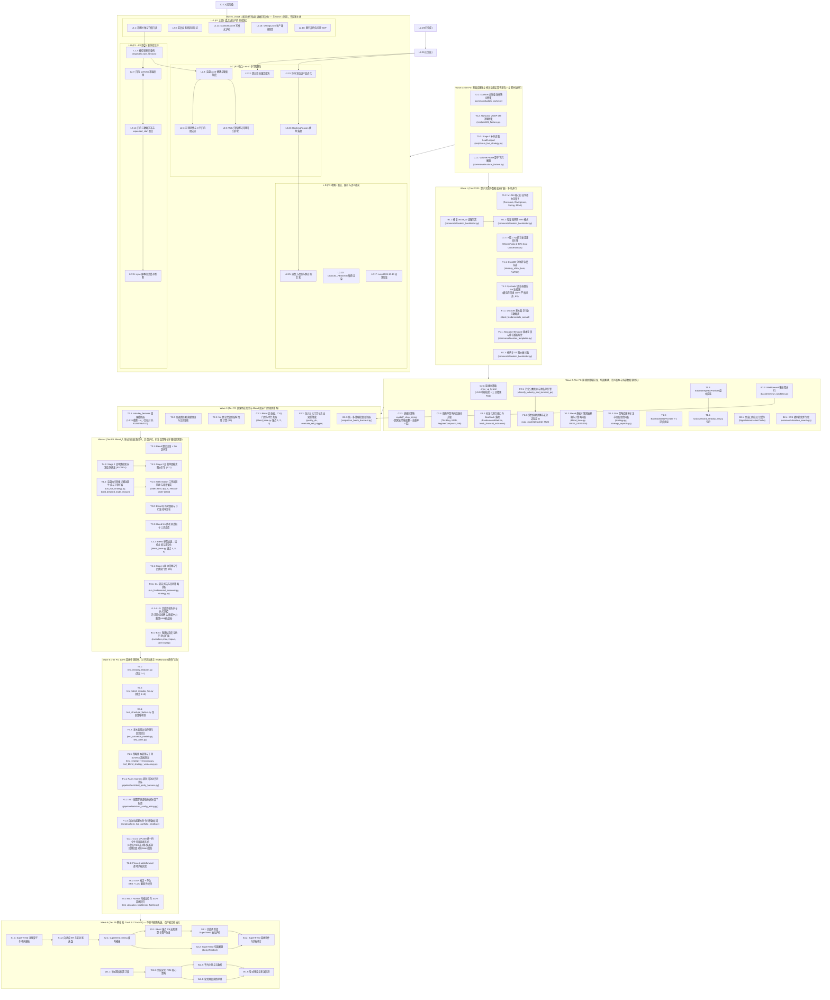

# 全局量化开发任务全量拆解与主优先级执行路线图
# (Master Development Plan & Unified Implementation Roadmap)

> [!IMPORTANT]
> **唯一权威开发任务与路线图总表 (Single Source of Truth)**：
> 本文档是整个代码库所有定量研究、基础设施升级、高频特征提取、多流派策略研发及实盘交易护栏工程的**唯一权威任务拆解、优先级队列、波次编排与执行进度跟踪总表**。
> 
> `docs/` 目录下的各个专项研究与架构设计方案（如 [`docs/intraday_5m_live_and_blend_enhancement_plan.md`](file:///home/stone/Work/github/quant/docs/intraday_5m_live_and_blend_enhancement_plan.md) 与 [`docs/缠论与筹码分布及多流派量化融合实施方案.md`](file:///home/stone/Work/github/quant/docs/%E7%BC%A0%E8%AE%BA%E4%B8%8E%E7%AD%B9%E7%A0%81%E5%88%86%E5%B8%83%E5%8F%8A%E5%A4%9A%E6%B5%81%E6%B4%BE%E9%87%8F%E5%8C%96%E8%9E%8D%E5%90%88%E5%AE%9E%E6%96%BD%E6%96%B9%E6%A1%88.md)）仅承载数学理论建模、代码库审计结论、因果边界推演与代码级详细规范——**所有现存及未来新增的原子任务拆解、进度勾选状态与路线图编排，必须且仅在此文档中集中维护与更新**。

---

## 一、 跨方案架构协同总览 (Cross-Track Architectural Synergy)

### 1.1 核心专项研究与架构设计规范总表 (Core Specifications & Research Docs Table)

| 规范文档路径 | 核心研究主题与架构范围 | 关联任务轨道 | 状态 |
| :--- | :--- | :---: | :---: |
| [`docs/intraday_5m_live_and_blend_enhancement_plan.md`](file:///home/stone/Work/github/quant/docs/intraday_5m_live_and_blend_enhancement_plan.md) | 5分钟高频日内微观结构共振、因果截断引擎与实盘两阶段防透支护栏规范 | Track T | 已落地 |
| [`docs/缠论与筹码分布及多流派量化融合实施方案.md`](file:///home/stone/Work/github/quant/docs/%E7%BC%A0%E8%AE%BA%E4%B8%8E%E7%AD%B9%E7%A0%81%E5%88%86%E5%B8%83%E5%8F%8A%E5%A4%9A%E6%B5%81%E6%B4%BE%E9%87%8F%E5%8C%96%E8%9E%8D%E5%90%88%E5%AE%9E%E6%96%BD%E6%96%B9%E6%A1%88.md) | 缠论中枢、拍卖理论 Volume Profile、A股 CYQ 换手衰减筹码动力学及多流派量化融合方案 | Track C | 已落地 |
| [`docs/snowball_strategy.txt`](file:///home/stone/Work/github/quant/docs/snowball_strategy.txt) | 雪球价值投资双估值模型（5年期末终值折现与成长股息资本化）与安全边际准入体系 | Track F | 已落地 |
| [`docs/wheel_strategy_research.md`](file:///home/stone/Work/github/quant/docs/wheel_strategy_research.md) | 轮式期权复合量化策略 (Options Wheel Strategy) 状态机、VRP方差溢价捕获与缠论支撑门控架构蓝图 | Track W | 孵化中 |
| [`common/indicators.py`](file:///home/stone/Work/github/quant/common/indicators.py) | SuperTrend 单向棘轮、自适应 ER 与多空非对称乘数，及 supertrend_timing 择时策略与 Entry/RiskExit 切面 | Track S | 孵化中 |
| [`docs/six_defects_parity_audit.md`](file:///home/stone/Work/github/quant/docs/six_defects_parity_audit.md) | 基于 Vidovich & Zerjal (2024/2026) 理论的实盘与回测对齐取证审计报告 (六大缺陷排查) | Track P | 实施中 |
| [`common/position_lifecycle.py`](file:///home/stone/Work/github/quant/common/position_lifecycle.py) | 统一持仓生命周期状态机 (UPLSM) 6 状态 FSM、非对称快通道（放量突破 0-delay 闪电建仓 / -8% 止损 0-delay 避险平仓）与两日门禁精简整合方案 | Track G | 已落地 |
| [`common/allocation_backtester.py`](file:///home/stone/Work/github/quant/common/allocation_backtester.py) | 回测系统高并发、跨窗口指标记忆缓存与高拟真度执行引擎升级方案 (记账修复、多进程并行与微观结构拟真) | Track B | 实施中 |
| [`docs/black_list.md`](file:///home/stone/Work/github/quant/docs/black_list.md) | 核心股票池剔除标的权威黑名单档案与失血归因 (SSOT) | 全局 / Live | 已落地 |
| [`docs/backtest_research_impl.md`](file:///home/stone/Work/github/quant/docs/backtest_research_impl.md) | 回测研究文档设计精炼与回测产物自包含落盘：①[`backtester/run_backtest.py`](file:///home/stone/Work/github/quant/backtester/run_backtest.py) 在 `--results-dir` 内自动落盘生效策略 `strategy_dump.json`；②[`docs/backtest_research.md`](file:///home/stone/Work/github/quant/docs/backtest_research.md) 输出路径由 `/tmp/opencode/bt_*` 迁移至仓库内 `backtests_research/<ts>/`，并含 `pfx_of()` 消融前缀修复与消融臂可达性矩阵；③**产物入库留档规范**（原为「`backtests_research/` 不加 `.gitignore` 排除、`INDEX.md` 交叉复核索引、体积纪律与提交信息规范」；**2026-10-25 提交 `5500cc3` 已反转为「运行产物不入库、只留人工报告 `.md` / `INDEX.md` / 股池快照 / `_provenance/`」**，见 §4.15 第 2 条与 [`docs/backtest_research_impl.md`](file:///home/stone/Work/github/quant/docs/backtest_research_impl.md) §4） | Track B | 已落地 |
| [`docs/long_only_multi_asset_gap_analysis.md`](file:///home/stone/Work/github/quant/docs/long_only_multi_asset_gap_analysis.md) | 多资产 Long-Only 指南（ETF Beta + 个股 Alpha + 现金）对照诊断、差距矩阵与 P0/P1 设计增强（rank-band、统一冷却状态机、换手 QP、行业中性化、SleeveAllocator、日频 VWAP/IVOL/1M-1W 因子、执行窗口） | Track M | 规划中（7 项 `[ ]`） |
| [`docs/position_policy_consolidation_design.md`](file:///home/stone/Work/github/quant/docs/position_policy_consolidation_design.md) | 持仓策略内核收敛：AssetPolicy / PortfolioSequencer / SparseProjector 三层，统一冷却、惰性与生命周期；四处旧实现分四阶段 bit-identical 退役 | Track M | 规划中（4 项 `[ ]`） |
| [`docs/development_plan.md`](file:///home/stone/Work/github/quant/docs/development_plan.md) §2.15 `M3.3`–`M3.8` | 5m 标定探针门禁与双轨 raw 存储/动态复权派生架构：`M3.6`/`M3.7`/`M3.8` 闭环落地，`M3.2` 降级结项，`amount`/`adjustflag` 架构就绪 | Track M | 实施中（3 项完成 / 3 项待办）（**2026-11-01 补记，不回改左侧快照**：按 `M3.3`–`M3.11` 现行逐行实测为 **7 项完成 / 2 项待办** —— `[x]` = `M3.3`/`M3.4`/`M3.6`/`M3.7`/`M3.8`/`M3.9`/`M3.10`，`[ ]` = `M3.5`/`M3.11`；其中 `M3.4` 于 2026-11-01 经用户裁决按剩余 6 条结项、其第 4 条拆出至新行 `M3.11` 承接，故「3 项完成 / 3 项待办」已不成立。本行标题所述 `M3.3`–`M3.8` 范围亦不覆盖后增的 `M3.9`–`M3.11`，权威明细一律以 §2.15 表为准） |

> **轨道归档状态（2026-10-24）**：本表 4 列结构不变。关联任务轨道中 **Track T / Track C / Track F / Track L1（`L1.1`–`L1.5`）/ Track V / Track G**，以及 **`L2.1`–`L2.8`**（§2.11/§2.12）的全部任务行已闭环并原文移入 [`docs/development_plan_archive.md`](file:///home/stone/Work/github/quant/docs/development_plan_archive.md)；仍留在现役清单的是 **Track S、Track W、Track P、Track B** 与 **Track L（`L2.9`–`L2.62`）**。上表「状态」列保留归档时的原判，不回改。
>
> **轨道归档状态 · 补记（2026-10-24，仅 Track C 一项被后续审计改写）**：上句对 **Track T / Track F / Track L1 / Track V / Track G** 以及 **`L2.1`–`L2.8`** 仍然成立；**对 Track C 已不再成立** —— 同日归档之后的一次**只读代码审计**在现役计划中新开了 **3 项** Track C 缺陷行（**§2.14 的 `C6.1`–`C6.3`，全部 `[ ]`、未开工**（2026-10-29 已全部闭环，见 §2.14））（2026-10-29：`C6.x` 已闭环 `[x]`，见 §2.14 该行第 8 条 / ✅ 段；Track C 审计衍生三项至此清零。），故"Track C 的全部任务行已闭环并原文移入归档"只描述**归档时点**的事实：Track C 现在**同时**存在于归档（`C1.1`–`C5.3` 原文，12 行，未回退、未改写、未重编号）与现役（`C6.1`–`C6.3`，3 行）。**未回退任何归档动作，上表「状态」列仍不因本补记回改**。

### 1.2 跨体系因果交汇与架构拓扑 (Cross-Track Architectural Synergy)

当前代码库正处于从“纯日线形态/中枢回测”向“**5分钟日内高频微观结构共振（Track T）** + **形态学/拍卖理论/A股筹码分布多流派量化融合（Track C）** + **SuperTrend 自适应趋势跟踪与切面止损体系（Track S）** + **雪球价值投资双估值与安全边际选股体系（Track F）** + **实盘调仓防抖与风控执行（Track L）** + **策略语义版本与深度动因审计（Track V）** + **轮式期权复合策略体系（Track W）** + **实盘回测对齐测试床体系（Track P）**”多轨协同演进的关键阶段。各大体系并非割裂运作，而是深度共享底层基础设施，并在特征算子层、切面解耦层、策略层与实盘层形成强烈的非线性 Alpha 乘数效应、基本面确定性安全边际、对齐验证防线与单向棘轮风险锁死机制：

```mermaid
flowchart TD
    subgraph INFRA["1. 共享底层基础设施与数据层 (Shared Infrastructure)"]
        CACHE["common/duckdb_cache.py\n(多轨列式存储: ohlcv_bars 日线 + intraday_ohlcv_bars 5m + stock_fundamentals_annual 基本面)"]
        DATA["common/data.py & common/financial_api.py\n(BaoStock T-1基本面/5m底座 + 东财盘中直连 + 极值锁定布朗桥合成器)"]
    end

    subgraph OPERATORS["2. 算子、特征与基本面估值层 (Four Factor & Feature Engines)"]
        TRACK_T_FEAT["Track T: 因果日内高频特征聚合\ncommon/intraday_features.py\n(VWAP, RV_5m, RS_Down_5m, UpVol_Ratio, SmartMoney)"]
        TRACK_C_FACT["Track C: 结构形态与筹码动力学算子\ncommon/structural_factors.py\n(Curvature κ, Divergence, Wyckoff Spring, CYQ 筹码)"]
        TRACK_S_FACT["Track S: 趋势跟踪与自适应算子\ncommon/indicators.py\n(supertrend, adaptive_supertrend, kaufman_efficiency_ratio)"]
        TRACK_F_FACT["Track F: 价值投资双估值与基本面引擎\npipeline/fundamental_screener/fscreen/valuation_models.py\n(Model 1 终值折现, Model 2 股息资本化, MoS 20%, 行业分类)"]
    end

    subgraph SYNERGY["3. 核心跨方案交汇与数据共振 (Core Synergies)"]
        SYN1["协同 1: 48倍真微观 Volume Profile\n(intraday_features 复用 structural_factors.compute_rolling_poc_series)"]
        SYN2["协同 2: 5m 真实成交核驱动 CYQ 筹码分布\n(以 48根 5m 真实分箱替代日线三角核代理)"]
        SYN3["协同 3: 日内 + 日线双级防洗盘止损\n(早盘毛刺止损豁免与 Wyckoff 弹簧破底翻共振)"]
        SYN4["协同 4: SuperTrend 追踪止损切面解耦\n(通用单向棘轮风控切面，可与任意 Alpha 入场模型即插即用无缝挂载)"]
        SYN5["协同 5: 基本面质地硬门禁与安全边际定价\n(5大财务底线过滤垃圾资产，MoS 20% 安全边际防守)"]
    end

    subgraph STRATEGY["4. 策略与配置层 (Strategies & Modular Blend Base)"]
        CONFIG["pipeline/research_strategy/rs/config.py\n(默认值按锚点区分：锚点 1/2 = True，锚点 3/4/5 = False\nchan_mrd_entry_mode = raw_b1，权威清单见方案书 §6.2)"]
        STRATS["旗舰新策略与切面组合库\n• chan_vp_hybrid (中枢筹码混合)\n• wyckoff_chan_spring (弹簧破底翻)\n• supertrend_timing (自适应趋势跟踪择时)\n• timing_aspects (SuperTrend 入场与风控出场切面)\n• fundamental_screener (雪球双估值与五大硬门禁选股)"]
        BLEND["pipeline/research/blend/blend_base.py (及五大子类)\n• 锚点 1: 分形维数 D_t 宏观状态机风格预算\n• 锚点 2: CYQ 获利盘比例与假中枢质量门禁\n• 锚点 3: VAH 突破与筹码单峰冲力共振定仓\n• 锚点 4: 破底翻 Day 1 加速建仓与顶背驰否决\n• 锚点 5: 结构化 ZG/VAL 吊灯止损与 NPOC 止盈\n• 锚点 6: Rolling IC-IR 与 Löwdin 正交化\n• 锚点 7: 宏观宽基 SuperTrend 状态机折半风险预算\n• 锚点 8: 标的级 SuperTrend 下穿动量防线一票否决置 0.0"]
    end

    subgraph LIVE["5. 实盘执行护栏 (Two-Stage Live Execution)"]
        STAGE1["scripts/check_live_portfolio_health.py @ 14:00\n(逐笔盯市 HWM 回撤、午后跳水门禁、下行半方差缩放、CAUTION_SUPERTREND_BREAK 破位预警)"]
        STAGE2["scripts/run_live_strategy.py @ 14:15\n(跌停封死双向冻结防透支、T+1涨停拦截、双模式限价引导、supertrend_stop_level 动态止损单)"]
    end

    INFRA --> OPERATORS
    OPERATORS --> SYNERGY
    SYNERGY --> STRATEGY
    STRATEGY --> LIVE
    STAGE1 -->|"account_state.json &\nstage1_health_report.json"| STAGE2
```

（2026-10-27 复核：图中 `CACHE` 节点未列 `adjust_factors` 因子表 —— 该表已随 M3.8 落地成为双轨存储核心，此处为高层示意，未穷举全部表）

### 1.3 近期核心里程碑与架构闭环留痕 (Recent Milestones & Closure Notes)

- **2026-10-27 (`L2.48`) 生命周期状态机回测同源启用 (UPLSM Backtester Parity)**：
  - `common/position_lifecycle.py` 新增 `simulate_position_lifecycle` 与配置解析器，支持开仓确认、T+1 妊娠锁、非对称冷却、-8% 硬止损与 ATR 吊灯止损快路径及 `cash_proxy` 停泊，严格满足稀疏权重 0.0 与全 NaN 契约；
  - `backtester/run_backtest.py` 默认开启 `--enable-position-lifecycle`，提供 `--no-position-lifecycle` 反向逃生门确保逐位可比；`pipeline/parity_harness.py` 增设逐日决策一致性校验；100% 离线通过 8 个专项测试。
- **2026-10-27 (`M3.6` & `M3.8`) 双轨 raw 不可变存储与内存向量化复权派生 (Dual-Track Raw Storage & In-Memory Factor Derivation)**：
  - `common/duckdb_cache.py` 扩展列（**按表分开**）：日线 `ohlcv_bars` 只加 `amount DOUBLE`（`:1174-1183`，**无 `adjustflag` 列** —— 日线复权基是**表级**的，落在 `asset_sync_metadata.adjustflag`）；5m `intraday_ohlcv_bars` 加 `amount DOUBLE` + **行级** `adjustflag VARCHAR`（`:1186-1198`）；`intraday_sync_metadata` 加 `adjustflag`（`:1201-1212`）；新增 `adjust_factors` 因子表并实现幂等加列（`_ensure_column`，`:1281-1285`）**（2026-10-27 复核更正：原文写「扩展 `ohlcv_bars` 与 `intraday_ohlcv_bars` 包含 `amount DOUBLE` 与 `adjustflag VARCHAR`」，把 5m 的行级 `adjustflag` 误记到了日线表上；日线实际只有 `amount`，且 5m 那个行级列是写侧留痕、读路径从不 SELECT 它，不是读侧语义。权威出处：`docs/version.md` §22.2 第 1 条）**；
  - 存储层彻底解耦：日线与 5m 仅存 raw（不复权）OHLCV 与真实 Volume/Amount，实现物理体积缩减约 67%（2026-10-27 复核更正：67% 是理论收益（单口径存储取代 n 份副本的 `(n−1)/n` 分档），不是已实现的物理体积 —— 历史双份副本的破坏性清理（`M3.7` 第 4 条双闸 + parquet 备份 + `VACUUM`）未落地，现库内仍并存历史重复行，实际体积未缩减；权威出处 `docs/version.md` §22.2 第 9 条末段、§23.5 第 6 条）；
  - 读时计算：`DuckDBCache.query_bars`/`query_intraday_bars` 与 `CachedDataProvider.get_bars`/`get_intraday_bars` 走向量化缩放动态派生 QFQ/HFQ，`adjustflag` 降级为读时计算维度**（2026-10-27 复核更正：原文写 `DuckDBCache.get_bars`/`query_bars`/`query_intraday_bars`，但 `DuckDBCache` 侧方法只有 `query_bars` / `query_intraday_bars`；`get_bars` / `get_intraday_bars` 是 `CachedDataProvider`（`common/data.py`）的方法名 —— 全仓 `def get_bars` / `def get_intraday_bars` 只命中 `common/data.py:870` / `:1053`，`common/duckdb_cache.py` 侧为 `:2844` / `:2758`）**；
  - 严格保持 Volume 与 Amount 不变性，数学上彻底根除除权导致的 `HistoryRewriteRefused` 门禁冲突；离线通过硬门禁相对误差 $\le 10^{-6}$ 对账单测（2026-10-27 复核更正：「硬门禁」仅指离线断言阈值，运行时无任何精度门禁；替代保障是 fail-closed 异常（`MissingAdjustFactorsError` / `UnknownAdjustBasisError` / `AdjustBasisRequiredError` / `AdjustBasisTransitionRefused`）。权威出处 `docs/version.md` §22.3 第 1 条）。

### 1.4 底座数据存储与时序生命周期对齐进展 (Data Infra & Position Lifecycle Parity)

- **时序对齐**：回测执行器现已与实盘两阶段引擎共享统一的持仓状态机逻辑，消除回测与实盘调仓换手、持仓周期、止损退场维度的非同源失真；
- **数据不可变防线**：DuckDB 列式存储正式迈入 raw 不可变存储 + 读时动态派生新纪元，为后续 5m 真实成交核驱动 Volume Profile、高频因子标定与多资产配置提供无历史重写风险的高保真底层底座。

---

## 二、 现役原子任务清单（现役 123 项；另有已归档 66 项，见 [development_plan_archive.md](file:///home/stone/Work/github/quant/docs/development_plan_archive.md)）（⚠ 计数见 §4.30，现役 148 项）

> **计数口径（按任务行实数核定；改数请只改这一行，历史沿革见其下括注）**：**66（归档）+ 88（现役已完成）+ 35（现役待办）= 189**。现役子表口径（**2026-10-29 起**：`L2.41`/`L2.46` 已移出 §2.13 至新表 §2.18，故 **§2.13 由 54 收为 52**、**新增 §2.18 = 2**，合计仍 118（该「118」为 2026-10-29 时点；现役现为 **123**，见本节末 2026-10-30 口径同步括注）；移出前的子表切分为 `§2.13 54 / §2.14 3 / §2.15 15 / §2.16 4`）：**§2.3 7 / §2.7 5 / §2.8 10 / §2.10 20 / §2.13 52 / §2.14 3 / §2.15 15 / §2.16 4 / §2.18 2 / §2.19 5 = 123 项**（其中 `[x]` **88** / `[ ]` **35**；§2.13 追加 `L2.51` 后为 **43**、再追加 `L2.52` 后为 **44**（其中 `[x]` **38** / `[ ]` **6**）、`L2.53`/`L2.62` 于 2026-10-29 双双闭环后为 **54**（其中 `[x]` **48** / `[ ]` **6**）、`L2.52` 阶段二于同日按负结果结案后再为 **54**（其中 `[x]` **49** / `[ ]` **5**）；§2.15 为 **15**（其中 `[x]` **5** / `[ ]` **10**；**2026-10-31 起**：`M3.9` 闭环后 `[x]` 4 → **5**、`[ ]` 11 → **10**，总项数仍 15）；已归档 8 张子表（§2.1 21 / §2.2 12 / §2.4 7 / §2.5 5 / §2.6 8 / §2.9 5 / §2.11 5 / §2.12 3 = **66** 项，全部 `[x]`）**单独计数、永不并入上式右侧的现役项**，逐行原文见 [`docs/development_plan_archive.md`](file:///home/stone/Work/github/quant/docs/development_plan_archive.md)。**（2026-10-24 缓存普查衍生 `L2.46` 登记后重算：§2.13 37 → **38**，现役 79 → **80**，`[ ]` 13 → **14**；已归档 66 与 `[x]` 66 均不变，实数为 `66 + 66 + 14 = 146`。）** **（2026-10-24 Track C 只读审计衍生 `C6.1`–`C6.3` 登记后再次重算：新开子表 **§2.14 = 3**，现役 80 → **83**，`[ ]` 14 → **17**；已归档 66 与 `[x]` 66 均不变，实数为 `66 + 66 + 17 = 149`。该 3 条均为 `[ ]` 登记行（零代码改动、零闭环、零版本轴变动），故 `[x]` 仍为 **66**、归档仍为 **66**。）** **（2026-10-24 审计衍生 `L2.47` 登记后重算：§2.13 38 → **39**，现役 83 → **84**，`[ ]` 17 → **18**；已归档 66 与 `[x]` 66 均不变，实数为 `66 + 66 + 18 = 150`。）** **（2026-10-24 `L2.48` 生命周期状态机同源启用登记后重算：§2.13 39 → **40**，现役 84 → **85**，`[ ]` 18 → **19**；已归档 66 与 `[x]` 66 均不变，实数为 `66 + 66 + 19 = 151`。）** **（2026-10-24 `L2.49` 换手率削减研究登记后重算：§2.13 40 → **41**，现役 85 → **86**，`[ ]` 19 → **20**；已归档 66 与 `[x]` 66 均不变，实数为 `66 + 66 + 20 = 152`。）** **（2026-10-24 `L2.50` 熔断可检验性登记后重算：§2.13 41 → **42**，现役 86 → **87**，`[ ]` 20 → **21**；已归档 66 与 `[x]` 66 均不变，实数为 `66 + 66 + 21 = 153`。）** **（2026-10-25 `L2.51` 评级换手硬闸登记并闭环后重算：§2.13 42 → **43**，现役 87 → **88**，`[x]` 66 → **67**、`[ ]` 21 不变；已归档 66 不变，实数为 `66 + 67 + 21 = 154`。）** **（2026-10-25 `L2.52` 登记后重算：§2.13 43→44、现役 88→89、`[ ]` 21→22；归档 66 与 `[x]` 67 不变。）** **（2026-10-26 Track M 登记后重算：§2.15 = 7，现役 89 → 96，`[ ]` 22 → 29；已归档 66 与 `[x]` 67 均不变，实数为 66 + 67 + 29 = 162。该 7 条均为 `[ ]` 登记行：零代码改动、零闭环、零版本轴变动。）** **（2026-10-26 Track M §2.16 登记后重算：§2.16 = 4，现役 96 → 100，`[ ]` 29 → 33；已归档 66 与 `[x]` 67 均不变，实数为 66 + 67 + 33 = 166。该 4 条均为 `[ ]` 登记行：零代码改动、零闭环、零版本轴变动。）** **（2026-10-26 Track M §2.15 扩表 `M3.3`–`M3.5` 登记后重算：§2.15 7 → 10，现役 100 → 103，`[ ]` 33 → 36；已归档 66 与 `[x]` 67 均不变，实数为 66 + 67 + 36 = 169。该 3 条均为 `[ ]` 登记行：零代码改动、零闭环、零版本轴变动。）** **（2026-10-26 `M3.6`–`M3.8` 登记后重算：§2.15 10 → 13，现役 103 → 106，`[ ]` 36 → 39；已归档 66 与 `[x]` 67 均不变，实数为 66 + 67 + 39 = 172。该 3 条均为 `[ ]` 登记行：零代码改动、零闭环、零版本轴变动。）** **（2026-10-26 `M3.9` 登记后重算：§2.15 13 → 14，现役 106 → 107，`[ ]` 39 → 40；已归档 66 与 `[x]` 67 均不变，实数为 66 + 67 + 40 = 173。该 1 条为 `[ ]` 登记行：零代码改动、零闭环、零版本轴变动。）** **（2026-10-26 `M3.2` 按预注册判定降级并结项后重算：§2.15 仍 14，现役仍 107，`[x]` 67 → 68、`[ ]` 40 → 39；已归档 66 不变，实数为 66 + 68 + 39 = 173。本次为状态迁移（`[ ]`→`[x]`）与一个既有行的内容追加，未新增任务行、零代码改动、零版本轴变动。）** **（2026-10-26 `M3.10` 登记后重算：§2.15 14 → 15，现役 107 → 108，`[ ]` 39 → 40；已归档 66 与 `[x]` 68 均不变，实数为 66 + 68 + 40 = 174。该 1 条为 `[ ]` 登记行：零代码改动、零闭环、零版本轴变动。）** **（2026-10-27 `L2.48`、`M3.6`、`M3.8` 闭环后重算：§2.13 44 项中 `[x]` 37 → 38、`[ ]` 7 → 6；§2.15 15 项中 `[x]` 1 → 3、`[ ]` 14 → 12；现役 108 项中 `[x]` 68 → 71、`[ ]` 40 → 37；已归档 66 项不变，两文件合计 174 = 66 + 71 + 37 = 137 `[x]` + 37 `[ ]`。本次为 3 项状态迁移，无新增任务行。）** **（2026-10-27 `M3.7` 闭环后重算：§2.15 仍 15 项，其中 `[x]` 3 → **4**、`[ ]` 12 → **11**；现役 108 项不变，`[x]` 71 → **72**、`[ ]` 37 → **36**；已归档 66 项（全 `[x]`）不变，实数为 `66 + 72 + 36 = 174`，两文件合计 **138 `[x]` + 36 `[ ]` = 174**。逐表核算：§2.3 `0/7`、§2.7 `0/5`、§2.8 `10/0`、§2.10 `20/0`、§2.13 `38/6`、§2.14 `0/3`、§2.15 `4/11`、§2.16 `0/4` ⇒ `[x]` 0+0+10+20+38+0+4+0 = **72**、`[ ]` 7+5+0+0+6+3+11+4 = **36**、合计 7+5+10+20+44+3+15+4 = **108**。本次为 1 项状态迁移（`M3.7`：5m 双写随 `0fa81ab` 消除 + 日线补丁 raw 化随 2026-10-27 评审修复完成），**无新增任务行、零代码策略层改动、零版本轴变动**（未 bump `version` / `BASE_VERSION`，未重跑 `--dump-strategies`，见 `docs/version.md` §23.6）。）** **（2026-10-27 `L2.54`–`L2.57` 登记后重算：§2.13 45 → 49（`L2.53` 2026-10-27 登记时未计入旧口径的 44，本条一并纠正：45 = `L2.9`–`L2.53`、49 = `L2.9`–`L2.57`），现役 109 → 113，`[x]` 72 → 76、`[ ]` 37 不变（新增 4 项全为当日登记并闭环的 `[x]`）；已归档 66 不变，实数为 `66 + 76 + 37 = 179`。逐表核算：§2.3 `0/7`、§2.7 `0/5`、§2.8 `10/0`、§2.10 `20/0`、§2.13 `42/7`、§2.14 `0/3`、§2.15 `4/11`、§2.16 `0/4` ⇒ `[x]` 0+0+10+20+42+0+4+0 = 76、`[ ]` 7+5+0+0+7+3+11+4 = 37、合计 7+5+10+20+49+3+15+4 = 113。）** **（2026-10-27 `L2.58`–`L2.62` 登记后重算：§2.13 49 → 54（`[x]` 42 → 46、`[ ]` 7 → 8）；现役 113 → 118（`[x]` 76 → 80、`[ ]` 37 → 38）；归档 66 不变，合计 184 = 146 `[x]` + 38 `[ ]`。逐表核算：§2.3 `0/7`、§2.7 `0/5`、§2.8 `10/0`、§2.10 `20/0`、§2.13 `46/8`、§2.14 `0/3`、§2.15 `4/11`、§2.16 `0/4` ⇒ `[x]` 0+0+10+20+46+0+4+0 = 80、`[ ]` 7+5+0+0+8+3+11+4 = 38、合计 7+5+10+20+54+3+15+4 = 118。新增 5 行中 `L2.58`–`L2.61` 四项为 2026-10-27 当日登记并闭环的 `[x]`、`L2.62` 为只读设计完成但未实施的 `[ ]`。）** **（2026-10-29 `L2.53` 净额部署缺口与 `L2.62` 同日实例目录双双闭环后重算：§2.13 **54 项不变**（`[x]` 46 → **48**、`[ ]` 8 → **6**）；现役 **118 项不变**（`[x]` 80 → **82**、`[ ]` 38 → **36**）；已归档 66 不变，合计 **184 = 148 `[x]` + 36 `[ ]`**。逐表核算：§2.3 `0/7`、§2.7 `0/5`、§2.8 `10/0`、§2.10 `20/0`、§2.13 `48/6`、§2.14 `0/3`、§2.15 `4/11`、§2.16 `0/4` ⇒ `[x]` 0+0+10+20+48+0+4+0 = **82**、`[ ]` 7+5+0+0+6+3+11+4 = **36**、合计 7+5+10+20+54+3+15+4 = **118**。本轮**无新增行**：`L2.53` 与 `L2.62` 都是既有登记行，本次只是由 `[ ]` → `[x]`，故子表项数与现役总数均不变。）** **（2026-10-29 `L2.52` 阶段二负结果结案后重算：§2.13 **54 项不变**（`[x]` 48 → **49**、`[ ]` 6 → **5**）；现役 **118 项不变**（`[x]` 82 → **83**、`[ ]` 36 → **35**）；已归档 66 不变，实数为 **184 = 149 `[x]` + 35 `[ ]`**。逐表核算：§2.3 `0/7`、§2.7 `0/5`、§2.8 `10/0`、§2.10 `20/0`、§2.13 `49/5`、§2.14 `0/3`、§2.15 `4/11`、§2.16 `0/4` ⇒ `[x]` 0+0+10+20+49+0+4+0 = **83**、`[ ]` 7+5+0+0+5+3+11+4 = **35**、合计 7+5+10+20+54+3+15+4 = **118**。本轮**无新增行**：`L2.52` 是既有登记行，本次仅由 `[ ]` → `[x]`；语义上按该行第 6 条「可能无解」结案为**「无合资格杠杆」**，阶段二**未落地任何机制**（零代码改动、零版本轴变动），详见该行末 ✅ 段与 §4.21。）****（2026-10-29 `L2.41`/`L2.46` 移出 Track L 至 §2.18 后重算（本条最新权威值）：§2.13 `54 项 = 49 + 5` → **52 项 = 49 `[x]` + 3 `[ ]`**，新开 **§2.18 = 2 项 = 0 `[x]` + 2 `[ ]`**；现役 **118 项不变**（`[x]` **83** / `[ ]` **35**）；已归档 66 不变，两文件合计 **184 = 149 `[x]` + 35 `[ ]` 不变**。逐表核算：§2.3 `0/7`、§2.7 `0/5`、§2.8 `10/0`、§2.10 `20/0`、§2.13 `49/3`、§2.14 `0/3`、§2.15 `4/11`、§2.16 `0/4`、§2.18 `0/2` ⇒ `[x]` 0+0+10+20+49+0+4+0+0 = **83**、`[ ]` 7+5+0+0+3+3+11+4+2 = **35**、合计 7+5+10+20+52+3+15+4+2 = **118**。本轮**无新增、无删除任务行**：两项为**整行逐字迁移**（`L2.41`、`L2.46` 由 §2.13 表迁至 §2.18），状态一字未翻，故现役总数与两文件合计均不变。）****（2026-10-29 `C6.1`/`C6.2`/`L2.49` 三项闭环后重算（本条最新权威值）：现役 **118 项 = 87 `[x]` + 31 `[ ]`**；**§2.13 `52 项 = 50 `[x]` + 2 `[ ]`**（`L2.49` 由 `[ ]`→`[x]`）、**§2.14 `3 项 = 3 `[x]` + 0 `[ ]`**（`C6.1`/`C6.2` 双双 `[ ]`→`[x]`），§2.15 `4/11`、§2.16 `0/4`、§2.18 `0/2` 均不变；已归档 66 不变，两文件合计 **184 = 153 `[x]` + 31 `[ ]`**。逐表核算：§2.3 `0/7`、§2.7 `0/5`、§2.8 `10/0`、§2.10 `20/0`、§2.13 `50/2`、§2.14 `3/0`、§2.15 `4/11`、§2.16 `0/4`、§2.18 `0/2` ⇒ `[x]` 0+0+10+20+50+3+4+0+0 = **87**、`[ ]` 7+5+0+0+2+0+11+4+2 = **31**、合计 7+5+10+20+52+3+15+4+2 = **118**。本轮**无新增/删除任务行**：三项均为既有登记行的状态迁移（`C6.1`/`C6.2` 为代码闭环，`L2.49` 为负结果结案），故子表项数、现役总数与两文件合计均不变。）****（2026-10-30 口径同步：`D10`–`D14` 正式登记（新开 §2.19）+ 差额归属写入 `状态口径` 行）**：现役 **123 项 = 87 `[x]` + 36 `[ ]`**；已归档 66 项（全 `[x]`）不变，两文件合计 **189 = 153 `[x]` + 36 `[ ]`**。子表口径更新为 **§2.3 7 / §2.7 5 / §2.8 10 / §2.10 20 / §2.13 52 / §2.14 3 / §2.15 15 / §2.16 4 / §2.18 2 / §2.19 5 = 123**（**§2.19 = 5** 为本次新登记；**§2.13 的 52 项仍等于 50 `[x]` + 2 `[ ]`**，待办只有 `L2.47`/`L2.50`，新增的 5 项**全部落在 §2.19、未并入 §2.13**，故「§2.19 的 5 项」与「§2.13 的 2 项待办」不得混读）。本次为**纯登记**：`D10`–`D14` 全 `[ ]`、零代码改动、零版本轴变动，故 `[x]` **87 不变**、`[ ]` 由 31 → **36**、合计 118 → **123**。逐表核算：`[x]` 0+0+10+20+50+3+4+0+0+0 = **87**；`[ ]` 7+5+0+0+2+0+11+4+2+5 = **36**；合计 7+5+10+20+52+3+15+4+2+5 = **123**。）** **（2026-11-01 补记，`M3.4` 结项 + 新增 `M3.11` 后重算；不回改上段任何数字）**：现役 **124 = 91 `[x]` + 33 `[ ]`**、两文件合计 **190 = 157 `[x]` + 33 `[ ]`**（归档 8 张子表仍 **66 项全 `[x]`**）。子表口径：`§2.15` 由 **15 → 16 项**，其中 `[x]` **7 → 8**、`[ ]` **8 不变**（`M3.4` 由 `[ ]` 转 `[x]` 与新增 `M3.11` 一项 `[ ]` 恰好互相抵消），故 `§2.3 7 / §2.7 5 / §2.8 10 / §2.10 20 / §2.13 52 / §2.14 3 / §2.15 16 / §2.16 4 / §2.18 2 / §2.19 5 = 124` 项。 **（2026-11-01 补记之二，`M1.2` 闭环后重算；不回改上段任何数字）**：`M1.2` 由 `[ ]` 转 `[x]` 后，现役 **124 = 92 `[x]` + 32 `[ ]`**、两文件合计 **190 = 158 `[x]` + 32 `[ ]`**（归档 8 张子表仍 **66 项全 `[x]`**）；项数不变、只是 1 项由待办转完成。子表口径：`§2.15` **16 项 = 9 `[x]` + 7 `[ ]`**（总项数仍 16，仅 `[x]` 8 → 9、`[ ]` 8 → 7），故 `§2.3 7 / §2.7 5 / §2.8 10 / §2.10 20 / §2.13 52 / §2.14 3 / §2.15 16 / §2.16 4 / §2.18 2 / §2.19 5 = 124`。 **（2026-11-01 补记之三，`M2.1` 闭环后重算；不回改上段任何数字）**：`M2.1` 由 `[ ]` 转 `[x]` 后，现役 **124 = 93 `[x]` + 31 `[ ]`**、两文件合计 **190 = 159 `[x]` + 31 `[ ]`**（归档 8 张子表仍 **66 项全 `[x]`**）；项数不变、只是 1 项由待办转完成。子表口径：`§2.15` **16 项 = 10 `[x]` + 6 `[ ]`**（总项数仍 16，仅 `[x]` 9 → 10、`[ ]` 7 → 6），故 `§2.3 7 / §2.7 5 / §2.8 10 / §2.10 20 / §2.13 52 / §2.14 3 / §2.15 16 / §2.16 4 / §2.18 2 / §2.19 5 = 124`。 **（2026-11-01 5m 风控议程登记后重算；不回改上段任何数字）**：§2.20 新增 6 行（全 `[ ]`，其中 `D6` 一条带 `⏸` 挂起注记）后，现役本表 **124 → 130 项 = 93 `[x]` + 37 `[ ]`**、两文件合计 **190 → 196 = 159 `[x]` + 37 `[ ]`**（归档 8 张子表仍 **66 项全 `[x]`**）。机械口径（本节唯一认可，逐任务行计数而非数叙事）：`grep -cE '^\| \*\*`[^`]+`\*\* \| `\[x\]`' docs/development_plan.md` 与同式的待办版 —— 2026-11-01 本次编辑**前**实测 **93 `[x]` / 31 `[ ]`**、编辑**后**实测 **93 `[x]` / 37 `[ ]`**。子表口径：`§2.3 7 / §2.7 5 / §2.8 10 / §2.10 20 / §2.13 52 / §2.14 3 / §2.15 16 / §2.16 4 / §2.18 2 / §2.19 5 / §2.20 6 = 130`。**`§2.20 = 6` 是独立子表，不并入任何既有子表**（不并入 `§2.13`、不并入 `§2.19`、不并入 `§2.15`）。本次为**纯登记**：零代码改动、零版本轴变动（不碰 `BASE_VERSION`、不碰任何 per-class `version`、未跑 `--dump-strategies`、未改 `docs/version.md`）。**必须一并声明**：上句「现役现为 **123**」、`§2.19 5 = 123` 与本行历次括注中的 88 / 35、87 / 36、90 / 33、91 / 33、92 / 32、93 / 31 各组数字均为各自登记时点的快照，按「只追加、不回改」惯例保持原样，**不得据此复算当前口径**；`## 二、` 标题里的「现役 123 项」（`:100`）同理，亦为历史快照。 **（2026-11-02 补记：§2.21 登记 10 项 `LV` 后重算）** 现役 **130 → 140**（`[x]` **93 不变** / `[ ]` **37 → 47**）；两文件合计 **196 → 206 = 159 `[x]` + 47 `[ ]`**（归档 8 张子表仍 **66 项全 `[x]`**）。子表口径：`§2.3 7 / §2.7 5 / §2.8 10 / §2.10 20 / §2.13 52 / §2.14 3 / §2.15 16 / §2.16 4 / §2.18 2 / §2.19 5 / §2.20 6 / §2.21 10 = 140`。**`§2.21 = 10` 是独立子表**（编号族 `LV1`–`LV10`），不并入 §2.13、不并入 §2.19、不并入 §2.20、也不并入 §2.15；本次为**纯登记**：10 行全 `[ ]`、零代码改动、零版本轴变动（不碰 `BASE_VERSION`、不碰任何 per-class `version`、未跑 `--dump-strategies`、未改 `docs/version.md`），故 `[x]` 一项未动。本补记**之前**的 130 / 37 / 196 各组数字仍是各自时点快照，按「只追加、不回改」惯例原样保留，**不得据此复算当前口径**。 **（⚠ 过期快照，勿据此计数；权威计数见 §4.30：现役 `148 = 96 [x] + 52 [ ]`、两文件合计 `214 = 162 [x] + 52 [ ]`；2026-11-04 `LV11`/`LV2` 结项与 `LV13`–`LV18` 登记后未回改）**
>
> **沿革（留痕用，不参与上式校验）**：原口径 83 项 ⇒ 2026-10-23 追加 §2.2 的 `C5.1`–`C5.3` 3 项、§2.8 的 `P1.4`–`P1.7` 4 项、§2.10 的 `B5.1`–`B5.3` 3 项，10 张子表计 93 项（其中 §2.1 实为 21 项、§2.2 实为 12 项、§2.8 实为 7 项、§2.10 实为 16 项，早期标注 19/12 已修正）；§2.11/§2.12 新增 8 项；§2.13 由初版 13 项经 `L2.22`–`L2.45` 逐轮追加至 37 项（最近一轮为 2026-10-24 的 `L2.44`/`L2.45`；此后 2026-10-24 缓存普查再追加 `L2.46` 一项 `[ ]`，故现为 **38** 项 —— 此处 37 为追加当时的历史值）。**2026-10-24 事故衍生追加 4 项：§2.8 的 `P1.8` 与 §2.10 的 `B6.1`–`B6.3`** —— 四者均派生自当日 `strategy_dumps` 漂移事故与默认路径加固（[`docs/version.md`](file:///home/stone/Work/github/quant/docs/version.md) §20），属**事故衍生的新工作**（新开 `[ ]` 行），**不是**对既有已完成任务的事后追认/回补；10 张子表随之由 93 项增至 **97** 项（§2.8 8 / §2.10 19）。§4.7 记载的「108 项」是**当轮**实数，属历史记载、不需回改；§4.5/§4.6 的 14 项实盘专项修复为已完成的记录性条目，未拆分为原子任务，不计入本口径。**（2026-10-24 归档后补记）**：上述「10 张子表」中的 §2.1 / §2.2 / §2.4 / §2.5 / §2.6 / §2.9 / §2.11 / §2.12 共 **66 行**（全部 `[x]`）已原文移入 [`docs/development_plan_archive.md`](file:///home/stone/Work/github/quant/docs/development_plan_archive.md)；本文件只保留 §2.3 / §2.7 / §2.8 / §2.10 / §2.13 共 **76 行**（`[x]` 59 / `[ ]` 17，2026-10-24 当日事故衍生 4 项全部闭环后更新为 `[x]` 63 / `[ ]` 13）。故「97 + 8 + 37 = 142」是**归档前**的留痕算式，不再等同于本文件实有行数；归档未改写、未重排、未重编号任何一行。**（2026-10-24 评审后追加）**：独立复核衍生的 3 项新任务 —— §2.8 的 `P1.9`/`P1.10` 与 §2.10 的 `B6.4` —— 已作为 `[ ]` 行录入，**均未开工**（零代码改动、零闭环、零版本轴变动）；现役行数 76 → **79**，`[ ]` 13 → **16**，两文件合计 142 → **145**。**（2026-10-24 补记：`P1.9` / `P1.10` / `B6.4` 三项现已**全部闭环** —— 分别见 [`docs/version.md`](file:///home/stone/Work/github/quant/docs/version.md) §20.10（含 §20.10.1 第二轮补封）/ §20.11 / §20.12；上文「均未开工」只描述登记当时的状态。）**
>
> **状态口径（2026-10-30 口径同步，现行权威；按任务行实数核对）**：现役本表 **123 项 = 88 `[x]` + 35 `[ ]`**；已归档 8 张子表 **66 项全部 `[x]`**（行原文见 [`docs/development_plan_archive.md`](file:///home/stone/Work/github/quant/docs/development_plan_archive.md)）—— 两文件合计 **189 = 154 `[x]` + 35 `[ ]`**。**§4.21–§4.24 的 `83 [x]` / `35 [ ]`（§4.22 `:1217` 与 §4.23 `:1225`）等数字是当日裁决时点快照，按「不重编号、不回改留痕」惯例不回改；现役计数的权威口径只看 `计数口径` 行（`:102`）与本行。** **（2026-10-31 更新，现役口径）**：`M3.9`（provider 复权口径参数守卫）闭环后，现役本表为 **123 = 88 `[x]` + 35 `[ ]`**、两文件合计 **189 = 154 `[x]` + 35 `[ ]`**（归档 66 全 `[x]` 不变）；本行**历史括注**中出现的 `153 `[x]` / 36 `[ ]`（含「现值 153 / 36」那句）一律为 **2026-10-30 时点快照**，按惯例不回改、勿再引用。 **历史括注（不参与上述校验，仅留痕）**：本行原以「状态口径（2026-10-25 `L2.51` 登记并闭环、`L2.52` 登记后重算，按任务行实数核对；上一版为 2026-10-24 `P1.9`/`P1.10`/`B6.4` 闭环、`L2.46` 与 Track C 审计衍生 `C6.1`–`C6.3` 登记时点的 87/153 快照）：现役本表 89 项 = 67 `[x]` + 22 `[ ]`；……两文件合计 155 = 133 `[x]` + 22 `[ ]`」开头，该组数字为 2026-10-25 时点快照，已过期但按惯例不回改，故以引号形式保留于此。**（历史括注，2026-10-25 时点快照；2026-10-30 已口径同步，现值 153 `[x]` / 36 `[ ]`，勿按本段数字引用）** **合计已完成 133 项**（现役 67 + 归档 66）：在前期 8 项 Tier P4 闭环（`P1.4`–`P1.7`、`B4.2`、`B5.1`–`B5.3`）基础上，4 项事故衍生任务（`P1.8`、`B6.1`–`B6.3`）全部落地闭环（`P1.8` 实盘票据生成前 dump↔config 体检与 strict 模式解析、`B6.1` 跨矩阵回测默认继承各策略钉住权重模式、`B6.2` `FastBacktestResult` 补齐写路径与 `copy()` 守卫、`B6.3` 告警文案硬编码行号去脆化与 AST 结构符号守卫），本轮评审衍生的 `P1.9` 亦已闭环（`_STATIC_TEMPLATE_NAMES` 与配置顶层键撞名导致的 preflight 静默旁路；**两轮**才真正封严：第一轮只封住「带 `research_strategy_spec`」这一条路径，第二轮补封「spec 被删/清空/缺 `strategy_key`、非字典 spec 崩溃、任意静态名 `template_name` 当盾牌、空 `template_name` + 撞名 `strategy_key`」四类形状，改由「spec 存在性决定身份 + 带 spec 永不静态豁免 + 无 spec 时全名皆静态且皆非配置键才豁免」判定，见 `docs/version.md` §20.10 / §20.10.1）；`P1.10` 亦已闭环（preflight 从 `run_live_strategy.py::parse_args()` 收口到 `main()`，失败仍早于任何票据写出，见 §20.11）；`B6.4` 亦已闭环（`FastBacktestResult` 补 `__ior__` / `__or__`，`|=` / `|` 纳入守卫且原子预检零部分写入、`fromkeys` 经实测非绕过并已用测试钉死，残余的显式 `dict.*` 原语等 4 类路径如实披露，见 §20.12）。**评审衍生 3 项（`P1.9` / `P1.10` / `B6.4`）已全部闭环**；两文件合计 `[x]` 达到 **133**；**剩余待办 22 项** = `L2.41`（Tier P3 中 1 项，ruleset 重建需求书待裁决）+ `L2.46`（Track L-A（Tier P1）1 项，缓存写入路径裸 A 股代码守卫 —— 2026-10-24 缓存普查衍生、**未开工**）+ **Track C 审计衍生 3 项（`C6.1`–`C6.3`，2026-10-24 只读审计衍生，§2.14：`C6.1` 归 Tier P2、`C6.2`/`C6.3` 归 Tier P4，**均未开工**（2026-10-29 已全部闭环，见 §2.14）**） + `L2.47`（Track B（回测计量口径）1 项，2026-10-24 审计衍生、**未开工**）+ `L2.48`（Track L，生命周期状态机回测同源启用，2026-10-24 登记、**未开工**）+ `L2.49`（Track L，换手率削减研究，2026-10-24 登记、**未开工**）+ `L2.50`（Track L，熔断可检验性 / 触发遥测，2026-10-24 登记、**未开工**）+ `L2.52`（Track L，止损出局→冷却买回的往返取证与方案搜索，2026-10-25 登记、**未开工**；阶段一零回测可立即开工）+ Track S 孵化池 7 项（`S1.1`–`S4.2`，Tier P5）+ Track W 孵化池 5 项（`W1.1`–`W1.5`，Tier P5）⇒ 1 + 1 + 1 + 3 + 1 + 1 + 1 + 1 + 7 + 5 = **22**（**评审衍生 3 项已清零，但缓存普查同日又衍生 `L2.46` 一项 `[ ]`、Track C 审计再衍生 `C6.1`–`C6.3` 三项 `[ ]`，故现役待办不为零、不得再写「评审衍生待办已清零」**）。**（2026-10-30 现行权威重述；上段 133 / 22 口径仅作历史留存）**：**合计已完成 153 项**（现役 87 + 归档 66）；**剩余待办 36 项** = Track S 孵化池 7 项（`S1.1`–`S4.2`）+ Track W 孵化池 5 项（`W1.1`–`W1.5`）+ §2.18 长尾积压池 2 项（`L2.41`、`L2.46`）+ Track L 的 2 项（`L2.47`、`L2.50`，§2.13）+ Track M 15 项（§2.15 的 11 项：`M1.1`、`M1.2`、`M1.3`、`M2.1`、`M2.2`、`M3.1`、`M3.3`、`M3.4`、`M3.5`、`M3.9`、`M3.10`；§2.16 的 4 项：`M4.1`–`M4.4`）+ §2.19 本次登记的局部缺陷 5 项（`D10`–`D14`）⇒ **7 + 5 + 2 + 2 + 15 + 5 = 36**。两项差额分列、**不得合并**：**−4**（`C6.1`/`C6.2`/`C6.3`/`L2.49` 闭环，`[ ]` 由 35 降为 31）+ **+5**（`D10`–`D14` 纯登记、零代码改动，`[ ]` 由 31 升为 36）。**核心里程碑（口径已更新，勿再写「100% / 清零」）**：**Track P 10/10 全部完成**（`P1.10` 已于 2026-10-24 闭环）；**Track B 20/20 已完成**（`B6.4` 已于 2026-10-24 闭环）；**`Tier P4` 的清零已被同日撤销（勿再引用「`Tier P4` 已清零」）** —— `P1.10` 闭环时它确是该梯队最后一项 `[ ]`、梯队曾一度不含任何待办行；但同日 Track C 只读审计又把 **`C6.2`/`C6.3`** 两项 `[ ]` 登记进 `Tier P4`（§2.14），故本梯队**现有 2 项待办**、**不再清零**（此说明**只**指 `Tier P4`，同样不得外推成全局结论）。**（2026-10-29 补记）**：`C6.2` 与 `C6.3` 已于 2026-10-29 双双闭环，`Tier P4` 的 Track C 项至此清零；该梯队现余 `L2.47`/`L2.50` 两项待办，故「`Tier P4` 已清零」的告诫**仍然成立**（只是原因不再含 Track C）。当前生产主链（`P1.8` 实盘漂移防线、`P1.9` 撞名旁路闭环、`P1.10` preflight 收口到 `main()`、`B6.1`–`B6.4`）全部闭环；`B6.4` 已于 2026-10-24 闭环，故 **`Tier P5` 中的 Track B 项已无待办**，该梯队只剩 Track S（7 项）/ Track W（5 项）孵化池（合计 12 项）尚未开工。**（2026-10-25 补记）**：本轮 `L2.51`（评级口径的换手硬闸）**登记并当日闭环**（`[x]`，见 §2.13 / §4.16.3），故现役 `[x]` 66 → **67**、现役合计 87 → **88**、两文件合计 153 → **154**；`L2.49`（换手率削减）**测量段推进但状态不变、仍为 `[ ]`**（测量与阈值裁决不改任何代码，见该行第 8–12 条与 §4.16）。本轮**未勾选任何旧 `[ ]` 行、未回退、未重编号**，故 **`[ ]` 仍为 21**、上文「剩余待办 21 项」的枚举逐项不变。（`L2.52` 于同日稍后登记后，现值为上文 **22 项**口径；本句保留 21 项为 `L2.52` 登记前的快照。）**（2026-10-26 Track M 登记后重算：现役 96 项 = 67 `[x]` + 29 `[ ]`；两文件合计 162 = 133 `[x]` + 29 `[ ]`。新增的 7 项均为 `[ ]`，未开工。）** **（2026-10-26 Track M §2.16 登记后重算：现役 100 项 = 67 `[x]` + 33 `[ ]`；两文件合计 166 = 133 `[x]` + 33 `[ ]`。新增 4 项均 `[ ]`、未开工。）** **（2026-10-26 Track M §2.15 扩表 `M3.3`–`M3.5` 后重算：现役 103 项 = 67 `[x]` + 36 `[ ]`；两文件合计 169 = 133 `[x]` + 36 `[ ]`。新增 3 项均 `[ ]`、未开工。）** **（2026-10-26 `M3.6`–`M3.8` 登记后重算：现役 106 项 = 67 `[x]` + 39 `[ ]`；两文件合计 172 = 133 `[x]` + 39 `[ ]`。新增 3 项均 `[ ]`、未开工。）** **（2026-10-26 `M3.9` 登记后重算：现役 107 项 = 67 `[x]` + 40 `[ ]`；两文件合计 173 = 133 `[x]` + 40 `[ ]`。新增 1 项 `[ ]`、未开工。）** **（2026-10-27 `L2.48`、`M3.6`、`M3.8` 闭环后重算：现役 108 项 = 71 `[x]` + 37 `[ ]`；两文件合计 174 = 137 `[x]` + 37 `[ ]`。`L2.48`（回测同源启用生命周期状态机 UPLSM）、`M3.6`（5m/日线缓存扩展 amount 与 adjustflag 列及幂等迁移）、`M3.8`（双轨 raw 不可变存储与内存向量化动态派生 QFQ/HFQ，彻底解耦复权与规避重写冲突）均已闭环落地。）** **（2026-10-26 `M3.2` 降级结项后重算：现役 107 项 = 68 `[x]` + 39 `[ ]`；两文件合计 173 = 134 `[x]` + 39 `[ ]`。注：`M3.5` 的产物已齐备但第 5 项交叉验证未执行，故仍计为 `[ ]`。）** **（2026-10-26 `M3.10` 登记后重算：现役 108 项 = 68 `[x]` + 40 `[ ]`；两文件合计 174 = 134 `[x]` + 40 `[ ]`。新增 1 项 `[ ]`、未开工。）** **（2026-10-27 `L2.48`、`M3.6`、`M3.8` 闭环后重算：现役 108 项 = 71 `[x]` + 37 `[ ]`；两文件合计 174 = 137 `[x]` + 37 `[ ]`。`L2.48`（回测同源启用生命周期状态机 UPLSM）、`M3.6`（5m/日线缓存扩展 amount 与 adjustflag 列及幂等迁移）、`M3.8`（双轨 raw 不可变存储与内存向量化动态派生 QFQ/HFQ，彻底解耦复权与规避重写冲突）均已闭环落地。）** **（2026-10-27 `M3.7` 闭环后重算（曾为本条最新权威值，已被本条末 2026-10-29 括注取代；上方「89 项 = 67 `[x]` + 22 `[ ]`」是 2026-10-25 快照、不再是现值）：现役 108 项 = **72 `[x]` + 36 `[ ]`**；已归档 66 项全部 `[x]`；两文件合计 **174 = 138 `[x]` + 36 `[ ]`**。`M3.7` 由 `[ ]` 翻为 `[x]`：5m 双写随 `0fa81ab` 消除（每 symbol 每轮只写一个 provider，EastMoney 降级为 BaoStock 空帧时的回退写入方与指数 5m 主写入方）、日线补丁 raw 化随 2026-10-27 评审修复完成。**如实披露的未闭合项**：`M3.7` 第 3–5 条（跨源 0.5% 抽样校验、历史双份副本的破坏性清理与 parquet 备份/`VACUUM`、非权威元数据 23 行收口）**未执行、无离线测试**，代码层只承诺「不再新增副本」。剩余 36 项 = Track L/B 6 项（`L2.41`、`L2.46`、`L2.47`、`L2.49`、`L2.50`、`L2.52`）+ `C6.1`–`C6.3`（3 项）+ Track M 未开工 11 项（`M1.1`–`M1.3`、`M2.1`、`M2.2`、`M3.1`、`M3.3`–`M3.5`、`M3.9`、`M3.10`）+ `M4.1`–`M4.4`（4 项）+ Track S 7 项（`S1.1`–`S4.2`）+ Track W 5 项（`W1.1`–`W1.5`）。逐表核算见 `计数口径` 行末 2026-10-27 括注。）** **（2026-10-27 `L2.54`–`L2.57` 登记并当日闭环后重算（曾为最新权威值，已被本条末 2026-10-29 括注取代；上方「108 项 = 72 `[x]` + 36 `[ ]`」及其 36 项枚举为登记前快照）：现役 113 项 = 76 `[x]` + 37 `[ ]`；已归档 66 项全部 `[x]`；两文件合计 179 = 142 `[x]` + 37 `[ ]`。`L2.54`（含股息净值引擎与实盘部署接线）+ `L2.55`（anchor 缺失降级裸价的 P0 修正）+ `L2.56`（BaoStock 解码回退链与逐标的隔离）+ `L2.57`（三轮历史快照账本重述）四项均于 2026-10-27 当日登记并闭环，四行全部为 `[x]`。同时纠正计数滞后：`L2.53`（实盘持仓输入滞后，2026-10-27 登记、仍为 `[ ]`）此前未计入旧口径的 §2.13 = 44，故现役实数由 108 修为 109、§2.13 由 44 修为 45；剩余待办因此为 37 项 = 上文 36 项枚举 + `L2.53`。）** **（2026-10-27 `L2.58`–`L2.62` 登记后重算（曾为最新权威值，已被本条末 2026-10-29 括注取代；上方「113 项 = 76 `[x]` + 37 `[ ]`」为登记前快照）：现役 118 项 = 80 `[x]` + 38 `[ ]`；已归档 66 项全部 `[x]`；两文件合计 184 = 146 `[x]` + 38 `[ ]`。`L2.58`（净值引擎 provider 键不匹配导致的假 `stale_price`）+ `L2.59`（BaoStock 会话失步自愈与隐式相对路径建库封堵）+ `L2.60`（读 / 展示路径不得以可写方式 CREATE 生产缓存）+ `L2.61`（测试不得断言实盘运行时档案）四项均于 2026-10-27 当日登记并闭环，四行全部为 `[x]`；`L2.62`（同日重跑写入独立实例目录 `<date>/<HHMMSS>/`、终止 summary 跨轮合并）仅完成只读设计、未实施，仍为 `[ ]`，故剩余待办由 37 项变为 38 项、`[x]` 由 76 升至 80。）** **（2026-10-29 最新权威值；上方「现役 118 项 = 80 `[x]` + 38 `[ ]`」与「两文件合计 184 = 146 `[x]` + 38 `[ ]`」均为当日 `L2.53`/`L2.62` 闭环前的快照，不再是现值）：现役 **118 项 = 83 `[x]` + 35 `[ ]`**；已归档 **66 项全部 `[x]`**；两文件合计 **184 = 149 `[x]` + 35 `[ ]`**。`[x]` 的增量由三步构成：①`L2.53`（净额部署持仓输入校验缺口）闭环 `[x]`；②`L2.62`（同日重跑写入独立实例目录）闭环 `[x]`；③`L2.52` 阶段二于 2026-10-29 经用户裁决**按负结果结案（「无合资格杠杆」）**，该行 `[ ]` → `[x]`。第三步**不改任何策略代码、不触版本轴**（负结果，无机制落地）。③之前的 `L2.53`/`L2.62` 使 §2.13 由 46/8 变 48/6，③再使 §2.13 由 48/6 变 **49/5**；逐表核算见 `计数口径` 行末 2026-10-29 括注。）****（2026-10-29 `L2.41`/`L2.46` 移出 Track L 至 §2.18 后重算；上式总数不变）**：§2.13 由 **`54 项 = 49 + 5`** 收为 **`52 项 = 49 + 3`**，新开 **`§2.18 = 2 项 = 0 + 2`**；现役仍 **118 项 = 83 `[x]` + 35 `[ ]`**、已归档仍 **66 项（全 `[x]`）**、两文件合计仍 **184 = 149 `[x]` + 35 `[ ]`**。逐表核算见 `计数口径` 行末 2026-10-29 第二括注。**（2026-10-29 最新权威值，`C6.1`/`C6.2`/`L2.49` 三项闭环后重算；替代上一条 2026-10-29 括注）：现役 **118 项 = 87 `[x]` + 31 `[ ]`**；已归档 **66 项全部 `[x]`**；两文件合计 **184 = 153 `[x]` + 31 `[ ]`**。`[x]` 的增量由三步构成：①`C6.1`（锚点 2 密度否决阈值参数化，`BASE_VERSION 1.6.0→1.7.0`）闭环；②`C6.2`（锚点 3 归属消歧，零行为变化）闭环；③`L2.49`（换手率削减）经用户裁决**按负结果结案**（「无合资格杠杆」，见该行 ✅ 段与 §4.24）。三者均不新增任务行；逐表核算见 `计数口径` 行末 2026-10-29 第三括注。）** **（2026-10-30 口径同步，本条现行权威值；上方自「现役本表 89 项」起的各段一律为历史快照，不回改）**：现役 **123 项 = 87 `[x]` + 36 `[ ]`**；已归档 **66 项全部 `[x]`**；两文件合计 **189 = 153 `[x]` + 36 `[ ]`**。**`[x]` 87 项的构成**：§2.8 10 + §2.10 20 + §2.13 50 + §2.14 3 + §2.15 4 = **87**（§2.3 0 + §2.7 0 + §2.16 0 + §2.18 0 + §2.19 0 = 0）。**剩余待办 36 项的完整枚举（含 Track M 的 15 项）** = Track L 2 项（`L2.47`、`L2.50`，§2.13）+ §2.18 长尾积压池 2 项（`L2.41`、`L2.46`）+ **Track M 15 项**（§2.15 的 11 项：`M1.1`、`M1.2`、`M1.3`、`M2.1`、`M2.2`、`M3.1`、`M3.3`、`M3.4`、`M3.5`、`M3.9`、`M3.10`；§2.16 的 4 项：`M4.1`–`M4.4`）+ Track S 孵化池 7 项（`S1.1`–`S4.2`）+ Track W 孵化池 5 项（`W1.1`–`W1.5`）+ §2.19 本次新登记的局部缺陷 5 项（`D10`–`D14`）⇒ **2 + 2 + 15 + 7 + 5 + 5 = 36**。**差额归属（§4.22 的 83 `[x]` / 35 `[ ]` → 今日 87 `[x]` / 31 `[ ]`，即 §4.22 之后共 4 项由 `[ ]` 翻 `[x]`）**：`C6.1` + `C6.2` + `C6.3`（三项均见 §2.14，该节末 2026-10-29 补记明载「本表三项已全部闭环」「`[ ]` 计数由 3 归 0」）+ `L2.49`（§4.24 `:1236` 明载「`L2.49` 由 `[ ]` 改为 `[x]`」）⇒ **83 + 4 = 87、35 − 4 = 31**，与实数相符。**留痕提示（不改历史）**：`计数口径` 行末第三条 2026-10-29 括注把该增量写成「三步」（只列 `C6.1`/`C6.2`/`L2.49`），漏记同批闭环的 `C6.3`；归属以本条 4 项为准，`C6.3` 的证据见 §2.14 该行 ✅ 段与 §2.14 节末补记。**（2026-10-30 追加登记）**：`D10`–`D14` 为**纯登记行**（全 `[ ]`，零代码改动、零版本轴变动），故 `[x]` 87 不变、`[ ]` 31 → **36**、现役 118 → **123**、两文件 184 → **189**；明细见 §2.19 与 §4.26 / §4.27 的 2026-10-30 更正注。** **（2026-11-01 补记，现役口径；不回改上文任何数字）**：`M3.3` 与 `M3.10` 于 2026-11-01 同日闭环后，现役本表为 **123 = 90 `[x]` + 33 `[ ]`**、两文件合计 **189 = 156 `[x]` + 33 `[ ]`**（归档 66 全 `[x]` 不变）。**总项数 123 / 189 自 2026-10-30 起从未变过**，变的只是 2 项由 `[ ]` 转 `[x]`。机械核对方式（本节唯一认可的算法，逐任务行计数而非数「还剩几条」的叙事）：`grep -cE '^\| \*\*`[^`]+`\*\* \| `\[x\]`' docs/development_plan.md`（待办版把 `\[x\]` 换成 `\[ \]`）—— 2026-11-01 本次编辑**前**实测 **88 `[x]` / 35 `[ ]`**、编辑**后**实测 **90 `[x]` / 33 `[ ]`**；`§2.15` 子表同步由 5 `[x]` + 10 `[ ]` 变为 **7 `[x]` + 8 `[ ]`**。**必须一并声明的口径边界**：本行历史括注中的 87 `[x]` / 36 `[ ]`（2026-10-30 时点快照，已用 `git show 1abe3ea:docs/development_plan.md` 实测复核，当时实数确为 87 / 36）、153 `[x]` / 36 `[ ]`、以及 `计数口径` 行（`:102`）与其历史括注的 88 `[x]` / 35 `[ ]`（2026-10-31 `M3.9` 闭环后的时点快照，同样经机械复核成立）**一律按「只追加、不回改」惯例保持原样，勿再按之引用** —— 它们彼此不矛盾，只是三个不同日期的快照；现行权威只读本补记与 §2.15 / §2.19 的 2026-11-01 补记。**（2026-11-01 补充记，`M3.4` 结项与 `M3.11` 登记后；不回改上文）**：现役本表为 **124 = 91 `[x]` + 33 `[ ]`**、两文件合计 **190 = 157 `[x]` + 33 `[ ]`**（归档 66 全 `[x]` 不变）。**必须把两件事分开记账、不得混读**：①`M3.4` 由 `[ ]` 转 `[x]` 是**结项**（用户 2026-11-01 裁决：第 4 条拆至 `M3.11`、本条按其余 6 条结项）；②`M3.11` 是**新增登记行**（`[ ]`、未开工、零代码改动、零版本轴变动），只增项数、不计为完成。故总数 123 → **124**、`[x]` 90 → **91**、`[ ]` **33 不变** —— 这三个数字同源，单独引用任何一个都会失真。**（2026-11-01 补记之二，`M1.2` 闭环后）**：现役本表为 **124 = 92 `[x]` + 32 `[ ]`**、两文件合计 **190 = 158 `[x]` + 32 `[ ]`**（归档 66 全 `[x]` 不变）。本次**只有 1 项状态变更**：`M1.2`（rank-band 非对称选择带 + ΔScore 显著性门）由 `[ ]` 转 `[x]`，故作业总数 124 与两文件合计 190 **一字不动**，仅 `[x]`/`[ ]` 在两者间挪 1 项；`§2.15` 同步为 **16 项 = 9 `[x]` + 7 `[ ]`**（`[x]` 8 → **9**、`[ ]` 8 → **7**，总项数仍 16）。`M3.11` 仍为 `[ ]`、未开工；`M3.5` 仍为挂起、`D12`/`D13` 等挂起项一律未动。**（2026-11-01 补记之三，`M2.1` 闭环后）**：现役本表为 **124 = 93 `[x]` + 31 `[ ]`**、两文件合计 **190 = 159 `[x]` + 31 `[ ]`**（归档 66 全 `[x]` 不变）。本次**只有 1 项状态变更**：`M2.1`（离线行业元数据层与截面中性化）由 `[ ]` 转 `[x]`，作业总数 124 与两文件合计 190 **一字不动**，仅 `[x]`/`[ ]` 在两者间挪 1 项；`§2.15` 同步为 **16 项 = 10 `[x]` + 6 `[ ]`**（`[x]` 9 → **10**、`[ ]` 7 → **6**，总项数仍 16）。`M3.11` 仍为 `[ ]`、未开工（其 **Tier P2** 定档不受本次变更影响）；`M3.5` 仍为挂起、`D12`/`D13` 等挂起项一律未动。 **（2026-11-01 补记之四，5m 风控议程登记后；不回改上文任何数字）**：§2.20 登记 `R1` / `R3` / `R4` / `R6` / `R7` + `D6` 共 **6** 行（全 `[ ]`；`D6` 为能力缺口硬阻塞、行尾带 `⏸`）后，现役本表为 **130 = 93 `[x]` + 37 `[ ]`**、两文件合计 **196 = 159 `[x]` + 37 `[ ]`**（归档 66 全 `[x]` 不变）。**总项数 124 → 130 全部来自新增行，`[x]` 93 一项未动** —— 本次没有任何状态翻转，故不得写成「又有 N 项闭环」。**必须写明**：本行前文的历史数字（含 88 / 35、153 / 36、87 / 36、90 / 33、91 / 33、92 / 32、93 / 31 各组）一律为各自登记时点的快照，按「只追加、不回改」惯例保持原样，**不得据此复算当前口径**；`## 二、` 标题里的「现役 123 项」（`:100`）与 §2.17 / §2.19 标题中的数字同理，均为历史快照。现行权威只读本补记与 §2.20 的口径声明。 **（2026-11-02 补记：§2.21 登记 10 项 `LV` 后重算，现役口径）** 现役本表 **130 → 140 = 93 `[x]` + 47 `[ ]`**；已归档 8 张子表 **66 项全部 `[x]`**（归档数不变）—— 两文件合计 **196 → 206 = 159 `[x]` + 47 `[ ]`**。**总项数 130 → 140 全部来自新增行（`LV1`–`LV10`），`[x]` 93 一项未动** —— 本次没有任何状态翻转，故不得写成「又有 N 项闭环」。上述 130 / 37 / 196 为本补记**之前**的时点数字，按「只追加、不回改」惯例原样保留。**同时声明**：`## 二、` 标题里的「现役 123 项」（`:100`）与 §2.13 / §2.15 / §2.17 / §2.19 / §2.20 标题中的数字一律为各自登记时点的历史快照，**不得据此复算当前口径**；现行权威只读 `计数口径`（`:102`）本行末尾的 2026-11-02 补记与 §2.21 的口径声明。 **（⚠ 过期快照，见 §4.30）**
> **（2026-11-03 对账补记：`计数口径` 与 `状态口径` 同步，不回改上文任何数字）**：`LV1` 结项（`[ ]` → `[x]`）并同批登记 `LV11` / `LV12`（均 `[ ]`，纯登记、零代码）后，现役 **142 = 94 `[x]` + 48 `[ ]`**、两文件合计 **208 = 160 `[x]` + 48 `[ ]`**、归档 66 项（全 `[x]`）不变；子表口径 `§2.3 7 / §2.7 5 / §2.8 10 / §2.10 20 / §2.13 52 / §2.14 3 / §2.15 16 / §2.16 4 / §2.18 2 / §2.19 5 / §2.20 6 / §2.21 12 = 142`（`§2.21` = **1 `[x]` + 11 `[ ]`**）。`LV11` / `LV12` 的 P 档位与序位**待用户裁定**，本条不代定档。 **（⚠ 过期快照，见 §4.30）**
>
> **（2026-11-07 计数补记，只追加、不回改任何历史数字）**：`M1.1` / `M4.3` / `M4.4` 三行由 `[ ]` → `[x]`（结项口径见 §4.54），故**现行本表实数**为 **157 项 = 111 `[x]` + 46 `[ ]`**（行总数 157 不变），**两文件合计 223 = 177 `[x]` + 46 `[ ]`**（归档 [`docs/development_plan_archive.md`](file:///home/stone/Work/github/quant/docs/development_plan_archive.md) 仍 **66 项全 `[x]`**）。**机械口径（本节唯一认可，逐任务行计数而非数叙事）**：`grep -cE '^\| \*\*`[^`]+`\*\* \| `\[x\]`' docs/development_plan.md`（待办版把 `\[x\]` 换成 `\[ \]`）—— 本次编辑**前**实测 **108 `[x]` / 49 `[ ]`**、编辑**后**实测 **111 `[x]` / 46 `[ ]`**；归档文件同式实测 **66 `[x]` / 0 `[ ]`**。**子表口径**（本次无新增 / 无删除行，仅三处状态翻转）：`§2.15` **16 项 = 14 `[x]` + 2 `[ ]`**（`M1.1` 由 `[ ]` 转 `[x]`；余 `M3.5` 挂起、`M3.11`）、`§2.16` **4 项 = 4 `[x]` + 0 `[ ]`**（`M4.3` / `M4.4` 同批闭环，该子表清零），其余子表一字未动（`§2.3 7 / §2.7 5 / §2.8 10 / §2.10 20 / §2.13 52 / §2.14 3 / §2.18 2 / §2.19 5 / §2.20 6 / §2.21 19 / §2.22 1 / §2.23 1 / §2.24 6 = 157`）。**必须一并声明**：本行以上自「66（归档）+ 88（现役已完成）+ 35」起的所有括注（88 / 35、90 / 33、93 / 31、108 / 49 等各组）、`## 二、` 标题里的「现役 123 项」与各节标题中的数字，**一律为各自登记时点的历史快照**，按「只追加、不回改」惯例保持原样，**不得据此复算当前口径**；现行权威只读本补记与 §4.54.7。 **（⚠ 过期快照，见 §4.30）**
> **（2026-11-07 归档后计数口径，只追加、不回改历史）**：本次归档移出 111 行已完成任务行与 §4 全段，计划现役表为 **46 行、全部 `[ ]`、0 行 `[x]`**；上方 157 / 111 / 46 及更早数字均为归档前快照，勿据以复算。

### 2.3 《SuperTrend 自适应趋势跟踪与切面止损体系方案》原子任务表（`S1.1`–`S4.2`，共 7 个任务）（当前优先级：**Tier P5 孵化池**，不影响现有系统）

| 任务编号 | 状态 | 任务名称 | 涉及核心文件与符号 | 核心交付内容与验收标准 (含单向棘轮机制与 8 大 Blend 锚点协同) | 配套离线单测 | 规模 | 前置依赖 |
| :--- | :---: | :--- | :--- | :--- | :--- | :---: | :--- |
| **`S1.1`** | `[ ]` | 实现 SuperTrend 基础算子与单向棘轮机制 | [`common/indicators.py`](file:///home/stone/Work/github/quant/common/indicators.py) `supertrend` | 1. 实现经典 SuperTrend 算法：计算基础带轨 $BasicUpper = (H+L)/2 + m \times ATR$ 与 $BasicLower = (H+L)/2 - m \times ATR$； 2. 严格实现因果单向棘轮机制 (One-Way Ratchet)：多头态时下轨 $FinalLower_t = \max(BasicLower_t, FinalLower_{t-1})$（仅当 $C_{t-1} > FinalLower_{t-1}$ 时向上抬升），空头态时上轨 $FinalUpper_t = \min(BasicUpper_t, FinalUpper_{t-1})$（仅向下压低），严禁回退松动； 3. 状态翻转因果判别：收盘价下穿 $FinalLower_{t-1}$ 时翻转为看空状态并重置基准，上穿 $FinalUpper_{t-1}$ 时翻转为看多状态； 4. 输出 DataFrame 包含 `supertrend`（当前有效带轨）、`supertrend_direction`（+1 看多 / -1 看空）、`supertrend_upper` 与 `supertrend_lower`，杜绝未来函数。 | `test_indicators.py` | **S** | 无 |
| **`S1.2`** | `[ ]` | 实现自适应考夫曼效率比 (ER) 与多空非对称乘数扩展 | [`common/indicators.py`](file:///home/stone/Work/github/quant/common/indicators.py) `adaptive_supertrend` `kaufman_efficiency_ratio` | 1. 实现考夫曼效率比算子 `kaufman_efficiency_ratio(close, period=10)`：$ER_t = \frac{\|C_t - C_{t-n}\|}{\sum_{i=0}^{n-1} \|C_{t-i} - C_{t-i-1}\|}$，反映趋势纯度（$ER \in [0, 1]$）； 2. 动态自适应 ATR 乘数映射：$m_t = m_{\min} + (1 - ER_t) \times (m_{\max} - m_{\min})$，强趋势阶段乘数收紧（防利润大幅回吐），震荡整理阶段乘数放大（防噪音频繁假破位洗盘）； 3. 支持多空非对称乘数（`multiplier_up` vs `multiplier_down`）以契合 A 股多头单向主导及“牛短熊长、暴跌缓涨”非对称波动特征； 4. 完善零波动保护（分母为 0 时返回 0.0）与向前对齐处理，输出无前视偏差浮点序列。 | `test_indicators.py` | **M** | `S1.1` |
| **`S2.1`** | `[ ]` | 研发 SuperTrend 择时策略模板与配置参数组 | [`pipeline/research_strategy/rs/supertrend_strategy.py`](file:///home/stone/Work/github/quant/pipeline/research_strategy/rs/supertrend_strategy.py) [`pipeline/research_strategy/rs/config.py`](file:///home/stone/Work/github/quant/pipeline/research_strategy/rs/config.py) `SuperTrendTimingStrategy` `StrategyConfig` | 1. 策略标识 `supertrend_timing`，继承 `AllocationTemplate`，实现 `generate_weights`, `explain_weights`, `warmup_bars`； 2. 配置参数扩展：`supertrend_period=10`, `supertrend_multiplier=3.0`, `supertrend_adaptive=False`, `supertrend_er_period=10`, `supertrend_min_mult=1.5`, `supertrend_max_mult=4.0`； 3. 严格遵循稀疏权重契约：未调仓日全量填充 `NaN`，仅在状态翻转及周期重平衡日输出显式目标权重； 4. 标的出场或空仓时**强制写入显式 `0.0`**（严禁保留 `NaN` 导致回测引擎错误向后继承旧仓位，牢记 `AGENTS.md` 铁律）； 5. 继承 `apply_asset_inertia` 支持调仓死区惰性过滤，防范频繁微调交易滑点磨损。 | `test_supertrend_strategy.py` | **M** | `S1.1`, `S1.2` |
| **`S2.2`** | `[ ]` | SuperTrend 模块化切面解耦与 Aspect Composition 搜索支持 | [`pipeline/research_strategy/rs/timing_aspects.py`](file:///home/stone/Work/github/quant/pipeline/research_strategy/rs/timing_aspects.py) `SuperTrendEntryAspect` `SuperTrendRiskExitAspect` [`common/strategy_aspects.py`](file:///home/stone/Work/github/quant/common/strategy_aspects.py) | 1. 解耦出 `SuperTrendEntryAspect`：当趋势由空转多或处于多头强化通道时输出建仓/加仓意愿信号； 2. 解耦出 `SuperTrendRiskExitAspect`：作为独立通用风控切面，单向锁定止损线，向下击穿即刻发出清仓信号，可跨策略任意即插即用挂载； 3. 接入 `CompositeTimingTemplate` 组合框架，支持与既有 4 大时序策略（RSI, Swing, ChanPivot, Turtle）切面自由交叉配对搜索； 4. 生成策略合规 `composite_spec` JSON 描述块，确保 `backtester` 可完美无损反序列化复现。 | `test_timing_aspects.py` | **M** | `S2.1` |
| **`S3.1`** | `[ ]` | Blend 宏观风险预算门禁与资产级动量防线集成 | [`pipeline/research/blend/blend_base.py`](file:///home/stone/Work/github/quant/pipeline/research/blend/blend_base.py) `BaseBlendAllocationStrategy` 锚点 7, 锚点 8 | 1. **锚点 7（宏观 SuperTrend 状态机与风险预算）**：新增 `blend_enable_macro_supertrend=False`，追踪全市场基准（沪深300/中证500）SuperTrend 轨道；若指数下穿 SuperTrend（处于看空态），自动将组合全局风险敞口/仓位上限折半（`risk_scale = 0.50`），将腾出资金引导至现金管理； 2. **锚点 8（资产级 SuperTrend 动量防线一票否决）**：新增 `blend_enable_asset_supertrend_defense=False`，个股/ETF 无论在 Alpha 层面评分多高或出现中枢/三买/突破，若其收盘价跌破自身 SuperTrend 止损下轨（`direction == -1`），触发一票否决权，当日目标权重直接置显式 `0.0`； 3. 默认参数保持 `False`（100% 向后兼容既有 `blend_6..13` 回测结果）。 4. 依 `AGENTS.md` §7 升级 `BASE_VERSION`（本次为向后兼容新增，升次版本号）、在 `docs/version.md` 追加中文变更日志、重跑 `--dump-strategies` 并同步更新版本断言单测。 | `test_blend_supertrend.py` | **M** | `S1.1`, `S2.1` |
| **`S4.1`** | `[ ]` | 实盘两阶段执行护栏与交割单止损价位引导 | [`scripts/check_live_portfolio_health.py`](file:///home/stone/Work/github/quant/scripts/check_live_portfolio_health.py) [`scripts/run_live_strategy.py`](file:///home/stone/Work/github/quant/scripts/run_live_strategy.py) `CAUTION_SUPERTREND_BREAK` `supertrend_stop_level` | 1. **Stage 1 健康检查升级 (14:00)**：在检查持仓健康度时计算各标的 SuperTrend 轨线，若持仓标的盘中最新价跌破下轨，生成 `CAUTION_SUPERTREND_BREAK` 告警并写入 `stage1_health_report.json`； 2. **Stage 2 实盘执行升级 (14:15)**：解析 Stage 1 报告，对触发破位的持仓标的在 Phase 1 优先挂单清仓； 3. **交割单字段增强**：在 `generate_orders` 生成的订单列表中新增 `supertrend_stop_level`（次日绝对止损参考价）与 `supertrend_status`（多头持仓/空头防守），供交易员执行盘中条件单挂单盯盘。 | `test_live_supertrend_guard.py` | **M** | `S1.1`, `S3.1` |
| **`S4.2`** | `[ ]` | 离线全套测试套件、消融实验与 Walkforward 审计 | `common/tests/test_indicators.py` `pipeline/research_strategy/tests/test_supertrend_strategy.py` `test_blend_supertrend.py` `test_live_supertrend_guard.py` [`walkforward-audit`](file:///home/stone/Work/github/quant/pipeline/.agents/skills/walkforward-audit/SKILL.md) | 1. 编写 100% 离线单测（单向棘轮单调性断言、自适应 ER 边界验证、NaN vs 0.0 稀疏权重契约测试、实盘两阶段破位拦截模拟）； 2. 运行 Phase 6 逐项消融实验，分别对比开启锚点 7（宏观预算）与锚点 8（资产防线）对夏普比率、卡玛比率与最大回撤的边际改善； 3. 调取 `walkforward-audit` 技能进行 Deflated Sharpe Ratio (DSR) 变体数惩罚检验与 Leave-One-Out (LOO) 资产脆弱性审计，生成审计结论报告。 | `pytest` 全绿 | **L** | `S2.2`, `S3.1`, `S4.1` |

---

### 2.7 《轮式期权复合策略体系方案》原子任务表（`W1.1`–`W1.5`，共 5 个任务，Wave 6 先进非线性收益与衍生品策略）（当前优先级：**Tier P5 孵化池**，策略尚未注册进 `STRATEGY_CLASS_MAP`）

| 任务编号 | 状态 | 任务名称 | 涉及核心文件与符号 | 核心交付内容与验收标准 (含 FSM 状态机、BSM Greeks 与 100% 离线契约) | 配套离线单测 | 规模 | 前置依赖 |
| :--- | :---: | :--- | :--- | :--- | :--- | :---: | :--- |
| **`W1.1`** | `[ ]` | 轮式期权配置字段扩增与边界校验 | [`pipeline/research_strategy/rs/config.py`](file:///home/stone/Work/github/quant/pipeline/research_strategy/rs/config.py) `StrategyConfig` `wheel_*` | 在 `pipeline/research_strategy/rs/config.py` 中扩增 `wheel_*` 参数字段与边界校验 (`wheel_symbol`, `wheel_cash_proxy`, `wheel_target_dte`, `wheel_put_delta`, `wheel_call_delta`, `wheel_ivr_threshold`, `wheel_stop_loss_pct` 等)。 | `test_synthetic_wheel_strategy.py` | **S** | 无 |
| **`W1.2`** | `[ ]` | 研发合成轮式期权核心策略与 FSM 状态机 | [`pipeline/research_strategy/rs/synthetic_wheel_strategy.py`](file:///home/stone/Work/github/quant/pipeline/research_strategy/rs/synthetic_wheel_strategy.py) `SyntheticWheelStrategy` `BSM Greeks` | 编写 `pipeline/research_strategy/rs/synthetic_wheel_strategy.py`，实现 BSM Greeks 计算、Delta 逆求行权价、Garman-Klass 波动率代理及完整的 FSM 状态机（CSP -> CC -> 防御清仓）与成本基准追踪。 | `test_synthetic_wheel_strategy.py` | **L** | `W1.1` |
| **`W1.3`** | `[ ]` | 轮式期权策略平台注册与元数据内省绑定 | [`pipeline/research_strategy/rs/strategy.py`](file:///home/stone/Work/github/quant/pipeline/research_strategy/rs/strategy.py) `STRATEGY_CLASS_MAP` `SyntheticWheelStrategy` | 在 `pipeline/research_strategy/rs/strategy.py` 中注册 `SyntheticWheelStrategy` 到 `STRATEGY_CLASS_MAP` 并支持版本化元数据提取。 | `test_synthetic_wheel_strategy.py` | **S** | `W1.2` |
| **`W1.4`** | `[ ]` | 轮式期权 100% 离线单测套件与契约断言 | `pipeline/research_strategy/tests/test_synthetic_wheel_strategy.py` | 编写 `pipeline/research_strategy/tests/test_synthetic_wheel_strategy.py`，覆盖 BSM 逆解精度、状态机跳变、稀疏权重契约（调仓日非空、显式 0.0）与硬止损清仓逻辑（100% 离线测试）。 | `pytest` 全绿 | **M** | `W1.2` |
| **`W1.5`** | `[ ]` | 轮式策略配置预设与基准回测集成 | `pipeline/research_strategy/strategies_config.json` `synthetic_wheel_spy` `synthetic_wheel_delta_qqq` | 在 `pipeline/research_strategy/strategies_config.json` 中配置标准预设（`synthetic_wheel_spy`, `synthetic_wheel_delta_qqq`），并运行基准回测。 | 基准回测报告 | **M** | `W1.3`, `W1.4` |

---

### 2.8 《实盘与回测对齐测试床体系方案》原子任务表（`P1.1`–`P1.10`，共 10 个任务，Wave 5 生产级实盘监控与对齐保障）

| 任务编号 | 状态 | 任务名称 | 涉及核心文件与符号 | 核心交付内容与验收标准 (含 Vidovich 六大缺陷排查与对齐断言) | 配套离线单测 | 规模 | 前置依赖 |
| :--- | :---: | :--- | :--- | :--- | :--- | :---: | :--- |
> **本表 10 行已完成任务已于 2026-11-07 逐字移入 [`docs/development_plan_archive.md`](file:///home/stone/Work/github/quant/docs/development_plan_archive.md) §2.8**；本表保留表头与 0 行 `[ ]`。

---

### 2.10 《回测系统高并发、指标缓存与高拟真度执行升级方案》（Track B，`B1.1`–`B6.4`，共 20 个任务，Wave 1–5 高性能与真实度演进）

| 任务编号 | 状态 | 任务名称 | 涉及核心文件与符号 | 核心交付内容与验收标准 (含记账修复、并发引擎与拟真度扩展) | 配套离线单测 | 规模 | 前置依赖 |
| :--- | :---: | :--- | :--- | :--- | :--- | :---: | :--- |
> **本表 20 行已完成任务已于 2026-11-07 逐字移入 [`docs/development_plan_archive.md`](file:///home/stone/Work/github/quant/docs/development_plan_archive.md) §2.10**；本表保留表头与 0 行 `[ ]`。

---

### 2.13 数据缓存与测试隔离加固（2026-10-22 事故衍生）原子任务表（`L2.9`–`L2.62`，共 52 个任务，Track L "数据不可撒谎"防线延伸）（原 54 项；2026-10-29 用户裁决将 `L2.41` 与 `L2.46` 移出至 §2.18「长尾技术债积压池」，编号不变）

> **归档说明**：本表为 **Track L 现役部分**；`L1.x`（§2.5）与 `L2.1`–`L2.8`（§2.11 / §2.12）已完成闭环并**原文移入** [`docs/development_plan_archive.md`](file:///home/stone/Work/github/quant/docs/development_plan_archive.md)。本表自 `L2.9` 起编号连续、未重编号。

> 本小节为 2026-10-22 21:34 生产缓存被测试写入 / 陈旧标价事故的**衍生固化项**。事故根因、取证与逐条复盘见 [`docs/version.md`](file:///home/stone/Work/github/quant/docs/version.md) §9；`L2.6`（元数据 upsert 单调化）已在该节登记，本表**只做交叉引用不再重述**。**当前状态（2026-10-29 `L2.52` 阶段二负结果结案后重算；2026-10-29 `L2.41`/`L2.46` 移出至 §2.18 后再次重算）**：本表 **52 项（`L2.9`–`L2.62`）中 49 项完成，留 `L2.47`、`L2.49`、`L2.50` 3 项待办**（49 + 3 = 52；`L2.41`/`L2.46` 已于 2026-10-29 移出至 §2.18，见该节；**移出前口径为「54 项（`L2.9`–`L2.62`）中 49 项完成，留 `L2.41`、`L2.46`、`L2.47`、`L2.49`、`L2.50` 5 项待办（49 + 5 = 54）」，该句已因本次移出不再成立、仅作留痕**；**（2026-10-29 `L2.49` 负结果结案后再次重算）**：本表 **52 项中 50 项完成，留 `L2.47`、`L2.50` 2 项待办**（50 + 2 = 52；`L2.49` 已按负结果结案「无认证杠杆」，见该行 ✅ 段与 §4.24）；`L2.52` 已于 2026-10-29 按负结果结案「无合资格杠杆」，故自待办清单移出，见该行末 ✅ 段与 §4.21）；`L2.51`（评级口径的换手硬闸）于 2026-10-25 登记**并当日交付闭环**（`run_audit.py` 的 `TURNOVER_CEILING_ANN`，18 条离线用例全绿，逐条见该行与 §4.16.3），`L2.49`（换手率削减）同日**测量段推进、状态不变（`[ ]`）**（2026-10-29 补记：已于 2026-10-29 按负结果结案 `[x]`，见该行 ✅ 段与 §4.24） —— `L2.9`–`L2.40`、`L2.42`–`L2.45` 全部勾选闭环；`L2.46`（缓存写入路径的裸 A 股代码守卫）同日由缓存普查衍生登记，**`[ ]`、零代码改动、未开工**。`L2.47`（基准臂刻意解除交易制度约束、缺可执行同口径对照臂）于 2026-10-24 由 [`docs/audit/blend_17_baseline_审计_20261024.md`](file:///home/stone/Work/github/quant/docs/audit/blend_17_baseline_审计_20261024.md) §3.3 衍生登记，**`[ ]`、零代码改动、未开工**，与 `L2.46` 同属「台账/计量口径」类而非实盘阻断项。`L2.48`（生命周期状态机锁仓 / 冷却 / 惯性 / 止损快路径只在实盘生效、回测完全旁路）于 2026-10-27 **闭环落地（`[x]`）**：`common/position_lifecycle.py` 新增 `simulate_position_lifecycle` 与配置解析器，回测引擎（`run_allocation_backtest` / `run_backtest.py`）默认开启 UPLSM（`--enable-position-lifecycle` 默认 True，提供 `--no-position-lifecycle` 逃生门），对拍全绿，详见 `docs/version.md` §21。`L2.49`（换手率削减的研究与落地）于 2026-10-24 登记，**`[ ]`、零代码改动、未开工**，**研究先行** —— 先按预注册阈值测量各杠杆可触及的毛额 / bp，达不到阈值即结案，**不得**先改代码；同时**禁止**重提 `L2.36` 已证伪的「2-bar 出场确认」。`L2.50`（多级回撤熔断在 63 根 bar 折长下不可检验）于 2026-10-24 由当日 A/B / C 臂 / E 臂插桩实测衍生登记，**`[ ]`、零代码改动、未开工**：其结论是**可检验性缺口**（评测期仅 3 根 bar 触发缓降档、单笔最大 1.91pp、A/B 差异 100% 来自 dd≥20% 止损档），不是「熔断没用」；交付为离线合成压力带 + 长窗口 standard 回测 + 触发遥测，**不得**以「把阈值调低到 0.05」冒充 as-deployed 验证。2026-10-24 本轮已彻底完成：①`L2.44`（自动复权缓存**干跑预览**与 `store_bars` 历史重写门 1:1 对齐：预览原只比 `Close` 一列、真实门比 `open/high/low/close/volume` 五列，体量与 OHLC-only 漂移会被预览误报为「无差异」）；②`L2.45`（`run_screener.py` CLI 默认数据源由 `yfinance` 改回 `synthetic`，回归 `AGENTS.md` 离线铁律）—— 两项同属提交 `df420a2`，为本日**第二轮**。同日更早一轮已彻底完成：③`L2.37`（Walkforward 回测产物保留 `actual_weights`，新增 `walkforward_weights.csv` 导出且保证原有标量指标比特级不变）；④`L2.39`（实盘 tenure 锁定键名后缀兼容，`resolve_min_holding_bars` 同时识别 `_min_hold_bars` 与 `_min_holding_bars`，解决 `chan_fse_min_hold_bars` 取值回落默认 2 的分歧）；⑤`L2.42`（Tier-3 快速恢复两端口径严格对齐，`check_live_portfolio_health.py` 与 `run_live_strategy.py` 均识别快速恢复，联动 `CAUTION_RECOVERING`、30% 防御性仓位与去杠杆现金代理清扫，彻底根除降级状态下仍产出全平现金工单的口径背离）。前序批次亦已闭环 `L2.8`、`L2.33`、`L2.38`、`L2.40`。所有条目均为离线验证，禁止在测试中使用真实行情或网络。**`L2.54`–`L2.57` 四项均于 2026-10-27 当日登记并闭环**（含股息净值引擎与实盘接线、anchor 缺失降级裸价、BaoStock 解码与逐标的隔离、三轮历史快照账本重述）；其梯队员额未在本表补登、**梯队待批**（沿用 §三 Track L 梯队归属注记的口径，未新造第二张待批准表）；同一轮还把此前登记未计数的 `L2.53`（实盘持仓输入滞后，仍为 `[ ]`）纳入实数，故本表现役 113 项 = 76 `[x]` + 37 `[ ]`（本段开头「44 项（`L2.9`–`L2.52`）中 38 项完成」是 `L2.53` 登记前的快照、不是现值）。**`L2.58`–`L2.61` 四项于 2026-10-27 当日登记并闭环（对应提交 `12bf65f`/`c14f66c`/`f93a5da`/`8f3b976`）；`L2.62` 仅完成只读设计、未实施，梯队待批。**

| 任务编号 | 状态 | 任务名称 | 涉及核心文件与符号 | 核心交付内容与验收标准 | 配套离线单测 | 规模 | 前置依赖 |
| :--- | :---: | :--- | :--- | :--- | :--- | :---: | :--- |
| **`L2.47`** | `[ ]` | 基准臂**刻意解除**交易制度约束 ⇒ `outperformance` 不是同口径超额（缺可执行对照臂）（2026-10-24 审计衍生） | [`backtester/run_backtest.py`](file:///home/stone/Work/github/quant/backtester/run_backtest.py) `_run_baseline`（`:952-961`） `outperformance`（`:1024`、`:1463`） [`backtester/tests/test_run_backtest.py`](file:///home/stone/Work/github/quant/backtester/tests/test_run_backtest.py) `test_baseline_arm_forces_frictionless_trading_but_keeps_commission_and_slippage` [`docs/audit/blend_17_baseline_审计_20261024.md`](file:///home/stone/Work/github/quant/docs/audit/blend_17_baseline_审计_20261024.md) §3.3 | 1. **事实（2026-10-24 审计实测）**：`_run_baseline` 对基准臂覆盖**五个**字段 `min_shares=0` / `min_weight_change=0.0` / `china_trading=False` / `us_trading=False` / `hk_trading=False`（`:952-961`，注释理由是基准为市场指数、以点数计价，整手/涨跌停/T+1/印花税会让其无法成交或产生假现金拖累）；`--commission-pct` / `--slippage-pct`（默认各 `0.0005`）**未被覆盖**，故基准仍付单边 10bp。⇒ 策略侧的印花税（卖 5bp）、100 股整手、T+1、涨跌停**全部不作用于基准**，`outperformance = 策略 cagr − 基准 cagr`（`:1024`、`:1463`）的真实含义是「**策略净 A 股摩擦 vs 指数近似买入持有**」，**不是同口径超额**。 2. **与 `L2.34` 的关系（不得重复登记、不得改写其结论）**：`L2.34` 已证伪「`min_weight_change` 不对称使 `outperformance` 偏向主策略」这一前提（单标的 `equal_weight` 下 `Δw ≡ 0`，该字段是空操作），并以两条测试钉死五字段覆盖；但它**只交付测量结论与措辞纪律，没有提供可执行的同口径对照臂**。本行承接其第 5 条留白（真实不对称在「摩擦包」而非权重死区）。 3. **交付**：新增 `--baseline-profile {frictionless,matched}`，默认 `frictionless`（**逐字节保持既有数字不变**）；`matched` 时基准臂**继承**主策略的 `min_shares` / `min_weight_change` / `china_trading` 以及印花税、涨跌停、T+1 制度，并在 `walkforward_report.csv` / `comparison_report.json` **尾部追加** `baseline_matched_*` 与 `outperformance_matched`（追加列、不改旧列语义、不加 schema 版本号，同 `L2.24` 工单加列惯例）。 4. **必须给出的可分解结论**：同时呈现 `[outperformance(frictionless), outperformance(matched)]` 区间，并把两臂差额**分解到「印花税 / 整手取整 / 涨跌停·T+1 拒单」三项**，不得只给一个总数。 5. **唯一需先裁决的语义（不得默认其中一种显然）**：`000300.SH` 以点数计价（约 4,000 点），100 股整手在物理上不可成交 ⇒ `matched` 臂必须显式二选一并留痕：**(a)** 按名义金额缩放成「可购买的指数单位」（等价于假定存在整手可交易的指数 ETF）；**(b)** 允许分数份额、并把取整误差单独记账。**不得**静默退化为 0 股 / 买不到 / 现金 100% 闲置。 6. **版本轴**：`backtester/` **不在** `AGENTS.md` §7 的双轴范围 ⇒ 不升 `BASE_VERSION` / `version`、不重跑 `--dump-strategies`；也不得借本行改动任何策略逻辑。 7. **验收**：①默认路径产物与 HEAD **逐字节相同**（`walkforward_report.csv` / `comparison_report.json` / `batch_ranking.csv` 全列比对）；②`matched` 路径跑通且两类列并存；③离线合成 provider 覆盖「整手不可整除 / 涨跌停日 / 含印花税卖出」三情形，且每情形都能读出三项分解金额；④既有 `test_baseline_arm_forces_frictionless_trading_but_keeps_commission_and_slippage[standard\|walkforward]` 保持绿（默认臂语义不得被本行改动）。 ✅ **裁决留痕（2026-10-25，用户裁决）**：第 5 条的语义二选一裁定为 **(a) 按名义金额缩放** —— 把 `000300.SH` 的点数按其名义金额换算成「可购买的指数单位」（等价于假定存在整手可交易的指数 ETF）。**不得**改用 (b) 分数份额并把取整误差单独记账；**不得**静默退化为 0 股 / 买不到 / 现金 100% 闲置。本裁决只定语义，`[ ]` 状态不变，`--baseline-profile` 默认仍为 `frictionless`（既有数字逐字节不变）。 | `backtester/tests/test_run_backtest.py` `test_baseline_matched_profile_default_is_byte_identical` `test_baseline_matched_profile_inherits_strategy_frictions` `test_baseline_matched_profile_decomposes_stamp_duty_lot_rounding_and_limit_blocks` `test_baseline_arm_forces_frictionless_trading_but_keeps_commission_and_slippage`（既有，须保持绿） | **M** | `L2.34` |
| **`L2.50`** | `[ ]` | 多级回撤熔断（10%/15%/20%）在现有 walkforward 形态下不可检验 —— 需建立可证伪的熔断验证通道与触发遥测 | [`pipeline/research/blend/blend_base.py`](file:///home/stone/Work/github/quant/pipeline/research/blend/blend_base.py) `_apply_portfolio_deleverage`（`:135`） `deleverage_scale` 计算（`:1070-1103`） 缓降公式（`:1087-1093`） 原子应用（`:1561-1563`） `fast_recovery`（`:988`） tier 冷却 / 自动修复（`:1001-1017`） [`backtester/run_backtest.py`](file:///home/stone/Work/github/quant/backtester/run_backtest.py) `--mode`（`:119`） `--window-years`（`:120`）/ `--step-years`（`:121`） [`common/allocation_backtester.py`](file:///home/stone/Work/github/quant/common/allocation_backtester.py) `run_allocation_backtest`（`:349`） [`docs/version.md`](file:///home/stone/Work/github/quant/docs/version.md) §16.15.16（`:2573`，减仓被惰性门吞掉） §18（`:2734`；§18.2 `L2.40` `:2771`） [`docs/audit/blend_17_baseline_审计_20261024.md`](file:///home/stone/Work/github/quant/docs/audit/blend_17_baseline_审计_20261024.md) | 1. **实测（2026-10-24 A/B）**：`blend_17_baseline` 的 walkforward 是 **15 折 × 63 根 bar**（`2022-01-04`–`2025-11-27`、NAV **折内重置**），**90** 个「策略×折」单元的折级最大回撤最大仅 **0.1001**、其余 ≤ **0.0964**、均值 **4.4%–5.8%** ⇒ 第一档 **0.10** 在多数单元里连边都碰不到；**A 臂（原样）** 的 `chan_four_state_blend` 三份产物（`walkforward_weights.csv` / `walkforward_rebalances.csv` / `walkforward_report.csv`）与归档 **md5 逐字节一致**、均值 Sharpe **1.3715148082652862**（15/15 折）；**B 臂（三档阈值全推到 10.0）** 均值 Sharpe **1.3704220398**（**−0.0011**）、CAGR **33.0146% → 33.0067%**、折级 MaxDD **5.0112% → 5.0194%**、调仓 **434 → 433**、换手 **56.389 → 56.369**，差异只落在 **fold 4 / 7 / 15**、权重 **402 / 18900** 个单元格不同、最大 **abs(Δw) = 0.023676**、最大 **abs(Δequity) = 135.99 美元（0.136%）**、期末权益完全相同；**C 臂（只把 dd-stop 档推到 10.0、缓降档不动）** 的成交 / 权益 / fold 指标与 B 臂**逐字节相同** ⇒ A/B 全部差异来自 **dd ≥ 20% 的止损档**（防御桶切换 + `is_emergency` 对动态现金 / 波动率目标 / 建仓的门控），**与 `deleverage_scale` 缩放无关**；**E 臂插桩**（进程内 patch 模块级 `_apply_portfolio_deleverage`）实测 **4,725** 次调用 = 15 折 × **315** 根（**63** 评测 + **252** warmup），`scale < 1` 仅 **66** 次、其中 **63** 次落在从不参与计量的 warmup 缓冲内，真正被计量的只有 **3** 根（fold 7 的 `2023-10-25` `s=0.9866`、`2023-10-30` `0.9967`、`2023-10-31` `0.9765`），最大实测毛敞口削减 **1.91pp**（`0.8111 × 0.9765`）；两臂 `run.log` 对 `deleverage` / `circuit` / `tier` / `emergency` **零命中**（仅策略 banner 回显）⇒ 熔断是否触发**只能靠插桩或重跑**，无法从产物 CSV 反查。**两个混淆项**：**(i)** `cash_proxy=BIL` 不在该 20 只 A 股池内 ⇒ 扫入现金的残差**零收益**（实盘会拿货基收益，回测里这部分等于沉默）；**(ii)** 抬高阈值会顺带关掉峰值 NAV **自动修复**（`:1001-1017` 的 tier 冷却），本次折内 dd 到不了 0.20 故量级为零，换长窗口即成为真实混淆。再叠加 **`fast_recovery` 旁路**（`:988`：冲力 / 广度 / 10 日动量任一为正即把缓降档钉回 `scale=1.0`）进一步压缩触发面。 2. **问题陈述（这与「它没用」是两件事）**：一套声明了三档阈值（**0.10 / 0.15 / 0.20**）的熔断，在当前 **63** 根 bar 的折长下**从未被有效触发过**（评测期内仅 **3** 根 bar、单笔最大削减 **1.91pp**），因此它的**行为正确性无法从业绩面证伪** —— 业绩上没有差异，既可能是「不需要它」，也可能是「从没跑到它」，二者在现有产物里**不可区分**；本行要修的是**可检验性**，不是把阈值调松。 3. **验证通道（缺一不可的只有 (a)；「长窗口 standard 回测」只是行为观察、非验证通道，见第 9 条）**：**(a) 离线合成压力带** —— 用 `SyntheticDataProvider` 构造可控的 **−10% / −15% / −20% / −30%** 回撤路径，断言 `deleverage_scale` 依次为 **1.0 → 0.5 → 0.0**（缓降公式 `max(0, 1 − (dd − 0.10) / max(0.01, 0.20 − 0.10))`，`:1087-1093`：dd = 10% ⇒ **1.0**、15% ⇒ **0.50**、20% ⇒ **0.0**），并断言 `fast_recovery` 为真时缓降档被钉回 **1.0**、而 **dd ≥ 0.20 且 `defensive_key` 存在**时走防御桶（`:1070-1103`）—— **这是唯一能在不联网、不改折长的前提下证伪三档语义的方式**；**(b) 长窗口 standard 回测（非 walkforward；行为观察 / 非验证通道，见第 9 条，不是 tier 验证通道）** —— 以 `--mode standard` 跑满 `2022-01-04`–`2025-11-27`（含 2022 年那段 30% 级别回撤），逐日记录 `dd_mag` / `deleverage_scale` / 档位 / `is_emergency` / `fast_recovery`，给出各档**触发天数与占比**（`--window-years` / `--step-years` 只切 walkforward 折，长窗口必须走 standard）。 4. **遥测（telemetry）**：熔断每次触发（含 `scale` 变化）必须落一条结构化记录（日期、`dd_mag`、`deleverage_scale`、`tier`、`is_emergency`、`fast_recovery`、缩放前后毛敞口），否则「有没有触发」永远只能靠插桩 —— 这是 `L2.21` 幻影锚事故的同型问题（**不可观测即不可审计**）。 5. **口径纪律**：报告必须把「**止损档**（dd ≥ 0.20 的防御桶切换 / `is_emergency`）」与「**缓降档**（`deleverage_scale` 缩放）」**分列**，不得合并成一个「熔断贡献」—— 本次实测已证明 A/B 差异 **100%** 来自前者（C 臂逐字节相同）。 6. **禁止**用「把阈值调低到 0.05 让它触发」当验证：那是**另一个策略**（re-parameterized），必须如实标注为「不同参数下的行为」，不能冒充 as-deployed 的检验。 7. **验收标准**：①离线合成压力用例覆盖三档边界值（**0.0999 / 0.10 / 0.15 / 0.1999 / 0.20 / 0.30**）与 `fast_recovery` 旁路，且**删掉缩放实现该用例必红**（现场演示转红并记录，禁止恒真断言）；②长窗口 standard 回测报告中每档触发天数与 `scale` 分布可复核，并与遥测记录**逐日对账**（**仅行为复核，非 tier 达成判据** —— 该 universe 上 0.15 / 0.20 结构上不可达，见第 9 条）；③止损档 / 缓降档**分列**报表。 8. **版本轴**：若为落遥测而改动 `blend_base.py`，**必须**按 `AGENTS.md` §7 升 `BASE_VERSION`（新增字段 / 记录属向后兼容 ⇒ **minor**）、同步 `docs/version.md` 与两份版本断言测试、并重跑 `--dump-strategies`；仅写测试 / 报告**不升版**。 9. **回撤可达性证伪（2026-10-24，真实引擎 + read-only DB；事实来源 [`docs/backtest_research.md`](file:///home/stone/Work/github/quant/docs/backtest_research.md) §3）**：先用一个便宜的问题给 tier 判死刑 —— **这个 universe 在这个区间里回撤到底能到多深？** 「**70% 敞口等权篮子**」代理（日收益 = **0.7 × 20 只等权日均收益**，现金 **0%** 收益，无摩擦 / 无选股 / 无风控）：**`2022-01-04` → `2024-12-31` 全区间最大回撤仅 −9.5791%**（谷底段 **`2022-03-03` → `2022-04-26`**），Round 1 四个 **504-bar** 折分别 **−9.5791% / −7.0466% / −5.6930% / −9.1224%**（四折无一够到 0.10）；**100% 满仓**代理同段最深 **−13.5489%**，而引擎实测的**满仓探针模板**折内 MaxDD **13.4%**、与代理只差 **0.15pp**（差额来自整手取整 / 佣金 / 滑点 / ffill 边界）⇒ **代理忠实，可当可达性上界用**；Round 2b 六个 **63-bar** 折的代理回撤 **−6.72% / −1.07% / −1.61% / −3.22% / −4.95% / −4.53%**，**即便换算到满仓口径也无一达到 0.10**。⇒ **0.10 档仅在满仓、且仅在 `2022-03` → `2022-04` 这一段可达；0.15 / 0.20 在 `2022-01` → `2026-10` 全样本、任何敞口下都不可达**。**这是对「把窗口拉长就能测到熔断」这一设想的证伪，不是「熔断没用」** —— 把折长从 **63** 根拉到 **504** 根、把区间从 **2024** 拉到 **2026-10** 都**救不了** tier 语义验证；因此本行交付里「**长窗口 standard 回测**」的角色只是**连续净值与仓位 / 现金行为的观察**（第 3 条 (b)、第 7 条 ② 一律按此口径读），**不得**被当作 tier 验证证据，**不得**以「四折全 < 0.10」断言熔断有效或无效 —— `docs/backtest_research.md` §11 第 1 条「四折全 <0.10 不得据此断言熔断有效/无效」就是这条解读纪律的成文化。**唯一可证伪通道仍是第 3 条 (a) 的离线合成压力带**（`SyntheticDataProvider` 构造 **−10% / −15% / −20% / −30%** 路径，断言 `deleverage_scale` = **1.0 / 0.5 / 0.0**）。该负面结论的完整推导、折网格与命令见 [`docs/backtest_research.md`](file:///home/stone/Work/github/quant/docs/backtest_research.md) §3（回撤可达性）、§7（全景解剖轮）、§11（验收与解读纪律第 1 条「四折全 <0.10 不得据此断言熔断有效/无效」）。 | 离线合成压力带三档边界 + `fast_recovery` 旁路 + 删实现必红（合成 provider，无网络） | **M** | `L2.40`, `L2.48` |
> **本表 50 行已完成任务已于 2026-11-07 逐字移入 [`docs/development_plan_archive.md`](file:///home/stone/Work/github/quant/docs/development_plan_archive.md) §2.13**；本表保留表头与 2 行 `[ ]`。

> **Track L 的梯队缺口（结构缺陷，2026-10-25 补记）**：本表（§2.13）表头是 `任务编号 | 状态 | 任务名称 | 涉及核心文件与符号 | 核心交付内容与验收标准 | 配套离线单测 | 规模 | 前置依赖` —— **没有「优先级 / 梯队」列**；§2.3 / §2.7 / §2.8 / §2.10 / §2.14 五张表的表头同样是这 8 列 ⇒ 合计 **§二 的六张子表（§2.3 / §2.7 / §2.8 / §2.10 / §2.13 / §2.14）全部没有该列**（与 §三「Track L 梯队归属」注记的「六张表」同口径；梯队归属只存在于 §三 的六档表；个别行把它写进了正文第 6 条，如 `L2.46`）。**因此 `L2.46`–`L2.51` 六项落在梯队体系之外，是这张表在结构上无处可写，不是漏写。** 本轮**不新增该列**（改表头会让 6 张表的既有行全部错位，属未被要求的重构），改为在表后立一张**专属梯队表**（2026-10-25 用户批准生效，**即权威口径**，见下）：

**Track L 未分档任务梯队（2026-10-25 用户批准，已生效；不改 §三 任何梯队表的既有行，指针见 §三「Track L 梯队归属」注记）**

| 任务 | 梯队（已批准） | 依据（一句） |
| :--- | :---: | :--- |
| `L2.46` 缓存写入路径的裸 A 股代码守卫 | **Tier P5（2026-10-29 降级；原 `Tier P1`）** | 已有成文归属（§三 追加行注记），且与 `L2.18`/`L2.32` 同类：写入侧「真相闸门」缺口，会静默产生重复键。**（2026-10-29 用户裁决：本项已移出 Track L 并降至 Tier P5 长尾技术债积压池 —— 行已迁至 §2.18，排在全仓最末、Track S / Track W 之后；上句的 P1 依据仅作登记时点留痕）** |
| `L2.47` 基准臂解除交易制度约束 ⇒ `outperformance` 非同口径 | **Tier P4** | 属计量/台账口径纠偏（只改「超额」这个标签的可解释性），不改变任何持仓或用例执行，与 `P1.4`–`P1.7`、`B6.3` 同档。 |
| `L2.48` 生命周期状态机回测同源启用 | **Tier P1** | 引擎级同源缺口：落地后**所有**回测数字整批改变，必须排在依赖这些数字的一切结论之前（与 `B1.1` 记账修复同档）。 |
| `L2.49` 换手率削减的研究与落地 | **Tier P2** | 研究先行、无代码改动、可结案为「不值得做」；且以 `L2.48` 为前置（数字须在同一开关状态下测量），不阻断实盘与其他轨。（2026-10-29 已按负结果结案 `[x]`；档位仅作回溯） |
| `L2.50` 熔断不可检验 ⇒ 可证伪通道 + 触发遥测 | **Tier P4** | 缺的是**验证件**（离线合成压力带 + 触发遥测），属终审验证 / 可证伪性工程，与 `T5.x`、`B4.x` 同档。 |
| `L2.51` 评级口径的换手硬闸（已交付） | **Tier P4** | 审计工具自身的口径修正（已闭环），与 `B6.1`/`B6.3` 同档。 |

> **批准留痕（2026-10-25，用户批准，已生效 —— 勿再回退成「建议」）**：用户于 **2026-10-25** 明确批准上表全部六项梯队，原话为 `track l tasks priority approved`。**上表自此是权威口径**，不需要二次确认；任何「建议 / 待批准」措辞（含 §三 `Track L 已完成项` 注记里针对 `L2.51` 的旧括注）**均已被本注记取代**。 **为何梯队写在这张表里、而不是加一列**：见上一条 —— §二 的六张子表（`§2.3` / `§2.7` / `§2.8` / `§2.10` / `§2.13` / `§2.14`）**表头都没有「优先级 / 梯队」列**，加列会让六张表的既有行全部错位，属未被要求的重构；故梯队以「表后专属梯队表」的形式成立，**不改动任何子表的形状**。 **落地位置**：六项的梯队指针写在 §三 的 `Track L 梯队归属（2026-10-25 批准，已生效）` 注记里（`P1` → Wave 1/2 与 `Wave L` 的 `L-A`、`P2` → Wave 3 与 `L-C`、`P4` → Wave 5）；**不新增 Mermaid 节点、不改任何既有梯队行的既有内容**，沿用「追加行不在 Mermaid 图中加节点」的既有约定。 **批准只授权梯队归属，不改任何状态**：`L2.46`–`L2.50` 五项仍为 `[ ]`（未开工），`L2.51` 仍为 `[x]`（已闭环）；梯队是**优先级**，不是完成度。

> **`L2.52` 梯队（2026-10-25 建议，待用户批准 —— 未入上方权威口径表）**：建议 **Tier P2**（→ Wave 3）。理由：研究先行、阶段一零代码改动；阶段二以 `L2.48`（P1）为前置、并另需一次用户口径裁决，故不阻断实盘与其他轨；可用「不值得做 / 无法在不增加风险前提下削减」结案。**批准前不得以 P2 排期**；本行与上方六项**不合并**、不改变任何 `[ ]`/`[x]` 状态。**（2026-10-29 更正）**：`L2.52` 阶段一已于 2026-10-29 完成（裁决 `mixed`），阶段二经用户裁决**按负结果结案「无合资格杠杆」**（详见该行与 §4.21），故本条"待批准 / 阶段二双重前置"的表述**已失效**，不再需要任何批准动作；`[ ]`/`[x]` 状态以 §2.13 该行为准（现为 `[x]`）。

---

### 2.14 Track C（缠论/筹码/多流派融合）审计衍生缺陷登记（2026-10-24 只读审计）原子任务表（`C6.1`–`C6.3`，共 3 个任务，承接已归档 §2.2 的 `C1.1`–`C5.3`）

> **性质、编号与口径说明**：本表是 2026-10-24 对 Track C **现网代码**做的**只读审计**（无任何代码改动、无任何既有结论需要重跑回测）所暴露的 3 项缺陷的**登记行**，三条**全部 `[ ]`、均未开工**（零代码改动、零闭环、零版本轴变动）。①**编号归属**：Track C 原任务 `C1.1`–`C5.3` 已原文移入 [`docs/development_plan_archive.md`](file:///home/stone/Work/github/quant/docs/development_plan_archive.md) §2.2，**不重编号、不复用**；本表依据归档文件开头第 2 条既定规则（"任何增量工作（含对已归档项的新发现）一律回到**现役计划**中新开任务行"）在现役计划里**续接 Track C 家族**，取 `C5.3` 之后的下一个空闲序号段 **`C6.1`–`C6.3`**。②**为何用 `C` 前缀而非另立家族**：三条缺陷全部落在 Track C 自己的交付物上（锚点 2 的否决阈值、锚点 3 的启用面归属、Track C 段落的中文说明），换成 `D*`/`V2.*` 之类会让"Track C 还有哪些没闭环"再也 grep 不出来；`C5.x` 本身即 `C4.1` 的衍生段，续接符合本文件既有惯例。③**优先级分档（详见各行第 6 条）**：`C6.1` → **`Tier P2`**（唯一一条改变入场判据的），`C6.2` / `C6.3` → **`Tier P4`**（审计归属与文档正确性）—— 三条**不同档**，理由逐条写在备注里，不做"一刀切。④**不新增 §三 Mermaid 节点**（沿用"追加行不在图中加节点"的既有约定；三条的前置均为已归档的 `C3.1`/`C3.2`，不改变任何波次关键路径）。
>
> **口径变动（只改数、不改历史）**：本表**登记当时**现役子表口径由 **§2.3 7 / §2.7 5 / §2.8 10 / §2.10 20 / §2.13 38 = 80** 变为 **§2.3 7 / §2.7 5 / §2.8 10 / §2.10 20 / §2.13 38 / §2.14 3 = 83**（`[x]` 66 / `[ ]` 17）；两文件合计 `66（归档）+ 66 + 17 = 149` —— 该 83 / 149 组是**登记当时快照**，仅作沿革留痕。**（现役 / §2.13 / 合计 的现值一律以 §二 头部 `:81`/`:85` 两行为权威 —— 本节**故意不复制数字**，以免第三次过期）** —— 其后 `L2.47`–`L2.51` 相继登记（其中 `L2.51` 已闭环），故当前实数如上；权威算式仍以 §二 头部「计数口径」「状态口径」两行为准，本节不另立第二套口径。 **（2026-10-29 补记）**：本表三项已**全部闭环** —— `C6.1`/`C6.2` 见各行第 8 条，`C6.3` 见该行 ✅ 段；`[ ]` 计数由 3 归 0。登记时的「全部 `[ ]`、均未开工」仅描述 2026-10-24 时点。

| 任务编号 | 状态 | 任务名称 | 涉及核心文件与符号 | 核心交付内容与验收标准 | 配套离线单测 | 规模 | 前置依赖 |
| :--- | :---: | :--- | :--- | :--- | :--- | :---: | :--- |
> **本表 3 行已完成任务已于 2026-11-07 逐字移入 [`docs/development_plan_archive.md`](file:///home/stone/Work/github/quant/docs/development_plan_archive.md) §2.14**；本表保留表头与 0 行 `[ ]`。

---

### 2.15 《多资产 Long-Only 指南》对照衍生原子任务表（`M1.1`–`M3.10`，共 15 个任务，Track M，2026-10-26 登记，5 项完成 / 10 项待办）（**梯队已于 2026-10-29 经用户批准，权威口径见 §2.17**；**2026-10-31 起**：`M3.9` 闭环后 `[x]` 4 → **5**、`[ ]` 11 → **10**，总项数仍 15；**（2026-11-01 补记）**：`M3.3` 与 `M3.10` 同日闭环后 `[x]` **5 → 7**、`[ ]` **10 → 8**，总项数仍 **15**；**（2026-11-01 再补记）**：`M3.4` 按用户裁决结项（`[ ]` → `[x]`）且其第 4 条拆出为新行 `M3.11`（`[ ]`、未开工、零代码改动）后，本表为 **16 个任务 = 8 项完成 / 8 项待办**（`[x]` **7 → 8**、`[ ]` **8 不变**、总项数 **15 → 16**）；标题中的 `M1.1`–`M3.10` 与「共 15 个任务」为 2026-10-26 登记时点留痕、不回改，现行范围以表体 16 行为准）；**（2026-11-01 补记之三）**：`M1.2` 闭环（`[ ]` → `[x]`，2026-11-01）后，本表仍为 **16 个任务**，但为 **9 项完成 / 7 项待办**（`[x]` **8 → 9**、`[ ]` **8 → 7**，总项数不变）；标题中的「5 项完成 / 10 项待办」及上述各括号内数字均为历史时点留痕、不回改，现行口径以本补记与 `计数口径`（`:102`）/ `状态口径`（`:106`）行的最新补记为准。**（2026-11-01 补记之四）**：`M2.1` 闭环（`[ ]` → `[x]`，2026-11-01）后，本表仍为 **16 个任务**，但为 **10 项完成 / 6 项待办**（`[x]` **9 → 10**、`[ ]` **7 → 6**，总项数不变）；剩余 6 项 `[ ]` 为 `M1.1`、`M1.3`、`M2.2`、`M3.1`、`M3.5`（挂起）、`M3.11`（P2 并行、不入序位）。标题中的「5 项完成 / 10 项待办」及历次括号内数字均为历史时点留痕、不回改。（⚠ 计数见 §4.30；表格实为 16 项 = 10 `[x]` + 6 `[ ]`）**（2026-11-05 补记）**：`M1.3` 已闭环（`[ ]` → `[x]`），本表现行 **16 个任务 = 11 `[x]` + 5 `[ ]`**（`[x]` 10 → 11、`[ ]` 6 → 5，总项数不变）；剩余 5 项 `[ ]` 为 `M1.1`、`M2.2`、`M3.1`、`M3.5`（挂起）、`M3.11`（P2 并行、不入序位）。上句「10 项完成 / 6 项待办」为时点留痕，不回改。**（2026-11-05 补记之二）**：`M2.2` 已闭环（`[ ]` → `[x]`），本表现行 **16 个任务 = 12 `[x]` + 4 `[ ]`**；剩余 4 项为 `M1.1`、`M3.1`、`M3.5`（挂起）、`M3.11`（P2 并行、不入序位）。上句「11 `[x]` + 5 `[ ]`」为同日时点留痕，不回改。**（2026-11-05 补记之三）**：`M3.1` 已闭环（`[ ]` → `[x]`），本表现行 **16 个任务 = 13 `[x]` + 3 `[ ]`**；剩余 3 项为 `M1.1`、`M3.5`（挂起）、`M3.11`（P2 并行、不入序位）。上句「12 `[x]` + 4 `[ ]`」为同日时点留痕，不回改。

> 本表由 [`docs/long_only_multi_asset_gap_analysis.md`](file:///home/stone/Work/github/quant/docs/long_only_multi_asset_gap_analysis.md) 的差距诊断衍生；15 项均为**登记行**（零代码改动、零闭环、零版本轴变动）。梯队归属为本轮**建议**（P1/P2/P3），**待用户批准**后才成为权威口径；批注见 §三 末的「Track M 梯队归属」注记。**（2026-10-29 补记）**：本段「待用户批准」已兑现 —— Track M 梯队与执行顺序已由用户于 2026-10-29 批准，**权威口径见 §2.17**；本段其余文字为登记时点留痕，不回改。

> **与 §2.16 的关系（2026-10-26 补记）**：`M1.1` 的「回测接线」已被 §2.16 的 `M4.1`–`M4.4` 收敛设计承接 —— `M1.1` 不再单独实现，其验收并入 `M4.2`；`M1.1` 状态保留 `[ ]`，在 `M4.2` 闭环时一并勾选。`M1.2`/`M1.3`/`M2.x`/`M3.x` 不受影响。

> **证据更新（2026-10-26 只读核查，推翻 `M3.2` 第 2 条前提）**：`data/cache.duckdb` 的 `intraday_ohlcv_bars` 经 `PRAGMA table_info` 实测为 **9 列**（`provider, symbol, interval, ts, open, high, low, close, volume`），**无 `amount`/成交额列**；写入路径 `common/duckdb_cache.py:1438-1448` 在组包时丢弃上游 `Amount`，`:1453-1457` 的 `INSERT` 自然也不落该列；日线表 `ohlcv_bars` 同样无 `amount`。缓存 5m 共 **2,460,576** 行、**23** 只、`2022-01-04 09:35` ~ `2026-10-16 15:00`，其中 BaoStock 与 EastMoney **各 1,230,288 行且 `min/max ts` 完全相同（重复副本）**；`511880.SH` 仅 **18,048** 根、起点 `2026-01-05`（188 天）；缓存 5m 为 `adjustflag=2`（前复权）/ EastMoney `qfq`，而 `intraday_sync_metadata` **无 `adjustflag` 列**，复权口径库内不可辨识。⇒ 窗口 VWAP 的分子 `Σamount` 在生产缓存中不存在，「由已有 5m 缓存离线标定」在数据层不可行。故新增 `M3.3`–`M3.5`：`M3.3` 把探针做成门禁，`M3.4` 收口缓存 schema 缺口（需裁决），`M3.5` 修正 `M3.2` 前提并冻结标定产物契约。标定改在隔离库 `backtests_research/2026-10-26_window_vwap/intraday_5m_calib.db`（含 `amount`、`adjustflag=3` 不复权）上进行，正式 pipeline 与测试仍 **100% 离线**。

> **2026-10-26 用户指令（`M3.6`–`M3.8` 立项依据）**：要求改造 `scripts/sync_china_5m_and_indices.py` —— (i) 5m 缓存增 `amount` 列；(ii) **不再下载两份重复数据**（当前 `sync_5m_intraday` 在 `:1054-1055` 同时建 `BaoStockDataProvider(adjustflag="2")` 与 `EastMoneyDataProvider(adjust="qfq")`，两源各写 1,230,288 行且 `min/max ts` 全等，库内一半是冗余）；(iii) 研究「一次下载能否服务多个 `adjustflag`」。据此 `M3.4` 收窄为**裁决记录**任务（三选一已被定向为「增 `amount` 列 + 去重副本」），实施拆为 `M3.6`（schema/写入/迁移）→ `M3.7`（单一权威源去重）→ `M3.8`（一次不复权下载派生多复权口径：统一覆盖 5m 分钟线与日线 OHLCV 双轨架构，库内仅存 raw 不可变数据，`adjustflag` 降级为内存读时计算维度，根治历史重写痛点）。

> **2026-10-26 标定实测结论（`M3.2` 预注册判定：降级）**：5m 窗口 VWAP 标定完成，覆盖 22 只 A 股 + `511880`、2023-10-26~2026-10-26、726 个交易日、775,488 根 5m bar。早盘 `10:00–11:15` 的 `E[π]` = **−2.24 bp**（t=−5.84），午盘 `13:45–14:30` = **−0.18 bp**（t=−0.34），均 < 预注册 5 bp 阈值；最优代理 RMSE **46.8 bp**（约均值的 21 倍），常数溢价只动 bias ~2 bp、MAE 不变。故 `M3.2` 的引擎与溢价标定部分**取消**，仅保留文档披露。**须一并留档的三条附带结论**：(i) `T+1 open` 的 bias 逐年符号翻转（+5.5 / −9.0 / −7.9 / −3.3 bp），是口径错误不是可标定偏移，任何常数补偿都会在某年反向；(ii) 偏差不分散，个股 std 114.4 bp → 等权组合 61.1 bp（独立应 24.4 bp），约 2.5 倍共同因子，52% 交易日偏差 >30 bp；(iii) 仅当年化单边换手 ≥300–600% 时偏差才越过 20–30 bp 工程门槛。另：标定过程在共享代码中发现两处**静默少返**缺陷（`keep_logged_in=True` 会话静默死亡返回 0 行且 `error_code="0"`；某区间在恰好 4000 行处被分页截断、重查完整），均未被 `rows > 0` 类检查捕获，是否立项待裁决。

| 任务编号 | 状态 | 任务名称 | 涉及核心文件与符号 | 核心交付内容与验收标准 (含稀疏权重契约与 parity 要求) | 配套离线单测 | 规模 | 前置依赖 |
| :--- | :---: | :--- | :--- | :--- | :--- | :---: | :--- |
| **`M3.5`** | `[ ]` | 修正 `M3.2` 前提并冻结 5m 标定产物契约 | [`docs/development_plan.md`](file:///home/stone/Work/github/quant/docs/development_plan.md)（`M3.2` 第 2 条） [`backtests_research/2026-10-26_window_vwap/summary.json`](file:///home/stone/Work/github/quant/backtests_research/2026-10-26_window_vwap/summary.json) `daily_metrics.csv` / `provenance.json` / `report.md` | 1. **前提修正**：`M3.2` 第 2 条「由仓库已有 5m DuckDB 缓存离线标定」**作废**（缓存无 `amount`、且为前复权，见上方证据更新），改为「由隔离库 `backtests_research/2026-10-26_window_vwap/intraday_5m_calib.db`（`amount` + `adjustflag=3` 不复权）离线标定」。 2. **「不联网」的真实边界**：正式 pipeline 与全部单测仍 100% 离线；标定为一次性离线研究产物，以 `provenance.json`（下载窗口、`adjustflag`、行数、文件校验码）冻结，回测/实盘运行时**不得**联网或依赖该库。 3. **产物契约**：`daily_metrics.csv`（逐 symbol×date 的 `π` 与五种代理偏差）、`summary.json`（`π` 分位数、bias/MAE/RMSE、三档换手假设下的年化 bp、预注册判定结果）、`report.md`、`provenance.json`；**缺任一即不算闭环**。 4. **预注册判定（不得事后调整）**：`\|E[π]\| < 5bp` → `M3.2` 降级为「文档披露、不改引擎」；换手加权冲击 ≥ 20–30bp 或 `close` 模式系统性乐观 → 保留引擎任务。 5. **交叉验证**：用生产缓存的 qfq 5m `volume` 与标定库 `volume` 逐 bar 相等（`adjustflag` 不应改变成交量）作为「下载未错位」的证据；不等则标定作废。 6. **版本义务**：本条只动文档与隔离研究产物，**不** bump `BASE_VERSION`/per-class `version`；若最终决定改引擎，在 `M3.2` 落地时按 AGENTS §7 处理。 7. **2026-10-26 交付进度（本条保持 `[ ]`，不可提前结项）**：第 1–4 项已完成——`backtests_research/2026-10-26_window_vwap/` 下 `daily_metrics.csv`（16,156 行）、`summary.json`、`report.md`、`provenance.json`（含 git 提交号、universe sha256、pandas 3.0.5 / duckdb 1.5.5 / baostock 0.9.40）四项齐备，预注册判定已按第 4 条执行（结论记于 `M3.2` 第 6 条）。**第 5 项「用生产缓存 qfq 5m `volume` 与标定库 `volume` 逐 bar 相等」尚未执行，故本条不得标记 `[x]`**；该检查须在标定库解锁后（下载已完成）以只读方式补做，不等则标定作废。 8. **2026-10-26 用户决定：第 5 项永久搁置（用户已决，非遗漏；2026-10-30 将口径钉死）**：用户明确答复不跑该项交叉验证，故本条保持 `[ ]`，不得视为「遗漏未做」而去补。相应地，`M3.2` 第 6 条那个降级结论的证据等级须读作「**内部旁证支持、外部交叉验证未执行**」，引用时保留此限定：内部旁证为 `511880` 量额精确率 100%、分交易所偏差 SH +0.05% / SZ +0.38%、π 健康日 −2.18 bp 对退化日 −3.14 bp、5m 日 VWAP 对日线 98.81% 在 1e-4 内；这些只支持「比值未错位」，不等于「逐 bar 体积相等」已被证明。若日后 `M3.10` 修好分页截断，补做成本很低，届时再决定是否闭合本条。**（2026-10-30 口径钉死，可整句引用）**：`M3.2` 第 6 条结论的证据等级**固定**读作『内部旁证支持、外部交叉验证未执行』；第 5 项属**永久搁置**，不再作为闭环条件复算，任何引用不得省略该限定。**（同批追加）** 因此本行**按设计保持 `[ ]`** —— 该状态是「永久搁置的登记态」，不是待补的遗漏、也不是可排期的待办；任何统计或排期都不得把它读成「还能再做完的一条」，也不得为凑闭环去补第 5 项（若日后 `M3.10` 落地，是否闭合仍须用户重新裁决，默认不闭合）。 ⏸ **挂起口径（2026-11-01 用户批准）**：本条不属于可开工队列 —— 其唯一未完成项（第 5 条逐 bar `volume` 交叉验证）已于 2026-10-26 由用户明确决定永久搁置，且 `M3.2` 第 6 条结论的证据等级已固定读作「内部旁证支持、外部交叉验证未执行」；故本条在 §2.17 序位 5 中标注为挂起，不占 Wave 3 产能，除非用户显式重启该验证，否则不得以「补齐遗漏」为名去执行。 | [`pipeline/tests/test_window_vwap_calibration_contract.py`](file:///home/stone/Work/github/quant/pipeline/tests/test_window_vwap_calibration_contract.py)（新，校验产物 schema 与阈值判定为纯函数） | M | `M3.3`（探针判据）+ `M3.4`（schema 裁决口径） |
| **`M3.11`** | `[x]` | `511880.SH` 5m 历史回补区间登记与验收判据（`M3.4` 第 4 条拆出，2026-11-01） | [`common/duckdb_cache.py`](file:///home/stone/Work/github/quant/common/duckdb_cache.py) `intraday_sync_metadata` / `asset_sync_metadata`（候选落点之二） [`common/financial_api.py`](file:///home/stone/Work/github/quant/common/financial_api.py) `BaoStockDataProvider.fetch_ohlcv`（区间返回行数，`M3.10` 已加逐日完整性断言） `backtests_research/2026-10-26_window_vwap/provenance.json`（立项快照只读参照） | 1. **区间登记（三选一，必须写明所选与理由）**：把 `511880.SH` 5m 的**实际回补区间**（起点 `2026-01-05`、共 **18,048** 根，数据取自 `M3.4` 第 4 条立项快照）登记到**可机器读取**的位置。候选三处：①标定产物 `provenance.json` 增 `coverage` 块（逐 symbol 的 `start`/`end`/`bar_count`/`generated_at`）；②`intraday_sync_metadata` 或 `asset_sync_metadata` 增区间列/键；③本文档 §2.15 增一行**机器可解析**的区间登记行（形如 `symbol, interval, start, end, bar_count, source`）。交付时**必须明确择一并写出理由**（含被否两项的否决原因：如 `backtests_research/` 被 [`.gitignore:17`](file:///home/stone/Work/github/quant/.gitignore) 忽略而不入库，或元数据列会与 `M3.6` 的 `adjustflag` 列迁移混改），**不得三处各写半份，也不得只写「已回补」而无区间与行数**。 2. **量化判据（不得只写「已回补」）**：「该回补区间是否足够支撑现金替代腿（`511880.SH`）的 5m 历史」必须是**可计算**判据，至少覆盖三问：(i) **覆盖比例** —— 区间对**目标标定/回测窗口**的交易日覆盖比（分母须写出具体起止日与来源，不得用「近期」「历史」等含糊词）；(ii) **逐日完整性** —— 区间内每个交易日 bar 数 = 48、11:30–13:00 午休无 bar、缺失日须区分「停牌」与「缺失」，口径与 `M3.3` 第 3 条 / `M3.10` 第 3 条一致；(iii) **横向可比性** —— 与同表其他 5m 标的的**最早起点/起点中位数**对比，说明现金替代腿是否系统性更短。判据须给出**数值阈值 + pass/fail 结论**，不得只给叙述性判断。 3. **不足时的处置（补数范围 + fail-closed）**：若第 2 条判为不足，必须同时写明两件事：①**补数范围** —— 起止日、预估行数、provider、分片边界（分片须遵守 `M3.10` 的逐日完整性断言与 BaoStock「单进程串行、禁并发」约束，见 AGENTS 的 BaoStock 条）；②**消费侧 fail-closed** —— 区间不足时标定/回测**必须拒绝**把该标的当现金替代腿使用并**显式报错**，**禁止**静默用短区间结果冒充全区间结论，也禁止「先跑通再补记」。 4. **禁止项（沿用 `M3.4` 第 5 条，不得因本条放松）**：仍**禁止**以 `volume × close` 反推 `amount` 充当真值或回填缺口 —— 缺口只能标为「未采」（`NULL`）或重下补齐；该禁令已由 `M3.6` 第 2 条钉在写入路径上，本条只引用、不改写。 5. **零版本轴**：本条为**登记 / 判据 / 文档**任务，不 bump `BASE_VERSION`、不 bump 任何 per-class `version`；若最终裁决须改 schema 或 provider 取数行为，另开获批任务并按 AGENTS §7 处理版本升级与 [`docs/version.md`](file:///home/stone/Work/github/quant/docs/version.md) 补记。 6. **与 `M3.4` 的关系（防重复计分）**：本条**承接** `M3.4` 第 4 条，`M3.4` 已按其余 6 条结项（`[x]`）；本条闭环**不**回改 `M3.4` 的结项结论，`M3.4` 结项也**不**视为本条已完成 —— 在 `M3.11` 勾选前，「5m 现金替代腿历史足够」**一律不得当作已证事实**引用。（2026-11-01 用户批准：档位 = **Tier P2**，与 §2.17 序位 7 `M2.1` 并行执行、不阻塞 `M2.1`；不插入序位编号序列以避免 15 行重编号）（2026-11-08 实测登记，落点＝`docs/intraday_5m_coverage.md`：现行缓存 `511880.SH` 5m = **672 根 / 2026-10-19 09:35 ~ 2026-11-05 15:00 / 14 个交易日 / 单一 BaoStock provider**；三问判据 —— 逐日完整性 **PASS**、横向可比 **PASS**（与 `000001.SH` 重叠 672 根、比值 1.0000）、**覆盖 FAIL（14/219 工作日 = 6.4%）**，`require_pass` 据此 fail-closed、CLI `exit 1`。行内 `18,048 / 2026-01-05` 已由迁移前备份库 `data/cache.backup-20261027-pre-m38raw.duckdb` 精确复现（截到 2026-10-16 = 18,048 / 188 日 / 2 provider），属 **M3.7/M3.8 迁移前口径**。另实测整表 5m 历史由 **2,460,960 行 / 27 只 / 2022-01-04** 回退至 **34,944 行 / 28 只 / 2026-09-16**（`000001.SH` 111,072 → 1,488），原因与是否回补**待裁决**，本行未自行新开任务） | 两条离线用例（合成数据，**禁止联网**）：①**区间够** —— 合成一个覆盖目标窗口、逐日 48 根且午休无 bar 的 5m 帧，断言判据 pass 且消费侧放行；②**区间不够** —— 合成起点晚于目标窗口（或缺口未标停牌）的帧，断言判据 fail 且消费侧 **fail-closed 报错**、绝不静默降级。若第 1 条选择「登记到模块/元数据列」，另补一条读取侧断言：登记值可被程序读回，且与区间/行数一致（防「写得进、读不出」）。 | S | `M3.3`（已 `[x]`，48 根/日与午休口径由此承接）/ `M3.6`（已 `[x]`，`amount`/`adjustflag` 列已就绪） |
> **本表 14 行已完成任务已于 2026-11-07 逐字移入 [`docs/development_plan_archive.md`](file:///home/stone/Work/github/quant/docs/development_plan_archive.md) §2.15**；本表保留表头与 2 行 `[ ]`。

---

### 2.16 《持仓策略内核收敛设计》原子任务表（`M4.1`–`M4.4`，共 4 个任务，Track M，2026-10-26 登记，全部 `[ ]` 未开工）（**梯队已于 2026-10-29 经用户批准，权威口径见 §2.17**）**（2026-11-05 补记）**：`M4.1` 已闭环（`[ ]` → `[x]`），本表现行 **4 项 = 1 `[x]` + 3 `[ ]`**；标题中「全部 `[ ]` 未开工」为 2026-10-26 登记时点留痕，不回改。`M4.2` 仍须待本表 §2.17 序位 12 排期，本补记不代定排期。

> 本表由 [`docs/position_policy_consolidation_design.md`](file:///home/stone/Work/github/quant/docs/position_policy_consolidation_design.md) 衍生；四项均为**登记行**（零代码改动、零闭环、零版本轴变动）。**迁移期间允许改变的行为：无** —— 四阶段唯一目标是 bit-identical，任何语义改动另开获批任务。梯队归属为建议（P1/P1/P3/P4），**待用户批准**。**（2026-10-29 补记）**：同上 —— 已批准，**权威口径见 §2.17**（本条所述「P1/P1/P3/P4」建议档位已被 §2.17 的 P3/P4/P4/P4 取代，以 §2.17 为准）；本段为登记时点留痕，不回改。

| 任务编号 | 状态 | 任务名称 | 涉及核心文件与符号 | 核心交付内容与验收标准 (含 bit-identical 门禁与 NaN/0.0 契约) | 配套离线单测 | 规模 | 前置依赖 |
| :--- | :---: | :--- | :--- | :--- | :--- | :---: | :--- |
> **本表 4 行已完成任务已于 2026-11-07 逐字移入 [`docs/development_plan_archive.md`](file:///home/stone/Work/github/quant/docs/development_plan_archive.md) §2.16**；本表保留表头与 0 行 `[ ]`。

---

### 2.17 Track M 梯队与执行顺序（2026-10-29 用户批准 · 权威口径）

> **状态**：本节是 Track M **梯队与执行顺序的唯一权威出处**（`§2.15` 与 `§2.16` 两表均无「优先级 / 梯队」列，故梯队不写进那两张表，避免第二份判断）。本节的 15 行**只涵盖 `[ ]` 待办**；`M3.2`/`M3.6`/`M3.7`/`M3.8` 四项 `[x]` 不在排序范围内（其档位仅作回溯，见 §3 各条归属注）。**批准只定档、只定顺序 —— 不改任何 `[ ]`/`[x]` 状态，不产生任何代码改动，不改变任何数字与波次关键路径**；本节落地时尚无任何 Track M 代码被实施。**（2026-11-01 补记，不回改上句）**：上句「15 行只涵盖 `[ ]` 待办」的**现行读法**是 —— 表内共 **15 行**，其中 **12 项仍为待办**、另 **3 项已闭环**（`M3.9` 于 2026-10-31 闭环；`M3.10`、`M3.3` 于 2026-11-01 同日闭环）；闭环行只在「任务」列追加状态标记，**排序理由一字未删**（保留原始判断依据，便于日后回溯当初为何排在那个位置）。据此**实际可开工的下一步起点是第 4 项 `M1.2`** —— 第 1–3 项这条 P1 静默失效闸门链已全部闭环，Wave 1/2 的该组清零。

> **排序原则（四档，按"危害 × 不可逆性"降序，不按工作量）**：
> 1. **P1 = 静默失效闸门** —— 数据"悄悄错"或"悄悄少"，**今天就已在产**，且改动局限在 provider/探针层（零策略逻辑、零版本轴、零回测数字变更）。判据：若不做，之后所有测量都建立在错基座上。
> 2. **P2 = 口径可辨识性与截面基础** —— 能把"这份数据是什么口径"变成机械可查的事实，或提供下游共用的截面骨架。判据：若不做，P3 的产出无法复核、也无法解释。
> 3. **P3 = 组合构建与因子（新增可选能力）** —— 改变选择/优化/因子，但**只有被显式启用后才产生自己的数字**，不追溯性污染既有结论。
> 4. **P4 = 结构性重构** —— 爆炸半径最大、与 P1–P3 全部改动冲突、且必须以"删除旧实现"收尾，故必须最后做。

| # | 任务 | 梯队 | 波次 | 前置 | 并行 / 文件所有权 | 本序位理由 |
| :-- | :--- | :--- | :--- | :--- | :--- | :--- |
| 1 | `M3.9` provider 复权口径参数守卫（4 处静默错口径） | **P1** | Wave 1/2 | 无 | 可并行（`common/financial_api.py`）**（2026-10-31 订正：此格「可并行」表述有误 —— 第 2 项 `M3.10` 同改本文件的 BaoStock 取数路径，二者**必须串行**、`M3.9` → `M3.10` 依次执行；`M3.9` 只与第 3 项 `M3.3`（独立探针脚本）可并行）** | 唯一"今天就已生效"的静默错口径：以为前复权、实拿不复权，且库内不可辨 |
| 2 | `M3.10` BaoStock 静默少返探测层 ✅ **已闭环（2026-11-01）** | **P1** | Wave 1/2 | 无 | 可并行（同上）**（2026-10-31 订正：同上 —— 与 `M3.9` 共用 `common/financial_api.py` 的 BaoStock 取数路径，须排在 `M3.9` 之后串行执行，不得并发）** | 与 `M3.9` 并列的静默失效家族：`error_code=0` 返 0 行、页边界截断都不报错 |
| 3 | `M3.3` 5m 标定探针加固为门禁 ✅ **已闭环（2026-11-01）** | **P1** | Wave 1/2 | 无 | 可并行（探针脚本） | 一切 5m 标定数字的前置；探针不过则标定数字不可信 |
| 4 | `M1.2` rank-band 非对称选择带 + ΔScore 显著性门 ✅ **已闭环（2026-11-01）** | **P2** | Wave 3 | 无 | 与 `M3.x` 串行（`blend_base.py`） | 选择带先定型，其后 `M2.1` 的截面中性化才有稳定的比较对象 |
| 5 | `M3.5` 修正 `M3.2` 前提 + 冻结标定产物契约 ⏸ **已挂起（2026-11-01 用户批准）** | **P2** | Wave 3 | `M3.3` | 文档为主 | 契约不冻结则标定产物不可复核（`M3.2` 已降级结项） |
| 6 | `M3.4` 5m 缓存 schema 缺口 + `adjustflag` 可辨识性（仅裁决方案） | **P2** | Wave 3 | 无 | 与 `M3.5` 串行（同主题） | 历史 5m 行一律 NULL、不可归因，口径不可辨识 |
| 7 | `M2.1` 离线行业元数据层 + 截面中性化 ✅ **已闭环（2026-11-01）** | **P2** | Wave 3 | 无 | 独立（新模块） | `M3.1` 与 `M1.3` 的行业面公共前置，必须先于二者 |
| 8 | `M1.3` 换手惩罚 Long-Only QP | **P3** | Wave 4 | `M2.1`（行业约束项）；换手项可先行 | `allocation_templates.py` 家族 | 组合优化，启用后才产生自己的数字 |
| 9 | `M2.2` Core-Satellite `SleeveAllocator` | **P3** | Wave 4 | `M1.3` | 同上 | sleeve 预算以优化器为上游 |
| 10 | `M3.1` 日频 VWAP 斜率 / IVOL / 1M-1W 三因子 | **P3** | Wave 4 | `M2.1` | 独立（因子层） | 因子层，晚于截面骨架 |
| 11 | `M4.1` 抽取统一策略内核（纯新增、零调用方） ✅ 已闭环（2026-11-05） | **P3** | Wave 4 | 无 | 新文件，可与第 8–10 项并行 | 零风险纯新增；但须避开 `blend_base.py` 在改期，且其价值只有经 `M4.2` 才兑现 |
| 12 | `M4.2` 回测适配：blend 日循环委托内核（默认关，bit-identical 门禁） | **P4** | Wave 5 | `M4.1` | 串行 | **承接 `M1.1`** |
| 13 | `M4.3` 实盘适配：`run_live_strategy` 接内核 | **P4** | Wave 5 | `M4.2` | 串行 | 实盘与回测同源 |
| 14 | `M4.4` 删除旧实现 + 版本收口 | **P4** | Wave 5 | `M4.3` | 串行 | 必须最后一步，否则两套实现并存 |
| 15 | `M1.1` 统一持仓生命周期状态机接回测 | **P4** | Wave 5 | **由 `M4.2` 承接** | 不单独排期 | 单独排期无意义：其能力经 `M4.2` 的委托路径进入回测，故与 `M4.2` 同解 |

> **（2026-11-01 补记：当前可开工前沿）**：序位 4 `M1.2` 已于 **2026-11-01 闭环**（见 §2.15 该行 ✅ 段）；序位 5 `M3.5` 已挂起（2026-11-01 用户批准）、序位 6 `M3.4` 已结项（2026-11-01，其第 4 条拆至 `M3.11`），故**下一步可开工起点为序位 7 `M2.1`**（离线行业元数据层 + 截面中性化）。**本节的档位、波次、前置与「并行 / 文件所有权」格一律未改动**，上表 15 行的序位理由亦原文保留；**`M3.11` 的档位与序位仍未批准、未并入本节权威序列，本次变更不改变这一点**（见本节前述 `M3.11` 档位补记）。**（2026-11-01 后续裁决取代本句末段）**：用户已于 2026-11-01 批准 `M3.11` 档位 = **Tier P2**、与序位 7 `M2.1` **并行执行且不阻塞 `M2.1`**、且**不插入 15 行序位编号序列**（详见下条 `M3.11` 档位补记之二），故「`M3.11` 的档位与序位仍未批准」只在**该批准之前**成立；本句「未并入本节权威序列」这一半仍然成立（既不插行、也不重编号）。
>
> **（2026-11-01 补记之三：`M2.1` 闭环后的真实前沿）**：序位 7 `M2.1` 已于 **2026-11-01 闭环**（见 §2.15 该行 ✅ 段）。**本节 15 行中仍未闭环的只有 9 行**：序位 5 `M3.5`（⏸ 已挂起）、8 `M1.3`、9 `M2.2`、10 `M3.1`、11 `M4.1`、12 `M4.2`、13 `M4.3`、14 `M4.4`、15 `M1.1`（其中 12–15 受 `M4.1` → `M4.4` 强串行链约束，15 `M1.1` 由 `M4.2` 承接、不单独排期）；已闭环的 6 行为序位 1 `M3.9`、2 `M3.10`、3 `M3.3`、4 `M1.2`、6 `M3.4`（按用户裁决结项）、7 `M2.1`。**按本节既有序位，`M2.1` 之后最靠前的未闭环且未挂起项为序位 8 `M1.3`**（其行业约束部分的前置 `M2.1` 已闭合；换手项原本即可先行）—— 此处**只陈述既有表内事实，不新增档位、不改序位、不代定下一项**。**§2.15 剩余 6 条 `[ ]` 的归属（逐行实测）**：`M1.1`（序位 15）、`M1.3`（序位 8）、`M2.2`（序位 9）、`M3.1`（序位 10）、`M3.5`（序位 5，挂起）**均在**本节 15 行序位之内；**只有 `M3.11`（P2、与序位 7 并行、不入序位编号）在本节序列之外** —— 故「`M1.1`/`M1.3`/`M2.2`/`M3.1` 在本序列之外」的说法**不成立**，此处按实测订正。**`M3.11` 仍未开工（`[ ]`），其 Tier P2 定档（与序位 7 `M2.1` 并行、不阻塞、不插序位编号）不受本次变更影响**；上述剩余项的**档位与序位是否调整待用户裁定**，本节不代判。

> **与 2026-10-26 建议口径的三处偏离（必须写明，不得悄悄改）**：①`M1.1` 建议 `P1` → 现值 **`P4`**（理由：§3 自己的注记已声明"`M1.1` 由 `M4.2` 承接"，给一项**不可单独执行**的任务 `P1` 从未可兑现；且其数值影响只在核心被启用后出现）。②`M4.1` 建议 `P1` → 现值 **`P3`**（理由：它是**纯新增、零调用方**，落地当刻不改变任何数字，故不构成本文件 `P1` 所要求的"排在依赖现有数字的结论之前"；而它真正的风险是**与 `blend_base.py` 的并行改动冲突**，晚一档反而更安全）。③`M4.2` 建议 `P1` → 现值 **`P4`**（理由：它是**默认关 + bit-identical 门禁**，落地不改数字；而 `M4.3`/`M4.4` 与它强串行，拆到不同梯队会让一个不可能并行的链条跨两波）。**其余 12 项与 2026-10-26 建议一致**（`M1.2`、`M3.3`、`M3.5`、`M3.9`、`M3.10`、`M3.4`、`M2.1`、`M1.3`、`M2.2`、`M3.1`、`M4.3`、`M4.4`）。

> **并行与串行约束（排期时照此执行）**：可立即并行的是第 1、2、3 项（`M3.9`/`M3.10`/`M3.3`，文件互不相交）与第 7、10、11 项（`M2.1`/`M3.1`/`M4.1`）。**（2026-10-31 订正：上句「第 1、2、3 项文件互不相交」不成立）** 第 1 项 `M3.9` 与第 2 项 `M3.10` **都改 `common/financial_api.py` 的 BaoStock 取数路径** —— `M3.9` 改 [`BaoStockDataProvider`](file:///home/stone/Work/github/quant/common/financial_api.py) 的 `adjustflag` 归一化与指数分支，`M3.10` 改同类的 `fetch_ohlcv` 分片 / 探活 / 补拉 / 逐日完整性，改动面在**同一函数族**上重叠；故真实可并行集合是「`M3.3`（独立探针脚本）⟂ `M3.9` → `M3.10` 串行链」，即**仅 `M3.3` 与 `M3.9`/`M3.10` 文件互不相交**，`M3.9` 未闭环前不得开 `M3.10`。**必须串行**：`blend_base.py` 上依次为 `M1.2`（第 4 项）与其后的 `M4.2`（第 12 项）；`allocation_templates.py` 家族上依次为 `M1.3` → `M2.2` → `M4.2` → `M4.4`；`M4.1` → `M4.2` → `M4.3` → `M4.4` 严格四步串行。**不得**把 `M3.9` 与任何触及 `common/financial_api.py` 的改动并发。**（2026-10-31 补充）**：`M3.10` 正属「触及该文件的改动」，故 `M3.9` 与 `M3.10` **必须串行**；`M3.9` 已于 2026-10-31 闭环，`M3.10` 现可单独开工，但仍不得与其它任何 `common/financial_api.py` 改动并发。

> **本节不改的东西**：①不改 §三 Mermaid 图（沿用"追加行不在图中加节点"的既有约定，`M1.1`–`M4.4` 的前置均为本表内或已闭环项，不改变关键路径）；②不改 §2.15 / §2.16 两张表**任何一行的 `[ ]`/`[x]`**，也不改它们的任务计数（§2.15 仍 15 项 = 4 `[x]` + 11 `[ ]`（**2026-10-31 后为 5 `[x]` + 10 `[ ]`**：`M3.9` 已闭环，`M3.10` 仍待办，总项数不变；**2026-11-01 补记**：`M3.3` 与 `M3.10` 同日闭环后 §2.15 实为 **7 `[x]` + 8 `[ ]`**，总项数仍 15）；§2.16 仍 4 项 = 0 `[x]` + 4 `[ ]`）；③不改 `docs/version.md`（无版本轴变动 —— 本轮零代码）。**（2026-11-01 再补记）**：§2.15 在 `M3.4` 结项与 `M3.11` 登记后实为 **16 项 = 8 `[x]` + 8 `[ ]`**（`M3.4` 转 `[x]`、`M3.11` 为新增 `[ ]`，故 `[ ]` 数不变而总项数 +1）；§2.16 仍 4 项 = 0 `[x]` + 4 `[ ]` 未动。**必须写明一处口径差**：本节②「不改两张表任何一行的 `[ ]`/`[x]`」的**原意是「本轮的收尾整理不代劳其他行的状态变更」**；`M3.4` 的翻转与 `M3.11` 的登记均系用户 2026-11-01 明确裁决 / 指令后由本文件自行落账，不属于「代改」，故此处如实补记而不回改上文。**（2026-11-01 补记之二）**：§2.15 在 `M1.2` 闭环后为 **16 项 = 9 `[x]` + 7 `[ ]`**（`[x]` 8 → 9、`[ ]` 8 → 7、总项数仍 16）；§2.16 仍 4 项 = 0 `[x]` + 4 `[ ]` 未动。本节②的「不改两表状态与计数」原意仍是「不代劳其他行的状态变更」；`M1.2` 的翻转系其两轮独立复核通过后的结项落账，与上一条 `M3.4`/`M3.11` 补记同性质，故此处只追加、不回改上文。**（2026-11-01 补记之三）**：§2.15 在 `M2.1` 闭环后为 **16 项 = 10 `[x]` + 6 `[ ]`**（`[x]` 9 → 10、`[ ]` 7 → 6、总项数仍 16）；§2.16 仍 4 项 = 0 `[x]` + 4 `[ ]` 未动。`M2.1` 的翻转同样系「三轮独立复核通过后的结项落账」，与 `M3.4`/`M1.2` 两条补记同性质：本节②的「不改两表状态与计数」原意仍是「不代劳其他行的状态变更」。
> **（2026-11-01 补记：`M3.11` 的档位与序位状态）**：`M3.11`（`511880.SH` 5m 历史回补区间登记与验收判据，由 `M3.4` 第 4 条拆出，2026-11-01 登记）目前**仅**为 §2.15 表内的登记行，其 **P 档位与在本节 15 行执行序列中的位置均待用户批准**，**尚未并入本节（§2.17）的权威序列**。因此本节表内 15 行的档位、序位、并行 / 串行约束与「三处偏离」结论**一律保持不变**，**不得因 `M3.11` 的存在而改动任何既有排期**；待用户批准档位与序位后，再按本节同一格式补一行并注明生效日期（补记即可，不回改本节既有内容）。**（2026-11-01 补记之二：用户批准，已生效 —— 勿再回退成「待批准」；本段上文的「P 档位……待用户批准」已被本注记取代）**：用户于 **2026-11-01** 明确批准 `M3.11` 的档位为 **Tier P2**（与本节所引 `Wave 3 (Tier P2: …)` 同档、即 Wave 3），执行方式为**与序位 7 `M2.1` 并行**、**不阻塞 `M2.1`**，并**不插入 15 行的序位编号序列**（插行会迫使既有 15 行全部重编号，本次明确不做）。**该批准只定档，不改任何 `[ ]`/`[x]` 状态**（`M3.11` 仍为 `[ ]`、未开工），**不改变本节任何既有档位 / 波次 / 前置 / 文件所有权格**，**不重编号任何行**，上表 15 行与「三处偏离」结论、并行 / 串行约束**一律原文保留**。**计数口径不变，勿重算**：本次是**纯定档**，不产生状态变更、不增删任务行，故现役仍 **124 = 92 `[x]` + 32 `[ ]`**、两文件仍 **190 = 158 `[x]` + 32 `[ ]`**、`§2.15` 仍 **16 项 = 9 `[x]` + 7 `[ ]`**。
> **（2026-11-01 补记：5m 风控议程 6 项的档位已在 §2.20 落账，本节不动）**：用户于 **2026-11-01** 裁定 `R6` = **Tier P1**、`R1` / `R4` / `R7` = **Tier P2**、`R3` = **能力前置**（先于其余四条）、`D6` = **能力缺口（硬阻塞）**，已在 §2.20 逐行落账。**本节（§2.17）因此明确不改**：①**不插入**本节 15 行的序位编号序列（插行会迫使既有 15 行全部重编号，本次明确不做 —— 与 `M3.11` 于同日获批时的处理方式一致）；②**不重编号**任何既有行；③**不改**任何既有行的档位、并行 / 串行约束与「三处偏离」结论；④`R3` 对 `R1` / `R4` / `R6` / `R7` 的阻塞**只在本节之外生效**（即只在 §2.20 内成立），不得据此改动本节的任何排期或产能切分。**计数口径不变，勿按本节重算**：本次为纯定档 + 纯登记，不产生本节任何状态变更，现行口径见 `计数口径`（`:102`）/ `状态口径`（`:106`）行的 2026-11-01 补记。

---

### 2.18 长尾技术债积压池（Tier P5，非孵化池；2026-10-29 用户裁决移出 Track L）

> **状态（2026-10-29 用户裁决 · 权威口径）**：本表由 `L2.41`（ruleset 规则产出链重建）与 `L2.46`（缓存写入路径裸 A 股代码守卫）两项构成，二者于 **2026-10-29** 经用户裁决**移出 Track L**、降为**全仓最低优先级**（Tier P5 长尾技术债积压池，位置在 Track S / Track W 孵化池**之后**）。**`L2.` 前缀自此仅为历史编号，不再表示 Track L 归属** —— 本文件遵守「不重编号、不复用」规则（归档 §引言 / §2.14 引用），故两者 ID 与前缀**原样保留**，不新造 `X*` 家族、不改名、不重排。两者**仍在现役**（不搬入 [`docs/development_plan_archive.md`](file:///home/stone/Work/github/quant/docs/development_plan_archive.md)），故 **现役 118 = 83 `[x]` + 35 `[ ]`、两文件 184 = 149 `[x]` + 35 `[ ]`、归档 66 全部不变**；变的只是子表切分（§2.13 由 54 项收为 **52 项**，本表 **2 项**）。**（2026-10-30 追加，不回改上句）**：本表项数仍为 **2 项（`[x]` 0 / `[ ]` 2）**、状态一字未动；但现役总数因 §2.19 新登记 `D10`–`D14` 已为 **123 = 87 `[x]` + 36 `[ ]`**（两文件 **189 = 153 `[x]` + 36 `[ ]`**），故上句的 118 / 184 组为 **2026-10-29 裁决时点快照**，现行口径见 `计数口径` 行（`:102`）与 `状态口径` 行。

| 任务编号 | 状态 | 任务名称 | 涉及核心文件与符号 | 核心交付内容与验收标准 | 配套离线单测 | 规模 | 前置依赖 |
| :--- | :---: | :--- | :--- | :--- | :--- | :---: | :--- |
| **`L2.41`** | `[ ]` | `ruleset` 规则产出链需重做（生成器、技能、参考文件均已删除，无现存规格） | 见 git 历史 `f4343fc`（`docs/ruleset/**` 全树、`pipeline/.agents/skills/live-trading-rules/` 的 `SKILL.md` + `scripts/generate_rules.py`、`pipeline/.agents/skills/walkforward-audit/references/live_risk_rules.md`、`scripts/convert_rules_to_pdf.py` 在该提交时均完整） [`common/allocation_templates.py`](file:///home/stone/Work/github/quant/common/allocation_templates.py) `L425` [`pipeline/research/blend/blend_base.py`](file:///home/stone/Work/github/quant/pipeline/research/blend/blend_base.py) `L825-831` [`scripts/run_live_strategy.py`](file:///home/stone/Work/github/quant/scripts/run_live_strategy.py) [`scripts/run_live_multi_strategy.py`](file:///home/stone/Work/github/quant/scripts/run_live_multi_strategy.py) [`docs/version.md`](file:///home/stone/Work/github/quant/docs/version.md) §8 | 1. **已删除（2026-10-23，提交「remove ruleset manuals, ruleset skills and pdf export」；**删除口径** 37 个文件、7,615 行；该提交整体为 40 个文件、2 增 7,618 删 —— 余下 3 个是 `README.md`/`README_ZH.md` 去掉「文档转换工具」措辞与 `walkforward-audit/SKILL.md` 去掉悬空链接）**：①`docs/ruleset/**` **整目录**（含手册 `rules.md`/`rules_cn.md`、`live_deployment_guide*.md`、**3 份 `*_cn.pdf`**，以及全部运行产物 `live_trading_ticket.*` / `post_holdings.json` / `account_state.json` / `stage1_health_report.*` / `netted_*` / `sub_ledgers.json` / `friction_savings_report.json` —— **所有者已明确接受账户基线丢失**）；②`pipeline/.agents/skills/live-trading-rules/`（`SKILL.md` + `scripts/generate_rules.py`）；③`pipeline/.agents/skills/walkforward-audit/references/live_risk_rules.md`（`SKILL.md:281` 的悬空链接已同批删除；**`walkforward-audit` 技能本体保留** —— 它是 fold 级异常审计器，不是规则产出器）；④`scripts/convert_rules_to_pdf.py`（全仓零引用；`README.md:26` / `README_ZH.md:25` 的「文档转换工具 / documentation conversion tools」措辞已同批删除）。⇒ **当前不存在任何规格来源**，本行是**从零重建**，不是「修陈旧措辞」。 2. **重做必须修正三处已查实的机制错误**：①**Tier-1 是连续阻尼** `1−(dd−0.10)/0.10`（`dd`=10% ⇒ 0%、15% ⇒ 50%、20% ⇒ 100%），而 `generate_rules.py:193-195`（git 历史 `f4343fc`）与 `live_risk_rules.md:27-29`（同）都写成**离散 ×0.5**（`Cut all active stock positions by 50%` / `Remaining 50% must sit in Cash Proxy`）；②**发射器是 `common/allocation_templates.py:425`** 的 `changed = (daily != daily.shift(1)).any(axis=1)` —— **数据驱动**、阈值自适应 **2.5%–8%**（`blend_base.py:825-831`：`clip_min = max(0.02, 0.5×base)`、`clip_max = max(clip_min, min(0.08, 2×base))`），而 `live_risk_rules.md:49-50`（同）写成「单笔 ≥2% 才发、否则整行 `NaN`」—— **两处都不对**：阈值不是固定 2%（自适应带宽 2.5%–8%），且该判据**从不整行抑制**（只要有一个名字动了就发整行）；③Tier-1/2 的逐资产减仓会被换手惰性门吞掉、实盘/回测在 `dd ∈ (0.17, 0.20)` 分歧（见 `L2.40`）。 3. **重做还须覆盖**：①**执行者标签**（代码执行 / 人工执行）—— Tier-2 的轮动是**人工**动作，而 `run_live_strategy.py` 全文**无** `TIER_1`/`TIER_2` 常量、只有 `TIER_3_HALT`，机械动作仅 `current_targets *= live_scale`；②**双语**（中/英逐节结构对齐）；③**mermaid 拓扑与表格 `\|` 转义**（表内竖线必须 `\|`，否则渲染断表）；④**PDF 渲染链**（原 `convert_rules_to_pdf.py` 已删，须另定方案或明确声明「不产 PDF」）。 4. **措辞可从 git 历史取回，不必从零写**：`8a5789a`（手册分层改写——把实盘门与回测惯性拆开）、`6bfd56d`（Tier-2 执行者标签）；`docs/ruleset` 在 `f4343fc` 时仍是**完整状态**（12 份手册 + 3 份 PDF + 全部运行产物）。 5. **验收（五条，缺一不可）**：①产出**重建后的规格文档**（取代被删的 `rules.md`/`rules_cn.md`）；②生成器输出的 Tier-1 文案为**连续式**；③含**执行者标签**；④含 `L2.40` 那条**已验证警告**（声明减仓量可能被逐资产惰性门吞掉，直至实际不减）；⑤一条**离线**测试断言生成产物**含连续式公式**与「人工执行」字样，且**不含** `by 50%` / 「单笔 ≥2% 否则整行 `NaN`」这类错误表述。 6. **规模与版本轴**：`M`；前置 `L2.40`；生成器/手册均不在 `AGENTS.md` §7 双轴范围，**不触及 §7**。 7. **文档指针（本提交已修）**：指向已删除树的悬空散文链接已改指为「见 git 历史 `f4343fc`」——`docs/reports/china/chan_crisis_shield_blend/chan_crisis_shield_blend_deep_analysis.md:7`、`chan_crisis_shield_blend_deep_analysis_cn.md:7` 与 `:151`、`docs/reports/china/chan_four_state_blend/chan_four_state_blend_deep_analysis.md:7` 与 `_cn.md:7`、`docs/reports/china/chan_dual_hybrid_blend/chan_dual_hybrid_blend_deep_analysis.md:7` 与 `_cn.md:7`、`docs/hilbert_channel_breakout_system_research.md:766`；`docs/version.md:2347`/`:2557` 属追加式历史，**按决定**保持原样不改。 8. **重建需求书与开工资格裁决见 §4.13**（重建范围四类产物 / 三处机制错误原文 / 开工前三项裁决）。 | 新增离线用例：对生成产物做文本断言（含连续式公式 `1−(dd−0.10)/0.10`、含「人工执行」、**不含** `by 50%` 与「整行 `NaN` 抑制」说法），`tmp_path` 落盘、无网络（原 skill 目录已删，测试随重建的生成器新建或并入 `pipeline/tests/`） | **M** | `L2.40` |
| **`L2.46`** | `[ ]` | 缓存写入路径的裸 A 股代码守卫（`store_bars` 按调用方原始 `symbol` 落键，`normalize_thscode()` 只在**上游取数**生效） | [`common/data.py`](file:///home/stone/Work/github/quant/common/data.py) `CachedDataProvider` 两处落库调用（`:731`、`:884`，`self.duckdb_cache.store_bars(provider_name, symbol, …)` 用的是**调用方原始 `symbol`**；该文件对 `normalize_thscode` **零命中**） [`common/duckdb_cache.py`](file:///home/stone/Work/github/quant/common/duckdb_cache.py) `store_bars`（`:1572`，缓存层唯一写入 chokepoint） [`common/financial_api.py`](file:///home/stone/Work/github/quant/common/financial_api.py) `normalize_thscode()`（`:103`，裸 → `.SH`/`.SZ`）、`_BARE_SH_INDEX_CODES`（`:35`） [`scripts/audit_qfq_alignment.py`](file:///home/stone/Work/github/quant/scripts/audit_qfq_alignment.py) `census_coverage()` 的 `SELECT DISTINCT symbol` [`scripts/repair_qfq_alignment.py`](file:///home/stone/Work/github/quant/scripts/repair_qfq_alignment.py) | 1. **问题（已实测，勿再论证）**：写入路径按**调用方原始 `symbol`** 落键，而 `normalize_thscode()`（裸 6 位 → `.SH`/`.SZ`，含 `_BARE_SH_INDEX_CODES` 推断梯子）**只**在 provider 的**上游取数**里把代码规范化成 thscode 去查接口，**不改写**落库用的键名 ⇒ 任何调用方再传一次裸 6 位 A 股代码就会**原样重建**重复键。2026-10-24 已删除 2 个裸键（`000938` 529 行、`601088` 20 行；`ohlcv_bars` 549 行 + `asset_sync_metadata` 2 行；提交 `4ac8298`，备份 `data/cache.duckdb.bak.20261024-200255`），但该清理**不持久**：守卫不在写边界，下一次裸代码写入即复现。附带后果：裸 6 位代码在 `scripts/run_live_strategy.py::resolve_lot_size`（`:270`）既不匹配 `.HK`（其位数也不是 4/5）也不匹配 `.SH`/`.SZ`，落到 else 分支返回 **lot = 1** ⇒ 整手数**静默**错配。 2. **方案待定（两种语义不等价，不得默认其中一种显然）**：**(a) 拒绝** —— 写边界直接拒绝裸 6 位 A 股代码，语义是「裸代码**不是**合法缓存身份」；兼容风险是今天合法传裸代码的调用方（脚本/外部集成/历史 universe 行）会由「静默写重复键」变成「当场失败」。**(b) 规范化** —— 落库前改写成带后缀的规范键，语义是「裸代码是带后缀键的**别名**」；兼容风险是裸键写入会被**静默并入**另一条序列（metadata 最早/最晚边界与 provider 归属可能随之改变），且要求沪/深/指数推断梯子在写入侧与上游**逐字一致**，否则会把合法标的写到错交易所。**二选一须先裁决并留痕，不得两边各做一半。** 3. **验收标准（四条，可测）**：①**裸 6 位 A 股代码无法再在 `ohlcv_bars` / `asset_sync_metadata` 中新增裸键** —— 用一条断言该行为的**离线**测试固定，且必须是「**删掉守卫就变红**」的真测试（须现场演示一次转红并记录，禁止恒真断言）；②现有测试套件全绿（`common/tests`、`pipeline/tests`、`backtester/tests`）；③`docs/universe/**` 的 **21** 个池（实测仓内 `.txt` 池文件为 **29** 个路径 = 24 个实体文件 + 5 个 `mode 120000` 相对软链，含中间变异版本）、`web/livetrading/data/custom_universes.json`（实测 **2** 条）、**58** 个 strategy dump（实测 `pipeline/research_strategy/results/strategy_dumps/*.json` = **58**）**零改动**即可通过 —— 即守卫**不得**要求调用方改 universe；④**幂等**：同一符号经同一 provider 重复同步两次后，`(provider,symbol)` 序列数**不增长**（以 `SELECT COUNT(*) FROM (SELECT DISTINCT provider, symbol FROM ohlcv_bars)` 前后相等为证）。 4. **影响面提示**：改动落在 `common/data.py` 与 `common/duckdb_cache.py`；开工前**须先确认不打断** `scripts/audit_qfq_alignment.py` / `scripts/repair_qfq_alignment.py` 的 `SELECT DISTINCT symbol` 普查逻辑（二者按「库里有什么键」枚举：规范化会改变普查分母、拒绝会改变名单，若需同批调整必须先量出差异并写明）。 5. **关联**：数据侧清理记录、前后对照与保留意见见 [`docs/cache_snapshot.md`](file:///home/stone/Work/github/quant/docs/cache_snapshot.md) **§8bis**（其中 §8bis.5(ii) 原文已写明「写入侧守卫本次没有实现」）。 6. **备注（梯队裁决，勿默默选）**：归 **Track L-A（Tier P1 真相闸门）** —— 与 `L2.18`（「删除元数据行不是持久排除手段」）同属**清理不持久**这一类，与 `L2.32`（写入口门禁**只装在同步脚本、未下沉到 `store_bars`**）同属**守卫没装在写边界**这一类，二者均已在 Track L-A；分档依据按 §4.7 第 5 条是**影响面 + 前置是否满足（不是工作量）**：影响面是所有 provider 共用的缓存公共写路径、前置为零。**同时必须诚实地把它读成卫生/单调性项，而不是实盘阻断项**：当前没有任何仓内调用方按裸键写数/取数（§8bis.1 第 5 条已验证），故本轮**零已实现损害**，只剩「重复键复现」与「lot 静默取 1」两处潜在风险。**不落 `Tier P5`** —— P5 的定义是「现网零影响的增量能力」，而本项改的是**所有 provider 共用的写路径**、且 (a) 拒绝语义可能当场打断既有调用方，不符合「零影响」；**不落 `Tier P3`** —— 实盘影响是潜在（lot = 1）而非正在发生的缺陷。（**2026-10-29 备注**：本条的「不落 Tier P5」判断已被用户裁决覆盖 —— `L2.46` 已移出 Track L 并落入 §2.18 的 Tier P5 长尾技术债积压池；该判断的前提（与 `B6.2`/`B6.4` 同属工具债而非孵化池）不变，变的只是用户对优先级的裁决。） 7. **版本轴**：不触及 `AllocationTemplate` / `BaseBlendAllocationStrategy`，`AGENTS.md` §7 **不适用**（不升 `version` / `BASE_VERSION`、不重跑 `--dump-strategies`、`docs/version.md` 无需追加）。 ✅ **裁决留痕（2026-10-25，用户裁决）**：第 2 条的二选一裁定为 **(a) 拒绝** —— 写边界直接拒绝裸 6 位 A 股代码，语义为「裸代码**不是**合法缓存身份」。已知兼容后果：今天合法传裸代码的调用方（脚本 / 外部集成 / 历史 universe 行）将由「静默写重复键」变为**当场失败**，属**预期行为、非缺陷**。**不得两边各做一半**（不得同时做规范化）。本裁决只定语义，`[ ]` 状态不变，落地仍按第 3 条四条验收执行。 | 新增离线用例（`tmp_path` + `SyntheticDataProvider`，无网络）：裸 6 位代码写入后 `ohlcv_bars` 与 `asset_sync_metadata` 均无裸键；同一符号同步两次序列数不增；删掉守卫后该用例转红（现场演示一次） | **S** | 无 |
> **移出的理由（照用户 2026-10-29 口径记录，未改写）**：① **`L2.41`（ruleset 重建）** 长期**卡在需求书裁决**（三项开工资格 + 索引边界），不是技术阻塞而是**决策阻塞**，留在 Track L 的 P3 里会持续占用一条「看起来在排队、实际无法开工」的槽位；② **`L2.46`（裸 A 股代码写入守卫）** 方案虽已裁决 **(a) 拒绝**，但用户判定其**优先级不应高于现役 P1–P4 任何一项**，故与 `L2.41` 同置积压。

> **移出的后果（如实记录，不美化）**：`L2.46` 降级意味着**写入边界的裸 6 位 A 股代码守卫仍不存在** —— 一旦有任何调用方（脚本 / 外部集成 / 历史 universe 行）再传一次裸代码，`ohlcv_bars` 与 `asset_sync_metadata` 会**原样重建重复键**，且 `run_live_strategy.py::resolve_lot_size` 对裸 6 位代码会落到 `else` 分支返回 **lot = 1**、整手数**静默错配**；自 2026-10-24 清理（提交 `4ac8298`）以来该缺口**一直开着**，本次裁决**不改变其存在性**，只改变其**排队位置**。`L2.41` 降级意味着**已交付的 12 份手册与生成器之间的矛盾继续存在**（展示层仍可能撒谎）。

> **重启条件（三选一，任一满足即可从本池取回）**：① 出现**新的裸代码写入事故或重复键复现**；② 用户下达**专项指令**；③ 有**产能空档且孵化池（Track S / Track W）无候选**。本池**不设波次准入、不占 Wave 6 产能、不阻塞任何关键路径**，且排在 `S1.1`–`S4.2` 与 `W1.1`–`W1.5` **之后**（全仓最末）。

> **Tier P5 的两层语义（必须区分，勿混）**：孵化池（Track S / Track W）登记的是**新增能力**，P5 的既有定义是「现网零影响的增量能力」；本池登记的是**已知未闭合的技术债**，沿用的是 `B6.2`/`B6.4` 的先例（「工具债而非孵化池新能力」）。因此两者虽同为 `Tier P5`，**排序不同**：孵化池在前，本池在后。**`L2.46` 行第 6 条原文写着「不落 `Tier P5`」**（2026-10-24 的论证，理由是 P5 = 零影响增量能力）—— 该论证已被 **2026-10-29 用户裁决覆盖**，此处**明示冲突**而不静默：行原文按「不重编号、不回改」规则**一字未动**，本条是唯一的现行解读。

> **计数与归属**：本表 2 项（`[x]` **0** / `[ ]` **2**）计入**现役**（故 118 不变），**不再计入 Track L 的 62 项**（移出后 Track L 为 **60 项 = 57 `[x]` + 3 `[ ]`**，见 §三「Track L 已完成项」注记的 2026-10-29 再补记；**2026-10-29 `L2.49` 结案后为 58 `[x]` + 2 `[ ]`**）。两行为**整行逐字迁移**自 §2.13（原表内行，2026-10-29），`[ ]` 状态、任务名称、涉及文件、交付内容与验收标准、配套单测、规模、前置依赖**一字未改**；ID 不重编号，`L2.9`–`L2.62` 的编号连续性因此存在两处空位（`L2.41`、`L2.46` 已在本表，未复用）。梯队归属：**Tier P5，排在全仓最末**（详见 §三 `Tier P5` 行与「Track L 梯队归属」注记末条）。

### 2.19 局部缺陷残余转正式计数（`D10`–`D14`，共 5 个任务，2026-10-30 登记，全部 `[ ]` 未开工）

> **编号与口径说明**：本表把 §4.26 / §4.27 里**已披露但未实现**的 5 项残余，从「非编号注记」升格为**可计数的任务行**。编号续接 §4.25 的 `D5`–`D8` 与 §4.26 的 `D9`，取 **`D10`–`D14`**；**不占用、不重编号任何 `L2.x`**（`L2.9`–`L2.62` 与 §2.18 的 `L2.41`/`L2.46` 一字未动），也不新造其他家族。**本次不改其实现状态**：五行全部 `[ ]`，零代码改动、零闭环、零版本轴变动 —— 升格只影响**计数与可检索性**（此前它们只以正文条目存在，任何「还剩多少条未做」的统计都数不到它们）。
>
> **逐项来源（原条目原文未删、未改，本表只做引用与归纳）**：`D10` ← §4.26「未闭合项（如实披露）」第 1 条（`:1281`）；`D11`–`D14` ← §4.27「未实现项（如实登记，全部 `[ ]`）」第 1–4 条（`:1296`–`:1299`）。原文的**刻意延后理由**一律保留在原处，本表在对应行内逐字复述，不另立第二套解释。
>
> **计数影响（2026-10-30）**：现役 **118 → 123 项**（`[x]` **87 不变** / `[ ]` **31 → 36**）；两文件合计 **184 → 189 = 153 `[x]` + 36 `[ ]`**；归档 66 项（全 `[x]`）不变。子表口径：`§2.3 7 / §2.7 5 / §2.8 10 / §2.10 20 / §2.13 52 / §2.14 3 / §2.15 15 / §2.16 4 / §2.18 2 / §2.19 5 = 123`。**§2.13 的 52 项仍为 50 `[x]` + 2 `[ ]`（待办只有 `L2.47`、`L2.50`）** —— 本表 5 项**不并入 §2.13**，`§2.13 = 52` 与 `§2.19 = 5` 是两件事，不得混读。 **（⚠ 过期快照，见 §4.30）**
>
> **（2026-11-01 对账补记，不回改上段）**：以本节约定的「任务行实数」为唯一依据逐行重数（`grep -cE '^\| \*\*`[^`]+`\*\* \| `\[x\]`' docs/development_plan.md`，待办版把 `\[x\]` 换成 `\[ \]`）：2026-11-01 本次编辑**前**现役 **123 = 88 `[x]` + 35 `[ ]`**、两文件合计 **189 = 154 `[x]` + 35 `[ ]`**，与 `状态口径` 行（`:106`）的 2026-10-31 更新完全一致 —— 故上段 2026-10-30 快照的 87 / 36 与 153 / 36 **不是错账、只是差一天**（`M3.9` 于 2026-10-31 闭环时把 1 项由 `[ ]` 转 `[x]`，该行按「只追加」惯例未回改）。`M3.3` 与 `M3.10` 于 2026-11-01 同日闭环后，现役 **123 = 90 `[x]` + 33 `[ ]`**、两文件 **189 = 156 `[x]` + 33 `[ ]`**；子表口径为 `§2.3 7 / §2.7 5 / §2.8 10 / §2.10 20 / §2.13 52 / §2.14 3 / §2.15 15 / §2.16 4 / §2.18 2 / §2.19 5 = 123`（其中 `[x]` **90** / `[ ]` **33**），`§2.15` 由 **5 `[x]` + 10 `[ ]`** 变为 **7 `[x]` + 8 `[ ]`**，`§2.19` 自身 5 项仍全部 `[ ]` 未动。**如实披露一处口径差**：本轮清点曾预期 `[ ]` 会落在 **34**（按「36 减今天 2 项」推）、而历史叙事写的是 **36**，实测却是编辑前 **35** —— 差异就是上句那 1 项 `M3.9` 的 2026-10-31 结转；**不为了凑上 34 或 36 而回改任何一行状态或任何一段旧数字**，以逐行实测为准，并把这条差异留在此处备查。 **（⚠ 过期快照，见 §4.30）**
>
> **（2026-11-01 二次对账补记，不回改上文任何数字）**：`M3.4` 按用户裁决结项（`[ ]` → `[x]`）并在 §2.15 表末新增登记行 `M3.11`（`[ ]`）之后，用同一机械口径重数：现役 **124 = 91 `[x]` + 33 `[ ]`**、两文件合计 **190 = 157 `[x]` + 33 `[ ]`**；子表口径为 `§2.3 7 / §2.7 5 / §2.8 10 / §2.10 20 / §2.13 52 / §2.14 3 / §2.15 16 / §2.16 4 / §2.18 2 / §2.19 5 = 124`，其中 `§2.15` = **8 `[x]` + 8 `[ ]`**。变更来源只有两处、净效果可自查：`M3.4` 由 `[ ]` 转 `[x]`（`[x]` +1、`[ ]` −1）与 `M3.11` 登记（项数 +1、`[ ]` +1），合起来即「总数 +1、`[x]` +1、`[ ]` 不变」。`M3.5`、`D12`、`D13` 等挂起项一律未动，挂起口径不变。**关于 `M3.11` 的档位与序位（必须明写，防被当作已排期）**：`M3.11` 目前**仅**为 §2.15 表内的登记行，其 P 档位与在 §2.17 执行序列中的位置**待用户批准**，**未并入 §2.17 的权威序列**（本节 15 行的序位与各档结论保持不变），**不得因 `M3.11` 的存在而改动任何既有排期或并行 / 串行约束**。**（2026-11-01 补记之二，取代本句定档部分）**：用户已于 2026-11-01 批准 `M3.11` 档位 = **Tier P2**、与 §2.17 序位 7 `M2.1` **并行执行且不阻塞 `M2.1`**、且**不插入序位编号序列**（不重编号既有 15 行）；故本句「P 档位……**待用户批准**」已被取代，**但「未并入 §2.17 的权威序列」仍然成立**。该批准**只定档**：不改任何 `[ ]`/`[x]` 状态（`M3.11` 仍为 `[ ]`）、不改任何既有排期或并行 / 串行约束、不增删行，故本节与全表计数一律不变（现役 **124 = 92 `[x]` + 32 `[ ]`**、两文件 **190 = 158 `[x]` + 32 `[ ]`**、`§2.15` **16 项 = 9 `[x]` + 7 `[ ]`**），**后续读者不得因本次定档重算任何数字**。
>
> **（2026-11-01 三次对账补记，不回改上文任何数字）**：`M1.2` 于 2026-11-01 经两轮独立复核（`APPROVE-WITH-NITS`、无 blocker）后闭环（`[ ]` → `[x]`），以同一机械口径重数：现役 **124 = 92 `[x]` + 32 `[ ]`**、两文件合计 **190 = 158 `[x]` + 32 `[ ]`**；子表口径 `§2.3 7 / §2.7 5 / §2.8 10 / §2.10 20 / §2.13 52 / §2.14 3 / §2.15 16 / §2.16 4 / §2.18 2 / §2.19 5 = 124`，其中 `§2.15` = **9 `[x]` + 7 `[ ]`**（总项数仍 16）。**变更来源只有一处**：`M1.2` 由 `[ ]` 转 `[x]`（`[x]` 91 → 92、`[ ]` 33 → 32），作业总数 124 与两文件合计 190 均不变。**`M3.11` 不受本次变更影响**：它仍为 `[ ]`、未开工，其 **P 档位与在 §2.17 执行序列中的位置仍待用户批准**、**仍未并入 §2.17 权威序列**，故 `M1.2` 的闭环**不**顺带为 `M3.11` 定档、也不改任何既有排期与并行 / 串行约束。**（2026-11-01 补记之二，取代本句定档部分）**：`M3.11` 的档位已于同日由用户批准为 **Tier P2**（与 §2.17 序位 7 `M2.1` 并行、不阻塞 `M2.1`、不插序位编号），故本句「P 档位……仍待用户批准」已被取代；**它仍为 `[ ]`、未开工、未并入 15 行序位序列**这一点不变。本次仍属**纯定档**：无状态变更、无增删行，故现役 **124 = 92 `[x]` + 32 `[ ]`**、两文件 **190 = 158 `[x]` + 32 `[ ]`**、`§2.15` **16 项 = 9 `[x]` + 7 `[ ]`** 全部不动，**不得据此重算**。**（2026-11-01 补记之三，`M2.1` 闭环后）**：`M2.1` 于 2026-11-01 经三轮独立复核（`APPROVE-WITH-NITS`、无 blocker）后闭环（`[ ]` → `[x]`），以同一机械口径重数：现役 **124 = 93 `[x]` + 31 `[ ]`**、两文件合计 **190 = 159 `[x]` + 31 `[ ]`**；子表口径 `§2.3 7 / §2.7 5 / §2.8 10 / §2.10 20 / §2.13 52 / §2.14 3 / §2.15 16 / §2.16 4 / §2.18 2 / §2.19 5 = 124`，其中 `§2.15` = **10 `[x]` + 6 `[ ]`**（总项数仍 16）。**变更来源只有一处**：`M2.1` 由 `[ ]` 转 `[x]`（`[x]` 92 → 93、`[ ]` 32 → 31），作业总数 124 与两文件合计 190 均不变。**`M3.11` 不受本次变更影响**：仍为 `[ ]`、未开工，其 **Tier P2** 定档（与 §2.17 序位 7 `M2.1` 并行、不阻塞、不插序位编号）**继续有效**，本次只记录 `M2.1` 结项，不改变 `M3.11` 的任何档位判断、也不给它任何新序位。
>
> **优先级的读法**：本表**不设梯队列**（沿用 §2.15 / §2.16 的做法，梯队归属只写在 §三 与各条理由里）。逐行标注只复述来源原文支持的判断：`D10` = **实盘账务真相闸门档**（与 `D5`–`D9` 同族，是 §4.26 取簿 / 落盘链上**唯一仍无逐档行为断言**的一环）；`D12` = **阻塞在人工裁决**（改文件 = 改宇宙定义，须人显式裁定）；`D11` / `D13` / `D14` = **刻意延后的长尾**（各原文延后理由见行内逐字引用）。

| 任务编号 | 状态 | 任务名称 | 涉及核心文件与符号 | 核心交付内容与验收标准 | 配套离线单测 | 规模 | 前置依赖 |
| :--- | :---: | :--- | :--- | :--- | :--- | :---: | :--- |
| **`D10`** | `[ ]` | 矩阵/净额部署的取簿顺序与写盘时序无逐档行为断言（实盘账务真相闸门档，与 `D5`–`D9` 同族） | `web/livetrading/execution_service.py` `run_multi_strategy_netted_deploy` / `get_previous_multi_netting_post_holdings` / 无键 `resolve_seed_holdings` `web/livetrading/tests/test_live_book_integrity.py` 第 6 节现状 | 1. **缺口（§4.26 未闭合项第 1 条 `:1281`）**：矩阵/净额路径的取簿三档（上一轮净额 `post_holdings` → 无键 `resolve_seed_holdings` → 拒绝）与其写盘时序，目前**只由静态结构支撑**，无逐档行为断言；`test_multi_deploy_summary_records_universe_key` 虽驱动真实 `run_multi_strategy_netted_deploy`，但**显式传入 `current_holdings`**、并未走取簿链。 2. **交付**：三档各一条行为用例（命中上一轮计划簿 / 命中无键种子 / 未知即拒），外加写盘时序用例（拒绝早于任何 `holdings.json` / `nav_breakdown.json` / 子进程）。 3. **验收**：每条用例做「反向改坏即转红」验证；被拒轮零残留可机械核对。 4. **边界**：只补断言，**不改**取簿实现、不改下单定量；与本表 `D13` 的 sidecar 写入路由互不覆盖。 | 扩展 `web/livetrading/tests/test_live_book_integrity.py`（矩阵取簿三档 + 写盘时序） | 待估 | 无（取簿链已于 §4.26 落地；同族 `D5`–`D9` 均已闭环） |
| **`D12`** | `[ ]` | `docs/universe/china/50只A股高流动性优质股票精选/50_stock.txt` 表头行 `证券代码` 被当作标的加载（改文件 = 改宇宙定义，**须人工显式裁决**） | `docs/universe/china/50只A股高流动性优质股票精选/50_stock.txt` `FileUniverseProvider`（只跳空行与 `#` 行） `461910c` 引入的 `symbols[0] == "证券代码"` 断言 | 1. **事实（§4.27 第 2 条 `:1297`）**：`FileUniverseProvider` 只跳空行与 `#` 行，故该表头一直被当作一个「标号」加载（实测 provider 返回 **51** 条，首条即 `证券代码`），runner 与下拉框**都**报告它。 2. **为何不直接改**：删除该行会改变下一轮加载的**宇宙定义**（实际加载与下单的标的集合），属独立决策，**必须由人显式裁决**后才能改文件 —— 本行是**裁决阻塞**，不是技术阻塞。 3. **刻意延后（原文理由，逐字）**：「改动它是**修改宇宙定义**，会改变下一轮实际加载与下单的标的集合，风险面远大于"下拉框多一行"；且当前行为现已由测试固定，不会静默漂移。」（§4.27 `:1302`） 4. **验收（裁决后）**：`symbols[0]` 断言按新定义更新；provider 返回条数与文件有效行数一致；若涉及剔除说明同步 `docs/black_list.md`。 ⏸ **挂起口径（2026-11-01 用户批准）**：本条明确属于人工裁决阻塞（改文件即改实盘宇宙定义，见第 2、3 条原文），任何 Agent 均无权单独代为裁决；在用户给出显式裁决指令前持续挂起，不占任何工程排期与实施产能。 | 更新 `461910c` 引入的宇宙加载断言（`symbols[0] == "证券代码"`） | S | **人工裁决**（用户对「是否改宇宙定义」的显式裁定） |
| **`D13`** | `[ ]` | 矩阵/净额轮缺手工修正通道（`operator_holdings.json` sidecar 无写入路由） | `web/livetrading/storage.py` `save_holdings`（`operator_holdings.json` 写入点，`run_dir is None` 时） `_display_book_for_run_dir` / `holdings_source = operator_manual_correction` 矩阵轮目录形态 `<archive>/<date>/multi_netted_<matrix>` | 1. **缺口（§4.27 第 3 条 `:1298`）**：`1250719` 的 `operator_holdings.json` sidecar 由 `save_holdings` 在 `run_dir is None`（`/api/holdings` 的真实手工保存）时写入；矩阵轮目录形态**没有**对应的写入路由 —— 若手工把 sidecar 放进该目录，展示与种子**都会遵从**，但今天没有任何 UI/API 能产生它。 2. **刻意延后（原文理由，逐字）**：「矩阵轮的账务仍由"上一轮净额计划 → 种子"链覆盖（§4.26 第 1 条的实现），缺的是**人工断言入口**而非取簿能力；补入口要先定"矩阵净额簿的人工修正语义"（净额后各子账本如何分摊），不宜在收口批次里临时发明。」（§4.27 `:1303`） 3. **验收（落地时）**：先出「矩阵净额簿人工修正语义」结论再落路由；写入侧与展示/种子侧各有行为用例，且均做「反向改坏即转红」。 ⏸ **挂起口径（2026-11-01 用户批准）**：本条链式前置阻塞于 `D10`（账务取簿链逐档行为断言），且须先确立「矩阵净额簿人工修正语义」（见第 2 条原文）；在 `D10` 闭环并完成语义论证前持续挂起，不进任何开发波次。 | 扩展 `web/livetrading/tests/test_live_book_integrity.py`（sidecar 写入路由 + 展示/种子遵从） | 待估 | `D10`（取簿链断言先固化，再谈人工入口） |
| **`D14`** | `[ ]` | `app.js` 部署载荷无真浏览器覆盖（仅源码形状断言；无 JS 测试基建） | `web/livetrading/static/js/app.js` `getHoldingsFromTable()`（`:1454-1470`）/ `state.holdingsEdited` / `confirmEmptyBookIfNeeded` `web/livetrading/tests/test_live_book_integrity.py` 第 18 节静态断言（`test_every_deploy_payload_sends_the_confirmed_empty_book`） | 1. **现状（§4.27 第 4 条 `:1299`）**：`state.holdingsEdited` 的清零/置真、四条部署路径的 `current_holdings: null` 与 `edited: true` 组合，全部只经**静态核对**；仓库没有 JS 测试框架，故这些断言无法在 pytest 中钉住。另有一条窄口：**新增但从未键入的空行不置 `edited`**，部署时会被丢弃。 2. **已推进但不闭合**：`05c69e1` 新增 1 条**静态源码断言**（四条部署载荷必须同时含 `state.holdingsEdited` 与 `emptyBookConfirmed === true`、`current_holdings:` 站点数恰为 4），能挡「形状」回归，但**不能**证明浏览器行为（无 JS 运行时、不执行 `app.js`，仅读源码文本）。 3. **刻意延后（原文理由，逐字）**：「仓库无 JS 测试基建，引入一套仅为一个开关服务的框架不划算；服务端 `UnconfirmedPlanAsInputError` 作为**兜底**已覆盖"UI 发错簿"的后果，JS 侧属**纵深防御**而非唯一防线。」（§4.27 `:1304`） 4. **验收（落地时）**：真浏览器/JS 运行时覆盖 `confirmEmptyBookIfNeeded` 的真实交互与 `edited` / `confirm_empty_book` 两闸组合。 | 第 18 节静态断言保留；真浏览器覆盖需 JS 测试基建（缺口本身） | 待估 | 无（服务端 `UnconfirmedPlanAsInputError` 兜底已闭环） |
> **本表 1 行已完成任务已于 2026-11-07 逐字移入 [`docs/development_plan_archive.md`](file:///home/stone/Work/github/quant/docs/development_plan_archive.md) §2.19**；本表保留表头与 4 行 `[ ]`。

### 2.20 5m 风控议程登记（`R1` / `R3` / `R4` / `R6` / `R7` + `D6` 能力缺口，共 6 个任务，2026-11-01 登记，全部 `[ ]` 未开工，其中 `D6` 挂起）**（2026-11-05 补记）**：`R3` 已闭环（`[ ]` → `[x]`），本表现行 **6 项 = 1 `[x]` + 5 `[ ]`**；标题中「全部 `[ ]` 未开工」为 2026-11-01 登记时点留痕，不回改。

> **编号与口径说明（2026-11-01 用户裁定）**：本表登记 5m 风控议程的 **6** 个条目，编号取 `R1` / `R3` / `R4` / `R6` / `R7` + `D6`：前五者沿用议程内既有代号（**不新造 `R8` 起的编号、不复用 §2.19 的 `D10`–`D14`**），`D6` 续接 §4.25 的 `D5`–`D8`、§4.26 的 `D9` 与 §2.19 的 `D10`–`D14` 家族。**编号消歧（必读）**：§三 的 Track T Mermaid 图（`:476`）在 `T2.1` 节点标签内括注了另一套代号（原文「`T2.1: intraday_features 因果截断器 (14:15 截断 + κ_t 复权对齐, R1/R4/R6/R12)`」），那是**该图对历史研究编号的引用**；本表虽与其中三个字母数字同形，但属**两套互不相同的编号空间**，不得互相指代（本表的 `R1` ≠ 图里的 `R1`，本表的 `R6` ≠ 图里的 `R6`）。
>
> **本表是「待验证的假设清单」，不是「已证真的实现清单」**：`R1` / `R4` / `R6` / `R7` 全部由 `M3.2` / `M3.5` 的标定结论与 `Fix A` 的诚实性修复**派生而来**，其收益前提**尚未在本仓库被证真** —— §2.15 `M3.5` 第 8 条已把 `M3.2` 第 6 条结论的证据等级钉死为「内部旁证支持、外部交叉验证未执行」，故任何条目落地后若测不出效果，**按负结果结项是预期结局之一**，不得事后粉饰为「机制正确、只是样本不够」。**因此每条的第一步都不是写代码，而是把该条的阈值 / 判据 / 时点写成可复算的书面冻结值**（见下条）。
>
> **首条交付物统一为「阈值书面冻结」**：每条的第 1 条一律要求先冻结判据（阈值、窗口、时点、口径定义）并写明其**依据与失效条件**，再谈实现。**禁止**在未冻结判据的情况下开写代码，也**禁止**把未验证魔数直接搬进默认参数 —— 具体到 `blend_intraday_upvol_thresh = 0.58`（[`docs/intraday_5m_live_and_blend_enhancement_plan.md`](file:///home/stone/Work/github/quant/docs/intraday_5m_live_and_blend_enhancement_plan.md) `:626` 自注「未验证魔数，见 R8」，该 `R8` 是**那份文档自己的编号**，与本表无关），**不得**作为任何 `R*` 条目的默认值或验收基线。
>
> **能力前置：`R3` 硬阻塞其余四条**：`R3`（离线可验证的 5m 数据面）是本组唯一不依赖任何量化结论的条目，其余 `R1` / `R4` / `R6` / `R7` 的验收用例都需要先有「可控的合成 5m 面板」。故**在本表内** `R3` 未闭环前，`R1` / `R4` / `R6` / `R7` 一律不得标记开工。**该阻塞只在本节（§2.20）生效**：不插入 §2.17 的 15 行序位编号序列、不重编号、不改 §2.17 任何既有行的档位与并行 / 串行约束（见 §2.17 节末 2026-11-01 补记）。**（2026-11-05 补记）**：`R3` 已闭环，故本段所述的「`R3` 未闭环前 `R1` / `R4` / `R6` / `R7` 一律不得标记开工」这一能力阻塞**已解除**；解除范围仍**只**在本节（§2.20）生效，不改 §2.17 的任何序位、档位或并行 / 串行约束。解除阻塞**不等于**这四条可以开写代码 —— 它们各自第 1 条「阈值 / 判据 / 时点书面冻结」的交付义务**仍然前置**，未冻结前依旧不得开工。
>
> **离线可验证性（硬约束）**：本表全部条目的配套单测一律 **100% 离线、只用合成 5m 面板** —— **不得**读生产缓存、**不得**联网、**不得**依赖 `backtests_research/` 下的标定库（该目录被 [`.gitignore:17`](file:///home/stone/Work/github/quant/.gitignore) 的 `/backtests_research/**` 覆盖，`git check-ignore -v` 实测成立，故其产物不入库、不可作为任何 CI 输入）。凡「只有用真实 5m 数据才成立」的判据，一律降级为「待确认」登记，不写进验收。
>
> **边界（本表是纯登记：零代码、零版本轴）**：本次登记**不改任何代码**、**不改** [`docs/version.md`](file:///home/stone/Work/github/quant/docs/version.md)、**不动** `BASE_VERSION`、**不动**任何 per-class `version`、**不跑** `--dump-strategies`。**将来若某条真落地并触及** [`pipeline/research/blend/blend_base.py`](file:///home/stone/Work/github/quant/pipeline/research/blend/blend_base.py)（`R7` 的 5m 开关面即在该文件：`enable_intraday_5m`（`:705`）、`enable_5m_interval_nesting`（`:706`）、`use_intraday_downside_vol`（`:708`），三者默认均 `False`），**届时必须**按 AGENTS §7 升 `BASE_VERSION`、升对应策略类 `version`，并同步补记 `docs/version.md`；触及 `common/allocation_templates.py` 家族则只升该类自身的 `version`（该文件**没有**文件级 `BASE_VERSION`，不得「为对称」凭空发明一个）。
>
> **档位来源（2026-11-01 用户裁定，权威）**：`R6` = **Tier P1**；`R1` / `R4` / `R7` = **Tier P2**；`R3` = **能力前置**（不并入任何 Tier，先于其余四条）；`D6` = **能力缺口（硬阻塞）**。**本表不另立第二套优先级判断**，也不为任何条目指定 Wave 序号 —— 梯队与波次的唯一权威出处仍是 §三 与 §2.17。
>
> **未登记项披露（不得读成「已清零」）**：本表**只**登记用户 2026-11-01 裁定的这 6 项；议程内其余代号本次**一律未登记**，且其中多数早已散落在 §三 的节点标签里（`R5` 见 `:489` 的 `T4.1`、`R9` 见 `:478` 的 `T2.3`、`R10` / `R14` 见 `:490` 的 `T4.2`、`R11` 见 `:491` 的 `T4.3`、`R12` 见 `:476` 的 `T2.1` 括注），**它们不因本表而新增、删除或改档**。**`D5` 明确不登记（用户 2026-11-01 裁定）**：其判据依赖生产 `amount` 列（`M3.6` 于 §2.15 `:296` 新增），而该列全历史为 `NULL`、且以 `volume × close` 反推回填已被明令禁止（[`docs/version.md`](file:///home/stone/Work/github/quant/docs/version.md) `:3472` 明载「`amount DOUBLE` 可为空，严格区分 `0.0`（真零成交额）与 `NULL`（未采集），杜绝用 `volume × close` 污染成交额」；禁令另见 §2.15 `M3.6` 第 2 条）⇒ **该条不可复现**，登记它等于登记一条永远无法验收的行。**编号消歧**：§4.25 另有一个 `D5`（参考簿 × 生命周期交叉校验，`:1292`），与本段所指的是**两套不同编号空间**，不得混读。
>
> **计数影响（2026-11-01 登记后重算）**：现役 **124 → 130 项**（`[x]` **93 不变** / `[ ]` **31 → 37**）；两文件合计 **190 → 196 = 159 `[x]` + 37 `[ ]`**；归档 8 张子表仍 **66 项全 `[x]`**。子表口径：`§2.3 7 / §2.7 5 / §2.8 10 / §2.10 20 / §2.13 52 / §2.14 3 / §2.15 16 / §2.16 4 / §2.18 2 / §2.19 5 / §2.20 6 = 130`。**`§2.20 = 6` 是独立子表，不并入 §2.13、不并入 §2.19、也不并入 §2.15。** 本次为**纯登记**：6 行全 `[ ]`、零代码改动、零版本轴变动，故 `[x]` 一项未动。**必须一并声明**：`## 二、` 的标题「现役 123 项」（`:100`）与 §2.17 / §2.19 的标题数字均为**各自登记时点的历史快照**，按「只追加、不回改」惯例保持原样，现行权威只读本节与 `计数口径`（`:102`）/ `状态口径`（`:106`）行的 2026-11-01 补记。

| 任务编号 | 状态 | 任务名称 | 涉及核心文件与符号 | 核心交付内容与验收标准 | 配套离线单测 | 规模 | 前置依赖 |
| :--- | :---: | :--- | :--- | :--- | :--- | :---: | :--- |
| **`R1`** | `[x]` | 开盘前依据日内回撤（`hwm_intra` / `dd_trough`）决定当日目标暴露是否下调（议程 `R1`，Tier P2，2026-11-01 登记） | [`scripts/check_live_portfolio_health.py`](file:///home/stone/Work/github/quant/scripts/check_live_portfolio_health.py) `intraday_5m_info["hwm_intra"]` / `["dd_trough"]`（未测时置 `None`：`:1771-1772`；赋值 `:1839-1840` 与 `:1904-1907`；落 JSON `:1935-1936`；仪表盘 `:1111-1112`、`:1364`） 消费面**待确认**：Stage 2 目标暴露计算（`scripts/run_live_strategy.py`）—— 2026-11-01 登记时**未接线** | 1. **阈值书面冻结**：先把「触发下调的日内回撤阈值」与「下调比例」写成可复算的冻结值（含依据与失效条件）；**不得**沿用 `:1364` 现在把 `dd_trough` 标为 `Diagnostic only (R5)` 的诊断语义并顺手把它改成门禁 —— 那是 `R5`（§三 `:489` 的 `T4.1`）的归属，本条只消费同一个量、另立阈值。 2. **事实依据（仓库内可核对）**：`check_live_portfolio_health.py` 已产出 `hwm_intra`（日内峰值净值）与 `dd_trough`（自日内峰值到谷的回撤），落点 `:1935-1936`，未测时置 `None`（`:1771-1772`），仪表盘已在展示（`:1111-1112`）。**但当前没有任何消费方用它们下调目标暴露** —— 即「测得到、不消费」。 3. **交付**：新增「开盘前由 `dd_trough` 幅度决定当日目标暴露系数」的**确定性纯函数**（输入输出皆可离线构造），结果写进 Stage 1 报告与 ticket 的可观测字段；**必须**与 `dd_trough is None`（未测）区分开。 4. **验收（三态 + 反向改坏即转红）**：①**触发态** —— 合成 `dd_trough` 越过冻结阈值 ⇒ 目标暴露按冻结比例下调，ticket 可见下调原因；②**未触发态** —— 阈值内侧 ⇒ 目标暴露 **bit-identical** 于接入前（零改动）；③**阈值边界** —— 恰好等于阈值时行为固定且被测试钉死（`>=` 与 `>` 择一并写明理由）；三态各一条离线用例，**删掉判据即转红**（禁止恒真断言）。另加 `dd_trough is None` 一条：**不得**被当成 0（既不下调也不静默通过），须显式降级并告警。 5. **边界**：只做「市场层」的暴露系数，**不改**个股选择、**不改** `blend_base.py`、**不改** `common/allocation_templates.py`、**不碰**版本轴；本条阈值与 `R5` 的盘中回撤门禁阈值**不得合并成一套**（同一数据、两个目的，合并即两侧同时失真）。（2026-11-08 交付：`common/intraday_drawdown_derisk.py` + 冻结书 `docs/intraday_drawdown_derisk.md` + `pipeline/tests/test_intraday_drawdown_derisk.py` **14 条**离线用例全过。阶梯 `dd>-2%`→1.0、`-3%<dd≤-2%`→0.75、`-4%<dd≤-3%`→0.50、`dd≤-4%`→0.25，等号归深档、无滞回；参考价取"前收/携带前期峰值"（镜像 `scripts/check_live_portfolio_health.py:2856` 的 `hwm_intra=max(peak_nav,intra_peak)`），不取会话开盘价；`hwm_intra` 缺失/非正 ⇒ `INSUFFICIENT_DATA` + `drawdown is None`（不把生产侧 `else 0.0` 的退化当无回撤）。实测订正：`hwm_intra`/`dd_trough` **确有消费方但全是展示/诊断**（`:1884`、`:2216`、`:2858`），且行内引用的 `:1364` 已过期（现 `:2216`），`scripts/run_live_strategy.py` 零读取。首轮零接线） | 新增 `pipeline/tests/test_intraday_exposure_damping.py`（合成序列三态 + `None` 降级；全离线，**禁止**读生产报告文件） | M | `R3`（能力前置） |
| **`R4`** | `[x]` | 横截面收益「离散度」崩塌检测并下调市场层暴露（议程 `R4`，Tier P2，2026-11-01 登记） | 消费面**待确认**（登记时未定；与本表 `R1` 同层——都作用于「市场层暴露」——但**判据不同**，见第 5 条） 口径参照 [`common/intraday_features.py`](file:///home/stone/Work/github/quant/common/intraday_features.py) 的横截面特征口径 **登记时实测**：按 `dispersion` / `cross_sectional` / `cross-sectional`（大小写不敏感）检索 `common/indicators.py` 与 `common/intraday_features.py`，**仅 1 处命中** —— [`common/indicators.py`](file:///home/stone/Work/github/quant/common/indicators.py) `:146` 的 `cross-sectional (Jegadeesh & Titman 1993)` 是**动量因子的文献注记**，**不是**离散度算子 ⇒ 本条为**从零新增**，不是参数化既有逻辑 | 1. **阈值书面冻结（本条的重点就在这一步）**：先冻结三件事 —— ①「离散度」的**定义**（横截面收益**标准差** vs. **MAD** 择一，并写明否决另一项的理由：标准差对单只极端值敏感、MAD 更稳健但在小样本 / 高同向时可能退化为 0）；②**滚动窗口**（bar 数或分钟数，须写明取值理由）；③**阈值**（绝对阈值，还是相对自身历史的百分位）。三者齐备前**不得**开工。 2. **事实依据**：仓库现有「崩塌 / 跳水」类判断全部基于**单标的**序列（如 `M3.2` 的窗口 VWAP 偏离、`dd_trough` 类日内回撤），**没有任何横截面离散度算子**（见左列实测）⇒ 本条是从零新增算子，须自带定义与依据。 3. **交付**：新增横截面离散度算子 + 「离散度崩塌 ⇒ 市场层暴露下调」的**确定性纯函数**；结果落可观测字段。 4. **验收（两侧都要，反向改坏即转红）**：①**普通日 bit-identical** —— 离散度在正常区间时，暴露系数与接入前**完全一致**（零改动，不是「差一点点」）；②**崩塌日才降暴露** —— 合成一个横截面收益高度同向塌陷的面板 ⇒ 暴露下调且可见原因；③**单只极端值不得冒充崩塌** —— 一只标的暴涨 / 暴跌、横截面其余平稳时**不得**触发（这正是标准差 vs. MAD 的判别用例，也是本条最容易写错的地方）；④阈值边界固定且被测试钉死。 5. **边界**：不改个股选择、不改 `blend_base.py`、不改任何策略类、不碰版本轴；与 `R1` 是**两个独立判据**（回撤幅度 vs. 横截面结构），**不得**合并成一条，也**不得**互相复用阈值或互相调用。（2026-11-08 交付：`common/cs_dispersion_exposure.py` + 冻结书 `docs/cs_dispersion_exposure.md` + `pipeline/tests/test_cs_dispersion_exposure.py` **14 条**离线用例全过。算子 `r_i=close_i(t)/close_i(t-20)-1`、`D=std(ddof=1)`、基线 `B`=前 20 个同相位 `D` 的 median；带位 `D>0.75·B`→1.0（bit-identical）、`0.5·B<D≤0.75·B`→0.75、`D≤0.5·B`→0.50，等号归深档、无滞回；最小横截面 8（与 `AT4` 的 15 分属不同用途，不共享常量）；现金代理 `BIL`/`511880`/`GC001` 剔除；std 弃 MAD（并列过半即退化 0）。首轮零接线、`advisory=True`/`gates_orders=False`） | 待定（需 `R3` 的合成面板；至少覆盖上述 4 条验收，其中第③条必须有独立用例） | 待估 | `R3`（能力前置） |
| **`R7`** | `[ ]` | 缺 5m 数据 ⇒ **冻结新开仓**（`M3.10` / `Fix A` 只完成了「永不 PASS」的诚实半边，冻结半边从未实现）（议程 `R7`，Tier P2，2026-11-01 登记） | [`scripts/run_live_strategy.py`](file:///home/stone/Work/github/quant/scripts/run_live_strategy.py) `_missing_5m` 现**仅** `print` 告警（`:2038-2045`，文案 `[WARN] 以下 N 个标的缺少 5m 数据，日内字段为空`），此后**不再被任何决策逻辑消费** [`pipeline/research/blend/blend_base.py`](file:///home/stone/Work/github/quant/pipeline/research/blend/blend_base.py) `enable_intraday_5m`（`:705`）/ `enable_5m_interval_nesting`（`:706`）/ `use_intraday_downside_vol`（`:708`），三者默认均 `False` 诚实性先例：`Fix A` 于本文件 `:816`，其澄清段 `:845` | 1. **判据书面冻结**：先冻结「缺 5m」的判定口径 —— 是「全 universe 无 5m」还是「某标的无 5m」、是「帧为空」还是「帧存在但日内字段缺失」。不同口径对应**完全不同**的冻结范围（全市场冻结 vs. 单标的冻结），冻结前**不得**开工。 2. **事实依据（缺口确凿）**：`M3.10` / `Fix A` 解决的是**诚实性** —— 缺失 5m 时不得把 `intraday_vwap_breadth` 算成 `1.0` 而让门禁静默通过（先例见 `Fix A` 行 `:816`、澄清段 `:845`：「缺失 5m ⇒ 永不 PASS」与「缺失数据不得伪装成风险结论」同时成立）。**但「缺 5m ⇒ 冻结新开仓」从未实现**：`scripts/run_live_strategy.py:2038-2045` 至今只做 `print("[WARN] ...")`，`_missing_5m` 之后不再被任何决策逻辑消费 ⇒ 缺数据时**照常开仓**。故本条的「永不 PASS」另一半仍是空白。 3. **交付**：把 `_missing_5m` 从「打印」升级为「进入决策」—— 缺失达到冻结口径时**新开仓一律置零**（允许卖出 / 减仓），并在 ticket 与报告里落**显式**告警字段；沿用 §2.19 `D11` 第 4 条口径：`source` 必须能被显式观测到，**不得默认谎报已启用**。 4. **验收（两态 + 反向改坏即转红）**：①**缺失态** ⇒ 新开仓数量恒为 0 / 买单被拒 / 显式告警，且**卖出路径不受影响**（不得因缺数据把仓位冻结成不能减）；②**正常态** ⇒ **零改动**（bit-identical，含既有 55+ 策略与 9 静态模板的工单形状）；③删掉冻结判据，缺失态用例必须转红；④**不得**把「缺 5m」与「5m 测得但为中性」混为一谈（前者无数据、后者有数据）。 5. **边界**：**不改** `blend_base.py` 的 5m 开关默认值（仍全 `False`）；**不改** `M3.10` 已闭环的探活 / 分页断言；**不改**矩阵净额 runner 的 5m 能力（那是 §2.19 `D11`，本表不代劳、也不得顺手一并改）；不碰版本轴。 | 待定（需 `R3` 的合成面板；缺失态 / 正常态各一条 + 卖出路径不受影响一条） | M | `R3`（能力前置） |
| **`D6`** | `[ ]` | 日内止损不可建模（成交价建模缺口；任何「日内止损」研究在解决前不得开工） | [`common/allocation_backtester.py`](file:///home/stone/Work/github/quant/common/allocation_backtester.py) `EXECUTION_PRICE_MODES`（`:109`）仅 4 种**日频**模式：`close` / `next_open` / `next_vwap` / `intraday_twap` `intraday_twap` 的实现与校验：`:954-957`、`:982`、`:1597`；口径注记 `:479`、`:483` 非法值校验 `:899-901` | 1. **口径书面冻结（本条冻结的是「不可建模」这一结论本身）**：先冻结判据 —— 「什么叫日内止损可被回测」必须是**可判定**的（例：能在 5m bar 内触发，并在触发后的**下一个可成交价**成交，且该价不含任何未来信息）。在该判据被满足前，「不可建模」是**登记事实**，不是待办。 2. **事实依据**：回测器只有 4 种**日频**成交价模式（`common/allocation_backtester.py:109`），其中 `intraday_twap` 是「日频目标权重的日内切片」（见 `:479` 的口径注记），**不是**「bar 级触发 + bar 级成交」的事件驱动撮合。故任何「日内止损」研究只能靠日线 OHLC 的**事后**判断（如「当日最低价穿过止损价 ⇒ 假设在止损价成交」），这是典型的**前视 / 不可成交**假设：价格被穿过后，实际可成交价与穿越顺序均未知。 3. **交付（本条无实现，只有约束）**：登记「日内止损在成交价建模解决前不得开工」这一**硬阻塞**，并把解除阻塞的前置条件写清（bar 级事件驱动撮合 + 触发后下一可成交价建模 + 对应离线用例）。 4. **验收（解除阻塞时才成立）**：出现 bar 级撮合后，须能证明「触发时刻 → 成交时刻」不引用任何未来 bar —— 用合成面板构造「先穿后回」与「先回后穿」两条路径，**两者结果必须不同**（若相同即说明仍在用日线事后判断）；反向改坏即转红。 5. **边界 / 挂起**：本条**不可执行、长期挂起**；**不得**以「先做一版近似日线止损」的方式绕过，也**不得**把它读成「已排期、只是排在后面」。 ⏸ **挂起口径（2026-11-01 用户裁定）**：本条属**能力缺口硬阻塞** —— 依赖的前置是「bar 级事件驱动撮合与触发后成交价建模」，仓库内**无任何既有任务承载**该前置；在成交价建模落地前，任何以本条名义开工的研究（含「先用日线 min(low, stop) 近似」）一律视为**违反本表**，不产生可验收结论。 | 待定（解除阻塞时才需要：合成 bar 级路径「先穿后回」/「先回后穿」两态） | 待估 | **硬阻塞**（须先完成 bar 级事件驱动撮合与触发后成交价建模；无既有任务承载） |
> **本表 2 行已完成任务已于 2026-11-07 逐字移入 [`docs/development_plan_archive.md`](file:///home/stone/Work/github/quant/docs/development_plan_archive.md) §2.20**；本表保留表头与 4 行 `[ ]`。

### 2.21 2026-10-30 / 2026-11-02 实盘运行复核衍生任务登记（`LV1`–`LV10`，共 10 个任务，2026-11-02 登记，全部 `[ ]` 未开工）**（2026-11-03 补记，不回改标题原数字）**：同日 `LV1` 结项（`[ ]` → `[x]`）并新登记 `LV11` / `LV12`（均 `[ ]`）后，本表实为 **12 个任务 = 1 `[x]` + 11 `[ ]`**；标题中的「共 10 个任务」「全部 `[ ]` 未开工」为 2026-11-02 登记时点留痕，不回改。**（2026-11-04 补记，不回改上句）**：`LV11` / `LV2` 结项（`[ ]` → `[x]`）并新登记 `LV13`（`[ ]`）后，本表实为 **13 个任务 = 3 `[x]` + 10 `[ ]`**；上句「12 个任务 = 1 `[x]` + 11 `[ ]`」为 2026-11-03 时点留痕，按「只追加、不回改」惯例保持原样。**（2026-11-04 补记之二，不回改上句）**：同日再登记 `LV14`–`LV18`（五行均 `[ ]`，纯登记、零代码改动）后，本表实为 **18 个任务 = 3 `[x]` + 15 `[ ]`**；上句「13 个任务 = 3 `[x]` + 10 `[ ]`」为同日**前一轮**的时点留痕，按「只追加、不回改」惯例保持原样。**（2026-11-05 补记）**：`LV13` 已闭环（`[ ]` → `[x]`），本表现行 **18 项 = 4 `[x]` + 14 `[ ]`**；上句「13 个任务 = 3 `[x]` + 10 `[ ]`」与其后的「18 个任务 = 3 `[x]` + 15 `[ ]`」均为各自时点留痕，不回改。`LV13` 的实现早于台账 —— 它随 §4.30 的 b1（commit `6152080`）于 2026-11-04 落地，本次只补状态位与验收证据。**（2026-11-05 补记之二）**：`LV12` 已闭环（`[ ]` → `[x]`），本表现行 **18 项 = 5 `[x]` + 13 `[ ]`**；上句「18 项 = 4 `[x]` + 14 `[ ]`」为同日时点留痕，不回改。**（2026-11-05 补记之三）**：`LV4` 已闭环（`[ ]` → `[x]`），本表现行 **18 项 = 6 `[x]` + 12 `[ ]`**；上句「18 项 = 5 `[x]` + 13 `[ ]`」为同日时点留痕，不回改。**（2026-11-05 补记之四）**：`LV5` 已闭环（`[ ]` → `[x]`），本表现行 **18 项 = 7 `[x]` + 11 `[ ]`**；上句「18 项 = 6 `[x]` + 12 `[ ]`」为同日时点留痕，不回改。

> **编号与口径说明（2026-11-02 登记）**：本表登记 2026-10-30 / 2026-11-02 两轮实盘运行**只读复核**派生的 **10** 个条目，编号取新族 `LV1`–`LV10`（`LV` = Live-run Verification，实盘运行复核）。**编号边界（必读）**：本条族**不复用、不触碰、不改动** `L2.x`（§2.13）、`M*`（§2.15）、`D5`–`D14`（§2.19 / §2.20 / §4.25–§4.27）与 `R1`–`R7`（§2.20）中的**任何**既有行，且**不重编号任何一行**；`LV` 与上述各族属**互不相同的编号空间**，不得互相指代。
>
> **证据口径（两日归档，只读）**：全部「事实依据」均出自 `<RUN>` = [`custom_astock_202609_20_new/`](file:///home/stone/Work/stock/simulate/202609/runs/chan_four_state_blend/custom_astock_202609_20_new) 下 `2026-10-30/100120/` 与 `2026-11-02/135225/` 两个运行目录的产物（`summary.json`、`account_state.json`、`nav_breakdown.json`、`stage1_health_report.md`、`live_trading_ticket.json`），策略为 `chan_four_state_blend`、宇宙为 20 标的。行号均为 2026-11-02 复核时的**实测值**；**凡本轮未能逐行核对到具体行号的，本表一律只写符号名、不写行号**（宁缺不猜），凡只有归档单侧旁证的结论一律标「待确认」。
>
> **档位来源（2026-11-02 裁定，权威）**：`LV1` / `LV2` = **Tier P0**；`LV3` / `LV4` / `LV5` = **Tier P1**；`LV6`–`LV10` = **Tier P2**。**本表是独立子表**：**不并入** §2.17 的 15 行序位编号序列、**不重编号**任何既有行、**不改动**任何既有条目的档位与并行 / 串行约束（含 §2.20 的 `R3` 能力前置阻塞 —— 该阻塞**只**在 §2.20 生效，与本表无关，本表任何条目也不得据此把 `R1` / `R4` / `R6` / `R7` 拉进开工态）。
>
> **（2026-11-02 用户裁决与 LV 族内序位重排，取代上述档位分配中与本节冲突的部分）** ① **`LV3`（MV_CAP 超限处置）已否决**：**不启用** `--enforce-mv-cap`，**不做**强制收敛，也**不实现**票据上的结构化「已接受超限」标记；该条**不再排期、不再实施**，仅保留登记行与裁决留痕（完整表述见 `LV3` 行「核心交付内容与验收标准」第 6 条）。若日后重启，须由用户**重新裁决**。（⚠ 2026-11-04 订正：否决的是"打开 20% 强制截断"这一**行为**，该行为维持否决；其**报告措辞**范围已重开并随 `7cbfc6f` 提交（未推送），详见 `LV3` 行末注记。） ② **其余 9 条的权威 LV 族序位（序位 → 任务 → 档位，括号内即原文依据）**：`1` → `LV1` → **Tier P0**（风控门禁读冻结净值，风险被低报 4.09 / 3.86pp，是唯一直接压制熔断触发的缺陷）；`2` → `LV2` → **Tier P0**（票据执行时点与抬头口径相反 —— 盘后补跑仍称窗口内，直接决定票据能否被照单执行）；`3` → `LV4` → **Tier P1**（「票出钱不动」使成交事实不可判定，是全部账务结论的前置）；`4` → `LV5` → **Tier P1**（`volume IS NULL` 被容错吞掉 + 归档缺 `2026-10-28`，污染 breadth / thrust / ROC 输入）；`5` → `LV7` → **Tier P1（由 P2 升级）**（`prior_state` 只复制当日值、`nav_history_10d` 截断至 5 点 ⇒ 它是 `LV1` 门禁的**输入链**，不修则 `LV1` 修完仍会自我确认）；`6` → `LV6` → **Tier P2**（票据内部自相矛盾：顶层 0.0 vs 明细 −0.058，外加 `-0.0`；S 规模，且与 `LV10` 同一写出路径）；`7` → `LV10` → **Tier P2**（权重分母不闭合，BIL 差 498.00 / 0.26pp；与 `LV6` 同属票据可复算性，可同批落地）；`8` → `LV9` → **Tier P2**（属**行为变更** —— 擦线豁免 2 日确认期，须先冻结边界判据，成本高于 6 / 7）；`9` → `LV8` → **Tier P2**（需先冻结「零贡献」判据，且落地可能触及 [`blend_base.py`](file:///home/stone/Work/github/quant/pipeline/research/blend/blend_base.py)（版本轴），故置末）。 ③ **计数不变**：`LV3` 的 `[ ]` 状态**保持不变**（未实施 ≠ 已闭环），10 行仍全 `[ ]`，故本节 `计数影响` 段的 140 = 93 `[x]` + 47 `[ ]` **一项不改**。 ④ **作用域（严格）**：本次**只重排 LV 族内部序位**，仍**不并入** §2.17 的 15 行序位编号序列、**不改动** §2.20 的任何条目、**不动** §三 的任何既有档位；`Tier P0` / `Tier P1` / `Tier P2` 三档的既有含义与并行 / 串行约束亦**不变**。 **（⚠ 过期快照，见 §4.30）**
>
> **边界（本表是纯登记：零代码、零版本轴）**：本次登记**不改任何代码**、**不改** [`docs/version.md`](file:///home/stone/Work/github/quant/docs/version.md)、**不动** `BASE_VERSION`、**不动**任何 per-class `version`、**不跑** `--dump-strategies`、**不触发**任何实盘下单、**不改写**任何归档产物。**将来若某条落地并触及** [`pipeline/research/blend/blend_base.py`](file:///home/stone/Work/github/quant/pipeline/research/blend/blend_base.py)（`LV8` 的子策略权重与风格桶即落在该文件族内，含 `regime_ic_ir_hybrid` 路径 —— 注意该模式是 `chan_four_state_blend` 的**钉住配置**，见 `strategies_config.json` 与 AGENTS.md 的 2026-10-22 例外条，**不得**「顺手归一化」成 `rolling_ic_ir`），**届时必须**按 AGENTS §7 升 `BASE_VERSION`、升对应策略类 `version`，并同步补记 `docs/version.md`；触及 `common/allocation_templates.py` 家族则只升该类自身的 `version`（该文件**没有**文件级 `BASE_VERSION`，不得「为对称」凭空发明）。
>
> **离线可验证性（硬约束）**：全部配套单测一律 **100% 离线** —— **不得**读生产缓存、**不得**联网、**不得**把归档目录 `<RUN>` 下的产物当 CI 输入（那是**登记时的一次性人读证据**，不是夹具）；一律用 `common/testing.py` 的合成 OHLCV 与手工构造的 JSON 夹具。凡「只有用真实回单 / 真实行情才成立」的判据，一律降级为「待确认」登记，不写进验收。
>
> **证据等级与未验证项（不得读成「已查清」）**：两日归档**没有**券商回单、**没有**现金流水账、**没有**逐笔成交回报 —— 故「SELL 先于 BUY」的四阶段执行层级在两日**均无法验证**（两日票据内**均无任何 SELL 行**，只有代码路径可读）；`cache.duckdb` 内 2026-10-26 ~ 2026-10-29 的日线覆盖本轮**未核实**。凡依赖上述缺失证据的结论，本表一律记为**待确认**，`LV4` 只登记「对账**能力**缺失」，不登记「对账**失败**」（二者不是同一件事）。
>
> **计数影响（2026-11-02 登记后重算）**：现役 **130 → 140 项**（`[x]` **93 不变** / `[ ]` **37 → 47**）；两文件合计 **196 → 206 = 159 `[x]` + 47 `[ ]`**；归档 8 张子表仍 **66 项全 `[x]`**。子表口径：`§2.3 7 / §2.7 5 / §2.8 10 / §2.10 20 / §2.13 52 / §2.14 3 / §2.15 16 / §2.16 4 / §2.18 2 / §2.19 5 / §2.20 6 / §2.21 10 = 140`。**`§2.21 = 10` 是独立子表，不并入 §2.13、不并入 §2.19、不并入 §2.20、也不并入 §2.15。** 本次为**纯登记**：10 行全 `[ ]`、零代码改动、零版本轴变动，故 `[x]` 一项未动。**必须一并声明**：`## 二、` 的标题「现役 123 项」（`:100`）与 §2.17 / §2.19 / §2.20 的标题数字均为**各自登记时点的历史快照**，按「只追加、不回改」惯例保持原样，现行权威只读本节与 `计数口径`（`:102`）/ `状态口径`（`:106`）行的 2026-11-02 补记。**（2026-11-02 重排注：仅序位与措辞变更，计数不变：现役 140 = 93 `[x]` + 47 `[ ]`。）** **（⚠ 过期快照，见 §4.30）**
> **（2026-11-03 重算：`LV1` 结项 + `LV11`/`LV12` 登记）**：现役 **140 → 142 项**（`[x]` **93 → 94**、`[ ]` **47 → 48**）；两文件合计 **206 → 208 = 160 `[x]` + 48 `[ ]`**；归档 8 张子表仍 **66 项全 `[x]`**。子表口径：`§2.3 7 / §2.7 5 / §2.8 10 / §2.10 20 / §2.13 52 / §2.14 3 / §2.15 16 / §2.16 4 / §2.18 2 / §2.19 5 / §2.20 6 / §2.21 12 = 142`，其中 **`§2.21` 由 10 → 12 项（1 `[x]` + 11 `[ ]`）**。变更来源只有三处、净效果可自查：`LV1` 由 `[ ]` 转 `[x]`（`[x]` +1、`[ ]` −1）；`LV11` 与 `LV12` 各新增一行（项数 +2、`[ ]` +2）。本次 `LV11`/`LV12` 为**纯登记**（零代码改动、零版本轴变动）；`LV1` 的代码改动已落地但**不触版本轴**（未动 `BASE_VERSION`、未跑 `--dump-strategies`、未改 `docs/version.md`）。**`LV11`/`LV12` 的 P 档位与 LV 族序位一律「待用户裁定」**，本条登记**不代定档、不插序位编号、不改 §2.17 任何既有排期**。 **（⚠ 过期快照，见 §4.30）**

| 任务编号 | 状态 | 任务名称 | 涉及核心文件与符号 | 核心交付内容与验收标准 | 配套离线单测 | 规模 | 前置依赖 |
| :--- | :---: | :--- | :--- | :--- | :--- | :---: | :--- |
| **`LV3`** | `[ ]` | MV_CAP 超限的**处置裁决**：同一对标的连续两日突破 20% 上限且均未改单（`Tier P1`，2026-11-02 登记）（⏸ 已否决，不排期）（⚠ 2026-11-04 起"措辞范围"已重开并落地，见本行末裁定与验证注记） | 归档侧：11-02 票据 **L775** = `交付市值权重 21.07% > 上限 20.00%，未启用 --enforce-mv-cap 故不改单`（601728，`current_weight` **L764 = 0.21074872644446743**）、**L874** = `22.39%`（601919，`current_weight` **L864 = 0.2238879860419834**）；10-30 票据 **L674 = 21.01%** / **L773 = 22.38%** [`scripts/run_live_strategy.py`](file:///home/stone/Work/github/quant/scripts/run_live_strategy.py) `mv_cap_enforcement_enabled`（`:1523`） `detail["mv_cap"]`（`:1693`） `--enforce-mv-cap` 参数声明（`:1111`）与其说明（`:1106`） 取整分支 `:3028`–`:3044` | 1. **裁决前置（本条第一步不是写代码）**：由**人**显式裁定「超限是否必须强制收敛」—— 选项至少包括「启用 `--enforce-mv-cap` 并接受换手成本」与「显式接受超限、但必须在票据上留证」。**裁决未出之前不得改任何默认值**，也不得把默认改成「静默收敛」（那会改变既有 55+ 策略的工单形状）。 2. **事实依据**：10-30 为 21.01% / 22.38%（L674 / L773），11-02 为 21.07% / 22.39%（L775 / L874）—— **两日、同一对标的、同一方向越限，且两日都因「未启用」而不改单**；两次的拦截原因还各自不同（10-30 是惰性阈值、11-02 一个是惰性阈值、一个是 `TENURE_LOCKED`）⇒ 越限是**结构性**的（权重本身超过上限），不是偶发。 3. **交付**：按裁决结果二选一 —— ①**启用**：超限标的按 100 股整手**向下**取整收敛到上限，并落可观测的**回收金额 / 回收后现金**字段（不得只改 `target_shares` 而不说钱去哪了）；②**不启用**：票据必须打出**结构化**的「已接受超限」标记（独立字段，不是拼在 `reason` 字符串尾部的方括号文案 —— 今天的 `[市值权重超限 MV_CAP: …]` 只是自由文本，机器读不到）。 4. **验收（反向改坏即转红）**：①启用态 —— 合成 21.07% / 22.39% 两个输入 ⇒ 收敛到 ≤20%，股数为整手且**向下**（不得四舍五入越限），回收金额与现金变动**逐分对平**；②未启用态 —— 票据含结构化超限标记，且**下单量与接入前 bit-identical**；③未超限 ⇒ 零改动、无新字段噪声；④删掉「向下取整」判据 ⇒ 用例必须转红。 5. **边界**：只动「单标的市值权重上限」这一维，不改总暴露、不改惰性阈值与最低持仓周期（这两者是本次拦单的**另一个**原因，`LV3` 不代劳）、不改 `blend_base.py`、不碰版本轴。 6. **⏸ 用户裁决（2026-11-02）：否决** —— **不启用** `--enforce-mv-cap`、**不做**强制收敛、**不实现**结构化超限标记；本条**不再排期、不再实施**，保留 `[ ]` 登记以留痕（未实施不得计为 `[x]`）。若日后重启，须由用户重新裁决。（2026-11-08：`backtester/SCHEMAS.md` 与 `SCHEMAS_ZH.md` 已按「只收紧报告措辞」原则澄清 `total_turnover`（双边、含 Day-0 建仓）与 `total_cost`（`commission + slippage + stamp`，且 `slippage` 含市场冲击）两处口径；纯文档改动、零代码改动、零数值改动、不改变 `LV3` 的 `[ ]` 状态） | 新增 `pipeline/tests/test_mv_cap_ruling.py`（启用 / 未启用 / 未超限三态 + 整手向下取整边界；全离线） | M | **已否决（用户 2026-11-02 裁决）** **（2026-11-04 用户裁定）**：维持"不打开 20% 单票上限强制截断"的现状（不改阈值、不改 `clamped` 语义、不改任何闸门判定），本条交付范围收窄为**只收紧报告措辞** —— `scripts/check_live_portfolio_health.py` 输出的 `**Enforced across all regimes**` / `Strictly maintain 20% single-stock ceiling across all assets.` 与实测 `601919.SH 21.5077%`（`breached: true` / `enforced: false` / `clamped: false`）自相矛盾，须改为"按测量披露、当前未截断"的如实表述。验收：报告在任何配置下都不得声称全 regime 强制；行为零变更。 **（2026-11-04 只读核验）**：上述措辞收窄**已在工作区落地但未提交** —— 旧的硬编码绝对断言已从**输出路径**移除（`git diff` 可见删掉表行 `Enforced across all regimes` 与 `actions.append("Strictly maintain 20% single-stock ceiling across all assets.")`），改由 `single_stock_cap_state`（`:1427`）/ `single_stock_cap_status_text`（`:1457`）/ `single_stock_cap_action_text`（`:1476`）从 Stage 2 自己的 `mv_cap_enforcement_enabled` + 熔断常量派生，报告状态格与操作清单不再出现「全 regime 强制」的绝对断言；该块自述为纯字符串格式化，不读写任何 `breached`/`enforced`/`clamped`/门禁量。**状态仍为 `[ ]`**：本条含未提交改动，须提交并经实盘单次运行确认后方可结项。 **（2026-11-04 实现与验证，本条仍未结项）**：措辞收窄落地于 [`scripts/check_live_portfolio_health.py`](file:///home/stone/Work/github/quant/scripts/check_live_portfolio_health.py) 四处输出点（`resolve_gate_directive` 的动作清单两处、Markdown 表格行一处、控制台 dashboard 一处），并新增派生层 `single_stock_cap_state` / `single_stock_cap_status_text` / `single_stock_cap_action_text`（`:1427` / `:1457` / `:1476`）—— 文案从 **Stage 2 自己的** `mv_cap_enforcement_enabled`（flag ∧ `LIVETRADING_DISABLE_MV_CAP` kill-switch）与 `DEFAULT_MAX_SINGLE_POSITION` 派生，另含"传了 flag 但被 kill-switch 覆盖"的第三态，故文案在结构上无法再与 `enforced` 漂开；审计漏掉的第三处陈旧断言 `"Standard 20% single-stock cap strictly applied."`（保守分支，旧行 1487）已一并消除。**行为零变更**：`apply_market_value_cap`（[`scripts/run_live_strategy.py`](file:///home/stone/Work/github/quant/scripts/run_live_strategy.py) `:1729-1788`）与 `mv_cap_enforcement_enabled`（`:1573-1581`）未进入 diff，`breached`/`enforced`/`clamped` 计算、`gate_code`、分层阈值、NAV/HWM/回撤、breadth/thrust/vol 全部未动，无 JSON 字段增删。验证：`pipeline/tests` **597 passed / 1 skipped**、`web/livetrading/tests` **257 passed / 1 skipped**、`pipeline/tests/test_live_health_check.py` **13 passed**（7 旧 + 6 新，含"开/关两向"与"零行为变更"守卫）、`common/tests` 两套 **51 passed**，并在 socket 硬阻断下复跑 `13 passed`（无联网）。**审计事实更正三条（不回改上文）**：①`stage1_health_report.json` 实为 333 行，审计所引"857-861"不存在，实际暴露点为 `trader_actions[3]`（第 285 行）；②`breached`/`enforced`/`clamped` **不在** Stage-1 报告内，而在 Stage-2 归档 `live_trading_ticket.json` → `orders[].detail_reason.mv_cap`（`601919.SH`：`market_value_weight 0.215077` / `cap 0.2` / `breached true` / `enforced false` / `clamped false`）；③审计漏记保守分支陈旧断言一处（上文已述）。**状态仍为 `[ ]`**：改动未提交，且须经实盘单次运行确认。**（订正：上文"未提交"已失效）**：措辞收窄与新增用例已随 `7cbfc6f` 提交（**未推送**）。状态仍为 `[ ]`，唯一未满足条件为**实盘单次运行确认**。 |
| **`LV6`** | `[ ]` | 票据 `delta_weight` 自相矛盾与 `-0.0` 输出（`Tier P2`，2026-11-02 登记，LV 序位 6） | 归档侧：10-30 票据 BIL 行顶层 `delta_weight` **L9 = 0.0**、`trade_value` **L14 = -0.0**、`trade_value_rmb` **L15 = -0.0**；同一行 `detail_reason.inertia_check.delta_weight` **L29 = -0.058**、`threshold` L30 = 0.05、`triggered` **L31 = true** [`scripts/run_live_strategy.py`](file:///home/stone/Work/github/quant/scripts/run_live_strategy.py) 票据写出路径 | 1. **口径书面冻结**：先冻结「顶层 `delta_weight` 与 `detail_reason` 内同名量的唯一真相源」—— 二者必须**同源同值**，或顶层显式改名为「已执行 / 已交付」的另一语义（择一并写明理由）。冻结前不得开工。 2. **事实依据**：同一张票据、同一条 BIL 行，顶层说 `delta_weight = 0.0`（L9），明细说 `-0.058` 且已 `triggered`（L29 / L31）—— **两个读者会得到两个结论**；同时 `trade_value` 输出 `-0.0`（L14 / L15），把「零」写成了「负零」，任何按符号位判方向的消费方都会读错。 3. **交付**：统一 delta 真相源（或顶层改名），并把 `-0.0` 归一为 `0.0`（含 `trade_value` / `trade_value_rmb` / `delta_shares` 等全部同源字段）；票据新增一条自洽性校验，不一致即生成期报错。 4. **验收（反向改坏即转红）**：①合成一张顶层与明细不一致的票据 ⇒ 写出期报错（不是事后读时才炸）；②`-0.0` 归一 —— 断言 `math.copysign(1, v) == 1.0`，删掉归一即转红；③正常票据 ⇒ bit-identical（除 `-0.0 → 0.0` 这一处归一）。 5. **边界**：只做票据**内部自洽与符号归一**，不改权重计算、不改惰性阈值、不改任何策略、不碰版本轴。 | 新增 `pipeline/tests/test_ticket_self_consistency.py`（矛盾票据报错 + `-0.0` 归一 + 正常票据不变；全离线） | S | 无 |
| **`LV7`** | `[ ]` | `prior_state` 前推、版本元数据与 `nav_history_10d` 截断（`Tier P1`，2026-11-02 登记，LV 序位 5；2026-11-02 由 `Tier P2` 升级，理由见本节「档位来源」追加段） | 归档侧：两日 `account_state.json` 顶层 `as_of_date` **L2**（= 2026-10-30 / 2026-11-02），`prior_state.as_of_date` **L26 = 2026-10-29**，`prior_state.current_nav` **L27 = 199935.46**（与顶层 **L3** 同值） `nav_history_10d` **L8**–**L14** 仅 5 个点：199595.4 / 200658.01 / 197351.17 / **199935.46 / 199935.46**（末两点重复）；`prior_state.nav_history_10d` **L32**–**L37** 仅 4 个点 `summary.json` `health_stdout` **L77** 含 `FAST-RECOVERY NAV UNAVAILABLE … （4/10 个交易日, 数据不足）` 与 `[WARN] nav_history_10d 出现重复点` 11-02 票据 `strategy_version` **L89 = "1.2.2"** / `base_version` **L90 = "1.7.0"** | 1. **口径书面冻结**：先冻结 `prior_state` 的语义（「上一交易日的**已确认**状态」而非「上一次运行的状态」）、以及 `nav_history_10d` 的**最小样本门槛**（不足时应输出什么状态码而不是凑数）。 2. **事实依据**：①`prior_state.as_of_date` 恒为前一日（L26），但其 `current_nav`（L27）与顶层（L3）**同值** ⇒ 前推的是「当日的复制」而非「上一日的结算」，一旦上游表单值冻结，整条链会**自我确认**；②`nav_history_10d` 只有 5 个点且**末两点同为 199935.46**（L12 / L13），Stage 1 自己都报了「重复点」WARN 与「4/10 数据不足」（L77）⇒ 恢复门禁长期处于**未测得**状态；③票据与 `prior_state` 的版本号并存两套（票据 1.2.2 / 1.7.0），需核对与当前 dump 是否一致。 3. **交付**：①`prior_state` 只允许写入**上一交易日**的已确认快照，若与当日同值则落 `frozen_suspect` 标记；②`nav_history_10d` 不足门槛 ⇒ 输出 `nav_10d_status: INSUFFICIENT_HISTORY` 且**禁止**用重复点补位；③版本元数据与 `strategy_dumps` 交叉校验，不一致即报错。 4. **验收（反向改坏即转红）**：①合成「前一日 = 当日」的冻结序列 ⇒ `frozen_suspect` 命中；②样本 4/10、5/10、10/10 三态各一条，状态码精确；③重复末点 ⇒ 去重后计数而非当成两个交易日；④版本号不一致 ⇒ 报错；删任一判据即转红。 5. **边界**：只做状态文件的**语义与校验**，不改门禁阈值（阈值归 `LV1`）、不改估值口径、不重写历史 `account_state.json`（归档不可变）、不碰版本轴。**（2026-11-04 实盘审计新增机制，不回改上文；同日只读复核后订正，见下列三处）**：事故发生时的确读取了 `2026-11-03/210229`（一次 Stage-1 即失败的记录、其自身 `as_of_date` 为 `2026-11-02`）而非 `205541`，致 `2026-11-04/203553` 的 `prior_state.as_of_date` 为 `2026-11-02` —— 所有 `held_bars` 门控规则（tenure lock、`[持仓N日]` 标签）当时实际跑在**年轻一个交易日**的账本上。**（订正 ①：该机制现已「完全解决」，不是「部分前置解决」。）**`latest_account_state_at_or_before`（[`web/livetrading/storage.py`](file:///home/stone/Work/github/quant/web/livetrading/storage.py) `:2731-2790`，回退遍历本体在 `:2779`）**自身没有任何排序**，顺序完全继承 `list_instances_for_date` 的 `_instance_sort_key`，故排序改动**能够**到达它。具体到 `2026-11-03` 容器：`210229` 的 `summary.json` `timestamp` = `2026-11-03T05:02:29Z`、`205541` = `2026-11-04T04:58:18Z` ⇒ 升序 `[flat, 210229, 205541]` ⇒ `reversed()` ⇒ `[205541, 210229, flat]` ⇒ **`205541` 胜出**（`2026-11-03/` 顶层 flat 目录只有 `holdings.json` / `operator_holdings.json`，**无** `account_state.json`，反转后居末）。因此该实例不再复现。**（订正 ②：初稿 `holding_bars` 引错了账本。）**初稿写的 `000999:6` / `600660:22` / `601728:21` / `601919:2` 是 `205541` **自己**的真值（11-03 账本），不是被服务的那份；实际 `prior_state` 带的是 **11-02** 的值：`holding_bars` = `{000157:0, 000999:5, 600660:21, 600900:5, 601728:20, 601919:1}`，`as_of_date: 2026-11-02`。**（订正 ③：剩余缺口比「缺 `as_of_date` 过滤」更宽 —— 是「全链路没有『期望的上一交易日』不变量」，且朴素地只在顶层加过滤会被绕过。）**①Stage 1 会把顶层 `as_of_date` **重新盖上今天**、同时把嵌套 `prior_state` 原样带出（[`scripts/check_live_portfolio_health.py`](file:///home/stone/Work/github/quant/scripts/check_live_portfolio_health.py) `:2349-2371` 的 `baseline_state = copy.deepcopy(state)` / `prior_state_to_preserve`；写回点 `:742` / `:772`），故一份过期状态进入流水线后其顶层日期会被改写；②Stage 2 只比较**顶层**日期（[`scripts/run_live_strategy.py`](file:///home/stone/Work/github/quant/scripts/run_live_strategy.py) `:1871`），随后从嵌套块**整块替换** `entry_signal_streak` / `zero_target_streak` / `entry_prices` / `last_exit_date` / `lifecycle_states`（`:1871-1882`），`holding_bars` 则由 `resolve_holding_bars`（`:623-645`，读 `prior_state.holding_bars` 于 `:628-631`）取得；③`get_account_state`（`storage.py:2666-2690`）对读到的状态**完全不做 `as_of_date` 校验**。**可观测痕迹（复核实测）**：`2026-11-04/203553` 顶层持久化的 `holding_bars` 与 `205541` 的**逐标的相同**（`000157:1` / `000999:6` / `600660:22` / `600900:6` / `601728:21` / `601919:2`，`203553` 另多 `600362:0`）—— 即 11-03 → 11-04 的「推进一根 bar」从未落地，这正是「年轻一个会话的基线」留下的可见痕迹。**影响面（这是它在排序修复后仍留 P1 的原因）**：`acc_bars` → tenure lock（`min_holding_bars` 默认 2，`run_live_strategy.py:2628` / `:2674`）与中国 T+1 孕育门（`:2629`）；`entry_signal_streak`（`:1865`、`:1873-1874`）→ 入场确认分支；`last_exit_date` → `resolve_exit_cooldown` 锚点（`:728-731`）；`lifecycle_states` → UPLSM 状态机，且 `storage.extract_lifecycle_states`（`storage.py:663-665`）也会回退读 `prior_state.lifecycle_states`；以及 **Stage 1 自己**的回撤 / HWM 基线（`check_live_portfolio_health.py:1061-1063`）与 `nav_history_10d` 恢复度量（`:1135-1160`）。**证据边界（勿过度断言）**：`2026-11-03/210229/account_state.json` 与 `2026-11-02/135225/account_state.json` **逐字节相同**（均 17189 bytes，md5 一致），故仅凭内容**无法**证明读的是哪个目录；「读的是 `210229`」这一结论依赖代码路径加 mtime（`web/livetrading/storage.py` mtime 20:54 > 两实例的 20:33 / 20:38，且该改动尚未提交）。两种读法都同意：被服务的那份状态是 11-02 的。该剩余缺口属本条（`LV7`）范围，不在别处重复登记。 | 新增 `pipeline/tests/test_account_state_rollforward.py`（冻结前推 / 样本门槛三态 / 重复点去重 / 版本不一致；全离线） | M | 无 |
| **`LV8`** | `[ ]` | `chan_four_state` 子策略**零贡献**与空风格桶：先冻结「零贡献」判据，再谈机制（`Tier P2`，2026-11-02 登记，LV 序位 9） | 归档侧：11-02 票据 `detail_reason.dimension_signals` 中 `chan_four_state` **恒 0.0**（**L24** / L194 / L390 / L489 / L588 / L685 … 逐条均为 0.0），而 `chan_three_type` = 0.1667（L25 / L195 / L391 / L490 / L589）、`chan_vaa_compound` = 0.05 ~ 0.06（L26 / L196 / L392 / L491 / L590） 11-02 `summary.json` `deploy_stderr` **L115** 含 `regime weighting: empty style bucket(s) ['reversal'] at date=2024-01-02 …`（10-30 同字段 **L116**） [`pipeline/research/blend/blend_base.py`](file:///home/stone/Work/github/quant/pipeline/research/blend/blend_base.py) 的滚动 IC-IR 加权与风格分桶路径 | 1. **判据书面冻结（本条的重点就在这一步）**：先冻结「零贡献」的**可证伪定义** —— 是「全标的、全交易日恒 0.0」，还是「在特定 regime 下为 0.0 属预期」？两者对应**完全相反**的结论。**冻结前不得声称任何机制「正确」**；按 §2.20 的负结果纪律，若落地后测不出贡献，**按负结果结项是允许的结局**，不得事后粉饰为「机制正确、只是样本不够」。 2. **事实依据**：`chan_four_state` 这一腿在同一张票据的所有标的上都是 **0.0**，而同层的另两腿给出非零值（0.1667 / 0.05~0.06）⇒ 它不是「加权后被摊薄」，而是**结构性地没有输出**；同时 `deploy_stderr` 反复报 `empty style bucket(s) ['reversal']`（L115）—— 风格分类缺桶会让该桶的权重**无处可去**，这与「某腿恒零」在时序上高度耦合，但**本轮未证因果**。 3. **交付**：①先产出判据冻结文档（写进本条执行记录）；②按判据实现一条**可观测**的零贡献诊断（每个子策略逐日原始分、加权前后权重、被空桶吞掉的份额）；③若确认为缺陷则修权重归一，若确认为预期则把「预期」写成测试钉死。 4. **验收（反向改坏即转红）**：①合成「某腿有原始分但权重恒 0」⇒ 诊断显式报出（今天报不出）；②合成「空风格桶」⇒ 被吞份额可见且**不**静默进现金；③若冻结判据认定属预期 ⇒ 用例必须钉死「本 regime 下该腿为 0.0」这一**行为**，并在注释里写明依据；④删掉诊断判据即转红。 5. **边界**：**不得**改 `chan_four_state_blend` 钉住的 `blend_weighting_mode="regime_ic_ir_hybrid"` 与 `blend_enable_orthogonalization`（AGENTS.md 的 2026-10-22 例外条明令禁止「归一化」回 `rolling_ic_ir`）；**不得**改动 `strategies_config.json` 的钉住值；若终须改 `blend_base.py` 或策略类，**必须**按 AGENTS §7 升 `BASE_VERSION` / `version` 并补记 `docs/version.md` —— 本轮登记**不涉及**任何版本轴变动。 | 待定（需先冻结判据；至少 3 条：零贡献诊断、空桶份额可见、预期态行为钉死；全离线合成权重面板） | M | 判据冻结（写进执行记录后方可开工） |
| **`LV9`** | `[ ]` | VOLUME_BREAKOUT 快速通道的边界安全边际：`vol_ratio` 仅越阈 1.1%，且 10 日动能未达标（`Tier P2`，2026-11-02 登记，LV 序位 8） | 归档侧：11-02 票据 `detail_reason.lifecycle_decision`：`vol_ratio` **L42 = 1.5168244446641999**、`volume_surge_multiplier` **L43 = 1.5**、`market_breadth` **L44 = 0.6**、`breadth_thrust_threshold` **L45 = 0.6** 11-02 `stage1_health_report.md` **L35**：`10-Day Momentum Thrust` = **`45.0%`**（阈值 `60.0%`）；10-30 同处 **L35 = `55.0%`** 触发文案：11-02 票据 `reason`（L17）= `宏观冲力爆量突破 (冲力生效且成交量放大 1.5x)，豁免确认期即刻买入` | 1. **口径书面冻结**：先冻结三件事 —— ①`vol_ratio` 的**比较方向与边界**（`>` 还是 `>=`，恰等于 1.5 时是否放行，择一并写明理由）；②快速通道允许绕过 2 日确认期的**附加条件**（是否要求 10 日动能同时达标）；③量能 / 广度字段**缺失**时的处置（缺失 ≠ 满足）。 2. **事实依据**：11-02 的 `vol_ratio` 为 **1.51682…**，相对阈值 1.5 只富余 **1.12%** —— 这个量级的余量在真实日线的量能噪声内，属**擦线通过**；而同日 10 日动能仅 **45.0%**（阈值 60.0%，L35），10-30 也只有 55.0% ⇒ **动能门槛两日都未过，快速通道两日照样豁免了确认期**。`market_breadth` 与 `breadth_thrust_threshold` 双双为 0.6（L44 / L45），恰在边界上，同样没有余量。 3. **交付**：①把边界语义写成可测常量（`>` / `>=` 择一）并加注释说明理由；②新增「擦线通过」的可观测标记（`vol_ratio` 距阈值的相对余量），在票据上可见；③把「绕过 2 日确认」做成**可关闭的开关**（默认保持现行为，但必须能关，以便对照验证）。 4. **验收（反向改坏即转红）**：①`vol_ratio` = 1.5 - ε ⇒ **不放行**（边界用例）；②`vol_ratio` = 1.5 + ε 且动能未达标 ⇒ 放行但票据带「擦线」标记；③量能或广度字段缺失 ⇒ **不得**放行（缺失 ≠ 满足）；④关掉开关 ⇒ 必须走 2 日确认期，测试转红；⑤删任一边界断言即转红。 5. **边界**：只动**快速通道的边界与可见性**，不改 2 日确认期本身、不改广度 / 冲力的阈值数值、不改 `blend_base.py`、不碰版本轴；**不得**把本条做成「把阈值调高」的调参（那是独立研究，须另立判据）。 | 新增 `pipeline/tests/test_volume_breakout_boundary.py`（边界 ε 两态 + 缺失不放行 + 开关关闭三态；全离线） | S | 无 |
| **`LV10`** | `[ ]` | 票据**权重分母闭合**：同一张票据内并存两套分母，缺单一 `valuation_base`（`Tier P2`，2026-11-02 登记，LV 序位 7） | 归档侧：11-02 `nav_breakdown.json` `nav_effective` **L3 = 192096.06**、`equity` **L6 = 144296.0**、`cash` **L7 = 47800.06** 11-02 票据：601728 `current_weight` **L764 = 0.21074872644446743**（`current_shares` L767 = 5800、`price` L763 = 6.98）；601919 `current_weight` **L864 = 0.2238879860419834**（`current_shares` L867 = 2400、`price` L863 = 17.92）；BIL `current_weight` **L106 = 0.25142660396053934**、`target_weight` **L107 = 0.19501732622730528** 000157 `target_shares_raw` **L75 = 1868.03** | 1. **口径书面冻结**：先冻结「权重分母的唯一定义」—— 必须是 `nav_effective`（含现金）还是 `equity`（不含现金）？票据内**所有** `current_weight` / `target_weight` 必须同分母，冻结前不得开工。 2. **事实依据（三处可复算）**：①601728：5800 × 6.98 = **40,484**，÷ 192096.06 = **0.21074872644446743**，与票据**逐位一致**；②601919：2400 × 17.92 = **43,008**，÷ 192096.06 = **0.2238879860419834**，同样逐位一致 ⇒ 权益腿用的是 `nav_effective` 分母；③**但** BIL `current_weight` 0.25142660396053934 × 192096.06 = **48,298.06** ≠ `cash` **47,800.06**（差 **498.00**），且 `1 − 0.2514266 = 74.857%` 对 `equity/nav_effective = 75.117%`（差 **0.26 个百分点**）⇒ 现金腿与权益腿**不是同一分母**，同一张票上两套口径并存。 3. **交付**：票据顶层新增**单一** `valuation_base` 字段（含其取数来源），所有 `current_weight` / `target_weight` / `trade_value` 必须可由它 + 股数 + 价格**逐项复算**；另把 `target_shares_raw`（如 000157 的 **1868.03**）与取整后的 `target_shares`（1800，L11）**成对**落盘，使「缩放与整手取整」在票面即可验证（今天只能反推）。 4. **验收（反向改坏即转红）**：①对每个标的断言 `abs(current_weight - shares*price/valuation_base) <= 1e-9`，删掉断言即转红；②现金腿断言 `abs(bil_weight - cash/valuation_base) <= 1e-9` —— 用今天这组数（0.2514266 vs 0.2488342）必须**失败**；③`sum(weights)` 与 `1.0` 的偏差必须被**显式**报告而不是被残差吸收；④`target_shares_raw` 缺字段 ⇒ 生成期报错。 5. **边界**：只做票据的**分母统一与可复算字段**，不改估值口径（`nav_effective` 怎么算归估值侧）、不改 `equity` / `cash` 的产出、不改下单定量、不碰版本轴。 | 新增 `pipeline/tests/test_ticket_weight_base.py`（逐项复算 + 现金腿口径 + 残差显式化；合成票据夹具，全离线） | S | 无 |
| **`LV14`** | `[ ]` | Phase 2 重复打印同一条买入指令（`Tier P3`，2026-11-04 登记，序位待用户裁定） | [`scripts/run_live_strategy.py`](file:///home/stone/Work/github/quant/scripts/run_live_strategy.py) `:3226` 与 `:3232` 是**同一次** `for _, r in buys.iterrows()` 迭代内的两条近乎相同的 `print`（先带 `建议限价: …`、后不带） 归档观测 `2026-11-04/203553/deploy_stdout` 第 **46–47** 行 | 1. **现象**：一次 BUY 在操作员输出里被打印两次 —— 一行带 `建议限价: 33.47`、一行不带，读起来像**两笔** 300 股订单。 2. **交付**：同一 BUY 在 Phase 2 只产出一条操作员可见行；若确要保留两视图，必须**显式标注**为同一笔的「含限价 / 不含限价」，不得让读者自行推断。 3. **验收（反向改坏即转红）**：新增离线用例在**删除第二条 `print` 后转红**；金额与下单数量**不得变化** —— 这一条只动展示层。 4. **不做范围**：不改票据、不改 Phase 1 / 3 / 4 的任何打印、不改下单定量与整手取整、不碰版本轴。 | 新增 `pipeline/tests/test_phase2_buy_print_once.py`（同一 BUY 只一条可见行 / 双视图须带同笔标注 / 金额与股数 bit-identical；全离线） | S | 无（纯展示层修复；**序位待用户裁定**） **（2026-11-05 用户裁定）**：序位 **2/5**，裁决顺序 `LV15` → `LV14` → `LV18` → `LV16` → `LV17`，见 §4.42。 |
| **`LV15`** | `[ ]` | 建仓锚点系统性晚一个交易日，且「下界」告示在依据未变的情况下被撤掉（`Tier P3`，2026-11-04 登记，序位待用户裁定） | [`web/livetrading/execution_service.py`](file:///home/stone/Work/github/quant/web/livetrading/execution_service.py) 锚点扫描 `:1943-1966`（`date_val >= as_of` 即 `break`） [`web/livetrading/storage.py`](file:///home/stone/Work/github/quant/web/livetrading/storage.py) `_load_snapshot_holdings` `:1883-1891`（读的是每个会话**盘前**的 `holdings.json`） 归档侧：`2026-11-04/203553/nav_breakdown.json` **`:16` / `:43-44` / `:48`**（`anchor_inflation_ratio 1.0`、`dividend_basis: total_return`）；对照 `2026-11-03/205541/nav_breakdown.json` 的 `nav_warnings[1]` `000157.SZ` 于 `2026-11-02`（实例 `2026-11-02/135225`，1,800 @ 6.02）建仓，锚点却记为 `2026-11-03`，且估值与 11-03 的 raw mark 数值相同 | 1. **现象**：`000157.SZ` 在 `2026-11-02` 建仓，持仓锚点却记 `2026-11-03`；11-03 的诚实告示（`anchor_unavailable … marking at RAW … a LOWER BOUND that EXCLUDES all dividends paid since entry`）到 11-04 消失，`dividend_basis` 改称 `total_return`，而 **basis 并未改变**。 2. **根因**：锚点扫描读每个会话**盘前**的 `holdings.json` ⇒ 会话 X 内建的仓要到 X+1 的账本才首次出现，故锚点系统性晚一个交易日。 3. **交付**：锚点日期等于**实际建仓会话**；若一时取不到，则「晚一日」必须**显式写入告示**，不得静默。`dividend_basis: total_return` **只**在真的做了分红调整时出现，否则保留 raw / lower-bound 告示。 4. **验收（反向改坏即转红）**：①合成「会话 X 内建仓」⇒ 锚点为 X（或告示显式写「晚一日」）；②依据未变时撤掉 lower-bound 告示 ⇒ 用例转红；③`dividend_basis` 与告示必须**同源** —— basis 未变则措辞不得改。 5. **不做范围**：今日金额影响 **¥0.00**，故属**标签 / 健壮性**；**不得**借机改动任何已归档数值、不改估值口径、不重写历史 `nav_breakdown.json`、不碰版本轴。 | 新增 `pipeline/tests/test_anchor_session_alignment.py`（建仓会话即锚点 / 下界告示不得无故撤销 / basis 与告示同源三态；全离线合成归档夹具，**禁止**读 `data/runs/**`） | M | 无（与 `LV7` 同属「读上一轮账本」类，但机制不同源，**不合并**、不改 `LV7` 行；**序位待用户裁定**） **（2026-11-05 用户裁定）**：序位 **1/5**（起点），裁决顺序 `LV15` → `LV14` → `LV18` → `LV16` → `LV17`，见 §4.42。 |
| **`LV16`** | `[ ]` | `nav_degraded_as_of` 只在降级分支写入，恢复后从不清除（`Tier P3`，2026-11-04 登记，序位待用户裁定） | [`scripts/check_live_portfolio_health.py`](file:///home/stone/Work/github/quant/scripts/check_live_portfolio_health.py) `:750`（`"nav_degraded_as_of": as_of_date` **无条件**写在降级分支；成功分支无任何清除动作） 归档侧：`2026-11-04/203553/account_state.json` **`:698`** 对照 **`:704-705`** —— `nav_gate_status: EVALUATED` / `tier_status: EVALUATED` 却仍带 `nav_degraded_as_of: "2026-11-04"` | 1. **现象**：一次 `nav_gate_status: EVALUATED` / `tier_status: EVALUATED` 的运行为何仍带 `nav_degraded_as_of: "2026-11-04"`，读者**无法区分**「今日降级」与「曾降级、已恢复」。 2. **交付（二选一，须写明所选与理由）**：(a) 在 breaker **真正评估成功**的那条分支上**清除**该字段；(b) 拆成语义独立的两字段 —— `nav_last_degraded_as_of`（历史）+ `nav_degraded_today`（当日）。 3. **验收（反向改坏即转红）**：用例覆盖「降级一次后恢复」，恢复后该字段**不再呈现为当日降级**；删掉清除 / 拆分判据即转红。 4. **不做范围**：不改降级判定条件本身（归 `LV1` / `LV11`）、不改熔断阈值、不改任何已归档 `account_state.json`、不碰版本轴。 | 扩展 `pipeline/tests/test_stage1_nav_source.py`（降级 → 恢复 → 字段不再呈现当日降级；全离线） | S | 无（降级判定与失败关闭归 `LV1` / `LV11`，本条**只做字段语义**；**序位待用户裁定**） **（2026-11-05 用户裁定）**：序位 **4/5**，裁决顺序 `LV15` → `LV14` → `LV18` → `LV16` → `LV17`，见 §4.42。 |
| **`LV17`** | `[ ]` | 文档记载的相位顺序与实际输出顺序不一致（CASH SWEEP 实为**第三**相位）（`Tier P3`，2026-11-04 登记，序位待用户裁定） | [`AGENTS.md`](file:///home/stone/Work/github/quant/AGENTS.md) `:156-158`（把 CASH SWEEP 记为**第四**相位、在 HOLD 之后） [`scripts/run_live_strategy.py`](file:///home/stone/Work/github/quant/scripts/run_live_strategy.py) `:3186-3192`（`sort_priority`：`SWEEP`/`RELEASE` 排 **3**、其余含 HOLD 排 **4**） 归档观测 `2026-11-04/203553/deploy_stdout` 第 **42 / 45 / 49 / 58** 行（现金腿先于持仓块输出） | 1. **现象**：`AGENTS.md` 记 CASH SWEEP 为第四相位（HOLD 之后），实现却把 `SWEEP`/`RELEASE` 排 3、HOLD 排 4 ⇒ 现金腿**先于**持仓块输出。 2. **交付（二选一，须在行内写明选了哪一边及理由）**：改排序键（让输出与文档一致）**或**改文档（让文档与输出一致）。 3. **验收**：文档与实现二者**对齐**；且「**钱不受影响**」这一点被**显式确认** —— 仅输出顺序，不影响下单集合（断言排序前后订单集合与金额 bit-identical）。 4. **不做范围**：不改「Phase 1 SELLS 先于 Phase 2 BUYS」的执行层级、不改任何下单集合 / 定量 / 整手取整、不改票据 schema、不碰版本轴。若裁决选「改文档」，落点在 [`AGENTS.md`](file:///home/stone/Work/github/quant/AGENTS.md) `:156-158`，须另批改动（本次登记**不**实施）。 | 扩展 `common/tests/test_live_strategy.py`（输出顺序与文档一致 + 排序前后订单集合 bit-identical；全离线） | S | 无（**序位待用户裁定**） 若选「改文档」则与 `AGENTS.md` 的相位描述同批，不与任何 `LV` 行冲突 **（2026-11-05 用户裁定）**：序位 **5/5**；**选「改文档」** —— 以 [`AGENTS.md`](file:///home/stone/Work/github/quant/AGENTS.md) `:156-158` 对齐实现（CASH SWEEP 实为**第三**相位、先于持仓块），**不改** `sort_priority` 排序键；验收须显式确认排序前后订单集合与金额 **bit-identical**，且本项须与 `AGENTS.md` 的相位描述同批改动。见 §4.42。 |
| **`LV18`** | `[ ]` | `vol_scaling_factor 0.42x` 被展示为已施行的风险动作，实际完全惰性（`Tier P3`，2026-11-04 登记，序位待用户裁定） | [`scripts/check_live_portfolio_health.py`](file:///home/stone/Work/github/quant/scripts/check_live_portfolio_health.py) 写入 `:1390`；三处打印 `:1509` / `:1603` / `:1916` [`web/livetrading/execution_service.py`](file:///home/stone/Work/github/quant/web/livetrading/execution_service.py) `:2578`（仅 `setdefault` 进 `health_data`，**无下游消费者**） 归档侧：`2026-11-04/203553/stage1_health_report.json` **`:232` / `:299`**、`stage1_health_report.md` **`:53-55` / `:84`**（`0.4161909794421544`）；同次 `linear_equity_scale` = **1.0**（印证未被缩放） 对照：相邻 `target_exposure` 明标 `[Stage-1 advisory, ignored by Stage-2 orders]`（`check_live_portfolio_health.py:1593`），该因子**无**同类告示 | 1. **现象**：`0.4161909794421544` 被算出、三处打印并回写进报告，但**没有任何下游消费者**用它缩放权重或股数 —— 真按 0.42× 执行，`600362` 应约为 **100** 股而非 **300** 股。 2. **交付（二选一，须写明所选）**：(a) 让它**真的**参与 Stage-2 定仓（属策略行为变更，须走版本轴与 [`docs/version.md`](file:///home/stone/Work/github/quant/docs/version.md)）；(b) 保持惰性但把输出与报告**改标 advisory**（照抄 `target_exposure` 的措辞）。**默认倾向 (b)**。 3. **验收（反向改坏即转红）**：①选 (b) ⇒ 三处输出与两份报告均带 advisory 字样，且下单量与接入前 **bit-identical**；②选 (a) ⇒ 必须有交易层面的差分证据与版本轴留痕，**不得**只改文案就宣称已生效；③**无论选哪边都不得静默保留现状** —— 「展示成已施行、实际惰性」这一形状必须被一条用例钉死。 4. **不做范围**：不改 Barroso 波动率目标的**计算**本身；不改 `target_exposure` 既有 advisory 措辞；不改熔断 / 门禁阈值；选 (b) 时**零版本轴变动**，选 (a) 时按 [`AGENTS.md`](file:///home/stone/Work/github/quant/AGENTS.md) §7 升 `version` / `BASE_VERSION` 并补记 `docs/version.md`。 | 新增 `pipeline/tests/test_vol_scaling_labeling.py`（advisory 措辞覆盖三处输出与报告字段 / 下单量 bit-identical；全离线） | S | 无（**序位待用户裁定**） 若裁决选 (a) 则须先定版本轴，见交付第 2 条 **（2026-11-05 用户裁定）**：序位 **3/5**；**选 (b)** —— 保持惰性，三处输出（`check_live_portfolio_health.py:1509/1603/1916`）与两份报告改标 **advisory**（照抄 `target_exposure` 的 `[Stage-1 advisory, ignored by Stage-2 orders]` 措辞），下单量与接入前 **bit-identical**，**零版本轴**。选 (a) 已明确不做。见 §4.42。 |
| **`LV19`** | `[ ]` | 持仓预刷新与估值取数的**新鲜度契约不一致**（补数容忍 2 日、估值要求当日），且 `last_sync_time` 落**裸本地时间**（`Tier P1`，2026-11-06 登记，序位待用户裁定；本案已致 2026-11-05 Stage-1 净值降级、首轮无法出票） | [`scripts/sync_china_5m_and_indices.py`](file:///home/stone/Work/github/quant/scripts/sync_china_5m_and_indices.py) 补数判据 `:1034`（`max_date >= target_end_date - timedelta(days=2)`） 命名空间循环 `:1032`；fetch 落在循环内 `:1051-1069` [`common/freshness.py`](file:///home/stone/Work/github/quant/common/freshness.py) `:121`（估值要求 bar **恰在** `as_of`，零容忍） [`common/duckdb_cache.py`](file:///home/stone/Work/github/quant/common/duckdb_cache.py) `sync_ts = datetime.datetime.now()`（`:1967` / `:2324`，**裸本地时间**、无时区） [`web/livetrading/execution_service.py`](file:///home/stone/Work/github/quant/web/livetrading/execution_service.py) 预刷新入口 `:730`；`data_provider` 仅用于 synthetic 短路 `:794`；实际调用 `:840` 归档侧 `2026-11-05/`：`stage1_health_report.json` `:78-79`（`cache_file` = `data/cache.duckdb`）、`:82`（`patch_equity_daily_bars: ok`）、`summary.json` `:93`（`health_stdout` 含 `PART A.2`） 实测量（`asset_sync_metadata`，7 只持仓）：`MarketDBDataProvider` 写入 `2026-11-05 20:20:10–13`（−0800）、`FuyaoDataProvider` 写入 `20:23:28–35`（−0800）；库 mtime `2026-11-05 20:23:36 −0800`；运行时钟 `2026-11-06T12:20:14+08:00` | 1. **契约统一（本条主体）**：持仓预刷新对**估值真正读取的那个命名空间**不得使用 2 日容忍 —— 要么把判据收紧到 `max_date >= target_end_date`，要么让预刷新的写入命名空间与 `compute_nav` 的读取命名空间**由同一配置项派生**（今天是硬编码的双写，而调用方传入的 `data_provider` 只用于 synthetic 短路）。全 universe 刷新在周末／假日仍需容忍，**不得一刀切删**。 2. **时区口径**：`last_sync_time` 必须落 UTC（或读取侧显式归一），并在报告中同时给出转换后的市场时间。理由：本轮运维把 `20:23` 读成「前一晚」而实际是同一次运行的**第 3 分钟** —— raw 数值与市场时钟相差 **16 小时**，任何事后审计都会读错。 3. **预刷新须逐命名空间留痕**：今天的 `fetch_errors=none` 只表达「该标的最终补到了」，**不表达**「估值要读的那个命名空间是否被跳过」。须输出机器可读的 `per_namespace: {provider → skipped／patched／failed}`。 4. **未决测量必须先做**：归档 `health_stdout` 含 `PART A.2`，但 `Patching <sym> [FuyaoDataProvider]` **零命中**，而 Fuyao 元数据确在 `20:23:28–35` 被写 7 次 ⇒ 写入者**不在两个归档进程之内**，或归档 stdout 不完整。开工前须先定案，判据：其余 13 只非持仓标的的 `last_sync_time` 是否落在同一批。**（2026-11-06 已定案：20 只全部同批写入，写入者为门禁自身的读穿透加载（`CachedDataProvider.get_bars` 未覆盖即 `store_bars`），故本条原判「写入者不在两个归档进程之内」已被推翻；前置已解除，详见 §4.48。）** 5. **与四个既有行的关系（不重复其内容，仅登记本轮复现）**：三套净值并存（`nav_effective` 198810.57 ／ `current_nav`(mtm) 208830.78 ／ `nav_form` 200076.78）归 `LV10`；`nav_degraded_as_of` 残留归 `LV16`；`nav_history_10d` 仅 7 点且含重复对归 `LV7`；`Barroso 0.35x` 惰性却叙述为已施行归 `LV18`。本条**不**改写上述四行。 6. **解除一个误读（必须留痕）**：本轮曾疑「`tier_status=UNKNOWN` 下仍出票」，**已证伪** —— `202418/` 是同一 `as_of` 的 Stage-2 复跑（`12:24:37`），其时 `tier_status` / `nav_gate_status` 均为 `EVALUATED`、`circuit_breaker_tier` 为 `NORMAL`，`run_live_strategy.py:2198-2202` 的拒绝条件**一个都不满足** ⇒ 既未绕过、也无需绕过。**不得**把本次事故记成「降级门禁下下单」。 | 新增 `pipeline/tests/test_patched_namespace_freshness.py`（①只差一个交易日必补 ②周末／假日不误补 ③逐命名空间留痕字段三态精确 ④删掉任一条判据即转红；全离线合成 cache，**禁止**读 `data/runs/**` 与生产缓存） | M | 无（可独立先行） **边界（必须与 C 方案分清）**：把 fetch 提到命名空间循环外（C 方案，2026-11-06 起实施）**不修本条** —— 它只减少抓取次数与单标的超时风险，落库结果不变（11-05 那次 Fuyao 本就判为新鲜而被跳过）。二者**不得**互相充当验收证据。 |
| **`LV20`** | `[x]` | 补 reversal 腿的收益性研究：**按负结果结案（不值得改代码）** | 实测 regime 直方图（cfsb 钉住配置，1134 bar，`2022-01-04`–`2026-09-07`）：`reversal` regime **61/1134 = 5.38%**（15 标的池）／**64/1134 = 5.64%**（实盘 20 标的池），最长连续 **11 / 8 bar**；`momentum` **90.21% / 91.45%**；`defensive` **4.41% / 2.91%**；非结构分支 **0 bar**（`fractal_d_series` 经 `ffill().bfill()` ⇒ `median_d` 从不 NaN，该分支为死代码）。空桶再归一化见 `blend_base.py:575-578` [`pipeline/research/blend/blend_base.py`](file:///home/stone/Work/github/quant/pipeline/research/blend/blend_base.py)（风格分桶 `:366-403`、预算 `:536-578`、钳位 `:591-603`） [`pipeline/research/blend/chan_four_state_blend.py`](file:///home/stone/Work/github/quant/pipeline/research/blend/chan_four_state_blend.py)（三腿硬编码 `:91-95`、权重 `:100-107`） | 1. **否决条件命中**：预注册门槛为「reversal regime < ~10% 即整案塌缩」，实测 5.4%–5.6%、最长 8–11 bar（不足一个 60 日 IC-IR 回看 + 5 日调仓周期）⇒ **不加第 4 条腿、不改 `get_sub_strategies`、不升 `version`**。 2. **同时实测到的更大失真**：`blend_bucket_renorm_max_delta=0.15`（`strategies_config.json:412`）造成 **100–117/1134 bar** 上应用向量滞后于归一化值，翻转后动量桶仍持防御权重最多 5 bar、单点 L1 最高 **1.49**；这是比空桶更值得处理的轴。 3. **建议后续**：把 `bucket_renorm_max_delta` 作为独立扫描轴（基线 `0.15`，对照 `None` / `0.30` / `0.60`），按「翻转 bar 段 / 稳定 bar 段」分片裁决。 | ①负结果按 §2.20 纪律记录，**不得**改写成「机制正确、样本不够」；②若池子或窗口变更使 reversal regime 超过 ~10%、或最长连续段显著长于 11 bar，本条须重开；③本行为纯研究结案：**零代码改动、零版本轴变动、零 `--dump-strategies`** | S | 负结果结案；填充 `reversal` 桶须改代码（非 config-only），故否决即等于零实现成本 |
| **`LV21`** | `[x]` | blend 六基线 + `crb@inertia_relative_ratio=0.30` 对照批次（21 min 范围）实测登记 | run `backtests_research/20261107_210715_baseline6/`（7 臂全 18/18 折、每臂 22,680 条 lifecycle 记录）；几何 `2022-01-04`→`2026-10-22`、`0.25y/0.25y`、`--cash-sweep-rate 0.015`、`marketdb` 本地 DuckDB、20 标的池。均值折 Sharpe：`crb` **1.4803**（σ 2.2999）、`ccsb` **1.2044**（1.9334）、`cfsb` **1.1516**（2.3166）、`cfssb` **1.1049**（2.4883）、`cdhb` **0.9771**（2.3724）、`generic` **0.4284**（1.9948）；均值 CAGR 28.19 / 20.77 / 25.30 / 23.49 / 24.89 / 12.78%；均值 MDD 4.24 / 4.32 / 4.68 / 4.51 / 4.58 / 6.04%；换手 3.93 / 3.57 / 3.99 / 3.45 / 4.05 / 7.94（DERIVED） [`backtests_research/INDEX.md`](file:///home/stone/Work/github/quant/backtests_research/INDEX.md) 已同步登记 7 行 | 1. **基线可用**：六臂均 18/18 折、无 traceback；`cfsb` 的 `blend_weighting_mode` 实测为 `regime_ic_ir_hybrid`、M1.1 两道可选闸门（2b / 3b）均 OFF ⇒ 对象正确。 2. **名次不可用**：折间 σ 1.93–2.49，18 折标准误 ≈ **0.54**；`crb`（1.48）与 `cdhb`（0.98）差 **0.50**，不足一个标准误 ⇒ 除 `generic`（0.43，且换手 7.94、MDD 6.04% 双高）明显离群外，其余五臂属**同一族**，**禁止据此排序**。 3. **`crb@0.30` 为惰性臂**：与 `01_crb_baseline` 的 `walkforward_weights.csv` / `walkforward_rebalances.csv` / `walkforward_report.csv` / `lifecycle_ab_comparison.csv` **md5 逐字节相同**，516 次调仓与 390 BUY / 388 SELL 计数全同，ΔSharpe **+0.000000**、**18 折全部精确为 0**；内核确已生效（32 行 HOLD 文案由 `< 5%` 变 `(< 6%)`），但**无一次减仓落入 (5%, 6%) 带** ⇒ **0 个决策翻转**。 4. **该轴须重设计**：`inertia_relative_ratio` 只有在持仓权重 ≥16.7% 时才会把有效阈值推过默认 5%，20 标的池上 0.30 不可检验。 | ①可比性已核：`01` 与 `07` 的 universe / 日期 / provider / dump sha / 佣金滑点 / 其余 **17 个** lifecycle 键全同，仅 `inertia_relative_ratio` 由 0.0 → 0.3；②`07` 的 resolved config 确为 **0.30**（非掩盖）；③**缺口**：`version` / `base_version` 在 manifest / dump / spec 中**全部缺失**，本批结果**无法从盘上绑定版本**；`agg CAGR` 不存在，仅 `mean_cagr`。 | S | 未提交；`backtests_research/20261107_210715_baseline6/` 为未跟踪目录 |
| **`LV22`** | `[x]` | Stage 1（M1.1 两簇闸门消融）+ Stage 2A（三个生命周期旋钮）六臂实测：**全部 NULL；`inertia_relative_ratio` 轴已能 bind 但效果不达标** | run `backtests_research/20261107_222523_stage12/`（六臂全 18/18 折、rc=0、无 traceback；几何与 `02_cfsb_baseline` 逐项一致：`2022-01-04`→`2026-10-22`、`0.25y/0.25y`、`--cash-sweep-rate 0.015`、`marketdb`、20 标的池）。基线 `02_cfsb_baseline` 均值折 Sharpe **1.1516** / CAGR 25.30% / MDD 4.684%。各臂均值 Sharpe（ΔSharpe ／ ΔSharpe 逐折 +/−/0）：`s1_gate2b` **1.1999**（**+0.0482**／11/7/0）、`s1_gate3b` **1.1347**（**−0.0169**／6/7/5）、`s1_both` **1.2793**（**+0.1277**／11/7/0）、`s2a_guard_latency`（=3，默认 2）**1.1713**（+0.0197／11/7/0）、`s2a_inertia_threshold`（=0.01，默认 0.05）**1.0950**（−0.0567／5/13/0）、`s2a_inertia_ratio_060`（=0.60，默认 0.3）**1.2173**（+0.0657／12/6/0）。参数送达：六闸门无 `--lifecycle-*` 开关，走 `--strategy-params`；`two_day_breakdown_rule=true` 见 `s1_gate2b/run_manifest.json:38`，`blend_weighting_mode=regime_ic_ir_hybrid` 见 `s1_gate2b/strategy_dump.json:34`（manifest 无 params 块） [`pipeline/research/blend/blend_base.py`](file:///home/stone/Work/github/quant/pipeline/research/blend/blend_base.py) [`common/position_lifecycle.py`](file:///home/stone/Work/github/quant/common/position_lifecycle.py)（裸键解析 `:1039-1049`） | 1. **全部 NULL**：预注册门槛 `\|ΔSharpe\| ≥ 0.15` **且** `≥14/18` 折同号 —— 六臂无一条通过；最接近的是 `s1_both`（+0.1277），但仅 11/18 且 k=3 删折即翻号，**不判通过**。 2. **消融簇确有行为效果但不足以成为默认**：`s1_gate2b` 使 `EXIT_CONFIRMING` 阻断 158 → **423**、生命周期决策差异 **1201**；`s1_gate3b` 新增 `REENTRY_GATED` 阻断 **166**；两者叠加 `s1_both` 差异 **1395** —— 机制真实，绩效未过门槛。 3. **`s2a_guard_latency` 结果由单折承载**：k=1 删折即翻号（+0.0197 → −0.0384），**不得**作为推荐值。 4. **`s2a_inertia_threshold=0.01` 方向一致为负**（13/18 折为负，ΔSharpe −0.0567），但幅度不足门槛。 | ①`cfsb` 钉值 `regime_ic_ir_hybrid` 在单臂送达检查中未被改动；②所有臂的 fold 网格日期与基线逐位相同；③**未标注**：六臂仍缺 `version` / `base_version`（与 `LV21` 同一缺口）；④本行为实测登记：零代码改动、零版本轴变动、零 `--dump-strategies`。 | S | 未提交；`backtests_research/20261107_222523_stage12/` 为未跟踪目录 |
| **`LV23`** | `[x]` | `cfsb` 风格桶再归一化钳位（`blend_bucket_renorm_max_delta`）四臂实测与机制诊断：**全部 NULL；钳位滞后主要集中于翻转 bar，但不作推荐值变动** | run `backtests_research/20261108_101441_bucketrenorm/`（四臂全 18/18 折、rc=0、无 traceback；几何与基线全同：`2022-01-04`→`2026-10-22`、`0.25y/0.25y`、`--cash-sweep-rate 0.015`、`marketdb`、20 标的池）。基线 `a00_base_015` 均值折 Sharpe **1.1516** / CAGR 25.30% / MDD 4.68%。各臂均值 Sharpe（ΔSharpe ／ 逐折 +/−/0）：`a01_none` **1.2701**（**+0.1184** ／ 11/7/0）、`a02_030` **1.2196**（**+0.0680** ／ 6/12/0）、`a03_060` **1.3061**（**+0.1545** ／ 10/8/0）。诊断（1161 bar）：`a00` 滞后 100 bar（8.61%）、最大 L1 1.4712（2022-03-15）、翻转点滞后占 61/100（口径：regime=`argmax(budgets)` 而非 `argmax(pre-renorm)`；"翻转点滞后"取严格定义 `regime_t != regime_{t-1}`，宽松 k>0 口径会高估为 89–98/100）；`a02` 滞后 65 bar（翻转占 60）；`a03` 滞后 12 bar（全部为翻转点）。四臂权重与调仓 md5 全部不同，非惰性。 | 1. **全部 NULL**：预注册门槛 `|ΔSharpe| ≥ 0.15` 且 `≥14/18` 折同号 —— `a01` 幅度与同号不足（+0.1184, 11/18）；`a02` 双未达标（+0.0680, 6/18）；`a03` 幅度达标（+0.1545）但同号仅 10/18，未达 14/18 广度门槛，按负结果 / NULL 结案，不作推荐值。 2. **机制验证独立成立**：诊断证实钳位滞后绝大部分发生在翻转 bar（`a00` 61/100、`a02` 60/65、`a03` 12/12），独立验证 LV20 §2 与 11-07 测量结论。 3. **维持基线配置**：维持 `strategies_config.json:412` 的 `blend_bucket_renorm_max_delta=0.15`，不改动配置、不改代码、不升版本。 | ①`cfsb` 钉值 `regime_ic_ir_hybrid` 保持生效；②四臂 fold 几何与基线逐位相同；③数据覆盖披露：`600941.SH` 上市首日 2022-01-05 晚于要求 1 日，无实际截断影响；④本行为实测登记：零代码改动、零版本轴变动、零 `--dump-strategies`。 | S | 未提交；`backtests_research/20261108_101441_bucketrenorm/` 为未跟踪目录（2026-11-08 更正：该目录的 `RESULTS.md`、`diagnostics/README.md`、`universe_20_stocks.txt` 已入库（提交 `61d2054`），`diagnostics/_provenance/` 下 3 个复现脚本随本次提交入库；四臂 CSV、策略 JSON 与 DEBUG 日志按根 `.gitignore:17` 仍不入库，属预期） |
> **本表 7 行已完成任务已于 2026-11-07 逐字移入 [`docs/development_plan_archive.md`](file:///home/stone/Work/github/quant/docs/development_plan_archive.md) §2.21**；本表保留表头与 12 行 `[ ]`。
> **（2026-11-07 `LV8` 事实前提更正补记——只追加，不改本行 `[ ]` 状态、不改任何计数）**：对 2026-11-02 之后实盘归档（`/home/stone/Work/stock/simulate/202609/runs`）的只读复核实测，`LV8` 行「事实依据」与「核心交付内容」中三条表述须更正： ① **「`chan_four_state` 恒 0.0」不成立**。窗口内可取票据 3 张 × 8 标的 = **24 个观测**，其中 **22 个 0.0、2 个 0.2**（`000157.SZ`，2026-11-03 BUY 与 2026-11-04 HOLD）；11-05 为 8/8 全零。原行所引「9/9 全零 + `chan_three_type` 0.1667 + `chan_vaa_compound` 0.05~0.06」**精确对应 2026-11-02 当日票据**（`135225` / `210313`），并非 11-02 之后的任何一次运行。 ② **「结构性地没有输出」未证**。`detail_reason.dimension_signals` **逐行求和 0.0054–0.3929、从不到 1**，即它是**按标的按腿的原始目标权重**而非归一化向量；故单腿为 0.0 表示「该腿当日对该标的无目标」（稀疏），不等于「恒无输出」。另：`detail_reason` 是 **Python dict repr 而非 JSON**，解析须 `ast.literal_eval`。 ③ **「空桶与某腿恒零时序高度耦合」应降级为无因果**。空桶是**确定性**的：三条腿按字典键名分为 `momentum` / `momentum` / `defensive`，**不含任何 reversal 分类腿**，故 `reversal` 桶在**每根回测 bar** 上必然为空（实测每次运行 685–687 条告警 = 每 bar 一条，桶集恒为 `['reversal']`）；它与单腿零值无因果。 **样本边界**：窗口仅 2026-11-03 至 2026-11-05；归档最新仅到 2026-11-05，**无 11-06 / 11-07 归档**；11-02 后 5 次运行中 **2 次无票据**（`210229` Stage-1 `FAILED`、`203129` deploy `FAILED`）。**未确定**：0.2 是四状态腿的盘前原始分还是经上限/归一后的产物；窗口内实际生效的 `blend_adaptive_shrinkage` / `blend_stop_cooldown_bars`（归档未记录；当前 dump 晚于全部运行，票据 `base_version=1.8.0` 与 dump `2.0.0` 不一致）。**本条只修正事实前提；`LV8` 仍为 `[ ]`，且「零贡献」判据的冻结对象应明确为「按标的的原始目标权重稀疏性」而非「全 bar 恒零」。**
> **（2026-11-07 计数补记之二，只追加、不回改任何历史数字）**：`§2.21` 新增 `LV20`（`[x]`，反转腿负结果结案）后，本表现行 **13 项 = 1 `[x]` + 12 `[ ]`**（同日归档时点留痕「本表保留表头与 12 行 `[ ]`」不回改）；本文件现存任务行实数 **47 项 = 1 `[x]` + 46 `[ ]`**（归档后本文件原为 **46 项、全部 `[ ]`**、**0 个 `[x]`**，见 `:110` 的「111 行已完成已移出」声明；本次仅新增 1 行 `[x]`），两文件合计 **224 = 178 `[x]` + 46 `[ ]`**（归档 [`docs/development_plan_archive.md`](file:///home/stone/Work/github/quant/docs/development_plan_archive.md) 实测 **177 `[x]`**）。`LV20` 为**纯研究结案**：零代码改动、零版本轴变动、零 `--dump-strategies`。 **（⚠ 计数口径见 §4.30，该节现位于 [`docs/development_plan_archive.md`](file:///home/stone/Work/github/quant/docs/development_plan_archive.md)）**
> **（2026-11-07 `LV20` 追加证据——只追加，不改本行与上文）**：第三组独立实测，窗口取**实盘运行窗口** `2024-01-02 … 2026-11-05`、**687 bar**（与实盘 `deploy_stderr` 每 bar 一条空桶告警的 685–687 行一一对应）：`momentum` **629 bar / 91.56%**、**`reversal` 32 bar / 4.66%**、`defensive` 26 bar / 3.78%、非结构分支 **0 bar**；**最长 `reversal` 连续仅 6 bar**（2025-04-11…04-18），切换 **37 次 / 2.84 年 = 13.02 次/年**；时间加权 L1 全窗 **0.3782**、近 12 月 **0.3976**。三组测量（1134 bar×15 标的 **5.38%** / 1134 bar×20 标的 **5.64%** / 687 bar 实盘窗口 **4.66%**）在**不同窗口、不同池子**下全部落在 **4.7%–5.6%**、最长连续 **6–11 bar** ⇒ 否决结论不随口径变化。**附带独立确认**：`defensive` 格实测 applied `[0.3819, 0, 0.6181]`（L1 **0.744**），而未受钳位影响的原始再归一化 `imm_l1` 仅 **0.200** ⇒ **钳位滞后而非空桶才是主要失真源**，与 `LV20` 第 2 条一致。产物 `/tmp/opencode/regime_results.json`（`pipeline/.venv` Python 3.11.15）。 **（⚠ 计数口径见 §4.30，该节现位于 [`docs/development_plan_archive.md`](file:///home/stone/Work/github/quant/docs/development_plan_archive.md)）**
> **（2026-11-07 计数补记之三，只追加、不回改任何历史数字）**：`§2.21` 新增 `LV21`（`[x]`，六基线批次实测登记）后，本表现行 **14 项 = 2 `[x]` + 12 `[ ]`**；本文件现存任务行实数 **48 项 = 2 `[x]` + 46 `[ ]`**，两文件合计 **225 = 179 `[x]` + 46 `[ ]`**（归档实测 177 `[x]` + 本文件 2）。`LV21` 为**实测登记**：零代码改动、零版本轴变动、零 `--dump-strategies`。 **（⚠ 计数口径见 §4.30，该节现位于 [`docs/development_plan_archive.md`](file:///home/stone/Work/github/quant/docs/development_plan_archive.md)）**
> **（2026-11-07 `inertia_relative_ratio` 轴结案——只追加、不改 `LV21` / `LV22` 正文）**：该轴在 20 标的池上经历两级证据：`crb@0.30`（`LV21`）与基线 **md5 逐字节相同、18 折全零**，属**惰性**（有效阈值 5% → 6%，无一次减仓落入 (5%,6%) 带）；`cfsb@0.60`（`LV22`）把有效阈值推到 **12%**，生命周期决策差异 **132**（全为 `INERTIA` 阻断）、成交由基线 849 降至 763，**轴确实 bind**（否证「该轴不可测」），但 ΔSharpe **+0.0657**、12/18 折同号、k=4 删折翻号 ⇒ **效果未达预注册门槛且符号不稳**。**裁定：本池、本轴上按 NULL 关闭，不设推荐值、不再单独烧臂**；若日后重开，触发条件须是**高权重集中度池**（单标的权重 ≥30%，使相对阈值在默认绝对阈值之上具有可观测区间）或相对阈值改为**按标的绝对下限联动**的机制改造（后者触代码与版本轴，须另立任务）。**本轮不据此改任何 `strategies_config.json` 钉值。** **（⚠ 计数口径见 §4.30，该节现位于 [`docs/development_plan_archive.md`](file:///home/stone/Work/github/quant/docs/development_plan_archive.md)）**
> **（2026-11-07 计数补记之四，只追加、不回改任何历史数字）**：`§2.21` 新增 `LV22`（`[x]`，Stage 1 + 2A 六臂实测登记）后，本表现行 **15 项 = 3 `[x]` + 12 `[ ]`**；本文件现存任务行实数 **49 项 = 3 `[x]` + 46 `[ ]`**，两文件合计 **226 = 180 `[x]` + 46 `[ ]`**（归档实测 177 `[x]` + 本文件 3）。`LV22` 与轴结案均为**记录性**变更：零代码改动、零版本轴变动、零 `--dump-strategies`。 **（⚠ 计数口径见 §4.30，该节现位于 [`docs/development_plan_archive.md`](file:///home/stone/Work/github/quant/docs/development_plan_archive.md)）**
> **（2026-11-08 计数补记之五，只追加、不回改任何历史数字）**：`§2.21` 新增 `LV23`（`[x]`，风格桶再归一化钳位四臂实测与机制诊断登记）后，本表现行 **16 项 = 4 `[x]` + 12 `[ ]`**；本文件现存任务行实数 **50 项 = 4 `[x]` + 46 `[ ]`**，两文件合计 **227 = 181 `[x]` + 46 `[ ]`**（归档实测 177 `[x]` + 本文件 4）。`LV23` 为**实测登记**：零代码改动、零版本轴变动、零 `--dump-strategies`。 **（⚠ 计数口径见 §4.30，该节现位于 [`docs/development_plan_archive.md`](file:///home/stone/Work/github/quant/docs/development_plan_archive.md)）**

### 2.22 接线任务登记（`W1`，2026-11-05 由用户裁定立项，1 项待办）

本表登记**跨任务接线**（把已闭环但尚未进入真实运行路径的构件接入现网）。与 §2.15（Track M）、§2.21（实盘复核）并列，**不入 §2.17 执行序列**，因为它横跨两个项目组。

| 任务 | 状态 | 主题 | 涉及文件 | 交付与验收 | 测试落点 | 规模 | 前置 |
| :-- | :-- | :-- | :-- | :-- | :-- | :-- | :-- |
| **`W1`** | `[ ]` | 已交付构件接入真实运行路径（三项独立子任务，见 §4.41 与 §4.42） | ①`common/fill_reconciliation.py`；②`pipeline/instrument_selection/selectorbot/scoring.py` + `run_screener.py`；③`common/sleeve_allocator.py` + `strategies_config.json` + `scripts/live_preflight.py` | 1. **`W1a` 回单摄取**：`LV4` 对账器接入 Stage 2 之后的回单摄取路径，`nav_breakdown.json::cash` **仍不回改**，只报差额；前置＝用户给出券商回单格式（字段/单位/时间戳语义）与摄取时点。 2. **`W1b` 因子启用**：`run_screener` 显式传 `daily_data` 与合并权重，使 `M3.1` 因子真正参与 `overall_selection_score`；前置＝用户裁定权重标定口径，并接受**选股结果将改变**。 3. **`W1c` 袖分配器选型**：若采用 `M2.2` 的 `SleeveAllocator`，须入 `strategies_config.json` 并过 `live_preflight` 白名单；属**策略行为变更**，须走版本轴与 `docs/version.md`。 4. 三项**各自独立可验收**，不得因一项受阻而阻塞另两项。 5. 未获前置裁定前**不得开工**，也不得用「先改文案/先默认开启」的方式绕过。 | `W1a` 扩展 `pipeline/tests/test_fill_reconciliation.py`；`W1b` 扩展 `pipeline/instrument_selection/tests/test_scoring.py`；`W1c` 扩展 `common/tests/test_sleeve_allocator.py` 与 `common/tests/test_live_dump_preflight.py` | M | 用户裁定三项前置（见交付第 1–3 条） |

### 2.23 机器学习子项目登记（`ML1`，2026-11-05 由用户裁定立项，1 项待办）

本表登记与 `ml/bnn_forecaster` 同构的**独立子项目**：自有 `uv` 环境、自有 `tests/`，不污染 `pipeline/` 的依赖树。横跨两个项目组，故**不入 §2.17 执行序列**。

| 任务 | 状态 | 主题 | 涉及文件 | 交付与验收 | 测试落点 | 规模 | 前置 |
| :-- | :-- | :-- | :-- | :-- | :-- | :-- | :-- |
| **`ML1`** | `[ ]` | LightGBM + 遗传规划（GP）两阶段 Alpha 挖掘子项目（来源 [`docs/LightGBM与遗传规划（GP）中短期量化Alpha投研体系研究.md`](file:///home/stone/Work/github/quant/docs/LightGBM与遗传规划（GP）中短期量化Alpha投研体系研究.md)，见 §4.45） | 新建 `ml/alpha_mining/`（路径名待用户确认）：`pyproject.toml`、`tests/`、`README.md`；复用 `common/alpha101_operators.py`、`common/factor_analyzer.py`、`common/indicators.py` | 1. **环境隔离**：独立 `uv` 环境（`lightgbm` + `numpy` + `pandas` + `scipy`），**禁止**把 `lightgbm` 装进 `pipeline/.venv`；`common/` 仍靠 `sys.path` 注入复用。 2. **算子层一律 REUSE**：`ts_sum`/`ts_std`/`ts_corr`/`ts_cov`/`ts_rank`/`ts_argmax`/`ts_argmin`/`ts_decay_linear`/`cs_rank`/`cs_demean`/`cs_zscore`/`signed_power` 已全部存在于 `common/alpha101_operators.py:92-245`，**不得重写**；仅补 `sigmoid`、`signed_log` 两条缺失纯函数。 3. **适应度函数**：`RankIC × sqrt(ICIR) − λ1·Turnover − λ2·max_abs_corr（与存量因子的横截面最大绝对相关） − λ3·Length`，其中 RankIC/ICIR 复用 `common/factor_analyzer.py:60`、`:162`，只写组合与惩罚项。 4. **Purged Group TimeSeries CV + Embargo**：因持有期 `k` 使标签重叠 `k−1` 天，必须清除跨界样本并在测试段后设 3~5 日隔离带；此构件**无第三方依赖**，须可在纯 `pandas`/`numpy` 下离线测试。 5. **LightGBM 组合层**：`lambdarank` 或自定义负 RankIC 损失；`max_depth` 3~5、`num_leaves` 15~31、`feature_fraction` 0.6~0.8、`min_child_samples` 100~500。 6. **落地监控**：对抗性验证防时间漂移、特征重要性衰减报警、换手过载熔断。 7. **不改变现网**：子项目产出在获批前**不得**写入 `strategies_config.json`、不得进 `run_screener.py`、不得改任何既有回测输出。 | 新建 `ml/alpha_mining/tests/`（100% 合成数据、零网络）；Purged CV 需有「跨 Purge 边界的样本被剔除」用例；GP 适应度需有「与存量因子相关系数超 0.6 时被惩罚」用例；`sigmoid`/`signed_log` 落在 `common/tests/test_alpha101_operators.py` | L | 用户批准新依赖；裁定标签口径（特质残差 vs 原始收益）与是否允许最终影响选股结果；确认子项目路径名 |

### 2.24 阶段五归因/自愈文档衍生任务（`AT1`–`AT6`，2026-11-07 登记，Tier P2/P3）

本节把 `docs/量化策略性能归因与生命周期自愈体系.md`（253 行、5 节）逐条对照现有代码后登记为任务行。该文档的多数「原语」已存在（`common/factor_analyzer.py:60` RankIC / `:115` 自相关半衰期 / `:162` IC 汇总 / `:239` 分层收益），但**快照侧、消费侧、报告侧**缺失；另有 4 类提议因数据源在仓库内根本不存在而**刻意不建**（见 §4.51）。横跨 `common/` 与计划表，**不入 §2.17 执行序列**。

| 任务 | 状态 | 主题 | 涉及文件 | 交付与验收 | 测试落点 | 规模 | 前置 |
| :-- | :-- | :-- | :-- | :-- | :-- | :-- | :-- |
| **`AT1`** | `[x]` | Brinson 行业/选股/交互归因纯函数与报告 | 新建 `common/brinson_attribution.py`；复用 `common/sector_metadata.py:56` `load_sector_map`、`:96` `resolve_sector`（**不得新建行业映射**） | 1. 纯函数：持仓权重/基准权重/区间收益/行业映射 → `allocation_effect`、`selection_effect`、`interaction_effect` 与逐行业明细； 2. **恒等式**：三者之和 = 组合收益 − 基准收益，误差 ≤ `1e-12`，必须是断言而非注释； 3. 行业缺失标的必须显式落入 `UNCLASSIFIED` 桶并计入报告，**禁止静默丢弃或按行业均值填充**； 4. advisory，**不得**接入任何门禁或下单路径 | `pipeline/tests/test_brinson_attribution.py`（100% 离线合成数据） | M | 无 |
| **`AT2`** | `[x]` | 特质残差收益与 Specific Alpha 健康度 | 新建 `common/specific_alpha.py`；`common/daily_factors.py:192` `ivol_residual` **只能复用、不得当作等价物** | 1. 明确标注 **SIMPLIFIED**：无商业 Barra 因子收益表，只能用「市场残差 + 现有日频风格因子横截面回归残差」近似，须逐条说明与完整 Barra 的差异； 2. 文档 §2.3 阈值**只作报告标签，不作门禁**； 3. docstring 必须写清：单变量市场残差 ≠ 多因子特质收益分解（§4.44:1995 已明定不可顶替） | `pipeline/tests/test_specific_alpha.py` | M | 无 |
| **`AT3`** | `[x]` | 策略信号快照 + 实盘 IC/ICIR/半衰期衰减监控 | 每轮快照 `(date, strategy, symbol, score, universe_id)`（**含落选标的**）；复用 `common/factor_analyzer.py:60`/`:115`/`:162`；Stage 2 票据写出路径 | 1. **先决条件**：无横截面预测分数就无法算 IC——`detail_reason.dimension_signals` 是持仓内子策略权重（`scripts/run_live_strategy.py:2399-2413` 汇总、`:2986-2990` 取值、`:3051` 写入、`round(...,4)`），**不是** score，不得当 IC 输入； 2. 快照必须覆盖全部候选（含未入选），否则横截面被选择截断、结构性高估； 3. horizon 与收益口径书面冻结（用收盘收益；`--cutoff-time` 默认 14:15 是盘中信息集，不得混用）； 4. **分市场分腿**计算；单日横截面 < 15 只落 `INSUFFICIENT_HISTORY`，**禁止补零、禁止当 0**； 5. advisory；历史不可重算（qfq 修订、配置/dump 漂移），**禁止**用今日数据回填过去 10 日分数； 6. 明确写出：即便补齐，首个结论最早也要在「10 个有效评估日 + horizon」之后 | `pipeline/tests/test_signal_snapshot.py`、`pipeline/tests/test_ic_decay_monitor.py` | L | 无（为 `AT5` 前置） |
| **`AT4`** | `[x]` | 实盘换手膨胀与参与率容量监控 | `scripts/run_live_strategy.py` 或新建 `common/live_capacity.py`；**不得新建阈值** | 1. 回测侧已有 `total_turnover` / `max_volume_participation`，实盘侧为零实现——只补实盘观测，不改回测； 2. 换手基线**只许复用 `L2.36` 预注册值**（8.0×/年合格、10.0×/年硬上限），不得另造第二个阈值； 3. 参与率同时给「占当日成交量」与「占近 20 日均量」两口径，缺失落显式三态，**禁止用 0 或均值填充**； 4. advisory，不接门禁 | `pipeline/tests/test_live_capacity.py` | M | 无 |
| **`AT5`** | `[x]` | 信号层 Yellow/Orange/Red 警报矩阵（advisory） | 新建 `common/signal_alerts.py`；**只读**消费 `AT3`/`AT4` 输出 | 1. **先冻结映射**（指标 → 层级 → 动作），冻结前不得写码（§2.20 纪律）； 2. **不得合并或改写**既有阈值：组合层 10/15/20 回撤熔断、`LV1`、`R1`（日内回撤门禁）、`R4`（横截面离散度）、`R6`（隔夜暴露）各管一维，阈值不得互相复用； 3. 数据不足必须透传 `INSUFFICIENT_HISTORY`，不得降级为「正常」； 4. 首版只出报告，**不接**降权/清盘执行（2026-11-08 交付：`common/signal_alerts.py` + 冻结书 `docs/signal_alerts.md` + `pipeline/tests/test_signal_alerts.py` **50 条**离线用例全过。映射冻结并双向断言：AT3 `INSUFFICIENT_HISTORY`→INSUFFICIENT；`ic_ir≤-0.50`→RED、`-0.50~-0.25`→ORANGE、`-0.25~0`→YELLOW、`≥0`→GREEN；AT4 只**消费标签**（`BREACH`→ORANGE、`WATCH`→YELLOW、`MISSING`→INSUFFICIENT），参与率 `exceeds_*`→YELLOW。聚合取最严重；任何缺失 ⇒ **INSUFFICIENT**（禁止降级为正常），并保留 `worst_measured_level` 不吞 RED。AST 断言本模块浮点字面量恰为 `{-0.50,-0.25,0.0}`，与既有阈值 `{8.0,10.0,0.75,0.50,0.10,0.15,0.20,-0.02}` **零交集**。首版只出报告、不接降权/清盘） | `pipeline/tests/test_signal_alerts.py` | M | `AT3`、`AT4` |
| **`AT6`** | `[ ]` | 重演化触发与平滑热替换协议 | 新建协议文档 + 状态机；依赖 `ML1` | 1. 四步：冻结旧权重（分批释放）→ 新特征/模型产出 → 影子交易（paper）→ 切换；每步须有可复算的进入/退出条件； 2. **硬阻塞**于 `ML1`（`ml/alpha_mining/` 尚未落地）与用户对「切换风险预算」的裁决； 3. 写明：警报只触发**候选**，切换需人工确认，**无自动上线**； 4. 影子交易最小样本与显著性依据必须书面冻结，不得沿用文档 §四 的「5~10 个交易日」占位值 | `pipeline/tests/test_hot_swap_protocol.py` | L | `ML1` + 用户裁决 |

计数（本节写作时点，独立记数、不回改旧节）：**151 → 157**（`[x]` 106 不变，`[ ]` 45 → 51，新增 6 行）；两文件合计 **217 → 223**。`D11` 与 `R6` 的在办状态不受本节影响，其结项见 §4.52 / §4.53。

> **（2026-11-08 计数补记之六，只追加、不回改任何历史数字）**：`§2.24` 中 `AT1` / `AT2` / `AT3` / `AT4` 四行由 `[ ]` → `[x]`（结项口径见下）。四模块**均为新建 `common/` 纯函数／只读层**，实测**新增 88 条离线用例**（全合成数据、零网络）：`AT1` `common/brinson_attribution.py` **22** 条、`AT2` `common/specific_alpha.py` **11** 条、`AT3` `common/signal_snapshot.py` + `common/ic_decay_monitor.py` **34** 条（两文件合计）、`AT4` `common/live_capacity.py` **21** 条，全部通过。**零策略／模板／`BASE_VERSION` 改动 ⇒ 零版本轴升版、零 `--dump-strategies`、零 [`docs/version.md`](file:///home/stone/Work/github/quant/docs/version.md) 变更**（四模块均不参与权重生成，故不触发 [`AGENTS.md`](file:///home/stone/Work/github/quant/AGENTS.md) §7 的版本轴义务）。 **状态计数变化（逐任务行机械实测，口径 `^\| \*\*`ID`\*\* \| `\[( |x)\]``）**：`§2.24` 由 **0 `[x]` + 6 `[ ]`** 变为 **4 `[x]` + 2 `[ ]`**；本文件任务行总数**不变（50 项）**，现为 **8 `[x]` + 42 `[ ]`**；两文件合计**仍 227**，现为 **185 `[x]` + 42 `[ ]`**（归档 [`docs/development_plan_archive.md`](file:///home/stone/Work/github/quant/docs/development_plan_archive.md) 实测 **177 `[x]`** + 本文件 8）。`§2.21` **不受影响**：仍 **16 项 = 4 `[x]` + 12 `[ ]`**。 **明确登记的剩余面（不得省略）**：① **`AT3` 尚未接入 `scripts/run_live_strategy.py` 的 Stage-2 写路径** —— 仓库内目前**没有横截面 score 源**（`detail_reason.dimension_signals` 是持仓内子策略权重，不是分数），接线须先有 score 生产者，故本轮只交付快照／衰减监控的**库层**；② **`AT4` 库层已消除「实盘零实现」**，但把 `capacity_labels(...)` 写入票据 `detail_reason` **仍需改实盘脚本**，属未接线的尾巴；③ **`AT5` 仍阻塞于映射冻结**（依赖 `AT3`+`AT4` 输出），**`AT6` 仍阻塞于 `ML1`** + 用户对「切换风险预算」的裁决。**（⚠ 计数口径见 §4.30，该节现位于 [`docs/development_plan_archive.md`](file:///home/stone/Work/github/quant/docs/development_plan_archive.md)）**

> **（2026-11-08 计数补记之七，只追加、不回改任何历史数字）**：`AT3` 消费端补入**强制完整性守卫**后，`pipeline/tests/test_ic_decay_monitor.py` 由 16 条增至 **21 条**（`pipeline/tests/test_signal_snapshot.py` 仍 18 条），`AT3` 两文件合计由补记之六所记的 34 条更正为 **39 条**；§2.24 四任务新增离线用例总数由 88 条更正为 **93 条**（`AT1` 22 / `AT2` 11 / `AT3` 39 / `AT4` 21），全部合成数据、全部通过。守卫内容：`ICDecayMonitor.add_snapshot` / `add_snapshots` 在**摄入期强制**校验快照完整性 —— 未声明 `candidates`（无法证明完整）、显式选择截断（如 19/20）、分数超出声明名单三种形态一律抛 `IncompleteSnapshotError`（同时满足 `MonitorInputError` 与 `SelectionTruncatedSnapshotError` 两条契约），且**先于任何 IC 计算**；`add_snapshots` 另做批量原子预检，避免半批入库。**任务状态计数不变**：本文件仍 **50 项 = 8 `[x]` + 42 `[ ]`**，两文件合计仍 **227 = 185 `[x]` + 42 `[ ]`**；§2.21 仍 **16 = 4 `[x]` + 12 `[ ]`**；§2.24 仍 **4 `[x]` + 2 `[ ]`**。
> **（2026-11-08 计数补记之九，只追加、不回改任何历史数字）**：`M3.11`（`§2.15`）、`R4` / `R1`（`§2.20`）、`AT5`（`§2.24`）四行由 `[ ]` → `[x]`。四任务均为**新建 `common/` 纯函数／只读层 + 冻结判据书 + 离线用例**，合计新增 **100 条**用例（`M3.11` 22 / `R4` 14 / `R1` 14 / `AT5` 50），`pipeline/tests` 全量 **984 passed / 1 skipped**。**零策略／模板／`BASE_VERSION` 改动 ⇒ 零版本轴升版、零 `--dump-strategies`、零 [`docs/version.md`](file:///home/stone/Work/github/quant/docs/version.md) 变更**；四者首轮**全部零接线**（不改 `scripts/run_live_strategy.py`，不产生下单/降权指令）。 **状态计数变化（逐任务行机械实测，口径 `^\| \*\*`ID`\*\* \| `\[( |x)\]``，只数本文件；2026-11-07 迁移前的 §2.15 行仍在归档）**：本文件任务行总数不变（50 项），由 **8 `[x]` + 42 `[ ]`** 变为 **12 `[x]` + 38 `[ ]`**；两文件合计仍 **227 = 189 `[x]` + 38 `[ ]`**（归档 [`docs/development_plan_archive.md`](file:///home/stone/Work/github/quant/docs/development_plan_archive.md) 实测 177 `[x]` + 本文件 12）。 **子表口径（只报本文件实测，不套用迁移前的旧数）**：`§2.15` 本文件仅余 **2 项 = 1 `[x]` + 1 `[ ]`**（`M3.11` 转 `[x]`，余 `M3.5` 挂起；其余 14 行已于 2026-11-07 迁入归档且全部 `[x]`，故两文件合计 **16 = 15 `[x]` + 1 `[ ]`**，`M1.1` 亦在归档中且为 `[x]`）；`§2.20` 本文件 **4 项 = 2 `[x]` + 2 `[ ]`**（`R1` / `R4` 转 `[x]`，余 `R7`、`D6`；`R3` / `R6` 同样在归档，两文件合计 **6 = 4 `[x]` + 2 `[ ]`**）；`§2.24` 本文件 **6 项 = 5 `[x]` + 1 `[ ]`**（余 `AT6`）；`§2.21` 不受影响，仍 **16 = 4 `[x]` + 12 `[ ]`**。 **未决事项（不新开任务行，等用户裁决）**：5m 表整表由迁移前 2,460,960 行 / 27 只 / 2022-01-04 回退为 34,944 行 / 28 只 / 2026-09-16，原因与是否回补待定。

---

## 三、 六级主优先级执行路线图与并行波次编排（`Tier P0` $\to$ `Tier P5`）

> **归档说明（2026-10-24）**：上方 Mermaid 是**归档前**（提交 `5e1d710`）的波次快照，仅作历史留痕、不随之重排；`WAVE0`–`WAVE5` 与 `WAVE L` 中的已完成轨道（Track T / C / F / L1 / V / G 及 `L2.1`–`L2.8`）已移入 [`docs/development_plan_archive.md`](file:///home/stone/Work/github/quant/docs/development_plan_archive.md)，**不再是现役工作**；现役待办见 §二 与下方梯队表。（**2026-10-24 补记**：其中 **Track C** 已被同日只读审计重新开出现役行 —— §2.14 的 `C6.1`–`C6.3`（3 项 `[ ]`）现属现役；但**上面这张图仍只是 `C1.1`–`C5.3` 的归档前快照**，按既有约定**不为追加行加节点**，故图中"Track C 已归档"的观感对 `C6.x` 不适用。）
> **Wave L 与主链的关系**：Track L 是横向并行轨道，`WAVEL --> WAVE1` 不成立——数据层修复不阻塞算子/策略研发，但 `L2.1`/`L2.2`/`L2.13` 必须在任何"数据已可信"的对外结论之前完成。
> **Track L 关键路径**：`L2.1 → L2.2 → {L2.7 → L2.14 → L2.15, L2.3 → L2.4/L2.5}`；`L2.8`/`L2.13`/`L2.16`/`L2.18`/`L2.17`/`L2.20` 无前置，可与 `L2.1` 同日并发；`L2.21` 已完成（见 §4.9），其收窄结论不再受 `L2.3` 归档键改造影响，`L2.22`–`L2.25` 承接后续治理。
> **同波次串行链**：`T1.4→T1.5`、`S2.1→S2.2`、`F2.1→F2.2`、`B1.1→B1.2→B2.2→B2.3`、`T4.2→T4.3`、`V1.4→V1.5` 虽然同处一个波次，但依赖严格串行，不得并发。
> **版本双轴铁律**：凡修改 `pipeline/research/blend/blend_base.py` 或 `common/allocation_templates.py` 的任务（`C3.1`, `C3.2`, `S3.1`, `T3.1`–`T3.3`, `T4.1`–`T4.3`），必须依 `AGENTS.md` §7 同步升级 `BASE_VERSION`/`version`、更新 `docs/version.md` 并重跑 `--dump-strategies`，同步版本断言单测；该义务此前无任务承接，现明确绑定到各任务自身。
> **孵化池的插入规则**：`WAVE6` 不参与主链关键路径，仅在 P1–P4 出现产能空档时插入，**不得抢占任何 P1–P4 任务的算力与审查容量**；`S3.1` 虽改 `blend_base.py`，但两个开关默认 `False`，在孵化池默认配置下对既有 `blend_6..13` 结果零影响。

> **Track L 梯队归属（2026-10-25 用户批准，已生效 · 权威口径）**：`L2.46`–`L2.51` 六项在 §二 的子表里**没有梯队列可写**（§2.3 / §2.7 / §2.8 / §2.10 / §2.13 / §2.14 六张表的表头均无「优先级 / 梯队」列），故其梯队以 §2.13 表后的专属梯队表为准，本节只登记**指针与波次映射**，不复制第二份梯队判断。**梯队 → 波次的映射直接取自本图各 `subgraph` 标题自身**（`Wave 1 (Tier P0/P1: …)`、`Wave 2 (Tier P1: …)`、`Wave 3 (Tier P2: …)`、`Wave 5 (Tier P4: …)`；Track L 横向轨另有 `L-A (P1 立即)` / `L-C (P2 收口)` 子图）：`P0` → Wave 0，`P1` → Wave 1 与 Wave 2（两波），`P2` → Wave 3，`P3` → Wave 4，`P4` → Wave 5，`P5` → Wave 6（孵化池）。**批准后的六项归属**：**`P1` = `L2.46`, `L2.48`**（→ Wave 1/2；Track L 侧同 `L-A`。`L2.48` 是引擎级同源缺口，落地后**所有**回测数字整批改变，须排在依赖这些数字的一切结论之前）；**`P2` = `L2.49`**（→ Wave 3；Track L 侧同 `L-C`，以 `L2.48` 为前置）（2026-10-29：`L2.49` 已按负结果结案 `[x]`，故 `P2` 档在 Track L 侧已清零）；**`P4` = `L2.47`, `L2.50`, `L2.51`**（→ Wave 5 离线单测与终审验证；`L2.51` 已 `[x]` 闭环，档位仅用于回溯归档）。**口径一致性**：`L2.46` 此前已单独出现在下方 `Track L-A` 行的清单里，本次批准使它与其余五项**同源于一张表**，不再一处一格；`P1`/`P2`/`P4` 与既有的 `Tier Pn` 表和 `Track L-A`–`L-D` 行**不冲突、不重排**。**不新增 Mermaid 节点**：六项前置均为现役或已闭环项，不改变任何波次关键路径，沿用本节既有的「追加行不在 Mermaid 图中加节点」约定（原始约定见本节末的「新增行梯队归属」注记）；**批准只定档，不改任何 `[ ]`/`[x]` 状态**。 **`L2.52`（2026-10-25 新登记）**：建议 **P2**（→ Wave 3），**待用户批准，未入权威口径**；其阶段一（往返取证，零回测）可立即开工，阶段二受 `L2.48` 与一次口径裁决双重前置。**（2026-10-29 更正）**：`L2.52` 已按负结果结案（阶段一 `mixed`、阶段二「无合资格杠杆」，见 §4.21），本条"待用户批准 / 双重前置"仅为 2026-10-25 登记时点快照，**不再是待办指引**。**（2026-10-29 更正）**：`L2.46` 已于 2026-10-29 移出 Track L 并降至 Tier P5（§2.18），故本条 `P1` 组合现仅余 `L2.48`（已闭环）；`L2.41` 亦同时移出（原 Track L-D / Tier P3）。

### 优先级排序依据与阶段准出标准 (Priority Rationale & Exit Criteria)

> **口径（2026-10-24 归档后）**：本表「包含任务 ID 清单」列只保留**现役**任务；已归档轨道折叠为一行 `已归档` 指针（行原文见 [`docs/development_plan_archive.md`](file:///home/stone/Work/github/quant/docs/development_plan_archive.md)），已完成但行仍在现役表内的项标注「已完成，见 §2.x」。「优先级排序依据」与「阶段准出标准」两列是**决策记录**，按归档前原文保留、不回改；Track L-A–L-D 四行保留归档前的分组快照（`L2.9`–`L2.50` 仍为现役表行，`L2.41`、`L2.46`、`L2.47`、`L2.48`、`L2.49` 与 `L2.50` 六项待办）（2026-10-24 `L2.50` 登记后更新；分组快照本身不回改）。

| 优先级梯队 (Tier) | 执行波次与并行轨道 | 包含任务 ID 清单 | 优先级排序依据 (Why This Priority) | 阶段准出标准 (Exit Criteria) |
| :--- | :--- | :--- | :--- | :--- |
| **Tier P0** (基础设施基石) | **Wave 0** (零依赖独立快速修复) | （全档已归档，见 [`development_plan_archive.md`](file:///home/stone/Work/github/quant/docs/development_plan_archive.md)：`T0.1`–`T0.3`、`C1.1`） | **无依赖致命缺陷先行**：`T0.1`–`T0.3` 均为代码库既有致命 Bug（如 `1m` 误映射月末、VWAP 前视泄漏、实盘健康报告未读取），修复不仅零依赖，且能立即解除后续所有模块的底层隐患；`C1.1` 将 POC 下沉为共享库解除分层循环依赖。 | 修复通过代码审查与离线单测，`import common.structural_factors` 无警告，`Alpha101` 无前视。 |
| **Tier P1** (数据与新策略) | **Wave 1 & 2** (Track T 数据底座 + Track C/S 旗舰新策略与切面 + Track F 估值模型 + Track V 语义版本管理 + Track B 记账修复与并行抽样) | （Track T / C / F / V 的 `T1.1`–`T1.5`、`C1.2`–`C2.3`、`F1.1`–`F2.2`、`V1.1`–`V1.3` 已归档，见 archive） `B1.1`–`B1.3`, `B2.1`, `B2.2`, `B2.4`（已完成，见 §2.10） | **多轨并行解耦加速**：在有了 `T1.2` 钉扎布朗桥与 `C1.2`/`C1.3`、`F1.1`/`F1.2` 基础算子与数据底座后，旗舰新策略 `C2.1`/`C2.2` 与 `F2.1`/`F2.2`（雪球双估值解析解与行业黑名单）可完全独立研发，与外部网络行情源接入（`T1.3`–`T1.5`）互不阻塞；同时推进策略语义化版本管理基石（`V1.1`–`V1.3`），实现 `AllocationTemplate` 与 `BaseBlendAllocationStrategy` 基础引擎版本（`BASE_VERSION`）与具体策略版本（`version`）双轴解耦及子策略层级内省；同步推进 Track B `actual_w` 真实记账修复（`B1.1`）、轻量无开销评估（`B1.2`）与 Walkforward 多进程并行引擎（`B2.2`），消除账实背离并实现 6x 以上计算加速。 | 钉扎布朗桥按日聚合与日线比特级一致；新策略跑通 `generate_weights` 并严格遵守稀疏权重契约（无 `NaN` 扩散）；雪球双估值解析解数值精度达到 $10^{-9}$ 且奇点防护无除零崩溃；模板与子类具备显式版本字段且 dataclass 继承不被静默覆盖，策略 dump 成功持久化版本元数据；回测持仓真实记账无幽灵杠杆，多进程与单进程比特级一致。 |
| **Tier P2** (特征与宏观底座) | **Wave 3** (高频特征聚合 + Blend 宏观/质量/风险预算增强 + 质地门禁重构 + 统一批量回测) | （`T2.1`–`T2.3`、`C3.1`、`F2.3` 已归档，见 archive） `B2.3`（已完成，见 §2.10） `C6.1`（2026-10-24 Track C 只读审计衍生：锚点 2 的密度否决阈值被硬编码为 `0.40`、不吃 `chan_vp_min_consolidation_density`（`0.45`）；归本档理由见 §2.14 该行第 6 条；**`[ ]` 未开工**，见 §2.14）（2026-10-29：`C6.1` 已闭环 `[x]`，见 §2.14 该行第 8 条；Track C 审计衍生三项至此清零。） | **自下而上驱动底座**：先由因果截断引擎输出标准特征矩阵，再将特征与趋势轨线注入 `BaseBlendAllocationStrategy` 的状态机（锚点 1）、质量门禁（锚点 2）、冲力共振（锚点 3）；同时在 Track F 落地准入 5 大财务底线（`F2.3`）与逻辑破损/性价比衰减双重卖出触发；在 Track B 研发统一多策略批量回测入口（`B2.3`），终结 Shell 串行冷启动开销。 | `enrich_universe_with_intraday_features` 满足 $\kappa_t$ 复权对齐；Blend 策略在开启锚点 1/2/3 后，能对深套、空心及破位标的精准置 `0.0` 否决；`quality_ok` 对财务造假、高杠杆及黑名单标的一票否决；批量回测器一次常驻内存秒级评估 55+ 策略矩阵。`C6.1` 准出指标（**2026-10-24 新登记，`[ ]` 未开工**；**2026-10-29 已验收闭环，`[x]`**）：把 `chan_vp_min_consolidation_density` 改到旧阈值两侧时，锚点 2 的密度否决**必须随参数移动**（旧行为即失败），且该判据不得再含浮点字面量（2026-10-29：`C6.1` 已闭环 `[x]`，见 §2.14 该行第 8 条 / ✅ 段；Track C 审计衍生三项至此清零）。 |
| **Tier P3** (全链路、衍生品与实盘护栏) | **Wave 4** (微观共振闭环 + 实盘 Stage 1/2 护栏 + 筛选报告与策略适配 + 轮式期权复合策略 + 实战动因审计 + 微观执行拟真) | （`T3.1`–`T3.3`、`C3.2`、`F3.1`、`T4.1`–`T4.3`、`L1.1`–`L1.5`、`V1.4`–`V1.5` 已归档，见 archive；`B3.1`–`B3.4` 已完成，见 §2.10） `P1.8`（2026-10-24 事故衍生：实盘 dump↔config 漂移防线，已完成，见 §2.8） `P1.9`（2026-10-24 评审衍生：`dual_momentum` 静态模板名与配置顶层键撞名 → preflight 被名字短路；**两轮**闭环：第一轮以 `is_static_template_exempt` 的「配置成员关系优先 + `research_strategy_spec` 身份信号」封住带 spec 路径，第二轮补封 spec 被删/清空/畸形、静态 `template_name` 当盾牌等形状，改为「spec 存在性决定身份 + 带 spec 永不豁免 + 无 spec 时全名皆静态且皆非配置键才豁免」，**已完成**，见 §2.8 / `docs/version.md` §20.10 / §20.10.1） `L2.41`（Track L 手册生成器重建待办，见 §2.13 / §4.13）（`L2.41` 已于 2026-10-29 移出 Track L 并降至 Tier P5，见 §2.18） | **高阶微观整合与实盘风控防护**：在入场端实现弹簧与 5m 区间套双通道加速，在出场端实现结构化吊灯止损；实盘 Stage 1/2 筑牢跌停封死双向冻结（R14）、双模式限价单引导（R11）以及实盘防抖执行风控（`L1.1`–`L1.5` 再入场冷却期、连续确认、宏观冲力突破豁免与 -8% 硬止损）；在 Track F 升级 CLI 筛选报告与 `FundamentalScreenerStrategy` 稀疏权重生成适配（`F3.1`）；在 Track V 落地实盘执行引擎多维详细动因生成器与工单字段扩展（`V1.4`），以及 Web Station 调仓工单表格动因链接与详细审计弹窗（`V1.5`）；在 Track B 扩增次日开盘价撮合、平方根冲击成本、闲置现金逆回购利息与做空借券费（`B3.1`–`B3.4`），全面对齐真实交易微观摩擦。**2026-10-24 追加 `P1.8`（事故衍生，已闭环）**：实盘票据生成前的 dump↔config 一致性体检 —— 当日事故已证明"配置对、测试绿、产物漂移"足以让运行中的实盘引擎静默换轨，故它属于**出票前的实盘护栏**（P3），而不是事后测试（P4）；放在 `P1.4`–`P1.7` 的台账纠偏**下游**，因为它守的是产物与配置的**运行期**一致性，而非配置自身是否被读取。 | 威科夫弹簧实现 Day 1 加速建仓；跌停卖单未成交资金在 Phase 2 与 Phase 4 彻底冻结；基本面选股策略输出合规稀疏权重；实盘执行全链路支持防抖冷却、连续信号确认与硬止损穿透防护；工单具备完整详细动因（对账、子策略拆解、冲力/波动率阻尼、配额挤出、防抖门禁等）并在 Web 交互弹窗清晰呈现；次日开盘价与冲击模型准确反映大资金容量边界；`P1.8` 额外要求：漂移态在出票**之前** fails fast 并同时点名两个取值与两个文件，健康态静默通过（已落地闭环）。`P1.9` 额外要求：给与静态模板名撞名的配置键钉上权重模式后，其 dump 漂移必须 fail-fast；8 个确无配置键的静态模板仍静默通过（**已落地闭环（2026-10-24），见 `docs/version.md` §20.10**）。 |
| **Tier P4** (单测、对齐测试床与终审验证) | **Wave 5** (全套离线单测 + 对齐测试床 + 严苛消融终审 + Numba 压测) | （`T5.1`–`T5.2`、`C4.1`、`F3.2`、`V1.6`、`G1.1`–`G1.5`、`T6.1`–`T6.2`、`C5.1`–`C5.3` 已归档，见 archive；`P1.1`–`P1.3`、`P1.4`–`P1.7`、`B4.1`–`B4.2`、`B5.1`–`B5.3`、`B6.1`、`B6.3` **全部完成闭环**，行见 §2.8 / §2.10） `P1.10`（2026-10-24 评审衍生：preflight 执行位置收口到 `main()`，**已完成闭环**，见 §2.8 / [`docs/version.md`](file:///home/stone/Work/github/quant/docs/version.md) §20.11） `C6.2`（2026-10-24 Track C 只读审计衍生：锚点 3 的启用面被 `cdhb_confluence_sizing` 误读；**`[ ]`、未开工**，归本档理由见 §2.14 该行第 6 条）（2026-10-29：`C6.2` 已闭环 `[x]`，见 §2.14 该行第 8 条；Track C 审计衍生三项至此清零。） `C6.3`（2026-10-24 Track C 只读审计衍生：Track C 说明与代码相反陈述；**`[x]` 已闭环，2026-10-29**，归本档理由见 §2.14 该行第 6 条） | **质量终审与防过拟合铁律**：全部代码合入后，默认配置严格保持 `False`。（2026-10-29 订正，`C6.3`：本句为 Phase 6 立项时的决策记录、不回改原文，须就地限定 —— 锚点 1/2 已默认 `True`，锚点 3/4/5 仍默认 `False`；`C6.3` 已闭环，`C6.2` 仍 `[ ]`。） （2026-10-29 再次订正：`C6.2` 已于同日闭环 `[x]`，故本句「`C6.2` 仍 `[ ]`」仅描述该日更早时点；`Tier P4` 现余 `L2.47`/`L2.50` 两项待办，「不得引用 `Tier P4` 已清零」的告诫仍然成立。）必须通过全套离线测试（含稀疏权重及切面测试、雪球双估值全套单测 `F3.2`、策略版本双轴解耦与工单 Schema 兼容性单测 `V1.6`、UPLSM 统一生命周期状态机与多策略净额穿透离线单测 `G1.2/G1.5`、Track B 回测拟真度与并行测试套件 `B4.2`）；在 Track P 构建基于 Vidovich & Zerjal (2024/2026) 理论的双轨 Parity Harness 回放测试床与 AST 语法树穿透静态分析器（`P1.1`–`P1.3`），全面排查并阻断实盘与回测六大系统性分歧缺陷；在 Track B 试验 Numba JIT 内核并产出基准压测报告（`B4.1`）；逐项运行 Walkforward 消融实验、DSR 显著性惩罚与单次 ERS 检验，方可批准生产翻转。**2026-10-24 追加的 `B6.1`/`B6.3`（事故衍生）已闭环**：前者复核 `run_blend_cross_matrix.py` 的 `--weighting-mode` 默认值设为 `None` 继承各策略钉住值，后者消除钉住例外告警里的行号并加 AST 符号存在性守卫。**同批评审另开的 `P1.10` 已闭环（2026-10-24）**：`run_live_strategy.py` 的 preflight 已从 `parse_args()` 收口到 `main()`，与另两条入口一致，且仍保持「出票前失败」（`main()` 在 `makedirs`/票据构造之前即失败）——该轮确曾使 **`Tier P4` 一度清零**（`P1.10` 当时为该梯队最后一项待办，梯队曾不含任何 `[ ]` 行）；**但同日 Track C 只读审计又把 `C6.2`/`C6.3` 两项 `[ ]` 登记进本梯队（§2.14），故 `Tier P4` 现已重新打开、不再清零 —— 勿再引用「`Tier P4` 已清零」**（此处仅描述 `Tier P4`，同样不得写成全局「100% 全部清零」）。 | 100% 离线单测通过（0 网络请求）；DSR 显著；通过 `walkforward-audit` LOO 脆弱性审计并给出正式评级；基本面筛选策略通过离线回测验证；版本双轴解耦与实盘工单 Schema 兼容性单测全绿；UPLSM 6状态FSM与非对称快通道测试全绿且回测实盘对齐；Parity Harness 双轨回放测试床对齐实盘快照与回测订单（$\|\Delta w\| < 10^{-4}, \Delta \text{Shares} \equiv 0$），AST 静态分析器确认核心配置参数 0 僵尸引用（0 Dead Config），实盘自动拉起脚本参数显式传递；Track B 100% 离线测试全绿且 55+ 既有策略回归全通。`C5.1`–`C5.3`、`P1.4`–`P1.7`、`B5.1`–`B5.3`、`B6.1`、`B6.3` 准出指标全部验证通过；`P1.10` 准出指标（`parse_args()` 不再 fail-fast、`main()` 仍早于票据写出 fail-fast）**已验收**（目标文件 47 passed；`main()` 失败时输出目录未创建、票据文件不存在）。`C6.2`/`C6.3` 准出指标（**2026-10-24 新登记，`[ ]` 未开工**；**2026-10-29 补记：其中 `C6.3` 已闭环，`C6.2` 仍 `[ ]`**；**2026-10-29 再补记：`C6.2` 亦已闭环，两项准出指标全部验收**）：锚点 3 的启用归属断言成立且不得以 "confluence" 字样判定；`docs/` 内不再存在与代码默认值相反的取值（`chan_mrd_entry_mode`、两枚 `True` 默认值），验收口径见 §2.14 该两行第 4 条。 |
| **Tier P5** (孵化池：不影响现有系统) | **Wave 6** (仅产能空档插入，不占 P1–P4 资源) | `S1.1`, `S1.2` `S2.1`, `S2.2` `S3.1` `S4.1`, `S4.2` `W1.1`–`W1.5` （`B6.2` 事故衍生写路径与 `copy()` 守卫已闭环；`B6.4` 评审衍生 `\|=` 缺口**已闭环（补 `__ior__`/`__or__`）**，均见 §2.10） `L2.41`, `L2.46`（2026-10-29 由 Track L 移出的**长尾技术债积压**，见 §2.18：**排在上述 Track S / Track W 全部之后**、全仓最末；不设波次准入、不占 Wave 6 产能、不阻塞关键路径；仅专项指令或产能空档且无孵化池候选时插入） | **现网零影响的增量能力**：Track S 全部是新增算子与新策略，`blend_enable_macro_supertrend` / `blend_enable_asset_supertrend_defense` 默认 `False`、`supertrend_timing` 未进入任何默认配置；Track W 的 `SyntheticWheelStrategy` 尚未注册进 `STRATEGY_CLASS_MAP`、不进入任何现有 universe。二者**不改变任何现有回测数字与实盘工单**，故降级为孵化池，避免占用 P1–P4 的算力与审查容量。升级回主链的条件见 §4.8。**2026-10-24 追加的 `B6.2`（事故衍生）已落地闭环**：`FastBacktestResult` 全量补齐写路径与 `copy()` 守卫，杜绝守卫脱落。**同批评审另开 `B6.4`（已闭环，2026-10-24）**：`res \|= {...}` 曾因 `dict.__ior__` 在 C 层合并而绕过 `__setitem__`，实测可注入 `UNPORTED_PRODUCTION_KEYS`（`fromkeys()` 已实测**不**绕过）；现已补 `__ior__`（走已守卫的 `update`、原子、返回 `self`）与 `__or__`（dict-only 右操作数、返回新的守卫实例），残余的显式 `dict.*` 原语等路径如实披露。 | 各自原验收标准（§2.3、§2.7）不变；**未勾选前不影响 `T6.1`/`T6.2` 对当前系统的结论有效性**。`B6.2` 验收全绿；`B6.4` 已实施并验收（29 → 32 passed）。 |
| **Track L-A** (P1 真相闸门) | **Wave L-A** (立即并发，前置全部满足) | `L2.1`, `L2.8` `L2.13`, `L2.16`, `L2.18` `L2.46`（2026-10-24 缓存普查衍生，`[ ]` **未开工**：裸 6 位 A 股代码的写入路径守卫，梯队的裁决理由见 §2.13 该行第 6 条）**（2026-10-29：`L2.46` 已移出 Track L 并降至 Tier P5，见 §2.18；本行的 P1 / Track L-A 归属对 `L2.46` 不再适用）** | **"谎言仍可写进生产"的直接缺口，且前置为零或已完成**：`L2.13` 是 2026-10-22 事故唯一遗留的写入哨点缺口（`L2.12` 已完成）；`L2.16` 是那次写入能抵达生产的**结构性原因**（签入 `settings.json` 钉死生产路径，`L2.12` 的护栏只是事后拦截），`L2.12` 已完成；`L2.18` 把"删元数据行 156 秒即被重建"的教训固化为 SOP（`L2.6` 已完成）；`L2.1` 无依赖且是 `L2.2` 的唯一底座；`L2.8` 决定 2024-07-20→2026-03-08 区间历史能否被引用。五项规模 S/M，可当日并发开工。**2026-10-24 追加的 `L2.46` 同档理由**：它是同一个"清洁动作不持久"模式的第三例——`L2.18` 讲删行、`L2.32` 讲门禁没下沉到 `store_bars`，`L2.46` 讲键名没在写边界归一，三者都是"库里能重新长回一个不该存在的身份"；**它是卫生/单调性项而非实盘阻断项**（当前零仓内调用方按裸键写数，详见 §2.13 该行第 6 条），规模 **S**、无前置。 | pytest 内写模式打开 `<repo>/data` 必抛错、只读同一路径必成功、`LIVETRADING_ALLOW_PRODUCTION_PATHS=1` 放行、非 pytest 进程行为与 HEAD 逐位一致；`git grep` 无 `/home/stone/...` 生产绝对路径；裸 `StorageManager(repo_root=tmp)` 解析落在 `tmp` 下；`docs/version.md` §9 存在"数据修复 SOP"；600362/600660 前复权边界给出"上游除权 / 滚动窗口残留 / 本地拼接缺陷"三选一的可复核结论。 |
| **Track L-B** (P1→P2 新鲜度主干) | **Wave L-B** (严格串行，`L2.2` 起) | `L2.2` → `L2.7` → `L2.14` → `L2.15` | **新鲜度判定必须收敛为唯一闸门**：`L2.2` 立 `expected_last_session` 为唯一判据并废除 7 天启发式；`L2.7`/`L2.14` 是同一缺陷在日内侧的**潜伏复制**（当前 Fuyao 不提供 5m，故影响为零；接入真实 5m 源即刻生效），必须与 `L2.2` 同批落地，否则出现第三套互相漂移的新鲜度判定；`L2.15` 的同步脚本在整改完成前**禁止对生产缓存运行**，故紧随其后。 | `expected_last_session=None` 路径与旧行为逐位一致；日内元数据在"更晚窗口同步"与"更早窗口回补"两方向单调；补丁窗口不得回滚最早边界；`is_earliest_known` 仅在具备可复核上游证据时置真，四个 provider namespace 不被无关同步置真。 |
| **Track L-C** (P2 as-of 收口) | **Wave L-C** (依赖 `L2.2`，主链之后) | `L2.3` → `L2.4` `L2.3` → `L2.5` `L2.22`, `L2.23` → `L2.24` | **急性风险已止血，剩余为结构性收口**：§4.6 Fix B 已交付 `common/freshness.py` 与 `StalePriceError`，过期价不再被静默使用；`L2.3` 完成 as-of 与墙钟解耦、以 `StalePriceError` 取代 `.iloc[-1]` 并新增 5 个 flag；`L2.4`/`L2.5` 保证 0 行 5m 不再"假成功"、归档键与回测断言同步。因依赖 `L2.2`，排在 L-B 之后。 | 盘中默认拒绝 + 市场本地窗口门禁生效；日志与 `summary.json` 齐备 tz-aware UTC / 市场本地 / session / as_of / `freshness_summary`；0 行 5m 时 `enabled=False` 并 WARN；归档目录键改用 as_of；回测断言 `expected_last_session=None` 为唯一路径。 |
| **Track L-D** (P3 取证与展示) | **Wave L-D** (`L2.17`/`L2.20` 可立即并行) | `L2.17`, `L2.20` `L2.25` | **无阻塞前置，但需要"结论/裁决"而非纯编码**：`L2.17` 判定 `runs/2026-10-13` 是同日重跑覆盖还是事后回填；`L2.20` 修 `CANCEL_PENDING` 被渲染成 `⚪ HOLD (维持)` 的语义反转（纯展示层，不影响下单）。`L2.21` 已完成（见 §4.9）；`L2.25` 承接其消费方与展示侧收尾，`L2.20` 可在 `L2.25` 中一并完成。 | 归档结论写入 `docs/version.md` §9 且回溯审计不再把该目录当作当日事实；前端为 `CANCEL_PENDING` 增独立徽章并对历史 ticket 生效且有渲染断言；`L2.25` 完成消费方改用 `action` + `blocking_reason` 并落地静态防复发护栏（人为插入"由 `tgt_w==0` 推断清仓"必须使测试失败）。 |

> **Track L 已完成项（不计入上述四档待办）**（**当前权威口径见本条末 2026-10-29「补记之二」（`L2.52` 负结果结案后）；本条其余各段一律为归档时点 / 当日快照，不回改**）：`L2.1`–`L2.50`（50 项：**44 项完成**，留 `L2.41`、`L2.46`、`L2.47`、`L2.48`、`L2.49` 与 `L2.50` **6 项待办**（50 − 6 = 44 完成、6 待办）；逐条见 §2.11–§2.13）。**（2026-10-25 补记，不改上式）**：该口径是归档时点快照；同日新增 **`L2.51`（评级口径的换手硬闸，登记即 `[x]`）** 后，Track L 实为 **`L2.1`–`L2.52` = 52 项、45 完成 / 7 待办**（待办仍是 `L2.41`、`L2.46`、`L2.47`、`L2.48`、`L2.49`、`L2.50` 与 `L2.52`）；`L2.51` 的梯队归属见 §2.13 表后的梯队表（**Tier P4，2026-10-25 用户批准生效**），**本行不把它并入上表任何一门梯队、也不改上述四档待办清单**。**（2026-10-25 同日再补记，不改上式）**：`L2.46`–`L2.51` 六项的梯队已由用户于 2026-10-25 批准并落为权威口径 —— `P1` = `L2.46`/`L2.48`、`P2` = `L2.49`、`P4` = `L2.47`/`L2.50`/`L2.51`，**波次映射与指针见本节「Track L 梯队归属（2026-10-25 批准）」注记**，梯队表本体见 §2.13 表后；**批准只定档、不改任何 `[ ]`/`[x]` 状态**，故上面「45 完成 / 6 待办」的计数一字不变。2026-10-24 追加闭环 `L2.44`（自动复权缓存干跑预览与历史重写门 1:1 对齐）与 `L2.45`（`run_screener.py` 默认数据源改 `synthetic`），均属提交 `df420a2`。2026-10-24 本轮已彻底完成并闭环 `L2.37`（Walkforward 回测产物保留 `actual_weights` 与 `walkforward_weights.csv` 导出）、`L2.39`（实盘 tenure 键名后缀兼容与解析对齐）与 `L2.42`（Tier-3 快速恢复两端口径对齐与 30% 防御性仓位落地）；前序批次已闭环 `L2.8`（生产 DuckDB 前复权对齐修复与校验）、`L2.33`（非中国 provider 显式重标定出口与 CLI 工具）、`L2.38`（回测/实盘建仓门槛口径对齐）与 `L2.40`（组合级去杠杆与现金代理清扫方案 (b) 落地，底座升级至 `BASE_VERSION 1.6.0`）；`L2.36`（稳态换手三口径定标与平仓确认杠杆的证伪）以 `[x]` 结案且**不含任何代码改动**；`L2.34`（基准臂 `min_weight_change` 前提证伪 + 五字段覆盖已用两条测试钉死）与 `L2.35`（provenance 落地，产物可绑定「代码+数据」）已于同一批闭环；`L2.8` 生产修复在 `L2.32` 写保护门禁护航下已于 2026-10-24 正式执行并通过 dry-run 0 残差复核闭环；`L2.32` 已落地，其溢出面 `L2.33` 已闭环。原分项枚举（`L2.6`、`L2.7`、`L2.9`–`L2.21`、`L2.23`–`L2.26`）已退休；`WAVEL` 子图仍以 `L212done`/`L219done`/`L221done` 节点保留 `L2.12 → L2.13`、`L2.19 → L2.21 → L2.22/L2.23` 的前置关系（图未改）。**（2026-10-24 归档后更正）**：`L2.41` 已于同一轮归档整理中并入 **`Tier P3`** 现役清单（见本节 :374 行 P3 单元格），故本句「不计入上述四档待办」仅描述**归档前**口径；`L2.1`–`L2.8` 的行原文已移入 [`docs/development_plan_archive.md`](file:///home/stone/Work/github/quant/docs/development_plan_archive.md) 的 §2.11/§2.12，本文件只剩 §2.13 的 `L2.9`–`L2.46`，故本句末指向「§2.11–§2.13」的读法应改为「归档 §2.11/§2.12 + 现役 §2.13」。**（2026-10-27 补记）**：`L2.48`（生命周期状态机回测同源启用）已闭环落地（`[x]`），Track L 实为 **`L2.1`–`L2.52` = 52 项、46 完成 / 6 待办**（待办余 `L2.41`、`L2.46`、`L2.47`、`L2.49`、`L2.50` 与 `L2.52`）。**（2026-10-29 补记之一，曾为本条当前权威口径，已被其后的「补记之二」取代；以下为其时点快照）**：`L2.53`（净额部署持仓输入校验缺口）与 `L2.62`（同日重跑独立实例目录）双双闭环后，Track L 实为 **`L2.1`–`L2.62` = 62 项、`[x]` 56 / `[ ]` 6**（待办余 `L2.41`、`L2.46`、`L2.47`、`L2.49`、`L2.50` 与 `L2.52`；62 − 6 = 56 已完成）；逐条见归档 §2.11/§2.12（`L2.1`–`L2.8`，8 项全 `[x]`）与现役 §2.13（`L2.9`–`L2.62`，54 项 = 48 `[x]` + 6 `[ ]`）。本注开头与 2026-10-25 / 2026-10-27 各补记均为**归档时点 / 当日快照**，一律不回改；本条与文件头「计数口径」的 **`66 + 83 + 35 = 184`**（现役 118 项）同口径（`L2.52` 阶段二负结果结案后的现值；结案前为 `66 + 82 + 36`）。**（2026-10-29 补记之二，`L2.52` 负结果结案后）**：Track L 实为 **`L2.1`–`L2.62` = 62 项、`[x]` 57 / `[ ]` 5**（待办仅余 `L2.41`、`L2.46`、`L2.47`、`L2.49`、`L2.50`；`57 + 5 = 62`）；逐条见归档 §2.11/§2.12 与现役 §2.13。**（2026-10-29 再补记）**：`L2.41`/`L2.46` 移出后，Track L 实为 **60 项、`[x]` 57 / `[ ]` 3**（余 `L2.47`、`L2.49`、`L2.50`）；移出的两项计入 §2.18，故**现役总数 118 与两文件 184 均不变**。**（2026-10-29 `L2.49` 结案后再补记）**：Track L 实为 **60 项、`[x]` 58 / `[ ]` 2**（仅余 `L2.47`、`L2.50`）；现役总数 118 与两文件 184 均不变。**（2026-10-30 口径同步，不回改本条任何数字）**：`D10`–`D14` 已于 2026-10-30 作为正式任务行录入 §2.19，现役为 **123 = 87 `[x]` + 36 `[ ]`**、两文件 **189 = 153 `[x]` + 36 `[ ]`**；本条各段（含上方「现役总数 118 与两文件 184 均不变」）一律为归档时点 / 当日快照，权威口径只看 `计数口径` 行（`:102`）与 `状态口径` 行。
> **2026-10-23 新增 16 行的梯队归属（不重排既有 id，`WAVEL` 子图未为其加节点）**：`L2.27`/`L2.30` 归 **Track L-C**（P2 as-of 收口的延伸）；`L2.28`/`L2.29` 归 **Track L-A**（承接 `L2.8` 的取证结论，不构成新的前置依赖）；`L2.31` 归 **Track L-B**（`L2.5` 日期键所有权在脚本层的收尾）；`C5.1`–`C5.3` 归 **`Tier P4`**（`C4.1` 衍生，其中 `C5.1`/`C5.2` 正是"两只策略永不建仓"的根因修复）；`P1.4`–`P1.7` 归 **`Tier P4`**（Track P 台账纠偏与路径护栏；`P1.7` 是纠偏-1 的工具侧根治）；`B5.1`–`B5.3` 归 **`Tier P4`**（Track B 收尾）。**这 16 行全在既有任务的下游，不改变任何波次的关键路径，故本节 Mermaid 图不做同步改动**（避免图与表两处漂移）。**2026-10-23 21:38 复验后另新增 1 行**：`L2.32` 归 **Track L-A**（承接 `L2.8` 被复验证伪后暴露的写入口遗留面：只追加门禁只装在同步脚本，未下沉到 `store_bars`），同样不改变关键路径与图。**`L2.32` 落地后新增 2 行**：`L2.33` 归 **Track L-A**（`L2.32` 封堵的直接溢出面：非中国 provider 的合法重述没有出口）、`L2.34` 归 **Track B**（回测计量口径，与 `L2.32` 无依赖关系；其前提已于同批证伪并闭环），两者同样不改变波次关键路径，故 Mermaid 图仍不做同步改动。**2026-10-23 再新增 1 行**：`L2.35` 归 **Track L-A**（产物 provenance 缺口——把「这段数字跑在哪份代码+哪份库上」变成机械可验事实），无前置、不改变关键路径，图同样不改。**末轮再新增 2 行**：`L2.36` 归 **Track L-A**（换手三口径定标与出场确认杠杆的证伪，结案记录、无代码改动）、`L2.37` 归 **Track L-A**（`actual_weights` 未落盘，与 `L2.35` 同属「产物可复核性」缺口），两者均无前置、不改变关键路径，故 Mermaid 图仍不做同步改动。**provenance 落地后再新增 1 行**：`L2.38` 归 **Track L-A**（实盘/回测建仓门槛口径差异——方向为回测更松，同一目标权重在窄带内两侧得到不同持仓而监控不报），前置 `L2.34`、不改变关键路径，图同样不改。**其后追加 1 行**：`L2.39` 归 **Track L-B**（实盘参数解析器的键名后缀所有权——配置与解析器各说一个后缀，属 `L2.5` 日期键所有权在脚本层的同类收尾），无前置、不改变关键路径，图同样不改。**再追加 1 行**：`L2.40` 归 **Track L-A**（多级回撤熔断的减仓量被换手惰性门吞掉——与 `L2.38` 同属实盘/回测口径缺口，且两条路径在 `dd ∈ (0.17, 0.20)` 行为相反，属"风控声明与实际订单不对账"的真相闸门），前置 `L2.38`、不改变关键路径，图同样不改。**本轮再追加 2 行**：`L2.41` 归 **Track L-D**（手册生成器陈旧——「文档仍可撒谎」的展示层收尾：生成器与已交付 12 份手册矛盾，属口径不一致而非数据缺陷）、`L2.42` 归 **Track L-A**（Tier-3 声明与实际工单不对账——与 `L2.40` 同属「风控声明与订单不对账」的真相闸门），两者均无前置、不改变关键路径，故 Mermaid 图仍不做同步改动。**本轮再追加 1 行**：`L2.43` 归 **Track L-A**（实盘输出路径迁出 `docs/ruleset` 并删除 ruleset 产出链——把「实盘产物写进手写文档树」这一致命耦合拆掉，并以 `[x]` 结案），无前置、不改变关键路径，故 Mermaid 图仍不做同步改动。**2026-10-24 事故衍生再追加 4 行**：`P1.8` 归 **`Tier P3`**（实盘票据生成前的 dump↔config 一致性体检 —— 当日事故唯一缺失的**运行时**防线，`P1.4`–`P1.7` 那批台账纠偏全在它上游却都拦不住产物漂移）、`B6.1`/`B6.3` 归 **`Tier P4`**（矩阵默认值语义复核、钉住告警行号去脆化，均为审计工具自身）、`B6.2` 归 **`Tier P5`**（`FastBacktestResult` 写路径守卫补全，无生产消费者）；四者的前置全为**已闭环**任务（`P1.8`←`P1.7`、`B6.1`←`P1.6`、`B6.2`←`B5.3`、`B6.3` 无前置），故不改变任何关键路径，本节 Mermaid 图同样不做同步改动（与既有约定一致：不为追加行在图中加节点，避免图与表两处漂移）。**（2026-10-24 闭环补记）**：当日这 4 项事故衍生任务已全部通过 100% 离线单测闭环落地，Tier P4 梯队任务与 Track P (8/8) / Track B (19/19) 全量清零闭环。**（2026-10-24 缓存普查再追加 1 行）**：`L2.46` 归 **Track L-A（Tier P1）**（写入路径按调用方原始 symbol 落键导致的裸 A 股重复键 —— 与 `L2.18`「删除不是持久排除」、`L2.32`「门禁未下沉到 `store_bars`」同类同档，裁决理由见 §2.13 该行第 6 条），登记时**无前置、零代码改动、未开工**，不改变任何关键路径，故 Mermaid 图同样不做同步改动。**（2026-10-24 Track C 只读审计再追加 3 行，逐行原文见 §2.14）**：`C6.1` 归 **`Tier P2`**（锚点 2 的密度否决阈值被硬编码为 `0.40`、不吃 `chan_vp_min_consolidation_density` —— 属**行为侧**参数失真且改变入场判据，故与祖先 `C3.1` 同档；它**不进** `Tier P4`）、`C6.2`/`C6.3` 归 **`Tier P4`**（锚点 3 的启用面被 `cdhb_confluence_sizing` 误读、文档与代码相反陈述 —— 均为台账/口径纠偏，与 `B6.3`、`P1.4`–`P1.7` 同档；**正是这两项撤销了上文「`Tier P4` 清零」的当前有效性**，故该句只保留"当轮曾清零"的留痕含义）；三者前置均为**已归档**的 `C3.1`/`C3.2`，登记时**零代码改动、未开工**，不改变任何关键路径，故本节 Mermaid 图同样不做同步改动。 **2026-10-24 审计衍生再追加 1 行**：`L2.47` 归 **Track B**（回测计量口径——基准臂刻意解除制度约束、缺可执行同口径对照臂；与 `L2.34` 同族并以其为前置，接的是它「只给措辞纪律、未给对照臂」的留白），无波次关键路径影响，故 Mermaid 图仍不做同步改动。**（2026-10-29 更正）**：上列两条归属已被用户 2026-10-29 裁决取代 —— `L2.41` 原归 **`Tier P3`**、`L2.46` 原归 **Track L-A（Tier P1）**，二者今**同移出 Track L、降至 Tier P5 长尾技术债积压池（§2.18）**，不再占任何 P1/P3 槽位；本条其余各段为追加时点留痕，不回改。

> **Track M 梯队归属（2026-10-26 新登记；**建议口径，已被 2026-10-29 批准后的权威口径取代，本条仅作登记时点留痕、不再是排期依据**）**：`M1.1`/`M1.2` 建议 **Tier P1**（→ Wave 1/2：它们改变回测与实盘的持仓生命周期与选择带，落在任何依赖现有回测数字的结论之前）；`M1.3`/`M2.1`/`M2.2`/`M3.1` 建议 **Tier P2**（→ Wave 3：组合优化、行业中性化、sleeve 预算与因子层，均以 M1.x 为上游）；`M3.2` 建议 **Tier P3**（→ Wave 4：执行时点与实盘票据标注）。**本节 Mermaid 图不新增节点**（沿用"追加行不入图"的既有约定）；**批准只定档，不改任何 `[ ]`/`[x]` 状态**；未批准前该 15 项（`M1.1`–`M3.10`）不进入任何权威梯队清单。**（2026-10-29 用户批准）**：Track M 已批准，梯队与执行顺序的权威口径见 **§2.17**；本条所载建议档位如与 §2.17 不一致，以 §2.17 为准（偏离项与理由见 §2.17 末「与 2026-10-26 建议口径的三处偏离」）。**批准不改任何 `[ ]`/`[x]` 状态、不产生代码改动。****（2026-10-29 更正）**：Track M 已于 2026-10-29 经用户批准并进入权威梯队（§2.17），**「未批准前不进入任何权威梯队清单」的前提已解除**；且「该 15 项」只指 §2.15 的 `M1.1`–`M3.10`，Track M 整体为 **19 项**（另含 §2.16 的 `M4.1`–`M4.4`），其中 `[ ]` 待办 **15 项**。

> **Track M · §2.15 扩表 `M3.3`–`M3.5` 梯队归属（2026-10-26 新登记；**建议口径，已被 2026-10-29 批准后的权威口径取代，本条仅作登记时点留痕、不再是排期依据**）**：`M3.3` 建议 **Tier P1**（探针是 `M3.2` 的前置，探针不过则标定数字不可信）；`M3.4` 建议 **Tier P2**（基础设施，需用户裁决三选一方案）；`M3.5` 建议 **Tier P1**（纯文档 + 隔离研究产物，立即可做且决定 `M3.2` 是否值得做）。**Mermaid 图不新增节点**；**批准只定档，不改 `[ ]`/`[x]` 状态**。**（2026-10-29 用户批准）**：Track M 已批准，梯队与执行顺序的权威口径见 **§2.17**；本条所载建议档位如与 §2.17 不一致，以 §2.17 为准（偏离项与理由见 §2.17 末「与 2026-10-26 建议口径的三处偏离」）。**批准不改任何 `[ ]`/`[x]` 状态、不产生代码改动。**

> **Track M · §2.15 扩表 `M3.6`–`M3.8` 梯队归属（2026-10-26 新登记；**建议口径，已被 2026-10-29 批准后的权威口径取代，本条仅作登记时点留痕、不再是排期依据**）**：`M3.6`（`amount`/`adjustflag` 加列）建议 **Tier P1**（一切 VWAP 类标定的数据前置，且纯加列不改既有行）；`M3.7`（双份副本去重）建议 **Tier P2**（含破坏性删除，须双闸门禁与备份先行）；`M3.8`（统一覆盖 5m 与日线的不复权下载与内存复权派生）建议 **Tier P2**（双轨架构设计与对账先行，硬门禁未过不得默认启用派生）。**（2026-10-27 复核更正：上引「硬门禁未过不得默认启用派生」是 2026-10-26 的建议口径，未被采纳 —— 代码里的派生路径就是默认，不存在「未过门禁所以不默认启用」这一状态。）** 实际形态（三条，均可逐行核对）：(a) `CachedDataProvider`（`common/data.py`）的构造参数 `derive_mode` **默认 `"auto"`**（存 raw + 因子、读时派生），直连是**显式**的 `derive_mode="direct"`，且该参数**未接 CLI**（`load_universe` 不暴露，命令行跑批只能拿到 `"auto"`）；(b) **运行时没有任何精度门禁** —— $10^{-6}$ 相对误差对账只存在于离线测试 `pipeline/tests/test_adjust_factor_derivation.py` 与手动脚本 `scripts/verify_adjust_factor_derivation.py`（**必须联网，按 `AGENTS.md` 纪律绝不在 pytest 中执行**）；(c) 运行时的替代保障是**全部 fail-closed** —— `MissingAdjustFactorsError`（有因子源却取空）、`UnknownAdjustBasisError`（基未声明 / legacy NULL）、`AdjustBasisRequiredError`（未声明基写入被拒）、`AdjustBasisTransitionRefused`（已存基被改写被拒）。权威出处：`docs/version.md` §22.3 第 1 条、§22.2 第 7 条、§23.5 第 3 条。**Mermaid 图不新增节点**；**批准只定档，不改 `[ ]`/`[x]` 状态**。**（2026-10-27 闭环补记）**：`M3.6` 与 `M3.8` 现已双轨闭环落地（加列迁移与内存复权派生完成，离线测试全绿）。**（2026-10-29 用户批准）**：Track M 已批准，梯队与执行顺序的权威口径见 **§2.17**；本条所载建议档位如与 §2.17 不一致，以 §2.17 为准（偏离项与理由见 §2.17 末「与 2026-10-26 建议口径的三处偏离」）。**批准不改任何 `[ ]`/`[x]` 状态、不产生代码改动。**

> **Track M · `M3.9` 梯队归属（2026-10-26 新登记；**建议口径，已被 2026-10-29 批准后的权威口径取代，本条仅作登记时点留痕、不再是排期依据**）**：`M3.9` 建议 **Tier P1**（纯参数守卫 + 文档纠错，改的是「一行三元表达式静默改变数据口径」这类高危形状，且不触任何策略逻辑与版本轴，可立即开工）。**Mermaid 图不新增节点**；**批准只定档，不改 `[ ]`/`[x]` 状态**。**（2026-10-29 用户批准）**：Track M 已批准，梯队与执行顺序的权威口径见 **§2.17**；本条所载建议档位如与 §2.17 不一致，以 §2.17 为准（偏离项与理由见 §2.17 末「与 2026-10-26 建议口径的三处偏离」）。**批准不改任何 `[ ]`/`[x]` 状态、不产生代码改动。**

> **Track M · `M3.10` 梯队归属（2026-10-26 新登记；**建议口径，已被 2026-10-29 批准后的权威口径取代，本条仅作登记时点留痕、不再是排期依据**）**：`M3.10` 建议 **Tier P1**（它防的是「数据悄悄少了」——`error_code="0"` 返回 0 行与 4000 行页边界截断都不会报错，任何下游统计都看不出来；属与 `M3.9`（口径悄悄错）并列的静默失效家族，且改动局限在 provider 取数层，不触策略逻辑与版本轴）。**Mermaid 图不新增节点**；**批准只定档，不改 `[ ]`/`[x]` 状态**。**（2026-10-29 用户批准）**：Track M 已批准，梯队与执行顺序的权威口径见 **§2.17**；本条所载建议档位如与 §2.17 不一致，以 §2.17 为准（偏离项与理由见 §2.17 末「与 2026-10-26 建议口径的三处偏离」）。**批准不改任何 `[ ]`/`[x]` 状态、不产生代码改动。**

> **Track M · §2.16 梯队归属（2026-10-26 新登记；**建议口径，已被 2026-10-29 批准后的权威口径取代，本条仅作登记时点留痕、不再是排期依据**）**：`M4.1` 建议 **Tier P1**（纯新增死代码，零调用方，可立即开工且不改变任何数字）；`M4.2` 建议 **Tier P1**（回测适配，决定后续所有回测数字的可比性）；`M4.3` 建议 **Tier P3**（实盘适配与 parity）；`M4.4` 建议 **Tier P4**（删除旧实现与版本收口）。**Mermaid 图不新增节点**；**批准只定档，不改 `[ ]`/`[x]` 状态**；`M1.1` 由 `M4.2` 承接，其状态不因本条变动。**（2026-10-29 用户批准）**：Track M 已批准，梯队与执行顺序的权威口径见 **§2.17**；本条所载建议档位如与 §2.17 不一致，以 §2.17 为准（偏离项与理由见 §2.17 末「与 2026-10-26 建议口径的三处偏离」）。**批准不改任何 `[ ]`/`[x]` 状态、不产生代码改动。**

---

## 四、 离线验证命令与 Phase 6 Walkforward / DSR / 单次 ERS 终审门禁

> **§4（4.1–4.54，55 个小节 / 1778 行）已于 2026-11-07 整体逐字归档**：见 [`docs/development_plan_archive.md`](file:///home/stone/Work/github/quant/docs/development_plan_archive.md) 的「已归档 §4 收尾日志」。
