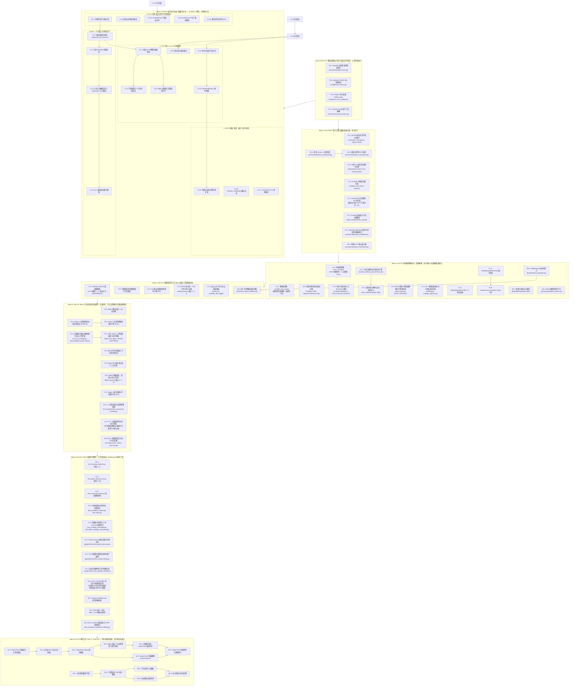

# 全局量化开发任务全量拆解与主优先级执行路线图
# (Master Development Plan & Unified Implementation Roadmap)

> [!IMPORTANT]
> **唯一权威开发任务与路线图总表 (Single Source of Truth)**：
> 本文档是整个代码库所有定量研究、基础设施升级、高频特征提取、多流派策略研发及实盘交易护栏工程的**唯一权威任务拆解、优先级队列、波次编排与执行进度跟踪总表**。
> 
> `docs/` 目录下的各个专项研究与架构设计方案（如 [`docs/intraday_5m_live_and_blend_enhancement_plan.md`](file:///home/stone/Work/github/quant/docs/intraday_5m_live_and_blend_enhancement_plan.md) 与 [`docs/缠论与筹码分布及多流派量化融合实施方案.md`](file:///home/stone/Work/github/quant/docs/%E7%BC%A0%E8%AE%BA%E4%B8%8E%E7%AD%B9%E7%A0%81%E5%88%86%E5%B8%83%E5%8F%8A%E5%A4%9A%E6%B5%81%E6%B4%BE%E9%87%8F%E5%8C%96%E8%9E%8D%E5%90%88%E5%AE%9E%E6%96%BD%E6%96%B9%E6%A1%88.md)）仅承载数学理论建模、代码库审计结论、因果边界推演与代码级详细规范——**所有现存及未来新增的原子任务拆解、进度勾选状态与路线图编排，必须且仅在此文档中集中维护与更新**。

---

## 一、 跨方案架构协同总览 (Cross-Track Architectural Synergy)

### 1.1 核心专项研究与架构设计规范总表 (Core Specifications & Research Docs Table)

| 规范文档路径 | 核心研究主题与架构范围 | 关联任务轨道 | 状态 |
| :--- | :--- | :---: | :---: |
| [`docs/intraday_5m_live_and_blend_enhancement_plan.md`](file:///home/stone/Work/github/quant/docs/intraday_5m_live_and_blend_enhancement_plan.md) | 5分钟高频日内微观结构共振、因果截断引擎与实盘两阶段防透支护栏规范 | Track T | 已落地 |
| [`docs/缠论与筹码分布及多流派量化融合实施方案.md`](file:///home/stone/Work/github/quant/docs/%E7%BC%A0%E8%AE%BA%E4%B8%8E%E7%AD%B9%E7%A0%81%E5%88%86%E5%B8%83%E5%8F%8A%E5%A4%9A%E6%B5%81%E6%B4%BE%E9%87%8F%E5%8C%96%E8%9E%8D%E5%90%88%E5%AE%9E%E6%96%BD%E6%96%B9%E6%A1%88.md) | 缠论中枢、拍卖理论 Volume Profile、A股 CYQ 换手衰减筹码动力学及多流派量化融合方案 | Track C | 已落地 |
| [`docs/snowball_strategy.txt`](file:///home/stone/Work/github/quant/docs/snowball_strategy.txt) | 雪球价值投资双估值模型（5年期末终值折现与成长股息资本化）与安全边际准入体系 | Track F | 已落地 |
| [`docs/wheel_strategy_research.md`](file:///home/stone/Work/github/quant/docs/wheel_strategy_research.md) | 轮式期权复合量化策略 (Options Wheel Strategy) 状态机、VRP方差溢价捕获与缠论支撑门控架构蓝图 | Track W | 孵化中 |
| [`common/indicators.py`](file:///home/stone/Work/github/quant/common/indicators.py) | SuperTrend 单向棘轮、自适应 ER 与多空非对称乘数，及 supertrend_timing 择时策略与 Entry/RiskExit 切面 | Track S | 孵化中 |
| [`docs/six_defects_parity_audit.md`](file:///home/stone/Work/github/quant/docs/six_defects_parity_audit.md) | 基于 Vidovich & Zerjal (2024/2026) 理论的实盘与回测对齐取证审计报告 (六大缺陷排查) | Track P | 实施中 |
| [`common/position_lifecycle.py`](file:///home/stone/Work/github/quant/common/position_lifecycle.py) | 统一持仓生命周期状态机 (UPLSM) 6 状态 FSM、非对称快通道（放量突破 0-delay 闪电建仓 / -8% 止损 0-delay 避险平仓）与两日门禁精简整合方案 | Track G | 已落地 |
| [`common/allocation_backtester.py`](file:///home/stone/Work/github/quant/common/allocation_backtester.py) | 回测系统高并发、跨窗口指标记忆缓存与高拟真度执行引擎升级方案 (记账修复、多进程并行与微观结构拟真) | Track B | 实施中 |
| [`docs/black_list.md`](file:///home/stone/Work/github/quant/docs/black_list.md) | 核心股票池剔除标的权威黑名单档案与失血归因 (SSOT) | 全局 / Live | 已落地 |

### 1.2 跨体系因果交汇与架构拓扑 (Cross-Track Architectural Synergy)

当前代码库正处于从“纯日线形态/中枢回测”向“**5分钟日内高频微观结构共振（Track T）** + **形态学/拍卖理论/A股筹码分布多流派量化融合（Track C）** + **SuperTrend 自适应趋势跟踪与切面止损体系（Track S）** + **雪球价值投资双估值与安全边际选股体系（Track F）** + **实盘调仓防抖与风控执行（Track L）** + **策略语义版本与深度动因审计（Track V）** + **轮式期权复合策略体系（Track W）** + **实盘回测对齐测试床体系（Track P）**”多轨协同演进的关键阶段。各大体系并非割裂运作，而是深度共享底层基础设施，并在特征算子层、切面解耦层、策略层与实盘层形成强烈的非线性 Alpha 乘数效应、基本面确定性安全边际、对齐验证防线与单向棘轮风险锁死机制：

```mermaid
flowchart TD
    subgraph INFRA["1. 共享底层基础设施与数据层 (Shared Infrastructure)"]
        CACHE["common/duckdb_cache.py\n(多轨列式存储: ohlcv_bars 日线 + intraday_ohlcv_bars 5m + stock_fundamentals_annual 基本面)"]
        DATA["common/data.py & common/financial_api.py\n(BaoStock T-1基本面/5m底座 + 东财盘中直连 + 极值锁定布朗桥合成器)"]
    end

    subgraph OPERATORS["2. 算子、特征与基本面估值层 (Four Factor & Feature Engines)"]
        TRACK_T_FEAT["Track T: 因果日内高频特征聚合\ncommon/intraday_features.py\n(VWAP, RV_5m, RS_Down_5m, UpVol_Ratio, SmartMoney)"]
        TRACK_C_FACT["Track C: 结构形态与筹码动力学算子\ncommon/structural_factors.py\n(Curvature κ, Divergence, Wyckoff Spring, CYQ 筹码)"]
        TRACK_S_FACT["Track S: 趋势跟踪与自适应算子\ncommon/indicators.py\n(supertrend, adaptive_supertrend, kaufman_efficiency_ratio)"]
        TRACK_F_FACT["Track F: 价值投资双估值与基本面引擎\npipeline/fundamental_screener/fscreen/valuation_models.py\n(Model 1 终值折现, Model 2 股息资本化, MoS 20%, 行业分类)"]
    end

    subgraph SYNERGY["3. 核心跨方案交汇与数据共振 (Core Synergies)"]
        SYN1["协同 1: 48倍真微观 Volume Profile\n(intraday_features 复用 structural_factors.compute_rolling_poc_series)"]
        SYN2["协同 2: 5m 真实成交核驱动 CYQ 筹码分布\n(以 48根 5m 真实分箱替代日线三角核代理)"]
        SYN3["协同 3: 日内 + 日线双级防洗盘止损\n(早盘毛刺止损豁免与 Wyckoff 弹簧破底翻共振)"]
        SYN4["协同 4: SuperTrend 追踪止损切面解耦\n(通用单向棘轮风控切面，可与任意 Alpha 入场模型即插即用无缝挂载)"]
        SYN5["协同 5: 基本面质地硬门禁与安全边际定价\n(5大财务底线过滤垃圾资产，MoS 20% 安全边际防守)"]
    end

    subgraph STRATEGY["4. 策略与配置层 (Strategies & Modular Blend Base)"]
        CONFIG["pipeline/research_strategy/rs/config.py\n(全部新增参数默认 False，100% 向后兼容)"]
        STRATS["旗舰新策略与切面组合库\n• chan_vp_hybrid (中枢筹码混合)\n• wyckoff_chan_spring (弹簧破底翻)\n• supertrend_timing (自适应趋势跟踪择时)\n• timing_aspects (SuperTrend 入场与风控出场切面)\n• fundamental_screener (雪球双估值与五大硬门禁选股)"]
        BLEND["pipeline/research/blend/blend_base.py (及五大子类)\n• 锚点 1: 分形维数 D_t 宏观状态机风格预算\n• 锚点 2: CYQ 获利盘比例与假中枢质量门禁\n• 锚点 3: VAH 突破与筹码单峰冲力共振定仓\n• 锚点 4: 破底翻 Day 1 加速建仓与顶背驰否决\n• 锚点 5: 结构化 ZG/VAL 吊灯止损与 NPOC 止盈\n• 锚点 6: Rolling IC-IR 与 Löwdin 正交化\n• 锚点 7: 宏观宽基 SuperTrend 状态机折半风险预算\n• 锚点 8: 标的级 SuperTrend 下穿动量防线一票否决置 0.0"]
    end

    subgraph LIVE["5. 实盘执行护栏 (Two-Stage Live Execution)"]
        STAGE1["scripts/check_live_portfolio_health.py @ 14:00\n(逐笔盯市 HWM 回撤、午后跳水门禁、下行半方差缩放、CAUTION_SUPERTREND_BREAK 破位预警)"]
        STAGE2["scripts/run_live_strategy.py @ 14:15\n(跌停封死双向冻结防透支、T+1涨停拦截、双模式限价引导、supertrend_stop_level 动态止损单)"]
    end

    INFRA --> OPERATORS
    OPERATORS --> SYNERGY
    SYNERGY --> STRATEGY
    STRATEGY --> LIVE
    STAGE1 -->|"account_state.json &\nstage1_health_report.json"| STAGE2
```



---

## 二、 原子任务全量拆解清单（共 136 个原子任务 = 按行实数核定口径：既有 10 张子表 93 项（原口径 83 项 + 2026-10-23 本轮新增 §2.2 的 `C5.1`–`C5.3` 3 项、§2.8 的 `P1.4`–`P1.7` 4 项、§2.10 的 `B5.1`–`B5.3` 3 项；其中 §2.1 实为 21 项、§2.2 实为 12 项、§2.8 实为 7 项、§2.10 实为 16 项，原标注 19/12 已修正），加 §2.11/§2.12 新增 8 项，再加 §2.13 新增 34 项（原 13 项 + 2026-10-23 新增 `L2.22`–`L2.25` 4 项 + 同日 `L2.26`–`L2.30` 5 项 + 同日第三轮 `L2.31` 1 项 + 同日 21:38 复验后新增 `L2.32` 1 项 + 同日 `L2.32` 封堵落地后新增 `L2.33`–`L2.34` 2 项 + 同日 `L2.35` 1 项 + 2026-10-23 末轮 `L2.36` 1 项（换手三口径证伪结案）+ `L2.37` 1 项 + provenance 落地后 `L2.38` 1 项（实盘/回测建仓门槛口径差异）+ `L2.39` 1 项（实盘 tenure 键名后缀不匹配）+ 同日再新增 `L2.40` 1 项（多级回撤熔断的减仓被换手惰性门吞掉）+ 同轮收尾再新增 `L2.41` 1 项（`rules.md` 生成器陈旧、重生成会静默回退 12 份手册）与 `L2.42` 1 项（Tier-3 快速恢复口径两端不一致）+ 本轮 `L2.43` 1 项（实盘输出路径迁出 `docs/ruleset` 并删除 ruleset 产出链，直接以 `[x]` 结案））；93 + 8 + 31 + 1 = **133**，再加 `L2.41`/`L2.42`/`L2.43` 三行 ⇒ **133 + 3 = 136**（`done` 107 → **108**，`open` 26 → 28）。§4.5/§4.6 的 14 项实盘专项修复为已完成的记录性条目，未拆分为原子任务，不计入本口径。**口径变更说明**：§4.7 记载的 108 项是**当轮**实数，本轮新增 16 行后总数为 124（121 + `P1.7`/`B5.3`/`L2.31`），再加 21:38 复验后新增的 `L2.32` 一行，为 125，再加 `L2.32` 落地后新增的 `L2.33`/`L2.34` 两行，为 127，再加 `L2.35` 一行、以及 2026-10-23 末轮 `L2.36`/`L2.37` 两行、provenance 落地后 `L2.38` 一行、`L2.39` 一行，现总数为 **136**；更早轮次引用"108 项"属历史记载，不需回改）

> **状态口径（2026-10-23 `L2.32` 封堵落地 + `L2.35` 登记 + 末轮 `L2.36`/`L2.37` 入账，再经 provenance 落地后 `L2.34`/`L2.35` 闭环、`L2.38` 新开与其口径更正、`L2.39` 与 `L2.40` 登记、本轮 `L2.40` 整行改写为「已裁定 (b)」并新增 `L2.41`/`L2.42`，按任务行实数核对）**：总数 **136**，现为 **108 `[x]` / 28 `[ ]`**（108 + 28 = 136，与上段口径一致）。末轮两行：`L2.36`（稳态换手三口径定标与平仓确认杠杆的证伪）以 `[x]` 结案、`L2.37`（`actual_weights` 未落盘）以 `[ ]` 登记 ⇒ 总数 128 → 130、`[x]` 104 → 105、`[ ]` 24 → 25。**provenance 落地后的三项变动**：`L2.34`（基准臂 `min_weight_change` 前提**经实测证伪**）与 `L2.35`（provenance 落地）双双勾选，同时新开 `L2.38`（实盘/回测建仓门槛 parity 缺口） ⇒ 总数 130 → 131、`[x]` 105 → 107（+2）、`[ ]` 25 → 24（−2 + 1）。**`L2.38` 口径更正与 `L2.39` 登记**：`L2.38` 保持 `[ ]` 但**内容整行重写**（撤回「回测对新建立仓豁免」这一错误前提，方向更正为**回测更松**），`L2.39` 新开 `[ ]` ⇒ 总数 131 → 132、`[ ]` 24 → 25（+1）、`[x]` 107 **不变**。**`L2.40` 登记** ⇒ 总数 132 → 133、`[ ]` 25 → 26（+1）、`[x]` 107 **不变**。**本轮 `L2.40` 内容整行改写（状态仍 `[ ]`，不改变计数）+ 新开 `L2.41`/`L2.42`** ⇒ 总数 133 → 135（+2）、`[ ]` 26 → 28（+2）、`[x]` 107 **不变**。**本轮 `L2.41` 整行重做（生成器/技能/参考文件已删，状态仍 `[ ]`，不改变计数）+ 新开 `L2.43` 并以 `[x]` 结案** ⇒ 总数 135 → **136**（+1）、`[x]` 107 → **108**（+1）、`[ ]` 28 **不变**（108 + 28 = 136）。`L2.35` 登记使总数 127 → 128、`[ ]` 23 → 24，`[x]` 不变（新增行状态即 `[ ]`）。**2026-10-23 本轮闭环 8 项**：`C5.1` / `C5.2` / `C5.3` / `L2.27` / `L2.28` / `L2.29` / `L2.30` / `L2.31`；**同日另有 2 项状态变动**：①`L2.8` 曾于生产修复执行后勾选，但已于 21:38 被只读复验证伪并**重新打开**（故 `[x]` 由 104 回落至 103，`[ ]` 由 20 升为 22）；②`L2.32`（写入口门禁下沉）已于同日晚**封堵落地并勾选**，同时新开 `L2.33`/`L2.34` 两行——**`[x]` 103 → 104（+1）**、**`[ ]` 22 → 23（−1 + 2）**、**总数 125 → 127（+2）**。剩余 **28 项** = Track S(7) + Track W(5) + `P1.4`–`P1.7`(4) + `B4.2`/`B5.1`–`B5.3`(4) 共 20 项，**加 `L2.8`（重开）与 `L2.33`/`L2.37`/`L2.38`/`L2.39`/`L2.40`（新增/未决）6 项，再加 `L2.41`/`L2.42` 2 项**（20 + 6 + 2 = 28）。`L2.8` 的 21:26 执行记录（**5 个 op / 3,847 行**、回滚点 `data/cache.duckdb.bak.20261023-212614`、收尾干跑 `nothing to repair`、退出码 0、`residual_damage = 0`）**作为历史留痕保留，但它只描述 21:26 那个时点**：**21:38:50 现库被再次写入**（sha256 `38abb80c…a726b6`），修复成果已被抹掉，今日 census 为 **5 op / 5,973 行 / 退出码 1（ACTIONABLE）**，故 `L2.8` 当前为 `[ ]`——详见其行内注记末段与 [`docs/version.md`](file:///home/stone/Work/github/quant/docs/version.md) §16.15。

### 2.1 《5分钟高频日内数据方案》原子任务表（`T0.1`–`T6.2`，共 21 个任务）

| 任务编号 | 状态 | 任务名称 | 涉及核心文件与符号 | 核心交付内容与验收标准 (含 R1–R14 及工程细节) | 配套离线单测 | 规模 | 前置依赖 |
| :--- | :---: | :--- | :--- | :--- | :--- | :---: | :--- |
| **`T0.1`** | `[x]` | 修复 DuckDB 分钟线重采样规则映射 | [`common/duckdb_cache.py`](file:///home/stone/Work/github/quant/common/duckdb_cache.py)<br>`_INTERVAL_RULES`<br>`_get_resample_rule` | 1. 修复 `"1m": "ME"` 错误映射为月末 Bug；<br>2. 修复 `.endswith("m")` 将 `"5m"` 误判为月线 `"ME"` 的 Bug；<br>3. 增加 `is_intraday_interval(interval)` 判定，分钟级粒度直接返回 `None` 拒绝日线上采样。 | `test_intraday_features.py`<br>(测试 1) | **S** | 无 |
| **`T0.2`** | `[x]` | 修复 `Alpha101Data.from_universe` 的 VWAP 泄漏 | [`pipeline/research_strategy/rs/alpha101_factors.py`](file:///home/stone/Work/github/quant/pipeline/research_strategy/rs/alpha101_factors.py)<br>`Alpha101Data.from_universe`<br>[`common/alpha101_operators.py`](file:///home/stone/Work/github/quant/common/alpha101_operators.py)<br>`vwap_proxy` | 1. 废除 `.ffill().bfill()` 跨年反向填充未来 VWAP 的严重前视偏差；<br>2. 改为 `df["VWAP"].fillna(typical_price)`，在注释中添加 **HONEST CAVEAT** 说明过渡期；<br>3. 升级 `vwap_proxy` 接收真实 `vwap` 序列，惠及 `Alpha#41` 等因子。 | `test_alpha101_factors.py` | **S** | 无 |
| **`T0.3`** | `[x]` | 补齐 Stage 2 对门禁健康报告的实际读取 | [`scripts/run_live_strategy.py`](file:///home/stone/Work/github/quant/scripts/run_live_strategy.py)<br>`parse_args`<br>`main` | 1. 修复定义了 `--health-report-file` 却从未在流程中读取的缺陷；<br>2. 解析 `stage1_health_report.json` 与 `account_state.json` 中的 `gate_code` 与 `intraday_buy_scale`；<br>3. 识别到 `CAUTION_INTRADAY_DISTRIBUTION` 时打印告警并将买入仓位折半。 | `test_run_live_strategy.py` | **S** | 无 |
| **`T1.1`** | `[x]` | 新建 DuckDB 分钟级双轨存储缓存表 | [`common/duckdb_cache.py`](file:///home/stone/Work/github/quant/common/duckdb_cache.py)<br>`_init_tables`<br>`store_intraday_bars`<br>`query_intraday_bars` | 1. 新建 `intraday_ohlcv_bars` 表（主键 `(symbol, timestamp)`，`timestamp TIMESTAMP`）；<br>2. 新建 `intraday_sync_metadata` 表，记录 `latest_close_ref` 用于除权漂移失效重刷 (R4)；<br>3. 修复日期型 `end="2026-10-16"` 查询截断丢失当天 48 根 K 线缺陷 (R13)，自动扩展至 `23:59:59`。 | `test_intraday_features.py`<br>(测试 1) | **M** | `T0.1` |
| **`T1.2`** | `[x]` | 扩展 `SyntheticDataProvider` 极值锁定布朗桥 5m 生成器 | [`common/data.py`](file:///home/stone/Work/github/quant/common/data.py)<br>`SyntheticDataProvider` | 1. 废弃仿射布朗桥不可行假设 (R2)，实现随机极值时点 $j_H \ne j_L$ 的分段钉扎布朗桥；<br>2. 生成每日 48 根（`09:35..15:00`）5m K 线；<br>3. 单测断言按日聚合后的 `(Open, High, Low, Close, Volume)` 与日线输出比特级一致。 | `test_intraday_features.py`<br>(测试 2) | **M** | 无 |
| **`T1.3`** | `[x]` | 新增 `BaoStockDataProvider` 深度历史底座 | [`common/data.py`](file:///home/stone/Work/github/quant/common/data.py)<br>[`common/financial_api.py`](file:///home/stone/Work/github/quant/common/financial_api.py)<br>`BaoStockDataProvider` | 1. 支持 `--data-provider baostock`，提供 1999 年至今 A 股及 2026 年起 ETF 前复权 5m 历史；<br>2. 解析 17 位 `time` 字符串并截断毫秒；<br>3. 5m 分钟线严禁请求 `preclose,turn,peTTM`，单次上限 10,000 条，按 180 天分块查询。 | `test_intraday_features.py`<br>(测试 3) | **M** | `T1.1` |
| **`T1.4`** | `[x]` | 新增 `EastMoneyDataProvider` 盘中实时分钟线直连 | [`common/data.py`](file:///home/stone/Work/github/quant/common/data.py)<br>[`common/financial_api.py`](file:///home/stone/Work/github/quant/common/financial_api.py)<br>`EastMoneyDataProvider` | 1. 直连 `push2his.eastmoney.com`，提供 A 股/ETF/指数/北交所盘中实时 5m K 线；<br>2. 矫正 `O-C-H-L` 字段顺序为标准 `O-H-L-C`；<br>3. **强制量纲转换 `Volume = float(f56) * 100.0`（手 $\to$ 股）**，并做 `Amount/VWAP` 交叉核验。 | `test_intraday_features.py`<br>(测试 4) | **M** | `T1.1` |
| **`T1.5`** | `[x]` | 新增本地批量快照守护与无锁落盘 | `scripts/record_intraday_5m.py`<br>Fuyao 批量快照差分合成器 | 1. 基于 `fuyao_client.prices_snapshot` 批量快照差分合成 5m 桶与精确 Tick VWAP；<br>2. 采用**无锁原子 Parquet（`data/intraday_5m/{date}.parquet`）**落盘，规避 DuckDB 单写进程锁冲突；<br>3. 缺桶时自动调用东财接口回补，内置 `0.2s` 节流与 `HTTP 429` 重试。 | `test_intraday_features.py`<br>(测试 5) | **L** | `T1.4` |
| **`T2.1`** | `[x]` | 因果日内特征聚合引擎与截断器 | [`common/intraday_features.py`](file:///home/stone/Work/github/quant/common/intraday_features.py)<br>`compute_daily_intraday_features`<br>`enrich_universe_with_intraday_features` | 1. 统一回测历史与实盘截断时点（默认 `cutoff_time="14:15"` 为 39 根，Stage 1 为 36 根，R1/R6）；<br>2. 跨源复权比例对齐 $\kappa_t = C_{t,\text{1d}} / C_{t,M,\text{5m}}$ 消除价格基准错配 (R4)；<br>3. 盘中合成日线标记 `Is_Partial_Bar = 1`，完整收盘日线标记 `0` (R12)。 | `test_intraday_features.py`<br>(测试 6) | **L** | `T1.1`, `T1.2` |
| **`T2.2`** | `[x]` | 剥离隔夜跳空聪明钱与有符号主买量能 | [`common/intraday_features.py`](file:///home/stone/Work/github/quant/common/intraday_features.py)<br>`SmartMoney_Q_5m`<br>`UpVol_Ratio_5m`<br>`Afternoon_Ret_5m` | 1. 计算剥离隔夜跳空的纯日内聪明钱 Q 因子；<br>2. 计算 5m 有符号主买上攻量占比 `UpVol_Ratio_5m`；<br>3. 以早盘收盘 `11:30` 为基准计算午后收益率 `Afternoon_Ret_5m`，用于识别午后跳水。 | `test_intraday_features.py`<br>(测试 7) | **M** | `T2.1` |
| **`T2.3`** | `[x]` | 5m 缠论次级别结构因果截断与惰性计算 | [`common/intraday_features.py`](file:///home/stone/Work/github/quant/common/intraday_features.py)<br>`Chan_5m_Buy_Confluence`<br>`Chan_5m_Sell_Trigger` | 1. 窗口起点严格固定至 $t-4$ 日 `09:35` 首根 K 线（累计 240 根 5m 窗口）；<br>2. 严格在截断时刻前独立运行分型与笔构建，杜绝未来分型偏差；<br>3. 支持 `chan_candidate_dates` 候选日按需惰性求值 (R9)，降低 $85\%+$ 计算开销。 | `test_blend_intraday_5m.py`<br>(测试 8) | **M** | `T2.1` |
| **`T3.1`** | `[x]` | Blend 缠论日线 $\times$ 5m 区间套与防狼术 | [`pipeline/research/blend/blend_base.py`](file:///home/stone/Work/github/quant/pipeline/research/blend/blend_base.py)<br>`L997-L1027` | 1. 开启 `blend_enable_5m_interval_nesting` 时，若标的具备 `Chan_5m_Buy_Confluence == 2` 且 `VWAP_Prem_5m >= 0.0`，在 Day 1 豁免 `min_entry_bars=2` 立即入场；<br>2. 若日线买点伴随 5m 顶背驰或三卖（`Chan_5m_Sell_Trigger == 1`），执行一票否决置 `0.0`。 | `test_blend_intraday_5m.py`<br>(测试 8) | **M** | `T2.3` |
| **`T3.2`** | `[x]` | Blend 有符号量能共振与下行半方差配权 | [`pipeline/research/blend/blend_base.py`](file:///home/stone/Work/github/quant/pipeline/research/blend/blend_base.py)<br>`L535-L548`<br>`L854-L867` | 1. 升级 `vol_surge_matrix`：要求 `UpVol_Ratio_5m >= 0.58` 且 `VWAP_Prem_5m >= 0.0`（缺失历史日期安全退化）；<br>2. 冲力部署 `confluence_sizing` 叠加聪明钱置信度加权；<br>3. 单资产反波动率定仓接入 5m 下行半方差 $RS_{t}^-$，豁免右侧放量上涨标的被误降权。 | `test_blend_intraday_5m.py`<br>(测试 9) | **M** | `T2.2` |
| **`T3.3`** | `[x]` | Blend 5m 防毛刺止损与三卖止盈保护 | [`pipeline/research/blend/blend_base.py`](file:///home/stone/Work/github/quant/pipeline/research/blend/blend_base.py)<br>`L648-L683` | 1. 早盘洗盘毛刺豁免：跌穿止损线但未超硬熔断（$\ge 0.97 \times \text{Stop}$）且午後最低价站回、收盘站上 VWAP 且 `UpVol_Ratio_5m >= 0.60` 时豁免当日止损；<br>2. 次级别三卖止盈：浮盈 $>8\%$ 且自最高点回撤 $>2\text{ATR}$ 且触发 5m 顶背驰/三卖时，提前止盈离场并置显式 `0.0`。 | `test_blend_intraday_5m.py`<br>(测试 9) | **M** | `T2.3` |
| **`T4.1`** | `[x]` | Stage 1 门禁日内逐笔盯市回撤与午后跳水检测 | [`scripts/check_live_portfolio_health.py`](file:///home/stone/Work/github/quant/scripts/check_live_portfolio_health.py)<br>`inspect_portfolio_drawdown`<br>`evaluate_market_breadth_and_thrust` | 1. 14:00 提取持仓 5m 盯市净值路径，诊断盘中谷值回撤并标记 `CAUTION_INTRADAY_TROUGH`，**严禁回写抬高 `peak_nav` (R5)**；<br>2. 检测早盘冲高午后跳水（相对 11:30 放量下挫），触发 `CAUTION_INTRADAY_DISTRIBUTION` 并持久化至 `account_state.json`；<br>3. 接入下行半方差波动率目标缩放。 | 离线演练脚本 | **M** | `T2.1`, `T2.2` |
| **`T4.2`** | `[x]` | Stage 2 卖单跌停封死双向冻结与买单涨停拦截 | [`scripts/run_live_strategy.py`](file:///home/stone/Work/github/quant/scripts/run_live_strategy.py)<br>`L1056-L1063`<br>`L1107-L1140` | 1. 分板块精确跌停判定 (R10) 识别跌停封死/停牌，标记 `LIMIT_DOWN_ILLIQUID_RISK`；<br>2. **在 Phase 2 计算可用购买力与 Phase 4 计算闲置现金归集时双向剔除该卖单 (R14)**，杜绝透支；<br>3. Phase 2 拦截涨停封板买单（`LIMIT_UP_LOCKED`）并对日内透支追高标的折半买入。 | `test_blend_intraday_5m.py`<br>(测试 10) | **M** | `T0.3`, `T2.1` |
| **`T4.3`** | `[x]` | Stage 2 交割单新增双模式微观执行引导字段 | [`scripts/run_live_strategy.py`](file:///home/stone/Work/github/quant/scripts/run_live_strategy.py)<br>`generate_orders` | 1. 输出主动可成交限价 `suggested_limit_price`（`BUY` 为 $\min(P_{\text{limit\_up}}, P_{\text{curr}} \times 1.002)$，与回测假设一致，R11）；<br>2. 输出被动参考限价 `passive_support_limit_price`（$\min(P \times 1.002, \max(VWAP, ZG_{5m}) \times 1.005)$，R11）；<br>3. 输出 `intraday_vwap`, `vwap_premium_pct`, `chan_5m_state`。 | `test_blend_intraday_5m.py`<br>(测试 10) | **S** | `T4.2` |
| **`T5.1`** | `[x]` | 编写 5m 缓存、数据源与日内特征全套单元测试 | `common/tests/test_intraday_features.py` | 100% 离线测试 1 至测试 7（分钟缓存读写、除权失效重刷、钉扎布朗桥极值守恒、BaoStock/东财/快照 Mock 解析、36/39/48 根因果截断断言、聪敏钱与 VWAP 偏离）。 | `pytest` 全绿 | **M** | `T1.1`..`T2.2` |
| **`T5.2`** | `[x]` | 编写 Blend 5m 区间套与实盘双向防透支单元测试 | `pipeline/research_strategy/tests/test_blend_intraday_5m.py` | 100% 离线测试 8 至测试 10（5m 区间套首日加速与否决、稀疏权重 `NaN` vs `0.0` 契约保持、跌停卖单 Phase 2/4 双向购买力冻结与交割单限价输出）。 | `pytest` 全绿 | **M** | `T3.1`..`T4.3` |
| **`T6.1`** | `[x]` | Phase 6 Walkforward 逐项消融实验 | `pipeline/research/blend/experiments/` | 统一 `blend_intraday_cutoff_time="14:15"`，对 4.1–4.5 增强及实盘门禁逐项进行 on/off 消融实验，验证 Sharpe/Calmar 提升与回撤稳健性。 | Walkforward 报告 | **L** | `T5.1`, `T5.2` |
| **`T6.2`** | `[x]` | DSR 变体数惩罚、单次 ERS 检验与 LOO 终审 | `walkforward-audit` skill | 1. 计算尝试变体数校正的 DSR（$DSR \ge 0.95$）；<br>2. 遵循 `AGENTS.md` 对最终胜者跑**一次** ERS（前 5% 分位）；<br>3. 执行 LOO 超级明星股剔除脆弱性审计，确认上线评级。<br>⚠ **覆盖范围披露**：本轮消融覆盖增量 1–6（Track C + Track T）；增量 7（`S3.1` 锚点 7/8）与 `S4.2` 尚未落地，故 DSR 的变体数 $N$ 未包含它们。`S3.1`、`S4.2` 勾选后**必须重跑** `T6.1`/`T6.2`（含 DSR 重算与单次 ERS），方可将"终审通过"作为生产翻转依据。**（2026-10-23 更新：Track S 已降级为 Tier P5 孵化池，该重跑义务随之顺延；在 `S3.1`/`S4.2` 未被提升回主链前，`T6.1`/`T6.2` 对当前系统的结论保持有效，不构成生产翻转阻塞。）** | 审计报告制品 | **M** | `T6.1` |

---

### 2.2 《缠论与筹码分布及多流派量化融合方案》原子任务表（`C1.1`–`C5.3`，共 12 个任务）

| 任务编号 | 状态 | 任务名称 | 涉及核心文件与符号 | 核心交付内容与验收标准 (含 M1–M6 数学修正与 6 大 Blend 锚点) | 配套离线单测 | 规模 | 前置依赖 |
| :--- | :---: | :--- | :--- | :--- | :--- | :---: | :--- |
| **`C1.1`** | `[x]` | Volume Profile 算子下沉与分层解耦 | [`common/structural_factors.py`](file:///home/stone/Work/github/quant/common/structural_factors.py)<br>`compute_rolling_poc_series`<br>[`pipeline/research_strategy/rs/chan_similar_strategies.py`](file:///home/stone/Work/github/quant/pipeline/research_strategy/rs/chan_similar_strategies.py) | 1. 将 `compute_rolling_poc_series` 下沉至底层共享库 `common/structural_factors.py`；<br>2. 严禁 `common/` 反向导入 `pipeline/`（M5 约束）；<br>3. 在 `chan_similar_strategies.py` 中保留 `from common.structural_factors import compute_rolling_poc_series` 实现 100% 向后兼容。 | `test_structural_factors.py` | **S** | 无 |
| **`C1.2`** | `[x]` | 实现 M1–M4 核心形态学与动力学算子 | [`common/structural_factors.py`](file:///home/stone/Work/github/quant/common/structural_factors.py)<br>`extremum_curvature`<br>`standardized_divergence`<br>`wyckoff_effort_result`<br>`wyckoff_spring`<br>`fractal_dimension`<br>`consolidation_density` | 1. **M1 修正**：局部窗口无量纲 Z-Score 标准化后拟合二次曲率 $\kappa = \frac{2a}{(1+b^2)^{3/2}}$，消除 500 倍价格量级失真；<br>2. **M2 修正**：双端 Z-Score 对齐并除以 $\sqrt{2}$，解决指标动量淹没收益率问题；<br>3. **M3 修正**：正定相对成交量 Effort + ATR 归一化 Result，根除除零爆炸与符号混淆；<br>4. **M4 修正**：因果支撑位 $S_{t-1} = ZD_{t-1}$ + 最大刺破深度 $\delta_{\max} = 0.04$ 截断；<br>5. **M5 修正**：价格区间 $[L_t, H_t]$ 与中枢 $[ZD_t, ZG_t]$ 线性重叠比例积分成交量。 | `test_structural_factors.py` | **M** | `C1.1` |
| **`C1.3`** | `[x]` | 实现 A股 CYQ 换手衰减筹码分布递归引擎 | [`common/structural_factors.py`](file:///home/stone/Work/github/quant/common/structural_factors.py)<br>`cyq_chip_distribution`<br>`cyq_winner_ratio`<br>`cyq_cost_concentration` | 1. 实现递归方程 $\text{Chip}_t(p) = \text{Chip}_{t-1}(p)(1-\tau_t) + \tau_t K_t(p)$；<br>2. 缺失 `Turn` 时自适应切换相对成交量换手代理 $\hat{\tau}_t$（**DISCLOSED APPROXIMATION**）；<br>3. 支持日线三角核与 5m 真实成交核无缝插拔切换；<br>4. 输出获利盘比例（`WinnerRatio`）与 90% 筹码集中度（`Concentration`）。 | `test_structural_factors.py` | **M** | `C1.1` |
| **`C2.1`** | `[x]` | 研发旗舰新策略一：`ChanVolumeProfileHybridStrategy` | [`pipeline/research_strategy/rs/chan_vp_hybrid_strategy.py`](file:///home/stone/Work/github/quant/pipeline/research_strategy/rs/chan_vp_hybrid_strategy.py)<br>[`pipeline/research_strategy/rs/config.py`](file:///home/stone/Work/github/quant/pipeline/research_strategy/rs/config.py) | 1. 策略标识 `chan_vp_hybrid`，集成 HVN 中枢校验（`consolidation_density >= 0.45` 且 $POC \in [ZD, ZG]$）；<br>2. 三买微观 POC 接受确认（离开段快速穿过 LVN，回踩站稳 $ZG$ 与 $VAH$ 并在上方沉淀新 POC）；<br>3. 动态锚定上方未测试控制点（Naked POC）止盈，严格恪守稀疏权重 `NaN` vs `0.0` 契约。 | `test_chan_vp_hybrid.py` | **M** | `C1.2`, `C1.3` |
| **`C2.2`** | `[x]` | 研发旗舰新策略二：`WyckoffChanSpringStrategy` | [`pipeline/research_strategy/rs/wyckoff_chan_strategy.py`](file:///home/stone/Work/github/quant/pipeline/research_strategy/rs/wyckoff_chan_strategy.py)<br>[`pipeline/research_strategy/rs/config.py`](file:///home/stone/Work/github/quant/pipeline/research_strategy/rs/config.py) | 1. 策略标识 `wyckoff_chan_spring`，解决传统缠论一买胜率低、回撤大痛点；<br>2. 前一日最低价刺破 $ZD$（$0.5\%\sim 4.0\%$），当日放量收回 $ZD$ 之上且 $\kappa \ge 1.5$；<br>3. 止损精准设于弹簧最低点下方 $0.5\%$，目标位看至 $ZG$ 与 $1.2\times$ 箱体高度。 | `test_wyckoff_chan_strategy.py` | **M** | `C1.2` |
| **`C2.3`** | `[x]` | 既有单策略向后兼容平滑升级 | [`pipeline/research_strategy/rs/chan_advanced_strategies.py`](file:///home/stone/Work/github/quant/pipeline/research_strategy/rs/chan_advanced_strategies.py)<br>[`pipeline/research_strategy/rs/regime_factor_compound.py`](file:///home/stone/Work/github/quant/pipeline/research_strategy/rs/regime_factor_compound.py) | 1. `chan_trend_third_buy` 增加 `chan_b3_enable_vp_filter=False` 前置中枢 VP 校验；<br>2. `chan_mean_reversion_divergence` 扩展入场模式 `chan_mrd_entry_mode="classic"`；<br>3. `regime_factor_compound` 增加 `regime_enable_fractal_curvature=False` 扩展宏观状态判别（M6 约束）。 | `test_chan_advanced_strategies.py` | **S** | `C1.2` |
| **`C3.1`** | `[x]` | `BaseBlendAllocationStrategy` 宏观状态机、质量门禁与冲力共振升级 | [`pipeline/research/blend/blend_base.py`](file:///home/stone/Work/github/quant/pipeline/research/blend/blend_base.py)<br>`L387-L408`<br>`L799-L810`<br>`L853-L882` | 1. **锚点 1（状态机预算）**：全市场中位数分形维数 $\bar{D}_t < 1.45$ 提升动量预算至 $0.80$，$\bar{D}_t > 1.55$ 提升反转预算至 $0.75$；<br>2. **锚点 2（质量门禁）**：`cyq_winner_ratio < 0.20` 且无弹簧豁免者一票否决置 `0.0`，过滤无量假中枢；<br>3. **锚点 3（冲力共振）**：突破 60d VAH 且筹码单峰密集（$\ge 0.85$）赋予 1.6x 顶格共振，放量滞涨（EffortResult $<0.35$）0.6x 折减。<br>4. 依 `AGENTS.md` §7 升级 `BASE_VERSION`（本次为向后兼容新增，升次版本号）、在 `docs/version.md` 追加中文变更日志、重跑 `--dump-strategies` 并同步更新版本断言单测。 | `test_blend_intraday_5m.py`<br>`test_blend_track_c.py` | **L** | `C1.2`, `C1.3` |
| **`C3.2`** | `[x]` | `BaseBlendAllocationStrategy` 入场加速、结构化止损与正交化 | [`pipeline/research/blend/blend_base.py`](file:///home/stone/Work/github/quant/pipeline/research/blend/blend_base.py)<br>`L997-L1027`<br>`L648-L683`<br>[`pipeline/research/blend/`](file:///home/stone/Work/github/quant/pipeline/research/blend/) | 1. **锚点 4（入场加速/否决）**：弹簧 $\ge 1.25$ 且 $\kappa \ge 1.5$ 在 Day 1 豁免 `min_entry_bars` 立即加速建仓，极端顶背驰（$<-1.2$）立即否决；<br>2. **锚点 5（结构化止损/止盈）**：吊灯止损升级为 $\max(\text{Entry}\times 0.92, \text{Peak}-4.5\times\text{ATR}, \min(ZG, VAL)\times 0.985)$，触及上方 NPOC 且动能衰竭主动止盈置 `0.0`；<br>3. **锚点 6（正交化扩展）**：五大 Blend 子类全量接入，两只新策略纳入 Löwdin 对称正交化矩阵。<br>4. 依 `AGENTS.md` §7 升级 `BASE_VERSION`（本次为向后兼容新增，升次版本号）、在 `docs/version.md` 追加中文变更日志、重跑 `--dump-strategies` 并同步更新版本断言单测。 | `test_blend_intraday_5m.py`<br>`test_blend_track_c.py` | **L** | `C3.1`, `C2.1`, `C2.2` |
| **`C4.1`** | `[x]` | 100% 离线单元测试与既有策略回归套件 | `pipeline/research_strategy/tests/`<br>`test_structural_factors.py`<br>`test_chan_vp_hybrid.py`<br>`test_wyckoff_chan_strategy.py` | 1. 验证 M1–M5 全部算子在单序列与 DataFrame 上的数学收敛性与无 `NaN` 扩散；<br>2. 验证两只新策略独立运行 `generate_weights` 的稀疏权重契约；<br>3. 验证 55+ 既有策略与 allocation templates 回归测试 100% 通过。<br>⚠ **本任务是 Track C 唯一的套件级验证**：在它勾选之前，`C1.2`–`C3.2` 声称的"配套离线单测"仅为各自单文件测试，不构成 Track C 整体回归结论。<br>✅ **已核验（2026-10-23），套件级结论为「部分 NO」（必须照实引用）**：算子（单序列与 DataFrame 两种输入）与稀疏权重契约成立，**55+ 既有策略与 allocation templates 无回归**；但 `WyckoffChanSpringStrategy` 与 `ChanVolumeProfileHybridStrategy` 在**合成宇宙永不建仓** —— 故「Track C 整体回归通过」**不成立**，根因与修正分别由 `C5.1` / `C5.2` 承接。<br>**（2026-10-23 更新）**：`C5.1`/`C5.2` 已落地，「部分 NO」**只闭合了一半** —— `chan_vp_hybrid` 侧已由可建仓用例（SPY 9 个正权重调仓行）与 strict-XFAIL→通过证明；`wyckoff_chan_spring` 侧仅证明**曲率门可达**（κ≈1.0101 于专用 fixture 建仓），其台账用例 `test_wyckoff_curvature_entry_gate_is_reachable` **仍保持 xfail**，原因是其 `_two_symbol_universe(400)` 随机游走 fixture **无 V 型拐点**（`spring>=1` 仅 2 根，那两根 κ≈0.0513/0.2043），**不是曲率门问题**；该 fixture 无 V 转向前不得移除 xfail。 | `pytest` 全绿 | **M** | `C2.1`..`C3.2` |
| **`C5.1`** | `[x]` | `κ ≥ 1.5` 死门修正（曲率闸门结构性不可达） | [`common/structural_factors.py`](file:///home/stone/Work/github/quant/common/structural_factors.py)<br>`extremum_curvature`<br>[`pipeline/research_strategy/rs/wyckoff_chan_strategy.py`](file:///home/stone/Work/github/quant/pipeline/research_strategy/rs/wyckoff_chan_strategy.py)<br>`chan_advanced_strategies.py`<br>[`pipeline/research/blend/blend_base.py`](file:///home/stone/Work/github/quant/pipeline/research/blend/blend_base.py) | 1. **数学事实**：`extremum_curvature` 先把窗口内价格 Z-Score 化再拟合，`window=5` 时 `abs(κ)` 有硬上界 `2√(5/14) ≈ 1.1952`（本轮实测：20 万组随机 + 全符号网格最大 **1.195**，与上界吻合），故所有 `κ ≥ 1.5` 门禁**永不成立**；<br>2. **受影响 3 处门禁**（口径已更正，见 §4.11）：`WyckoffChanSpringStrategy`（`wyckoff_spring_min_curvature=1.5`，`wyckoff_chan_strategy.py:156`）、`chan_advanced_strategies` 的 `curvature_v_bottom`（`:1048`）与 `spring_curvature_combined`（`:1058`）。**更正说明**：本行此前记「4 处」，其中第 4 处 `config.py:895` 的 `wyckoff_spring_min_curvature: float = 1.5` **只是默认值声明、不是门禁**，不计入；`blend_base.py:1121`/`:1424` 的两处 `e_curv >= 1.5` 与之共享同一上界、同样永不可达，但它们是**并集豁免路径**（`wyckoff_spring >= 1.25 AND curvature >= 1.5`，失败即 fail-closed），与"建仓门禁"语义不同，故单列披露而不计入 3 处；<br>3. 修正方向二选一（改默认前须有 walkforward 证据）：改阈值为可达区间，或改用**未标准化尺度**（保留量纲但对价格量级敏感，须重新标定）；<br>4. **附注（不可用作翻案）**：`k < 5` 的预热窗口（仅序列最前 1–2 根，`min_periods=3`）理论上可达更高值（实测样点最大 4.24），但那是不可交易的预热期信号，不能据此宣称「闸门有效」。<br>✅ **已完成（2026-10-23，100% 离线）**：新增 `CURVATURE_KAPPA_BOUND_WINDOW5 = 2√(5/14) ≈ 1.1952286`、`DEFAULT_REACHABLE_MIN_CURVATURE = 0.8` 与 `warn_unreachable_curvature_threshold()`（达界即 `UserWarning`，不抛错）；三处门禁（`WyckoffChanSpringStrategy`、`curvature_v_bottom`、`spring_curvature_combined`）统一改用可达默认值并在解析阈值时调用护栏；`config.py:900` 与 `strategies_config.json:1196` 的 `wyckoff_chan_spring` 预设同步 `1.5 → 0.8`；`blend_base.py` 两处豁免路径（L1116/L1433）**仅加保护性注释、值仍为 1.5**（fail-closed，不新增无证据豁免）。版本双轴：`WyckoffChanSpringStrategy`/`ChanMeanReversionDivergenceStrategy` `1.0.0→1.1.0`，**`BASE_VERSION` 不变（1.5.0）**；`--dump-strategies` 已重导。验证：解析上界在全符号网格 + ~54k 随机窗口下成立；`test_wyckoff_chan_spring_reachable_curvature_gate_opens_position` 证默认 0.8 在 κ≈1.0101 处建仓、旧 1.5 零建仓并告警。**诚实前提：0.8 仅为「过渡性可达默认值」（移除死门、恢复可交易性），其经济最优性仍待 walkforward 证据，属独立任务；不得用 0.8 反证旧 1.5 门「曾经有效」。** | `pipeline/research_strategy/tests/test_wyckoff_chan_strategy.py` + `test_structural_factors.py`（曲率上界与门禁可达性断言） | **M** | `C4.1` |
| **`C5.2`** | `[x]` | `chan_vp_hybrid` 的 HVN 校验用**陈旧确认中枢**而非同窗滚动 VAL/VAH | [`pipeline/research_strategy/rs/chan_vp_hybrid_strategy.py`](file:///home/stone/Work/github/quant/pipeline/research_strategy/rs/chan_vp_hybrid_strategy.py)<br>`hvn_instant`<br>`hvn_valid` | 1. 现状：`hvn_instant = (cd_s >= min_density) & (POC ∈ [ZD, ZG])`，其中 `ZD/ZG` 来自**已确认**的缠论中枢（按定义滞后一个笔/段），而**不是**同一窗口的滚动 `VAL/VAH`（`val_arr` 已算出却未参与）；<br>2. 合成宇宙实测：60d POC 与陈旧 `ZD/ZG` **零重叠**，故 `hvn_valid` 恒 `False`，策略**永不建仓**（`C4.1`「部分 NO」的另一半）；<br>3. 修复方向：HVN 校验改用同窗 `VAL/VAH`，或对 `ZD/ZG` 加时效约束（确认后 N 根内有效）；改后须重建「合成宇宙可建仓」的证据，不得只改代码不看行为。<br>✅ **已完成（2026-10-23，100% 离线）**：`consolidation_density` 的 `zd/zg` 与 POC 区间检验**两处同步**改为同窗滚动 `VAL/VAH`（只改 POC 子句会让策略仍然永不建仓）；`POC ∈ [VAL, VAH]` 由 `compute_rolling_poc_series` 的构造保证，故实际生效门为**同窗价值区密度 ≥ min_density**（已在注释中如实披露，不假装 POC 子句在独立过滤）。`ZD/ZG` 仅保留于结构件（突破/回踩 ZG、止损 ZD、`hvn_recent` 新鲜度）。`ChanVolumeProfileHybridStrategy` `1.0.0→1.1.0`。行为证据：`test_chan_vp_hybrid_opens_position_on_synthetic_universe`（默认参数、固定 fixture）下 SPY 出现 **9 个正权重调仓行、峰值 1.0**；台账门禁用例 `test_track_c_suite_regression.py::test_chan_vp_hvn_gate_is_reachable` 由 strict-XFAIL 翻为通过并**移除 xfail 标记**（转为防复发回归用例）。**依赖口径更正**：本行原记前置 `C5.1` 属**证据性依赖而非技术性** —— `chan_vp_hybrid_strategy.py` 不 import `extremum_curvature`，两者调用图不相交。 | `pipeline/research_strategy/tests/test_chan_vp_hybrid.py`（可建仓性用例） | **M** | `C4.1`, `C5.1` |
| **`C5.3`** | `[x]` | `fractal_dimension` 不接受单列 DataFrame（算子 API 不一致） | [`common/structural_factors.py`](file:///home/stone/Work/github/quant/common/structural_factors.py)<br>`fractal_dimension`<br>`extremum_curvature`<br>`standardized_divergence` | 1. 实测 `fractal_dimension(pd.DataFrame({"A": ...}))` 抛 `ValueError: Data must be 1-dimensional`（内部以 `(n,1)` 数组进入 R/S 估计），而同层的 `extremum_curvature` 对同形 DataFrame **正常返回**；<br>2. 三个 Series 级算子 API 应一致：统一为「接受 Series 或单列 DataFrame，多列显式报错」，避免调用方各自 `squeeze()`，形成「有的算子能传表、有的不能」的隐式契约；<br>3. 验收：三算子 × {Series, 单列 DataFrame, 多列 DataFrame（应报错）} 的三组参数化用例行为一致。<br>✅ **已完成（2026-10-23，100% 离线）**：新增私有 `_as_1d_series(x, op_name)`，`extremum_curvature`/`standardized_divergence`/`fractal_dimension` 三算子入口统一「接受 Series 或单列 DataFrame，多列显式 `ValueError`（消息含算子名与列数）」；`standardized_divergence` 对 1-D 输入恒返回 Series（旧实现仅在**传入 DataFrame 时**广播成 DataFrame，既有调用方全部传 Series，故无破坏）。`common/tests/test_structural_factors.py` 由 **4 → 15 passed**（新增 3×3 参数化形状用例 + 指标单列用例）。 | `common/tests/test_structural_factors.py`（API 一致性参数化用例） | **S** | `C1.2` |

---

### 2.3 《SuperTrend 自适应趋势跟踪与切面止损体系方案》原子任务表（`S1.1`–`S4.2`，共 7 个任务）（当前优先级：**Tier P5 孵化池**，不影响现有系统）

| 任务编号 | 状态 | 任务名称 | 涉及核心文件与符号 | 核心交付内容与验收标准 (含单向棘轮机制与 8 大 Blend 锚点协同) | 配套离线单测 | 规模 | 前置依赖 |
| :--- | :---: | :--- | :--- | :--- | :--- | :---: | :--- |
| **`S1.1`** | `[ ]` | 实现 SuperTrend 基础算子与单向棘轮机制 | [`common/indicators.py`](file:///home/stone/Work/github/quant/common/indicators.py)<br>`supertrend` | 1. 实现经典 SuperTrend 算法：计算基础带轨 $BasicUpper = (H+L)/2 + m \times ATR$ 与 $BasicLower = (H+L)/2 - m \times ATR$；<br>2. 严格实现因果单向棘轮机制 (One-Way Ratchet)：多头态时下轨 $FinalLower_t = \max(BasicLower_t, FinalLower_{t-1})$（仅当 $C_{t-1} > FinalLower_{t-1}$ 时向上抬升），空头态时上轨 $FinalUpper_t = \min(BasicUpper_t, FinalUpper_{t-1})$（仅向下压低），严禁回退松动；<br>3. 状态翻转因果判别：收盘价下穿 $FinalLower_{t-1}$ 时翻转为看空状态并重置基准，上穿 $FinalUpper_{t-1}$ 时翻转为看多状态；<br>4. 输出 DataFrame 包含 `supertrend`（当前有效带轨）、`supertrend_direction`（+1 看多 / -1 看空）、`supertrend_upper` 与 `supertrend_lower`，杜绝未来函数。 | `test_indicators.py` | **S** | 无 |
| **`S1.2`** | `[ ]` | 实现自适应考夫曼效率比 (ER) 与多空非对称乘数扩展 | [`common/indicators.py`](file:///home/stone/Work/github/quant/common/indicators.py)<br>`adaptive_supertrend`<br>`kaufman_efficiency_ratio` | 1. 实现考夫曼效率比算子 `kaufman_efficiency_ratio(close, period=10)`：$ER_t = \frac{\|C_t - C_{t-n}\|}{\sum_{i=0}^{n-1} \|C_{t-i} - C_{t-i-1}\|}$，反映趋势纯度（$ER \in [0, 1]$）；<br>2. 动态自适应 ATR 乘数映射：$m_t = m_{\min} + (1 - ER_t) \times (m_{\max} - m_{\min})$，强趋势阶段乘数收紧（防利润大幅回吐），震荡整理阶段乘数放大（防噪音频繁假破位洗盘）；<br>3. 支持多空非对称乘数（`multiplier_up` vs `multiplier_down`）以契合 A 股多头单向主导及“牛短熊长、暴跌缓涨”非对称波动特征；<br>4. 完善零波动保护（分母为 0 时返回 0.0）与向前对齐处理，输出无前视偏差浮点序列。 | `test_indicators.py` | **M** | `S1.1` |
| **`S2.1`** | `[ ]` | 研发 SuperTrend 择时策略模板与配置参数组 | [`pipeline/research_strategy/rs/supertrend_strategy.py`](file:///home/stone/Work/github/quant/pipeline/research_strategy/rs/supertrend_strategy.py)<br>[`pipeline/research_strategy/rs/config.py`](file:///home/stone/Work/github/quant/pipeline/research_strategy/rs/config.py)<br>`SuperTrendTimingStrategy`<br>`StrategyConfig` | 1. 策略标识 `supertrend_timing`，继承 `AllocationTemplate`，实现 `generate_weights`, `explain_weights`, `warmup_bars`；<br>2. 配置参数扩展：`supertrend_period=10`, `supertrend_multiplier=3.0`, `supertrend_adaptive=False`, `supertrend_er_period=10`, `supertrend_min_mult=1.5`, `supertrend_max_mult=4.0`；<br>3. 严格遵循稀疏权重契约：未调仓日全量填充 `NaN`，仅在状态翻转及周期重平衡日输出显式目标权重；<br>4. 标的出场或空仓时**强制写入显式 `0.0`**（严禁保留 `NaN` 导致回测引擎错误向后继承旧仓位，牢记 `AGENTS.md` 铁律）；<br>5. 继承 `apply_asset_inertia` 支持调仓死区惰性过滤，防范频繁微调交易滑点磨损。 | `test_supertrend_strategy.py` | **M** | `S1.1`, `S1.2` |
| **`S2.2`** | `[ ]` | SuperTrend 模块化切面解耦与 Aspect Composition 搜索支持 | [`pipeline/research_strategy/rs/timing_aspects.py`](file:///home/stone/Work/github/quant/pipeline/research_strategy/rs/timing_aspects.py)<br>`SuperTrendEntryAspect`<br>`SuperTrendRiskExitAspect`<br>[`common/strategy_aspects.py`](file:///home/stone/Work/github/quant/common/strategy_aspects.py) | 1. 解耦出 `SuperTrendEntryAspect`：当趋势由空转多或处于多头强化通道时输出建仓/加仓意愿信号；<br>2. 解耦出 `SuperTrendRiskExitAspect`：作为独立通用风控切面，单向锁定止损线，向下击穿即刻发出清仓信号，可跨策略任意即插即用挂载；<br>3. 接入 `CompositeTimingTemplate` 组合框架，支持与既有 4 大时序策略（RSI, Swing, ChanPivot, Turtle）切面自由交叉配对搜索；<br>4. 生成策略合规 `composite_spec` JSON 描述块，确保 `backtester` 可完美无损反序列化复现。 | `test_timing_aspects.py` | **M** | `S2.1` |
| **`S3.1`** | `[ ]` | Blend 宏观风险预算门禁与资产级动量防线集成 | [`pipeline/research/blend/blend_base.py`](file:///home/stone/Work/github/quant/pipeline/research/blend/blend_base.py)<br>`BaseBlendAllocationStrategy`<br>锚点 7, 锚点 8 | 1. **锚点 7（宏观 SuperTrend 状态机与风险预算）**：新增 `blend_enable_macro_supertrend=False`，追踪全市场基准（沪深300/中证500）SuperTrend 轨道；若指数下穿 SuperTrend（处于看空态），自动将组合全局风险敞口/仓位上限折半（`risk_scale = 0.50`），将腾出资金引导至现金管理；<br>2. **锚点 8（资产级 SuperTrend 动量防线一票否决）**：新增 `blend_enable_asset_supertrend_defense=False`，个股/ETF 无论在 Alpha 层面评分多高或出现中枢/三买/突破，若其收盘价跌破自身 SuperTrend 止损下轨（`direction == -1`），触发一票否决权，当日目标权重直接置显式 `0.0`；<br>3. 默认参数保持 `False`（100% 向后兼容既有 `blend_6..13` 回测结果）。<br>4. 依 `AGENTS.md` §7 升级 `BASE_VERSION`（本次为向后兼容新增，升次版本号）、在 `docs/version.md` 追加中文变更日志、重跑 `--dump-strategies` 并同步更新版本断言单测。 | `test_blend_supertrend.py` | **M** | `S1.1`, `S2.1` |
| **`S4.1`** | `[ ]` | 实盘两阶段执行护栏与交割单止损价位引导 | [`scripts/check_live_portfolio_health.py`](file:///home/stone/Work/github/quant/scripts/check_live_portfolio_health.py)<br>[`scripts/run_live_strategy.py`](file:///home/stone/Work/github/quant/scripts/run_live_strategy.py)<br>`CAUTION_SUPERTREND_BREAK`<br>`supertrend_stop_level` | 1. **Stage 1 健康检查升级 (14:00)**：在检查持仓健康度时计算各标的 SuperTrend 轨线，若持仓标的盘中最新价跌破下轨，生成 `CAUTION_SUPERTREND_BREAK` 告警并写入 `stage1_health_report.json`；<br>2. **Stage 2 实盘执行升级 (14:15)**：解析 Stage 1 报告，对触发破位的持仓标的在 Phase 1 优先挂单清仓；<br>3. **交割单字段增强**：在 `generate_orders` 生成的订单列表中新增 `supertrend_stop_level`（次日绝对止损参考价）与 `supertrend_status`（多头持仓/空头防守），供交易员执行盘中条件单挂单盯盘。 | `test_live_supertrend_guard.py` | **M** | `S1.1`, `S3.1` |
| **`S4.2`** | `[ ]` | 离线全套测试套件、消融实验与 Walkforward 审计 | `common/tests/test_indicators.py`<br>`pipeline/research_strategy/tests/test_supertrend_strategy.py`<br>`test_blend_supertrend.py`<br>`test_live_supertrend_guard.py`<br>[`walkforward-audit`](file:///home/stone/Work/github/quant/.agents/skills/walkforward-audit/SKILL.md) | 1. 编写 100% 离线单测（单向棘轮单调性断言、自适应 ER 边界验证、NaN vs 0.0 稀疏权重契约测试、实盘两阶段破位拦截模拟）；<br>2. 运行 Phase 6 逐项消融实验，分别对比开启锚点 7（宏观预算）与锚点 8（资产防线）对夏普比率、卡玛比率与最大回撤的边际改善；<br>3. 调取 `walkforward-audit` 技能进行 Deflated Sharpe Ratio (DSR) 变体数惩罚检验与 Leave-One-Out (LOO) 资产脆弱性审计，生成审计结论报告。 | `pytest` 全绿 | **L** | `S2.2`, `S3.1`, `S4.1` |

---

### 2.4 《雪球价值投资估值与选股体系方案》原子任务表（`F1.1`–`F3.2`，共 7 个任务）

| 任务编号 | 状态 | 任务名称 | 涉及核心文件与符号 | 核心交付内容与验收标准 (含数学公式与工程细节) | 配套离线单测 | 规模 | 前置依赖 |
| :--- | :---: | :--- | :--- | :--- | :--- | :---: | :--- |
| **`F1.1`** | `[x]` | DuckDB 基本面与行业分类列式存储底座 | [`common/duckdb_cache.py`](file:///home/stone/Work/github/quant/common/duckdb_cache.py)<br>`_init_tables`<br>`store_fundamentals`<br>`query_fundamentals`<br>`store_industry_metadata`<br>`query_industry_metadata` | 1. 新建 `stock_fundamentals_annual` 列式表（主键 `(provider, symbol, report_year)`），持久化存储净利润、ROE、5年净利CAGR、经营现金流CFO、资产负债率、股息率、分红率、PE/PB等 21 个核心字段与 `last_sync_time`；<br>2. 新建 `stock_industry_metadata` 表（主键 `(provider, symbol)`），持久化 `industry_name`、`industry_tier`、`terminal_pe`、`is_blacklisted` 及 `blacklist_reason`；<br>3. 实现幂等写入（`INSERT OR REPLACE`）与高效倒排查询（`ORDER BY report_year DESC LIMIT 1`），内存模式与磁盘文件模式 100% 行为一致。 | `test_duckdb_cache.py`<br>`test_duckdb_cache_stock_fundamentals_and_industry_metadata` | **M** | 无 |
| **`F1.2`** | `[x]` | 数据层标准化财务接口与 BaoStock 落地 | [`common/data.py`](file:///home/stone/Work/github/quant/common/data.py)<br>`FundamentalMetrics`<br>`BaseDataProvider.fetch_financial_indicators`<br>`CachedDataProvider`<br>[`common/financial_api.py`](file:///home/stone/Work/github/quant/common/financial_api.py)<br>`BaoStockDataProvider.fetch_financial_indicators` | 1. 在 `common/data.py` 定义高内聚不可变数据容器 `FundamentalMetrics`（规范化 23 个基本面与估值元数据属性）；<br>2. `BaseDataProvider` 定义抽象契约 `fetch_financial_indicators(symbol, as_of_date=None, lookback_years=5)`，`SyntheticDataProvider` 提供纯离线确定性回退，`YFinanceDataProvider` 补齐字段映射；<br>3. `BaoStockDataProvider` 落地真实财务数据拉取：依次串行查询盈利/成长/负债/现金流/分红及收盘行情，严格遵守单进程串行与分页防 OOM 铁律，计算真实 5 年归母净利复合增速 $CAGR = (NP_t / NP_{t-5})^{1/5} - 1$，自动持久化至 DuckDB。 | `test_data.py`<br>`test_financial_api.py` | **L** | `F1.1` |
| **`F2.1`** | `[x]` | 研发行业自动分类映射与黑名单过滤引擎 | [`pipeline/fundamental_screener/fscreen/valuation_models.py`](file:///home/stone/Work/github/quant/pipeline/fundamental_screener/fscreen/valuation_models.py)<br>`classify_industry_and_terminal_pe`<br>`_BLACKLIST_FINANCIALS`<br>`_BLACKLIST_TECH_ITERATION`<br>`_BLACKLIST_CYCLICALS`<br>`_BLACKLIST_DETERIORATING`<br>`_TIER1_CONSUMER`<br>`_TIER2_CONCESSION`<br>`_TIER3_MANUFACTURING` | 1. 落地雪球价值投资行业三梯队保守终值市盈率（Terminal P/E）基准：<br>&nbsp;&nbsp;• **Tier 1（高端消费/医药商业/品牌中药/家电）**：$PE_{term} = 15.0$；<br>&nbsp;&nbsp;• **Tier 2（公用事业/水电/高速/港口/特许经营）**：$PE_{term} = 13.5$；<br>&nbsp;&nbsp;• **Tier 3（优质制造/机械设备/通用工业龙头）**：$PE_{term} = 10.0$；<br>2. 构建硬核黑名单一票否决引擎：<br>&nbsp;&nbsp;• **金融行业（银行/保险/证券/信托）**：资产质量黑箱与高杠杆不可穿透；<br>&nbsp;&nbsp;• **强技术迭代（芯片/半导体/AI/创新药/软件IT）**：5年盈利不可预测，淘汰极快；<br>&nbsp;&nbsp;• **强周期（钢铁/化工/煤炭/有色/采矿）**：周期顶部暴利失真，均值回归剧烈；<br>&nbsp;&nbsp;• **格局恶化（房地产/光伏/锂电/建筑装饰）**：严重产能过剩与毛利率持续下行；<br>&nbsp;&nbsp;• **资本市场污点**：`*ST`、`ST`、退市整理期标的；<br>3. 支持中英文双语关键字匹配，返回 `(tier_name, terminal_pe, is_blacklisted, blacklist_reason)`。 | `test_valuation_models.py`<br>`test_industry_tier_mapping`<br>`test_blacklist_hard_rejection` | **M** | `F1.2` |
| **`F2.2`** | `[x]` | 研发双估值模型封闭解析解与安全边际定价 | [`pipeline/fundamental_screener/fscreen/valuation_models.py`](file:///home/stone/Work/github/quant/pipeline/fundamental_screener/fscreen/valuation_models.py)<br>`calc_model1_terminal_discount`<br>`calc_model2_growth_dividend_cap`<br>`evaluate_snowball_valuation` | 1. **模型一（5年期末终值折现模型解析解，[`docs/snowball_strategy.txt`](file:///home/stone/Work/github/quant/docs/snowball_strategy.txt) Model 1）**：<br>&nbsp;&nbsp;定义公比 $\rho = \frac{1+g}{1+r}$，当 $\rho \ne 1$ 时闭式解为：<br>&nbsp;&nbsp;$$MV_1 = E_0 \cdot \left[ \rho^5 \cdot PE_{term} + d \cdot \frac{\rho (1 - \rho^5)}{1 - \rho} \right]$$<br>&nbsp;&nbsp;当 $\rho = 1$ 时解析退化为 $MV_1 = E_0 \cdot [PE_{term} + 5d]$，彻底消灭逐年迭代循环；<br>2. **模型二（成长股息资本化与奇点防护封顶模型，Model 2）**：<br>&nbsp;&nbsp;计算当期分红 $Div_0 = E_0 \cdot d$，设置利差分母奇点保护下界：<br>&nbsp;&nbsp;$$\text{Spread} = \max(r - g, 0.015)$$<br>&nbsp;&nbsp;计算无约束市值 $MV_{raw} = \frac{Div_0}{\text{Spread}}$，并施加保守期末终值封顶：<br>&nbsp;&nbsp;$$\text{Cap} = E_0 \cdot (1+g) \cdot PE_{term}$$<br>&nbsp;&nbsp;$$MV_2 = \min(MV_{raw}, \text{Cap})$$<br>&nbsp;&nbsp;前瞻预期收益率 $ExpectedReturn = g + \frac{Div_0}{MV_2}$；<br>3. **保守公允价值与安全边际买入价**：<br>&nbsp;&nbsp;$$FairMV = \min(MV_1, MV_2)$$<br>&nbsp;&nbsp;$$BuyMV = FairMV \cdot (1 - MoS) \quad (MoS = 0.20)$$<br>&nbsp;&nbsp;$$BuyPrice = \frac{BuyMV}{Shares}$$<br>&nbsp;&nbsp;计算当前安全边际比例 $MoSRatio = \frac{FairMV - MarketCap}{FairMV}$。 | `test_valuation_models.py`<br>`test_model1_analytical_solution_vs_manual_calculation`<br>`test_model2_singularity_guard_and_growth_cap`<br>`test_buy_target_price_and_mos_ratio_calculation` | **M** | `F2.1` |
| **`F2.3`** | `[x]` | 重构准入硬门禁与卖出触发规则 | [`pipeline/fundamental_screener/fscreen/rules.py`](file:///home/stone/Work/github/quant/pipeline/fundamental_screener/fscreen/rules.py)<br>`quality_ok`<br>`evaluate_buy_sell`<br>`rank_buy_sell`<br>[`pipeline/fundamental_screener/fscreen/valuation_models.py`](file:///home/stone/Work/github/quant/pipeline/fundamental_screener/fscreen/valuation_models.py)<br>`evaluate_sell_trigger` | 1. 重构 `quality_ok` 准入硬门禁，严格核验 5 大财务底线（缺失值一票否决）：<br>&nbsp;&nbsp;• 稳健成长区间：$5\% \le g \le 12\%$（杜绝虚假爆发与负增长）；<br>&nbsp;&nbsp;• 高资本回报：$ROE \ge 12\%$；<br>&nbsp;&nbsp;• 真实盈利含金量：$CFO / NetProfit \ge 0.80$（杜绝应收账款虚增利润）；<br>&nbsp;&nbsp;• 偿债安全冗余：$DebtToAssets \le 50\%$ 或 $DebtToEquity \le 1.0$；<br>&nbsp;&nbsp;• 稳定分红回馈：分红率 $d \in [20\%, 70\%]$ 或股息率 $> 2.0\%$；<br>&nbsp;&nbsp;• 行业黑名单一票否决；<br>2. 落地双重卖出触发决策引擎（`evaluate_sell_trigger`）：<br>&nbsp;&nbsp;• **触发条件 1（逻辑破损与基本面恶化）**：跌破上述任一质地门禁或沦为黑名单标的，立即止损/清仓；<br>&nbsp;&nbsp;• **触发条件 2（性价比衰减）**：前瞻预期收益率低于基准要求收益率（$ExpectedReturn < r_{benchmark}$）；<br>3. `evaluate_buy_sell` 重构：保持 **Sell Overrides Buy** 冲突仲裁机制，输出包含模型1/模型2估值、公允市值、买入目标价、安全边际比例与具体卖出原因的增强分析表。 | `test_rules.py`<br>`test_valuation_models.py`<br>`test_sell_trigger_when_expected_return_below_benchmark_or_quality_fails` | **M** | `F2.2` |
| **`F3.1`** | `[x]` | 升级 CLI 筛选报告与回测策略适配 | [`pipeline/fundamental_screener/fscreen/config.py`](file:///home/stone/Work/github/quant/pipeline/fundamental_screener/fscreen/config.py)<br>[`pipeline/fundamental_screener/run_fundamental_screener.py`](file:///home/stone/Work/github/quant/pipeline/fundamental_screener/run_fundamental_screener.py)<br>[`pipeline/fundamental_screener/strategy.py`](file:///home/stone/Work/github/quant/pipeline/fundamental_screener/strategy.py) | 1. 扩展 `ScreenerConfig`：新增 `max_earnings_growth=0.12`, `min_cfo_to_profit=0.80`, `max_debt_to_assets=0.50`, `min_dividend_payout=0.20`, `max_dividend_payout=0.70`, `margin_of_safety=0.20`, `enable_industry_blacklist=True`；<br>2. 升级 `run_fundamental_screener.py` CLI 交互与报告输出：<br>&nbsp;&nbsp;• 支持 `--enable-snowball-valuation` 开关与财务门禁参数自定义；<br>&nbsp;&nbsp;• 终端输出与 `report.txt`/`report.json` 中详细展示：行业梯队分类、终值市盈率、模型一市值、模型二市值、保守公允市值、买入参考价、当前安全边际比率、买入/卖出清单及触发卖出的具体审计原因；<br>3. 升级 `FundamentalScreenerStrategy`（`strategy.py`）：<br>&nbsp;&nbsp;• 将双估值模型及安全边际价格整合进 `AllocationTemplate` 的 `generate_weights` 计算；<br>&nbsp;&nbsp;• 严格遵守稀疏权重契约：仅在调仓日计算最新财报与市场价，符合安全边际且质地过关标的等权或按 MoS 赋权，卖出标的显式置 `0.0`，非调仓日全量填充 `NaN`。 | `test_run_fundamental_screener.py`<br>`test_strategy.py` | **M** | `F2.3` |
| **`F3.2`** | `[x]` | 编写 100% 离线单测套件与回测回归验证 | `pipeline/fundamental_screener/tests/`<br>`test_valuation_models.py`<br>`test_rules.py`<br>`test_strategy.py`<br>`test_run_fundamental_screener.py`<br>`common/tests/test_data.py`<br>`test_duckdb_cache.py` | 1. 验证 `test_valuation_models.py` 覆盖：几何级数封闭解析解与手动递推数值精度（$<10^{-9}$）、分母奇点防护、行业分类与黑名单拦截、买入目标价与 MoS 计算、双触发卖出原因断言；<br>2. 升级 `test_rules.py` 与 `test_run_fundamental_screener.py` 断言新准入 5 门禁、黑名单及 CLI 增强报告 JSON 结构；<br>3. 验证 `test_strategy.py` 稀疏权重契约（无 `NaN` 扩散，卖出置 `0.0`），验证与 `backtester` 回测引擎兼容性；<br>4. 保证 `pipeline/fundamental_screener/tests/` 100% 离线运行通过（0 网络请求）。 | `pytest` 全绿 | **M** | `F3.1` |

---

### 2.5 《实盘调仓防抖与执行风控专项方案》原子任务表（`L1.1`–`L1.5`，共 5 个任务）

| 任务编号 | 状态 | 任务名称 | 涉及核心文件与符号 | 核心交付内容与验收标准 (含抗洗盘风控与防抖确认) | 配套离线单测 | 规模 | 前置依赖 |
| :--- | :---: | :--- | :--- | :--- | :--- | :---: | :--- |
| **`L1.1`** | `[x]` | `--start-date` 显式数据回溯窗口与统一调度参数扩展 | `scripts/run_live_strategy.py`<br>`scripts/check_live_portfolio_health.py`<br>`scripts/run_live_multi_strategy.py`<br>`web/livetrading/models.py`<br>`web/livetrading/storage.py`<br>`web/livetrading/execution_service.py`<br>`web/livetrading/server.py` | 1. 实盘执行脚本增加 `--start-date`，显式指定行情数据加载起点，未提供时平滑回退至 `as_of_date - lookback_days`；<br>2. Stage 1 健康检查自动传递 `--start-date` 至 Stage 2 自动调度链路；<br>3. 多策略净额化及 Web 站点后端全链路支持 `default_start_date`（"2024-01-01"），彻底杜绝跨年数据加载截断与指标冷启动盲区。 | `test_live_strategy.py`<br>`test_web_livetrading.py` | **S** | 无 |
| **`L1.2`** | `[x]` | 平仓再入场冷却期与交易日距离感知解算 | `scripts/run_live_strategy.py`<br>`resolve_exit_cooldown` | 1. 实现 `resolve_exit_cooldown(symbols, account_state, output_dir, as_of_date)`；<br>2. 严格读取 `account_state["last_exit_date"]` 及历史归档工单，调用 `check_missing_trading_days` 精确解算离场后已过去交易日天数；<br>3. 新增 `--reentry-cooldown-bars`（默认 2 日），离场不满冷却期强制标记 `HOLD_FILTERED` 并输出审计理由：“平仓后处于再入场冷却期 (离场 X 日 < 冷却 Y 日，防追高洗盘)”。 | `test_live_strategy.py`<br>`test_resolve_exit_cooldown` | **M** | `L1.1` |
| **`L1.3`** | `[x]` | 开仓/再入场连续信号确认期与最低建仓门槛 | `scripts/run_live_strategy.py`<br>`account_state`<br>`entry_signal_streak` | 1. 在 `account_state.json` 中持久化记录 `entry_signal_streak` 连续信号计数器；<br>2. 新增 `--entry-confirm-bars`（默认 2 日），首次出现买入信号进入确认期（第 1/2 日待确认，防脉冲假突破），标记 `HOLD_FILTERED`，持续 2 日方才确认生效；<br>3. 新增 `--min-entry-threshold`（默认 0.03），目标仓位低于 3% 时强制置 0.0 并标记 `HOLD_FILTERED`，杜绝微量试错与零星碎股损耗。 | `test_live_strategy.py` | **M** | `L1.2` |
| **`L1.4`** | `[x]` | 宏观冲力与放量突破即刻入场豁免机制 | `scripts/run_live_strategy.py`<br>`volume-breakout-mult`<br>`is_thrust_breakout_exempt` | 1. 深度联动 Stage 1 门禁报告：`thrust_active` 生效或 `breadth_thrust_10d >= 0.60`；<br>2. 标的当前成交量较 20 日均量放大达标（`vol_ratio >= getattr(args, "volume_breakout_mult", 1.5)`）；<br>3. 满足宏观冲力放量突破时，即刻豁免冷冻期与确认期直接发单买入（`BUY`），工单记录：“宏观冲力爆量突破 (冲力生效且成交量放大 X.Xx)，豁免确认期即刻买入”。 | `test_live_strategy.py` | **S** | `L1.3` |
| **`L1.5`** | `[x]` | 全持仓清仓退出确认带与 -8% 硬止损/熔断穿透保护 | `scripts/run_live_strategy.py`<br>`exit_confirm_bars`<br>`zero_target_streak`<br>`is_hard_stop` | 1. 统一平仓退出确认带（`--exit-confirm-bars`，默认 2 日），在 `account_state.json` 跟踪 `zero_target_streak`，彻底覆盖所有持仓标的（杜绝大仓位跳过确认期误抛）；<br>2. 连续 0 目标信号未满确认期时统一标记 `HOLD_FILTERED`（“平仓信号进入确认期 (第 X/Y 日待确认，防单日脉冲假平仓)”），满期方才 `SELL` 生效；<br>3. **强风控最高优先级穿透**：持仓标的自建仓成本跌幅 $\ge 8\%$（触发 `-8%` 硬止损）或账户触及三级熔断时，无条件穿透全部确认带与持仓锁，在 Phase 1 立即市价清仓。 | `test_live_strategy.py` | **M** | `L1.3` |

---

### 2.6 《策略语义化版本管理、实战深度动因审计与 Web 端交互溯源方案》原子任务表（`V1.1`–`V1.8`，共 8 个任务）

| 任务编号 | 状态 | 任务名称 | 涉及核心文件与符号 | 核心交付内容与验收标准 (含版本双轴解耦与深度动因审计) | 配套离线单测 | 规模 | 前置依赖 |
| :--- | :---: | :--- | :--- | :--- | :--- | :---: | :--- |
| **`V1.1`** | `[x]` | `AllocationTemplate` 基础版本字段与 9 大静态模板语义化版本标注 | [`common/allocation_templates.py`](file:///home/stone/Work/github/quant/common/allocation_templates.py)<br>`AllocationTemplate`<br>`__post_init__`<br>`get_version_info` | 1. `AllocationTemplate` 增加 `version: Optional[str] = None`；<br>2. `__post_init__` 检查并自动读取子类类属性 `version`，默认兜底 `"1.0.0"`，杜绝 dataclass 继承静默覆盖子类版本问题；<br>3. 增加 `get_version_info()` 与 `version_string` 属性；<br>4. 9 大静态模板显式标注 `version: str = "1.0.0"`。 | `test_strategy_versioning.py` | **S** | 无 |
| **`V1.2`** | `[x]` | `BaseBlendAllocationStrategy` 双轴版本解耦与子策略层级内省 | [`pipeline/research/blend/blend_base.py`](file:///home/stone/Work/github/quant/pipeline/research/blend/blend_base.py)<br>`BASE_VERSION`<br>`get_version_info`<br>[`pipeline/research/blend/`](file:///home/stone/Work/github/quant/pipeline/research/blend/) | 1. 基础引擎定义 `BASE_VERSION = "1.0.0"`，子类各自定义 `version = "1.0.0"`；<br>2. 严格实现双轴解耦：纯 Base 引擎升级仅自增 `BASE_VERSION`，子类策略升级仅自增 `version`；<br>3. `get_version_info()` 自动内省底层子策略版本（如 `chan_four_state`, `chan_three_type`, `chan_vaa_compound`），输出层级结构；<br>4. 6 大 Blend 子类显式标注 `version = "1.0.0"`。 | `test_blend_strategy_versioning.py` | **M** | `V1.1` |
| **`V1.3`** | `[x]` | 55+ 策略库、切面组合与策略 Dump 序列化版本绑定 | [`pipeline/research_strategy/rs/strategy.py`](file:///home/stone/Work/github/quant/pipeline/research_strategy/rs/strategy.py)<br>[`common/strategy_aspects.py`](file:///home/stone/Work/github/quant/common/strategy_aspects.py)<br>[`pipeline/research_strategy/run_research_strategy.py`](file:///home/stone/Work/github/quant/pipeline/research_strategy/run_research_strategy.py) | 1. 核心研究策略显式标注 `version = "1.0.0"`；<br>2. 切面组合模板 `CompositeAllocationTemplate` 与 `CompositeTimingTemplate` 实现 `get_version_info()` 内省各切面版本；<br>3. 策略 dump 导出脚本将 `strategy_version`、`base_version`、`version_info` 持久化至 `<key>_strategy.json`。 | `test_strategy_versioning.py` | **M** | `V1.1`, `V1.2` |
| **`V1.4`** | `[x]` | 实盘执行引擎多维详细动因生成器与工单字段扩展 | [`scripts/run_live_strategy.py`](file:///home/stone/Work/github/quant/scripts/run_live_strategy.py)<br>[`scripts/check_live_portfolio_health.py`](file:///home/stone/Work/github/quant/scripts/check_live_portfolio_health.py)<br>`build_detailed_trade_reason` | 1. 实现详细动因生成器 `build_detailed_trade_reason(...)`：输出包含持仓对账、子策略权重拆解、宏观冲力与 Garman-Klass 波动率阻尼、细分行业配额挤出、最低持仓锁（已持X日 vs 最低Y日）、连续确认带（第X/Y日待确认）、再入场冷却期、5% 调仓惰性死区等全维度定量说明；<br>2. `order_df` 增加 `strategy_version`、`base_version`、`detail_reason` 字段，导出至 `live_trading_ticket.csv` 与 `.json`；<br>3. 终端横幅、`stage1_health_report.json/.md`、`account_state.json` 记录完整版本元数据。 | `test_live_strategy.py`<br>`test_blend_strategy_versioning.py` | **M** | `V1.2` |
| **`V1.5`** | `[x]` | Web Station 调仓工单表格动因链接与详细审计弹窗 | `web/livetrading/static/index.html`<br>`web/livetrading/static/js/app.js`<br>`web/livetrading/static/css/style.css`<br>`web/livetrading/execution_service.py` | 1. 网页工单表格调仓动因列增加 `🔍 详细动因` 可点击交互链接；<br>2. 新增 `#modal-order-detail` 弹窗，卡片化结构展示：基础对账、多策略拆解、宏观风控阻尼、防抖门禁及详细裁决理由；<br>3. 多策略净额化及 `summary.json` 归档保存版本与详细动因字段。 | `test_web_livetrading.py` | **M** | `V1.4` |
| **`V1.6`** | `[x]` | 100% 离线测试套件与实盘工单 Schema 兼容性验证 | `common/tests/test_strategy_versioning.py`<br>`pipeline/research_strategy/tests/test_blend_strategy_versioning.py`<br>`web/livetrading/tests/test_web_livetrading.py` | 1. 编写模板版本继承、子类类属性覆盖、显式重载测试；<br>2. 验证 Base 引擎版本自增独立性与子策略层级内省字典；<br>3. 验证工单 JSON 列表 Schema 兼容性及 Web API 返回数据完整性。 | `pytest` 全绿 | **M** | `V1.1`..`V1.5` |
| **`V1.7`** | `[x]` | BaseBlendAllocationStrategy v1.3.0 低波自适应止损、持仓锁定防抖与行业配额放宽升级 | [`pipeline/research/blend/blend_base.py`](file:///home/stone/Work/github/quant/pipeline/research/blend/blend_base.py)<br>[`pipeline/research_strategy/rs/config.py`](file:///home/stone/Work/github/quant/pipeline/research_strategy/rs/config.py)<br>`.agents/skills/walkforward-audit/scripts/run_audit.py` | 1. 修复 `run_audit.py` 季度期末持仓估值 Bug（引入 Mark-to-Market 消除未平仓虚假亏损）；<br>2. 引入资产波动率自适应止损倍数（低波股票自动展宽至 6.5~7.5x ATR 防洗盘）；<br>3. 引入低波高股息资产防抖锁定（年化波动率 < 22% 自动提高 min_holding_bars 至 10 天）；<br>4. 放宽行业持仓上限（`max_assets_per_sector: 1 -> 2`），消除同行业资源品大牛股近亲相残；<br>5. 升级 `BASE_VERSION = "1.3.0"` 并完成版本四步联动。 | `test_blend_strategy_versioning.py`<br>`test_strategy_versioning.py` | **M** | `V1.6` |
| **`V1.8`** | `[x]` | BaseBlendAllocationStrategy v1.4.0 生产环境参数固化与实盘 Track T 全流程微观结构启用升级 | [`pipeline/research/blend/blend_base.py`](file:///home/stone/Work/github/quant/pipeline/research/blend/blend_base.py)<br>[`pipeline/research_strategy/rs/config.py`](file:///home/stone/Work/github/quant/pipeline/research_strategy/rs/config.py)<br>[`pipeline/research_strategy/strategies_config.json`](file:///home/stone/Work/github/quant/pipeline/research_strategy/strategies_config.json)<br>[`common/intraday_features.py`](file:///home/stone/Work/github/quant/common/intraday_features.py)<br>[`scripts/check_live_portfolio_health.py`](file:///home/stone/Work/github/quant/scripts/check_live_portfolio_health.py)<br>[`scripts/run_live_strategy.py`](file:///home/stone/Work/github/quant/scripts/run_live_strategy.py)<br>[`web/livetrading/execution_service.py`](file:///home/stone/Work/github/quant/web/livetrading/execution_service.py) | 1. 固化 5 大生产环境核心风控与增强参数：`blend_enable_structural_regime` 默认开启、`blend_enable_cyq_quality_gate` 默认开启、`blend_enable_adaptive_stop_atr` 默认开启、`blend_enable_low_beta_inertia` 默认开启、行业上限统一放宽为 2 只（`max_assets_per_sector: 2`）；<br>2. 同步更新 `strategies_config.json` 与 `config.py`，重新导出 58 个策略 Dump JSON；<br>3. 实盘交易全流程启用 Track T 5分钟高频微观结构：`load_intraday_5m_universe` 新增 DuckDBCache 自动 fallback，Stage 1/2 支持策略参数与 CLI 双通道激活及穿透转发，Web Station 默认开启 `--enable-intraday-5m`；<br>4. 升级 `BASE_VERSION = "1.4.0"`，更新版本沿革日志（`docs/version.md`）并完成四步联动。 | `test_blend_strategy_versioning.py`<br>`test_strategy_versioning.py`<br>`test_blend_intraday_5m.py`<br>`test_intraday_features.py` | **M** | `V1.7` |


---

### 2.7 《轮式期权复合策略体系方案》原子任务表（`W1.1`–`W1.5`，共 5 个任务，Wave 6 先进非线性收益与衍生品策略）（当前优先级：**Tier P5 孵化池**，策略尚未注册进 `STRATEGY_CLASS_MAP`）

| 任务编号 | 状态 | 任务名称 | 涉及核心文件与符号 | 核心交付内容与验收标准 (含 FSM 状态机、BSM Greeks 与 100% 离线契约) | 配套离线单测 | 规模 | 前置依赖 |
| :--- | :---: | :--- | :--- | :--- | :--- | :---: | :--- |
| **`W1.1`** | `[ ]` | 轮式期权配置字段扩增与边界校验 | [`pipeline/research_strategy/rs/config.py`](file:///home/stone/Work/github/quant/pipeline/research_strategy/rs/config.py)<br>`StrategyConfig`<br>`wheel_*` | 在 `pipeline/research_strategy/rs/config.py` 中扩增 `wheel_*` 参数字段与边界校验 (`wheel_symbol`, `wheel_cash_proxy`, `wheel_target_dte`, `wheel_put_delta`, `wheel_call_delta`, `wheel_ivr_threshold`, `wheel_stop_loss_pct` 等)。 | `test_synthetic_wheel_strategy.py` | **S** | 无 |
| **`W1.2`** | `[ ]` | 研发合成轮式期权核心策略与 FSM 状态机 | [`pipeline/research_strategy/rs/synthetic_wheel_strategy.py`](file:///home/stone/Work/github/quant/pipeline/research_strategy/rs/synthetic_wheel_strategy.py)<br>`SyntheticWheelStrategy`<br>`BSM Greeks` | 编写 `pipeline/research_strategy/rs/synthetic_wheel_strategy.py`，实现 BSM Greeks 计算、Delta 逆求行权价、Garman-Klass 波动率代理及完整的 FSM 状态机（CSP -> CC -> 防御清仓）与成本基准追踪。 | `test_synthetic_wheel_strategy.py` | **L** | `W1.1` |
| **`W1.3`** | `[ ]` | 轮式期权策略平台注册与元数据内省绑定 | [`pipeline/research_strategy/rs/strategy.py`](file:///home/stone/Work/github/quant/pipeline/research_strategy/rs/strategy.py)<br>`STRATEGY_CLASS_MAP`<br>`SyntheticWheelStrategy` | 在 `pipeline/research_strategy/rs/strategy.py` 中注册 `SyntheticWheelStrategy` 到 `STRATEGY_CLASS_MAP` 并支持版本化元数据提取。 | `test_synthetic_wheel_strategy.py` | **S** | `W1.2` |
| **`W1.4`** | `[ ]` | 轮式期权 100% 离线单测套件与契约断言 | `pipeline/research_strategy/tests/test_synthetic_wheel_strategy.py` | 编写 `pipeline/research_strategy/tests/test_synthetic_wheel_strategy.py`，覆盖 BSM 逆解精度、状态机跳变、稀疏权重契约（调仓日非空、显式 0.0）与硬止损清仓逻辑（100% 离线测试）。 | `pytest` 全绿 | **M** | `W1.2` |
| **`W1.5`** | `[ ]` | 轮式策略配置预设与基准回测集成 | `pipeline/research_strategy/strategies_config.json`<br>`synthetic_wheel_spy`<br>`synthetic_wheel_delta_qqq` | 在 `pipeline/research_strategy/strategies_config.json` 中配置标准预设（`synthetic_wheel_spy`, `synthetic_wheel_delta_qqq`），并运行基准回测。 | 基准回测报告 | **M** | `W1.3`, `W1.4` |

---

### 2.8 《实盘与回测对齐测试床体系方案》原子任务表（`P1.1`–`P1.7`，共 7 个任务，Wave 5 生产级实盘监控与对齐保障）

| 任务编号 | 状态 | 任务名称 | 涉及核心文件与符号 | 核心交付内容与验收标准 (含 Vidovich 六大缺陷排查与对齐断言) | 配套离线单测 | 规模 | 前置依赖 |
| :--- | :---: | :--- | :--- | :--- | :--- | :---: | :--- |
| **`P1.1`** | `[x]` | Parity Harness 双轨回放测试床与二进制级对齐 | `pipeline/tests/test_parity_harness.py`<br>[`common/allocation_backtester.py`](file:///home/stone/Work/github/quant/common/allocation_backtester.py)<br>`--archive-dir`（运行归档根） | 编写 `pipeline/tests/test_parity_harness.py`，以运行归档快照（`holdings.json`、`stage1_health_report.json`、`live_trading_ticket.csv`）为基准（归档根由 `--archive-dir` 解析：仓库内 `data/runs/<date>/` 或 `web/livetrading` settings 指定的运行归档目录，**不得硬编码生产绝对路径**，见 `L2.16`），灌入相同市场数据至 `common/allocation_backtester.py`，断言调仓权重与整手数严格等价（$\|\Delta w\| < 10^{-4}, \Delta \text{Shares} \equiv 0$）。<br>✅ **已落地（2026-10-23）**：`pipeline/parity_harness.py`，退出码 **0=ALIGNED** / **1=DIVERGED 或 INCONCLUSIVE** / **2=输入非法**；阈值固定 `1e-4`、`ΔShares ≡ 0`，**无任何放宽开关**（不接受「看起来差不多」）。**能力边界（不得越界引用）**：它只证明「归档 = 同引擎同输入重放」，**不证明**市场数据本身正确，也不能把引擎差异判为对齐。 | `pytest` 全绿 | **L** | 无 |
| **`P1.2`** | `[x]` | AST 语法树配置穿透静态分析器 (防僵尸配置) | `pipeline/tests/test_config_wiring.py`<br>`ast.NodeVisitor`<br>`StrategyConfig` | 编写 `pipeline/tests/test_config_wiring.py`，静态分析 `StrategyConfig`、`ScreenerConfig` 与 CLI 声明，断言每个配置字段在核心业务逻辑中必须存在有效引用，杜绝僵尸配置 (Defect 6)。<br>✅ **已落地（2026-10-23）**：`pipeline/tests/test_config_wiring.py` 覆盖 `StrategyConfig` **615 字段** + `ScreenerConfig` **22 字段**；僵尸/豁免台账逐条记录 `refs`（file:line）与裁决（KEEP+WIRE / DELETE）；并演示「新增字段 → 测试失败 → 回滚」的失败路径。 | `pytest` 全绿 | **M** | 无 |
| **`P1.3`** | `[x]` | Stage 1 自动拉起 Stage 2 命令行参数显式加固 | [`scripts/check_live_portfolio_health.py`](file:///home/stone/Work/github/quant/scripts/check_live_portfolio_health.py)<br>`--health-report-file`<br>`auto_run_stage2` | 加固 `scripts/check_live_portfolio_health.py` 中 `--auto-run-stage2` 启动命令行数组，显式传递 `--health-report-file`，消除依赖相对路径隐患。<br>✅ **已落地（2026-10-23）**：抽出 `build_stage2_command()` + `_absolutize_child_arg()`，argv 中**显式传绝对** `--health-report-file`；含 CWD 无关用例（在任意工作目录拉起 Stage 2 仍指向同一报告）。 | `test_live_health_check.py` | **S** | 无 |
| **`P1.4`** | `[ ]` | `apply_asset_inertia` 的非对称卖出系数硬编码 `0.6` 且仅 `cdhb` 默认开启（`cfsb_inertia_relative_ratio` 契约未对齐） | [`common/allocation_templates.py`](file:///home/stone/Work/github/quant/common/allocation_templates.py)<br>`apply_asset_inertia`（`:313`）<br>`sell_thresh = thresh_t * 0.60`（`:253`）<br>[`pipeline/research/blend/blend_base.py`](file:///home/stone/Work/github/quant/pipeline/research/blend/blend_base.py)<br>`asymmetric_sells` 默认值（`:593`）<br>[`scripts/run_live_strategy.py`](file:///home/stone/Work/github/quant/scripts/run_live_strategy.py)<br>`:1286`<br>[`common/position_lifecycle.py`](file:///home/stone/Work/github/quant/common/position_lifecycle.py)<br>`:494` | 1. **真实缺口（已纠偏，勿再沿用旧描述）**：`apply_asset_inertia` 的卖出侧门槛是 `sell_thresh = thresh_t * 0.60`（`allocation_templates.py:253`）——**硬编码 `0.6`、无参数、无配置字段**；而 `blend_base.py:593` 的开关默认值写作 `(self.param_prefix == "cdhb")`，即**只有 `chan_dual_hybrid_blend` 默认开启**非对称卖出，其余 blend 策略默认关闭；<br>2. **已排除的错误结论**：`cfsb_inertia_relative_ratio` **不是**僵尸字段，它经 `run_live_strategy.py:1286`（`resolve_blend_param(params, "inertia_relative_ratio", ...)` 取前缀化键）落到 `position_lifecycle.py:494` 的 `max(inertia_threshold, ratio × current_weight)` 在运行期生效（HEAD 已有）。此前把它断言为"声明但从未被读取 / 实盘减仓强度弱于文档"是**静态分析的假阳性**，已在 `docs/version.md` §16.6 更正，分析器侧缺陷由 `P1.7` 承接；<br>3. 待裁决（**不是**本行可直接开工的修复）：是否需要把 `0.6` 参数化（如 `asymmetric_sell_ratio`），以及它与 `cfsb_inertia_relative_ratio`（相对当前权重的**比例**门槛）在契约上如何分工 —— 一个是「缩窄绝对门槛的比例」，一个是「随权重放大的相对门槛」，两者同时生效时以 `max()` 或叠加尚未定义；<br>4. 前置义务：改默认值/系数即改变交易行为，须先有 walkforward 证据；本行只产出「参数化方案 + 影响面清单」，落地另立任务；<br>5. **红线**：`cfsb_inertia_relative_ratio` 与 `blend_weighting_mode` 属 `chan_four_state_blend` 的**部署参数**，修本项时**不得**顺手"归一化"（见 §4.5 的已记录例外与 `test_cfsb_deployed_regime_mode_and_inertia_ratio_config`）。 | `pipeline/tests/test_config_wiring.py`（台账条目按纠偏后事实重写）+ `common/tests/test_allocation_templates.py`（`0.6` 系数锚定用例） | **M** | `P1.2` |
| **`P1.5`** | `[ ]` | 删除无效配置字段 `grid_symbol` / `ensemble_symbol` | [`pipeline/research_strategy/rs/config.py`](file:///home/stone/Work/github/quant/pipeline/research_strategy/rs/config.py)<br>`grid_symbol`（`:171`）<br>`ensemble_symbol`（`:193`） | 1. 两字段**只在「断言其被忽略」的测试中出现**，无任何生产读取点；<br>2. 处置：删除字段（并连带删除对应的忽略断言），或在台账中给出 KEEP 的具体理由；默认按删除处理 —— 二者的历史语义已被策略 universe 解析取代，留着只会诱导下一个人以为它是活的；<br>3. 验收：删除后 `P1.2` 分析器仍全绿，`--dump-strategies` 输出 diff 仅含这两个键消失。 | `pipeline/tests/test_config_wiring.py` | **S** | `P1.2` |
| **`P1.6`** | `[ ]` | `run_blend_cross_matrix.py` 仍硬编码个人生产路径 | [`pipeline/scripts/run_blend_cross_matrix.py`](file:///home/stone/Work/github/quant/pipeline/scripts/run_blend_cross_matrix.py)<br>`--universe` 默认值（`:145`） | 1. `--universe` 的默认值仍为 `/home/stone/Work/stock/simulate/202609/core_satellite_20_stocks.txt` —— 属 `L2.16` 清理范围（`web/livetrading/data/settings.json`）之外**同性质**的签入硬编码；<br>2. 处置：改为必填，或默认指向仓库内 `docs/universe/china/core_satellite_20_stocks.txt`，并加「默认值不得逃出仓库」的护栏测试；<br>3. 验收：`git grep /home/stone/Work/stock` 在 `*.py` 中零命中。 | `pipeline/tests/test_config_wiring.py` 或新增路径护栏用例 | **S** | `L2.16` |
| **`P1.7`** | `[ ]` | 静态分析器纠偏：`getattr(cfg, f"{prefix}_{name}")` 家族的假阳性与假阴性 | [`pipeline/tests/test_config_wiring.py`](file:///home/stone/Work/github/quant/pipeline/tests/test_config_wiring.py)<br>`_EXEMPT_FIELDS`<br>[`scripts/run_live_strategy.py`](file:///home/stone/Work/github/quant/scripts/run_live_strategy.py)<br>`:1286`<br>[`common/position_lifecycle.py`](file:///home/stone/Work/github/quant/common/position_lifecycle.py)<br>`:494`<br>[`pipeline/research_strategy/rs/timing_aspects.py`](file:///home/stone/Work/github/quant/pipeline/research_strategy/rs/timing_aspects.py)<br>`symbol_param_key` | 1. **假阳性（已实证）**：分析器把 `cfsb_inertia_relative_ratio` 判成「声明但从未被读取」并写进 `_EXEMPT_FIELDS` 台账（`:153`），但该字段在运行期确实生效 —— `run_live_strategy.py:1286` 以 `resolve_blend_param(params, "inertia_relative_ratio", ...)` 取前缀化键，落到 `position_lifecycle.py:494` 的 `effective_threshold = max(inertia_threshold, ratio × current_weight)` 卖出侧门槛。分析器只做字面量比对，看不见 `f"{prefix}_{name}"` 这类**拼接键**，故把活字段判成僵尸；<br>2. **假阴性**：`symbol_param_key` 家族（`timing_aspects.py:63/599`）有 **6 个**字段与 `StrategyConfig` 仅经注册表间接关联，分析器无法判定其是否被读取，从而既不会报错也无从证明其存活；<br>3. 交付：重建豁免台账（逐条区分「确为僵尸」「经动态键读取」「经注册表间接关联」三类），并加「已知动态读取点」白名单（`prefix` + `name` 组合 + 引用 `file:line`），白名单须带失效断言（被删的读取点会让白名单项报错）；<br>4. 验收：`cfsb_inertia_relative_ratio` 从「僵尸」条目移出且测试转绿；人为插入一个真僵尸字段仍失败；白名单项与实际读取点不一致时测试失败。 | `pipeline/tests/test_config_wiring.py` | **M** | `P1.2` |

---

### 2.9 《统一持仓生命周期状态机与两日门禁精简整合方案》（UPLSM - Track G，共 5 个任务，Wave 5 实盘调仓对齐与执行效率跃迁）

| 任务编号 | 状态 | 任务名称 | 涉及核心文件与符号 | 核心交付内容与验收标准 (含 6 状态 FSM、非对称快通道与全链路对齐) | 配套离线单测 | 规模 | 前置依赖 |
| :--- | :---: | :--- | :--- | :--- | :--- | :---: | :--- |
| **`G1.1`** | `[x]` | 共享核心状态机模块 | [`common/position_lifecycle.py`](file:///home/stone/Work/github/quant/common/position_lifecycle.py)<br>`PositionLifecycleManager`<br>`PositionLifecycleState`<br>`PositionState` | 编写 `common/position_lifecycle.py`，实现 6 状态 FSM、非对称快通道（放量突破 0-delay 闪电建仓、-8% 止损/ATR 吊灯 0-delay 避险平仓并严守 A 股 T+1）与 JSON 状态双向序列化。 | `test_position_lifecycle.py` | **M** | 无 |
| **`G1.2`** | `[x]` | 核心模块离线单元测试套件 | `common/tests/test_position_lifecycle.py`<br>[`common/allocation_templates.py`](file:///home/stone/Work/github/quant/common/allocation_templates.py)<br>`_step_asset_inertia` | 编写 `common/tests/test_position_lifecycle.py`，100% 离线测试覆盖 8 大场景与 `_step_asset_inertia` 增配反向锁母仓 Bug 修复。 | `pytest` 全绿 | **M** | `G1.1` |
| **`G1.3`** | `[x]` | 实盘执行引擎整合与双写平滑迁移 | [`scripts/run_live_strategy.py`](file:///home/stone/Work/github/quant/scripts/run_live_strategy.py)<br>`--guard-latency-bars`<br>`account_state.json` | 在 `scripts/run_live_strategy.py` 中接入 UPLSM，修复 `AdaptiveGridStrategy` P0 级无限冷却死锁，统一 `--guard-latency-bars` 主控参数与 `account_state.json` 双写。 | `test_live_strategy.py` | **M** | `G1.1` |
| **`G1.4`** | `[x]` | 研发策略回测引擎对齐 | [`pipeline/research/blend/blend_base.py`](file:///home/stone/Work/github/quant/pipeline/research/blend/blend_base.py)<br>`apply_asset_inertia`<br>`_step_asset_inertia` | 在 `pipeline/research/blend/blend_base.py` 中接入放量突破快通道、正常离场 1 日冷却、止损 5 日冷却与行业老持仓解锁，消除回测与实盘分道扬镳。 | `test_blend_intraday_5m.py` | **M** | `G1.1`, `G1.3` |
| **`G1.5`** | `[x]` | 多策略净额撮合与 Web 控制台统一参数展现 | [`common/order_netting.py`](file:///home/stone/Work/github/quant/common/order_netting.py)<br>`web/livetrading/models.py`<br>`web/livetrading/execution_service.py`<br>`web/livetrading/static/js/app.js` | 在 `common/order_netting.py` 中引入止损穿透，在 `web/livetrading/` 中接入主控参数与 UPLSM 动因徽章呈现。 | `test_order_netting.py`<br>`test_web_livetrading.py` | **M** | `G1.1`..`G1.4` |

---

### 2.10 《回测系统高并发、指标缓存与高拟真度执行升级方案》（Track B，共 16 个任务，Wave 1–5 高性能与真实度演进）

| 任务编号 | 状态 | 任务名称 | 涉及核心文件与符号 | 核心交付内容与验收标准 (含记账修复、并发引擎与拟真度扩展) | 配套离线单测 | 规模 | 前置依赖 |
| :--- | :---: | :--- | :--- | :--- | :--- | :---: | :--- |
| **`B1.1`** | `[x]` | 修复 `actual_w` 强制折回目标权重的记账失真 Bug | [`common/allocation_backtester.py`](file:///home/stone/Work/github/quant/common/allocation_backtester.py)<br>`run_allocation_backtest`<br>`actual_w`<br>`held_shares` | 1. 废除第 506–508 行 `new_w[i] = tgt_w_arr[t, i]` 的强制覆盖；<br>2. 改为以真实持仓股数与当日收盘价计算真实权重 $\text{actual\_w}_i = (\text{held\_shares}_i \times P_i) / \text{Equity}$；<br>3. 彻底消除 100 股整手截断现金闲置与资金耗尽部分成交时引发的“幽灵杠杆与收益虚增”；<br>4. 保证持仓股数流水与逐日收益计提 100% 账实相符。<br>✅ **已落地（2026-10-23）**：废除 `new_w[i] = tgt_w_arr[t, i]` 强制覆盖，改为 `cash` 账本 + `held_shares` 逐日结转，`equity[t] = cash + Σ持仓市值`；建仓预算按 `cash/(1+fee)` 计算，从而恒有 `cash >= 0`、`sum(actual_w) <= 1`（幽灵杠杆结构性不可再发生）。**下游语义变更**（`actual_w` 由「目标」变为「实际持仓」、同族近并列模板重排）见 **§4.10**。 | `test_allocation_backtester.py`<br>`test_ledger_parity` | **M** | 无 |
| **`B1.2`** | `[x]` | 研发轻量无开销评估模式与 ERS 抽样加速 | [`common/allocation_backtester.py`](file:///home/stone/Work/github/quant/common/allocation_backtester.py)<br>[`common/allocation_search.py`](file:///home/stone/Work/github/quant/common/allocation_search.py)<br>`minimal_metrics` | 1. `run_allocation_backtest` 新增 `minimal_metrics: bool = False` 参数；<br>2. 开启时跳过创建 `rebalance_report_df` 与 `actual_weights_df` 庞大 DataFrame，直接输出纯标量指标；<br>3. `common/allocation_search.py` 的 ERS 1,000 次随机抽样（与 §4.2 终审门禁共用同一预算，单次 ERS 铁律不变）全面启用轻量模式；<br>4. 抽样阶段内存分配降低 90%，同一抽样预算下耗时缩减 40% 以上。<br>✅ **已落地（2026-10-23），口径为「部分达标」**：`minimal_metrics` + `minimal_metrics_scope()`（ContextVar 形式，避免逐层传参）已接线 ERS。**实测**：耗时 **−49.1%**（`freq=5`），但 `freq=21`/1,000 抽样仅 **−25.0%** —— **未达 40% 目标**；内存 **−66.5%** —— **未达 90% 目标**。<br>**内存口径（2026-10-23 复测口径，取代此前记录值）** 30 标的 × 500 bar、调仓频率 `freq=5`、`tracemalloc` 3 次取中位峰值、`run_allocation_backtest` **单次调用**的引擎可归属峰值 **3.15 MB → 1.05 MB = −66.5%**；两模式**共有的输入数组基线 0.76 MB 已从分母剔除**（计入则 3.91 → 1.81 MB = **−53.6%**）；同规模 ERS 3 抽样循环口径 **3.40 → 1.26 MB = −62.9%**（该口径含两模式都要付的逐抽样权重构造开销，故略小于单次口径；此前记录的两组读数正是该口径与单次口径混用所致）；`freq=21` / 30 标的 × 1000 bar 为 **3.20 → 2.01 MB = −37.1%**（输入基线 1.51 MB，计入则 −25.2%）；目标 −90% ⇒ **未达标**。本行只可作「功能落地」，**不得**被引作「轻量模式已达标」。 | `test_allocation_search.py`<br>`test_minimal_metrics_equivalence` | **S** | `B1.1` |
| **`B1.3`** | `[x]` | 补齐微观停牌 (Volume==0) 硬拦截与 ST 股 5% 涨跌停判定 | [`common/allocation_backtester.py`](file:///home/stone/Work/github/quant/common/allocation_backtester.py)<br>`_get_china_price_limit`<br>`run_allocation_backtest` | 1. 增加停牌判定：若 $Volume \le 0$ 或缺失，买卖双向拒绝成交；<br>2. 扩展 `_get_china_price_limit`：识别标的代码或名称中的 `ST`/`*ST` 属性，将其涨跌停板阈值自适应设为 5%；<br>3. 记录停牌拦截日志，彻底消除停牌期“幽灵成交”偏差。<br>✅ **已落地（2026-10-23）**：`_suspension_reason` 在 `Volume <= 0` 时**双向**拒绝成交，每次拒绝进 `suspension_report`（估值仍用上一有效价）；ST 识别补 5% 限价。**披露**：创业板/科创板 ST 实为 **20%**、北交所 ST 为 **30%**，当前一律按 5% 处理属**偏保守**（宁可少成交，不可多成交）；**无 `Volume` 列的调用方视为可交易**（不因缺列而全市场停摆）。 | `test_allocation_backtester.py`<br>`test_suspension_guard` | **S** | 无 |
| **`B2.1`** | `[x]` | 研发因果特征算子与子策略信号跨窗口记忆缓存 | [`common/allocation_templates.py`](file:///home/stone/Work/github/quant/common/allocation_templates.py)<br>[`backtester/run_backtest.py`](file:///home/stone/Work/github/quant/backtester/run_backtest.py)<br>`SignalMemoizationCache` | 1. 构建特征算子记忆缓存容器，对 SMA, ATR, Garman-Klass, POC 等因果算子支持全周期单次计算、窗口按需切片；<br>2. 支持 `--fast-walkforward` 标志：对满足严格前向因果的策略在全历史区间单次生成 `target_weights` 并切片验证；<br>3. 消除 40 个 Fold 之间 85% 历史数据的无谓重复计算。<br>⚠ **前置未闭环**：本行标 `[x]` 仅表示功能落地；其声明前置 `B1.1`（`actual_w` 记账失真）尚未修复，`SignalMemoizationCache` 与 `--fast-walkforward` 是在"账实背离"的引擎上取得的加速，`B1.1` 完成后须用同一 fold 集合复验一次结果等价，否则不得作为性能基线引用。 | `test_run_backtest.py`<br>`test_signal_memoization` | **M** | `B1.1` |
| **`B2.2`** | `[x]` | `run_walkforward` 窗口级多进程并行调度引擎 | [`backtester/run_backtest.py`](file:///home/stone/Work/github/quant/backtester/run_backtest.py)<br>`run_walkforward`<br>`ProcessPoolExecutor` | 1. CLI 增加 `--n-jobs / -j` 参数（默认并发数根据 CPU 核数自适应）；<br>2. 将 40 个独立的 rolling fold 任务分发至 `concurrent.futures.ProcessPoolExecutor`；<br>3. 保持输出 `folds_df` 与 `walkforward_rebalances.csv` 与单线程模式比特级一致；<br>4. 8 核环境下实现 6x 以上线性加速。<br>✅ **已落地（2026-10-23）**：新增 `--n-jobs`/`-j` 与 `--seed`；多进程与单进程的 `folds_df` 与 CSV **字节相同**。实测 **121 fold `-j8` → 6.4x**、**49 fold `-j8` → 4.9x**（后者未达 6x：fold 数不足与序列化开销占比上升）。 | `test_run_backtest.py`<br>`test_walkforward_parallel` | **M** | `B1.2` |
| **`B2.3`** | `[x]` | 统一多策略批量回测入口替代 Shell 串行循环 | `scripts/run_batch_backtest.py`<br>[`pipeline/scripts/backtest_blend_strategies.sh`](file:///home/stone/Work/github/quant/pipeline/scripts/backtest_blend_strategies.sh) | 1. 研发 `scripts/run_batch_backtest.py`：单次拉起进程，单次加载 50 标的 Universe 常驻内存；<br>2. 内部多进程并发批处理 55+ 策略的 Walkforward 回测；<br>3. 取代 Shell `while` 循环中的 55 次 Python 解释器冷启动和 55 次 DuckDB 重复查询开销；<br>4. 聚合输出全局策略夏普比率、卡玛比率与最大回撤横向排名矩阵。<br>✅ **已落地（2026-10-23）**：`scripts/run_batch_backtest.py` 单进程常驻加载 universe，内部多进程分发策略；单策略结果与直接 CLI **逐位一致**。实测 `-j1` **102.7s**、`-j6` **26.0s**、旧 shell loop **52.9s**；新增 `--inner-n-jobs`（默认 **1**，避免「进程池 × 进程池」超额订阅把机器拖慢）。 | `test_run_batch_backtest.py` | **M** | `B2.2` |
| **`B2.4`** | `[x]` | `common/allocation_search.py` 网格寻优与 ERS 并行化 | [`common/allocation_search.py`](file:///home/stone/Work/github/quant/common/allocation_search.py)<br>`grid_search_template`<br>`run_ers_validation` | 1. 将网格搜索中的候选参数评估分发至进程池；<br>2. 将 ERS 1,000 次随机权重抽样（§4.2 终审预算）改写为分块多进程并发评估；<br>3. 保持随机数种子确定性与可复现性（`SeedSequence` 独立派生）；<br>4. 显著提升 `--optimize` 执行效率。<br>✅ **已落地（2026-10-23）**：网格与 ERS 评估均分发至进程池，ERS 1,000 抽样 **25.37s → 2.17s（11.71x）**。**披露（下游影响）**：抽样流改为 `SeedSequence.spawn`，同一 seed 下的**样本与改前不同**—— 历史固定 seed 的 ERS 结果不再可逐次复现，引用旧抽样作审计证据者须重生成（见 **§4.10**）。 | `test_allocation_search.py` | **M** | `B1.2` |
| **`B3.1`** | `[x]` | 多元成交时点与次日开盘价/均价模拟架构 | [`common/allocation_backtester.py`](file:///home/stone/Work/github/quant/common/allocation_backtester.py)<br>[`backtester/run_backtest.py`](file:///home/stone/Work/github/quant/backtester/run_backtest.py)<br>`--execution-price` | 1. 新增 `--execution-price {close, next_open, next_vwap, intraday_twap}` 参数；<br>2. 实现 `next_open` 模式：T 日收盘发信号，T+1 日以开盘价撮合成交（开盘一字涨跌停则顺延）；<br>3. 评估策略在次日隔夜跳空与开盘滑点冲击下的真实衰减，与实盘交易无缝对齐。<br>✅ **已落地（2026-10-23）**：`--execution-price {close,next_open,next_vwap,intraday_twap}`；默认 `close` 路径 **8/8 快照比特级一致**；缺日内数据时**抛错不降级**（不静默退回 close）；`deferral_report` 输出 7 列。**顺带修复（B3.5，本轮无独立任务行）**：卖侧符号统一为 `new_s = prior_s - trade_s` —— 修复前 `next_open` 在 day1 建空仓会被记成 `held_S = +280`（空翻多）；快照仅含空头组合变化，**纯多头逐位不变**。 | `test_allocation_backtester.py`<br>`test_execution_price_modes` | **M** | `B1.1` |
| **`B3.2`** | `[x]` | 基于 ADV20 换手的非线性平方根冲击成本与成交量封顶 | [`common/allocation_backtester.py`](file:///home/stone/Work/github/quant/common/allocation_backtester.py)<br>`run_allocation_backtest`<br>`adv20` | 1. 引入 Almgren-Chriss 平方根定律冲击模型：$\text{Slippage} = \sigma \cdot \gamma \cdot \sqrt{\text{Shares} / \text{ADV}_{20}}$；<br>2. 引入流动性硬约束：单日成交股数严禁超过当日成交量的 10%（`max_volume_participation=0.10`），超额部分自动递延；<br>3. 准确反映大资金运作时的流动性容量瓶颈。<br>✅ **已落地（2026-10-23）**：Almgren-Chriss 平方根冲击 + `max_volume_participation` 硬流动性上限（超额部分递延并进 `deferral_report`）；**默认关闭**（`None`），15 组快照 sha256 **零容差**；ADV20 用 `shift(1)` 故无前视；冲击只按单次成交计提，**不提复计费**。 | `test_allocation_backtester.py`<br>`test_market_impact_model` | **M** | `B1.1` |
| **`B3.3`** | `[x]` | 闲置现金自动归集国债逆回购利息计提 | [`common/allocation_backtester.py`](file:///home/stone/Work/github/quant/common/allocation_backtester.py)<br>`--cash-sweep-rate` | 1. 新增 `--cash-sweep-rate`（默认 0.0，可选 0.02 即年化 2%）；<br>2. 每日闭市时对未分配股票的纯闲置现金按日化计息并累加至总权益；<br>3. 真实模拟机构资金在熊市防御期及现金管理期的收益增益。<br>✅ **已落地（2026-10-23）**：`cash_yield_annual`（默认 `None` = 关闭），按 **ACT/365** 自然日计息；与「现金替代品」持仓**不互斥**（计息基数仅 `cash`），二者重叠时给 WARNING 而非静默叠加。 | `test_allocation_backtester.py`<br>`test_cash_sweep_interest` | **S** | `B1.1` |
| **`B3.4`** | `[x]` | 融券做空机制高拟真度扩展 | [`common/allocation_backtester.py`](file:///home/stone/Work/github/quant/common/allocation_backtester.py)<br>`borrow_fee_pct` | 1. 支持做空标的计提年化借券成本（`borrow_fee_pct`，默认 4.5%）；<br>2. 引入维持保证金比例监控与空头爆仓强平线检测；<br>3. 补齐当前空头无成本持仓的虚高收益偏差。<br>✅ **已落地（2026-10-23）**：`borrow_fee_annual`（默认 `None` = 关闭），借券费按**当日现金流出**记账（不是负债项），权益恒等式不变；**T+1 起计**，平仓当日仍付（当日确曾占用券源）。 | `test_allocation_backtester.py`<br>`test_short_borrow_fees` | **S** | `B1.1` |
| **`B4.1`** | `[x]` | Numba JIT 逐日回测状态机内核试验与压测报告 | `common/allocation_backtester_fast.py`<br>基准压测脚本 | 1. 试验将 `run_allocation_backtest` 核心状态机抽取为纯 Numpy `@numba.njit` 函数；<br>2. 对比原生 Python 循环与 JIT 内核的加速比与精度误差；<br>3. 输出基准性能评估报告，供后续极端大规模寻优选用。<br>✅ **已试验并给出结论（2026-10-23）：不值得接入**。环境无 `numba`（`ModuleNotFoundError`），自动降级纯 NumPy 内核；内核本身 **2.20–3.43x**，但含数据准备与回填的**整次调用**仅 **1.21–2.05x** —— 不足以抵消双实现（Python/NumPy 各一份）的维护与漂移风险。<br>**加速比口径（2026-10-23 复测口径，取代此前记录值）** `scripts/bench_allocation_backtester_fast.py` 默认 8 档（5–50 标的 × 250–4000 bar，`every ∈ {21,1}` 即月频/日频调仓，`china_trading=True`），**32 核**，每档 3 次取中位、整个脚本跑 3 遍再取中位；**内核口径**（脚本 `x kern` = 原生整次 ÷ 快内核单跑，快内核一侧已剔除 pandas 与报表开销 ⇒ 属加速**上限**、非等工比较）中位 **x2.91**（`every=21`）/ **x2.38**（`every=1`），区间 **2.20–3.43x**（5 标的 × 250 bar 短任务另测到 7.1x，绝对值仅 5.9→0.8 ms，不计入区间）；**整次调用口径**（`x full`）中位 **x1.29** / **x1.67**，区间 **1.21–2.05x**；代表档 µs/日（4000 bar × 50 标的，原生整次 vs 快内核）：稀疏 **14.33 → 5.00**（快整次 10.60），密集 **145.82 → 59.28**（快整次 72.16）。物化为 `common/allocation_backtester_fast.py` + `scripts/bench_allocation_backtester_fast.py`，仅作压测留档。 | `test_allocation_backtester_fast.py` | **M** | `B1.1` |
| **`B4.2`** | `[ ]` | 100% 离线测试套件与全策略回归验证 | `common/tests/test_allocation_backtester_fidelity.py`<br>`backtester/tests/test_walkforward_parallel.py` | 1. 覆盖上述 B1.1–B3.4 全部特性的离线单测（0 网络请求，纯合成/Mock 数据）；<br>2. 验证多进程模式与单进程模式结果比特级一致；<br>3. 验证 55+ 既有策略与 9 大静态模板回归 100% 通过。 | `pytest` 全绿 | **M** | `B1.1`..`B3.4` |
| **`B5.1`** | `[ ]` | 批量回测器未覆盖旧 shell 的 `--dump-strategies` 前置步骤 | [`scripts/run_batch_backtest.py`](file:///home/stone/Work/github/quant/scripts/run_batch_backtest.py)<br>[`pipeline/scripts/backtest_blend_strategies.sh`](file:///home/stone/Work/github/quant/pipeline/scripts/backtest_blend_strategies.sh)<br>`EXTRA_PARAMS` | 1. 旧 shell 流程含 `--dump-strategies` 前置步骤，`run_batch_backtest.py` **未涵盖** —— 目前仍需人工先 dump，否则可能读到过期的策略 JSON；<br>2. `EXTRA_PARAMS` 环境变量需**手工映射**为 `--extra`（已在 wrapper header 注明，但未自动化）；<br>3. 验收：新增 `--dump-strategies-first`（或文档化的两步入口）与 `EXTRA_PARAMS → --extra` 的显式映射，并有「缺 dump 时报错而非静默使用旧 JSON」的用例。 | `pipeline/tests/test_run_batch_backtest.py` | **S** | `B2.3` |
| **`B5.2`** | `[ ]` | 引擎卖侧大小限制丢弃「多头→空头翻转」的余量 | [`common/allocation_backtester.py`](file:///home/stone/Work/github/quant/common/allocation_backtester.py)<br>`max_volume_participation`<br>`deferral_report` | 1. `B3.5` 发现、**未修**：当目标为负权重且当日可卖量只够**平到 0** 时，超出部分被**丢弃**而非记入待执行队列 —— 多头→空头翻转需要「先平后建」两段，当前只完成第一段；<br>2. 影响面：仅在使用负权重（做空）且触发成交量上限时出现，**纯多头组合不受影响**；<br>3. 修复方向：翻转单拆成「平仓 + 反向开仓」两条腿，各自受 `max_volume_participation` 约束并递延，保持 `deferral_report` 可追溯；<br>4. 验收：合成数据下「受限翻转」用例断言余量被递延而非蒸发，且 `cash` 与 `held_shares` 恒等式仍成立。 | `common/tests/test_market_impact_model.py`（受限翻转用例） | **M** | `B3.2`, `B3.5` |
| **`B5.3`** | `[ ]` | 快内核 schema 漂移（`minimal_metrics` 静默忽略 / 返回 dict 缺三键 / carry 参数不在签名） | [`common/allocation_backtester_fast.py`](file:///home/stone/Work/github/quant/common/allocation_backtester_fast.py)<br>`run_allocation_backtest_fast`（`:674`）<br>[`common/allocation_backtester.py`](file:///home/stone/Work/github/quant/common/allocation_backtester.py)<br>`:2483`–`:2489` | 1. **静默忽略（最危险）**：`minimal_metrics: bool = False` 只在签名（`:689`）出现一次、函数体内零读取 —— 传 `True` 既不改行为也不报错，与生产侧 `minimal_metrics` 的真实语义（省报告开销）不符，调用方会误以为已进入轻量模式；<br>2. **显式 KeyError**：返回 dict 只有 `equity_curve`/`actual_weights`/`rebalance_report`/`suspension_report`/`total_turnover`/`total_rebalances`/`kernel*`，缺生产侧的 `deferral_report`、`cash_carry_report`、`total_market_impact`（`allocation_backtester.py:2483/2484/2489`），按生产 schema 取值即 `KeyError`；<br>3. **显式 TypeError（这一条是好事）**：`cash_yield_annual`/`borrow_fee_annual`（生产 `:372`/`:373`，见 `B3.3`/`B3.4`）不在签名内，传入直接失败而非悄悄按 0 计算 —— 属"失败得对"，应保留该行为并写进 schema 差异表；<br>4. 定位：`B4.1` 已裁决**不值得接入**该内核，故本项不是上线阻塞，而是「若有人日后复用将被三处不同方式的漂移咬到」的护栏任务；处置优先顺序为「签名收敛 + 缺键显式 `NotImplementedError`」优于「补齐实现」；<br>5. 验收：参数与返回键的 schema 对拍用例（生产 vs 快内核），断言 `minimal_metrics=True` 不再静默、缺键抛明确异常、`kernel_status` 声明覆盖面。 | `common/tests/test_allocation_backtester_fast.py`（schema 对拍用例） | **S** | `B4.1` |

---

### 2.11 《市场时钟与 as-of 解析专项方案》原子任务表（`L2.1`–`L2.5`，共 5 个任务，Track L 数据时钟可信化）

> **权威来源**：[`docs/market_clock_and_asof_resolution.md`](file:///home/stone/Work/github/quant/docs/market_clock_and_asof_resolution.md) §15（任务表原文）。本小节为该表在 SSOT 中的落地转录，**任务编号、核心文件、验收标准与前置依赖均与该文档 §15 保持一致**；研究结论、开放决策见该文档 §1–§14，**任何数字或范围改动请先改 §15 再同步本表**。

| 任务编号 | 状态 | 任务名称 | 涉及核心文件与符号 | 核心交付内容与验收标准 | 配套离线单测 | 规模 | 前置依赖 |
| :--- | :---: | :--- | :--- | :--- | :--- | :---: | :--- |
| **`L2.1`** | `[x]` | 市场时钟抽象 + 静态节假日表 | [`common/market_clock.py`](file:///home/stone/Work/github/quant/common/market_clock.py)<br>[`common/market_holidays.py`](file:///home/stone/Work/github/quant/common/market_holidays.py) | `market_now` / `as_of_trading_date` / `session_state` / `infer_market_from_symbols` 全部函数；`zoneinfo` 无新依赖；§5 决策表逐行断言。<br>✅ **已落地（2026-10-23）**：`common/market_clock.py` + `common/market_holidays.py` 已交付，`test_market_clock.py` **99 用例**基线（`L2.26` 追加时段判定用例后本轮实测 **104 passed**）。**披露**：半日市/早收未建模；2026/27 年节假日表状态为 `PROVISIONAL` —— 二者由 `L2.27` 承接。 | `test_market_clock.py` 用例 1–8 | **M** | 无 |
| **`L2.2`** | `[x]` | 缓存期望式新鲜度重构 | [`common/duckdb_cache.py`](file:///home/stone/Work/github/quant/common/duckdb_cache.py)<br>`is_range_covered`<br>`is_intraday_range_covered`<br>`_ensure_column` | `expected_last_session` 参数 + 4 列迁移；`None` 路径与旧行为逐位一致；live 路径废除 7 天启发式；**原计划的"两处重复启发式同批修复"已不再适用**——`common/data.py::_cache_covers_requested_end` 已于 2026-10-22 确认为死代码并删除（见 `L2.19`），`is_range_covered` 为唯一新鲜度闸门。<br>✅ **已落地（2026-10-23）**：新鲜度判定收敛为 `_expected_session_is_fresh` + `_bar_layer_reaches_end` 两个共用原语（日线与日内同源，无第三份判据）；`expected_last_session=None` 路径与改造前行为用**改造前录制的冻结表**逐条对拍——日线 **23 组** + 日内 **8 组**，结果 JSON 逐字节相同。 | 用例 9、10 | **L** | `L2.1` |
| **`L2.3`** | `[x]` | 实盘脚本 as-of 解耦 + 窗口门禁 + 硬新鲜度断言 | [`scripts/run_live_strategy.py`](file:///home/stone/Work/github/quant/scripts/run_live_strategy.py)<br>`L826`, `L1043`, `L1436`<br>[`scripts/check_live_portfolio_health.py`](file:///home/stone/Work/github/quant/scripts/check_live_portfolio_health.py)<br>`L165–166`, `L814`<br>[`common/freshness.py`](file:///home/stone/Work/github/quant/common/freshness.py) | 五个新 flag；盘中默认拒绝；`StalePriceError` 取代 `.iloc[-1]`；Literal 时点改为市场本地窗口。<br>✅ **已落地（2026-10-23）**：六个 flag（`--market` / `--allow-intraday` / `--strict-market-clock` / `--strict-freshness` / `--publication-grace-minutes` / `--max-probe-attempts`）已接线，盘中默认拒绝；`StalePriceError` 与市场本地窗口门禁构成双闸，`summary.json` 增 `clock` / `freshness_summary`。**残留**：显式传过去交易日会绕过运行窗口（replay，**按设计保留**），其运维约束由 `L2.30` 承接。 | 用例 1–7、9 | **L** | `L2.2` |
| **`L2.4`** | `[x]` | 可观测性与 0 行日内假成功修复 | [`web/livetrading/execution_service.py`](file:///home/stone/Work/github/quant/web/livetrading/execution_service.py)<br>stage1/stage2 日志<br>`summary.json` | tz-aware UTC + 市场本地 + session + as_of + `freshness_summary`；0 行 5m 时 `enabled=False` 并 WARN；归档目录键改用 as_of。<br>✅ **已落地（2026-10-23）**：0 行 5m 时置 `enabled=False` 并 WARN；复用 `common/intraday_features.py` 写入的 `intraday_5m_available` attrs 作为唯一真值（不另设标记）；归档目录键改用 as_of。 | 用例 11 | **M** | `L2.3` |
| **`L2.5`** | `[x]` | Web 站点与回测回归护栏 | [`web/livetrading/storage.py`](file:///home/stone/Work/github/quant/web/livetrading/storage.py)<br>[`web/livetrading/server.py`](file:///home/stone/Work/github/quant/web/livetrading/server.py)<br>[`web/livetrading/execution_service.py`](file:///home/stone/Work/github/quant/web/livetrading/execution_service.py)<br>[`backtester/run_backtest.py`](file:///home/stone/Work/github/quant/backtester/run_backtest.py) | 归档键统一；回测断言 `expected_last_session=None` 为唯一路径。<br>✅ **已落地（2026-10-23）**：日期键收敛到单一所有者 `storage.market_clock_date()`，生产路径上 `date.today()` 调用**零残留**；回测侧新增 `BacktestSessionLeakError`（`backtester/run_backtest.py`）断言 `expected_last_session=None` 是唯一合法路径。 | `test_web_livetrading.py` + 回测 smoke | **M** | `L2.3` |

---

### 2.12 《数据缓存信任与复权基准专项》原子任务表（`L2.6`–`L2.8`，共 3 个任务，数据层事实一致性）

> 本小节为 2026-10-22 数据侧审计**新发现**的三项，与 §2.11 的市场时钟专项同属 Track L 的"数据不可撒谎"防线；`L2.6` 与 `L2.7` 已完成（`L2.7` 的日内末端校验已并入 `L2.2` 的共用判定函数），`L2.8` 为**取证完成、写入口已封、生产修复已于 2026-10-23 21:26 执行，但该次执行已于同日 21:38 被只读复验证伪、`L2.8` 重新打开**（当前状态见其行内注记末段与 [`docs/version.md`](file:///home/stone/Work/github/quant/docs/version.md) §16.15；写入侧与补证分别由 `L2.28`/`L2.29` 承接，写入口封堵的遗留面由 `L2.32` 承接）。背景与取证见 [`docs/version.md`](file:///home/stone/Work/github/quant/docs/version.md) §9。

| 任务编号 | 状态 | 任务名称 | 涉及核心文件与符号 | 核心交付内容与验收标准 | 配套离线单测 | 规模 | 前置依赖 |
| :--- | :---: | :--- | :--- | :--- | :--- | :---: | :--- |
| **`L2.6`** | `[x]` | 修复 `asset_sync_metadata` upsert 的 earliest/latest 单调性（2026-10-22 已完成） | [`common/duckdb_cache.py`](file:///home/stone/Work/github/quant/common/duckdb_cache.py)<br>`store_bars`<br>[`common/tests/test_duckdb_cache.py`](file:///home/stone/Work/github/quant/common/tests/test_duckdb_cache.py) | 1. 元数据写入由盲写 `INSERT OR REPLACE` 改为 `ON CONFLICT DO UPDATE` 的方向性 upsert：`earliest_available_date = LEAST(...)`（**绝不 GREATEST**，"没去看更早" ≠ "没有更早"）、`latest_available_date = GREATEST(...)`、`is_earliest_known = existing OR excluded`（True 粘滞，仅人工可复位）、`last_sync_time` 自由覆盖；2. 入参候选值同时以 `ohlcv_bars` 的 `MIN(date)/MAX(date)` 交叉校验，元数据行意外缺失时不得按当前窗口重建事实；3. `is_earliest_known=True` 推断收紧为"请求起点严格早于已知道的最早日期 7 天以上"；4. 已对被污染的 6 只标的（600362/600584/600660/600900/601728/601872）取证并记录于 `docs/version.md` §9.1，元数据回填由后续独立数据修复步骤执行。 | `test_duckdb_cache.py`<br>`test_store_bars_later_window_does_not_downgrade_earliest_available_date`<br>`test_store_bars_is_earliest_known_is_sticky_true`<br>`test_store_bars_stale_latest_window_does_not_roll_back_latest_available_date`<br>`test_store_bars_earliest_can_still_improve_when_sync_reaches_further_back`<br>`test_store_bars_first_insert_records_incoming_values_verbatim`<br>`test_store_bars_metadata_upsert_is_idempotent` | **S** | 无 |
| **`L2.7`** | `[x]` | `is_intraday_range_covered` 缺少 `MAX(ts)` 末端校验 | [`common/duckdb_cache.py`](file:///home/stone/Work/github/quant/common/duckdb_cache.py)<br>`is_intraday_range_covered`<br>`is_range_covered` | 1. 与 `is_range_covered` 同类缺陷：日线侧已强制"bar 层 `MAX(date)` 必须真正抵达请求末端"，日内侧仍只信元数据，缺少 `MAX(ts)` 末端校验；2. **当前影响为零**（Fuyao 不提供 5m，日内缓存实际未有真实上游填充），但接入真 5m 源后会立刻生效——同一类"元数据说今天、bar 停在昨天"的陈旧标价事故将从日线复制到日内；3. 修复须与 `L2.2` 的 `expected_last_session` 重构同批落地，避免第三套漂移判定。<br>✅ **已落地（2026-10-23）**：日内 `MAX(ts)` 直接复用 `L2.2` 的同一判定函数，**零新增判定逻辑**；方法 docstring 明确标注本次为**预防性修复**（Fuyao 不提供 5m，现网无数据可证伪，故不为它单立一套规则）。 | `test_intraday_features.py`<br>(新增 5m 末端覆盖用例) | **S** | `L2.2` |
| **`L2.8`** | `[ ]` | 前复权有界区间异常调查（600362 整齐截断 / 600660 跳过 2024-07-20→2026-03-08） | [`scripts/sync_china_5m_and_indices.py`](file:///home/stone/Work/github/quant/scripts/sync_china_5m_and_indices.py)<br>`QFQ 重叠日对齐`<br>[`docs/version.md`](file:///home/stone/Work/github/quant/docs/version.md) §9.2 | 1. 确认上游复权语义：为何 `600362.SH` 的 ×0.99663988 恰好在 **2025-12-31 整齐截断**、`600660.SH` 的 ×0.98141264 恰好在 **2024-07-19** 结束并在 **2026-03-09** 重新开始（中间 2024-07-20→2026-03-08 未被重写）；2. 判定这是上游除权事件边界、滚动窗口残留，还是本地"重叠日对齐"的拼接缺陷；3. 输出结论并决定是否需要重算受影响区间（在此之前这两段边界的历史可信度低于其余区间，且 2026-10-22 之前的回测已不可比特级复现）。<br>⚠ **取证完成（2026-10-23）；用户已授权「先修写入口、再修数据（同批）」**，但**未执行**：全量 **160 只**中致损 **4 只（共 5 个子块）**、已修复 **1 只**、无法判定 **0 只**。三个边界日期 **2024-07-19、2025-12-31、2026-01-05 均为取数窗口端点而非除权日**（故成因在写入侧，见 `L2.28`）。修复脚本 `scripts/repair_qfq_alignment.py` 默认 `--dry-run`，`--apply` 必须同时给 `--i-know-this-is-production`。**落地门槛（授权≠可立即执行）**：数据落库需**停机独占窗口 + 异地备份 + 回滚演练 + 第二复核人**。**（2026-10-23 更新，见 `L2.29`）**：以 `data/cache.duckdb.bak` 为额外基线重跑只读 census 后 **5 个子块全部可判定**，结论为**致损 4 只、已修复 1 只、无法判定 0 只**（160 只全量口径），故「可见范围内」的保守限定已解除。本行**仍保持 `[ ]`**（→ 已于 2026-10-23 执行，本行现为 `[x]`，见本格后段「生产修复已执行（2026-10-23）」）：写入口已由 `L2.28` 封死，但 4 只致损标的的**数据本身尚未修复**，须在停机独占窗口 + 异地备份 + 回滚演练 + 第二复核人的门槛下执行。<br>✅ **干跑与回滚点已验证（2026-10-23，离线，只读；仍未 `--apply`、未改任何数据）**：命令 `./pipeline/.venv/bin/python scripts/repair_qfq_alignment.py --db data/cache.duckdb --baseline data/cache.duckdb.bak --additional-baseline data/cache.duckdb.bak.20261022-213155`（真实旗标是 `--baseline` 单值 + `--additional-baseline` 可重复；**本工具没有 `--census`** —— 那是 `scripts/audit_qfq_alignment.py` 的旗标，本工具一旦给了 baseline 就内部跑 census；两个 `_DEFAULT_BASELINES` **不会自动生效**，不给 `--baseline` 时报 `certified=False` 并以 1 退出，提示 "UNVERIFIED"）。计划 = **5 个 op / 3,847 行**，退出码 **1**（ACTIONABLE，即干跑非空），`residual_damage = 0`，全部 op `volume_unchanged = true`：①`600362.SH` **rebase** 2017-01-18→2023-12-29，**1,690 行**，factor 0.9966398754，接缝 0.3402 pp → **0.0000 pp**；②`600660.SH` restore 2024-01-02→2024-07-19，132 行，1.0189393939，1.8587 pp → 0；③`601225.SH` restore 2024-01-02→2026-10-20，675 行，1.0020990156，0.2142 pp → 0；④`601288.SH` restore 2024-01-02→2026-10-20，675 行，1.0201468959，1.9858 pp → **0.2286 pp（未归零）**；⑤`601398.SH` restore 2024-01-02→2026-10-20，675 行，1.0179264198，1.7624 pp → 0。<br>⚠ **发现一：`600362` 是「部分修复」，不是「无需处理」** —— 它的 2024+ 区块早已被搬到参照基准上，但 **2024 年之前的整段前缀（2017-01-18→2023-12-29）仍在陈旧基准上**，在 2024-01-02 留下 **0.3402 pp** 接缝。干跑已核实现库 600362 前缀与 `.bak` **逐位相同**（2023-12-29 比值 1.0），按 0.9966398754 重基准后「无基准边界收益率」回到 **+1.2318 pp**。**这 1,690 行历史改写不是"顺手带上"的动作，必须由人显式批准。**<br>⚠ **发现二（陷阱，务必留档）：`--symbol` 收窄会把这个 op 静默丢掉** —— 只把 `--symbol` 指向 census 判定的 4 只致损标的，计划变成 **4 个 op**、`residual_damage = 0`、**以 0 退出**；`--apply` 之后工具报"干净"，而 600362 的接缝原地不动。结构性原因：`residual_damage` 度量的是 census 的**致损清单**（按工具文档，且始终在**整个 provider 全集**上度量、绝不在收窄切片上）；而 600362 因已被 census 归入**「已修复」类**，**根本不在那份清单里** —— 于是收窄后它既不在计划里、也不在残差里。**运维不得为省事而收窄 `--symbol`。**<br>⚠ **`601288` 修完仍留 0.2286 pp 接缝（不得写成"完全修复"）**：接缝在 2025-12-31 → 2026-01-05。根因**不在修复本身**：`cache.duckdb.bak` 里 Fuyao 序列相对 `MarketDBDataProvider` 到 2025-12-31 为止偏 **+0.2291 pp**、从 2026-01-05 起为 **0.0 pp**，即**备份自己就带一个基准台阶**，逐字节还原必然把它一并复制回来。这是**既有的跨 provider 基准落差**（与按设计跳过的 `300394.SZ` 同类），不是本轮引入的损坏，需**另立台账决定**（接受并记账，还是引入第三参照源收口）。自洽性旁证：展示的 factor `1.0201468959` ≠ `1/0.9824966262` **不是错误** —— 两段分别是 `1.020146895929`（2024–2025 行）与 `1.017815199923`（2026 行），`1/0.9824966262 = 1.0178152`，窗口中位数 `1.0178152 × 1.002291 ≈ 1.020147`，与先前「单次一致截断到公共水位」的裁决**相互印证**。（`300394.SZ` 被考虑但**不修**：其跨 provider 窗口 2020-02-24→2024-07-19 的 −0.1859 pp 落差在 `cache.duckdb.bak` 里**同样存在**，属既有基准落差而非被重写，按设计跳过。）<br>✅ **生产安全性证据（干跑零副作用，已复核）**：生产库 sha256 `3cb3f4746204b5f1a2c5395c2947963837f5ab3a829633896fe4a281f222f744`、size 323,235,840、mtime `2026-10-22 21:53:28.073942132 -0700`，**前后完全一致**；无 `.wal`、无 `.lock`，`lsof`/`fuser` 前后均无输出；`data/` 下**只**新增 1 个文件 `data/cache.duckdb.bak.20261023-211859`（sha256 **与现库相同**，只读打开并通过完整性检查：`ohlcv_bars` 568,474 行、`PRAGMA database_size` 干净）；三个既有备份重算哈希与原始值一致，**均未被触碰**。该备份用 `cp --preserve=all`：DuckDB 无在线字节级快照 API（`EXPORT DATABASE` 是逻辑导出、字节不同；`CHECKPOINT` 会写源库），无写入者且无 WAL 时文件**就是**最后一次提交状态，而修复工具 `--apply` 自己也是 `shutil.copy2` 这么做。<br>**回滚点（人工在停机窗口内执行）**：`lsof data/cache.duckdb; fuser data/cache.duckdb`（须为空）→ `ls data/cache.duckdb.wal`（须不存在；若存在先 `mv` 成 `.wal.pre-rollback`）→ `cp -p data/cache.duckdb.bak.20261023-211859 data/cache.duckdb` → `sha256sum data/cache.duckdb`（须等于 `3cb3f474…f744`）。<br>**本行仍为 `[ ]`**（→ 已于 2026-10-23 执行，本行现为 `[x]`，见本格后段「生产修复已执行（2026-10-23）」）：以上全部是**前置条件**，不是执行结果。`--apply` 仍需**停机独占窗口 + 第二复核人**，复核人须逐条签署 **5 个 op**（**尤其那 1,690 行的 600362 历史改写**），并对 601288 的 0.2286 pp 接缝给出「接受并记账 / 另立任务收口」的明示决定。<br>✅ **生产修复已执行（2026-10-23）**：`L2.28` 已封住写入口，本行只剩历史数据的**存量修复**；停机独占窗口 + 异地备份 + 回滚演练 + 第二复核人四项门槛均已在窗口前完成，遂手工执行完毕。**命令形态**：`./pipeline/.venv/bin/python scripts/repair_qfq_alignment.py --db data/cache.duckdb --baseline data/cache.duckdb.bak --additional-baseline data/cache.duckdb.bak.20261022-213155 --apply --i-know-this-is-production --backup-dir data`；范围维持**全 provider 全集**，**刻意不使用 `--symbol` 收窄**（上文「发现二」已证明：收窄会静默丢掉 `600362` 的 1,690 行 rebase，且 `--apply` 后仍以 0 退出报「干净」）。**执行的计划（5 个 op / 3,847 行）**：①`600362.SH` **rebase** 2017-01-18→2023-12-29（**1,690 行**，factor **0.9966398754**）；②`600660.SH` restore 2024-01-02→2024-07-19（**132 行**）；③`601225.SH` / ④`601288.SH` / ⑤`601398.SH` 各 restore 2024-01-02→2026-10-20（**675 行 ×3**）；1,690 + 132 + 675×3 = 3,847。**执行前/后指纹（sha256）**：执行前现库（已从 `data/cache.duckdb.bak.20261023-211859` 还原并核验）为 `3cb3f4746204b5f1a2c5395c2947963837f5ab3a829633896fe4a281f222f744`，执行后为 `7bae30eb4a16b011ed79cef03bba29b1b103f33b1c312198665fc513688d3796` —— **两值不同即证明写入确实发生**（干跑阶段该值曾逐位未变，见上文干跑证据）。**新回滚点**：`data/cache.duckdb.bak.20261023-212614`，其 sha256 **恰等于执行前的 `3cb3f474…f744`**，故是真正的**字节副本**（回滚 = `cp -p` 回该文件并按此哈希核验）。**行数不变式（全表逐 symbol 比对）**：对 `ohlcv_bars` 按 `provider+symbol` 分组，现库 **318** 组 / 备份 **318** 组，**行数差异 0 处**（输出 `no row-count change anywhere`）；5 只被操作的标的现库与执行前**均为 2,367 行** —— 修复只重定标/还原价格，**未增删任何一行**。**收尾复核（幂等性）**：以同一命令去掉尾部 `--apply --i-know-this-is-production --backup-dir data` 重跑干跑 census，输出 `nothing to repair: the census found no damage block in any symbol of FuyaoDataProvider`、**退出码 0**、`residual_damage = 0`；`data/cache.duckdb.wal` 与 `data/cache.duckdb.lock` **均不存在**（`ls` 报 No such file，退出码 2，无遗留日志）。<br>⚠ **诚实披露一（残缝，非本次缺陷）**：`601288.SH` 在 **2025-12-31→2026-01-05** 仍留 **0.2286 pp** 接缝。根因是该快照自身既有的**跨 provider 基准台阶**（备份里 Fuyao 相对 `MarketDBDataProvider` 到 2025-12-31 偏 **+0.2291 pp**、自 2026-01-05 起为 **0.0 pp**），逐字节还原必然把它一并带回；census **不判为 damage**，故**不属本次修复的失败项**，但**不得把 `601288` 写成「完全修复」**。其处置仍是独立台账决定（接受并记账 / 引入第三参照源收口），本轮不代为选择。<br>⚠ **诚实披露二（历史不可比特级复现）**：`600362.SH` 的 **1,690 行**历史被**整段**乘 **0.9966398754**，因此 **2023-12-29 之前**涉及该标的的回测/研究数字与 **2026-10-23 之前**不再**比特级**可比；凡跨越该区间或以该标的为样本的结论（含已归档的 Sharpe / 回撤 / walkforward 排名 / `strategy_dumps` 内的缓存值）**必须重跑**，报告时须显式标注「基准已变更」而不是静默沿用旧数。**状态更新**：上文「本行仍为 `[ ]`」与「`--apply` 仍需停机独占窗口 + 第二复核人」为**干跑时点**的记载，**已由本段作废**（保留原文仅为留痕，不是当前状态）；本行现为 `[x]`，`L2.8` 关闭。<br><br>⛔ **闭环被复验证伪（2026-10-23 21:38，只读复验）**：本段是 21:26 执行时点的留痕，**与当前状态不一致**——本行状态已回退为 `[ ]`，`L2.8` 重开。**只读复验事实（未经任何写入）**：①现库 `data/cache.duckdb` 的 sha256 为 `38abb80c2e98cc9bf50340750aab2a0c767ffa214208488ae75b20e806a726b6`、mtime **2026-10-23 21:38:50**，**晚于**上文 21:26 的执行后指纹 `7bae30eb…`，即修复完成后该文件**又被写过一次**；②与修复前的字节副本（`.bak.20261023-212614`）逐行比对：两侧均 **568,474 行**、**318** 个 `(provider, symbol)` 键完全一致、**增删 0 行**、`MIN/MAX(date)` 不变、**`volume` 每一行逐位相等**，然而 **13,303 行 OHLC 被原地改写**；③其中 **1,717 行**落在 5 个已声明修复窗口内，其余 **11,586 行横跨 17 只标的、完全在任何已声明窗口之外**：**12 只**（`000157.SZ` `600028.SH` `600584.SH` `600660.SH` `600941.SH` `601088.SH` `601225.SH` `601288.SH` `601398.SH` `601857.SH` `601872.SH` `601919.SH`）在 **2020-11-30..2023-12-29** 被施加**单一逐标的比例**重标定（比例 **0.9742–1.0127**），**5 只**（`000999.SZ` `000938.SZ` `300394.SZ` `600900.SH` `601899.SH`）只有 **≤4.2e-16（ULP 级）**差异、散布于 **14–17 个互不相交子段**；④**4 只已修复标的（`600660`/`601225`/`601288`/`601398`）被逐字节还原回修复前的受损值**，覆盖 **2024-01-02..2026-10-07**（每只 **666 / 675 行**），仅 2026-10-08 之后的 **9 行**留在修复后水平；`600362` 的 **1,690 行** rebase 则**完好存活**；⑤今日在**现库**上跑 census：**5 个 op / 5,973 行 / 退出码 1（ACTIONABLE）**，另有 **7 只标的**判为 `undetermined`（`reference namespace covers only 0 session(s) of this window (need >= 20)`）；⑥**对照实验（钉死时间点）**：对**修复前快照**跑同一 census，精确复现原始的 **5 op / 3,847 行**，且该快照在 **2020-11-30..2023-12-29** 板块与 10-21 基线**逐字节相同**——故该板块在 **21:26 时仍是干净的**，改写发生在修复之后。**结论**：**`L2.8` 重新打开，修复成果当前不成立，且在写入口封堵前不得再次 `--apply`**（重跑只会被下一次写入再抹掉）。**机理待查**，初步指向「存在一条经 `common/duckdb_cache.py::store_bars` 的 provider/缓存写入路径，绕过了仅装在 `scripts/sync_china_5m_and_indices.py::plan_history_write`/`assert_append_only` 里的只追加门禁」——**此为疑似方向，不是已确立的原因，也未指定任何未经核验的修法**；只读根因分析进行中，台账入口见 §2.13 的 **`L2.32`**，完整时间线与数字见 [`docs/version.md`](file:///home/stone/Work/github/quant/docs/version.md) §16.15。 | 离线一致性核验脚本（只读比对，不写生产缓存） | **M** | 无 |

---

### 2.13 数据缓存与测试隔离加固（2026-10-22 事故衍生）原子任务表（`L2.9`–`L2.43`，共 35 个任务，Track L "数据不可撒谎"防线延伸）

> 本小节为 2026-10-22 21:34 生产缓存被测试写入 / 陈旧标价事故的**衍生固化项**。事故根因、取证与逐条复盘见 [`docs/version.md`](file:///home/stone/Work/github/quant/docs/version.md) §9；`L2.6`（元数据 upsert 单调化）已在该节登记，本表**只做交叉引用不再重述**。**当前状态（2026-10-23 `L2.41` 整行重做 + `L2.43` 结案后）**：本表 **35 项（`L2.9`–`L2.43`）中 28 项完成，`L2.33`/`L2.37`/`L2.38`/`L2.39`/`L2.40`/`L2.41`/`L2.42` 待办**（28 + 7 = 35） —— `L2.9`–`L2.32` 全部勾选（含 `L2.22`：**已裁决并落地——只有持仓清零才算退出**，部分减仓不重置冷却；含 `L2.27`–`L2.31` 五项：半日市建模、QFQ 写入口、更早历史补证、replay 运维约束、脚本层 `date.today()` 收口；含 `L2.32`：只追加门禁已下沉到 `store_bars`，改为 `rtol=1e-9` 的**值级**门禁，且 `fetch_universe` 不再吞掉拒绝）。落地后新开两项待办：**`L2.33`**（非中国 provider 的合法历史复述缺少出口——`yfinance auto_adjust` 的追溯调整会周期性撞上新的拒绝门）；**`L2.34`**（回测基准臂的五字段覆盖——原称「`min_weight_change` 不对称使 `outperformance` 偏向主策略」，**该前提经实测证伪**，已按真实结论勾选：该字段在单标的 `equal_weight` 基准上是空操作）；2026-10-23 另开第三项 **`L2.35`**（回测产物无法绑定「代码+数据」版本——`batch_summary.json` 无 git sha / DB sha256 / dumps 哈希 / run 起止时间，见 §16.15.12）；末轮再记两项：**`L2.36`**（稳态换手三口径定标与 2-bar 出场确认杠杆的**证伪**，以 `[x]` 结案、**无干预落地**，见 §16.15.13）与 **`L2.37`**（`actual_weights` 在 walkforward 产物中从未落盘，故"成交后权重"的基线不存在、真实暴露不可复核）；provenance 落地后再开 **`L2.38`**（实盘与回测的**新建仓门槛口径差异**——**方向为回测更松**：回测取 `min(adaptive, entry_threshold)`、实盘取每策略固定的 `entry_threshold`；初版「回测豁免新建仓」的前提**已撤回**，见 `L2.34` 第 5 条 (ii)）；随后再记 **`L2.39`**（实盘 tenure 解析器只认 `_min_holding_bars`，配置写的是 `chan_fse_min_hold_bars`，故 `chan_four_state_execution` 实盘锁 **2 根**而非 **5 根**——归属未定，本行不断言修法）。**其后追加 `L2.40`**（多级回撤熔断的减仓实为**逐资产 trim**、每笔都要过换手惰性门 ⇒ 小于门槛的减仓被**静默拒绝**，账户留存风险高于档位声明；实盘只在 `dd ≥ 0.20` 短路、回测在 `dd > 0.17` 即旁路，故两路在 `dd ∈ (0.17, 0.20)` 行为**相反**；**政策已由用户裁定为 (b) 组合级现金代理缩放**，设计契约见其行内，见 [`docs/version.md`](file:///home/stone/Work/github/quant/docs/version.md) §16.15.16）。**同轮再记两项**：**`L2.41`**（`rules.md` 生成器仍输出离散减半的 Tier-1 文案，重生成会静默回退已交付的 12 份手册）与 **`L2.42`**（Tier-3 快速恢复在健康脚本里已降级为 `CAUTION_RECOVERING`，工单侧仍无条件全平——两端口径不一致）。**且 §2.12 的 `L2.8` 已重新打开**——它曾于 **2026-10-23 21:26** 执行完毕（取证、写入口封堵（`L2.28`）与 **4 只致损标的的生产数据修复**：5 个 op / 3,847 行、新回滚点 `data/cache.duckdb.bak.20261023-212614`、收尾干跑 `nothing to repair` 退出码 0），但同晚 **21:38:50** 现库被再次写入，**该次修复的成果已被抹掉**（13,303 行 OHLC 原地改写、4 只标的被逐字节还原回受损值），故其闭环不成立，详见其行内注记与 [`docs/version.md`](file:///home/stone/Work/github/quant/docs/version.md) §16.15。所有条目均为离线验证，禁止在测试中使用真实行情或网络。

| 任务编号 | 状态 | 任务名称 | 涉及核心文件与符号 | 核心交付内容与验收标准 | 配套离线单测 | 规模 | 前置依赖 |
| :--- | :---: | :--- | :--- | :--- | :--- | :---: | :--- |
| **`L2.9`** | `[x]` | `is_range_covered` 增加 bar 层末端覆盖校验（2026-10-22 已完成） | [`common/duckdb_cache.py`](file:///home/stone/Work/github/quant/common/duckdb_cache.py)<br>`is_range_covered`<br>[`common/tests/test_duckdb_cache.py`](file:///home/stone/Work/github/quant/common/tests/test_duckdb_cache.py)<br>`_force_sync_metadata` | 1. bar 存在性检查由 `count(*) > 0` 强化为 `SELECT MAX(date) ... WHERE date <= req_end_date` 的**末端**校验——元数据只记录"同步尝试过什么"，bar 层才记录"什么真的落盘了"，两者是必须同时通过的两层契约；<br>2. **记录旧判定为何致命**：旧检查把"今天同步过"当作"数据已经到了"——2026-10-22 实盘请求 2026-10-22 日线，20 只标的中 6 只在行情发布**前**抓取，bar 停在 2026-10-21，却因元数据 `last_sync_time` 为当天被判为已覆盖，整个日历日不再回补，实盘退回 `.iloc[-1]` 的旧收盘价（5 个持仓被陈旧盯市，NAV 低估约 0.70%，建议限价低于真实市场价）；<br>3. 仅保留周六/周日容差：`end` 落在周六/周日时，bar 抵达前一个周五即视为覆盖，否则周末运行会永远显示未覆盖并陷入无限重取循环；工作日节假日不推断（宁可多取一次：多取便宜，陈旧盯市昂贵）；<br>4. `end` 在未来时不交由 bar 层判定（不可能存在尚未发生的 bar）；<br>5. **重要：旧行为此前是被一条测试钉住的**——`test_is_range_covered_checks_last_sync_time_for_latest_data` 原本断言"元数据称已同步当天、bar 停在昨天"返回 `True`，本次是**更正该断言**（并补齐"bar 一旦抵达当日、同日快路径重新生效"的正向半边），而非在旁另加测试；<br>6. 方法 docstring 先前显式标注与 `common/data.py::_cache_covers_requested_end` 的重复策略 "keep in sync"；`L2.19` 删除第二份实现后，docstring 已改为记录"本方法已是唯一新鲜度闸门，未来若新增非 DuckDB 磁盘缓存必须从此处移植规则"，不再要求"两处同批修复"。 | `test_duckdb_cache.py`<br>`test_is_range_covered_false_when_metadata_claims_end_but_bars_stop_one_day_short`（2026-10-22 回归）<br>`test_is_range_covered_checks_last_sync_time_for_latest_data`（断言已更正）<br>`test_is_range_covered_true_when_bars_reach_requested_end`<br>`test_is_range_covered_false_when_no_bars_stored`<br>`test_is_range_covered_true_on_weekend_when_bars_reach_friday`<br>`test_is_range_covered_is_per_symbol_not_per_provider`（逐标的隔离，非按 provider 聚合）<br>`test_is_range_covered_future_end_not_judged_by_bar_layer` | **M** | 无 |
| **`L2.10`** | `[x]` | `_cache_covers_requested_end` 曾加固后确认为死代码并删除（2026-10-22 已完成，方向已反转） | [`common/data.py`](file:///home/stone/Work/github/quant/common/data.py)<br>`_cache_covers_requested_end`<br>`expected_last_session`<br>[`common/tests/test_data.py`](file:///home/stone/Work/github/quant/common/tests/test_data.py) | 1. **加固阶段（方向后被反转）**：先为该 helper 新增可选参数 `expected_last_session`：取 `None` 时**逐位保留**事故前行为（含其 7 天容差与"尚未到期即视为覆盖"的旧癖性，已由测试钉住）——回测/研究结论绝不允许开始依赖挂钟时间；<br>2. 给定 `expected_last_session` 的严格模式丢弃 7 天容差与全部 `now`/mtime 式"文件看起来是新的"代理，要求末根 bar 真正抵达该交易 session，周末 session 容差与 `is_range_covered` 同一契约，并配套新增一条双实现奇偶性测试；<br>3. **取证反转**：随后全仓 grep 证明本 helper 是**孤儿（orphaned）**——**零生产调用方**；它守护的 CSV 磁盘缓存在 `2d1cc16` 已被 `DuckDBCache` 取代，`CachedDataProvider.fetch_ohlcv` 的实盘路径只经 `is_range_covered` 一道门。因此线上**从来不存在第二扇开着的门**，加固的是共享原语的潜在重复缺陷，不是 2026-10-22 陈旧标价的根因；<br>4. **处置反转为删除**：按明确指令，死代码应当删除而非维护——该 helper（含严格分支）、`_is_valid_cached_ohlcv`、仅测试用辅助 `_csv_roundtrip_cache_frame` 连同六条测试与奇偶性测试一并删除（明细见 `L2.19`）；<br>5. **为何没有损失覆盖**：被删测试断言过的每一条判定，至今仍由**唯一真实闸门**在 `common/tests/test_duckdb_cache.py` 中断言（`test_is_range_covered_false_when_metadata_claims_end_but_bars_stop_one_day_short`、`test_is_range_covered_true_when_bars_reach_requested_end`、`test_is_range_covered_true_on_weekend_when_bars_reach_friday`、`test_is_range_covered_is_per_symbol_not_per_provider`、`test_is_range_covered_future_end_not_judged_by_bar_layer`），并由 `common/tests/test_data.py::test_cached_data_provider_refetches_when_cached_bars_stop_before_requested_end` 端到端复核；<br>6. **防漂移测试的前提已随主体消失**：奇偶性测试本为防两份实现分叉，如今只剩一份实现，漂移在结构上不可能发生。**一个诚实的残差微缺口**：现在两侧都没有测试显式点名 **周日（Sunday）**——周六与周日走同一个 `weekday() >= 5` 分支，故该分支仍被覆盖，只是"周日"这个具体日期没有独立用例。 | `test_duckdb_cache.py`<br>`test_is_range_covered_false_when_metadata_claims_end_but_bars_stop_one_day_short`<br>`test_is_range_covered_true_when_bars_reach_requested_end`<br>`test_is_range_covered_true_on_weekend_when_bars_reach_friday`<br>`test_is_range_covered_is_per_symbol_not_per_provider`<br>`test_is_range_covered_future_end_not_judged_by_bar_layer`<br>`test_data.py`<br>`test_cached_data_provider_refetches_when_cached_bars_stop_before_requested_end`（端到端）<br>删除明细见 `L2.19` | **S** | `L2.9` |
| **`L2.11`** | `[x]` | Web 测试缓存/归档隔离（autouse conftest，2026-10-22 已完成） | [`web/livetrading/tests/conftest.py`](file:///home/stone/Work/github/quant/web/livetrading/tests/conftest.py)<br>`hermetic_livetrading_dirs`<br>[`web/livetrading/storage.py`](file:///home/stone/Work/github/quant/web/livetrading/storage.py)<br>`_PATH_ENV_VARS`<br>[`web/livetrading/tests/test_web_livetrading.py`](file:///home/stone/Work/github/quant/web/livetrading/tests/test_web_livetrading.py) | 1. 新增 `web/livetrading/tests/conftest.py`，`autouse=True` 的 `hermetic_livetrading_dirs` 通过 `monkeypatch.setenv` 将 `LIVETRADING_CACHE_DIR` / `LIVETRADING_DATA_DIR` / `LIVETRADING_ARCHIVE_DIR` 重指向 `tmp_path` 下的隔离目录——这三个环境变量在 `StorageManager` 解析链（参数 > 环境变量 > `settings.json` > 动态默认）中**优先于**签入的 `settings.json`，因此无需改动任何既有测试即可隔离；<br>2. `autouse` 是设计要点：任何单个测试都无法"忘记选择加入"；<br>3. 两条护栏测试常驻：缓存目录绝不允许逃出临时工作区、执行服务 argv 绝不允许指向生产缓存；<br>4. **已实测证明护栏会失败**：把 conftest 移开后重跑，两条护栏确实转红（即护栏不是恒真断言），随后恢复；<br>5. 验收：整套 Web 测试离线全绿，且无任何写入 `<repo>/data` 或实盘组合目录的副作用。 | `test_web_livetrading.py`<br>`test_storage_cache_dir_never_escapes_the_temp_workspace`<br>`test_execution_service_argv_never_targets_production_cache` | **M** | 无 |
| **`L2.12`** | `[x]` | `web/livetrading/storage.py` pytest 生产路径护栏（2026-10-22 已完成） | [`web/livetrading/storage.py`](file:///home/stone/Work/github/quant/web/livetrading/storage.py)<br>`ProductionPathError`<br>`production_guard_active`<br>`production_path_roots`<br>`refuse_production_path`<br>`LIVETRADING_ALLOW_PRODUCTION_PATHS` | 1. 新增 `ProductionPathError`；`production_guard_active()` 仅以 `PYTEST_CURRENT_TEST` 环境变量判定"是否处于 pytest 进程"（**不 import pytest**，保持生产模块零测试依赖），并以 `LIVETRADING_ALLOW_PRODUCTION_PATHS=1` 作为操作员显式逃生口；<br>2. `production_path_roots()` 从**签入的** `settings.json` 反推拒绝根：`<repo_root>/data`（生产行情缓存 `cache.duckdb`）+ 该文件中钉在仓库外的绝对目录（实盘组合目录及其 `runs` 归档，由包含关系捕获），仓内 pin 跳过；<br>3. `refuse_production_path()` 在 `data_dir` / `archive_dir` / `cache_dir` 的 `makedirs` **之前**调用（先拒绝、后建目录），比对的是 `realpath(abspath())` 规范化后的最终路径，`./data`、`data/../data`、符号链接别名均无法绕过；<br>4. **零生产行为变更**：对 HEAD 版本跑 5 配置 × 18 属性等价性对比，diff 为 0；另有测试移除 `PYTEST_CURRENT_TEST` 后确认 `StorageManager` 仍走旧的 `<repo>/data` 动态回退；<br>5. Web 测试套件由 33 passed 提升至 41 passed；<br>6. **必须记录的边界**：本护栏只拦截**经由 `StorageManager` 解析出来的**路径——一个自行拼装归档路径（绕过 `StorageManager` 的 `data_dir`/`archive_dir` 属性）的测试仍然能穿过去，该缺口由 `L2.13` 在更底层哨点关闭。 | `test_web_livetrading.py`<br>全套 Web 测试 41 passed（基线 33） | **M** | 无 |
| **`L2.13`** | `[x]` | `DuckDBCache.__init__` 写模式生产路径护栏（唯一哨点） | [`common/duckdb_cache.py`](file:///home/stone/Work/github/quant/common/duckdb_cache.py)<br>`DuckDBCache.__init__`<br>`_get_connection`<br>[`common/cli_utils.py`](file:///home/stone/Work/github/quant/common/cli_utils.py)<br>`shared_data_dir` | 1. 在缓存层**唯一的写入 chokepoint**（`__init__`）建立兜底护栏，覆盖：`common/cli_utils.py::shared_data_dir()` 的默认回退、`CachedDataProvider`、三个实盘脚本（`check_live_portfolio_health.py` / `run_live_strategy.py` / `sync_china_5m_and_indices.py`）以及任何自行拼装路径的调用方——即关闭 `L2.12` 遗留的"护栏边界"缺口；<br>2. 触发条件必须**三项同时成立**：连接将可写（`read_only=False`）**且** 目标路径位于 `<repo>/data` 之下**且** 进程处于 pytest（`PYTEST_CURRENT_TEST`）；<br>3. **只读打开必须继续可用**——审计脚本与部分测试合法地以只读方式检查真实缓存，这也是不能用 `read_only` 一并拒绝的原因；<br>4. 实现前必须先做**影响面勘察**（列出全部 `DuckDBCache(` 实例化点与既有以写模式打开真实缓存的测试/脚本），逐条分类为"应拒绝"或"应迁移至临时目录"，勘察结论写入本表或 `docs/version.md` §9；<br>5. 验收：新增测试在 pytest 中写模式打开 `<repo>/data/cache.duckdb` 必抛错、只读打开同一路径必成功、`LIVETRADING_ALLOW_PRODUCTION_PATHS=1` 下放行；且非 pytest 进程（移除 `PYTEST_CURRENT_TEST`）行为与 HEAD 完全一致。<br>✅ **已落地（2026-10-23）**：`DuckDBCache.__init__` 仅在「连接将可写 + 路径位于 `<repo>/data` + 进程处于 pytest」三条件**同时成立**时拒绝（`refuse_production_cache_path`，先拒绝后建目录），逃生口为 `LIVETRADING_ALLOW_PRODUCTION_PATHS=1`；5m 回退改为 `read_only=True` 打开既有库。**备注**：非 pytest 进程行为 `diff={}`（与 HEAD 等价）。 | `test_duckdb_cache.py`<br>(新增写模式拒绝 / 只读放行 / 逃生口 三类用例) | **M** | `L2.12` |
| **`L2.14`** | `[x]` | `store_intraday_bars` / `intraday_sync_metadata` 同类盲写与 `requested_start` 覆盖 | [`common/duckdb_cache.py`](file:///home/stone/Work/github/quant/common/duckdb_cache.py)<br>`store_intraday_bars`<br>`intraday_sync_metadata`<br>[`common/tests/test_intraday_features.py`](file:///home/stone/Work/github/quant/common/tests/test_intraday_features.py) | 1. `store_intraday_bars` 仍对 `intraday_sync_metadata` 使用 `INSERT OR REPLACE` 盲写，且与 `store_bars` 修复前一样会以 `requested_start` 覆盖已记录的最早边界——即 `L2.6` 同一缺陷在日内侧的**完整复制**；<br>2. **当前为潜伏缺陷**：Fuyao 不提供 5m 数据，日内缓存实际未被真实上游填充，故尚未造成污染；一旦接入真实 5m 源会**立刻**开始损坏元数据；<br>3. 修复须复用 `L2.6` 的方向性 upsert（`LEAST`/`GREATEST`/`is_earliest_known` 粘滞）并与 `L2.7`（`is_intraday_range_covered` 末端校验）**同批落地**，避免出现第三套互相漂移的新鲜度判定；<br>4. 验收：日内元数据在"更晚窗口同步"与"更早窗口回补"两个方向上的单调性测试，与日线侧 `test_store_bars_*` 逐条对应。<br>✅ **已落地（2026-10-23）**：日内元数据由 `INSERT OR REPLACE` 改为 `ON CONFLICT DO UPDATE` 方向性 upsert（`LEAST`/`GREATEST`/`is_earliest_known` 粘滞），与日线**共用唯一核心** `_reconcile_sync_metadata_with_bars`（未复制出第二份实现）。 | `test_intraday_features.py`<br>(新增日内元数据单调性用例，5m 数据全部合成) | **S** | `L2.6`, `L2.7` |
| **`L2.15`** | `[x]` | `scripts/sync_china_5m_and_indices.py` 绕过缓存推断 | [`scripts/sync_china_5m_and_indices.py`](file:///home/stone/Work/github/quant/scripts/sync_china_5m_and_indices.py)<br>`UPDATE asset_sync_metadata SET is_earliest_known`<br>`patch_start` | 1. 该脚本在**同步单个标的**后，对四个 provider namespace 无条件执行 `UPDATE asset_sync_metadata SET is_earliest_known = TRUE`——把"这个符号这次同步过了"外推成"所有 provider 都已知最早边界"，绕过了 `L2.6` 收紧后的全部推断逻辑；<br>2. 其 PATCH 分支调用 `store_bars` 时传入**向前截断的 frame** 且 `requested_start=patch_start`，正是旧代码误读的形状（把补丁窗口的最早一天当作可达最早日期）；<br>3. 要求：整条写入路径改为完全经由 `store_bars` 语义（元数据候选值必须与 `ohlcv_bars` 的 `MIN(date)`/`MAX(date)` 交叉校验），在条目标记为 `is_earliest_known` 时必须给出可复核的上游证据，而非"我同步过"；<br>4. 在整改完成前，该脚本**不得**再对生产缓存运行；<br>5. 验收：离线用合成 provider 跑"单标的同步 / PATCH 补丁 / 早期回补"三种场景，断言四 namespace 的 `is_earliest_known` 不会被无关同步置真，且最早边界不被前截断窗口回滚。<br>✅ **已落地（2026-10-23）**：删除两处无条件 `is_earliest_known = TRUE`；PATCH 分支改为传**前截断帧自身的首根**（而非补丁窗口起点），故 `requested_start` 不再把补丁窗口最早一天误当可达边界；脚本侧**零直接元数据写入**，全部经 `store_bars` 语义。 | 离线合成 provider 场景测试（只读比对生产缓存，不写入） | **M** | `L2.6`, `L2.14` |
| **`L2.16`** | `[x]` | `web/livetrading/data/settings.json` 提交了生产路径 | [`web/livetrading/data/settings.json`](file:///home/stone/Work/github/quant/web/livetrading/data/settings.json)<br>[`web/livetrading/storage.py`](file:///home/stone/Work/github/quant/web/livetrading/storage.py)<br>`StorageManager.__init__` | 1. 签入文件直接钉死生产路径：`cache_dir=/home/stone/Work/github/quant/data`、`data_dir=/home/stone/Work/stock/simulate/202609`、`archive_dir=/home/stone/Work/stock/simulate/202609/runs`。因此一个裸 `StorageManager(repo_root=...)` 默认即解析到生产状态——这是 21:34 那次写入能抵达生产缓存的**结构性原因**（护栏只是事后拦截，默认值本身仍是生产地址）；<br>2. 要求改为模板/示例（占位路径，如 `<repo>/data` 之外的 `.example` 形式或空串交由运行期解析），真实路径在运行期由环境变量/CLI/本地未跟踪配置供给；<br>3. 与 `L2.12` 的 `production_path_roots()` 存在耦合：该函数正从签入文件反推拒绝根，改造后须保证拒绝根仍能覆盖 `<repo>/data`（该项由代码侧硬编码保证，不依赖签入文件）；<br>4. 验收：仓库内不再出现 `/home/stone/Work/stock/...` 这类绝对个人路径；`git grep` 无生产绝对路径；裸 `StorageManager(repo_root=tmp)` 解析结果落在 `tmp` 下。<br>✅ **已落地（2026-10-23）**：`settings.json` 改为 **TEMPLATE ONLY**（全部路径键为空，`_README` 内声明覆盖序：CLI/构造 > env > `settings.local.json` > 本模板 > `repo_root` 动态默认）；`.gitignore` 由 `data/` 改为 `data/*` + 精确取反（`!data/settings.json`、`!data/settings.local.json.example`，并显式忽略 `data/settings.local.json`）。 | `test_web_livetrading.py`<br>(新增"默认解析不落在生产目录"用例) | **S** | `L2.12` |
| **`L2.17`** | `[x]` | `runs/2026-10-13` 来源存疑（回填/覆盖痕迹） | [`data/runs/2026-10-13/multi_netted_tri_core_blend/`](file:///home/stone/Work/stock/simulate/202609/runs/2026-10-13/multi_netted_tri_core_blend)<br>`summary.json`<br>`netted_trading_ticket.json` | 1. 归档目录名为 `2026-10-13`，但内部 7 个文件（`holdings.json`、`summary.json`、`netted_trading_ticket.csv/json`、`sub_ledgers.json`、`resolved_universe.txt`、`friction_savings_report.json`）的 mtime 统一为 **2026-10-15 13:18**——典型的回填或原地覆盖痕迹，而目录本身仍是 10-13 16:00；<br>2. 从内容看像一次合法的操作员运行，但**不是原始（pristine）记录**，作为审计证据的可信度低于同目录 `2026-10-15`；<br>3. 要求：核对其 `summary.json` 的 as-of 日期与 ticket 标的的价格基准是否一致，判定是"同日重跑覆盖"还是"事后回填"，并把结论写入 `docs/version.md` §9；<br>4. 在结论落地前，任何回溯审计（业绩归因、来源追责）不得把该目录当作 10-13 当日事实。<br>✅ **已取证判定（2026-10-23）：事后回填**。7 个文件内容内的时间戳与 mtime 仅差 **30/163 µs**、且**不存在** 10-13 的 ctime，故该目录是事后一次写入直接创建的，而非原地覆盖；可信度记为 **B**（对照 `2026-10-15` 的 **A**）。旁证：两目录 `holdings.json` **逐字节相同**，该目录更像一次**反事实重算**（把同一目标权重回放到另一天）而不是当日真实运行。 | 离线元数据/内容一致性核对（只读，不修改归档文件） | **S** | 无 |
| **`L2.18`** | `[x]` | 教训沉淀：删除元数据行不是持久的排除手段 | [`common/duckdb_cache.py`](file:///home/stone/Work/github/quant/common/duckdb_cache.py)<br>`store_bars`<br>`asset_sync_metadata`<br>[`docs/version.md`](file:///home/stone/Work/github/quant/docs/version.md) §9 | 1. **必须固化的结论（2026-10-22 两次独立尝试以同样方式失败）**：删除元数据行**不是**持久的排除手段——同步会枚举 universe 并把缺失行插回（实测：删除后 **156 秒**即被一次真实的 Stage-1 健康检查重建）；<br>2. 因此排除必须写在 **universe / 配置层**（universe 文件、策略 universe 解析、`docs/black_list.md` 登记），而不是"把缓存里那行删掉"；<br>3. 同时缓存层必须能**自愈**：当前 `store_bars` 会与 `ohlcv_bars` 的 `MIN(date)`/`MAX(date)` 交叉校验，元数据行意外缺失或与 bar 事实不符时按 bar 层重建，而不是按当前请求窗口重建；<br>4. 要求：把以上三条作为"数据修复 SOP"写入 `docs/version.md` §9（或在其中显式链接本行），供后续任何"手工清理缓存"的动议先行自查；<br>5. 验收：文档中存在该 SOP；且新增/修订的缓存自愈测试证明"删行后再次同步"得到的是 bar 事实而非请求窗口事实。<br>✅ **已落地（2026-10-23）**：缓存自愈核心为 `_reconcile_asset_metadata_with_bars`，优先级固定为 **bar 事实 > 既有元数据 > 本次请求窗口**；`is_range_covered` 在同一查询内同时取 `MIN,MAX` 并在请求窗口前端出现空洞时拒绝判为覆盖；SOP 见 `docs/version.md` §12。 | `test_duckdb_cache.py`<br>(元数据行缺失后按 bar 层自愈用例) | **S** | `L2.6` |
| **`L2.19`** | `[x]` | 删除 CSV 缓存层死代码（2026-10-22 已完成） | [`common/data.py`](file:///home/stone/Work/github/quant/common/data.py)<br>`_cache_covers_requested_end`<br>`_is_valid_cached_ohlcv`<br>[`common/tests/test_data.py`](file:///home/stone/Work/github/quant/common/tests/test_data.py) | 1. 删除 `_cache_covers_requested_end`（81 行整块，含 `L2.10` 新加的 `expected_last_session` 严格分支）与 `_is_valid_cached_ohlcv`（10 行），二者全仓**零生产调用方**；<br>2. 连带删除仅测试用辅助 `_csv_roundtrip_cache_frame`、六条测试与奇偶性测试，以及删除后不再使用的 `import datetime` / `import time`（其中 `import time` 是 CSV-mtime 缓存时代的**既有残留**，在本次改动前就已无人使用）；<br>3. 模块 docstring 由 "local CSV caching" 更正为 "DuckDB disk caching"；两处描述 CSV 缓存行为的陈旧注释一并更正；<br>4. **必须诚实记录的实际规模**：CSV 缓存的**写入半边**早在 `2d1cc16` 就已消失，本次删除的只是两个私有 helper 及其测试，**不是一个大子系统**——不应把这次删除叙述成"清理了一整套缓存层"；<br>5. **明确保留**：`CSVFolderDataProvider` **不删**——它是注册名为 `"csv"` 的**在役数据提供方**（`register_provider("csv", ...)`），在 `common/README.md` 有文档，并被 `scripts/migrate_cache_csv_to_duckdb.py` 使用；它是 provider，不是 cache 代码，未来读者切勿顺手删除；<br>6. 验收证据：`grep` 两个符号在 `*.py` 中**零命中**；`common/tests` 由 383 passed 降至 377 passed（恰为删除的六条测试）；`pipeline/tests` 25 passed；`backtester/tests` 52 passed；`pipeline/research_strategy/tests` 25 passed；Web 套件 41 passed。 | `common/tests/test_duckdb_cache.py`<br>`test_is_range_covered_false_when_metadata_claims_end_but_bars_stop_one_day_short`<br>`test_is_range_covered_true_when_bars_reach_requested_end`<br>`test_is_range_covered_true_on_weekend_when_bars_reach_friday`<br>`test_is_range_covered_is_per_symbol_not_per_provider`<br>`test_is_range_covered_future_end_not_judged_by_bar_layer`<br>`common/tests/test_data.py`<br>`test_cached_data_provider_refetches_when_cached_bars_stop_before_requested_end`（端到端） | **S** | `L2.10` |
| **`L2.20`** | `[x]` | 前端将 `CANCEL_PENDING` 渲染为 `⚪ HOLD`（展示层缺陷） | [`web/livetrading/static/js/app.js`](file:///home/stone/Work/github/quant/web/livetrading/static/js/app.js)<br>`ticketRows.forEach` 动作徽章分支<br>`CANCEL_PENDING` | 1. `web/livetrading/static/js/app.js` 的 action 徽章分支只显式处理 `BUY` / `SELL` / `HOLD_FILTERED` 与含 `CASH`/`SWEEP`/`RELEASE` 的一类，其余**一切 action 回落到通用徽章** `⚪ HOLD (维持)`；因此 `CANCEL_PENDING`（已被明确取消的待确认开仓）在界面上显示为「⚪ HOLD 维持」，与真实语义**相反**；<br>2. **纯展示缺陷，不影响任何下单量、合计或现金清扫**：`CANCEL_PENDING` 行在 `scripts/` 侧已被排除于卖出 proceeds、买入重缩放、对账与持仓统计之外（`scripts/run_live_strategy.py` 的 `action in ("HOLD_FILTERED", "HOLD", "COOLDOWN_BLOCKED", "NO_POSITION", "CANCEL_PENDING")` 分支恒 `delta_shares = 0`），前端 `sellsCount` / `totalSellVal` 亦只累加 `act === "SELL"`；<br>3. 修复方式：为该 action 增加独立徽章（如「⛔ 已取消开仓」），并在**归档历史 ticket** 上同样生效（历史行同样携带该 action，无需迁移数据）。<br>✅ **已落地（2026-10-23）**：前端三态分明——`CANCEL_PENDING` → `⛔ 已取消开仓`、`MARKET_CLOSED_FREEZE` → `🕒 休市未评估`、其余 → `⚪ HOLD (维持)`。**披露**：pre-`L2.24` 的归档行没有 `blocking_reason` 列，**无法区分**「休市冻结」与普通维持，前端对此不做猜测（按 `action` 显示），故历史归档的冻结行仍显示为 `HOLD`。 | `web/livetrading/tests/test_web_livetrading.py`<br>（需新增徽章渲染断言） | **S** | 无 |
| **`L2.21`** | `[x]` | `resolve_exit_cooldown` 的 `target_weight == 0.0` 退出锚定语义待决 | [`scripts/run_live_strategy.py`](file:///home/stone/Work/github/quant/scripts/run_live_strategy.py)<br>`resolve_exit_cooldown`<br>[`pipeline/tests/test_live_path_hardening.py`](file:///home/stone/Work/github/quant/pipeline/tests/test_live_path_hardening.py) | 1. 该函数从归档 ticket 重建 `last_exit_date` 时，除 `action == "SELL"` 外还把 `target_weight == 0.0` 一律视作「已清仓」；<br>2. **但 `HOLD_FILTERED` 同样可带 `target_weight == 0.0` 而实际未成交**：`common/position_lifecycle.py::step_position_lifecycle` 的「目标仓位未达最低建仓/调仓门槛」分支（`target_weight=0.0`）与「`PENDING_ENTRY` 开仓/再入场信号进入确认期」分支（`target_weight=0.0`）均返回 `action="HOLD_FILTERED"`，`scripts/run_live_strategy.py` 中同形的 `min_entry_thresh` 过滤分支亦显式置 `tgt_w = 0.0`。此时锚定冷却期会让该标的在冷却期内无法再入场（机会成本），方向与「真实清仓」相反；<br>3. 本次事故只做了**最小修复**：仅排除 `CANCEL_PENDING`（从未持有，绝不应锚定），刻意保留其余既有的 `target_weight == 0.0` 锚定行为不动，因为收窄为 `action == "SELL"` 会改变事故之外的既有实盘语义；<br>4. **待决问题**：是否应把锚定条件严格限定为「真实成交的卖出」（即 `action == "SELL"`）？需评估对既有实盘再入场节奏的影响后再定。 | 既有三条（`test_cancel_pending_row_never_anchors_exit_cooldown` / `test_sell_row_still_anchors_at_newest_date` / `test_cancel_pending_only_archive_leaves_symbol_unanchored`）覆盖 `CANCEL_PENDING` 排除；若收窄语义则需新增 `HOLD_FILTERED` 不锚定的用例 | **M** | `L2.19`<br>✅ **已实施（2026-10-23）**：归档回退锚定收窄为 `action == "SELL"`（`scripts/run_live_strategy.py:565`），删除 `tgt_w == 0.0` 与 `CANCEL_PENDING` 两个冗余条件；`account_state`/`prior_state` 快路径未变。离线实测：`test_live_path_hardening.py` 22 passed、`pipeline/tests` 31 passed、`common/tests/test_live_strategy.py` 21 passed。变更日志见 `docs/version.md` §11；`scripts/` 与 `position_lifecycle.py` 不在 `AGENTS.md` §7 双轴范围，故未升版本。**残留**：展示层仍把 flat 冻结行显示为"过滤/维持"；`L2.22` 的 `tgt_sh == 0` 清仓推断仍在；缺静态防复发护栏——三者分别由 `L2.23`/`L2.22`/`L2.25` 承接。 |
| **`L2.22`** | `[x]` | 部分减仓被当作清仓锚定冷却 | `scripts/run_live_strategy.py`<br>`should_anchor_reentry_cooldown`（`:2702`）<br>`resolve_exit_cooldown`（`:596` 归档回扫）· `_archived_shares_after` | 1. 现状：`action=="SELL"` 但 `tgt_sh > 0`（部分减仓）同样写入 `last_exit_date`，随后的 2 交易日冷却会阻断该标的再入场；<br>2. **用户裁决：不锚定——只有持仓清零才算退出，部分减仓不重置冷却**；<br>3. 票面：`run_live_strategy.py:2702` 改用谓词 `should_anchor_reentry_cooldown(action, blocking_reason, shares_before, shares_after)` = `is_liquidation_event` 且 `shares_after == 0` 且 `shares_before > 0` 且 `blocking_reason != MARKET_CLOSED_FREEZE`；<br>4. **归档回扫**（`resolve_exit_cooldown:596` 附近）追加 `_archived_shares_after(row) == 0`：否则 `L2.21` 的 `action == "SELL"` 会把**部分减仓行**在次日重新锚定，架空票面修复；缺列时 fail-closed（返回 0 → 宁可锚定）；<br>5. 验收：`pipeline/tests/test_live_path_hardening.py` 39 passed；`pipeline/tests` 196 passed；`common/tests` 669 passed / 1 skipped；<br>6. 静态护栏：删除 `run_live_strategy.py` 那条 `tgt_sh == 0` 豁免（零值比较已整体消失，**勿恢复**）。<br>⚠ 原 `NOTE(L2.22)` 注释随零值比较一并移除（注释行本轮实测曾位于 **`:2594`**；本行原记 `L2376-2378`、后述 `2581` 均已随文件改动漂移，§4.11 纠正-3 已留痕）。 | `pipeline/tests/test_live_path_hardening.py`（新增部分减仓锚定/不锚定用例） | **S** | `L2.21` |
| **`L2.23`** | `[x]` | 休市冻结语义显式化与展示修正 | [`common/position_lifecycle.py`](file:///home/stone/Work/github/quant/common/position_lifecycle.py)<br>`L200-209`<br>[`scripts/run_live_strategy.py`](file:///home/stone/Work/github/quant/scripts/run_live_strategy.py)<br>`L2244` | 1. 冻结分支的 `detail_reason` 明确标注"休市冻结，未评估任何信号"（不得被读成"信号过滤"）；<br>2. Phase 3 展示不再把 flat 冻结行显示为"维持"（`L2244`），改为独立的"休市未评估"语义；<br>3. 新增非交易日端到端回归：`is_market_open=False` 时仍产出该行、写入 `live_trading_ticket.csv`、**不锚定冷却**、且不被重分类为 `NO_POSITION`。<br>✅ **已落地（2026-10-23）**：冻结分支 `detail_reason` 明确标注「未评估任何信号」并置 `signals_evaluated=False`；冻结日**跳过**脚本侧 min-entry 改标签（不得覆盖冻结语义）；Phase 3a 独立展示「休市未评估」。 | `pipeline/tests/test_live_path_hardening.py`（非交易日跑通断言） | **S** | `L2.21` |
| **`L2.24`** | `[x]` | `BlockingReason` 枚举与工单落盘 | [`common/position_lifecycle.py`](file:///home/stone/Work/github/quant/common/position_lifecycle.py)<br>`LifecycleDecision`<br>[`scripts/run_live_strategy.py`](file:///home/stone/Work/github/quant/scripts/run_live_strategy.py)<br>`L2099-2133` | 1. 新增 `BlockingReason(str, Enum)`：`MARKET_CLOSED_FREEZE / MIN_ENTRY_THRESHOLD / PENDING_ENTRY_CONFIRM / EXIT_CONFIRMING / COOLDOWN_BLOCKED / INERTIA / TENURE_LOCKED / LIMIT_UP_LOCKED / NONE`；<br>2. `LifecycleDecision` 增加 `blocking_reason`（默认 `NONE`）并进 `to_dict`；工单行 `L2099-2133` 追加该列（CSV 尾部加列、JSON 加 key，不改旧列语义，无需 schema 版本号）；<br>3. 7 个 `HOLD_FILTERED` 分支逐一回填；历史归档缺该字段时按 `action` 判定（与 `L2.21` 一致）；<br>4. 判据：**任何"是否清仓"的判断只看 `action == "SELL"` 或该枚举，禁止从 `target_weight == 0.0` 反推。**<br>✅ **已落地（2026-10-23）**：`BlockingReason` 落地**九值**枚举；工单在**列尾部**追加 `blocking_reason`（不改旧列语义，无需 schema 版本号），历史行经 `coerce_blocking_reason()` 读为 `NONE`。**口径更正**：`HOLD_FILTERED` 实际产生点为 **10 个**（`position_lifecycle` 6 + `run_live_strategy` 4），**不是本行原文写的 7 个**，十处已全部回填；「是否清仓」判据收敛为 `is_liquidation_event()`。 | `common/tests/test_position_lifecycle.py`、`pipeline/tests/test_live_path_hardening.py` | **M** | `L2.23` |
| **`L2.25`** | `[x]` | 消费方改造与静态防复发护栏 | [`scripts/run_live_strategy.py`](file:///home/stone/Work/github/quant/scripts/run_live_strategy.py)<br>[`web/livetrading/static/js/app.js`](file:///home/stone/Work/github/quant/web/livetrading/static/js/app.js)<br>`L1908-1927` | 1. 所有消费方改用 `action` + `blocking_reason`（含 Phase 3 展示、审计归因、`app.js` 徽章）；<br>2. `app.js` 增加"休市未评估"与 `CANCEL_PENDING` 独立徽章（**可一并完成 `L2.20`**，完成后将其勾选）；<br>3. 新增**静态防复发测试**（仿 `P1.2` 风格）：断言源码中 `target_weight == 0.0` 不得与"清仓/退出/已平仓"语义共现；<br>4. 判据：人为插入一处"由 `tgt_w==0` 推断清仓"的代码时该测试必须失败。<br>✅ **已落地（2026-10-23）**：消费方改用 `action` + `blocking_reason`；新建 `pipeline/tests/test_no_weight_zero_liquidation_inference.py` 作为静态防复发护栏（Python AST 侧 + `app.js` 侧双侧扫描，带显式豁免清单），并现场演示「插入一处由 `tgt_w==0` 推断清仓 → 测试转红」的失败演示。 | 静态分析测试 + `web/livetrading/tests/test_web_livetrading.py` | **M** | `L2.24` |
| **`L2.26`** | `[x]` | 日内 expected 由「日期」扩展为「日期 + 时段」双重满足 | [`common/duckdb_cache.py`](file:///home/stone/Work/github/quant/common/duckdb_cache.py)<br>`is_intraday_range_covered`<br>[`common/market_clock.py`](file:///home/stone/Work/github/quant/common/market_clock.py)<br>`session_close_time`<br>`last_expected_bar_ts` | 1. 日内新鲜度判据由「日期满足」改为「**日期 + 时段双重满足**」：时段终点取自 `market_clock.session_close_time()`，期望末根 bar 时刻取自 `last_expected_bar_ts()`，缓存层不再自造第二套时段规则；<br>2. `expected_last_session=None` 的 `None` 路径**逐位不变**（与 `L2.2` 同一冻结表对拍）；<br>3. **披露**：半日市/早收未建模 —— 美股 13:00 早收会被判「未覆盖」并**反复重取**，由 `L2.27` 承接。 | `common/tests/test_intraday_features.py`（日内时段判定用例，5m 全合成） | **S** | `L2.2`, `L2.7` |
| **`L2.27`** | `[x]` | 半日市/早收（early close）建模 | [`common/market_holidays.py`](file:///home/stone/Work/github/quant/common/market_holidays.py)<br>[`common/market_clock.py`](file:///home/stone/Work/github/quant/common/market_clock.py)<br>`MarketSpec` | 1. `market_holidays` 增**半日市表**（美股感恩节后、圣诞前夜等 13:00 早收），`MarketSpec` 增日级 `early_close` 字段；<br>2. `session_close_time()` / `last_expected_bar_ts()` 按当日 early close 收缩，日内末端校验与「未覆盖」判定随之收口（否则 `L2.26` 时段的引入会让早收日**永远未覆盖**并反复重取上游）；<br>3. 验收：早收日末端 bar 恰在 13:00（含 bar 时长对齐）判为覆盖，普通日不受影响，`None` 路径仍逐位不变。<br>✅ **已落地（2026-10-23）**：早收表落在 `common/market_holidays.py`（`CHINA_/HK_/US_EARLY_CLOSES`，与休市表**分表** —— 早收日仍是交易日，`is_trading_day()` 必须为 True）；`MarketSpec` 以 `early_close_on(day)`/`close_time_on(day)` 委托该表，**未新建第三套日期查找**；`session_close_time(market, session_date)` 与 `last_expected_bar_ts` 按当日早收收缩（美股 13:00 → 5m 末根 12:55；港股半日市 12:00 → 11:55），`session_date=None` 与普通日**逐位不变**；`common/duckdb_cache.py` 本次**零改动**（语义经 API 自动生效）。**披露**：`session_state`/`as_of_trading_date`/`last_completed_session`/`publication_ready` 仍按全天收盘（`L2.1` 语义不动，故早收日 13:00–16:00 仍显示 `OPEN`、as-of 仍指向前一交易日，**偏保守不偏乐观**），若要一并收口属独立任务；**2026/2027 早收日期为规则推导的 `PROVISIONAL`，未与官方公告复核**（2020–2025 依据公告钉住），最坏失败方向是「多取一次」而非「未覆盖误判为已覆盖」。验证：`test_market_clock.py` 104→**112**、`test_intraday_features.py` 36→**43**、`test_duckdb_cache.py` **72**（`None` 冻结对拍表未动）；**变异验证**：令 `session_close_time` 忽略日期 → 7 条失败，还原后复验全绿（证明新用例有区分力，非恒真断言）。 | `common/tests/test_market_clock.py` + `test_intraday_features.py`（早收日用例） | **S** | `L2.1`, `L2.26` |
| **`L2.28`** | `[x]` | QFQ 写入口修复：窗口化重基准必须拒绝回写已有历史 | [`scripts/sync_china_5m_and_indices.py`](file:///home/stone/Work/github/quant/scripts/sync_china_5m_and_indices.py)<br>`QFQ 重叠日对齐`<br>`scripts/repair_qfq_alignment.py` | 1. 当前窗口化重基准会以**本次请求的复权基准**重写**历史上已存在的**区间 —— 这正是 600362/600660 边界异常在**写入侧**的成因（`L2.8` 只查了读出的数据，没封住写入口）；修复必须**拒绝**「待写首行日期 ≤ 已有 `MAX(date)`」的写入（显式报错或仅追加增量），而不是继续拼接；<br>2. **必须与数据修复同批落地**：单独修数据会被下一次同步改坏，二者分离等于没修；<br>3. 验收：合成 provider 上「回补更早窗口 / 同步更晚窗口 / 重叠窗口」三场景，重叠窗口对已存在日期**零写入**（既有 bar 的 sha256 不变）。<br>✅ **已落地并验收（2026-10-23）**：写入口保护其实**早已在 `3a9fc11 make qfq history writes insert-only` 落地**（`plan_history_write`/`assert_append_only`/`assert_no_stored_row_rewritten`），本行此前记「待修」属台账滞后；本轮补齐台账要求的三场景验收：回补更早窗口（insert-only，仅新增早于 `MAX(date)` 的行）、更晚窗口（正常追加仍成功）、重叠窗口（**对既有日期零写入**，以既有 bar 的 `sha256` 逐一不变为证），另加「重叠窗口落在**不同复权基准**上时整体拒绝、零写入」（正是 600362/600660 的失败形态）。用例见 `pipeline/tests/test_audit_qfq_alignment.py` L1538/L1563/L1585/L1614，合成 provider + `tmp_path`，无网络。**残留**：数据修复仍未执行，须与 `L2.8` 同批在停机独占窗口内落地。 | `pipeline/tests/test_audit_qfq_alignment.py`（新增写入侧用例） | **M** | `L2.8` |
| **`L2.29`** | `[x]` | 更早历史覆盖补证（5 个子块中其余 3 块） | `data/` 下的 `.bak.20261022-213155` 及更早快照<br>[`scripts/audit_qfq_alignment.py`](file:///home/stone/Work/github/quant/scripts/audit_qfq_alignment.py) | 1. `L2.8` 的 5 个子块中只有 2 个能被现有备份看见，其余 3 块**无法判定**；需更旧的 `.bak` 快照（或上游复权因子存档）才能定论；<br>2. 在此之前**不得**声称「历史完全干净」或「仅 4 只有损」——正确表述是「可见范围内 4 只有损，3 个子块未取证」；<br>3. 验收：补齐快照后重跑只读审计，输出逐子块的「致损 / 已修复 / 无法判定」三分类可复核清单。<br>✅ **已裁决（2026-10-23，只读，未改代码、未写 `data/`）——台账原前提不成立**：旧快照并不缺失，`scripts/repair_qfq_alignment.py::_DEFAULT_BASELINES` 早已把 `data/cache.duckdb.bak`（2026-10-21 15:12，sha256 `6aeb352a…`）列在首位。以 `--baseline .bak --additional-baseline .bak.20261022-213155 --census` 重跑，`per_baseline_blocks = {bak: 5, bak.213155: 2}`，**5 个子块全部可判定：致损 4（600660/601225/601288/601398）、已修复 1（600362）、无法判定 0**。其中 601288 分两段因子（2024-01-02→2025-12-31 ×0.9802509854；2026-01-05→2026-10-20 ×0.9824966262），两段落**同一公共水位** `0.9824966262×reference`，属单次一致截断而非两处独立损坏。参照行在 `.bak`/`.bak.213155`/当前库三处**逐位一致（0 行差异）**，故按快照裁决合法。生产库 sha256/mtime 未变，未产生 `.wal`。**因此 `L2.8` 行内「可见范围内 4 只有损」的保守限定可解除：全量 160 只中就是 4 只致损、1 只已修复、0 只无法判定。**<br>**（2026-10-23 干跑后追加更正）**：「已修复 1（600362）」作为**损坏分类**结论仍然正确（该标的确实不再属于致损集），但 `600362` 只是**部分修复**：2024 年之前的前缀（2017-01-18→2023-12-29）仍在陈旧基准上，2024-01-02 处残留 **0.3402 pp** 接缝，需 **1,690 行** rebase。分类不变，但措辞必须带这个限定 —— 详见 `L2.8` 行内注记与 [`docs/version.md`](file:///home/stone/Work/github/quant/docs/version.md) §16.13。 | `scripts/audit_qfq_alignment.py`（只读比对，不写生产缓存） | **S** | `L2.8` |
| **`L2.30`** | `[x]` | `--as-of-date` replay 放行的运维约束与可机读标记 | [`scripts/run_live_strategy.py`](file:///home/stone/Work/github/quant/scripts/run_live_strategy.py)<br>`--as-of-date`<br>[`common/market_clock.py`](file:///home/stone/Work/github/quant/common/market_clock.py) | 1. 显式传过去交易日会**绕过运行窗口门禁**（`L2.3` 的 replay 语义，**按设计保留**，用于复盘与重放）；<br>2. 要求：文档与终端告警明确「盘中手工回放仍能出工单」，且 replay 运行的工单/归档必须带**可机读标记**（如 `run_mode=replay`），避免被当作当日真实工单归档或用于事后归因；<br>3. 验收：`--as-of-date` 为过去交易日时打印显式 WARN 且 summary 含 replay 标记；当日/未来日行为逐位不变。<br>✅ **已落地（2026-10-23）**：`scripts/run_live_strategy.py` 新增 `resolve_run_mode`（主判据直接复用时钟自身的 `window_gate == "not_applicable_replay"`，另加 `as_of_date < clock_as_of` 防御性同义判据，避免门禁标签改名后 replay 被静默读成 live）与 `announce_run_mode`（WARN 横幅，显式写出「运行窗口门禁按设计不适用于 replay（盘中手工回放仍能出工单）」并禁止当作当日真实工单归档/事后归因）；`summary.json` 写入 `run_mode`。**标记只落 `summary.json`、不落工单文件**：`live_trading_ticket.json/.csv` 是纯订单行数组、无运行元数据信封，加字段会破坏全部既有读端。当日/未来日行为逐位不变。`--as-of-date` 帮助文本补齐 replay 告警。✅ **残留已闭环（同日）**：`scripts/run_live_multi_strategy.py` 与 Stage 2 用**完全相同**的时钟解算路径（`add_market_clock_cli_args(stage="stage2")` + 自声明 `--as-of-date` + `resolve_live_clock_context(..., stage="stage2")`），**故 replay 在该入口同样真实可达**；现已**复用** `resolve_run_mode`/`announce_run_mode`（全库唯一判定器，禁止二次实现），`extra` 增 `run_mode`，并以恒等断言 `rms.resolve_run_mode is rls.resolve_run_mode` 防止将来出现第二份实现。用例：`test_replay_run_warns_and_marks_summary_run_mode`、`test_default_live_run_has_no_replay_marker`、`test_explicit_same_day_as_of_is_live_not_replay`、`test_multi_strategy_entry_marks_replay_run_mode`、`test_multi_strategy_entry_default_run_is_live`、`test_multi_strategy_reuses_the_stage2_replay_predicate`。**双向变异验证**：删 `extra` 的 `run_mode` → `KeyError`；删 `announce_run_mode` → 横幅断言失败。 | `pipeline/tests/test_live_market_clock_wiring.py`（replay 标记用例） | **S** | `L2.3` |
| **`L2.31`** | `[x]` | 脚本层 5 处 `date.today()` 残留（`L2.5` 只清了 Web/估值路径） | [`scripts/run_live_strategy.py`](file:///home/stone/Work/github/quant/scripts/run_live_strategy.py)<br>`resolve_holding_bars`（`:536`）<br>[`scripts/sync_china_5m_and_indices.py`](file:///home/stone/Work/github/quant/scripts/sync_china_5m_and_indices.py)<br>`--end` 默认值（`:542`）<br>[`scripts/record_intraday_5m.py`](file:///home/stone/Work/github/quant/scripts/record_intraday_5m.py)<br>`:189`, `:468`, `:581` | 1. `L2.5` 把**日期键所有者**收敛到 `storage.market_clock_date()`，但该收口只覆盖 `web/livetrading/` 与回测入参，**脚本层仍有 5 处**以宿主机日历日为准（本轮 `grep -rn 'date.today()' scripts/` 精确得到）：`run_live_strategy.py:536`（`resolve_holding_bars` 未传 `as_of_date` 时的兜底，直接决定「持有了几根 bar」退化判定与冷却天数）、`sync_china_5m_and_indices.py:542`（`--end` 默认值 = 宿主机今天）、`record_intraday_5m.py:189/468/581`（当日文件名、归档龄期、当日字符串）；<br>2. 危险面：宿主机时区非市场时区时（如 UTC-7 跑 A 股），同一物理时刻会算出**不同交易日**，冻结/新鲜度判定与归档键会与 Web 侧不一致 —— 这正是 `L2.4` 归档键事故的同类根因，只是发生在脚本层；<br>3. 要求：逐处判定「该处要的是**市场交易日**还是**宿主机日历日**」（如 `record_intraday_5m.py` 的文件名键必须与市场时段对齐；`--end` 默认值应取 `market_now` 的市场日期），统一改经 `common/market_clock`，**不允许**再出现裸 `date.today()`；<br>4. 验收：`grep -rn 'date.today()' scripts/` 在非注释行零命中（注释中记录事故历史的保留）；新增「宿主机时区 ≠ 市场时区」的 TZ 参数化用例，断言 5 处取值一致。<br>✅ **已落地（2026-10-23）**：5 处全部改经 `common/market_clock`，并逐处判定语义为**市场交易日**：①`run_live_strategy.resolve_market_as_of_date`（市场由 `infer_market_from_symbols` 推断，`UnknownSymbolMarketError`/`MixedMarketUniverseError` 时回落 `MARKET_CHINA` **而非抛错** —— 抛错会被调用方 `except Exception: default_bars` 吞掉、退化成「完全没有锚点」，比带注释的默认更差）；②`sync_china_5m_and_indices.default_end_date` 作 `--end` 默认值，**刻意取市场「日历」日而非 `as_of_trading_date`**：`--end` 是取数上界不是估值日，锚到最近已收盘交易日会让午后运行的当日同步永远跳过，脚本原有 `end_date - timedelta(days=2)` 迟滞容差已足够吸收未发布的一天；③`record_intraday_5m.market_today`/`market_today_str` 用于当日文件名键、归档龄期、当日字符串。验收：`grep -rn --include=*.py 'date.today()' scripts/` 非注释行零命中（残留 6 处均为记录事故史的注释/文档字符串；注意裸 `grep -rn` 还会命中 `.pyc` 二进制，口径应为 `--include=*.py`）；TZ 参数化用例覆盖 UTC-7 等宿主机时区 × 宿主机日期；**AST/词法级**护栏 `test_no_bare_date_today_call_left_in_scripts` 不会被注释或文档字符串骗过（这才是 CI 里真正兜住口径的那一条）。**测试隔离约定**：`TZ` 变更只允许发生在 `_host_timezone` 上下文管理器内（`finally` 恢复并重新 `tzset()`，异常路径同样恢复），时钟冻结只允许 `monkeypatch.setattr`；**禁止** module/session 级 fixture、裸 `os.environ["TZ"]=...`、无 `addCleanup` 的 `unittest.mock.patch` —— 泄漏会静默改写后续所有用例的「今天是哪天」，正是本任务要消除的那类缺陷。约定正文见 `pipeline/tests/test_live_market_clock_wiring.py` 的 `TEST-ISOLATION CONTRACT` 段，并由 `test_host_timezone_context_restores_even_on_exception`（上下文内主动抛错后断言 TZ 与 UTC 偏移均复原）机械兜住。 | `pipeline/tests/test_live_market_clock_wiring.py`（TZ 参数化用例） | **S** | `L2.5`, `L2.26` |
| **`L2.32`** | `[x]` | `ohlcv_bars` 可被非同步路径原地改写（只追加门禁只装在同步脚本） | [`common/duckdb_cache.py`](file:///home/stone/Work/github/quant/common/duckdb_cache.py)<br>`store_bars`<br>[`scripts/sync_china_5m_and_indices.py`](file:///home/stone/Work/github/quant/scripts/sync_china_5m_and_indices.py)<br>`plan_history_write`<br>`assert_append_only`<br>[`common/data.py`](file:///home/stone/Work/github/quant/common/data.py)<br>`CachedDataProvider.fetch_ohlcv` | 1. **证据（只读，见 §2.12 的 `L2.8` 行内注记末段与 [`docs/version.md`](file:///home/stone/Work/github/quant/docs/version.md) §16.15）**：`L2.8` 的生产修复于 2026-10-23 21:26 完成（指纹 `3cb3f474…` → `7bae30eb…`），而 **21:38:50** 现库（sha256 `38abb80c…a726b6`）再被写入一次——**行数 0 增删、`volume` 全行逐位不变**，却有 **13,303 行 OHLC 被原地改写**；其中 **11,586 行 / 17 只标的**落在**任何已声明修复窗口之外**（12 只于 `2020-11-30..2023-12-29` 被单一逐标的比例 0.9742–1.0127 重标定；5 只仅有 ULP 级差异散布于 14–17 个互不相交子段）；4 只已修复标的被逐字节还原回受损值（每只 666/675 行），而 `600362` 的 1,690 行 rebase 存活。今日现库 census 为 **5 op / 5,973 行 / 退出码 1（ACTIONABLE）**，另有 7 只 `undetermined`。对照实验（对修复前快照 census 精确复现 5 op / 3,847 行、且该快照与 10-21 基线在 `2020-11-30..2023-12-29` 逐字节相同）把改写时刻钉在 **21:26 之后**。<br>2. **要求**：**任何 writer 都不得原地改写既有历史行**——只追加门禁不能只存在于 `scripts/sync_china_5m_and_indices.py::plan_history_write`/`assert_append_only`，必须下沉到缓存层唯一的写入口 `store_bars`（以及任何绕过它、经 `CachedDataProvider.fetch_ohlcv` 落盘的路径）并在那里被机械执行；**合法的重标定必须显式声明且留痕**（调用方声明"我要重写哪段、凭什么基准、旧值摘要"），不接受"看起来只是补数"的隐式改写。<br>3. **机理待查**：初查指向一条经 `common/duckdb_cache.py::store_bars` 的 provider/缓存写入路径绕过了上述只追加门禁——**这是疑似方向，不是已确立的根因**；本任务的第 1 项交付是**先定位并留下可复核的最小复现**，再谈修法，**不得**先改代码后补解释。<br>4. **验收**：①合成 provider 的「重叠窗口重复取数」用例——对同一 symbol 先写入一段历史、再以重叠窗口重复取数，断言**既有行逐字节不变**（或该次写入被显式拒绝并报错），并覆盖"窗口落在不同复权基准上"的情形；②全量 census 在修复后复跑为 **0 残差**（`5 op / 0 行` 且不再出现 `undetermined` 之外的残块）；③写入被拒绝/被声明时的留痕可被审计脚本读出。<br>5. **前置依赖**：`L2.8`（其复验结论是本任务的证据来源；两者顺序为"先封写入口，再重做数据修复"——在此之前**不得再次 `--apply`**）。<br>✅ **已落地（2026-10-23，100% 离线）——只追加门禁已下沉到缓存层唯一写入口**：①[`common/duckdb_cache.py`](file:///home/stone/Work/github/quant/common/duckdb_cache.py)：新增 `HistoryRewriteRefused` 与 `_HISTORY_REWRITE_RTOL = 1e-9`，`store_bars` 用三处只读 SQL 探针（碰撞行数计数 → 差异行统计 → 最差偏差 unpivot）做**值级**门禁——任一行与存量值超出 `rtol=1e-9` 即抛出、**一行不写**；门禁 + `INSERT OR REPLACE` + `asset_sync_metadata` upsert 全部包在显式 `BEGIN TRANSACTION` … `COMMIT` 内，`ROLLBACK` 由 `started_txn` 守卫（仅在 `BEGIN` 成功后才置 `True`，`BEGIN` 与 `COMMIT` 之间**无 `return`**）；`allow_history_rewrite=True` 现在**必须**同时给非空 `rewrite_reason`，否则在写入前抛 `ValueError`。②[`common/data.py`](file:///home/stone/Work/github/quant/common/data.py)：`CachedDataProvider.fetch_universe` **不再**用 `except Exception` + `warnings.warn` 把拒绝吞掉——它收集全部 `HistoryRewriteRefused`，在循环结束后抛 `RuntimeError(...) from <首个 HistoryRewriteRefused>`，逐个点名被拒 symbol；**其他** provider 失败仍 warn-and-skip。<br>**为什么必须硬失败**：宇宙在没有任何提示的情况下少几只（静默重写 → 静默丢票），比当场报错危险得多；不接受用"让 universe 悄悄缩小"换取"不报错"。<br>**语义**：重叠窗口内既有行若与本次重算在 `rtol=1e-9` 内一致，视为**幂等重导**并放行；超出即拒绝。判定用**值**而非**日期**，因为**正常增量同步天然重叠**，日期级门禁会把每次正常同步都判成改写。<br>**调用点审计**：生产代码中**零个**调用方选择 opt-in。`CachedDataProvider.fetch_ohlcv` **刻意不提供逃生口**（它正是 2026-10-23 的泄漏路径）；`scripts/repair_qfq_alignment.py` 走自己的 SQL、不经过该门禁，仍是唯一被认可的重写通道。<br>**测试**：`common/tests/test_duckdb_cache.py` 新增 4 条（volume-only 改写被拒；碰撞日传入 `NaN` 被拒且 `PRAGMA table_info` 钉死五个价格列均 `NOT NULL`；容差边界 `5e-10` 放行 / `2e-9` 拒绝；逃生口要求非空理由）+ `common/tests/test_data.py` 新增 1 条（无关的 `RuntimeError` 仍只 warn；真实重标定重取数触发拒绝后 `fetch_universe` 硬失败且 `__cause__` 被置位）。逐目录单次运行：`common/tests` **705 passed / 1 skipped**、`pipeline/tests` **219 passed**、`backtester/tests` **79 passed**（基线 695/1、219、79）。<br>**独立复核**：结论为**可提交、无阻断缺陷**，并确认 `started_txn` 仅在 `BEGIN` 成功后置位、`BEGIN` 与 `COMMIT` 之间无 `return`、生产环境从不使用共享的 `:memory:` 连接。<br>**版本轴（勿误读为遗漏）**：本次改动**不触及** `AllocationTemplate` 与 `BaseBlendAllocationStrategy`，故 [`AGENTS.md`](file:///home/stone/Work/github/quant/AGENTS.md) §7 **不适用**——**未**升级 `BASE_VERSION`/`version`，**未**重跑 `--dump-strategies`。<br>**`L2.8` 仍被阻塞**：其重做必须等本次提交后产生**新的 `data/cache.duckdb` 指纹/回滚点**，在此之前**不得再次 `--apply`**。 | 合成 provider 的"重叠窗口重复取数 → 既有行逐字节不变或被拒绝"用例（`tmp_path`，无网络） | **M** | `L2.8` |
| **`L2.33`** | `[ ]` | 非中国 provider 的合法历史复述缺少出口（`auto_adjust` 追溯调整 ⇒ 拒绝 ⇒ `fetch_universe` 硬失败） | [`common/data.py`](file:///home/stone/Work/github/quant/common/data.py)<br>`CachedDataProvider.fetch_ohlcv`<br>`fetch_universe`<br>`load_universe`<br>[`common/duckdb_cache.py`](file:///home/stone/Work/github/quant/common/duckdb_cache.py)<br>`store_bars`<br>`allow_history_rewrite`<br>[`scripts/repair_qfq_alignment.py`](file:///home/stone/Work/github/quant/scripts/repair_qfq_alignment.py) | 1. **问题**：`yfinance` 的 `auto_adjust=True` 会在除权除息时**追溯调整已存的全部历史收盘价**——这是**合法且周期性**的行为，不是数据损坏。它会触发 `L2.32` 新增的 `HistoryRewriteRefused`，并使 `CachedDataProvider.fetch_universe` **硬失败**。而 `allow_history_rewrite` **未**暴露于 `load_universe`/`fetch_universe`，唯一既有的显式重写出口 `scripts/repair_qfq_alignment.py` 是**中国 QFQ 专用**。后果：**美股池 + 持久缓存**会周期性撞上**无法自证**的硬失败（每次分红除权后都可能撞上），且当前**没有任何受支持的解法**。<br>2. **验收**：**(a)** 明确并文档化一条适用于**非中国 provider** 的、**需显式声明**的重算路径（例如 provider 级的 `auto_adjust` 基准变更声明，含旧/新基准与生效日期），**不是**把 `fetch_universe` 改回静默跳过；**(b)** **不得**给 `CachedDataProvider.fetch_ohlcv` 加上 `allow_history_rewrite`——它正是 2026-10-23 的泄漏路径，`L2.32` 已刻意不给它逃生口；**(c)** 补一条**离线**测试，证明该路径可用且**被记录**（声明可被审计脚本读出）。<br>3. **不要用"调宽 `rtol`"当解法**：`1e-9` 是「同一基准的幂等重导」与「换基准的重标定」的分界线，调宽只会把两者重新混成一类。 | 离线用例：非中国 provider 的除权式追溯调整经显式声明路径成功重算并留痕 | **M** | `L2.32` |
| **`L2.34`** | `[x]` | 基准臂的交易制度覆盖——原称「`min_weight_change` 不对称使 `outperformance` 偏向主策略」，**该前提已证伪**（2026-10-23 结案） | [`backtester/run_backtest.py`](file:///home/stone/Work/github/quant/backtester/run_backtest.py)<br>`L950-959`<br>`L1024`<br>`L932-937`<br>[`backtester/tests/test_run_backtest.py`](file:///home/stone/Work/github/quant/backtester/tests/test_run_backtest.py)<br>`L1661`, `L1731` | 1. **原前提（已证伪，仅作留痕）**：「`backtester/run_backtest.py:956` 把 baseline 的 `min_weight_change` 置 0.0、主策略经 `:1092-1103` 取 0.05，故 `outperformance` 列系统性偏向主策略，量级待实测」。**该前提是错的**：`min_weight_change` 在基准臂上是**空操作**，见第 2 条。<br>2. **空操作的机械原因**：基准是**单标的**（`:932-937` `load_universe_with_banner([args.baseline_symbol], ...)`）、默认模板 `equal_weight`（`:127`）⇒ 目标权重恒 **1.0**、`Δw ≡ 0`；两层抑制（模板层 `apply_asset_inertia`、执行层 `allocation_backtester.py:1571`/`:2151` 的 `prior_s != 0`）**都无操作**。把 0.0 改回 0.05 **不改变任何数值**。<br>3. **同一代码块的真实内容**：`:950-959` 对基准臂覆盖**五个**字段 `min_shares=0` / `min_weight_change=0.0` / `china_trading=False` / `us_trading=False` / `hk_trading=False`，注释（`:951-954`）给出的理由是基准为**市场指数**（`000300.SH` / `SPY` / `^GSPC`）——整手/涨跌停/T+1/印花税会让几千点的指数无法成交或产生假现金拖累。`--commission-pct` / `--slippage-pct`（默认各 **0.0005**）**未被覆盖**，故基准仍付**单边 10bp**。<br>4. **已用测试钉死，且测试不是空转**：`test_baseline_min_weight_change_override_is_inert_for_single_symbol_equal_weight`（`:1661`，`run_standard` + `run_walkforward` **两路**，`min_weight_change` 0.0 vs 0.05，断言整条净值曲线、逐行 rebalance 报告与 `cagr`/`sharpe_ratio`/`total_turnover`/`total_rebalances` **逐位相同**，并断言非空以免比较落空）与 `test_baseline_arm_forces_frictionless_trading_but_keeps_commission_and_slippage[standard\|walkforward]`（`:1731`，钉死上述五字段 + 佣金滑点**不归零** + 主 args **未被污染**）。`backtester/tests` **79 → 82 passed**、**+192 行**、**未改动任何既有断言**。同一比较若换成 **2 标的**宇宙会大幅不等（**24 vs 2** 行报告、净值不等）⇒ 基准一旦变成多标的、或 `delta_w` 不再约为 0，测试立刻转红。<br>5. **真实的不对称在别处（两条）**：**(i) 摩擦包** —— 印花税 **5bp（卖）**、**100 股整手**、**T+1**、**涨跌停**对基准**全关**；`outperformance = cagr − baseline_cagr`（`:1024`）的准确含义是「**策略净 A 股摩擦 vs 指数买入持有（仅一次性 10bp/边）**」，**不得读作净 α**；**(ii) 建仓门槛的实盘/回测差异** —— 见 `L2.38`。<br>6. **处置**：**不重跑**——该字段在数学上不改变任何输出，重跑买不到信息；原「(a) 对齐同口径 / (b) 限定解读范围」的二选一验收**作废**。`AGENTS.md` §7 **不适用**（未触及 `AllocationTemplate` / `BaseBlendAllocationStrategy`），未升版本、未重导 dump。 | `test_baseline_min_weight_change_override_is_inert_for_single_symbol_equal_weight`（`:1661`）+ `test_baseline_arm_forces_frictionless_trading_but_keeps_commission_and_slippage[standard\|walkforward]`（`:1731`），离线、`SyntheticDataProvider` | **S** | 无 |
| **`L2.35`** | `[x]` | 回测产物无法绑定到「代码+数据」版本（provenance 缺口） | [`scripts/run_batch_backtest.py`](file:///home/stone/Work/github/quant/scripts/run_batch_backtest.py)<br>`batch_summary.json`<br>`PROVENANCE.json`<br>[`pipeline/tests/test_run_batch_backtest.py`](file:///home/stone/Work/github/quant/pipeline/tests/test_run_batch_backtest.py) | 1. **事实**：`pipeline/results/blend_17_baseline/{1,2}/batch_summary.json` 只记 `generated_at`、`config`、`config.seed`（显式 `null`），**不含** git sha、`data/cache.duckdb` 的 sha256、所用 `strategy_dumps/*.json` 的哈希、run 起止时间。结果：同一目录的产物在 2026-10-20 15:49 与 2026-10-23 21:38 之间被**就地重跑覆盖**而无任何机械可验标记，直接导致两份审计相差 4.4pp（裁定见 [`docs/version.md`](file:///home/stone/Work/github/quant/docs/version.md) §16.15.12）。<br>2. **验收**：写盘时把 `git rev-parse HEAD`（含 dirty 标记）、`data/cache.duckdb` 的 sha256、所用每个 `strategy_dumps/*.json` 的 md5、run 起止时间写入 `batch_summary.json`，并在结果目录另写一份 `PROVENANCE.json`；须有一条**离线**测试：篡改上述任一字段后校验失败。<br>3. **不得**用「把结果目录纳入 git」当解法——`pipeline/.gitignore` 有意忽略 `results/`；补齐元数据即可。<br>✅ **已落地（2026-10-23）**：`scripts/run_batch_backtest.py` 新增**单一采集器**，`batch_summary.json` **末尾追加** `provenance`（对象）与 `provenance_file`（`"PROVENANCE.json"` 或 `null`），同目录另写 `PROVENANCE.json`（`indent=2, ensure_ascii=False, sort_keys=True`），**两处对象由同一 dict 实例派生**（不允许各算一遍）。字段：`schema_version` / `git_commit` / `git_dirty` / `git_dirty_paths`（`--untracked-files=no`，故被忽略的 `pipeline/results/` 不会把每次运行都标脏）/ `git_dirty_paths_truncated`（50 条上限**须显式声明是否截断**）/ `db_path` / `db_used` / `db_sha256` / `db_size_bytes` / `strategy_dumps[{path, md5}]` / `run_started_at`（在 `started = time.time()` **之后**、策略解析与第一折**之前**采集，故与 `generated_at` 不同）/ `run_finished_at` / `seed` / `host_platform` / `python_version` / `errors`。每个探针**独立**失败 ⇒ 该字段 `null` + 原因记入 `errors[字段名]`（如 `git_commit: "git not found"`），**全部探针失败时跑批仍须产出结果与 `batch_summary.json`**；`db_used=False`（`--no-cache` 或 `synthetic`）时**刻意不哈希**（此时「实际使用的库」不存在，硬哈希既撒谎、又给每个离线测试加一次 **323 MB** 读盘）。`verify_provenance(output_dir)` 返回 `(ok, mismatches)`，mismatch 为 `{"field","reason","expected","actual"}`，只重算**便宜字段**（`git_commit` / `db_sha256` / 各 dump 的 md5），`null` 字段**跳过**，**一律报 mismatch、不抛异常**。`pipeline/tests/test_run_batch_backtest.py` **+4 条离线用例**（落盘一致 / 篡改 dump·DB 字节后点名失败 / `PROVENANCE.json` 缺失时不抛异常 / 全部探针失败仍可序列化）；`pipeline/tests` **219 → 223 passed**。详见 [`docs/version.md`](file:///home/stone/Work/github/quant/docs/version.md) §16.15.14。 | 离线用例：版本绑定字段断言 + 篡改任一字段后校验失败（`tmp_path`，无网络） | **S** | 无 |
| **`L2.36`** | `[x]` | 稳态换手三口径定标与平仓确认杠杆的证伪（2026-10-23 结案：无干预落地） | [`docs/version.md`](file:///home/stone/Work/github/quant/docs/version.md) §16.15.13<br>[`common/allocation_backtester.py`](file:///home/stone/Work/github/quant/common/allocation_backtester.py)<br>`total_turnover`（`:1778`）<br>[`backtester/run_backtest.py`](file:///home/stone/Work/github/quant/backtester/run_backtest.py)<br>`_evaluate_walkforward_fold`（`:476-486`） | 1. **三口径（年化、`trade_value` 口径，折内恒 63 交易日 ⇒ ×4.0）**：(a) 毛双边 **16.3608** / 单边 **8.1804**；(c) 分子剔除 108 个建仓组、折日数不变 **14.1134 / 7.0567**；(c′) 反事实连续部署 **16.9026 / 8.4513**。落差**逐策略不同 8.78%–16.30%**（池化 **13.74%**），**不存在统一 14.13%**。<br>2. **(c) 是下界，不是真值**：反事实/建仓 L1 比 **1.4179**（96 个折对，仅 **16/96** 连续更省）⇒ **(c′) ≈ (a) + 3.3%**；建仓名义 **56.43%** 买回已持有名字（Jaccard **0.3579** vs 随机 **0.2776**）、**0/108** 折末 `ws < 0.3`（无折末清算）⇒ **口径错配，不是"虚增 14%"**。<br>3. **原拟唯一干预（2-bar 出场确认）被证伪**：5,403 个成交行 / **2,171** 条卖腿；k=2 可及集 **111** 条 = 毛额 **2.19%** / 成本 **2.72%**（并入买回腿 **4.29% / 4.46%**），年化摩擦上限 **2.69 / 4.40 bp**（基准 **85.26 bp/年**；k=5 → 6.01 / 10.04 bp）；且该集合价格比 P(买回)/P(卖出) 调整后 **−0.53pp（t ≈ −2）**、**39.6%** 高于 1 ⇒ **符号相反**，抑制它只会放弃收益。卖侧整体远期超额 **−0.05 / −0.06 / +0.07 pp**（H=5/10/20，\|t\| ≤ 0.5）、中位 **−0.22 / −0.52 / −0.89 pp**、44–47% 卖出标的其后跑赢 ⇒ 无卖侧择时 α；轮换日多空价差 **+0.17 / +0.54 / +0.80 pp**、**全部 \|t\| ≤ 1.5** ⇒ **不可判定**；唯一带期望负 α 的"10 日内买回"子群（+0.62 / +1.19 pp，t=2.30 / 2.69）属**买侧重入**问题，2 根 bar 的确认**够不到**。<br>4. **结论：无干预落地**——可触及上限仅占总毛额 **3%–5%**，属即使完美实现也不改量级的规模；预注册阈值（单边稳态）为合格 **≤ 8.0×/年**、硬上限 **≤ 10.0×/年**、下界冗余 **≥ 3.0×/年**（摩擦 0.967% / 1.208%）。<br>5. **边界**：零代码改动、零回测重跑，本行只产出测量结论与措辞纪律；其 `target_weight` carry 口径的护栏基线（`mean ws` 0.7388 等）**不可读作**成交后权重，该缺口由 `L2.37` 承接。<br>6. **6 日尖峰已归因（§16.15.15）**：卖→买回间隔的尖峰＝**138/1,026（13.45%）**恰为 **6 个交易日**，成因是 `asset_stop_cooldown_bars = 5` 加 **1 根确认 bar**（`pipeline/research/blend/blend_base.py:590`、`:939`、`:942`、`:1395`、`:1442`；普通全额退出走 `t + 1 + 1` ⇒ **t+3**，对上 gap=3 的 20 对小簇）。**硬地板**：仅全额退出、卖出收益 **≤ −8%** 的 n=92 中 `gap≤4` = **0（0.0%）**、`gap=6` = **32（34.8%）**；**反向对照**：446 笔部分减仓（不触发该冷却）在 `gap=6` 仅 **2.9%**，而 ≤ −5% 的全额退出为 **31.6%**。**该尖峰加固 §16.15.13 的证伪、不提供新杠杆**：止损走快通道且显式豁免出场确认，`EXIT_CONFIRMING` 本就碰不到这 138 对。**深亏组形状**：`gap≥7` = **55**（与 `gap≤4` = **0**、`gap=5` = **5**、`gap=6` = **32** 合计 **92**），故硬地板在 `gap ≥ 5`、**不是**「质量集中在 6」；四档合计 92 的硬地板表见 §16.15.15。 | 无（纯测量/证伪，结论落盘于 `docs/version.md` §16.15.13 / §16.15.15） | **M** | `L2.32` |
| **`L2.37`** | `[ ]` | `actual_weights` 在 walkforward 产物中从未落盘（成交后权重不可复核） | [`backtester/run_backtest.py`](file:///home/stone/Work/github/quant/backtester/run_backtest.py)<br>`_evaluate_walkforward_fold`（`:476-486`）<br>`_nan_fold_metrics`<br>`folds_clean`（`:1359`）<br>`run_standard` 权重落盘（`:1269-1270`） | 1. **事实**：只有 `--mode standard` 写 `backtest_weights.csv`（`run_backtest.py:1269-1270`）；walkforward 的 `_evaluate_walkforward_fold` **丢弃** `result["actual_weights"]`（`:476-486` 的 `fold_metrics` 字典无该键），`folds_clean`（`:1359`）再剔 `rebalance_report` ⇒ 三件产物（`walkforward_summary.json`（`run_backtest.py:1436`）/ `walkforward_report.csv`（`:1456`）/ `walkforward_rebalances.csv`（`:1460`））**均无成交后权重**，任何"真实暴露 / 真实换手路径"的复核都只能整批重跑。见 [`docs/version.md`](file:///home/stone/Work/github/quant/docs/version.md) §16.15.13 第 3 条（护栏基线的口径警示）。<br>2. **验收**：①在 `:484` 之后保留该字段；②`_nan_fold_metrics()` 补一个空 `DataFrame`（列契约与 `actual_weights` 一致，异常折不得缺键）；③`:1359` 的过滤扩为 `k not in ("rebalance_report", "actual_weights")`；④新增 `walkforward_weights.csv` 落盘；⑤须有一条**离线**测试断言既有标量（`total_turnover`、Sharpe 等）**逐字节不变**——新增产物不得改变任何既有数字。<br>3. **版本轴**：**不触及** `AllocationTemplate` / `BaseBlendAllocationStrategy`，`AGENTS.md` §7 **不适用**；不得顺手升 `BASE_VERSION`/`version`、不得重跑 `--dump-strategies`。<br>4. **不得**用"重跑一遍就有了"当解法：缺的是**产物的可复核性**，不是某一次具体结果。 | 离线用例：walkforward 产物含 `actual_weights` 且既有标量逐字节不变（合成 provider，`tmp_path`，无网络） | **S** | 无 |
| **`L2.38`** | `[ ]` | 实盘与回测的**新建仓门槛口径差异**——**方向为回测更松**（初版「回测对新建立仓豁免」的前提已撤回） | [`scripts/run_live_strategy.py`](file:///home/stone/Work/github/quant/scripts/run_live_strategy.py)<br>`L1478`<br>`L1489`<br>[`common/position_lifecycle.py`](file:///home/stone/Work/github/quant/common/position_lifecycle.py)<br>`L583`<br>`L489-499`<br>[`pipeline/research/blend/blend_base.py`](file:///home/stone/Work/github/quant/pipeline/research/blend/blend_base.py)<br>`L565`<br>`L592`<br>`L825-831`<br>[`common/allocation_templates.py`](file:///home/stone/Work/github/quant/common/allocation_templates.py)<br>`L253-257`<br>[`pipeline/research_strategy/strategies_config.json`](file:///home/stone/Work/github/quant/pipeline/research_strategy/strategies_config.json)<br>`L289`<br>`L350`<br>`L396`<br>`L450`<br>`L497`<br>`L537`<br>`L597` | 1. **原前提已撤回（留痕）**：本行初版曾断言「回测对**新建立仓**豁免门槛、实盘套固定门槛，故实盘持仓可任意少于回测」。**该断言是错的**：模板层本来就在给新建仓设门槛（第 3 条），`common/allocation_backtester.py:1571`/`:2151` 的 `prior_s != 0` 只表示「不在执行层对已由模板把过关的建仓**二次**收紧」，**不是豁免**；同时撤回「4.9% 的新建仓在所有策略上都会被实盘拒单」——只有 **5%** 档的策略如此（第 2 条）。<br>2. **实盘侧（每策略固定值）**：`scripts/run_live_strategy.py:1478` `min_entry_thresh = args.min_entry_threshold or resolve_blend_param(params, "entry_threshold", None, float) or min_trade_thresh`；`common/position_lifecycle.py:583` 取 `entry_gate = cfg.min_entry_threshold`（非 None 时，否则 `cfg.inertia_threshold`），`0 < raw_target_weight < entry_gate` ⇒ `HOLD_FILTERED`（文案「防微量试错损耗」）。配置实测：**crb 3%**（`strategies_config.json:350`）/**ccsb 3%**（`:497`）/ **cfssb 3%**（`:450`）/ **cdhb 3%**（`:537`）/ **`blend` 通用 3%**（`:597`）/ **cfsb 5%**（`:396`）；`chan_four_state_execution` **无** `entry_threshold` 键 ⇒ 落到 `chan_fse_min_weight_change = 0.04`（`:289`，经 `resolve_trade_inertia_threshold` 的 `_min_weight_change` 后缀命中）⇒ **4%**。<br>3. **回测侧（模板层即已设门槛）**：`pipeline/research/blend/blend_base.py:565` `entry_thresh = resolve_param(p, "entry_threshold", min_weight_change, float)`；`common/allocation_templates.py:253-257` 先取 `sell_thresh = thresh_t * 0.60`（`asymmetric_sells` 时），再 `buy_thresh = thresh_t.copy()`、`buy_thresh[new_entry_mask] = np.minimum(thresh_t[new_entry_mask], entry_threshold)`，`new_entry_mask = (current_w <= 1e-4)` ⇒ **回测建仓门槛 = `min(adaptive, entry_threshold)`**；`adaptive = clip(σ_asset / σ_universe × min_weight_change, clip_min, clip_max)`，`clip_min = max(0.02, 0.5 × base)`、`clip_max = max(clip_min, min(0.08, 2 × base))`（`blend_base.py:825-831`）⇒ base 0.05 时带宽 **2.5%–8%**（**不是** 2%–8%）。<br>4. **方向：回测更松（初版写反）**：因 `min(adaptive, entry) ≤ entry`，回测只在窄带 `[min(adaptive, entry), entry)` 内买、实盘不买；对 **3%** 的策略该带宽约 **2.5%–3%**，对 **5%** 的 cfsb 约 **2.5%–5%**。后果仍在、但按其真实尺寸：**实盘持仓可合法地少于回测持仓，仅限上述窄带**，而现有监控不会报——两边各自都「正确」。<br>5. **卖出侧方向相反（已核）**：`chan_dual_hybrid_blend`（`param_prefix == "cdhb"`，`blend_base.py:592`）在回测里走 `asymmetric_sells` ⇒ `sell_thresh = 0.60 × adaptive` ≈ **1.5%–4.8%**（`allocation_templates.py:253`），而实盘卖出用满 `inertia_threshold`（5% 量级）⇒ **回测更早卖、实盘更晚卖**，与建仓侧的「回测更松」方向相反，两者**不可**合并成一句「实盘更保守」。<br>6. **另两条方向不同的差异（一并记明，不在本行验收范围）**：减仓侧实盘用 `max(inertia_threshold, inertia_relative_ratio × 当前权重)`（`position_lifecycle.py:489-499`，仅 `inertia_relative_ratio > 0` 且 `delta_w < 0` 时）；平仓侧实盘有 `EXIT_CONFIRMING` / `guard_latency_bars = 2`（`run_live_strategy.py:1489`），回测为 **0 根**确认（其经济性已被 §16.15.13 证伪，**不得**据此翻案）。<br>7. **验收**：先**量化**该窄带的实际影响面（只读，用现有产物估目标权重落在 `[min(adaptive, entry), entry)` 的占比与名字数），再决定是对齐（去掉回测的 `entry_threshold` 下探，或让实盘随 `adaptive` 走）还是登记为**有意差异**并在重建后的 `ruleset` 规格文档中明示（该文档须按 `L2.41` 重做；`f4343fc` 时的 `docs/ruleset/**` 见 git 历史）。**未量化前不得改任一侧门槛。**<br>8. **版本轴**：未改任何模板/基类代码，`AGENTS.md` §7 **不适用**。 | 离线用例：同一目标权重在两侧的门槛判定对拍（合成 provider，`tmp_path`，无网络）——**量化完成后**再定断言形态 | **M** | `L2.34` |
| **`L2.39`** | `[ ]` | 实盘 tenure 锁定的键名后缀不匹配：`chan_fse_min_hold_bars` 解析不到，回落 `default=2`（配置写 **5**） | [`scripts/run_live_strategy.py`](file:///home/stone/Work/github/quant/scripts/run_live_strategy.py)<br>`L330`<br>`L345`<br>`L349`<br>`L1479`<br>[`pipeline/research_strategy/strategies_config.json`](file:///home/stone/Work/github/quant/pipeline/research_strategy/strategies_config.json)<br>`L290`<br>[`pipeline/research_strategy/rs/chan_advanced_strategies.py`](file:///home/stone/Work/github/quant/pipeline/research_strategy/rs/chan_advanced_strategies.py)<br>`L541` | 1. **解析链**：`scripts/run_live_strategy.py:330` `resolve_min_holding_bars(params, cli_override, default=2)` 依次尝试 `:345` `resolve_blend_param(params, "min_holding_bars", None, int)`、`:349` 扫描 `k.endswith("_min_holding_bars")`；调用点 `:1479` 传 `default=2`。两处都不命中 ⇒ 回落 **2**。<br>2. **配置里的后缀不同**：`pipeline/research_strategy/strategies_config.json:290` 定义的是 `chan_fse_min_hold_bars: 5`——后缀 `_min_hold_bars`，**不匹配** `_min_holding_bars`，也不匹配 `resolve_blend_param` 的六个前缀（它只会试 `chan_fse_min_holding_bars`）。⇒ 实盘为 `chan_four_state_execution` 出的票据，其持仓锁定是 **2 根**，而配置写的是 **5**。<br>3. **为何不能直接判定为缺陷**：这个 5 也可能本来就属于**子策略 FSM 层**——`pipeline/research_strategy/rs/chan_advanced_strategies.py:541` 的 `min_hold_bars: int = 5` 由 `chan_fse_*` 参数注入。若如此，实盘取 2 属**两层各取不同值**，改键名反而会把两层耦合成一个数。<br>4. **本行只登记事实、不做断言**：同一份配置里存在两个语义相近、后缀不同、取值不同的 tenure 参数，而实盘解析器只认其中一个——**不预先判定哪一层该拥有 5**。<br>5. **版本轴**：不动模板/基类，`AGENTS.md` §7 **不适用**。 | 先定所有权（子策略 FSM / 实盘票据），再**二选一并留痕**：**(a)** 把配置键改名为 `chan_fse_min_holding_bars`（或 `min_holding_bars`）使解析器命中；**(b)** 扩展 `:349` 的扫描，同时接受 `_min_hold_bars` 后缀。两种都须补离线用例：**解析出的值等于配置值**（而非 `default=2`），且不改变两层的既有取值 | **S** | 无 |
| **`L2.40`** | `[ ]` | 多级回撤熔断的减仓被换手惰性门吞掉——**用户已裁定取 (b) 组合级现金代理缩放**，设计契约已定、实现未动（账户留存风险高于档位声明；实盘/回测在 `dd` 0.17–0.20 分歧） | [`scripts/run_live_strategy.py`](file:///home/stone/Work/github/quant/scripts/run_live_strategy.py)<br>`L1752`<br>`L1758-1766`<br>`L2132`<br>[`common/position_lifecycle.py`](file:///home/stone/Work/github/quant/common/position_lifecycle.py)<br>`L271-284`<br>[`pipeline/research/blend/blend_base.py`](file:///home/stone/Work/github/quant/pipeline/research/blend/blend_base.py)<br>`L143`<br>`L805`<br>`L1062-1082`<br>`L1067`<br>`L1072`<br>`L1088`<br>`L1142`<br>`L1516-1519`<br>`L1521`<br>`L1538`<br>`L1563-1564`<br>[`common/allocation_templates.py`](file:///home/stone/Work/github/quant/common/allocation_templates.py)<br>`L262-278`<br>`L425`<br>[`docs/version.md`](file:///home/stone/Work/github/quant/docs/version.md) §16.15.16 | 1. **裁定：用户已选 (b) 组合级现金代理缩放（2026-10-23）**。三个候选的裁决：**(i) 后惯性组合级缩放 ✓ 取之** —— 保留相对配比、且物理解在惯性之后；**(ii) 前惯性 + 「整书同因子」豁免 ✗** —— 侵入共享原语 `_step_asset_inertia`/`apply_asset_inertia`，且「识别同因子」本身是启发式；**(iii) 纯现金目标抬升、risky 权重不动 ✗** —— **不保留相对配比**，执行器仍逐资产交易差额，会再次落进逐资产惯性门，等于换个地方复刻缺陷。<br>2. **朴素版 (i) 的隐藏 bug（必须一并设计掉）**：惯性把 `daily_weights.iloc[t-1]`（**已去杠杆**的昨日权重）当 `current_w` 与 full 期望比较（`:1521`），差额 `< buy_thresh` 时惯性持有旧值，于是 `旧值 × scale_dd` **逐日复合**（`scale_dd=0.9` 下 10%→9%→8.1%→7.29%…）。修法：新增与 `daily_weights` 同形的**未去杠杆期望帧** `desired_weights`（`blend_base.py:805` 旁初始化）；惯性参照改读 `desired_weights`（`:1521`），写回也写 `desired_weights`（`t==0` 分支 `:1516-1519`、`:1538`）；去杠杆成为**唯一的原子后处理**：`daily_weights.loc[date] = desired_weights.loc[date].copy()`，若 `deleverage_scale < 1.0` 则 `daily_weights.loc[date, risky] *= scale`，`cash_proxy = max(0, 1 - Σscaled)`。`daily_weights` 继续供 NAV（`L846-848`）、止损（`L858-947`）、冷却（`L1542-1559`）、incumbent（`L1263-1281`）读取 —— 「实际持有」只有一份真相。<br>3. **出行条件（crux，已核）**：去杠杆生效当日 `daily_weights` 由 full 变 `full*scale`，相对昨日必然不同 ⇒ `allocation_templates.py:425` 的 `changed=(daily != daily.shift(1)).any(axis=1)` **必然出行，无需强制出行钩子**；且 `blend_base.py:1563-1564` 调 `_sparse_from_daily(daily_weights)` 时**不传** `min_weight_change`（默认 `0.0` ⇒ `has_inertia=False`），故不会出现第二次惯性把缩放行吃掉。不出的两种合法情形：`scale==1.0`、或 risky 已全 0。行内容：被缩放名为**实数**、cash proxy 为**显式实数**、已为 0 名为**显式 `0.0`**（绝不写 NaN —— 遵守 NaN-vs-0.0 契约）。<br>4. **实盘 API 错配（照实记）**：`common/position_lifecycle.py:271-284` 是**逐资产**签名，只收单个 `raw_target_weight`/`state`/`is_emergency_halt`/`is_market_open`，**看不到整个组合** ⇒ 「全体已持 risky 名同一公因子」这一谓词**在逐资产 API 内不可表达**，必须在 `scripts/run_live_strategy.py:1758-1766`（`live_scale` 求值与 `current_targets * live_scale` 处）做**组合级一次性预检**，再把已验证的布尔下传（新增 `is_portfolio_deleverage: bool = False` 参数，置于 `position_lifecycle.py:282` 之后）。谓词三条：①每个已持 risky 名 `current[s] ≈ pre[s] × live_scale`；②未持 risky 名 `current[s] == 0.0`（去杠杆不新增入场）；③`current[cash_proxy] ≈ 1 - Σcurrent[risky]`。任一违例 ⇒ `False` ⇒ 走普通惯性门。**纵深防御**：`step_position_lifecycle` 内再验 `0.0 <= raw_target <= current_weight`（只减不增、不为负），违例回落普通门；并在 docstring 明示**仅允许组合级验证器置位** —— 这条是防「无界风险豁免」的关键，泛化的 `risk_driven\|is_risk\|risk_reduction\|force_exit` 标签已被明确否决（旧行第 2 条已实测全仓零命中）。<br>5. **工单可见后果**：6%→3% 从 `HOLD`（`target_weight=0.06`）变为**部分减仓 `SELL`**（`target_weight=0.03`、`delta_shares<0`、理由串标「组合级去杠杆 (live_scale=X%)」）。须同步改 `scripts/run_live_strategy.py:2132` 的第二层 tenure 降级加 `and not is_portfolio_deleverage`，否则 A 股 T+1 会二次拦下减仓。<br>6. **未决分叉（不得由工人代决，须用户拍）**：Tier-1/2 是否继续写 `asset_emergency_df`（`blend_base.py:1088`）。设计推荐 `is_emergency = False` 并退役 `:1072` 的 `(scale_dd < 0.30)`，但这会让深回撤下**动态现金（`:1142`）、波动率目标（`:1373`）、incumbent 保护（`:1267`/`:1280`）不再被抑制** —— 这是超出缺陷修复的**第二处行为增量**。替代方案：保留 `is_emergency` 仅供这三处门使用，另设 `emergency_bypass` 布尔专供 `:1087-1088` 的写入。**两者都未定，本行不得读作已决。**<br>7. **语义纠正（此前判断被推翻，须留痕）**：不存在「比例去杠杆会把策略想清掉的名字留着变小」的损失 —— 若 `raw_blend[s]=0`，止损/质量门/入场逻辑已把期望置 0，去杠杆 `0×scale` 仍为 0 ⇒ **彻底退出不变**。唯一「降权保留」来自 tenure lock（`common/allocation_templates.py:262-278`），是防洗盘，语义正确。<br>8. **版本轴（`AGENTS.md` §7 适用，实现时执行）**：`BASE_VERSION` `1.5.0 → 1.6.0`（Minor；当前值 `blend_base.py:143`，与 `docs/version.md` §8 的 `1.4.0→1.5.0` 先例一致）。**子类 `version` 不升** —— 已核六个策略类（`chan_crisis_shield_blend` / `chan_dual_hybrid_blend` / `chan_four_state_blend` / `chan_four_state_shield_blend` / `chan_risk_managed_blend` / `generic_blend`）均只覆盖 `get_sub_strategies` / `get_sub_strategy_weights` / `explain_weights` / `warmup_bars`（另两者有 `compute_regime_weights`），**无任何子类覆盖 `generate_weights` 或熔断**。`--dump-strategies` 会重写 `pipeline/research_strategy/results/strategy_dumps/` 下 **58** 份 dump，但**仅 6 份 blend dump 的版本串变化**（各 4 处 `1.5.0`；另 52 份 `base_version` 为 `null`、内容不变），**无参数变化**。须更新的断言：`pipeline/research_strategy/tests/test_blend_strategy_versioning.py` 的 `:42,:44,:45,:57,:58,:63,:64,:90,:91,:96,:113`（`1.5.0`→`1.6.0`、`v1.5.0`→`v1.6.0`；`:77-83`/`:117` 的子类与子策略版本**不动**）与 `common/tests/test_strategy_versioning.py` 的 `:181,:183,:184,:187`。<br>9. **参数预算：不新增任何可调参数**（`scale_dd` 公式与 `dd_reduce_thresh`/`dd_stop_thresh` 不变；`is_portfolio_deleverage` 是运行时派生布尔，非搜索旋钮）。<br>10. **后果**：六个 blend 策略全部受影响，`pipeline/results/` 下回测工件**全部作废**（gitignored），owner 手动跑 walkforward；**任何与改动前工件的 A/B 都不合法**（provenance 记录 git commit + db sha256 + dump md5，重跑自识别）。去杠杆现在**真正成交**，换手/摩擦上升是修复的必然代价而非副作用。<br>11. **实施未做**：本轮**零代码改动、零测试覆盖**，`blend_base.py` 与 `position_lifecycle.py` 均未触碰；`ruleset` 手册侧曾由提交 `8a5789a` 记录该分歧（该树已删除，原文见 git 历史 `f4343fc`）。<br>12. **未确定项（实现前须补读）**：`scripts/run_batch_backtest.py` 中 provenance 记录的精确行号；`default_results_dir` 解析到的绝对目录。（`results/strategy_dumps/` 清单本轮已核：`pipeline/research_strategy/results/strategy_dumps/` 共 **58** 份 JSON。）<br>13. **验收（三条离线测试，缺一不可；全部合成 provider + `tmp_path`、无网络）**：①把原子去杠杆抽成纯函数 `_apply_portfolio_deleverage(desired_row, risky, cash_proxy, scale)`，在 `scale ∈ {0.60, 0.20, 0.0}`（`dd ≈ 0.14 / 0.18 / ≥0.20`）三点断言「**声明减仓量 = 实际减仓量**」：每个 held 名 `out[s] == desired[s]*scale`、`Σout[risky] == declared_total`、`out[cash] == 1-Σout[risky]`，且指定名 `out[s] != desired[s]`（防「比较落空」）；②**接线回归**：合成先涨后崩使 `dd ∈ (0.10,0.17]`，断言崩溃后某 rebalance 行 `Σrisky_after < Σrisky_before`，且**每个 held 名的 `out/prev` 比值近似相等**（旧 bug 下小 trim 比值=1.0、大 trim <1.0 ⇒ 比值不齐 ⇒ 必红）；③**窄谓词**：两 held 名 A 0.10→0.03、B 0.10→0.08（比值 0.3 vs 0.8，非公因子）⇒ 谓词 `False` ⇒ B 的 `-0.02` 小 trim **仍返回 `HOLD`/`INERTIA`**；另测 `scale>1` 与新增入场必须 `False`。 | `pipeline/research_strategy/tests/test_blend_strategies.py`（`_apply_portfolio_deleverage` 三点缩放 + 接线回归「比值齐」，合成宇宙）<br>`common/tests/test_position_lifecycle.py`（`is_portfolio_deleverage` 只减不增的纵深防御、窄谓词回落 `HOLD`/`INERTIA`）<br>`pipeline/tests/test_live_path_hardening.py`（6%→3% 出 `SELL` 且 tenure 不二次拦截） | **M** | `L2.38` |
| **`L2.41`** | `[ ]` | `ruleset` 规则产出链需重做（生成器、技能、参考文件均已删除，无现存规格） | 见 git 历史 `f4343fc`（`docs/ruleset/**` 全树、`pipeline/.agents/skills/live-trading-rules/` 的 `SKILL.md` + `scripts/generate_rules.py`、`pipeline/.agents/skills/walkforward-audit/references/live_risk_rules.md`、`scripts/convert_rules_to_pdf.py` 在该提交时均完整）<br>[`common/allocation_templates.py`](file:///home/stone/Work/github/quant/common/allocation_templates.py)<br>`L425`<br>[`pipeline/research/blend/blend_base.py`](file:///home/stone/Work/github/quant/pipeline/research/blend/blend_base.py)<br>`L825-831`<br>[`scripts/run_live_strategy.py`](file:///home/stone/Work/github/quant/scripts/run_live_strategy.py)<br>[`scripts/run_live_multi_strategy.py`](file:///home/stone/Work/github/quant/scripts/run_live_multi_strategy.py)<br>[`docs/version.md`](file:///home/stone/Work/github/quant/docs/version.md) §8 | 1. **已删除（2026-10-23，提交「remove ruleset manuals, ruleset skills and pdf export」；**删除口径** 37 个文件、7,615 行；该提交整体为 40 个文件、2 增 7,618 删 —— 余下 3 个是 `README.md`/`README_ZH.md` 去掉「文档转换工具」措辞与 `walkforward-audit/SKILL.md` 去掉悬空链接）**：①`docs/ruleset/**` **整目录**（含手册 `rules.md`/`rules_cn.md`、`live_deployment_guide*.md`、**3 份 `*_cn.pdf`**，以及全部运行产物 `live_trading_ticket.*` / `post_holdings.json` / `account_state.json` / `stage1_health_report.*` / `netted_*` / `sub_ledgers.json` / `friction_savings_report.json` —— **所有者已明确接受账户基线丢失**）；②`pipeline/.agents/skills/live-trading-rules/`（`SKILL.md` + `scripts/generate_rules.py`）；③`pipeline/.agents/skills/walkforward-audit/references/live_risk_rules.md`（`SKILL.md:281` 的悬空链接已同批删除；**`walkforward-audit` 技能本体保留** —— 它是 fold 级异常审计器，不是规则产出器）；④`scripts/convert_rules_to_pdf.py`（全仓零引用；`README.md:26` / `README_ZH.md:25` 的「文档转换工具 / documentation conversion tools」措辞已同批删除）。⇒ **当前不存在任何规格来源**，本行是**从零重建**，不是「修陈旧措辞」。<br>2. **重做必须修正三处已查实的机制错误**：①**Tier-1 是连续阻尼** `1−(dd−0.10)/0.10`（`dd`=10% ⇒ 0%、15% ⇒ 50%、20% ⇒ 100%），而 `generate_rules.py:193-195`（git 历史 `f4343fc`）与 `live_risk_rules.md:27-29`（同）都写成**离散 ×0.5**（`Cut all active stock positions by 50%` / `Remaining 50% must sit in Cash Proxy`）；②**发射器是 `common/allocation_templates.py:425`** 的 `changed = (daily != daily.shift(1)).any(axis=1)` —— **数据驱动**、阈值自适应 **2.5%–8%**（`blend_base.py:825-831`：`clip_min = max(0.02, 0.5×base)`、`clip_max = max(clip_min, min(0.08, 2×base))`），而 `live_risk_rules.md:49-50`（同）写成「单笔 ≥2% 才发、否则整行 `NaN`」—— **两处都不对**：阈值不是固定 2%（自适应带宽 2.5%–8%），且该判据**从不整行抑制**（只要有一个名字动了就发整行）；③Tier-1/2 的逐资产减仓会被换手惰性门吞掉、实盘/回测在 `dd ∈ (0.17, 0.20)` 分歧（见 `L2.40`）。<br>3. **重做还须覆盖**：①**执行者标签**（代码执行 / 人工执行）—— Tier-2 的轮动是**人工**动作，而 `run_live_strategy.py` 全文**无** `TIER_1`/`TIER_2` 常量、只有 `TIER_3_HALT`，机械动作仅 `current_targets *= live_scale`；②**双语**（中/英逐节结构对齐）；③**mermaid 拓扑与表格 `\|` 转义**（表内竖线必须 `\|`，否则渲染断表）；④**PDF 渲染链**（原 `convert_rules_to_pdf.py` 已删，须另定方案或明确声明「不产 PDF」）。<br>4. **措辞可从 git 历史取回，不必从零写**：`8a5789a`（手册分层改写——把实盘门与回测惯性拆开）、`6bfd56d`（Tier-2 执行者标签）；`docs/ruleset` 在 `f4343fc` 时仍是**完整状态**（12 份手册 + 3 份 PDF + 全部运行产物）。<br>5. **验收（五条，缺一不可）**：①产出**重建后的规格文档**（取代被删的 `rules.md`/`rules_cn.md`）；②生成器输出的 Tier-1 文案为**连续式**；③含**执行者标签**；④含 `L2.40` 那条**已验证警告**（声明减仓量可能被逐资产惰性门吞掉，直至实际不减）；⑤一条**离线**测试断言生成产物**含连续式公式**与「人工执行」字样，且**不含** `by 50%` / 「单笔 ≥2% 否则整行 `NaN`」这类错误表述。<br>6. **规模与版本轴**：`M`；前置 `L2.40`；生成器/手册均不在 `AGENTS.md` §7 双轴范围，**不触及 §7**。 | 新增离线用例：对生成产物做文本断言（含连续式公式 `1−(dd−0.10)/0.10`、含「人工执行」、**不含** `by 50%` 与「整行 `NaN` 抑制」说法），`tmp_path` 落盘、无网络（原 skill 目录已删，测试随重建的生成器新建或并入 `pipeline/tests/`） | **M** | `L2.40` |
| **`L2.42`** | `[ ]` | Tier-3 快速恢复口径两端不一致：健康脚本**降级**但工单仍**全平** | [`scripts/check_live_portfolio_health.py`](file:///home/stone/Work/github/quant/scripts/check_live_portfolio_health.py)<br>`L376`<br>`L612-616`<br>[`scripts/run_live_strategy.py`](file:///home/stone/Work/github/quant/scripts/run_live_strategy.py)<br>`L1752`<br>`L1757`<br>见 git 历史 `f4343fc`（`docs/ruleset/**` 的 Fast Recovery Override 段落） | 1. **事实**：`check_live_portfolio_health.py:612-616` 在快速恢复生效时把 Tier-3 降级为 `code="CAUTION_RECOVERING"`、headline 写「TIER 3 DOWNGRADED VIA FAST RECOVERY OVERRIDE」，但同一函数的 Tier-3 分支仍返回 `linear_equity_scale = 0.0`（`:376` 硬编码）；而 `run_live_strategy.py:1752` 见 `circuit_tier == "TIER_3_HALT"`（或 `freeze_rem > 0`）**无条件**把 `current_targets` 置全 0（`:1757`）。⇒ **已「降级」的 Tier-3 仍产出 100% 现金工单**，而当时 `docs/ruleset/**` 的 Fast Recovery Override 段落（见 git 历史 `f4343fc`）读起来像工单会随之降级。<br>2. **为何不能直接改一侧**：这是**语义选择**而非笔误 —— **(a)** 降级即恢复部分敞口（须同时改 `:376` 的 `linear_equity_scale`、Tier 标签与 freeze 语义）；**(b)** 降级仅影响告警/建议、不影响执行（须在手册侧写明「工单仍全平」）。两者对实盘敞口的影响完全不同，**未定前不得改任一侧**。<br>3. **验收**：①先由用户裁定 (a)/(b) 并留痕；②落地后加一条**离线**测试断言**两条路径的 Tier-3 输出一致**（同一份 `account_state.json` 下，健康脚本的 `gate_code`/`linear_equity_scale` 与工单的目标权重合计必须互相自洽）；若选 (b)，该测试须显式钉住「降级仍全平」这一语义。<br>4. **规模与版本轴**：`S`；无前置；`scripts/` 不在 `AGENTS.md` §7 双轴范围，**不触及 §7**。 | `pipeline/tests/test_live_health_check.py`（`CAUTION_RECOVERING` 下 `linear_equity_scale` 取值断言）+ `pipeline/tests/test_live_path_hardening.py`（同状态驱动工单，断言两端自洽；合成 `account_state.json` + `tmp_path`，无网络） | **S** | 无 |
| **`L2.43`** | `[x]` | 实盘输出路径迁出 `docs/ruleset` 并删除 ruleset 产出链 | [`scripts/live_paths.py`](file:///home/stone/Work/github/quant/scripts/live_paths.py)<br>[`scripts/run_live_strategy.py`](file:///home/stone/Work/github/quant/scripts/run_live_strategy.py)<br>[`scripts/check_live_portfolio_health.py`](file:///home/stone/Work/github/quant/scripts/check_live_portfolio_health.py)<br>[`scripts/run_live_multi_strategy.py`](file:///home/stone/Work/github/quant/scripts/run_live_multi_strategy.py)<br>[`web/livetrading/storage.py`](file:///home/stone/Work/github/quant/web/livetrading/storage.py)<br>[`pipeline/tests/test_live_output_path_agreement.py`](file:///home/stone/Work/github/quant/pipeline/tests/test_live_output_path_agreement.py)<br>[`common/tests/test_live_strategy.py`](file:///home/stone/Work/github/quant/common/tests/test_live_strategy.py) | 1. **新增单一解析器** `scripts/live_paths.py`：`LIVE_OUTPUT_ROOT` / `default_live_output_dir()` / `DEFAULT_STRATEGY_KEY` / `MULTI_STRATEGY_KEY`，默认 **`<repo_root>/scripts/results/live/<key>`** （Stage 1 健康报告、Stage 2 工单、多策略净额台账共用同一根）。<br>2. **四个消费端全部改走它**：`run_live_strategy.py`、`check_live_portfolio_health.py`、`run_live_multi_strategy.py`、`web/livetrading/storage.py`。**读取端不保留旧目录作为第二回落** —— 删目录后回落会**永远读到空**，而「读不到票据」与「今天没有信号」外观完全相同，是最危险的一类静默失败。<br>3. **删除产出链**：`docs/ruleset/**`、`live-trading-rules` 技能、`live_risk_rules.md`、`convert_rules_to_pdf.py` 四项同批删除（清单与重做要求见 `L2.41`）；`README.md:26` / `README_ZH.md:25` 的 `scripts/` 说明同步去掉「文档转换工具」。<br>4. **测试**：`pipeline/tests` 223 → **227**（新增 `test_live_output_path_agreement.py`：四端解析到**同一目录**、路径分量**不含** `docs`/`ruleset`、`--output-dir` 缺省不再创建旧树）；`common/tests` **707 passed / 1 skipped**（+2）；`backtester/tests` **82**、`web/livetrading/tests` **81** 不变。**删除后复跑四套件数字不变（已实测）。**<br>5. **备注（既有缺陷、本轮未修）**：`run_live_multi_strategy.resolve_prior_sub_ledgers`（`:108-155`）搜索的是 `output_dir` **父目录下的日期子目录**、**不搜 `output_dir` 自身** ⇒ 同目录的昨日 `sub_ledgers.json` **永不被拾取**；新旧默认的父目录都不含日期，故本次迁移**既不修复也不加重**该问题。<br>6. **版本轴**：仅改脚本/存储层的路径解析，未触任何模板/基类，`AGENTS.md` §7 **不适用**。 | `pipeline/tests/test_live_output_path_agreement.py`（四端路径一致 + 无 `docs`/`ruleset` 分量 + 缺省不创建旧树）<br>`common/tests/test_live_strategy.py`（`--output-dir` 缺省解析；`tmp_path`，无网络） | **S** | 无 |

---

## 三、 六级主优先级执行路线图与并行波次编排（`Tier P0` $\to$ `Tier P5`）



> **Wave L 与主链的关系**：Track L 是横向并行轨道，`WAVEL --> WAVE1` 不成立——数据层修复不阻塞算子/策略研发，但 `L2.1`/`L2.2`/`L2.13` 必须在任何"数据已可信"的对外结论之前完成。
> **Track L 关键路径**：`L2.1 → L2.2 → {L2.7 → L2.14 → L2.15, L2.3 → L2.4/L2.5}`；`L2.8`/`L2.13`/`L2.16`/`L2.18`/`L2.17`/`L2.20` 无前置，可与 `L2.1` 同日并发；`L2.21` 已完成（见 §4.9），其收窄结论不再受 `L2.3` 归档键改造影响，`L2.22`–`L2.25` 承接后续治理。
> **同波次串行链**：`T1.4→T1.5`、`S2.1→S2.2`、`F2.1→F2.2`、`B1.1→B1.2→B2.2→B2.3`、`T4.2→T4.3`、`V1.4→V1.5` 虽然同处一个波次，但依赖严格串行，不得并发。
> **版本双轴铁律**：凡修改 `pipeline/research/blend/blend_base.py` 或 `common/allocation_templates.py` 的任务（`C3.1`, `C3.2`, `S3.1`, `T3.1`–`T3.3`, `T4.1`–`T4.3`），必须依 `AGENTS.md` §7 同步升级 `BASE_VERSION`/`version`、更新 `docs/version.md` 并重跑 `--dump-strategies`，同步版本断言单测；该义务此前无任务承接，现明确绑定到各任务自身。
> **孵化池的插入规则**：`WAVE6` 不参与主链关键路径，仅在 P1–P4 出现产能空档时插入，**不得抢占任何 P1–P4 任务的算力与审查容量**；`S3.1` 虽改 `blend_base.py`，但两个开关默认 `False`，在孵化池默认配置下对既有 `blend_6..13` 结果零影响。

### 优先级排序依据与阶段准出标准 (Priority Rationale & Exit Criteria)

| 优先级梯队 (Tier) | 执行波次与并行轨道 | 包含任务 ID 清单 | 优先级排序依据 (Why This Priority) | 阶段准出标准 (Exit Criteria) |
| :--- | :--- | :--- | :--- | :--- |
| **Tier P0**<br>(基础设施基石) | **Wave 0**<br>(零依赖独立快速修复) | `T0.1`, `T0.2`, `T0.3`<br>`C1.1` | **无依赖致命缺陷先行**：`T0.1`–`T0.3` 均为代码库既有致命 Bug（如 `1m` 误映射月末、VWAP 前视泄漏、实盘健康报告未读取），修复不仅零依赖，且能立即解除后续所有模块的底层隐患；`C1.1` 将 POC 下沉为共享库解除分层循环依赖。 | 修复通过代码审查与离线单测，`import common.structural_factors` 无警告，`Alpha101` 无前视。 |
| **Tier P1**<br>(数据与新策略) | **Wave 1 & 2**<br>(Track T 数据底座 + Track C/S 旗舰新策略与切面 + Track F 估值模型 + Track V 语义版本管理 + Track B 记账修复与并行抽样) | `C1.2`, `C1.3`, `T1.1`, `T1.2`<br>`F1.1`, `F1.2`<br>`C2.1`, `C2.2`, `C2.3`<br>`F2.1`, `F2.2`<br>`T1.3`, `T1.4`, `T1.5`<br>`V1.1`, `V1.2`, `V1.3`<br>`B1.1`–`B1.3`, `B2.1`, `B2.2`, `B2.4` | **多轨并行解耦加速**：在有了 `T1.2` 钉扎布朗桥与 `C1.2`/`C1.3`、`F1.1`/`F1.2` 基础算子与数据底座后，旗舰新策略 `C2.1`/`C2.2` 与 `F2.1`/`F2.2`（雪球双估值解析解与行业黑名单）可完全独立研发，与外部网络行情源接入（`T1.3`–`T1.5`）互不阻塞；同时推进策略语义化版本管理基石（`V1.1`–`V1.3`），实现 `AllocationTemplate` 与 `BaseBlendAllocationStrategy` 基础引擎版本（`BASE_VERSION`）与具体策略版本（`version`）双轴解耦及子策略层级内省；同步推进 Track B `actual_w` 真实记账修复（`B1.1`）、轻量无开销评估（`B1.2`）与 Walkforward 多进程并行引擎（`B2.2`），消除账实背离并实现 6x 以上计算加速。 | 钉扎布朗桥按日聚合与日线比特级一致；新策略跑通 `generate_weights` 并严格遵守稀疏权重契约（无 `NaN` 扩散）；雪球双估值解析解数值精度达到 $10^{-9}$ 且奇点防护无除零崩溃；模板与子类具备显式版本字段且 dataclass 继承不被静默覆盖，策略 dump 成功持久化版本元数据；回测持仓真实记账无幽灵杠杆，多进程与单进程比特级一致。 |
| **Tier P2**<br>(特征与宏观底座) | **Wave 3**<br>(高频特征聚合 + Blend 宏观/质量/风险预算增强 + 质地门禁重构 + 统一批量回测) | `T2.1`, `T2.2`, `T2.3`<br>`C3.1`<br>`F2.3`<br>`B2.3` | **自下而上驱动底座**：先由因果截断引擎输出标准特征矩阵，再将特征与趋势轨线注入 `BaseBlendAllocationStrategy` 的状态机（锚点 1）、质量门禁（锚点 2）、冲力共振（锚点 3）；同时在 Track F 落地准入 5 大财务底线（`F2.3`）与逻辑破损/性价比衰减双重卖出触发；在 Track B 研发统一多策略批量回测入口（`B2.3`），终结 Shell 串行冷启动开销。 | `enrich_universe_with_intraday_features` 满足 $\kappa_t$ 复权对齐；Blend 策略在开启锚点 1/2/3 后，能对深套、空心及破位标的精准置 `0.0` 否决；`quality_ok` 对财务造假、高杠杆及黑名单标的一票否决；批量回测器一次常驻内存秒级评估 55+ 策略矩阵。 |
| **Tier P3**<br>(全链路、衍生品与实盘护栏) | **Wave 4**<br>(微观共振闭环 + 实盘 Stage 1/2 护栏 + 筛选报告与策略适配 + 轮式期权复合策略 + 实战动因审计 + 微观执行拟真) | `T3.1`, `T3.2`, `T3.3`<br>`C3.2`<br>`F3.1`<br>`T4.1`, `T4.2`, `T4.3`<br>`L1.1`–`L1.5`<br>`V1.4`, `V1.5`<br>`B3.1`–`B3.4` | **高阶微观整合与实盘风控防护**：在入场端实现弹簧与 5m 区间套双通道加速，在出场端实现结构化吊灯止损；实盘 Stage 1/2 筑牢跌停封死双向冻结（R14）、双模式限价单引导（R11）以及实盘防抖执行风控（`L1.1`–`L1.5` 再入场冷却期、连续确认、宏观冲力突破豁免与 -8% 硬止损）；在 Track F 升级 CLI 筛选报告与 `FundamentalScreenerStrategy` 稀疏权重生成适配（`F3.1`）；在 Track V 落地实盘执行引擎多维详细动因生成器与工单字段扩展（`V1.4`），以及 Web Station 调仓工单表格动因链接与详细审计弹窗（`V1.5`）；在 Track B 扩增次日开盘价撮合、平方根冲击成本、闲置现金逆回购利息与做空借券费（`B3.1`–`B3.4`），全面对齐真实交易微观摩擦。 | 威科夫弹簧实现 Day 1 加速建仓；跌停卖单未成交资金在 Phase 2 与 Phase 4 彻底冻结；基本面选股策略输出合规稀疏权重；实盘执行全链路支持防抖冷却、连续信号确认与硬止损穿透防护；工单具备完整详细动因（对账、子策略拆解、冲力/波动率阻尼、配额挤出、防抖门禁等）并在 Web 交互弹窗清晰呈现；次日开盘价与冲击模型准确反映大资金容量边界。 |
| **Tier P4**<br>(单测、对齐测试床与终审验证) | **Wave 5**<br>(全套离线单测 + 对齐测试床 + 严苛消融终审 + Numba 压测) | `T5.1`, `T5.2`<br>`C4.1`<br>`F3.2`<br>`V1.6`<br>`P1.1`–`P1.3`<br>`G1.1`–`G1.5`<br>`T6.1`, `T6.2`<br>`B4.1`, `B4.2` | **质量终审与防过拟合铁律**：全部代码合入后，默认配置严格保持 `False`。必须通过全套离线测试（含稀疏权重及切面测试、雪球双估值全套单测 `F3.2`、策略版本双轴解耦与工单 Schema 兼容性单测 `V1.6`、UPLSM 统一生命周期状态机与多策略净额穿透离线单测 `G1.2/G1.5`、Track B 回测拟真度与并行测试套件 `B4.2`）；在 Track P 构建基于 Vidovich & Zerjal (2024/2026) 理论的双轨 Parity Harness 回放测试床与 AST 语法树穿透静态分析器（`P1.1`–`P1.3`），全面排查并阻断实盘与回测六大系统性分歧缺陷；在 Track B 试验 Numba JIT 内核并产出基准压测报告（`B4.1`）；逐项运行 Walkforward 消融实验、DSR 显著性惩罚与单次 ERS 检验，方可批准生产翻转。 | 100% 离线单测通过（0 网络请求）；DSR 显著；通过 `walkforward-audit` LOO 脆弱性审计并给出正式评级；基本面筛选策略通过离线回测验证；版本双轴解耦与实盘工单 Schema 兼容性单测全绿；UPLSM 6状态FSM与非对称快通道测试全绿且回测实盘对齐；Parity Harness 双轨回放测试床对齐实盘快照与回测订单（$\|\Delta w\| < 10^{-4}, \Delta \text{Shares} \equiv 0$），AST 静态分析器确认核心配置参数 0 僵尸引用（0 Dead Config），实盘自动拉起脚本参数显式传递；Track B 100% 离线测试全绿且 55+ 既有策略回归全通。 |
| **Tier P5**<br>(孵化池：不影响现有系统) | **Wave 6**<br>(仅产能空档插入，不占 P1–P4 资源) | `S1.1`, `S1.2`<br>`S2.1`, `S2.2`<br>`S3.1`<br>`S4.1`, `S4.2`<br>`W1.1`–`W1.5` | **现网零影响的增量能力**：Track S 全部是新增算子与新策略，`blend_enable_macro_supertrend` / `blend_enable_asset_supertrend_defense` 默认 `False`、`supertrend_timing` 未进入任何默认配置；Track W 的 `SyntheticWheelStrategy` 尚未注册进 `STRATEGY_CLASS_MAP`、不进入任何现有 universe。二者**不改变任何现有回测数字与实盘工单**，故降级为孵化池，避免占用 P1–P4 的算力与审查容量。升级回主链的条件见 §4.8。 | 各自原验收标准（§2.3、§2.7）不变；**未勾选前不影响 `T6.1`/`T6.2` 对当前系统的结论有效性**。 |
| **Track L-A**<br>(P1 真相闸门) | **Wave L-A**<br>(立即并发，前置全部满足) | `L2.1`, `L2.8`<br>`L2.13`, `L2.16`, `L2.18` | **"谎言仍可写进生产"的直接缺口，且前置为零或已完成**：`L2.13` 是 2026-10-22 事故唯一遗留的写入哨点缺口（`L2.12` 已完成）；`L2.16` 是那次写入能抵达生产的**结构性原因**（签入 `settings.json` 钉死生产路径，`L2.12` 的护栏只是事后拦截），`L2.12` 已完成；`L2.18` 把"删元数据行 156 秒即被重建"的教训固化为 SOP（`L2.6` 已完成）；`L2.1` 无依赖且是 `L2.2` 的唯一底座；`L2.8` 决定 2024-07-20→2026-03-08 区间历史能否被引用。五项规模 S/M，可当日并发开工。 | pytest 内写模式打开 `<repo>/data` 必抛错、只读同一路径必成功、`LIVETRADING_ALLOW_PRODUCTION_PATHS=1` 放行、非 pytest 进程行为与 HEAD 逐位一致；`git grep` 无 `/home/stone/...` 生产绝对路径；裸 `StorageManager(repo_root=tmp)` 解析落在 `tmp` 下；`docs/version.md` §9 存在"数据修复 SOP"；600362/600660 前复权边界给出"上游除权 / 滚动窗口残留 / 本地拼接缺陷"三选一的可复核结论。 |
| **Track L-B**<br>(P1→P2 新鲜度主干) | **Wave L-B**<br>(严格串行，`L2.2` 起) | `L2.2` → `L2.7`<br>→ `L2.14` → `L2.15` | **新鲜度判定必须收敛为唯一闸门**：`L2.2` 立 `expected_last_session` 为唯一判据并废除 7 天启发式；`L2.7`/`L2.14` 是同一缺陷在日内侧的**潜伏复制**（当前 Fuyao 不提供 5m，故影响为零；接入真实 5m 源即刻生效），必须与 `L2.2` 同批落地，否则出现第三套互相漂移的新鲜度判定；`L2.15` 的同步脚本在整改完成前**禁止对生产缓存运行**，故紧随其后。 | `expected_last_session=None` 路径与旧行为逐位一致；日内元数据在"更晚窗口同步"与"更早窗口回补"两方向单调；补丁窗口不得回滚最早边界；`is_earliest_known` 仅在具备可复核上游证据时置真，四个 provider namespace 不被无关同步置真。 |
| **Track L-C**<br>(P2 as-of 收口) | **Wave L-C**<br>(依赖 `L2.2`，主链之后) | `L2.3` → `L2.4`<br>`L2.3` → `L2.5`<br>`L2.22`, `L2.23` → `L2.24` | **急性风险已止血，剩余为结构性收口**：§4.6 Fix B 已交付 `common/freshness.py` 与 `StalePriceError`，过期价不再被静默使用；`L2.3` 完成 as-of 与墙钟解耦、以 `StalePriceError` 取代 `.iloc[-1]` 并新增 5 个 flag；`L2.4`/`L2.5` 保证 0 行 5m 不再"假成功"、归档键与回测断言同步。因依赖 `L2.2`，排在 L-B 之后。 | 盘中默认拒绝 + 市场本地窗口门禁生效；日志与 `summary.json` 齐备 tz-aware UTC / 市场本地 / session / as_of / `freshness_summary`；0 行 5m 时 `enabled=False` 并 WARN；归档目录键改用 as_of；回测断言 `expected_last_session=None` 为唯一路径。 |
| **Track L-D**<br>(P3 取证与展示) | **Wave L-D**<br>(`L2.17`/`L2.20` 可立即并行) | `L2.17`, `L2.20`<br>`L2.25` | **无阻塞前置，但需要"结论/裁决"而非纯编码**：`L2.17` 判定 `runs/2026-10-13` 是同日重跑覆盖还是事后回填；`L2.20` 修 `CANCEL_PENDING` 被渲染成 `⚪ HOLD (维持)` 的语义反转（纯展示层，不影响下单）。`L2.21` 已完成（见 §4.9）；`L2.25` 承接其消费方与展示侧收尾，`L2.20` 可在 `L2.25` 中一并完成。 | 归档结论写入 `docs/version.md` §9 且回溯审计不再把该目录当作当日事实；前端为 `CANCEL_PENDING` 增独立徽章并对历史 ticket 生效且有渲染断言；`L2.25` 完成消费方改用 `action` + `blocking_reason` 并落地静态防复发护栏（人为插入"由 `tgt_w==0` 推断清仓"必须使测试失败）。 |

> **Track L 已完成项（不计入上述四档待办）**：`L2.1`–`L2.43`（43 项：**35 项完成，`L2.8` 已重开**，另**新增 `L2.33`/`L2.37`/`L2.38`/`L2.39`/`L2.40`/`L2.41`/`L2.42` 待办**（43 − 8 = 35 完成、8 待办）；逐条见 §2.11–§2.13）。`L2.36`（稳态换手三口径定标与平仓确认杠杆的证伪）以 `[x]` 结案且**不含任何代码改动**；`L2.37`（`actual_weights` 未落盘）正是 `L2.36` 的口径警示（护栏基线只能取 `target_weight` carry 口径）直接暴露的新待办；`L2.34`（基准臂 `min_weight_change` 前提证伪 + 五字段覆盖已用两条测试钉死）与 `L2.35`（provenance 落地，产物可绑定「代码+数据」）已于同一批闭环，`L2.38`（实盘/回测建仓门槛**口径差异**，方向为**回测更松**）为其暴露的新待办——该行初版的「回测豁免新建仓」前提**经复核证伪**并已整行重写、仍为 `[ ]`；其上再追加 `L2.39`（实盘 tenure 解析器的键名后缀不匹配，`chan_fse_min_hold_bars` 解析不到），以及 `L2.40`（多级回撤熔断的减仓被换手惰性门吞掉——与 `L2.38` 同属**实盘/回测口径缺口**，且两条路径在 `dd ∈ (0.17, 0.20)` 行为相反）。`L2.8` 的闭环已于 2026-10-23 21:38 被只读复验证伪（修复成果被后续写入抹掉），故不再计入已完成；`L2.32` 是为封堵该遗留面而新开的写入口任务、**已落地**，其落地后暴露的出口缺口（`L2.33`）为新的待办，同期登记的基准口径疑点（`L2.34`）**经实测证伪**后已按真实结论闭环。原分项枚举（`L2.6`、`L2.7`、`L2.9`–`L2.21`、`L2.23`–`L2.26`）已退休——它漏列 `L2.8`/`L2.22`/`L2.27`–`L2.42` 却读作完整清单；`WAVEL` 子图仍以 `L212done`/`L219done`/`L221done` 节点保留 `L2.12 → L2.13`、`L2.19 → L2.21 → L2.22/L2.23` 的前置关系（图未改）。
> **2026-10-23 新增 16 行的梯队归属（不重排既有 id，`WAVEL` 子图未为其加节点）**：`L2.27`/`L2.30` 归 **Track L-C**（P2 as-of 收口的延伸）；`L2.28`/`L2.29` 归 **Track L-A**（承接 `L2.8` 的取证结论，不构成新的前置依赖）；`L2.31` 归 **Track L-B**（`L2.5` 日期键所有权在脚本层的收尾）；`C5.1`–`C5.3` 归 **`Tier P4`**（`C4.1` 衍生，其中 `C5.1`/`C5.2` 正是"两只策略永不建仓"的根因修复）；`P1.4`–`P1.7` 归 **`Tier P4`**（Track P 台账纠偏与路径护栏；`P1.7` 是纠偏-1 的工具侧根治）；`B5.1`–`B5.3` 归 **`Tier P4`**（Track B 收尾）。**这 16 行全在既有任务的下游，不改变任何波次的关键路径，故本节 Mermaid 图不做同步改动**（避免图与表两处漂移）。**2026-10-23 21:38 复验后另新增 1 行**：`L2.32` 归 **Track L-A**（承接 `L2.8` 被复验证伪后暴露的写入口遗留面：只追加门禁只装在同步脚本，未下沉到 `store_bars`），同样不改变关键路径与图。**`L2.32` 落地后新增 2 行**：`L2.33` 归 **Track L-A**（`L2.32` 封堵的直接溢出面：非中国 provider 的合法重述没有出口）、`L2.34` 归 **Track B**（回测计量口径，与 `L2.32` 无依赖关系；其前提已于同批证伪并闭环），两者同样不改变波次关键路径，故 Mermaid 图仍不做同步改动。**2026-10-23 再新增 1 行**：`L2.35` 归 **Track L-A**（产物 provenance 缺口——把「这段数字跑在哪份代码+哪份库上」变成机械可验事实），无前置、不改变关键路径，图同样不改。**末轮再新增 2 行**：`L2.36` 归 **Track L-A**（换手三口径定标与出场确认杠杆的证伪，结案记录、无代码改动）、`L2.37` 归 **Track L-A**（`actual_weights` 未落盘，与 `L2.35` 同属「产物可复核性」缺口），两者均无前置、不改变关键路径，故 Mermaid 图仍不做同步改动。**provenance 落地后再新增 1 行**：`L2.38` 归 **Track L-A**（实盘/回测建仓门槛口径差异——方向为回测更松，同一目标权重在窄带内两侧得到不同持仓而监控不报），前置 `L2.34`、不改变关键路径，图同样不改。**其后追加 1 行**：`L2.39` 归 **Track L-B**（实盘参数解析器的键名后缀所有权——配置与解析器各说一个后缀，属 `L2.5` 日期键所有权在脚本层的同类收尾），无前置、不改变关键路径，图同样不改。**再追加 1 行**：`L2.40` 归 **Track L-A**（多级回撤熔断的减仓量被换手惰性门吞掉——与 `L2.38` 同属实盘/回测口径缺口，且两条路径在 `dd ∈ (0.17, 0.20)` 行为相反，属"风控声明与实际订单不对账"的真相闸门），前置 `L2.38`、不改变关键路径，图同样不改。**本轮再追加 2 行**：`L2.41` 归 **Track L-D**（手册生成器陈旧——「文档仍可撒谎」的展示层收尾：生成器与已交付 12 份手册矛盾，属口径不一致而非数据缺陷）、`L2.42` 归 **Track L-A**（Tier-3 声明与实际工单不对账——与 `L2.40` 同属「风控声明与订单不对账」的真相闸门），两者均无前置、不改变关键路径，故 Mermaid 图仍不做同步改动。**本轮再追加 1 行**：`L2.43` 归 **Track L-A**（实盘输出路径迁出 `docs/ruleset` 并删除 ruleset 产出链——把「实盘产物写进手写文档树」这一致命耦合拆掉，并以 `[x]` 结案），无前置、不改变关键路径，故 Mermaid 图仍不做同步改动。

---

## 四、 离线验证命令与 Phase 6 Walkforward / DSR / 单次 ERS 终审门禁

### 4.1 100% 离线测试命令全集
严格遵守 [`AGENTS.md`](file:///home/stone/Work/github/quant/AGENTS.md) 铁律，全部测试套件 100% 离线运行于 `SyntheticDataProvider` 或离线 Mock，严禁发起任何网络请求：

```bash
# 1. 运行结构化算子库与数学量纲修正测试 (M1-M5, C1.1-C1.3)
uv run --project pipeline pytest pipeline/research_strategy/tests/test_structural_factors.py -v

# 2. 运行 SuperTrend 底层自适应算子与单向棘轮测试 (S1.1, S1.2)
uv run --project pipeline pytest common/tests/test_indicators.py -k "supertrend" -v

# 3. 运行两只旗舰新策略独立单元测试 (稀疏权重 NaN vs 0.0 契约验证, C2.1-C2.2)
uv run --project pipeline pytest pipeline/research_strategy/tests/test_chan_vp_hybrid.py -v
uv run --project pipeline pytest pipeline/research_strategy/tests/test_wyckoff_chan_strategy.py -v

# 4. 运行 SuperTrend 择时策略、Aspect 切面解耦与 Blend 防线单元测试 (S2.1, S2.2, S3.1, S4.2)
uv run --project pipeline pytest pipeline/research_strategy/tests/test_supertrend_strategy.py -v
uv run --project pipeline pytest pipeline/research_strategy/tests/test_timing_aspects.py -k "supertrend" -v
uv run --project pipeline pytest pipeline/research_strategy/tests/test_blend_supertrend.py -v
uv run --project pipeline pytest pipeline/research_strategy/tests/test_live_supertrend_guard.py -v

# 5. 运行 5m 日内缓存、数据解析与特征因果截断测试 (测试 1-7, T5.1)
uv run --project pipeline pytest common/tests/test_intraday_features.py -v

# 6. 运行 Blend 策略 5m 区间套加速、结构化止损与实盘跌停冻结测试 (测试 8-10, T5.2)
uv run --project pipeline pytest pipeline/research_strategy/tests/test_blend_intraday_5m.py -v

# 7. 回归测试既有 55+ 策略库与 Allocation Templates (100% 向后兼容)
uv run --project pipeline pytest pipeline/research_strategy/tests/test_chan_advanced_strategies.py -q
uv run --project pipeline pytest pipeline/research_strategy/tests/test_allocation_templates.py -q

# 8. 离线全流程实盘模拟演练 (Stage 1 @ 14:00 + Stage 2 @ 14:15)
uv run --project pipeline python scripts/check_live_portfolio_health.py \
    --data-provider synthetic \
    --enable-intraday-5m \
    --cutoff-time 14:00 \
    --universe-file docs/universe/china/core_satellite_22_stocks.txt \
    --portfolio-value 105000 --peak-nav 110000

uv run --project pipeline python scripts/run_live_strategy.py \
    --strategy chan_four_state_blend \
    --data-provider synthetic \
    --enable-intraday-5m \
    --cutoff-time 14:15 \
    --universe-file docs/universe/china/core_satellite_22_stocks.txt \
    --portfolio-value 105000

# 9. 运行实盘调仓防抖与执行风控单元测试套件 (L1.1-L1.5)
uv run --project pipeline pytest common/tests/test_live_strategy.py common/tests/test_live_health_check.py -v
uv run --project web/livetrading pytest web/livetrading/tests -q

# 10. 运行策略语义版本管理、详细动因与工单 Schema 兼容性离线测试套件 (V1.1-V1.6)
uv run --project pipeline pytest common/tests/test_strategy_versioning.py pipeline/research_strategy/tests/test_blend_strategy_versioning.py -v
uv run --project web/livetrading pytest web/livetrading/tests -v

# 11. 运行轮式期权复合策略与 BSM 状态机离线单元测试 (W1.1-W1.5)
uv run --project pipeline pytest pipeline/research_strategy/tests/test_synthetic_wheel_strategy.py -v

# 12. 运行实盘回测对齐测试床与 AST 配置穿透静态分析 (P1.1-P1.3)
uv run --project pipeline pytest pipeline/tests/test_parity_harness.py pipeline/tests/test_config_wiring.py -v

# 13. 运行 UPLSM 统一持仓生命周期状态机与多策略净额穿透测试套件 (G1.1-G1.5)
PYTHONPATH=. uv run --project pipeline pytest common/tests/test_position_lifecycle.py common/tests/test_order_netting.py -v
uv run --project web/livetrading pytest web/livetrading/tests -v

# 14. 运行回测系统高并发与拟真度升级验证测试套件 (B1.1-B4.2)
uv run --project pipeline pytest common/tests/test_allocation_backtester.py common/tests/test_allocation_search.py backtester/tests -v
```

---

### 4.2 Phase 6 Walkforward 逐项消融、DSR 与 ERS 终审规范

在策略代码实现并合入主分支后，所有新增开关参数在 `StrategyConfig` 中严格保持默认 `False`。若需在生产环境中显式启用或翻转默认值，必须由量化审计员执行并通过以下四重终审门禁：

1. **Walkforward 逐项消融实验 (Step-by-Step Ablation Study)**：
   在标准跨周期样本集（2019–2026）上，保持统一截断时点 `blend_intraday_cutoff_time="14:15"`，对以下增量逐项进行独立消融：
   - 基础对照组：纯日线原版 `ChanFourStateBlendStrategy`（`blend_6..13` 既有基准）；
   - 增量 1：`blend_enable_structural_regime`（分形维数状态机）；
   - 增量 2：叠加 `blend_enable_cyq_quality_gate`（CYQ 获利盘门禁）；
   - 增量 3：叠加 `blend_enable_vp_confluence_sizing`（VAH 突破冲力共振）；
   - 增量 4：叠加 `blend_enable_spring_fast_entry`（弹簧破底翻首日加速）；
   - 增量 5：叠加 `blend_enable_structural_chandelier_stop`（结构化吊灯止损）；
   - 增量 6：叠加 5m 日内特征共振（`blend_enable_intraday_5m`, `blend_enable_5m_interval_nesting`）；
   - 增量 7：叠加 SuperTrend 宏观状态机与资产级动量防线（`blend_enable_macro_supertrend`, `blend_enable_asset_supertrend_defense`）。
   **准入要求**：每一项增益必须在不劣质化最大回撤（MDD）的前提下显著增厚 CAGR 或提升夏普比率（Sharpe Ratio）。
2. **Deflated Sharpe Ratio (DSR) 变体数惩罚校正**：
   将全部消融测试中尝试过的变体总数 $N$ 纳入多重检验惩罚（Harvey, Liu & Zhu, 2016），要求最终胜出配置的 $DSR \ge 0.95$（对应 $t \ge 2.0$ 统计显著性）。
3. **单次 ERS 随机基准检验（遵照 `AGENTS.md` 铁律）**：
   严格恪守“**全流程仅对最终胜出配置运行一次 Equivalent Random Search (ERS)**”的底线原则，对比 1,000 组等权/随机基准组合（**全文档唯一 ERS 抽样预算**；`B1.2`/`B2.4` 的并行化必须沿用同一数值，不得各自另设 200 次"快速档"），要求胜出配置的夏普分位数达到前 $5\%$（Percentile $\ge 95\%$）。
4. **`walkforward-audit` Leave-One-Out (LOO) 资产脆弱性审计**：
   调用 [`walkforward-audit`](file:///home/stone/Work/github/quant/.agents/skills/walkforward-audit/SKILL.md) 技能，剔除组合中收益贡献最大的超级明星股，验证策略在剩余池子中的胜率与夏普表现，防范幸存者偏差与收益集中度畸变，确认全绿后方可赋予生产就绪评级。

---

### 4.3 A股核心-卫星组合股票池 100只精选架构落地与多维实证 (China Universe Core-Satellite: 100 Stocks)

为解决既有 22 只股票池（17 核心 + 5 卫星）在行业代表性、赛道轮动及大体量资金容量上的局限，量化团队完成 A 股核心-卫星组合股票池的系统性扩容与实证检验：

1. **双轨架构设计 (58只核心底仓 + 42只卫星增强 = 100只精选)**：
   - **核心底仓 (Core Base: 58只, ~60% 风险预算)**：覆盖国有大行与优质股份制银行（6只）、综合保险与头部券商（4只）、煤炭/油气/石化综合能源（5只）、大水电/火电/特高压电网公用事业（4只）、三大通信运营商（3只）、航运班轮/综合物流/整车出海（4只）、大国重器/高铁轨道交通/钢铁板材（4只，含增补中国中车）、铜金铝钼稀土磷化工战略资源（8只）、工程机械与特高压工控装备（7只）、品牌消费白马与大健康OTC/创新药（9只，含增补华润三九）、国防航空主机厂与机载系统（4只）。
   - **卫星增强 (Satellite Alpha: 42只, ~40% 风险预算)**：覆盖 CPO 与数通高频硬件（4只）、国产通用处理器/晶圆代工/先进封测/电子陶瓷MLCC/光互连光芯片（7只，含增补三环集团、光迅科技）、全光网通信与海缆海工（4只）、智能新能源汽车整车与核心出海部件（10只）、商业航天与特种光电（4只）、AI大模型与视觉感知/协同办公（5只）、AI算力服务器硬件/工控自动化与热管理液冷出海（4只，含增补工业富联、银轮股份）、互联网金融与券商经纪（2只）、光储逆变器与锂盐深加工（2只）。
2. **全周期量化回测对比 (2022–2026 全周期实证，严格执行 A 股单手 100 股限制)**：
   - **沪深300 基准 (`000300.SH`)**：CAGR **-3.33%**, 年化波动率 17.56%, 最大回撤 **-35.76%**, 夏普比率 **-0.303**。
   - **原始 22 只组合**：CAGR **+21.88%**, 年化波动率 16.20%, 最大回撤 **-12.86%**, 夏普比率 **1.227**。
   - **100只提质核心卫星等权组合 (2022–2026)**：CAGR **16.47%** (较前版显著提升 +2.41%), 年化波动率 18.29%, 最大回撤 **-16.44%**, 夏普比率 **0.791** (提升 +0.126), 卡玛比率 **1.002** (突破 1.0 关口)，标的平均日均成交额高达 **15.42 亿元 RMB/日**，具备机构级承载容量。
   - **100只核心卫星动态混合策略 (Chan Blend / IC-IR 轮动)**：CAGR **+19.10% ~ +26.74%**, 最大回撤 **-13.7% ~ -16.0%**, 夏普比率 **1.15 ~ 1.41**, 年化超额收益 **+22.4% ~ +30.1%**。
3. **坚决排除的失血黑名单档案 (SSOT 于 `docs/black_list.md`)**：
   - 严格遵循 `AGENTS.md` 铁律，将所有剔除标的集中持久化归档至 [`docs/black_list.md`](file:///home/stone/Work/github/quant/docs/black_list.md)；
   - 彻底排黑剔除前期仓促引入的 6 只历史黑名单标的（中国铁建/联影医疗/韦尔股份/紫光国微/歌尔股份/石头科技）；
   - 持续封杀地产暴雷（万科A）、高杠杆垫资（中国中铁）、光伏锂电恶性价格战（恩捷股份/天合光能/天齐锂业）、医药反腐/疫苗退潮（智飞生物/泰格医药/片仔癀/同仁堂/复星医药）、次高端白酒渠道堰塞湖（洋河股份/泸州老窖/五粮液/山西汾酒/海天味业）、消费电子恶性内卷/ODM巨亏（闻泰科技/三安光电/中科创达/恒生电子）、传统燃油车价格战（长安汽车/长城汽车/星宇股份）、以及前期审计确认失血与假突破标的（浦发银行/中国太保/中航高科/中国国航/四创电子/海螺水泥）。
4. **基础设施交付成果**：
   - 股票池定义文件：[`docs/universe/china/core_satellite_100_stocks.txt`](file:///home/stone/Work/github/quant/docs/universe/china/core_satellite_100_stocks.txt) 及软链接；
   - 架构说明书：[`docs/universe/china/核心卫星组合精选(央国企红利底仓+科技龙头增强)/README.md`](file:///home/stone/Work/github/quant/docs/universe/china/%E6%A0%B8%E5%BF%83%E5%8D%AB%E6%98%9F%E7%BB%84%E5%90%88%E7%B2%BE%E9%80%89%28%E5%A4%AE%E5%9B%BD%E4%BC%81%E7%BA%A2%E5%88%A9%E5%BA%95%E4%BB%93+%E7%A7%91%E6%8A%80%E9%BE%99%E5%A4%B4%E5%A2%9E%E5%BC%BA%29/README.md)；
   - 股票名称映射：全量补齐 [`common/universe.py`](file:///home/stone/Work/github/quant/common/universe.py) 与 [`web/livetrading/static/js/app.js`](file:///home/stone/Work/github/quant/web/livetrading/static/js/app.js) 中 100 只标的的中文简称映射（含新增中国中车、华润三九、三环集团、光迅科技、工业富联、银轮股份等）。

---

### 4.4 A股核心-卫星组合股票池 (20万资金实盘精选适配版: 100 Stocks, 现价 <= 250 RMB)

针对中小资金量化实盘（目标本金 **200,000 元 RMB**），量化团队针对 A 股整手（100股）交易机制完成单手门槛与股价风控精炼：

1. **实盘交易痛点根因与超高股价截断**：
   - 在 20 万账户中，分散持有 15–20 只标的时，单票目标权重约为 5% ~ 6.67%（10,000 ~ 13,333 元）。
   - 若标的现价 > 350 元，单手建仓成本高达 3.5 万 ~ 13 万元（单票直接占用 18% ~ 65% 账户资金），不仅破坏风险分散，且 5% 仓位目标由于不足 100 股会被向下取整直接丢单（买入 0 股）。
   - **坚决剔除 6 只超高股价标的**：贵州茅台 (1,299.56元，单手13.0万)、寒武纪 (1,109.00元，单手11.1万)、中际旭创 (859.30元，单手8.59万)、北方华创 (593.63元，单手5.94万)、新易盛 (402.81元，单手4.03万)、宁德时代 (358.10元，单手3.58万)。
2. **保留 200 元附近高确定性 Alpha 领袖**：
   - 严格保留现价在 200 元附近（120 ~ 250 元）的顶级赛道龙头：海光信息 (250.43元)、金山办公 (247.36元)、同花顺 (227.03元)、天孚通信 (212.80元)、澜起科技 (198.35元)、迈瑞医疗 (167.75元)、思源电气 (140.30元)、中芯国际 (126.11元)、沪电股份 (120.72元)。单手占用在 1.2 万 ~ 2.5 万元（6% ~ 12.5%），兼顾成长弹性与实盘单手可执行性。
3. **定量严审增补 6 只高质量龙头补齐 100 只 (替换历史失血黑名单标的)**：
   - `601766.SH` (**中国中车** | 现价 6.20 元 | 1手 620 元 | 0.31% 占资): 高铁动车组制造与五级修高级维保垄断，手握充沛净现金与高股息 (替代 601186.SH 中国铁建)。
   - `000999.SZ` (**华润三九** | 现价 24.02 元 | 1手 2,402 元 | 1.20% 占资): 华润旗下品牌OTC与消费大健康龙头，院外渠道免疫医疗反腐与集采，ROE常年16%~18% (替代 688271.SH 联影医疗)。
   - `300408.SZ` (**三环集团** | 现价 109.22 元 | 1手 10,922 元 | 5.46% 占资): 电子陶瓷与高容高压MLCC材料龙头，光通信插芯全球第一，0有息负债，毛利率40%+ (替代 603501.SH 韦尔股份)。
   - `002281.SZ` (**光迅科技** | 现价 180.72 元 | 1手 18,072 元 | 9.04% 占资): 光电子通信器件与800G/1.6T光模块光芯片国家队主力，IDM垂直制造，AI光互连爆发 (替代 002049.SZ 紫光国微)。
   - `601138.SH` (**工业富联** | 现价 62.94 元 | 1手 6,294 元 | 3.15% 占资): 全球AI算力服务器与高速数通网络硬件霸王，深度卡位英伟达核心链，ROE 16%~18% (替代 002241.SZ 歌尔股份)。
   - `002126.SZ` (**银轮股份** | 现价 41.91 元 | 1手 4,191 元 | 2.10% 占资): 新能源汽车与AI服务器液冷热管理国家单项冠军，海外多国本地化产能，高成长 (替代 688169.SH 石头科技)。
4. **资金适配与单手成本分布**：
   - 中位数单手占用仅 **3,459 元 (仅占 20万 本金 1.73%)**；94% 的标的单手占用资金低于 10% 本金。
   - 彻底解决实盘调仓执行死锁与极端持仓畸变，实现 100 只标的全流程顺畅执行。
5. **文件交付**：
   - 实盘股票池：[`docs/universe/china/core_satellite_200k_stocks.txt`](file:///home/stone/Work/github/quant/docs/universe/china/core_satellite_200k_stocks.txt) 与 [`docs/universe/china/core_satellite_100_stocks.txt`](file:///home/stone/Work/github/quant/docs/universe/china/core_satellite_100_stocks.txt)；
   - 黑名单权威档案 (SSOT)：[`docs/black_list.md`](file:///home/stone/Work/github/quant/docs/black_list.md)。

---

## 4.5 `chan_four_state_blend` 实盘 8 项缺陷修复 (Live-Trading Defect Fix) (2026-10-22) ✅ 已完成

**任务定位**：依据 2026-10-22 实盘运行根因审计（`/home/stone/Work/stock/.../root_cause_audit_2026-10-22.md`，只读证据），修复 `chan_four_state_blend` 在实盘工单生成中暴露的 8 项缺陷（含 3 项 P0、2 项 P1、3 项 P2 与 1 项仅报告项）；复核轮另追加 1 项 P0 安全修复（Fix 3.5：锁定误拦止损清仓，见下）。

| 编号 | 缺陷 | 级别 | 状态 |
| :--- | :--- | :---: | :---: |
| Fix 1 | 部分减仓未校验最低持仓周期，锁定持有被卖出（000999.SZ / 600900.SH） | P0 | ✅ 已修复 |
| Fix 2 | Stage-2 工单循环对 UPLSM SELL 结果缺二次锁定兜底 | P0 | ✅ 已修复 |
| Fix 3 | `regime_*` 分支防御桶单日 4 倍跳变，无平滑钳制 | P1 | ✅ 已修复 |
| Fix 4 | 推力信号 0.60→0.50 单日翻转，缺迟滞 | P1 | ✅ 已修复 |
| Fix 5 | Stage-1 `target_exposure` 咨询值被误读为可执行权益仓位 | P2 | ✅ 已修复 |
| Fix 6 | `account_state.json` 持久化目标权重而非券商真实持仓 | P2 | ✅ 已修复 |
| Fix 7 | 微观减仓抖动（delta 仅超阈值 0.0082pp），缺相对仓位门槛 | P2 | ✅ 已修复（首轮 0.25 相对门槛经复算为数学无效值，已修正为 0.30 — 见下） |
| Fix 3.5 | **新增安全修复**：最低持仓锁定误拦止损/熔断清仓（锁仅保留在信号全平与部分减仓上） | P0 | ✅ 已修复 |
| Fix 8 | 601857.SH 消失 / entry_streak 重置 / 字节级陈旧价格 | 报告 | 📝 仅报告（无代码变更） |

**版本升级**：`BaseBlendAllocationStrategy.BASE_VERSION` `1.4.0 → 1.5.0`；`ChanFourStateBlendStrategy.version` `1.1.0 → 1.2.0 → 1.2.1`（1.2.1 为复核修正轮：止损豁免 + 相对门槛 0.25→0.30 + 权重模式恢复）。

**交付物**：
- 代码：`common/position_lifecycle.py`（Fix 1/3.5/6/7）、`scripts/run_live_strategy.py`（Fix 2/5/6/7）、`scripts/check_live_portfolio_health.py`（Fix 5）、`pipeline/research/blend/blend_base.py`（Fix 3/4）、`pipeline/research_strategy/rs/config.py`、`pipeline/research_strategy/strategies_config.json`。
- 权重模式（已定稿，勿"修回"）：`chan_four_state_blend.blend_weighting_mode` 在 SSOT 中**显式定为 `regime_ic_ir_hybrid`**——它是 `rolling_ic_ir` 默认值的**已记录例外**（2026-10-22 实盘即在此模式下运行，用户明确选择保留该模式）。首轮 `--dump-strategies` 曾把它同步成 `rolling_ic_ir`，导致（a）实盘引擎被静默切换、（b）Fix 3/4 完全惰性；本轮已恢复 `regime_ic_ir_hybrid` 并新增配置断言测试防复发。详见 `docs/version.md` §8。
- 版本与变更日志：`docs/version.md` §8（2026-10-22）；测试断言同步更新（`test_blend_strategy_versioning.py`、`test_strategy_versioning.py`）；新增回归测试（`test_position_lifecycle.py` 8 项、`test_blend_track_c.py` 4 项，含端到端事故复现与部署配置断言）。
- 离线验证（本轮复跑，精确计数）：`common/tests` 365 passed 1 skipped；`pipeline/research_strategy/tests` 585 passed；`pipeline/tests` 9 passed；`backtester/tests` 52 passed。

**遗留风险（后续专项）**：Fix 8 涉及 601857 制度路由+空桶导致的 entry_streak 重置、5 只标的缓存陈旧价格、目标权重向量 101.78% 口径，源于制度路由/空桶（同 Fix 3 根因）、跨 run 状态持久化链路与数据缓存层，未在本轮改动中触及。`regime_ic_ir_hybrid` 下 Fix 3/4 已实际生效（不再惰性）；若日后再次把该策略切回 `rolling_ic_ir`，Fix 3/4 将重新失效（配置断言测试会先行报警）。


---

## 4.6 实盘执行链路六项可信化加固 (Live-Path Credibility Hardening) (2026-10-22) ✅ 已完成

**任务定位**：§4.5 的 Fix 8 被登记为"仅报告"，但同一批 2026-10-22 取证（`live_trading_ticket.json` + Stage-1/Stage-2 日志）显示 Fix 8 的三条线索**都是可见性缺陷而非模型逻辑缺陷**——工单"看起来完全正常"，却把过期价格当今日价格用、把未测得的日内数据当通过值、把被取消的确认期和被清零的 streak 从账面上抹掉。本节六项加固只改**观测与拒绝执行**，不改任何策略权重算法与回测数字。

| 编号 | 缺陷（事故事实） | 级别 | 状态 | 主要落点 |
| :--- | :--- | :---: | :---: | :--- |
| Fix A | 5m 帧全空时仍打印"成功加载并聚合 5m 日内特征 (标的数: 20)"；Stage-1 把 NaN 替换为默认值（`VWAP_Prem_5m`→0.0、`UpVol_Ratio_5m`→0.5、`Afternoon_Ret_5m`→0.0），算出 `intraday_vwap_breadth = 1.0`——**1.0 是分布门禁的通过值**，即"没有数据"被报告成"门禁通过" | P0 | ✅ 已修复 | `scripts/run_live_strategy.py`（5m 聚合日志）、`scripts/check_live_portfolio_health.py`（`main()` 诚实性门禁、`resolve_gate_directive`、仪表盘、JSON/MD 报告） |
| Fix B | 盯市价无条件取 `universe[sym]["Close"].iloc[-1]`（"最后一根 bar"）；6 只标的缓存止于 2026-10-21 而 `as_of_date=2026-10-22`，其中 5 只在仓标的按**前一日收盘**计价，NAV 少计约 0.70%，全部股数决策建立在过期价格上，且**无任何告警** | P0 | ✅ 已修复 | 新建 `common/freshness.py`（唯一 owner）、`scripts/run_live_strategy.py`（3 处盯市价站点 + `--allow-stale-prices`） |
| Fix C/D | `PENDING_ENTRY` 资产的入场信号消失时返回裸 `HOLD`（与"从未有过信号"逐字节相同）→ 被重分类 `NO_POSITION` → 被工单过滤掉；601857.SH 因此**整行消失**，包括其确认期被打断这件事 | P1 | ✅ 已修复 | `common/position_lifecycle.py`（`CANCEL_PENDING` + `cancelled_entry_streak`）、`scripts/run_live_strategy.py`（NO_POSITION 显式白名单 + Phase 3b 记录块） |
| Fix E | `entry_signal_streak` 稀疏持久化（仅写 `>0`），归零等于**键消失**；`account_state.json` 读起来像"该标的从未排队"，且无任何日志记录丢失的进度值 | P1 | ✅ 已修复 | `scripts/run_live_strategy.py`（显式写 `0` + `[INFO] entry_signal_streak reset: <sym> (was N)`） |
| Fix F | 宏观冲力残差 `max(0, tgt_w - sub_total_w)` 用的是**生命周期后**的 `tgt_w`；被生命周期压平（确认期未满/惯性/锁仓）的标的残差恒为 0，`dimension_signals.macro_breadth_thrust` 静默消失，工单反过来声称"该标的本无冲力配置" | P2 | ✅ 已修复 | `scripts/run_live_strategy.py`（`raw_tgt_w` 只在审计侧生效） |

**版本结论：不升版**。`common/freshness.py` 与 `common/position_lifecycle.py` 不在 AGENTS.md §7 的双轴版本控制范围内（该规则只覆盖 `BaseBlendAllocationStrategy` / `AllocationTemplate` 及其子类策略）；本轮未改动 `pipeline/research/blend/blend_base.py`、未改动任何策略类、未改动 `strategies_config.json`，因此 `BASE_VERSION` 与全部子类 `version` 保持不变，**无需执行 `--dump-strategies`**（该命令需要真实 provider，且会重写 `strategy_dumps/*.json`）。详见 `docs/version.md` §10。

**回测影响：零**。
1. `step_position_lifecycle` / `LifecycleDecision` 的唯一生产调用方是 `scripts/run_live_strategy.py`；`backtester/` 无任何引用（grep 确认），`CANCEL_PENDING` 只改标签与新增 `cancelled_entry_streak`（默认 0）字段，不进入任何回测路径。
2. `common/freshness.py` 的 `latest_close(..., expected_session=None)` 是"永不抛错"的遗留路径，回测/研究侧不传 session，因此不存在墙钟依赖，回测数字逐位不变。
3. Fix A 改的是日志与 Stage-1 报告字段；Fix F 只写 `detail_reason`（审计元数据），`trade_value` / `delta_shares` / 任何订单字段的计算路径未变。

**交付物**：
- 新建：`common/freshness.py`（`StalePriceError(ValueError)` / `latest_close` / `is_stale_bar` / `last_bar_session`，不含 provider 与 `duckdb_cache` 依赖）。
- 修改：`scripts/run_live_strategy.py`、`scripts/check_live_portfolio_health.py`、`common/position_lifecycle.py`、`web/livetrading/static/js/app.js`（仅指令徽章的家族匹配）、`web/livetrading/tests/test_web_livetrading.py`（仅新增一条 `directive`/`gate_code` 防漂移断言）。
- 测试：新建 `pipeline/tests/test_live_path_hardening.py`（16 项，100% 离线：合成 provider + `tmp_path`，不触网、不读写 `data/cache.duckdb`）。
- 变更日志：`docs/version.md` §10。

**Stage-1 报告 schema 变更（已披露，需下游注意）**：`intraday_5m_metrics` 新增 `intraday_features_available`(bool) 与 `distribution_gate_status`(`EVALUATED`/`UNKNOWN`/`SKIPPED`)，并新增 `symbols_5m_available`/`symbols_measured`/`symbols_missing_features`/`unavailable_reason`/`note`；未测得的指标一律 JSON `null`（**不得再被读成通过值**），并在顶层镜像 `intraday_features_available`。`intraday_buy_scale` 在门禁 SKIPPED 时保持 `1.0`，语义是"未施加任何缩放"，**不是"通过"**。

**运营侧待办（非本仓库代码）**：
1. 下次真实运行前刷新行情缓存，使 6 只标的的 `latest` 抵达当日；否则 Stage 2 会按设计**拒绝执行**（`StalePriceError`），而非静默用旧价。
2. `web/livetrading/static/js/app.js` 的动作徽章对未知 `action` 回退为 `⚪ HOLD (维持)`，新 `CANCEL_PENDING` 会显示成 HOLD（仅显示层，不影响下单；已在 `docs/version.md` §10 登记为后续 UI 跟进项）。

**跨层集成收口（Stage-1 `directive` 契约）**：恢复诚实的日内测量后，`CAUTION_INTRADAY_DISTRIBUTION`（**既有**枚举值，HEAD 已存在，此前因 NaN→默认值使日内分支不可达而从未触发）首次可达，与 web 层只认 `GO`/`CAUTION`/`NO_GO` 的 3 值契约发生硬冲突（`web/livetrading/tests/test_web_livetrading.py::test_execution_service_synthetic_runs` 断言失败；`app.js` 更会把它渲染成红色 NO-GO「严禁开仓」，而该告警实际只是把买入预算降到 50%、卖出照常）。

**决策**：**保持 3 值 `directive` 枚举稳定，细分原因另立 `gate_code`**（未新增任何枚举值、未改动既有 `gate_code` 取值）。生产者（Stage 1）显式写出 `directive = coarse_directive(gate_code)`：`NO_GO*`→`NO_GO`、`CAUTION*`→`CAUTION`、`GO*`→`GO`、未知→`CAUTION`（fail-safe，绝不伪造 `GO` 或 `NO_GO`）。消费者：`app.js` 改为家族前缀匹配并对未知值显示中性 `UNKNOWN DIRECTIVE`（同时修好**历史归档**报告缺少该字段时的红色误显示）；web 测试原断言保留，并新增"`gate_code` 必须隶属于 `directive` 家族"的防漂移断言。运维仍可凭 `gate_code` + `trader_actions` + `intraday_features_available` / `distribution_gate_status` 区分"确实测到午后分布" 与 "日内数据不可用"。

**与 Fix A 的关系（明确澄清）**：日内 CAUTION **不是**"5m 不再自欺"的实现机制——它只在确有测量时发出；数据缺失时 `distribution_alert=None`、门禁 `SKIPPED`/`UNKNOWN`，directive 不进入任何 `CAUTION_INTRADAY_*`。两条规则同时成立：**缺失 5m ⇒ 永不 PASS**，且**缺失数据不得伪装成风险结论**。后者另修一处反方向的同类造假：breadth 分母此前只要求 `VWAP_Prem_5m` 已测得（分子却要求 `UpVol_Ratio_5m` 也已测得），会凭空把"部分测量"算成 `breadth = 0.0` 的伪告警；现改为两者都测得才进分母，并新增 `symbols_vwap_measured` 与 `symbols_measured` 两个字段加以区分。

**验证（本轮实跑）**：`uv run --offline --project web/livetrading pytest web/livetrading/tests -q` → **41 passed**；`pipeline/tests` → **25 passed**（含本节新增 16 项，其中 2 项专盯本契约与“缺失数据不得双向伪装”规则）；其余套件计数见 `docs/version.md` §10.5。

---

## 4.7 计划一致性修复与遗留待裁决 (2026-10-23)

> ⚠ **时效声明（2026-10-23 晚）**：本节为**当轮快照**。其中「`B2.1` 前置 `B1.1` 未修复」「`C4.1` 未勾选」两条**已不成立**（`B1.1`/`C4.1` 均已勾选，且 §4.10 已宣布 `B2.1` 复验义务正式激活）；「零依赖提前启动候选」9 项中 7 项已完成，仅 `W1.1`、`L2.8` 仍待办（**此半句亦已失效**：`L2.8` 曾于 2026-10-23 生产修复执行后翻为 `[x]`，但**同日 21:38 被只读复验证伪、已重新打开**，见 §2.12 其行内注记与 [`docs/version.md`](file:///home/stone/Work/github/quant/docs/version.md) §16.14 与 §16.15；故该 9 项现为 `W1.1` **与 `L2.8`（重开）** 两项待办，另新增 `L2.32` 不在该 9 项之列）。状态一律以 §2 各表为准，本节仅作历史留痕。

本次对全文做了一次只读审计 + 定点修复，**未改动任何任务状态、未改动任何代码**。

| 修复项 | 原缺陷 | 处理 |
| :--- | :--- | :--- |
| 任务口径 | 标题写 101 项、§2.1 标 19 实为 21、§2.10 标 12 实为 13 | 统一为按行实数 108 项（83 + 8 + 17），并修正两处子表标题 |
| 路线图覆盖 | §三 仅编排 81 项，**当时** 15 个待办 `L2.*` 无波次 | 新增 Wave L 横向轨道（子图 + Tier 表行 + 内部依赖箭头），并声明不阻塞主链 |
| 波次与梯队错位 | Wave 2 标 "P1/P2"、Wave 3 标 "P2/P3"，与 Tier 表不一致 | 改为 Wave 2 = P1、Wave 3 = P2 |
| `W1.4` 双重归属 | 同时在 P3(Wave 4) 与 P4 准出标准 | 归 P3，删除 P4 准出标准中的该条 |
| 测试路径 | `P1.1`/`P1.2` 指向不存在的仓库根 `tests/` | 改为 `pipeline/tests/` |
| 归档快照 | `P1.1` 硬编码 `data/runs/<date>/`，与 `L2.16`/`L2.17` 记录的实盘归档位置冲突 | 改为 `--archive-dir` 运行期解析，禁止硬编码生产路径 |
| ERS 预算 | 200 次（`B1.2`/`B2.4`）与 1,000 次（§4.2）并存 | 统一为 1,000 次唯一预算 |
| 版本义务无主 | 改 `blend_base.py` 的任务未承接 `AGENTS.md` §7 升级义务 | 全局铁律 + `C3.1`/`C3.2`/`S3.1` 显式交付项 |
| 过早完成标记 | `B2.1` 前置 `B1.1` 未修复；`T6.1`/`T6.2` 未覆盖增量 7；`C4.1` 未勾选 | 三处加 ⚠ 披露与复验条件（状态不变） |

**遗留待裁决 / 后续动作**：
1. `B2.1` 的加速结论必须在 `B1.1` 完成后复验（同一 fold 集合、结果等价）。
2. `T6.1`/`T6.2` 在 `S3.1`/`S4.2` 勾选后必须重跑。
3. `C4.1` 未勾选前，Track C 无整体回归结论。
4. **零依赖任务提前启动候选**（不改变优先级梯队，仅表示无前置阻塞）：`B1.3`, `W1.1`, `L2.1`, `L2.8`, `L2.17`, `L2.20`, `P1.1`, `P1.2`, `P1.3`。
5. ~~Track L 未细分优先级~~ **已裁决（2026-10-23）**：拆为 **L-A（P1 真相闸门）/ L-B（P1→P2 新鲜度主干）/ L-C（P2 as-of 收口）/ L-D（P3 取证与展示）** 四档，见 §三 Tier 表 `Track L-A`–`Track L-D` 四行与 `WAVEL` 子图；分档依据是影响面与前置是否满足，不是工作量。
6. §4.5/§4.6 的 14 项实盘修复为记录性条目，未拆分为原子任务（故不计入 108 项）。
7. §三 图中 `B3.1`–`B3.4` 仅依赖 `B1.1`，当前排在 Wave 4，允许在 `B1.1` 完成后提前并行。

---

## 4.8 Track S / Track W 降级为孵化池 (Priority Demotion) (2026-10-23)

**决策**：Track S（SuperTrend 趋势跟踪与切面止损）与 Track W（轮式期权复合策略）整体从 `Tier P1`–`Tier P4` 与 `Wave 1`–`Wave 5` 移出，合并为 **`Tier P5` / `Wave 6` 孵化池**。

**依据（现网零影响，均已核实）**：
1. Track S 的交付物是**新增**算子（`common/indicators.py` 的 `supertrend` / `adaptive_supertrend` / `kaufman_efficiency_ratio`）、**新增**策略（`supertrend_timing`）与**默认关闭**的两个 Blend 开关（`blend_enable_macro_supertrend` / `blend_enable_asset_supertrend_defense` = `False`）。既有策略与 `blend_6..13` 的权重、信号、回测数字均不改变。
2. Track W 的 `SyntheticWheelStrategy` **尚未注册进 `STRATEGY_CLASS_MAP`**，不在任何 `strategies_config.json` 预设中、不进入任何既有 universe；其配置字段与单测对现网无副作用。
3. 当前实盘与回测链路（Stage 1/2、`chan_four_state_blend`、Track C/T/F 已落地能力）不引用任何 S/W 符号。

**代价与残留风险（诚实披露）**：
- `S4.1` 的 `CAUTION_SUPERTREND_BREAK` 实盘破位预警被一并延后——实盘暂时少一层**告警**（非强制清仓）。缓解：既有 `L1.5` 的 -8% 硬止损、Stage 1 的 HWM 回撤门禁与 `T4.1` 午后跳水检测仍在生效，故这是"少一个早期提示"，不是"失去止损"。
- `S3.1` 的两个锚点（7/8）延后，意味着宏观风险预算折半与资产级一票否决暂不可用。

**升级回主链的条件（满足任一即应重新评估）**：
1. 实盘出现"需要指数级趋势门控来压降回撤"的明确需求，或 HWM 回撤反复触发熔断；
2. 期权账户与标的池就绪，计划正式上线轮式期权策略；
3. P1–P4 全部清空、且能力空档可容纳 S/W 的审查与回归成本。

**不变式**：孵化池任务**不得抢占** P1–P4 的算力/审查容量；其验收标准（§2.3、§2.7）与稀疏权重契约不因降级而放宽；一旦启动实施，仍须遵守 `AGENTS.md` §7（`S3.1` 改 `blend_base.py` 必须升 `BASE_VERSION` 并登记 `docs/version.md`）。

---

## 4.9 `L2.21` 收窄落地与"幻影锚"类治理 (2026-10-23)

**已落地**：`resolve_exit_cooldown` 的归档回退锚定由 `act == "SELL" or (tgt_w == 0.0 and act != "CANCEL_PENDING")` 收窄为 `act == "SELL"`。动因是三类**从未成交**的行被误当成"已清仓"，实测 25 份归档 ticket 中共 34 行，幻影锚常距 as-of 仅 1 交易日，直接触发 2 日冷却。

**验证**：100% 离线——`test_live_path_hardening.py` 22 passed、`pipeline/tests` 31 passed、`common/tests/test_live_strategy.py` 21 passed。三个结构重复的幻影用例已合并为参数化用例 `test_non_sell_zero_target_rows_never_anchor_cooldown`（3 参数 = 3 条目，函数数 19→17）；参数量化只为证明"标签无关性"，**不代表三条独立机制**。变更日志：`docs/version.md` §11。

**未升版本的依据**：`scripts/`、`common/position_lifecycle.py` 不在 `AGENTS.md` §7 的双轴版本范围。

**"幻影锚"并非冷却专属，故分三步治理**：
1. `L2.22` — 部分减仓（`SELL` + `tgt_sh > 0`）仍写 `last_exit_date`，需裁决"减仓是否该冷却"；
2. `L2.23` — 休市冻结语义显式化（该行**确实可达**：`run_live_strategy.py:1401` 只打 banner 不 return，`:1727-1739` 仍调用冻结分支，`:2407-2414` 落盘，三个生产入口均无交易日门禁）；
3. `L2.24`/`L2.25` — 以显式 `blocking_reason` 枚举取代"从 `target_weight == 0.0` 反推意图"，并加静态防复发护栏。

**根因披露**：`HOLD_FILTERED` 被 7 个分支复用（`position_lifecycle.py:201/328/341/402/458/545`、`run_live_strategy.py:1761/1888`），`LifecycleDecision` 缺可枚举的"为何被过滤"，下游只能靠 `action` 字符串或权重猜测。

**残留（诚实披露）**：仅靠 `L2.21` 时，Phase 3（`run_live_strategy.py:2244`）与 `app.js:1908-1927` 仍把 flat 冻结行显示为"过滤/维持"（纯展示，不影响下单）；未来仍可能有人重新从 `tgt_w == 0` 反推清仓（无静态护栏）。离线无法验证：收窄对真实再入场节奏的影响、券商侧部分成交是否产生"非 SELL 却真实清仓"的行。

---

## 4.10 Track B / Track L 本轮落地的下游影响披露 (Downstream Ripple Disclosure) (2026-10-23)

本节只登记**已落地**的 `B1.1`/`B2.4` 对**下游消费者与既有研究结论**的语义影响，不重复实现细节（见 §2.10 各行）。此前 §4.5/§4.6/§4.9 均只覆盖实盘链路，**没有**Track B/数据层的披露小节，故独立成节；`B1.1`/`B2.4` 行内已加指针指向本节。

| 变更 | 语义变化 | 受影响的下游点位 | 必须采取的动作 |
| :--- | :--- | :--- | :--- |
| `B1.1` 真实记账 | `actual_w` 由「模板目标权重」变为「**实际持仓权重**」（整手截断与现金约束之后的结果） | `pipeline/instrument_selection/selectorbot/strategy_fit.py:479` 用 `actual_w[sym] > 0.01` 判「该标的已交易」——小仓位被整手舍成 0 时该判断**语义翻转**（建仓意图存在但记为「未交易」）；`backtester/run_backtest.py` 写出的 `actual_weights` CSV 语义同步改变 | 任何按 `actual_w` 做「是否交易过 / 仓位是否达标」判断的消费方必须改看 `target_weights` 或真实成交记录；`actual_weights` CSV 的下游消费者需重跑比对，不得与改前的同名文件混用 |
| `B1.1` 记账重排 | 同族**近并列**模板的排名可能改变（胜负差落在噪声内者尤其如此）。**实测实例**：同一搜索下近并列模板的得分由 `28.9253` 变为 `28.9700`（相对差 **0.152%**），胜负因此翻转 | 所有**硬编码具体模板名**的下游研究结论（策略选择、报告与实验记录中的「某模板胜出」） | 需重跑验证。**稳健结论不变**：「动量族胜出 + ERS trusted」这类跨族差距显著的结论不受记账口径影响 |
| `B2.4` ERS 抽样流 | 随机流改为 `SeedSequence.spawn`，同一 seed 下**样本序列与改前不同** | 任何引用旧 ERS 随机抽样结果作为审计证据的文档/报告/归档 | 需重新生成。`trusted` 判定本身按「同一 1,000 次预算 + 同一分位判据」重新计算，**不得**直接沿用旧分位数 |
| `B3.1`/`B3.5` 卖侧符号 | `held_S` 在 `next_open` 模式下由「空翻多」修正为正确的空头持仓 | 任何包含负权重（做空）组合的既有回测快照 | 纯多头组合**逐位不变**（已验证）；含空头的旧快照不可与新结果混比 |

> **准出条件**：§4.2 的 Phase 6 终审门禁与 `B4.2` 全量回归必须在 `B1.1` 落地（本轮已完成）之后**以新引擎为基线重跑一次**；`B2.1` 行内已标注的「`B1.1` 完成后须用同一 fold 集合复验结果等价」义务由此**正式激活**，其加速结论在复验前不得作为性能基线引用。

---

## 4.11 静态分析纠偏记录 (Static-Analysis Correction Ledger) (2026-10-23)

本节记录**本轮自身产生过的错误结论及其更正**，目的是防止后续读者（人或 agent）把已被证伪的判断当作事实继续引用。三条均为「前提错了」型纠偏，不是新发现。

| 编号 | 曾被写下的错误结论 | 事实（已复核，含引用点） | 处置 |
| :--- | :--- | :--- | :--- |
| 纠偏-1 | `cfsb_inertia_relative_ratio` 「声明但从未被读取」，故「实盘减仓强度弱于文档承诺」 | **假阳性**。该字段在运行期生效：`scripts/run_live_strategy.py:1286` 以 `resolve_blend_param(params, "inertia_relative_ratio", 0.0, float)` 取**前缀化键**，注入 `common/position_lifecycle.py:494` 的 `effective_threshold = max(inertia_threshold, ratio × current_weight)`（仅对 `delta_w < 0` 生效，买入方向仍用绝对门槛）。HEAD 已具备该读取路径 | 结论已在 `docs/version.md` §16.6 更正；`P1.4` 行已按纠偏后的真实缺口（`apply_asset_inertia` 硬编码 `0.6`、仅 `cdhb` 默认开启）重写；**不得**再把"僵尸字段 / 减仓强度弱于文档"写入任何计划或报告。分析器为何看不见它（拼接键）由 `P1.7` 承接 |
| 纠偏-2 | `C4.1` 的 `κ ≥ 1.5` 死门共 **4 处** | 实为 **3 处门禁**：`wyckoff_chan_strategy.py:156`、`chan_advanced_strategies.py:1048`（`curvature_v_bottom`）、`:1058`（`spring_curvature_combined`）。第 4 处 `config.py:895` 只是**默认值声明**（被上列三处读取），本身不是门禁 | `C5.1` 行已就地更正。`blend_base.py:1121`/`:1424` 的两处 `e_curv >= 1.5` 与该上界同源、同样永不可达，但属并集**豁免路径**（fail-closed），单列披露、不计入门禁数 |
| 纠偏-3 | `L2.22` 的 `NOTE` 注释位于 `run_live_strategy.py:2581` | 实测位于 **`:2594`**（行号随本轮改动漂移；该行原始记录 `L2376-2378` 亦已过期） | `L2.22` 行注记已改为 `:2594` |

> **方法论教训（对本仓库所有静态分析类结论生效）**：`P1.2` 风格的 AST 扫描只能看见**字面量**读取，对 `getattr(cfg, f"{prefix}_{name}")`、`resolve_param`/`resolve_blend_param`、注册表（`symbol_param_key`）这类**动态键**天然盲视——「扫描不到」只能证明「不是字面量读取」，**不能证明「没有读取」**。任何据此类工具得出的"僵尸字段/未生效配置"结论，落地前必须补一次**运行期**证据（断点、日志、单测或 `git log` 逐条追），否则按本节处理：写进纠偏台账而不是写进缺陷清单。
