# 全局量化开发任务全量拆解与主优先级执行路线图
# (Master Development Plan & Unified Implementation Roadmap)

> [!IMPORTANT]
> **唯一权威开发任务与路线图总表 (Single Source of Truth)**：
> 本文档是整个代码库所有定量研究、基础设施升级、高频特征提取、多流派策略研发及实盘交易护栏工程的**唯一权威任务拆解、优先级队列、波次编排与执行进度跟踪总表**。
> 
> `docs/` 目录下的各个专项研究与架构设计方案（如 [`docs/intraday_5m_live_and_blend_enhancement_plan.md`](file:///home/stone/Work/github/quant/docs/intraday_5m_live_and_blend_enhancement_plan.md) 与 [`docs/缠论与筹码分布及多流派量化融合实施方案.md`](file:///home/stone/Work/github/quant/docs/%E7%BC%A0%E8%AE%BA%E4%B8%8E%E7%AD%B9%E7%A0%81%E5%88%86%E5%B8%83%E5%8F%8A%E5%A4%9A%E6%B5%81%E6%B4%BE%E9%87%8F%E5%8C%96%E8%9E%8D%E5%90%88%E5%AE%9E%E6%96%BD%E6%96%B9%E6%A1%88.md)）仅承载数学理论建模、代码库审计结论、因果边界推演与代码级详细规范——**所有现存及未来新增的原子任务拆解、进度勾选状态与路线图编排，必须且仅在此文档中集中维护与更新**。

---

## 一、 跨方案架构协同总览 (Cross-Track Architectural Synergy)

### 1.1 核心专项研究与架构设计规范总表 (Core Specifications & Research Docs Table)

| 规范文档路径 | 核心研究主题与架构范围 | 关联任务轨道 | 状态 |
| :--- | :--- | :---: | :---: |
| [`docs/intraday_5m_live_and_blend_enhancement_plan.md`](file:///home/stone/Work/github/quant/docs/intraday_5m_live_and_blend_enhancement_plan.md) | 5分钟高频日内微观结构共振、因果截断引擎与实盘两阶段防透支护栏规范 | Track T | 实施中 |
| [`docs/缠论与筹码分布及多流派量化融合实施方案.md`](file:///home/stone/Work/github/quant/docs/%E7%BC%A0%E8%AE%BA%E4%B8%8E%E7%AD%B9%E7%A0%81%E5%88%86%E5%B8%83%E5%8F%8A%E5%A4%9A%E6%B5%81%E6%B4%BE%E9%87%8F%E5%8C%96%E8%9E%8D%E5%90%88%E5%AE%9E%E6%96%BD%E6%96%B9%E6%A1%88.md) | 缠论中枢、拍卖理论 Volume Profile、A股 CYQ 换手衰减筹码动力学及多流派量化融合方案 | Track C | 实施中 |
| [`docs/snowball_strategy.txt`](file:///home/stone/Work/github/quant/docs/snowball_strategy.txt) | 雪球价值投资双估值模型（5年期末终值折现与成长股息资本化）与安全边际准入体系 | Track F | 实施中 |
| [`docs/wheel_strategy_research.md`](file:///home/stone/Work/github/quant/docs/wheel_strategy_research.md) | 轮式期权复合量化策略 (Options Wheel Strategy) 状态机、VRP方差溢价捕获与缠论支撑门控架构蓝图 | Track W | 规划中 |
| [`docs/six_defects_parity_audit.md`](file:///home/stone/Work/github/quant/docs/six_defects_parity_audit.md) | 基于 Vidovich & Zerjal (2024/2026) 理论的实盘与回测对齐取证审计报告 (六大缺陷排查) | Track P | 规划中 |
| [`common/position_lifecycle.py`](file:///home/stone/Work/github/quant/common/position_lifecycle.py) | 统一持仓生命周期状态机 (UPLSM) 6 状态 FSM、非对称快通道（放量突破 0-delay 闪电建仓 / -8% 止损 0-delay 避险平仓）与两日门禁精简整合方案 | Track G | 已落地 |
| [`docs/black_list.md`](file:///home/stone/Work/github/quant/docs/black_list.md) | 核心股票池剔除标的权威黑名单档案与失血归因 (SSOT) | 全局 / Live | 已落地 |

### 1.2 跨体系因果交汇与架构拓扑 (Cross-Track Architectural Synergy)

当前代码库正处于从“纯日线形态/中枢回测”向“**5分钟日内高频微观结构共振（Track T）** + **形态学/拍卖理论/A股筹码分布多流派量化融合（Track C）** + **SuperTrend 自适应趋势跟踪与切面止损体系（Track S）** + **雪球价值投资双估值与安全边际选股体系（Track F）** + **实盘调仓防抖与风控执行（Track L）** + **策略语义版本与深度动因审计（Track V）** + **轮式期权复合策略体系（Track W）** + **实盘回测对齐测试床体系（Track P）**”多轨协同演进的关键阶段。各大体系并非割裂运作，而是深度共享底层基础设施，并在特征算子层、切面解耦层、策略层与实盘层形成强烈的非线性 Alpha 乘数效应、基本面确定性安全边际、对齐验证防线与单向棘轮风险锁死机制：

```mermaid
flowchart TD
    subgraph INFRA["1. 共享底层基础设施与数据层 (Shared Infrastructure)"]
        CACHE["common/duckdb_cache.py\n(多轨列式存储: ohlcv_bars 日线 + intraday_ohlcv_bars 5m + stock_fundamentals_annual 基本面)"]
        DATA["common/data.py & common/financial_api.py\n(BaoStock T-1基本面/5m底座 + 东财盘中直连 + 极值锁定布朗桥合成器)"]
    end

    subgraph OPERATORS["2. 算子、特征与基本面估值层 (Four Factor & Feature Engines)"]
        TRACK_T_FEAT["Track T: 因果日内高频特征聚合\ncommon/intraday_features.py\n(VWAP, RV_5m, RS_Down_5m, UpVol_Ratio, SmartMoney)"]
        TRACK_C_FACT["Track C: 结构形态与筹码动力学算子\ncommon/structural_factors.py\n(Curvature κ, Divergence, Wyckoff Spring, CYQ 筹码)"]
        TRACK_S_FACT["Track S: 趋势跟踪与自适应算子\ncommon/indicators.py\n(supertrend, adaptive_supertrend, kaufman_efficiency_ratio)"]
        TRACK_F_FACT["Track F: 价值投资双估值与基本面引擎\npipeline/fundamental_screener/fscreen/valuation_models.py\n(Model 1 终值折现, Model 2 股息资本化, MoS 20%, 行业分类)"]
    end

    subgraph SYNERGY["3. 核心跨方案交汇与数据共振 (Core Synergies)"]
        SYN1["协同 1: 48倍真微观 Volume Profile\n(intraday_features 复用 structural_factors.compute_rolling_poc_series)"]
        SYN2["协同 2: 5m 真实成交核驱动 CYQ 筹码分布\n(以 48根 5m 真实分箱替代日线三角核代理)"]
        SYN3["协同 3: 日内 + 日线双级防洗盘止损\n(早盘毛刺止损豁免与 Wyckoff 弹簧破底翻共振)"]
        SYN4["协同 4: SuperTrend 追踪止损切面解耦\n(通用单向棘轮风控切面，可与任意 Alpha 入场模型即插即用无缝挂载)"]
        SYN5["协同 5: 基本面质地硬门禁与安全边际定价\n(5大财务底线过滤垃圾资产，MoS 20% 安全边际防守)"]
    end

    subgraph STRATEGY["4. 策略与配置层 (Strategies & Modular Blend Base)"]
        CONFIG["pipeline/research_strategy/rs/config.py\n(全部新增参数默认 False，100% 向后兼容)"]
        STRATS["旗舰新策略与切面组合库\n• chan_vp_hybrid (中枢筹码混合)\n• wyckoff_chan_spring (弹簧破底翻)\n• supertrend_timing (自适应趋势跟踪择时)\n• timing_aspects (SuperTrend 入场与风控出场切面)\n• fundamental_screener (雪球双估值与五大硬门禁选股)"]
        BLEND["pipeline/research/blend/blend_base.py (及五大子类)\n• 锚点 1: 分形维数 D_t 宏观状态机风格预算\n• 锚点 2: CYQ 获利盘比例与假中枢质量门禁\n• 锚点 3: VAH 突破与筹码单峰冲力共振定仓\n• 锚点 4: 破底翻 Day 1 加速建仓与顶背驰否决\n• 锚点 5: 结构化 ZG/VAL 吊灯止损与 NPOC 止盈\n• 锚点 6: Rolling IC-IR 与 Löwdin 正交化\n• 锚点 7: 宏观宽基 SuperTrend 状态机折半风险预算\n• 锚点 8: 标的级 SuperTrend 下穿动量防线一票否决置 0.0"]
    end

    subgraph LIVE["5. 实盘执行护栏 (Two-Stage Live Execution)"]
        STAGE1["scripts/check_live_portfolio_health.py @ 14:00\n(逐笔盯市 HWM 回撤、午后跳水门禁、下行半方差缩放、CAUTION_SUPERTREND_BREAK 破位预警)"]
        STAGE2["scripts/run_live_strategy.py @ 14:15\n(跌停封死双向冻结防透支、T+1涨停拦截、双模式限价引导、supertrend_stop_level 动态止损单)"]
    end

    INFRA --> OPERATORS
    OPERATORS --> SYNERGY
    SYNERGY --> STRATEGY
    STRATEGY --> LIVE
    STAGE1 -->|"account_state.json &\nstage1_health_report.json"| STAGE2
```



---

## 二、 原子任务全量拆解清单（共 66 个原子任务）

### 2.1 《5分钟高频日内数据方案》原子任务表（`T0.1`–`T6.2`，共 19 个任务）

| 任务编号 | 状态 | 任务名称 | 涉及核心文件与符号 | 核心交付内容与验收标准 (含 R1–R14 及工程细节) | 配套离线单测 | 规模 | 前置依赖 |
| :--- | :---: | :--- | :--- | :--- | :--- | :---: | :--- |
| **`T0.1`** | `[x]` | 修复 DuckDB 分钟线重采样规则映射 | [`common/duckdb_cache.py`](file:///home/stone/Work/github/quant/common/duckdb_cache.py)<br>`_INTERVAL_RULES`<br>`_get_resample_rule` | 1. 修复 `"1m": "ME"` 错误映射为月末 Bug；<br>2. 修复 `.endswith("m")` 将 `"5m"` 误判为月线 `"ME"` 的 Bug；<br>3. 增加 `is_intraday_interval(interval)` 判定，分钟级粒度直接返回 `None` 拒绝日线上采样。 | `test_intraday_features.py`<br>(测试 1) | **S** | 无 |
| **`T0.2`** | `[x]` | 修复 `Alpha101Data.from_universe` 的 VWAP 泄漏 | [`pipeline/research_strategy/rs/alpha101_factors.py`](file:///home/stone/Work/github/quant/pipeline/research_strategy/rs/alpha101_factors.py)<br>`Alpha101Data.from_universe`<br>[`common/alpha101_operators.py`](file:///home/stone/Work/github/quant/common/alpha101_operators.py)<br>`vwap_proxy` | 1. 废除 `.ffill().bfill()` 跨年反向填充未来 VWAP 的严重前视偏差；<br>2. 改为 `df["VWAP"].fillna(typical_price)`，在注释中添加 **HONEST CAVEAT** 说明过渡期；<br>3. 升级 `vwap_proxy` 接收真实 `vwap` 序列，惠及 `Alpha#41` 等因子。 | `test_alpha101_factors.py` | **S** | 无 |
| **`T0.3`** | `[x]` | 补齐 Stage 2 对门禁健康报告的实际读取 | [`scripts/run_live_strategy.py`](file:///home/stone/Work/github/quant/scripts/run_live_strategy.py)<br>`parse_args`<br>`main` | 1. 修复定义了 `--health-report-file` 却从未在流程中读取的缺陷；<br>2. 解析 `stage1_health_report.json` 与 `account_state.json` 中的 `gate_code` 与 `intraday_buy_scale`；<br>3. 识别到 `CAUTION_INTRADAY_DISTRIBUTION` 时打印告警并将买入仓位折半。 | `test_run_live_strategy.py` | **S** | 无 |
| **`T1.1`** | `[x]` | 新建 DuckDB 分钟级双轨存储缓存表 | [`common/duckdb_cache.py`](file:///home/stone/Work/github/quant/common/duckdb_cache.py)<br>`_init_tables`<br>`store_intraday_bars`<br>`query_intraday_bars` | 1. 新建 `intraday_ohlcv_bars` 表（主键 `(symbol, timestamp)`，`timestamp TIMESTAMP`）；<br>2. 新建 `intraday_sync_metadata` 表，记录 `latest_close_ref` 用于除权漂移失效重刷 (R4)；<br>3. 修复日期型 `end="2026-10-16"` 查询截断丢失当天 48 根 K 线缺陷 (R13)，自动扩展至 `23:59:59`。 | `test_intraday_features.py`<br>(测试 1) | **M** | `T0.1` |
| **`T1.2`** | `[x]` | 扩展 `SyntheticDataProvider` 极值锁定布朗桥 5m 生成器 | [`common/data.py`](file:///home/stone/Work/github/quant/common/data.py)<br>`SyntheticDataProvider` | 1. 废弃仿射布朗桥不可行假设 (R2)，实现随机极值时点 $j_H \ne j_L$ 的分段钉扎布朗桥；<br>2. 生成每日 48 根（`09:35..15:00`）5m K 线；<br>3. 单测断言按日聚合后的 `(Open, High, Low, Close, Volume)` 与日线输出比特级一致。 | `test_intraday_features.py`<br>(测试 2) | **M** | 无 |
| **`T1.3`** | `[x]` | 新增 `BaoStockDataProvider` 深度历史底座 | [`common/data.py`](file:///home/stone/Work/github/quant/common/data.py)<br>[`common/financial_api.py`](file:///home/stone/Work/github/quant/common/financial_api.py)<br>`BaoStockDataProvider` | 1. 支持 `--data-provider baostock`，提供 1999 年至今 A 股及 2026 年起 ETF 前复权 5m 历史；<br>2. 解析 17 位 `time` 字符串并截断毫秒；<br>3. 5m 分钟线严禁请求 `preclose,turn,peTTM`，单次上限 10,000 条，按 180 天分块查询。 | `test_intraday_features.py`<br>(测试 3) | **M** | `T1.1` |
| **`T1.4`** | `[x]` | 新增 `EastMoneyDataProvider` 盘中实时分钟线直连 | [`common/data.py`](file:///home/stone/Work/github/quant/common/data.py)<br>[`common/financial_api.py`](file:///home/stone/Work/github/quant/common/financial_api.py)<br>`EastMoneyDataProvider` | 1. 直连 `push2his.eastmoney.com`，提供 A 股/ETF/指数/北交所盘中实时 5m K 线；<br>2. 矫正 `O-C-H-L` 字段顺序为标准 `O-H-L-C`；<br>3. **强制量纲转换 `Volume = float(f56) * 100.0`（手 $\to$ 股）**，并做 `Amount/VWAP` 交叉核验。 | `test_intraday_features.py`<br>(测试 4) | **M** | `T1.1` |
| **`T1.5`** | `[x]` | 新增本地批量快照守护与无锁落盘 | `scripts/record_intraday_5m.py`<br>Fuyao 批量快照差分合成器 | 1. 基于 `fuyao_client.prices_snapshot` 批量快照差分合成 5m 桶与精确 Tick VWAP；<br>2. 采用**无锁原子 Parquet（`data/intraday_5m/{date}.parquet`）**落盘，规避 DuckDB 单写进程锁冲突；<br>3. 缺桶时自动调用东财接口回补，内置 `0.2s` 节流与 `HTTP 429` 重试。 | `test_intraday_features.py`<br>(测试 5) | **L** | `T1.4` |
| **`T2.1`** | `[ ]` | 因果日内特征聚合引擎与截断器 | [`common/intraday_features.py`](file:///home/stone/Work/github/quant/common/intraday_features.py)<br>`compute_daily_intraday_features`<br>`enrich_universe_with_intraday_features` | 1. 统一回测历史与实盘截断时点（默认 `cutoff_time="14:15"` 为 39 根，Stage 1 为 36 根，R1/R6）；<br>2. 跨源复权比例对齐 $\kappa_t = C_{t,\text{1d}} / C_{t,M,\text{5m}}$ 消除价格基准错配 (R4)；<br>3. 盘中合成日线标记 `Is_Partial_Bar = 1`，完整收盘日线标记 `0` (R12)。 | `test_intraday_features.py`<br>(测试 6) | **L** | `T1.1`, `T1.2` |
| **`T2.2`** | `[ ]` | 剥离隔夜跳空聪明钱与有符号主买量能 | [`common/intraday_features.py`](file:///home/stone/Work/github/quant/common/intraday_features.py)<br>`SmartMoney_Q_5m`<br>`UpVol_Ratio_5m`<br>`Afternoon_Ret_5m` | 1. 计算剥离隔夜跳空的纯日内聪明钱 Q 因子；<br>2. 计算 5m 有符号主买上攻量占比 `UpVol_Ratio_5m`；<br>3. 以早盘收盘 `11:30` 为基准计算午后收益率 `Afternoon_Ret_5m`，用于识别午后跳水。 | `test_intraday_features.py`<br>(测试 7) | **M** | `T2.1` |
| **`T2.3`** | `[ ]` | 5m 缠论次级别结构因果截断与惰性计算 | [`common/intraday_features.py`](file:///home/stone/Work/github/quant/common/intraday_features.py)<br>`Chan_5m_Buy_Confluence`<br>`Chan_5m_Sell_Trigger` | 1. 窗口起点严格固定至 $t-4$ 日 `09:35` 首根 K 线（累计 240 根 5m 窗口）；<br>2. 严格在截断时刻前独立运行分型与笔构建，杜绝未来分型偏差；<br>3. 支持 `chan_candidate_dates` 候选日按需惰性求值 (R9)，降低 $85\%+$ 计算开销。 | `test_blend_intraday_5m.py`<br>(测试 8) | **M** | `T2.1` |
| **`T3.1`** | `[ ]` | Blend 缠论日线 $\times$ 5m 区间套与防狼术 | [`pipeline/research/blend/blend_base.py`](file:///home/stone/Work/github/quant/pipeline/research/blend/blend_base.py)<br>`L997-L1027` | 1. 开启 `blend_enable_5m_interval_nesting` 时，若标的具备 `Chan_5m_Buy_Confluence == 2` 且 `VWAP_Prem_5m >= 0.0`，在 Day 1 豁免 `min_entry_bars=2` 立即入场；<br>2. 若日线买点伴随 5m 顶背驰或三卖（`Chan_5m_Sell_Trigger == 1`），执行一票否决置 `0.0`。 | `test_blend_intraday_5m.py`<br>(测试 8) | **M** | `T2.3` |
| **`T3.2`** | `[ ]` | Blend 有符号量能共振与下行半方差配权 | [`pipeline/research/blend/blend_base.py`](file:///home/stone/Work/github/quant/pipeline/research/blend/blend_base.py)<br>`L535-L548`<br>`L854-L867` | 1. 升级 `vol_surge_matrix`：要求 `UpVol_Ratio_5m >= 0.58` 且 `VWAP_Prem_5m >= 0.0`（缺失历史日期安全退化）；<br>2. 冲力部署 `confluence_sizing` 叠加聪明钱置信度加权；<br>3. 单资产反波动率定仓接入 5m 下行半方差 $RS_{t}^-$，豁免右侧放量上涨标的被误降权。 | `test_blend_intraday_5m.py`<br>(测试 9) | **M** | `T2.2` |
| **`T3.3`** | `[ ]` | Blend 5m 防毛刺止损与三卖止盈保护 | [`pipeline/research/blend/blend_base.py`](file:///home/stone/Work/github/quant/pipeline/research/blend/blend_base.py)<br>`L648-L683` | 1. 早盘洗盘毛刺豁免：跌穿止损线但未超硬熔断（$\ge 0.97 \times \text{Stop}$）且午後最低价站回、收盘站上 VWAP 且 `UpVol_Ratio_5m >= 0.60` 时豁免当日止损；<br>2. 次级别三卖止盈：浮盈 $>8\%$ 且自最高点回撤 $>2\text{ATR}$ 且触发 5m 顶背驰/三卖时，提前止盈离场并置显式 `0.0`。 | `test_blend_intraday_5m.py`<br>(测试 9) | **M** | `T2.3` |
| **`T4.1`** | `[ ]` | Stage 1 门禁日内逐笔盯市回撤与午后跳水检测 | [`scripts/check_live_portfolio_health.py`](file:///home/stone/Work/github/quant/scripts/check_live_portfolio_health.py)<br>`inspect_portfolio_drawdown`<br>`evaluate_market_breadth_and_thrust` | 1. 14:00 提取持仓 5m 盯市净值路径，诊断盘中谷值回撤并标记 `CAUTION_INTRADAY_TROUGH`，**严禁回写抬高 `peak_nav` (R5)**；<br>2. 检测早盘冲高午后跳水（相对 11:30 放量下挫），触发 `CAUTION_INTRADAY_DISTRIBUTION` 并持久化至 `account_state.json`；<br>3. 接入下行半方差波动率目标缩放。 | 离线演练脚本 | **M** | `T2.1`, `T2.2` |
| **`T4.2`** | `[ ]` | Stage 2 卖单跌停封死双向冻结与买单涨停拦截 | [`scripts/run_live_strategy.py`](file:///home/stone/Work/github/quant/scripts/run_live_strategy.py)<br>`L1056-L1063`<br>`L1107-L1140` | 1. 分板块精确跌停判定 (R10) 识别跌停封死/停牌，标记 `LIMIT_DOWN_ILLIQUID_RISK`；<br>2. **在 Phase 2 计算可用购买力与 Phase 4 计算闲置现金归集时双向剔除该卖单 (R14)**，杜绝透支；<br>3. Phase 2 拦截涨停封板买单（`LIMIT_UP_LOCKED`）并对日内透支追高标的折半买入。 | `test_blend_intraday_5m.py`<br>(测试 10) | **M** | `T0.3`, `T2.1` |
| **`T4.3`** | `[ ]` | Stage 2 交割单新增双模式微观执行引导字段 | [`scripts/run_live_strategy.py`](file:///home/stone/Work/github/quant/scripts/run_live_strategy.py)<br>`generate_orders` | 1. 输出主动可成交限价 `suggested_limit_price`（`BUY` 为 $\min(P_{\text{limit\_up}}, P_{\text{curr}} \times 1.002)$，与回测假设一致，R11）；<br>2. 输出被动参考限价 `passive_support_limit_price`（$\min(P \times 1.002, \max(VWAP, ZG_{5m}) \times 1.005)$，R11）；<br>3. 输出 `intraday_vwap`, `vwap_premium_pct`, `chan_5m_state`。 | `test_blend_intraday_5m.py`<br>(测试 10) | **S** | `T4.2` |
| **`T5.1`** | `[ ]` | 编写 5m 缓存、数据源与日内特征全套单元测试 | `common/tests/test_intraday_features.py` | 100% 离线测试 1 至测试 7（分钟缓存读写、除权失效重刷、钉扎布朗桥极值守恒、BaoStock/东财/快照 Mock 解析、36/39/48 根因果截断断言、聪敏钱与 VWAP 偏离）。 | `pytest` 全绿 | **M** | `T1.1`..`T2.2` |
| **`T5.2`** | `[ ]` | 编写 Blend 5m 区间套与实盘双向防透支单元测试 | `pipeline/research_strategy/tests/test_blend_intraday_5m.py` | 100% 离线测试 8 至测试 10（5m 区间套首日加速与否决、稀疏权重 `NaN` vs `0.0` 契约保持、跌停卖单 Phase 2/4 双向购买力冻结与交割单限价输出）。 | `pytest` 全绿 | **M** | `T3.1`..`T4.3` |
| **`T6.1`** | `[ ]` | Phase 6 Walkforward 逐项消融实验 | `pipeline/research/blend/experiments/` | 统一 `blend_intraday_cutoff_time="14:15"`，对 4.1–4.5 增强及实盘门禁逐项进行 on/off 消融实验，验证 Sharpe/Calmar 提升与回撤稳健性。 | Walkforward 报告 | **L** | `T5.1`, `T5.2` |
| **`T6.2`** | `[ ]` | DSR 变体数惩罚、单次 ERS 检验与 LOO 终审 | `walkforward-audit` skill | 1. 计算尝试变体数校正的 DSR（$DSR \ge 0.95$）；<br>2. 遵循 `AGENTS.md` 对最终胜者跑**一次** ERS（前 5% 分位）；<br>3. 执行 LOO 超级明星股剔除脆弱性审计，确认上线评级。 | 审计报告制品 | **M** | `T6.1` |

---

### 2.2 《缠论与筹码分布及多流派量化融合方案》原子任务表（`C1.1`–`C4.1`，共 9 个任务）

| 任务编号 | 状态 | 任务名称 | 涉及核心文件与符号 | 核心交付内容与验收标准 (含 M1–M6 数学修正与 6 大 Blend 锚点) | 配套离线单测 | 规模 | 前置依赖 |
| :--- | :---: | :--- | :--- | :--- | :--- | :---: | :--- |
| **`C1.1`** | `[x]` | Volume Profile 算子下沉与分层解耦 | [`common/structural_factors.py`](file:///home/stone/Work/github/quant/common/structural_factors.py)<br>`compute_rolling_poc_series`<br>[`pipeline/research_strategy/rs/chan_similar_strategies.py`](file:///home/stone/Work/github/quant/pipeline/research_strategy/rs/chan_similar_strategies.py) | 1. 将 `compute_rolling_poc_series` 下沉至底层共享库 `common/structural_factors.py`；<br>2. 严禁 `common/` 反向导入 `pipeline/`（M5 约束）；<br>3. 在 `chan_similar_strategies.py` 中保留 `from common.structural_factors import compute_rolling_poc_series` 实现 100% 向后兼容。 | `test_structural_factors.py` | **S** | 无 |
| **`C1.2`** | `[x]` | 实现 M1–M4 核心形态学与动力学算子 | [`common/structural_factors.py`](file:///home/stone/Work/github/quant/common/structural_factors.py)<br>`extremum_curvature`<br>`standardized_divergence`<br>`wyckoff_effort_result`<br>`wyckoff_spring`<br>`fractal_dimension`<br>`consolidation_density` | 1. **M1 修正**：局部窗口无量纲 Z-Score 标准化后拟合二次曲率 $\kappa = \frac{2a}{(1+b^2)^{3/2}}$，消除 500 倍价格量级失真；<br>2. **M2 修正**：双端 Z-Score 对齐并除以 $\sqrt{2}$，解决指标动量淹没收益率问题；<br>3. **M3 修正**：正定相对成交量 Effort + ATR 归一化 Result，根除除零爆炸与符号混淆；<br>4. **M4 修正**：因果支撑位 $S_{t-1} = ZD_{t-1}$ + 最大刺破深度 $\delta_{\max} = 0.04$ 截断；<br>5. **M5 修正**：价格区间 $[L_t, H_t]$ 与中枢 $[ZD_t, ZG_t]$ 线性重叠比例积分成交量。 | `test_structural_factors.py` | **M** | `C1.1` |
| **`C1.3`** | `[x]` | 实现 A股 CYQ 换手衰减筹码分布递归引擎 | [`common/structural_factors.py`](file:///home/stone/Work/github/quant/common/structural_factors.py)<br>`cyq_chip_distribution`<br>`cyq_winner_ratio`<br>`cyq_cost_concentration` | 1. 实现递归方程 $\text{Chip}_t(p) = \text{Chip}_{t-1}(p)(1-\tau_t) + \tau_t K_t(p)$；<br>2. 缺失 `Turn` 时自适应切换相对成交量换手代理 $\hat{\tau}_t$（**DISCLOSED APPROXIMATION**）；<br>3. 支持日线三角核与 5m 真实成交核无缝插拔切换；<br>4. 输出获利盘比例（`WinnerRatio`）与 90% 筹码集中度（`Concentration`）。 | `test_structural_factors.py` | **M** | `C1.1` |
| **`C2.1`** | `[x]` | 研发旗舰新策略一：`ChanVolumeProfileHybridStrategy` | [`pipeline/research_strategy/rs/chan_vp_hybrid_strategy.py`](file:///home/stone/Work/github/quant/pipeline/research_strategy/rs/chan_vp_hybrid_strategy.py)<br>[`pipeline/research_strategy/rs/config.py`](file:///home/stone/Work/github/quant/pipeline/research_strategy/rs/config.py) | 1. 策略标识 `chan_vp_hybrid`，集成 HVN 中枢校验（`consolidation_density >= 0.45` 且 $POC \in [ZD, ZG]$）；<br>2. 三买微观 POC 接受确认（离开段快速穿过 LVN，回踩站稳 $ZG$ 与 $VAH$ 并在上方沉淀新 POC）；<br>3. 动态锚定上方未测试控制点（Naked POC）止盈，严格恪守稀疏权重 `NaN` vs `0.0` 契约。 | `test_chan_vp_hybrid.py` | **M** | `C1.2`, `C1.3` |
| **`C2.2`** | `[x]` | 研发旗舰新策略二：`WyckoffChanSpringStrategy` | [`pipeline/research_strategy/rs/wyckoff_chan_strategy.py`](file:///home/stone/Work/github/quant/pipeline/research_strategy/rs/wyckoff_chan_strategy.py)<br>[`pipeline/research_strategy/rs/config.py`](file:///home/stone/Work/github/quant/pipeline/research_strategy/rs/config.py) | 1. 策略标识 `wyckoff_chan_spring`，解决传统缠论一买胜率低、回撤大痛点；<br>2. 前一日最低价刺破 $ZD$（$0.5\%\sim 4.0\%$），当日放量收回 $ZD$ 之上且 $\kappa \ge 1.5$；<br>3. 止损精准设于弹簧最低点下方 $0.5\%$，目标位看至 $ZG$ 与 $1.2\times$ 箱体高度。 | `test_wyckoff_chan_strategy.py` | **M** | `C1.2` |
| **`C2.3`** | `[x]` | 既有单策略向后兼容平滑升级 | [`pipeline/research_strategy/rs/chan_advanced_strategies.py`](file:///home/stone/Work/github/quant/pipeline/research_strategy/rs/chan_advanced_strategies.py)<br>[`pipeline/research_strategy/rs/regime_factor_compound.py`](file:///home/stone/Work/github/quant/pipeline/research_strategy/rs/regime_factor_compound.py) | 1. `chan_trend_third_buy` 增加 `chan_b3_enable_vp_filter=False` 前置中枢 VP 校验；<br>2. `chan_mean_reversion_divergence` 扩展入场模式 `chan_mrd_entry_mode="classic"`；<br>3. `regime_factor_compound` 增加 `regime_enable_fractal_curvature=False` 扩展宏观状态判别（M6 约束）。 | `test_chan_advanced_strategies.py` | **S** | `C1.2` |
| **`C3.1`** | `[ ]` | `BaseBlendAllocationStrategy` 宏观状态机、质量门禁与冲力共振升级 | [`pipeline/research/blend/blend_base.py`](file:///home/stone/Work/github/quant/pipeline/research/blend/blend_base.py)<br>`L387-L408`<br>`L799-L810`<br>`L853-L882` | 1. **锚点 1（状态机预算）**：全市场中位数分形维数 $\bar{D}_t < 1.45$ 提升动量预算至 $0.80$，$\bar{D}_t > 1.55$ 提升反转预算至 $0.75$；<br>2. **锚点 2（质量门禁）**：`cyq_winner_ratio < 0.20` 且无弹簧豁免者一票否决置 `0.0`，过滤无量假中枢；<br>3. **锚点 3（冲力共振）**：突破 60d VAH 且筹码单峰密集（$\ge 0.85$）赋予 1.6x 顶格共振，放量滞涨（EffortResult $<0.35$）0.6x 折减。 | `test_blend_intraday_5m.py` | **L** | `C1.2`, `C1.3` |
| **`C3.2`** | `[ ]` | `BaseBlendAllocationStrategy` 入场加速、结构化止损与正交化 | [`pipeline/research/blend/blend_base.py`](file:///home/stone/Work/github/quant/pipeline/research/blend/blend_base.py)<br>`L997-L1027`<br>`L648-L683`<br>[`pipeline/research/blend/`](file:///home/stone/Work/github/quant/pipeline/research/blend/) | 1. **锚点 4（入场加速/否决）**：弹簧 $\ge 1.25$ 且 $\kappa \ge 1.5$ 在 Day 1 豁免 `min_entry_bars` 立即加速建仓，极端顶背驰（$<-1.2$）立即否决；<br>2. **锚点 5（结构化止损/止盈）**：吊灯止损升级为 $\max(\text{Entry}\times 0.92, \text{Peak}-4.5\times\text{ATR}, \min(ZG, VAL)\times 0.985)$，触及上方 NPOC 且动能衰竭主动止盈置 `0.0`；<br>3. **锚点 6（正交化扩展）**：五大 Blend 子类全量接入，两只新策略纳入 Löwdin 对称正交化矩阵。 | `test_blend_intraday_5m.py` | **L** | `C3.1`, `C2.1`, `C2.2` |
| **`C4.1`** | `[ ]` | 100% 离线单元测试与既有策略回归套件 | `pipeline/research_strategy/tests/`<br>`test_structural_factors.py`<br>`test_chan_vp_hybrid.py`<br>`test_wyckoff_chan_strategy.py` | 1. 验证 M1–M5 全部算子在单序列与 DataFrame 上的数学收敛性与无 `NaN` 扩散；<br>2. 验证两只新策略独立运行 `generate_weights` 的稀疏权重契约；<br>3. 验证 55+ 既有策略与 allocation templates 回归测试 100% 通过。 | `pytest` 全绿 | **M** | `C2.1`..`C3.2` |

---

### 2.3 《SuperTrend 自适应趋势跟踪与切面止损体系方案》原子任务表（`S1.1`–`S4.2`，共 7 个任务）

| 任务编号 | 状态 | 任务名称 | 涉及核心文件与符号 | 核心交付内容与验收标准 (含单向棘轮机制与 8 大 Blend 锚点协同) | 配套离线单测 | 规模 | 前置依赖 |
| :--- | :---: | :--- | :--- | :--- | :--- | :---: | :--- |
| **`S1.1`** | `[ ]` | 实现 SuperTrend 基础算子与单向棘轮机制 | [`common/indicators.py`](file:///home/stone/Work/github/quant/common/indicators.py)<br>`supertrend` | 1. 实现经典 SuperTrend 算法：计算基础带轨 $BasicUpper = (H+L)/2 + m \times ATR$ 与 $BasicLower = (H+L)/2 - m \times ATR$；<br>2. 严格实现因果单向棘轮机制 (One-Way Ratchet)：多头态时下轨 $FinalLower_t = \max(BasicLower_t, FinalLower_{t-1})$（仅当 $C_{t-1} > FinalLower_{t-1}$ 时向上抬升），空头态时上轨 $FinalUpper_t = \min(BasicUpper_t, FinalUpper_{t-1})$（仅向下压低），严禁回退松动；<br>3. 状态翻转因果判别：收盘价下穿 $FinalLower_{t-1}$ 时翻转为看空状态并重置基准，上穿 $FinalUpper_{t-1}$ 时翻转为看多状态；<br>4. 输出 DataFrame 包含 `supertrend`（当前有效带轨）、`supertrend_direction`（+1 看多 / -1 看空）、`supertrend_upper` 与 `supertrend_lower`，杜绝未来函数。 | `test_indicators.py` | **S** | 无 |
| **`S1.2`** | `[ ]` | 实现自适应考夫曼效率比 (ER) 与多空非对称乘数扩展 | [`common/indicators.py`](file:///home/stone/Work/github/quant/common/indicators.py)<br>`adaptive_supertrend`<br>`kaufman_efficiency_ratio` | 1. 实现考夫曼效率比算子 `kaufman_efficiency_ratio(close, period=10)`：$ER_t = \frac{\|C_t - C_{t-n}\|}{\sum_{i=0}^{n-1} \|C_{t-i} - C_{t-i-1}\|}$，反映趋势纯度（$ER \in [0, 1]$）；<br>2. 动态自适应 ATR 乘数映射：$m_t = m_{\min} + (1 - ER_t) \times (m_{\max} - m_{\min})$，强趋势阶段乘数收紧（防利润大幅回吐），震荡整理阶段乘数放大（防噪音频繁假破位洗盘）；<br>3. 支持多空非对称乘数（`multiplier_up` vs `multiplier_down`）以契合 A 股多头单向主导及“牛短熊长、暴跌缓涨”非对称波动特征；<br>4. 完善零波动保护（分母为 0 时返回 0.0）与向前对齐处理，输出无前视偏差浮点序列。 | `test_indicators.py` | **M** | `S1.1` |
| **`S2.1`** | `[ ]` | 研发 SuperTrend 择时策略模板与配置参数组 | [`pipeline/research_strategy/rs/supertrend_strategy.py`](file:///home/stone/Work/github/quant/pipeline/research_strategy/rs/supertrend_strategy.py)<br>[`pipeline/research_strategy/rs/config.py`](file:///home/stone/Work/github/quant/pipeline/research_strategy/rs/config.py)<br>`SuperTrendTimingStrategy`<br>`StrategyConfig` | 1. 策略标识 `supertrend_timing`，继承 `AllocationTemplate`，实现 `generate_weights`, `explain_weights`, `warmup_bars`；<br>2. 配置参数扩展：`supertrend_period=10`, `supertrend_multiplier=3.0`, `supertrend_adaptive=False`, `supertrend_er_period=10`, `supertrend_min_mult=1.5`, `supertrend_max_mult=4.0`；<br>3. 严格遵循稀疏权重契约：未调仓日全量填充 `NaN`，仅在状态翻转及周期重平衡日输出显式目标权重；<br>4. 标的出场或空仓时**强制写入显式 `0.0`**（严禁保留 `NaN` 导致回测引擎错误向后继承旧仓位，牢记 `AGENTS.md` 铁律）；<br>5. 继承 `apply_asset_inertia` 支持调仓死区惰性过滤，防范频繁微调交易滑点磨损。 | `test_supertrend_strategy.py` | **M** | `S1.1`, `S1.2` |
| **`S2.2`** | `[ ]` | SuperTrend 模块化切面解耦与 Aspect Composition 搜索支持 | [`pipeline/research_strategy/rs/timing_aspects.py`](file:///home/stone/Work/github/quant/pipeline/research_strategy/rs/timing_aspects.py)<br>`SuperTrendEntryAspect`<br>`SuperTrendRiskExitAspect`<br>[`common/strategy_aspects.py`](file:///home/stone/Work/github/quant/common/strategy_aspects.py) | 1. 解耦出 `SuperTrendEntryAspect`：当趋势由空转多或处于多头强化通道时输出建仓/加仓意愿信号；<br>2. 解耦出 `SuperTrendRiskExitAspect`：作为独立通用风控切面，单向锁定止损线，向下击穿即刻发出清仓信号，可跨策略任意即插即用挂载；<br>3. 接入 `CompositeTimingTemplate` 组合框架，支持与既有 4 大时序策略（RSI, Swing, ChanPivot, Turtle）切面自由交叉配对搜索；<br>4. 生成策略合规 `composite_spec` JSON 描述块，确保 `backtester` 可完美无损反序列化复现。 | `test_timing_aspects.py` | **M** | `S2.1` |
| **`S3.1`** | `[ ]` | Blend 宏观风险预算门禁与资产级动量防线集成 | [`pipeline/research/blend/blend_base.py`](file:///home/stone/Work/github/quant/pipeline/research/blend/blend_base.py)<br>`BaseBlendAllocationStrategy`<br>锚点 7, 锚点 8 | 1. **锚点 7（宏观 SuperTrend 状态机与风险预算）**：新增 `blend_enable_macro_supertrend=False`，追踪全市场基准（沪深300/中证500）SuperTrend 轨道；若指数下穿 SuperTrend（处于看空态），自动将组合全局风险敞口/仓位上限折半（`risk_scale = 0.50`），将腾出资金引导至现金管理；<br>2. **锚点 8（资产级 SuperTrend 动量防线一票否决）**：新增 `blend_enable_asset_supertrend_defense=False`，个股/ETF 无论在 Alpha 层面评分多高或出现中枢/三买/突破，若其收盘价跌破自身 SuperTrend 止损下轨（`direction == -1`），触发一票否决权，当日目标权重直接置显式 `0.0`；<br>3. 默认参数保持 `False`（100% 向后兼容既有 `blend_6..13` 回测结果）。 | `test_blend_supertrend.py` | **M** | `S1.1`, `S2.1` |
| **`S4.1`** | `[ ]` | 实盘两阶段执行护栏与交割单止损价位引导 | [`scripts/check_live_portfolio_health.py`](file:///home/stone/Work/github/quant/scripts/check_live_portfolio_health.py)<br>[`scripts/run_live_strategy.py`](file:///home/stone/Work/github/quant/scripts/run_live_strategy.py)<br>`CAUTION_SUPERTREND_BREAK`<br>`supertrend_stop_level` | 1. **Stage 1 健康检查升级 (14:00)**：在检查持仓健康度时计算各标的 SuperTrend 轨线，若持仓标的盘中最新价跌破下轨，生成 `CAUTION_SUPERTREND_BREAK` 告警并写入 `stage1_health_report.json`；<br>2. **Stage 2 实盘执行升级 (14:15)**：解析 Stage 1 报告，对触发破位的持仓标的在 Phase 1 优先挂单清仓；<br>3. **交割单字段增强**：在 `generate_orders` 生成的订单列表中新增 `supertrend_stop_level`（次日绝对止损参考价）与 `supertrend_status`（多头持仓/空头防守），供交易员执行盘中条件单挂单盯盘。 | `test_live_supertrend_guard.py` | **M** | `S1.1`, `S3.1` |
| **`S4.2`** | `[ ]` | 离线全套测试套件、消融实验与 Walkforward 审计 | `common/tests/test_indicators.py`<br>`pipeline/research_strategy/tests/test_supertrend_strategy.py`<br>`test_blend_supertrend.py`<br>`test_live_supertrend_guard.py`<br>[`walkforward-audit`](file:///home/stone/Work/github/quant/.agents/skills/walkforward-audit/SKILL.md) | 1. 编写 100% 离线单测（单向棘轮单调性断言、自适应 ER 边界验证、NaN vs 0.0 稀疏权重契约测试、实盘两阶段破位拦截模拟）；<br>2. 运行 Phase 6 逐项消融实验，分别对比开启锚点 7（宏观预算）与锚点 8（资产防线）对夏普比率、卡玛比率与最大回撤的边际改善；<br>3. 调取 `walkforward-audit` 技能进行 Deflated Sharpe Ratio (DSR) 变体数惩罚检验与 Leave-One-Out (LOO) 资产脆弱性审计，生成审计结论报告。 | `pytest` 全绿 | **L** | `S2.2`, `S3.1`, `S4.1` |

---

### 2.4 《雪球价值投资估值与选股体系方案》原子任务表（`F1.1`–`F3.2`，共 7 个任务）

| 任务编号 | 状态 | 任务名称 | 涉及核心文件与符号 | 核心交付内容与验收标准 (含数学公式与工程细节) | 配套离线单测 | 规模 | 前置依赖 |
| :--- | :---: | :--- | :--- | :--- | :--- | :---: | :--- |
| **`F1.1`** | `[x]` | DuckDB 基本面与行业分类列式存储底座 | [`common/duckdb_cache.py`](file:///home/stone/Work/github/quant/common/duckdb_cache.py)<br>`_init_tables`<br>`store_fundamentals`<br>`query_fundamentals`<br>`store_industry_metadata`<br>`query_industry_metadata` | 1. 新建 `stock_fundamentals_annual` 列式表（主键 `(provider, symbol, report_year)`），持久化存储净利润、ROE、5年净利CAGR、经营现金流CFO、资产负债率、股息率、分红率、PE/PB等 21 个核心字段与 `last_sync_time`；<br>2. 新建 `stock_industry_metadata` 表（主键 `(provider, symbol)`），持久化 `industry_name`、`industry_tier`、`terminal_pe`、`is_blacklisted` 及 `blacklist_reason`；<br>3. 实现幂等写入（`INSERT OR REPLACE`）与高效倒排查询（`ORDER BY report_year DESC LIMIT 1`），内存模式与磁盘文件模式 100% 行为一致。 | `test_duckdb_cache.py`<br>`test_duckdb_cache_stock_fundamentals_and_industry_metadata` | **M** | 无 |
| **`F1.2`** | `[x]` | 数据层标准化财务接口与 BaoStock 落地 | [`common/data.py`](file:///home/stone/Work/github/quant/common/data.py)<br>`FundamentalMetrics`<br>`BaseDataProvider.fetch_financial_indicators`<br>`CachedDataProvider`<br>[`common/financial_api.py`](file:///home/stone/Work/github/quant/common/financial_api.py)<br>`BaoStockDataProvider.fetch_financial_indicators` | 1. 在 `common/data.py` 定义高内聚不可变数据容器 `FundamentalMetrics`（规范化 23 个基本面与估值元数据属性）；<br>2. `BaseDataProvider` 定义抽象契约 `fetch_financial_indicators(symbol, as_of_date=None, lookback_years=5)`，`SyntheticDataProvider` 提供纯离线确定性回退，`YFinanceDataProvider` 补齐字段映射；<br>3. `BaoStockDataProvider` 落地真实财务数据拉取：依次串行查询盈利/成长/负债/现金流/分红及收盘行情，严格遵守单进程串行与分页防 OOM 铁律，计算真实 5 年归母净利复合增速 $CAGR = (NP_t / NP_{t-5})^{1/5} - 1$，自动持久化至 DuckDB。 | `test_data.py`<br>`test_financial_api.py` | **L** | `F1.1` |
| **`F2.1`** | `[x]` | 研发行业自动分类映射与黑名单过滤引擎 | [`pipeline/fundamental_screener/fscreen/valuation_models.py`](file:///home/stone/Work/github/quant/pipeline/fundamental_screener/fscreen/valuation_models.py)<br>`classify_industry_and_terminal_pe`<br>`_BLACKLIST_FINANCIALS`<br>`_BLACKLIST_TECH_ITERATION`<br>`_BLACKLIST_CYCLICALS`<br>`_BLACKLIST_DETERIORATING`<br>`_TIER1_CONSUMER`<br>`_TIER2_CONCESSION`<br>`_TIER3_MANUFACTURING` | 1. 落地雪球价值投资行业三梯队保守终值市盈率（Terminal P/E）基准：<br>&nbsp;&nbsp;• **Tier 1（高端消费/医药商业/品牌中药/家电）**：$PE_{term} = 15.0$；<br>&nbsp;&nbsp;• **Tier 2（公用事业/水电/高速/港口/特许经营）**：$PE_{term} = 13.5$；<br>&nbsp;&nbsp;• **Tier 3（优质制造/机械设备/通用工业龙头）**：$PE_{term} = 10.0$；<br>2. 构建硬核黑名单一票否决引擎：<br>&nbsp;&nbsp;• **金融行业（银行/保险/证券/信托）**：资产质量黑箱与高杠杆不可穿透；<br>&nbsp;&nbsp;• **强技术迭代（芯片/半导体/AI/创新药/软件IT）**：5年盈利不可预测，淘汰极快；<br>&nbsp;&nbsp;• **强周期（钢铁/化工/煤炭/有色/采矿）**：周期顶部暴利失真，均值回归剧烈；<br>&nbsp;&nbsp;• **格局恶化（房地产/光伏/锂电/建筑装饰）**：严重产能过剩与毛利率持续下行；<br>&nbsp;&nbsp;• **资本市场污点**：`*ST`、`ST`、退市整理期标的；<br>3. 支持中英文双语关键字匹配，返回 `(tier_name, terminal_pe, is_blacklisted, blacklist_reason)`。 | `test_valuation_models.py`<br>`test_industry_tier_mapping`<br>`test_blacklist_hard_rejection` | **M** | `F1.2` |
| **`F2.2`** | `[x]` | 研发双估值模型封闭解析解与安全边际定价 | [`pipeline/fundamental_screener/fscreen/valuation_models.py`](file:///home/stone/Work/github/quant/pipeline/fundamental_screener/fscreen/valuation_models.py)<br>`calc_model1_terminal_discount`<br>`calc_model2_growth_dividend_cap`<br>`evaluate_snowball_valuation` | 1. **模型一（5年期末终值折现模型解析解，[`docs/snowball_strategy.txt`](file:///home/stone/Work/github/quant/docs/snowball_strategy.txt) Model 1）**：<br>&nbsp;&nbsp;定义公比 $\rho = \frac{1+g}{1+r}$，当 $\rho \ne 1$ 时闭式解为：<br>&nbsp;&nbsp;$$MV_1 = E_0 \cdot \left[ \rho^5 \cdot PE_{term} + d \cdot \frac{\rho (1 - \rho^5)}{1 - \rho} \right]$$<br>&nbsp;&nbsp;当 $\rho = 1$ 时解析退化为 $MV_1 = E_0 \cdot [PE_{term} + 5d]$，彻底消灭逐年迭代循环；<br>2. **模型二（成长股息资本化与奇点防护封顶模型，Model 2）**：<br>&nbsp;&nbsp;计算当期分红 $Div_0 = E_0 \cdot d$，设置利差分母奇点保护下界：<br>&nbsp;&nbsp;$$\text{Spread} = \max(r - g, 0.015)$$<br>&nbsp;&nbsp;计算无约束市值 $MV_{raw} = \frac{Div_0}{\text{Spread}}$，并施加保守期末终值封顶：<br>&nbsp;&nbsp;$$\text{Cap} = E_0 \cdot (1+g) \cdot PE_{term}$$<br>&nbsp;&nbsp;$$MV_2 = \min(MV_{raw}, \text{Cap})$$<br>&nbsp;&nbsp;前瞻预期收益率 $ExpectedReturn = g + \frac{Div_0}{MV_2}$；<br>3. **保守公允价值与安全边际买入价**：<br>&nbsp;&nbsp;$$FairMV = \min(MV_1, MV_2)$$<br>&nbsp;&nbsp;$$BuyMV = FairMV \cdot (1 - MoS) \quad (MoS = 0.20)$$<br>&nbsp;&nbsp;$$BuyPrice = \frac{BuyMV}{Shares}$$<br>&nbsp;&nbsp;计算当前安全边际比例 $MoSRatio = \frac{FairMV - MarketCap}{FairMV}$。 | `test_valuation_models.py`<br>`test_model1_analytical_solution_vs_manual_calculation`<br>`test_model2_singularity_guard_and_growth_cap`<br>`test_buy_target_price_and_mos_ratio_calculation` | **M** | `F2.1` |
| **`F2.3`** | `[x]` | 重构准入硬门禁与卖出触发规则 | [`pipeline/fundamental_screener/fscreen/rules.py`](file:///home/stone/Work/github/quant/pipeline/fundamental_screener/fscreen/rules.py)<br>`quality_ok`<br>`evaluate_buy_sell`<br>`rank_buy_sell`<br>[`pipeline/fundamental_screener/fscreen/valuation_models.py`](file:///home/stone/Work/github/quant/pipeline/fundamental_screener/fscreen/valuation_models.py)<br>`evaluate_sell_trigger` | 1. 重构 `quality_ok` 准入硬门禁，严格核验 5 大财务底线（缺失值一票否决）：<br>&nbsp;&nbsp;• 稳健成长区间：$5\% \le g \le 12\%$（杜绝虚假爆发与负增长）；<br>&nbsp;&nbsp;• 高资本回报：$ROE \ge 12\%$；<br>&nbsp;&nbsp;• 真实盈利含金量：$CFO / NetProfit \ge 0.80$（杜绝应收账款虚增利润）；<br>&nbsp;&nbsp;• 偿债安全冗余：$DebtToAssets \le 50\%$ 或 $DebtToEquity \le 1.0$；<br>&nbsp;&nbsp;• 稳定分红回馈：分红率 $d \in [20\%, 70\%]$ 或股息率 $> 2.0\%$；<br>&nbsp;&nbsp;• 行业黑名单一票否决；<br>2. 落地双重卖出触发决策引擎（`evaluate_sell_trigger`）：<br>&nbsp;&nbsp;• **触发条件 1（逻辑破损与基本面恶化）**：跌破上述任一质地门禁或沦为黑名单标的，立即止损/清仓；<br>&nbsp;&nbsp;• **触发条件 2（性价比衰减）**：前瞻预期收益率低于基准要求收益率（$ExpectedReturn < r_{benchmark}$）；<br>3. `evaluate_buy_sell` 重构：保持 **Sell Overrides Buy** 冲突仲裁机制，输出包含模型1/模型2估值、公允市值、买入目标价、安全边际比例与具体卖出原因的增强分析表。 | `test_rules.py`<br>`test_valuation_models.py`<br>`test_sell_trigger_when_expected_return_below_benchmark_or_quality_fails` | **M** | `F2.2` |
| **`F3.1`** | `[x]` | 升级 CLI 筛选报告与回测策略适配 | [`pipeline/fundamental_screener/fscreen/config.py`](file:///home/stone/Work/github/quant/pipeline/fundamental_screener/fscreen/config.py)<br>[`pipeline/fundamental_screener/run_fundamental_screener.py`](file:///home/stone/Work/github/quant/pipeline/fundamental_screener/run_fundamental_screener.py)<br>[`pipeline/fundamental_screener/strategy.py`](file:///home/stone/Work/github/quant/pipeline/fundamental_screener/strategy.py) | 1. 扩展 `ScreenerConfig`：新增 `max_earnings_growth=0.12`, `min_cfo_to_profit=0.80`, `max_debt_to_assets=0.50`, `min_dividend_payout=0.20`, `max_dividend_payout=0.70`, `margin_of_safety=0.20`, `enable_industry_blacklist=True`；<br>2. 升级 `run_fundamental_screener.py` CLI 交互与报告输出：<br>&nbsp;&nbsp;• 支持 `--enable-snowball-valuation` 开关与财务门禁参数自定义；<br>&nbsp;&nbsp;• 终端输出与 `report.txt`/`report.json` 中详细展示：行业梯队分类、终值市盈率、模型一市值、模型二市值、保守公允市值、买入参考价、当前安全边际比率、买入/卖出清单及触发卖出的具体审计原因；<br>3. 升级 `FundamentalScreenerStrategy`（`strategy.py`）：<br>&nbsp;&nbsp;• 将双估值模型及安全边际价格整合进 `AllocationTemplate` 的 `generate_weights` 计算；<br>&nbsp;&nbsp;• 严格遵守稀疏权重契约：仅在调仓日计算最新财报与市场价，符合安全边际且质地过关标的等权或按 MoS 赋权，卖出标的显式置 `0.0`，非调仓日全量填充 `NaN`。 | `test_run_fundamental_screener.py`<br>`test_strategy.py` | **M** | `F2.3` |
| **`F3.2`** | `[x]` | 编写 100% 离线单测套件与回测回归验证 | `pipeline/fundamental_screener/tests/`<br>`test_valuation_models.py`<br>`test_rules.py`<br>`test_strategy.py`<br>`test_run_fundamental_screener.py`<br>`common/tests/test_data.py`<br>`test_duckdb_cache.py` | 1. 验证 `test_valuation_models.py` 覆盖：几何级数封闭解析解与手动递推数值精度（$<10^{-9}$）、分母奇点防护、行业分类与黑名单拦截、买入目标价与 MoS 计算、双触发卖出原因断言；<br>2. 升级 `test_rules.py` 与 `test_run_fundamental_screener.py` 断言新准入 5 门禁、黑名单及 CLI 增强报告 JSON 结构；<br>3. 验证 `test_strategy.py` 稀疏权重契约（无 `NaN` 扩散，卖出置 `0.0`），验证与 `backtester` 回测引擎兼容性；<br>4. 保证 `pipeline/fundamental_screener/tests/` 100% 离线运行通过（0 网络请求）。 | `pytest` 全绿 | **M** | `F3.1` |

---

### 2.5 《实盘调仓防抖与执行风控专项方案》原子任务表（`L1.1`–`L1.5`，共 5 个任务）

| 任务编号 | 状态 | 任务名称 | 涉及核心文件与符号 | 核心交付内容与验收标准 (含抗洗盘风控与防抖确认) | 配套离线单测 | 规模 | 前置依赖 |
| :--- | :---: | :--- | :--- | :--- | :--- | :---: | :--- |
| **`L1.1`** | `[x]` | `--start-date` 显式数据回溯窗口与统一调度参数扩展 | `scripts/run_live_strategy.py`<br>`scripts/check_live_portfolio_health.py`<br>`scripts/run_live_multi_strategy.py`<br>`web/livetrading/models.py`<br>`web/livetrading/storage.py`<br>`web/livetrading/execution_service.py`<br>`web/livetrading/server.py` | 1. 实盘执行脚本增加 `--start-date`，显式指定行情数据加载起点，未提供时平滑回退至 `as_of_date - lookback_days`；<br>2. Stage 1 健康检查自动传递 `--start-date` 至 Stage 2 自动调度链路；<br>3. 多策略净额化及 Web 站点后端全链路支持 `default_start_date`（"2024-01-01"），彻底杜绝跨年数据加载截断与指标冷启动盲区。 | `test_live_strategy.py`<br>`test_web_livetrading.py` | **S** | 无 |
| **`L1.2`** | `[x]` | 平仓再入场冷却期与交易日距离感知解算 | `scripts/run_live_strategy.py`<br>`resolve_exit_cooldown` | 1. 实现 `resolve_exit_cooldown(symbols, account_state, output_dir, as_of_date)`；<br>2. 严格读取 `account_state["last_exit_date"]` 及历史归档工单，调用 `check_missing_trading_days` 精确解算离场后已过去交易日天数；<br>3. 新增 `--reentry-cooldown-bars`（默认 2 日），离场不满冷却期强制标记 `HOLD_FILTERED` 并输出审计理由：“平仓后处于再入场冷却期 (离场 X 日 < 冷却 Y 日，防追高洗盘)”。 | `test_live_strategy.py`<br>`test_resolve_exit_cooldown` | **M** | `L1.1` |
| **`L1.3`** | `[x]` | 开仓/再入场连续信号确认期与最低建仓门槛 | `scripts/run_live_strategy.py`<br>`account_state`<br>`entry_signal_streak` | 1. 在 `account_state.json` 中持久化记录 `entry_signal_streak` 连续信号计数器；<br>2. 新增 `--entry-confirm-bars`（默认 2 日），首次出现买入信号进入确认期（第 1/2 日待确认，防脉冲假突破），标记 `HOLD_FILTERED`，持续 2 日方才确认生效；<br>3. 新增 `--min-entry-threshold`（默认 0.03），目标仓位低于 3% 时强制置 0.0 并标记 `HOLD_FILTERED`，杜绝微量试错与零星碎股损耗。 | `test_live_strategy.py` | **M** | `L1.2` |
| **`L1.4`** | `[x]` | 宏观冲力与放量突破即刻入场豁免机制 | `scripts/run_live_strategy.py`<br>`volume-breakout-mult`<br>`is_thrust_breakout_exempt` | 1. 深度联动 Stage 1 门禁报告：`thrust_active` 生效或 `breadth_thrust_10d >= 0.60`；<br>2. 标的当前成交量较 20 日均量放大达标（`vol_ratio >= getattr(args, "volume_breakout_mult", 1.5)`）；<br>3. 满足宏观冲力放量突破时，即刻豁免冷冻期与确认期直接发单买入（`BUY`），工单记录：“宏观冲力爆量突破 (冲力生效且成交量放大 X.Xx)，豁免确认期即刻买入”。 | `test_live_strategy.py` | **S** | `L1.3` |
| **`L1.5`** | `[x]` | 全持仓清仓退出确认带与 -8% 硬止损/熔断穿透保护 | `scripts/run_live_strategy.py`<br>`exit_confirm_bars`<br>`zero_target_streak`<br>`is_hard_stop` | 1. 统一平仓退出确认带（`--exit-confirm-bars`，默认 2 日），在 `account_state.json` 跟踪 `zero_target_streak`，彻底覆盖所有持仓标的（杜绝大仓位跳过确认期误抛）；<br>2. 连续 0 目标信号未满确认期时统一标记 `HOLD_FILTERED`（“平仓信号进入确认期 (第 X/Y 日待确认，防单日脉冲假平仓)”），满期方才 `SELL` 生效；<br>3. **强风控最高优先级穿透**：持仓标的自建仓成本跌幅 $\ge 8\%$（触发 `-8%` 硬止损）或账户触及三级熔断时，无条件穿透全部确认带与持仓锁，在 Phase 1 立即市价清仓。 | `test_live_strategy.py` | **M** | `L1.3` |

---

### 2.6 《策略语义化版本管理、实战深度动因审计与 Web 端交互溯源方案》原子任务表（`V1.1`–`V1.6`，共 6 个任务）

| 任务编号 | 状态 | 任务名称 | 涉及核心文件与符号 | 核心交付内容与验收标准 (含版本双轴解耦与深度动因审计) | 配套离线单测 | 规模 | 前置依赖 |
| :--- | :---: | :--- | :--- | :--- | :--- | :---: | :--- |
| **`V1.1`** | `[x]` | `AllocationTemplate` 基础版本字段与 9 大静态模板语义化版本标注 | [`common/allocation_templates.py`](file:///home/stone/Work/github/quant/common/allocation_templates.py)<br>`AllocationTemplate`<br>`__post_init__`<br>`get_version_info` | 1. `AllocationTemplate` 增加 `version: Optional[str] = None`；<br>2. `__post_init__` 检查并自动读取子类类属性 `version`，默认兜底 `"1.0.0"`，杜绝 dataclass 继承静默覆盖子类版本问题；<br>3. 增加 `get_version_info()` 与 `version_string` 属性；<br>4. 9 大静态模板显式标注 `version: str = "1.0.0"`。 | `test_strategy_versioning.py` | **S** | 无 |
| **`V1.2`** | `[x]` | `BaseBlendAllocationStrategy` 双轴版本解耦与子策略层级内省 | [`pipeline/research/blend/blend_base.py`](file:///home/stone/Work/github/quant/pipeline/research/blend/blend_base.py)<br>`BASE_VERSION`<br>`get_version_info`<br>[`pipeline/research/blend/`](file:///home/stone/Work/github/quant/pipeline/research/blend/) | 1. 基础引擎定义 `BASE_VERSION = "1.0.0"`，子类各自定义 `version = "1.0.0"`；<br>2. 严格实现双轴解耦：纯 Base 引擎升级仅自增 `BASE_VERSION`，子类策略升级仅自增 `version`；<br>3. `get_version_info()` 自动内省底层子策略版本（如 `chan_four_state`, `chan_three_type`, `chan_vaa_compound`），输出层级结构；<br>4. 6 大 Blend 子类显式标注 `version = "1.0.0"`。 | `test_blend_strategy_versioning.py` | **M** | `V1.1` |
| **`V1.3`** | `[x]` | 55+ 策略库、切面组合与策略 Dump 序列化版本绑定 | [`pipeline/research_strategy/rs/strategy.py`](file:///home/stone/Work/github/quant/pipeline/research_strategy/rs/strategy.py)<br>[`common/strategy_aspects.py`](file:///home/stone/Work/github/quant/common/strategy_aspects.py)<br>[`pipeline/research_strategy/run_research_strategy.py`](file:///home/stone/Work/github/quant/pipeline/research_strategy/run_research_strategy.py) | 1. 核心研究策略显式标注 `version = "1.0.0"`；<br>2. 切面组合模板 `CompositeAllocationTemplate` 与 `CompositeTimingTemplate` 实现 `get_version_info()` 内省各切面版本；<br>3. 策略 dump 导出脚本将 `strategy_version`、`base_version`、`version_info` 持久化至 `<key>_strategy.json`。 | `test_strategy_versioning.py` | **M** | `V1.1`, `V1.2` |
| **`V1.4`** | `[x]` | 实盘执行引擎多维详细动因生成器与工单字段扩展 | [`scripts/run_live_strategy.py`](file:///home/stone/Work/github/quant/scripts/run_live_strategy.py)<br>[`scripts/check_live_portfolio_health.py`](file:///home/stone/Work/github/quant/scripts/check_live_portfolio_health.py)<br>`build_detailed_trade_reason` | 1. 实现详细动因生成器 `build_detailed_trade_reason(...)`：输出包含持仓对账、子策略权重拆解、宏观冲力与 Garman-Klass 波动率阻尼、细分行业配额挤出、最低持仓锁（已持X日 vs 最低Y日）、连续确认带（第X/Y日待确认）、再入场冷却期、5% 调仓惰性死区等全维度定量说明；<br>2. `order_df` 增加 `strategy_version`、`base_version`、`detail_reason` 字段，导出至 `live_trading_ticket.csv` 与 `.json`；<br>3. 终端横幅、`stage1_health_report.json/.md`、`account_state.json` 记录完整版本元数据。 | `test_live_strategy.py`<br>`test_blend_strategy_versioning.py` | **M** | `V1.2` |
| **`V1.5`** | `[x]` | Web Station 调仓工单表格动因链接与详细审计弹窗 | `web/livetrading/static/index.html`<br>`web/livetrading/static/js/app.js`<br>`web/livetrading/static/css/style.css`<br>`web/livetrading/execution_service.py` | 1. 网页工单表格调仓动因列增加 `🔍 详细动因` 可点击交互链接；<br>2. 新增 `#modal-order-detail` 弹窗，卡片化结构展示：基础对账、多策略拆解、宏观风控阻尼、防抖门禁及详细裁决理由；<br>3. 多策略净额化及 `summary.json` 归档保存版本与详细动因字段。 | `test_web_livetrading.py` | **M** | `V1.4` |
| **`V1.6`** | `[x]` | 100% 离线测试套件与实盘工单 Schema 兼容性验证 | `common/tests/test_strategy_versioning.py`<br>`pipeline/research_strategy/tests/test_blend_strategy_versioning.py`<br>`web/livetrading/tests/test_web_livetrading.py` | 1. 编写模板版本继承、子类类属性覆盖、显式重载测试；<br>2. 验证 Base 引擎版本自增独立性与子策略层级内省字典；<br>3. 验证工单 JSON 列表 Schema 兼容性及 Web API 返回数据完整性。 | `pytest` 全绿 | **M** | `V1.1`..`V1.5` |


---

### 2.7 《轮式期权复合策略体系方案》原子任务表（`W1.1`–`W1.5`，共 5 个任务，Wave 4 先进非线性收益与衍生品策略）

| 任务编号 | 状态 | 任务名称 | 涉及核心文件与符号 | 核心交付内容与验收标准 (含 FSM 状态机、BSM Greeks 与 100% 离线契约) | 配套离线单测 | 规模 | 前置依赖 |
| :--- | :---: | :--- | :--- | :--- | :--- | :---: | :--- |
| **`W1.1`** | `[ ]` | 轮式期权配置字段扩增与边界校验 | [`pipeline/research_strategy/rs/config.py`](file:///home/stone/Work/github/quant/pipeline/research_strategy/rs/config.py)<br>`StrategyConfig`<br>`wheel_*` | 在 `pipeline/research_strategy/rs/config.py` 中扩增 `wheel_*` 参数字段与边界校验 (`wheel_symbol`, `wheel_cash_proxy`, `wheel_target_dte`, `wheel_put_delta`, `wheel_call_delta`, `wheel_ivr_threshold`, `wheel_stop_loss_pct` 等)。 | `test_synthetic_wheel_strategy.py` | **S** | 无 |
| **`W1.2`** | `[ ]` | 研发合成轮式期权核心策略与 FSM 状态机 | [`pipeline/research_strategy/rs/synthetic_wheel_strategy.py`](file:///home/stone/Work/github/quant/pipeline/research_strategy/rs/synthetic_wheel_strategy.py)<br>`SyntheticWheelStrategy`<br>`BSM Greeks` | 编写 `pipeline/research_strategy/rs/synthetic_wheel_strategy.py`，实现 BSM Greeks 计算、Delta 逆求行权价、Garman-Klass 波动率代理及完整的 FSM 状态机（CSP -> CC -> 防御清仓）与成本基准追踪。 | `test_synthetic_wheel_strategy.py` | **L** | `W1.1` |
| **`W1.3`** | `[ ]` | 轮式期权策略平台注册与元数据内省绑定 | [`pipeline/research_strategy/rs/strategy.py`](file:///home/stone/Work/github/quant/pipeline/research_strategy/rs/strategy.py)<br>`STRATEGY_CLASS_MAP`<br>`SyntheticWheelStrategy` | 在 `pipeline/research_strategy/rs/strategy.py` 中注册 `SyntheticWheelStrategy` 到 `STRATEGY_CLASS_MAP` 并支持版本化元数据提取。 | `test_synthetic_wheel_strategy.py` | **S** | `W1.2` |
| **`W1.4`** | `[ ]` | 轮式期权 100% 离线单测套件与契约断言 | `pipeline/research_strategy/tests/test_synthetic_wheel_strategy.py` | 编写 `pipeline/research_strategy/tests/test_synthetic_wheel_strategy.py`，覆盖 BSM 逆解精度、状态机跳变、稀疏权重契约（调仓日非空、显式 0.0）与硬止损清仓逻辑（100% 离线测试）。 | `pytest` 全绿 | **M** | `W1.2` |
| **`W1.5`** | `[ ]` | 轮式策略配置预设与基准回测集成 | `pipeline/research_strategy/strategies_config.json`<br>`synthetic_wheel_spy`<br>`synthetic_wheel_delta_qqq` | 在 `pipeline/research_strategy/strategies_config.json` 中配置标准预设（`synthetic_wheel_spy`, `synthetic_wheel_delta_qqq`），并运行基准回测。 | 基准回测报告 | **M** | `W1.3`, `W1.4` |

---

### 2.8 《实盘与回测对齐测试床体系方案》原子任务表（`P1.1`–`P1.3`，共 3 个任务，Wave 5 生产级实盘监控与对齐保障）

| 任务编号 | 状态 | 任务名称 | 涉及核心文件与符号 | 核心交付内容与验收标准 (含 Vidovich 六大缺陷排查与对齐断言) | 配套离线单测 | 规模 | 前置依赖 |
| :--- | :---: | :--- | :--- | :--- | :--- | :---: | :--- |
| **`P1.1`** | `[ ]` | Parity Harness 双轨回放测试床与二进制级对齐 | `tests/test_parity_harness.py`<br>[`common/allocation_backtester.py`](file:///home/stone/Work/github/quant/common/allocation_backtester.py)<br>`data/runs/<date>/` | 编写 `tests/test_parity_harness.py`，以 `data/runs/<date>/` 历史运行快照（`holdings.json`、`stage1_health_report.json`、`live_trading_ticket.csv`）为基准，灌入相同市场数据至 `common/allocation_backtester.py`，断言调仓权重与整手数严格等价（$\|\Delta w\| < 10^{-4}, \Delta \text{Shares} \equiv 0$）。 | `pytest` 全绿 | **L** | 无 |
| **`P1.2`** | `[ ]` | AST 语法树配置穿透静态分析器 (防僵尸配置) | `tests/test_config_wiring.py`<br>`ast.NodeVisitor`<br>`StrategyConfig` | 编写 `tests/test_config_wiring.py`，静态分析 `StrategyConfig`、`ScreenerConfig` 与 CLI 声明，断言每个配置字段在核心业务逻辑中必须存在有效引用，杜绝僵尸配置 (Defect 6)。 | `pytest` 全绿 | **M** | 无 |
| **`P1.3`** | `[ ]` | Stage 1 自动拉起 Stage 2 命令行参数显式加固 | [`scripts/check_live_portfolio_health.py`](file:///home/stone/Work/github/quant/scripts/check_live_portfolio_health.py)<br>`--health-report-file`<br>`auto_run_stage2` | 加固 `scripts/check_live_portfolio_health.py` 中 `--auto-run-stage2` 启动命令行数组，显式传递 `--health-report-file`，消除依赖相对路径隐患。 | `test_live_health_check.py` | **S** | 无 |

---

### 2.9 《统一持仓生命周期状态机与两日门禁精简整合方案》（UPLSM - Track G，共 5 个任务，Wave 5 实盘调仓对齐与执行效率跃迁）

| 任务编号 | 状态 | 任务名称 | 涉及核心文件与符号 | 核心交付内容与验收标准 (含 6 状态 FSM、非对称快通道与全链路对齐) | 配套离线单测 | 规模 | 前置依赖 |
| :--- | :---: | :--- | :--- | :--- | :--- | :---: | :--- |
| **`G1.1`** | `[x]` | 共享核心状态机模块 | [`common/position_lifecycle.py`](file:///home/stone/Work/github/quant/common/position_lifecycle.py)<br>`PositionLifecycleManager`<br>`PositionLifecycleState`<br>`PositionState` | 编写 `common/position_lifecycle.py`，实现 6 状态 FSM、非对称快通道（放量突破 0-delay 闪电建仓、-8% 止损/ATR 吊灯 0-delay 避险平仓并严守 A 股 T+1）与 JSON 状态双向序列化。 | `test_position_lifecycle.py` | **M** | 无 |
| **`G1.2`** | `[x]` | 核心模块离线单元测试套件 | `common/tests/test_position_lifecycle.py`<br>[`common/allocation_templates.py`](file:///home/stone/Work/github/quant/common/allocation_templates.py)<br>`_step_asset_inertia` | 编写 `common/tests/test_position_lifecycle.py`，100% 离线测试覆盖 8 大场景与 `_step_asset_inertia` 增配反向锁母仓 Bug 修复。 | `pytest` 全绿 | **M** | `G1.1` |
| **`G1.3`** | `[x]` | 实盘执行引擎整合与双写平滑迁移 | [`scripts/run_live_strategy.py`](file:///home/stone/Work/github/quant/scripts/run_live_strategy.py)<br>`--guard-latency-bars`<br>`account_state.json` | 在 `scripts/run_live_strategy.py` 中接入 UPLSM，修复 `AdaptiveGridStrategy` P0 级无限冷却死锁，统一 `--guard-latency-bars` 主控参数与 `account_state.json` 双写。 | `test_live_strategy.py` | **M** | `G1.1` |
| **`G1.4`** | `[x]` | 研发策略回测引擎对齐 | [`pipeline/research/blend/blend_base.py`](file:///home/stone/Work/github/quant/pipeline/research/blend/blend_base.py)<br>`apply_asset_inertia`<br>`_step_asset_inertia` | 在 `pipeline/research/blend/blend_base.py` 中接入放量突破快通道、正常离场 1 日冷却、止损 5 日冷却与行业老持仓解锁，消除回测与实盘分道扬镳。 | `test_blend_intraday_5m.py` | **M** | `G1.1`, `G1.3` |
| **`G1.5`** | `[x]` | 多策略净额撮合与 Web 控制台统一参数展现 | [`common/order_netting.py`](file:///home/stone/Work/github/quant/common/order_netting.py)<br>`web/livetrading/models.py`<br>`web/livetrading/execution_service.py`<br>`web/livetrading/static/js/app.js` | 在 `common/order_netting.py` 中引入止损穿透，在 `web/livetrading/` 中接入主控参数与 UPLSM 动因徽章呈现。 | `test_order_netting.py`<br>`test_web_livetrading.py` | **M** | `G1.1`..`G1.4` |


---

## 三、 五级主优先级执行路线图与并行波次编排（`Tier P0` $\to$ `Tier P4`）

```mermaid
flowchart TD
    subgraph WAVE0["Wave 0 (Tier P0: 基础设施独立修复与底层算子基石) - 立即并发执行"]
        T01["T0.1: DuckDB 分钟重采样映射修复\n(common/duckdb_cache.py)"]
        T02["T0.2: Alpha101 VWAP bfill 泄漏修复\n(rs/alpha101_factors.py)"]
        T03["T0.3: Stage 2 补齐读取 health-report\n(scripts/run_live_strategy.py)"]
        C11["C1.1: Volume Profile 算子下沉解耦\n(common/structural_factors.py)"]
    end

    subgraph WAVE1["Wave 1 (Tier P0/P1: 算子实现与数据底座扩展) - 多轨并行"]
        C12["C1.2: M1-M4 核心形态学动力学算子\n(Curvature, Divergence, Spring, Effort)"]
        C13["C1.3: A股 CYQ 换手衰减递归引擎\n(WinnerRatio & 90% Cost Concentration)"]
        T11["T1.1: DuckDB 分钟双轨缓存表\n(intraday_ohlcv_bars, R4/R13)"]
        T12["T1.2: Synthetic 钉扎布朗桥 5m 生成器\n(极值与日线 100% 严格对齐, R2)"]
        S11["S1.1: SuperTrend 基础算子与单向棘轮\n(common/indicators.py, supertrend)"]
        S12["S1.2: 自适应 ER 与多空非对称乘数\n(adaptive_supertrend, kaufman_er)"]
        F11["F1.1: DuckDB 基本面与行业元数据表\n(stock_fundamentals_annual)"]
        V11["V1.1: AllocationTemplate 版本字段与静态模板标注\n(common/allocation_templates.py)"]
    end

    subgraph WAVE2["Wave 2 (Tier P1/P2: 旗舰新策略研发、切面解耦、语义版本与外部数据源接入)"]
        C21["C2.1: 旗舰新策略 chan_vp_hybrid\n(HVN 中枢校验 + 三买微观 POC)"]
        C22["C2.2: 旗舰新策略 wyckoff_chan_spring\n(因果支撑破底翻 + 高曲率 V 反)"]
        C23["C2.3: 既有单策略向后兼容升级\n(ThirdBuy, MRD, RegimeCompound, M6)"]
        S21["S2.1: SuperTrend 择时策略与稀疏权重契约\n(supertrend_strategy.py, NaN vs 0.0)"]
        S22["S2.2: SuperTrend 模块化切面解耦与 Aspect 组合\n(timing_aspects.py, Entry/RiskExit)"]
        F12["F1.2: 标准化财务接口与 BaoStock 落地\n(FundamentalMetrics, fetch_financial_indicators)"]
        F21["F2.1: 行业分类映射与黑名单引擎\n(classify_industry_and_terminal_pe)"]
        F22["F2.2: 双估值封闭解与安全边际定价\n(calc_model1/model2, MoS)"]
        V12["V1.2: Blend 基础引擎双轴解耦与子策略内省\n(blend_base.py BASE_VERSION)"]
        V13["V1.3: 55+ 策略库版本标注与切面组合内省\n(strategy.py, strategy_aspects.py)"]
        T13["T1.3: BaoStockDataProvider T-1 深度底座"]
        T14["T1.4: EastMoneyDataProvider 盘中直连"]
        T15["T1.5: scripts/record_intraday_5m.py 守护"]
    end

    subgraph WAVE3["Wave 3 (Tier P2/P3: 因果特征聚合与 Blend 底座/门禁规则重构)"]
        T21["T2.1: intraday_features 因果截断器\n(14:15 截断 + κ_t 复权对齐, R1/R4/R6/R12)"]
        T22["T2.2: 隔夜跳空剥离聪明钱与主买量能"]
        T23["T2.3: 5m 缠论次级别结构惰性计算 (R9)"]
        C31["C3.1: Blend 状态机、CYQ 门禁与冲力共振\n(blend_base.py 锚点 1, 2, 3)"]
        S31["S3.1: Blend 宏观风险预算与资产动量防线\n(blend_base.py 锚点 7 状态机 + 锚点 8 资产防线)"]
        F23["F2.3: 准入五大门禁与卖出双重触发\n(quality_ok, evaluate_sell_trigger)"]
    end

    subgraph WAVE4["Wave 4 (Tier P3: Blend 入场/出场全链路闭环、实盘护栏、衍生品策略与详细动因溯源)"]
        T31["T3.1: Blend 缠论日线 × 5m 区间套"]
        T32["T3.2: Blend 有符号量能与下行波动率定仓"]
        T33["T3.3: Blend 5m 防毛刺止损与三卖止盈"]
        C32["C3.2: Blend 弹簧加速、结构止损与正交化\n(blend_base.py 锚点 4, 5, 6)"]
        S41["S4.1: 实盘两阶段执行护栏与交割单止损引导\n(Stage 1 破位预警 + Stage 2 止损单)"]
        T41["T4.1: Stage 1 盘中回撤与午后跳水门禁 (R5)"]
        T42["T4.2: Stage 2 卖单跌停双向冻结防透支 (R10/R14)"]
        T43["T4.3: Stage 2 交割单双模式限价引导 (R11)"]
        F31["F3.1: CLI 筛选报告与回测策略适配\n(run_fundamental_screener.py, strategy.py)"]
        L1["L1.1–L1.5: 实盘调仓防抖与执行风控\n(冷冻期/连续确认/放量冲力豁免/-8%硬止损)"]
        V14["V1.4: 实盘执行多维详细动因生成与工单扩展\n(run_live_strategy.py, build_detailed_trade_reason)"]
        V15["V1.5: Web Station 工单动因链接与审计弹窗\n(index.html, app.js, #modal-order-detail)"]
        W11["W1.1: 轮式期权配置字段扩增 (config.py)"]
        W12["W1.2: 合成轮式期权核心策略与 FSM (synthetic_wheel_strategy.py)"]
        W13["W1.3: 策略平台注册与元数据提取 (strategy.py)"]
        W14["W1.4: 轮式期权 100% 离线单测套件 (test_synthetic_wheel_strategy.py)"]
        W15["W1.5: 轮式配置预设与基准回测 (strategies_config.json)"]
    end

    subgraph WAVE5["Wave 5 (Tier P4: 100% 离线单测套件、对齐测试床与 Walkforward 终审门禁)"]
        T51["T5.1: test_intraday_features.py (测试 1-7)"]
        T52["T5.2: test_blend_intraday_5m.py (测试 8-10)"]
        C41["C4.1: test_structural_factors.py 及新策略单测"]
        S42["S4.2: SuperTrend 离线测试套件与 Walkforward 审计\n(单向棘轮单测 + 消融实验 + LOO 审计)"]
        F32["F3.2: 基本面双估值单测与回测回归\n(test_valuation_models.py, test_rules.py)"]
        V16["V1.6: 策略版本管理与工单 Schema 离线测试\n(test_strategy_versioning.py, test_blend_strategy_versioning.py)"]
        P11["P1.1: Parity Harness 双轨回放对齐测试床\n(tests/test_parity_harness.py)"]
        P12["P1.2: AST 配置穿透静态分析防僵尸配置\n(tests/test_config_wiring.py)"]
        P13["P1.3: 自动拉起脚本命令行参数加固\n(scripts/check_live_portfolio_health.py)"]
        G11["G1.1–G1.5: UPLSM 统一持仓生命周期状态机\n(6状态FSM/非对称快通道/回测实盘对齐/Web动因)"]
        T61["T6.1: Phase 6 Walkforward 逐项消融实验"]
        T62["T6.2: DSR 校正 + 单次 ERS + LOO 脆弱性终审"]
    end

    WAVE0 --> WAVE1
    WAVE1 --> WAVE2
    WAVE2 --> WAVE3
    WAVE3 --> WAVE4
    WAVE4 --> WAVE5
```



### 优先级排序依据与阶段准出标准 (Priority Rationale & Exit Criteria)

| 优先级梯队 (Tier) | 执行波次与并行轨道 | 包含任务 ID 清单 | 优先级排序依据 (Why This Priority) | 阶段准出标准 (Exit Criteria) |
| :--- | :--- | :--- | :--- | :--- |
| **Tier P0**<br>(基础设施基石) | **Wave 0**<br>(零依赖独立快速修复) | `T0.1`, `T0.2`, `T0.3`<br>`C1.1` | **无依赖致命缺陷先行**：`T0.1`–`T0.3` 均为代码库既有致命 Bug（如 `1m` 误映射月末、VWAP 前视泄漏、实盘健康报告未读取），修复不仅零依赖，且能立即解除后续所有模块的底层隐患；`C1.1` 将 POC 下沉为共享库解除分层循环依赖。 | 修复通过代码审查与离线单测，`import common.structural_factors` 无警告，`Alpha101` 无前视。 |
| **Tier P1**<br>(数据与新策略) | **Wave 1 & 2**<br>(Track T 数据底座 + Track C/S 旗舰新策略与切面 + Track F 估值模型 + Track V 语义版本管理) | `C1.2`, `C1.3`, `T1.1`, `T1.2`<br>`S1.1`, `S1.2`<br>`F1.1`, `F1.2`<br>`C2.1`, `C2.2`, `C2.3`<br>`S2.1`, `S2.2`<br>`F2.1`, `F2.2`<br>`T1.3`, `T1.4`, `T1.5`<br>`V1.1`, `V1.2`, `V1.3` | **多轨并行解耦加速**：在有了 `T1.2` 钉扎布朗桥与 `C1.2`/`C1.3`、`S1.1`/`S1.2`、`F1.1`/`F1.2` 基础算子与数据底座后，旗舰新策略 `C2.1`/`C2.2`、`S2.1`（SuperTrend 择时）与 `F2.1`/`F2.2`（雪球双估值解析解与行业黑名单）可完全独立研发，并推进 `S2.2` 切面解耦，与外部网络行情源接入（`T1.3`–`T1.5`）互不阻塞；同时推进策略语义化版本管理基石（`V1.1`–`V1.3`），实现 `AllocationTemplate` 与 `BaseBlendAllocationStrategy` 基础引擎版本（`BASE_VERSION`）与具体策略版本（`version`）双轴解耦及子策略层级内省。 | 钉扎布朗桥按日聚合与日线比特级一致；新策略跑通 `generate_weights` 并严格遵守稀疏权重契约（无 `NaN` 扩散）；SuperTrend 算子通过单向棘轮单调性断言；切面解耦模块可自由交叉配对；雪球双估值解析解数值精度达到 $10^{-9}$ 且奇点防护无除零崩溃；模板与子类具备显式版本字段且 dataclass 继承不被静默覆盖，策略 dump 成功持久化版本元数据。 |
| **Tier P2**<br>(特征与宏观底座) | **Wave 3**<br>(高频特征聚合 + Blend 宏观/质量/风险预算增强 + 质地门禁重构) | `T2.1`, `T2.2`, `T2.3`<br>`C3.1`, `S3.1`<br>`F2.3` | **自下而上驱动底座**：先由因果截断引擎输出标准特征矩阵，再将特征与趋势轨线注入 `BaseBlendAllocationStrategy` 的状态机（锚点 1）、质量门禁（锚点 2）、冲力共振（锚点 3）、宏观风险预算折半（锚点 7）与资产动量防线（锚点 8）；同时在 Track F 落地准入 5 大财务底线（`F2.3`）与逻辑破损/性价比衰减双重卖出触发。 | `enrich_universe_with_intraday_features` 满足 $\kappa_t$ 复权对齐；Blend 策略在开启锚点 1/2/3/7/8 后，能准确在指数空头态折半全局预算，对深套、空心及破位标的精准置 `0.0` 否决；`quality_ok` 对财务造假、高杠杆及黑名单标的一票否决。 |
| **Tier P3**<br>(全链路、衍生品与实盘护栏) | **Wave 4**<br>(微观共振闭环 + 实盘 Stage 1/2 护栏 + 筛选报告与策略适配 + 轮式期权复合策略 + 实战动因审计) | `T3.1`, `T3.2`, `T3.3`<br>`C3.2`, `S4.1`<br>`F3.1`<br>`T4.1`, `T4.2`, `T4.3`<br>`L1.1`–`L1.5`<br>`V1.4`, `V1.5`<br>`W1.1`–`W1.5` | **高阶微观整合与实盘风控防护**：在入场端实现弹簧与 5m 区间套双通道加速，在出场端实现结构化吊灯止损；实盘 Stage 1/2 筑牢跌停封死双向冻结（R14）、双模式限价单引导（R11）、SuperTrend 破位预警以及实盘防抖执行风控（`L1.1`–`L1.5` 再入场冷却期、连续确认、宏观冲力突破豁免与 -8% 硬止损）；在 Track F 升级 CLI 筛选报告与 `FundamentalScreenerStrategy` 稀疏权重生成适配（`F3.1`）；在 Track V 落地实盘执行引擎多维详细动因生成器与工单字段扩展（`V1.4`），以及 Web Station 调仓工单表格动因链接与详细审计弹窗（`V1.5`）；在 Track W 研发合成轮式期权复合策略（`W1.1`–`W1.5`），系统性收割 VRP 方差溢价与正向 Theta 衰减，引入缠论中枢下轨支撑锚定与防深套硬止损熔断。 | 威科夫弹簧实现 Day 1 加速建仓；跌停卖单未成交资金在 Phase 2 与 Phase 4 彻底冻结；实盘 Stage 1 精准识别 SuperTrend 破位并写入健康报告；基本面选股策略输出合规稀疏权重；实盘执行全链路支持防抖冷却、连续信号确认与硬止损穿透防护；工单具备完整详细动因（对账、子策略拆解、冲力/波动率阻尼、配额挤出、防抖门禁等）并在 Web 交互弹窗清晰呈现；轮式期权策略跑通 CSP/CC/Cash Shield 三态 FSM 状态机流转，BSM Greeks 逆解行权价误差 $<10^{-4}$，严格遵循稀疏权重契约（调仓日非空、显式 0.0）。 |
| **Tier P4**<br>(单测、对齐测试床与终审验证) | **Wave 5**<br>(全套离线单测 + 对齐测试床 + 严苛消融终审) | `T5.1`, `T5.2`<br>`C4.1`, `S4.2`<br>`F3.2`<br>`V1.6`<br>`P1.1`–`P1.3`<br>`G1.1`–`G1.5`<br>`T6.1`, `T6.2` | **质量终审与防过拟合铁律**：全部代码合入后，默认配置严格保持 `False`。必须通过全套离线测试（含 SuperTrend 单向棘轮、稀疏权重及切面测试、雪球双估值全套单测 `F3.2`、策略版本双轴解耦与工单 Schema 兼容性单测 `V1.6`、轮式期权离线单测 `W1.4`、UPLSM 统一生命周期状态机与多策略净额穿透离线单测 `G1.2/G1.5`）；在 Track P 构建基于 Vidovich & Zerjal (2024/2026) 理论的双轨 Parity Harness 回放测试床与 AST 语法树穿透静态分析器（`P1.1`–`P1.3`），全面排查并阻断实盘与回测六大系统性分歧缺陷；逐项运行 Walkforward 消融实验、DSR 显著性惩罚与单次 ERS 检验，方可批准生产翻转。 | 100% 离线单测通过（0 网络请求）；消融实验证明宏观预算与资产防线显著降低组合最大回撤；DSR 显著；通过 `walkforward-audit` LOO 脆弱性审计并给出正式评级；基本面筛选策略通过离线回测验证；版本双轴解耦与实盘工单 Schema 兼容性单测全绿；UPLSM 6状态FSM与非对称快通道测试全绿且回测实盘对齐；Parity Harness 双轨回放测试床对齐实盘快照与回测订单（$\|\Delta w\| < 10^{-4}, \Delta \text{Shares} \equiv 0$），AST 静态分析器确认核心配置参数 0 僵尸引用（0 Dead Config），实盘自动拉起脚本参数显式传递。 |

---

## 四、 离线验证命令与 Phase 6 Walkforward / DSR / 单次 ERS 终审门禁

### 4.1 100% 离线测试命令全集
严格遵守 [`AGENTS.md`](file:///home/stone/Work/github/quant/AGENTS.md) 铁律，全部测试套件 100% 离线运行于 `SyntheticDataProvider` 或离线 Mock，严禁发起任何网络请求：

```bash
# 1. 运行结构化算子库与数学量纲修正测试 (M1-M5, C1.1-C1.3)
uv run --project pipeline pytest pipeline/research_strategy/tests/test_structural_factors.py -v

# 2. 运行 SuperTrend 底层自适应算子与单向棘轮测试 (S1.1, S1.2)
uv run --project pipeline pytest common/tests/test_indicators.py -k "supertrend" -v

# 3. 运行两只旗舰新策略独立单元测试 (稀疏权重 NaN vs 0.0 契约验证, C2.1-C2.2)
uv run --project pipeline pytest pipeline/research_strategy/tests/test_chan_vp_hybrid.py -v
uv run --project pipeline pytest pipeline/research_strategy/tests/test_wyckoff_chan_strategy.py -v

# 4. 运行 SuperTrend 择时策略、Aspect 切面解耦与 Blend 防线单元测试 (S2.1, S2.2, S3.1, S4.2)
uv run --project pipeline pytest pipeline/research_strategy/tests/test_supertrend_strategy.py -v
uv run --project pipeline pytest pipeline/research_strategy/tests/test_timing_aspects.py -k "supertrend" -v
uv run --project pipeline pytest pipeline/research_strategy/tests/test_blend_supertrend.py -v
uv run --project pipeline pytest pipeline/research_strategy/tests/test_live_supertrend_guard.py -v

# 5. 运行 5m 日内缓存、数据解析与特征因果截断测试 (测试 1-7, T5.1)
uv run --project pipeline pytest common/tests/test_intraday_features.py -v

# 6. 运行 Blend 策略 5m 区间套加速、结构化止损与实盘跌停冻结测试 (测试 8-10, T5.2)
uv run --project pipeline pytest pipeline/research_strategy/tests/test_blend_intraday_5m.py -v

# 7. 回归测试既有 55+ 策略库与 Allocation Templates (100% 向后兼容)
uv run --project pipeline pytest pipeline/research_strategy/tests/test_chan_advanced_strategies.py -q
uv run --project pipeline pytest pipeline/research_strategy/tests/test_allocation_templates.py -q

# 8. 离线全流程实盘模拟演练 (Stage 1 @ 14:00 + Stage 2 @ 14:15)
uv run --project pipeline python scripts/check_live_portfolio_health.py \
    --data-provider synthetic \
    --enable-intraday-5m \
    --cutoff-time 14:00 \
    --universe-file docs/universe/china/core_satellite_22_stocks.txt \
    --portfolio-value 105000 --peak-nav 110000

uv run --project pipeline python scripts/run_live_strategy.py \
    --strategy chan_four_state_blend \
    --data-provider synthetic \
    --enable-intraday-5m \
    --cutoff-time 14:15 \
    --universe-file docs/universe/china/core_satellite_22_stocks.txt \
    --portfolio-value 105000

# 9. 运行实盘调仓防抖与执行风控单元测试套件 (L1.1-L1.5)
uv run --project pipeline pytest common/tests/test_live_strategy.py common/tests/test_live_health_check.py -v
uv run --project web/livetrading pytest web/livetrading/tests -q

# 10. 运行策略语义版本管理、详细动因与工单 Schema 兼容性离线测试套件 (V1.1-V1.6)
uv run --project pipeline pytest common/tests/test_strategy_versioning.py pipeline/research_strategy/tests/test_blend_strategy_versioning.py -v
uv run --project web/livetrading pytest web/livetrading/tests -v

# 11. 运行轮式期权复合策略与 BSM 状态机离线单元测试 (W1.1-W1.5)
uv run --project pipeline pytest pipeline/research_strategy/tests/test_synthetic_wheel_strategy.py -v

# 12. 运行实盘回测对齐测试床与 AST 配置穿透静态分析 (P1.1-P1.3)
uv run --project pipeline pytest tests/test_parity_harness.py tests/test_config_wiring.py -v

# 13. 运行 UPLSM 统一持仓生命周期状态机与多策略净额穿透测试套件 (G1.1-G1.5)
PYTHONPATH=. uv run --project pipeline pytest common/tests/test_position_lifecycle.py common/tests/test_order_netting.py -v
uv run --project web/livetrading pytest web/livetrading/tests -v
```

---

### 4.2 Phase 6 Walkforward 逐项消融、DSR 与 ERS 终审规范

在策略代码实现并合入主分支后，所有新增开关参数在 `StrategyConfig` 中严格保持默认 `False`。若需在生产环境中显式启用或翻转默认值，必须由量化审计员执行并通过以下四重终审门禁：

1. **Walkforward 逐项消融实验 (Step-by-Step Ablation Study)**：
   在标准跨周期样本集（2019–2026）上，保持统一截断时点 `blend_intraday_cutoff_time="14:15"`，对以下增量逐项进行独立消融：
   - 基础对照组：纯日线原版 `ChanFourStateBlendStrategy`（`blend_6..13` 既有基准）；
   - 增量 1：`blend_enable_structural_regime`（分形维数状态机）；
   - 增量 2：叠加 `blend_enable_cyq_quality_gate`（CYQ 获利盘门禁）；
   - 增量 3：叠加 `blend_enable_vp_confluence_sizing`（VAH 突破冲力共振）；
   - 增量 4：叠加 `blend_enable_spring_fast_entry`（弹簧破底翻首日加速）；
   - 增量 5：叠加 `blend_enable_structural_chandelier_stop`（结构化吊灯止损）；
   - 增量 6：叠加 5m 日内特征共振（`blend_enable_intraday_5m`, `blend_enable_5m_interval_nesting`）；
   - 增量 7：叠加 SuperTrend 宏观状态机与资产级动量防线（`blend_enable_macro_supertrend`, `blend_enable_asset_supertrend_defense`）。
   **准入要求**：每一项增益必须在不劣质化最大回撤（MDD）的前提下显著增厚 CAGR 或提升夏普比率（Sharpe Ratio）。
2. **Deflated Sharpe Ratio (DSR) 变体数惩罚校正**：
   将全部消融测试中尝试过的变体总数 $N$ 纳入多重检验惩罚（Harvey, Liu & Zhu, 2016），要求最终胜出配置的 $DSR \ge 0.95$（对应 $t \ge 2.0$ 统计显著性）。
3. **单次 ERS 随机基准检验（遵照 `AGENTS.md` 铁律）**：
   严格恪守“**全流程仅对最终胜出配置运行一次 Equivalent Random Search (ERS)**”的底线原则，对比 1,000 组等权/随机基准组合，要求胜出配置的夏普分位数达到前 $5\%$（Percentile $\ge 95\%$）。
4. **`walkforward-audit` Leave-One-Out (LOO) 资产脆弱性审计**：
   调用 [`walkforward-audit`](file:///home/stone/Work/github/quant/.agents/skills/walkforward-audit/SKILL.md) 技能，剔除组合中收益贡献最大的超级明星股，验证策略在剩余池子中的胜率与夏普表现，防范幸存者偏差与收益集中度畸变，确认全绿后方可赋予生产就绪评级。

---

### 4.3 A股核心-卫星组合股票池 100只精选架构落地与多维实证 (China Universe Core-Satellite: 100 Stocks)

为解决既有 22 只股票池（17 核心 + 5 卫星）在行业代表性、赛道轮动及大体量资金容量上的局限，量化团队完成 A 股核心-卫星组合股票池的系统性扩容与实证检验：

1. **双轨架构设计 (58只核心底仓 + 42只卫星增强 = 100只精选)**：
   - **核心底仓 (Core Base: 58只, ~60% 风险预算)**：覆盖国有大行与优质股份制银行（6只）、综合保险与头部券商（4只）、煤炭/油气/石化综合能源（5只）、大水电/火电/特高压电网公用事业（4只）、三大通信运营商（3只）、航运班轮/综合物流/整车出海（4只）、大国重器/高铁轨道交通/钢铁板材（4只，含增补中国中车）、铜金铝钼稀土磷化工战略资源（8只）、工程机械与特高压工控装备（7只）、品牌消费白马与大健康OTC/创新药（9只，含增补华润三九）、国防航空主机厂与机载系统（4只）。
   - **卫星增强 (Satellite Alpha: 42只, ~40% 风险预算)**：覆盖 CPO 与数通高频硬件（4只）、国产通用处理器/晶圆代工/先进封测/电子陶瓷MLCC/光互连光芯片（7只，含增补三环集团、光迅科技）、全光网通信与海缆海工（4只）、智能新能源汽车整车与核心出海部件（10只）、商业航天与特种光电（4只）、AI大模型与视觉感知/协同办公（5只）、AI算力服务器硬件/工控自动化与热管理液冷出海（4只，含增补工业富联、银轮股份）、互联网金融与券商经纪（2只）、光储逆变器与锂盐深加工（2只）。
2. **全周期量化回测对比 (2022–2026 全周期实证，严格执行 A 股单手 100 股限制)**：
   - **沪深300 基准 (`000300.SH`)**：CAGR **-3.33%**, 年化波动率 17.56%, 最大回撤 **-35.76%**, 夏普比率 **-0.303**。
   - **原始 22 只组合**：CAGR **+21.88%**, 年化波动率 16.20%, 最大回撤 **-12.86%**, 夏普比率 **1.227**。
   - **100只提质核心卫星等权组合 (2022–2026)**：CAGR **16.47%** (较前版显著提升 +2.41%), 年化波动率 18.29%, 最大回撤 **-16.44%**, 夏普比率 **0.791** (提升 +0.126), 卡玛比率 **1.002** (突破 1.0 关口)，标的平均日均成交额高达 **15.42 亿元 RMB/日**，具备机构级承载容量。
   - **100只核心卫星动态混合策略 (Chan Blend / IC-IR 轮动)**：CAGR **+19.10% ~ +26.74%**, 最大回撤 **-13.7% ~ -16.0%**, 夏普比率 **1.15 ~ 1.41**, 年化超额收益 **+22.4% ~ +30.1%**。
3. **坚决排除的失血黑名单档案 (SSOT 于 `docs/black_list.md`)**：
   - 严格遵循 `AGENTS.md` 铁律，将所有剔除标的集中持久化归档至 [`docs/black_list.md`](file:///home/stone/Work/github/quant/docs/black_list.md)；
   - 彻底排黑剔除前期仓促引入的 6 只历史黑名单标的（中国铁建/联影医疗/韦尔股份/紫光国微/歌尔股份/石头科技）；
   - 持续封杀地产暴雷（万科A）、高杠杆垫资（中国中铁）、光伏锂电恶性价格战（恩捷股份/天合光能/天齐锂业）、医药反腐/疫苗退潮（智飞生物/泰格医药/片仔癀/同仁堂/复星医药）、次高端白酒渠道堰塞湖（洋河股份/泸州老窖/五粮液/山西汾酒/海天味业）、消费电子恶性内卷/ODM巨亏（闻泰科技/三安光电/中科创达/恒生电子）、传统燃油车价格战（长安汽车/长城汽车/星宇股份）、以及前期审计确认失血与假突破标的（浦发银行/中国太保/中航高科/中国国航/四创电子/海螺水泥）。
4. **基础设施交付成果**：
   - 股票池定义文件：[`docs/universe/china/core_satellite_100_stocks.txt`](file:///home/stone/Work/github/quant/docs/universe/china/core_satellite_100_stocks.txt) 及软链接；
   - 架构说明书：[`docs/universe/china/核心卫星组合精选(央国企红利底仓+科技龙头增强)/README.md`](file:///home/stone/Work/github/quant/docs/universe/china/%E6%A0%B8%E5%BF%83%E5%8D%AB%E6%98%9F%E7%BB%84%E5%90%88%E7%B2%BE%E9%80%89%28%E5%A4%AE%E5%9B%BD%E4%BC%81%E7%BA%A2%E5%88%A9%E5%BA%95%E4%BB%93+%E7%A7%91%E6%8A%80%E9%BE%99%E5%A4%B4%E5%A2%9E%E5%BC%BA%29/README.md)；
   - 股票名称映射：全量补齐 [`common/universe.py`](file:///home/stone/Work/github/quant/common/universe.py) 与 [`web/livetrading/static/js/app.js`](file:///home/stone/Work/github/quant/web/livetrading/static/js/app.js) 中 100 只标的的中文简称映射（含新增中国中车、华润三九、三环集团、光迅科技、工业富联、银轮股份等）。

---

### 4.4 A股核心-卫星组合股票池 (20万资金实盘精选适配版: 100 Stocks, 现价 <= 250 RMB)

针对中小资金量化实盘（目标本金 **200,000 元 RMB**），量化团队针对 A 股整手（100股）交易机制完成单手门槛与股价风控精炼：

1. **实盘交易痛点根因与超高股价截断**：
   - 在 20 万账户中，分散持有 15–20 只标的时，单票目标权重约为 5% ~ 6.67%（10,000 ~ 13,333 元）。
   - 若标的现价 > 350 元，单手建仓成本高达 3.5 万 ~ 13 万元（单票直接占用 18% ~ 65% 账户资金），不仅破坏风险分散，且 5% 仓位目标由于不足 100 股会被向下取整直接丢单（买入 0 股）。
   - **坚决剔除 6 只超高股价标的**：贵州茅台 (1,299.56元，单手13.0万)、寒武纪 (1,109.00元，单手11.1万)、中际旭创 (859.30元，单手8.59万)、北方华创 (593.63元，单手5.94万)、新易盛 (402.81元，单手4.03万)、宁德时代 (358.10元，单手3.58万)。
2. **保留 200 元附近高确定性 Alpha 领袖**：
   - 严格保留现价在 200 元附近（120 ~ 250 元）的顶级赛道龙头：海光信息 (250.43元)、金山办公 (247.36元)、同花顺 (227.03元)、天孚通信 (212.80元)、澜起科技 (198.35元)、迈瑞医疗 (167.75元)、思源电气 (140.30元)、中芯国际 (126.11元)、沪电股份 (120.72元)。单手占用在 1.2 万 ~ 2.5 万元（6% ~ 12.5%），兼顾成长弹性与实盘单手可执行性。
3. **定量严审增补 6 只高质量龙头补齐 100 只 (替换历史失血黑名单标的)**：
   - `601766.SH` (**中国中车** | 现价 6.20 元 | 1手 620 元 | 0.31% 占资): 高铁动车组制造与五级修高级维保垄断，手握充沛净现金与高股息 (替代 601186.SH 中国铁建)。
   - `000999.SZ` (**华润三九** | 现价 24.02 元 | 1手 2,402 元 | 1.20% 占资): 华润旗下品牌OTC与消费大健康龙头，院外渠道免疫医疗反腐与集采，ROE常年16%~18% (替代 688271.SH 联影医疗)。
   - `300408.SZ` (**三环集团** | 现价 109.22 元 | 1手 10,922 元 | 5.46% 占资): 电子陶瓷与高容高压MLCC材料龙头，光通信插芯全球第一，0有息负债，毛利率40%+ (替代 603501.SH 韦尔股份)。
   - `002281.SZ` (**光迅科技** | 现价 180.72 元 | 1手 18,072 元 | 9.04% 占资): 光电子通信器件与800G/1.6T光模块光芯片国家队主力，IDM垂直制造，AI光互连爆发 (替代 002049.SZ 紫光国微)。
   - `601138.SH` (**工业富联** | 现价 62.94 元 | 1手 6,294 元 | 3.15% 占资): 全球AI算力服务器与高速数通网络硬件霸王，深度卡位英伟达核心链，ROE 16%~18% (替代 002241.SZ 歌尔股份)。
   - `002126.SZ` (**银轮股份** | 现价 41.91 元 | 1手 4,191 元 | 2.10% 占资): 新能源汽车与AI服务器液冷热管理国家单项冠军，海外多国本地化产能，高成长 (替代 688169.SH 石头科技)。
4. **资金适配与单手成本分布**：
   - 中位数单手占用仅 **3,459 元 (仅占 20万 本金 1.73%)**；94% 的标的单手占用资金低于 10% 本金。
   - 彻底解决实盘调仓执行死锁与极端持仓畸变，实现 100 只标的全流程顺畅执行。
5. **文件交付**：
   - 实盘股票池：[`docs/universe/china/core_satellite_200k_stocks.txt`](file:///home/stone/Work/github/quant/docs/universe/china/core_satellite_200k_stocks.txt) 与 [`docs/universe/china/core_satellite_100_stocks.txt`](file:///home/stone/Work/github/quant/docs/universe/china/core_satellite_100_stocks.txt)；
   - 黑名单权威档案 (SSOT)：[`docs/black_list.md`](file:///home/stone/Work/github/quant/docs/black_list.md)。


