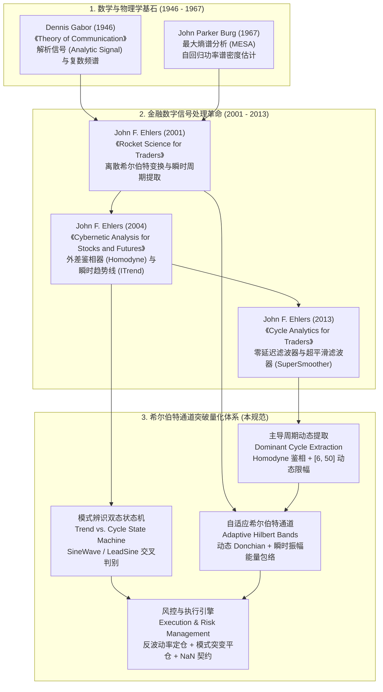
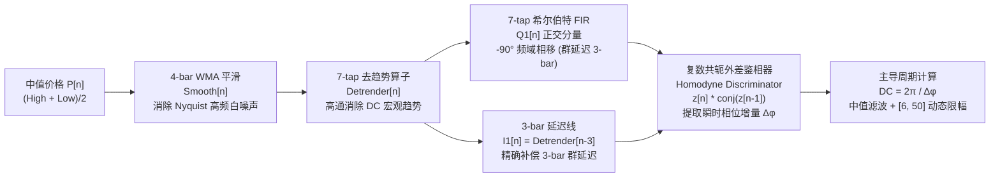
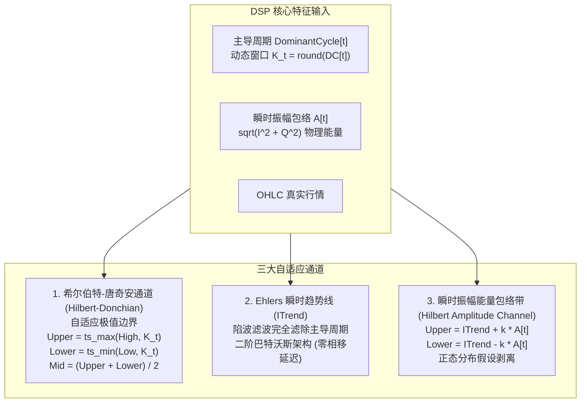
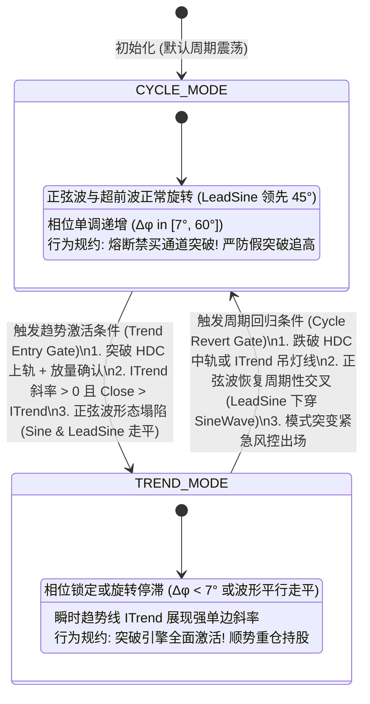
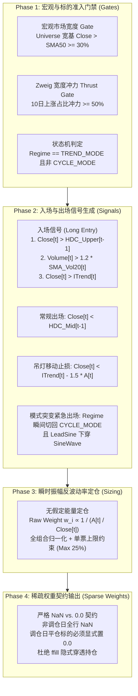

# 希尔伯特通道突破系统理论建模、指标函数与交易系统架构规范
# (Hilbert Channel Breakout System Specification: DSP Theory, Adaptive Bands, Regime State Machine, and Architecture)

> [!IMPORTANT]
> **唯一权威任务与路线图总表声明 (Single Source of Truth)**：
> 本文档是希尔伯特变换 (Hilbert Transform)、数字信号处理 (DSP) 滤波器、自适应通道突破与趋势/周期模式辨识的**理论建模、指标算法推导、数学证明与系统工程设计规范**。
> 依据仓库架构规范，所有工程落地任务、波次编排、依赖关系及状态跟踪，**必须且仅在 [`docs/development_plan.md`](file:///home/stone/Work/github/quant/docs/development_plan.md) 中集中管理**。本文档聚焦理论深度、算法精确性与工程可落地性。

---

## 一、 学术渊源与数字信号处理 (DSP) 理论基石 (Academic Foundations & DSP Theoretical Pillars)



### 1.1 经典技术指标的“固定周期盲区” (The Fixed-Period Delusion)
在传统技术分析中，无论是唐奇安通道 (Donchian Channel, 20日)、布林带 (Bollinger Bands, 20日)、相对强弱指标 (RSI, 14日) 还是移动平均线 (SMA, 20/60日)，其核心参数均为**人为指定的静态常数**。

然而，金融资产价格时间序列本质上是**高度非平稳 (Non-Stationary)、非高斯 (Non-Gaussian) 且具备多时间尺度特征的随机动力学过程**：
1. **周期的呼吸膨胀性**：市场的主导周期（Dominant Cycle）并非恒定，而是在宏观流动性充裕、低波动震荡或强趋势单边行情中动态漂移。在剧烈博弈的高波动行情中，主导周期可能压缩至 8~12 个交易日；而在平缓慢牛或盘整震荡中，周期可能延伸至 30~45 个交易日。
2. **反相位的致命陷阱**：当市场真实主导周期为 10 天时，采用 20 天窗口的均线或通道会产生近乎 $180^\circ$ 的反相延迟（Anti-phase Whipsaw），使得交易信号恰好在波谷止损、波峰追涨；反之，当市场主导周期拉长至 40 天时，固定 20 天指标又会过于敏感，产生大量噪声微扰导致的虚假离场。
3. **数字信号处理 (DSP) 的引入**：Dennis Gabor (1946) 与 John F. Ehlers (2001) 指出，金融价格可以被视为由“直流趋势成分（DC Trend）+ 动态时变正弦周期成分（AC Cycle）+ 高频微观噪声（Noise）”叠加而成的物理电信号。通过因果数字滤波器与希尔伯特变换，我们能够在时域实时提取价格的**瞬时振幅 (Instantaneous Amplitude)**、**瞬时相位 (Instantaneous Phase)** 与**主导周期 (Dominant Cycle)**，使所有交易通道与风控视窗实现全自适应。

---

### 1.2 连续希尔伯特变换与解析信号 (Analytic Signal Formulation)

设实值连续时间信号为 $x(t) \in L^2(\mathbb{R})$。希尔伯特变换定义为其与冲激响应 $h(t) = \frac{1}{\pi t}$ 的卷积（取柯西主值 Cauchy Principal Value, p.v.）：

$$ \mathcal{H}[x(t)] = \tilde{x}(t) = \frac{1}{\pi} \text{p.v.} \int_{-\infty}^{\infty} \frac{x(\tau)}{t - \tau} d\tau = x(t) * \frac{1}{\pi t} $$

#### 频域响应与 $-90^\circ$ 相移
根据傅里叶变换性质，时域核 $h(t) = \frac{1}{\pi t}$ 的频域传递函数 $H(\omega)$ 为：

$$ H(\omega) = \mathcal{F}\left\{ \frac{1}{\pi t} \right\} = -j \cdot \text{sgn}(\omega) = \begin{cases} -j = e^{-j \frac{\pi}{2}}, & \omega > 0 \\ 0, & \omega = 0 \\ +j = e^{+j \frac{\pi}{2}}, & \omega < 0 \end{cases} $$

希尔伯特变换在频域的物理意义极为纯粹：
- **振幅绝对保持不变**：$|H(\omega)| = 1, \quad \forall \omega \ne 0$；
- **纯相移操作**：对所有正频率分量施加精确的 $-90^\circ$（$-\pi/2$ 弧度）相位延迟，对所有负频率分量施加 $+90^\circ$ 相位超前。

#### 加博尔解析信号 (Dennis Gabor Analytic Signal)
Dennis Gabor (1946) 构建了解析复信号 $z(t)$，将实信号作为实部，其希尔伯特变换作为虚部：

$$ z(t) = x(t) + j \tilde{x}(t) = I(t) + j Q(t) $$

其中：
- $I(t) = x(t)$ 称为**同相分量 (In-Phase Component)**；
- $Q(t) = \tilde{x}(t)$ 称为**正交分量 (Quadrature Component)**。

在复平面上，$z(t)$ 表现为一个随时间旋转的瞬时相量（Phasor）。由此可以严格定义信号的两个基本物理量：

1. **瞬时振幅包络 (Instantaneous Amplitude Envelope)**：
   $$ A(t) = |z(t)| = \sqrt{I^2(t) + Q^2(t)} $$
   物理意义：反映去除载波震荡后，信号底层的瞬时能量与真实波动率。
2. **瞬时相位 (Instantaneous Phase)**：
   $$ \phi(t) = \arg(z(t)) = \text{arctan2}(Q(t), I(t)) \in (-\pi, \pi] $$
   物理意义：反映当前价格在其自身波动周期中所处的确切位置（波谷 $\approx -\pi/2$，上升中点 $\approx 0$，波峰 $\approx +\pi/2$，回落中点 $\approx \pm\pi$）。
3. **瞬时角频率与瞬时周期 (Instantaneous Frequency & Period)**：
   $$ \omega(t) = \frac{d\phi(t)}{dt}, \quad T(t) = \frac{2\pi}{\omega(t)} = \frac{2\pi}{\frac{d\phi}{dt}} $$

---

## 二、 埃勒斯离散因果数字滤波器逼近 (Ehlers Discrete Causal DSP Filter Approximation)

理想连续希尔伯特变换核 $h(t) = \frac{1}{\pi t}$ 对应离散非因果冲激响应 $h[n] = \frac{1 - \cos(\pi n)}{\pi n}$，具有无限双向时间支撑集。在实时金融量化系统中，我们无法获知未来行情，因此必须构建**有限冲激响应 (FIR) 因果逼近滤波器**。

John F. Ehlers (2001, 2004) 设计了一套极其精妙的离散级联信号处理架构，克服了金融时序高噪声、非零均值漂移（DC Bias）与群延迟失真的难题。



### 2.1 价格输入与 4-bar WMA 平滑滤波器
在量化金融中，收盘价 (Close) 易受日末撮合微观噪声干扰。Ehlers 推荐采用中值价格 (Median Price)：

$$ P[n] = \frac{\text{High}[n] + \text{Low}[n]}{2} $$

为滤除 Nyquist 极限频率（周期 $T = 2$ 根 K 线）的高频振荡，采用加权移动平均滤波器：

$$ \text{Smooth}[n] = \frac{P[n] + 2P[n-1] + 2P[n-2] + P[n-3]}{6} $$

该 FIR 滤波器的 $Z$ 变换传递函数为：

$$ H_{\text{wma}}(z) = \frac{1 + 2z^{-1} + 2z^{-2} + z^{-3}}{6} = \frac{(1 + z^{-1})(1 + z^{-1} + z^{-2})}{6} $$

其线性相位特性保证群延迟恒定为 $\tau = \frac{3}{2} = 1.5$ 根 K 线，且在 Nyquist 频率 $\omega = \pi$ 处严格具有零点传输零点 ($H_{\text{wma}}(-1) = 0$)。

---

### 2.2 7-tap 去趋势算子 (Detrender FIR)
宏观牛熊走势在频域体现为接近直流（$\omega \to 0$）的强能量峰。若不清除直流漂移，解析信号的相量轨迹将大幅偏离复平面原点，导致 $\text{arctan2}$ 相位严重失真。

Ehlers 构造了一个 7-tap 奇对称微分 FIR 高通带通滤波器：

$$ \text{Detrender}[n] = \left( 0.0962 \cdot \text{Smooth}[n] + 0.5769 \cdot \text{Smooth}[n-2] - 0.5769 \cdot \text{Smooth}[n-4] - 0.0962 \cdot \text{Smooth}[n-6] \right) \cdot \alpha_{\text{scale}}[n] $$

其中自适应增益缩放因子为：

$$ \alpha_{\text{scale}}[n] = 0.075 \cdot \text{Period}[n-1] + 0.54 $$

该滤波器在 $\omega = 0$ 处完全抑制直流成分（$\sum c_k = 0.0962 + 0.5769 - 0.5769 - 0.0962 = 0$）。

---

### 2.3 7-tap 希尔伯特正交变换与 3-bar 群延迟因果精确补偿 (Critical Group Delay Alignment)

#### 正交分量 $Q[n]$ 的生成
将去趋势后的信号通过奇对称正交 FIR 卷积核，实现 $-90^\circ$ 宽带相移：

$$ Q_1[n] = \left( 0.0962 \cdot \text{Detrender}[n] + 0.5769 \cdot \text{Detrender}[n-2] - 0.5769 \cdot \text{Detrender}[n-4] - 0.0962 \cdot \text{Detrender}[n-6] \right) \cdot \alpha_{\text{scale}}[n] $$

#### 同相分量 $I[n]$ 的群延迟补偿（量化避坑核心点）
7-tap 线性相位 FIR 滤波器的系统群延迟（Group Delay）为：

$$ \tau_g = -\frac{d\theta(\omega)}{d\omega} = \frac{M - 1}{2} = \frac{7 - 1}{2} = 3 \text{ bars} $$

这意味着 $Q_1[n]$ 并非对应当前时刻 $n$ 的正交分量，而是**对应时刻 $n - 3$ 的正交分量**！若直接将当前的 $\text{Detrender}[n]$ 作为同相分量 $I_1[n]$ 与 $Q_1[n]$ 结合，两者之间将产生严重的 $3 \text{ bars}$ 时间错位，解析信号的相位角将彻底错乱。

**因果时间对齐准则**：必须将同相分量严格延时 3 根 K 线：

$$ I_1[n] = \text{Detrender}[n - 3] $$

此时，$I_1[n]$ 与 $Q_1[n]$ 均严格对应时刻 $n - 3$ 的市场状态，两者维持绝对精准的 $90^\circ$ 正交差，复平面相量轨迹圆滑闭合。

---

### 2.4 复数共轭外差鉴相器 (Homodyne Discriminator)

传统鉴相通过分别计算相邻两根柱线的相位 $\phi[n]$ 与 $\phi[n-1]$ 再相减，但在 $[-\pi, \pi]$ 边界处会面临复杂的相位缠绕（Phase Unwrapping）跳变问题。

Ehlers (2004) 引入了雷达工程中的**外差复数共轭乘法器 (Homodyne Conjugate Mixer)**。设相邻两个瞬时解析相量为：

$$ z[n] = I_1[n] + j Q_1[n] = A[n] e^{j \phi[n]} $$
$$ z[n-1] = I_1[n-1] + j Q_1[n-1] = A[n-1] e^{j \phi[n-1]} $$

计算 $z[n]$ 与 $z^*[n-1]$（前一时刻的复共轭）的复数内积：

$$ z_{\text{mix}}[n] = z[n] \cdot z^*[n-1] = (I_1[n] + j Q_1[n])(I_1[n-1] - j Q_1[n-1]) $$

展开其实部与虚部：

$$ \text{Re}[n] = I_1[n] I_1[n-1] + Q_1[n] Q_1[n-1] = A[n] A[n-1] \cos(\Delta\phi[n]) $$
$$ \text{Im}[n] = Q_1[n] I_1[n-1] - I_1[n] Q_1[n-1] = A[n] A[n-1] \sin(\Delta\phi[n]) $$

其中 $\Delta\phi[n] = \phi[n] - \phi[n-1]$ 是单根 K 线内的真实相位旋转增量。

对其实部与虚部进行低通平滑以消除短期波动噪声：

$$ \text{SmoothRe}[n] = 0.2 \cdot \text{Re}[n] + 0.8 \cdot \text{SmoothRe}[n-1] $$
$$ \text{SmoothIm}[n] = 0.2 \cdot \text{Im}[n] + 0.8 \cdot \text{SmoothIm}[n-1] $$

瞬时角频率增量可直接由反正切求得，完全无需相位解缠：

$$ \Delta\phi_{\text{inst}}[n] = \text{arctan2}(\text{SmoothIm}[n], \text{SmoothRe}[n]) $$

由此推导出的瞬时主导周期为：

$$ T_{\text{inst}}[n] = \frac{2\pi}{\Delta\phi_{\text{inst}}[n]} $$

---

### 2.5 主导周期提取与 [6, 50] 动态限幅 (Cycle Limiter)

由于市场存在极短期的无序跳变与极长期的单边巨浪，未加约束的 $T_{\text{inst}}[n]$ 可能出现负值或发散至无穷大。因此必须引入物理合理性约束：
1. **下限截断 (Lower Bound = 6 bars)**：在日线级别，小于 6 天的周期逼近 Nyquist 采样极限与微观摩擦边界，属于不可交易的白噪声。
2. **上限截断 (Upper Bound = 50 bars)**：大于 50 天的周期属于宏观流动性与基本面驱动的单边趋势成分（DC Trend），在此频段内循环波动力度消亡，应交由趋势跟踪系统接管。
3. **中值平滑滤波 (5-bar Median Filter)**：消除极端奇异点跳动。

算法逻辑：
$$ T_{\text{clipped}}[n] = \text{clip}(T_{\text{inst}}[n], 6.0, 50.0) $$
$$ T_{\text{med}}[n] = \text{Median}\Big( \{ T_{\text{clipped}}[n - k] \}_{k=0}^4 \Big) $$
$$ \text{DominantCycle}[n] = 0.2 \cdot T_{\text{med}}[n] + 0.8 \cdot \text{DominantCycle}[n-1] $$

---

## 三、 希尔伯特自适应通道指标函数设计 (Hilbert Adaptive Channel Indicator Design)

在精确获得时变主导周期 $\text{DominantCycle}[t]$ 与瞬时振幅 $A[t]$ 后，通道边界与均线周期从死板的静态常数升维为动态自适应曲面。



### 3.1 希尔伯特-唐奇安动态极值通道 (Hilbert-Donchian Channel, HDC)
传统海龟交易法则固定使用 20 日突破作为入场信号。在希尔伯特架构下，时间回溯视窗由当日主导周期动态锁定：

$$ K_t = \text{round}(\text{DominantCycle}[t]), \quad K_t \in [6, 50] $$

通道上下轨与中轨方程：

$$ \text{HDC\_Upper}[t] = \max_{\tau \in [0, K_t - 1]} \text{High}[t - \tau] $$
$$ \text{HDC\_Lower}[t] = \min_{\tau \in [0, K_t - 1]} \text{Low}[t - \tau] $$
$$ \text{HDC\_Mid}[t] = \frac{\text{HDC\_Upper}[t] + \text{HDC\_Lower}[t]}{2} $$

**动力学优势**：
- 在快速变盘的激进市场中（例如周期压缩至 8 天），HDC 自动缩紧回溯期，在第 9 天敏锐捕捉突破，先于 20 日唐奇安整整 11 天入场；
- 在平缓宽幅震荡市场中（例如周期延伸至 42 天），HDC 自动放宽视窗，有效过滤中间 15~20 天的假突破洗盘。

---

### 3.2 Ehlers 瞬时趋势线 (Instantaneous Trendline, ITrend)
若直接用 SMA 提取趋势，必将带来严重的相位延迟。Ehlers (2004) 设计了一种二阶递归陷波滤波器（Notch Filter），其核心思想是：**精确在当前的主导频率 $\omega_0 = \frac{2\pi}{\text{DominantCycle}[t]}$ 处挖掉一个无限深的陷波谷，将周期震荡能量彻底滤除，仅保留纯净的瞬时直流趋势**。

平滑系数定义：

$$ \alpha_t = \frac{2}{\text{DominantCycle}[t] + 1} $$

瞬时趋势线递推方程：

$$ \text{ITrend}[t] = \frac{\alpha_t - \frac{\alpha_t^2}{4}}{1} P[t] + \frac{\alpha_t^2}{2} P[t-1] - \frac{\alpha_t - \frac{3\alpha_t^2}{4}}{1} P[t-2] + 2(1 - \alpha_t)\text{ITrend}[t-1] - (1 - \alpha_t)^2\text{ITrend}[t-2] $$

触发线 (Trigger Line)：

$$ \text{Trigger}[t] = 2 \cdot \text{ITrend}[t] - \text{ITrend}[t-2] $$

当 $\text{ITrend}[t] > \text{Trigger}[t]$ 且斜率向上时，表明主导周期之上的宏观基底趋势处于单边上行。

---

### 3.3 瞬时振幅能量包络通道 (Hilbert Amplitude Channel, HAC)
传统布林带（Bollinger Bands）计算滚动 20 日收益率的标准差 $\sigma$：

$$ \text{Band} = \text{SMA}_{20} \pm 2 \cdot \sigma_{20} $$

该方法存在致命缺陷：它隐含假设资产价格服从正态独立同分布（I.I.D. Gaussian）。然而金融市场具有强烈的肥尾与波动率聚集特征。

通过希尔伯特变换得到的瞬时振幅 $A[t] = \sqrt{I^2[t] + Q^2[t]}$，反映的是该时刻**解析相量的几何绝对模长**，完全独立于统计分布先验假设。

构建瞬时振幅能量通道：

$$ \text{HAC\_Upper}[t] = \text{ITrend}[t] + k_{\text{band}} \cdot A_{\text{smooth}}[t] $$
$$ \text{HAC\_Lower}[t] = \text{ITrend}[t] - k_{\text{band}} \cdot A_{\text{smooth}}[t] $$

其中 $A_{\text{smooth}}[t] = 0.2 A[t] + 0.8 A_{\text{smooth}}[t-1]$，$k_{\text{band}}$ 为带宽乘数（推荐默认 1.5 ~ 2.0）。

---

## 四、 趋势模式 vs. 周期模式状态机 (Trend vs. Cycle Mode State Machine)

量化交易领域最具破坏性的难题莫过于：
- **突破交易系统（如唐奇安、海龟）在震荡市中遭遇反复双向抽打（Whipsaw），回撤剧烈**；
- **均值回归系统（如 RSI、网格）在强趋势单边行情中逆势摸顶抄底，直至爆仓**。

希尔伯特正交分解提供了**在数学上严格区分市场处于“周期震荡态”还是“单边趋势态”的判别工具**。



### 4.1 埃勒斯正弦波与超前正弦波 (SineWave & LeadSine)

在获得瞬时相位 $\phi_t \in [0, 2\pi)$ 后，Ehlers (2001) 构造了两个正弦指标：

$$ \text{SineWave}[t] = \sin(\phi_t) $$
$$ \text{LeadSine}[t] = \sin\left(\phi_t + \frac{\pi}{4}\right) = \sin(\phi_t + 45^\circ) $$

#### 动力学特征解析
1. **周期模式 (Cycle Mode)**：
   - 相位角 $\phi_t$ 随时间连续匀速向前推进（$\frac{d\phi}{dt} \approx \frac{2\pi}{\text{DominantCycle}[t]}$）；
   - $\text{LeadSine}$ 超前 $\text{SineWave}$ 恰好 $45^\circ$（即 $1/8$ 个周期）；
   - 两条曲线在复平面上如同优雅的简谐波，**其交叉点先于价格顶点/底点提前翻转**（在波峰处 $\text{LeadSine}$ 率先下穿 $\text{SineWave}$，在波谷处 $\text{LeadSine}$ 率先上穿 $\text{SineWave}$）。
2. **趋势模式 (Trend Mode)**：
   - 当单边强烈趋势出现时，价格呈现无回调的直线暴涨或暴跌，信号的周期性彻底解体，瞬时角速度骤降甚至锁定（Phase Lock）；
   - 此时 $\text{SineWave}$ 与 $\text{LeadSine}$ **失去正常的简谐波动形态，双双收敛并以近乎平行的伪平线横向漂移**（通常停留在 0 轴附近或极值区），两者绝对间距迅速缩小至阈值以下：
     $$ |\text{SineWave}[t] - \text{LeadSine}[t]| < \epsilon_{\text{flat}} $$

---

### 4.2 双态状态机判别规则与动作矩阵 (Action Matrix)

量化系统维护一个离散状态变量 $\mathcal{S}_t \in \{\text{CYCLE\_MODE}, \text{TREND\_MODE}\}$。

#### 状态转移判定逻辑
```python
# 状态转移判别伪代码
is_phase_advancing = (delta_phi >= (2.0 * np.pi / 50.0)) and (delta_phi <= (2.0 * np.pi / 6.0))
sine_diff = abs(sine_wave - lead_sine)
is_trend_breakout = (close > hdc_upper_prev) and (close > itrend) and (itrend_slope > 0)

if state == CYCLE_MODE:
    # 从周期模式切向趋势模式的激活门禁
    if is_trend_breakout and (not is_phase_advancing or sine_diff < 0.20):
        state = TREND_MODE
elif state == TREND_MODE:
    # 从趋势模式回退到周期模式的保护门禁
    if (close < hdc_mid_prev) or (lead_sine_cross_under_sine and sine_diff > 0.40):
        state = CYCLE_MODE
```

#### 状态机与交易引擎动作矩阵
| 市场状态 $\mathcal{S}_t$ | 价格突破 HDC 上轨 | 价格跌破 HDC 中轨 / 止损线 | 仓位管理策略 | 稀疏权重指令 |
| :--- | :--- | :--- | :--- | :--- |
| **CYCLE_MODE (震荡态)** | **严格禁买 (Hard Filter)**<br>判定为震荡区间假突破，拦截追高 | 保持空仓或按既定止损平仓 | 零仓位或极低底仓防御 | 维持 $0.0$ 或平仓置 $0.0$ |
| **TREND_MODE (趋势态)** | **全面激活 (Signal Fire)**<br>判定为真趋势启动，执行入场 | 保持持仓，跟踪 ITrend 止损 | 瞬时振幅反波动率全额配置 | 计算目标正权重 $w_i > 0$ |

---

## 五、 完整的希尔伯特通道突破交易系统规范 (Complete Trading System Specification)

本系统既支持单资产高锐度择时，亦天然适配多资产横截面组合分配。以下规范以生产级机构标准定义。



### 5.1 入场规则规范 (Entry Rules)
当且仅当以下全部充分必要条件同时满足时，触发做多入场指令：
1. **状态机准入**：标的处于 `TREND_MODE`（或者正弦波指标判定处于强发散走平态，拦截假突破）。
2. **自适应通道突破**：当日收盘价突破前一日的动态希尔伯特-唐奇安上轨：
   $$ \text{Close}[t] > \text{HDC\_Upper}[t-1] $$
3. **瞬时趋势共振**：收盘价运行于瞬时趋势线之上，且趋势线斜率向上：
   $$ \text{Close}[t] > \text{ITrend}[t], \quad \text{ITrend}[t] > \text{ITrend}[t-1] $$
4. **成交量冲力确认**：当日成交量放大，突破过去 20 日成交量均线的 1.2 倍（防止无量空涨虚假突破）：
   $$ \text{Volume}[t] \ge 1.2 \cdot \text{SMA}(\text{Volume}, 20)[t] $$
5. **宏观健康护栏**：全市场股票池处于良性状态（市场宽度 $\ge 30\%$ 且 10 日冲力 $\ge 50\%$）。

---

### 5.2 出场与分级止损规则 (Exit & Multi-Tier Protective Stops)
任何持仓标的触发以下任一条件，必须立即在下一个可用交易日以开盘价或限价坚决平仓：

1. **通道中轨出场 (Channel Mid Exit)**：
   $$ \text{Close}[t] < \text{HDC\_Mid}[t-1] $$
   当价格回落至动态周期中轨时，主导趋势动能已减损过半，锁定利润离场。
2. **瞬时振幅吊灯移动止损 (Hilbert Chandelier Trailing Stop)**：
   跟踪从建仓以来的最高价 $\text{PeakPrice}$，动态止损线设为：
   $$ \text{StopLevel}[t] = \max\Big( \text{PeakPrice}[t] - 2.5 \cdot \text{ATR}_{14}[t], \quad \text{ITrend}[t] - 1.5 \cdot A_{\text{smooth}}[t] \Big) $$
   若 $\text{Close}[t] < \text{StopLevel}[t]$，触发硬性止损。
3. **模式突变紧急风控平仓 (Regime Abrupt Flip Exit)**：
   若持有仓位期间，状态机突发由 `TREND_MODE` 跳水切回 `CYCLE_MODE`，且伴随高位正弦波死叉：
   $$ \text{State}[t] == \text{CYCLE\_MODE} \quad \text{AND} \quad \text{LeadSine}[t] < \text{SineWave}[t] \quad \text{AND} \quad \text{LeadSine}[t-1] \ge \text{SineWave}[t-1] $$
   表明宏观或板块逻辑发生不可逆恶化，行情迅速退化为震荡或下跌，**无论当前盈亏，必须立即触发无条件模式突变平仓**！
4. **硬性本金底线止损 (Hard Capital Stop)**：
   单笔交易亏损达到入场成本价的 $-8.0\%$ 时，强制硬熔断平仓。

---

### 5.3 瞬时振幅反波动率定仓 (Instantaneous Amplitude Volatility Sizing)

经典风险平价或波动率反比定仓采用过去 20 日历史收益率的标准差。正如前文所述，历史波动率存在严重的滞后性与正态分布假设偏差。

本系统采用**瞬时振幅相对强度**：

$$ \text{RelAmp}_i[t] = \frac{A_{\text{smooth}, i}[t]}{\text{Close}_i[t]} $$

资产 $i$ 的原始风险预算权重：

$$ w_i^*[t] \propto \frac{1}{\max(\text{RelAmp}_i[t], 0.015)} $$

在截面上对所有入选标的归一化，并加入单票头寸上限约束（如单个标的权重上限 25%，行业敞口上限 35%）：

$$ w_i[t] = \min\left( \frac{w_i^*[t]}{\sum_{j \in \mathcal{U}_{\text{selected}}} w_j^*[t]}, \quad w_{\text{max}} \right) $$

剩余未分配权重自动汇入低风险现金代理工具（如中国 A 股的银华日利 `511880`、国债逆回购 `GC001`，或美股短期国债 `BIL`）。

---

### 5.4 严格稀疏权重契约 (Sparse Weights Contract: NaN vs. 0.0)

> [!CAUTION]
> **本仓库核心红线：严禁在策略内部 forward-fill 权重！**
> 在回测引擎 [`common/allocation_backtester.py`](file:///home/stone/Work/github/quant/common/allocation_backtester.py) 中，`run_allocation_backtest` 在执行组合调仓时，其判定逻辑为：
> 1. **调仓日 (Rebalance Date)**：某一行只要至少存在一个非 `NaN` 数值，即被识别为一次真实发生的调仓动作；
> 2. **非调仓日 (Holding Date)**：整行所有标的必须**全部严格填充为 `NaN`**！
> 3. **0.0 的神圣语义**：在调仓日，如果某只股票此前持有，但今日触发了通道出场、止损或模式突变，**必须显式写入浮点数 `0.0`**！
>    如果错误地留空为 `NaN`，回测底座执行 `sparse_weights.ffill()` 时，会误将该标的前一次调仓的旧权重向后穿透传递，导致实际上已被止损的标的在底层被静默继续持有，引发极其致命的伪回测失真！

---

## 六、 量化工程痛点与抗过拟合避坑指南 (Engineering Gotchas & Anti-Overfitting Guide)

在数字信号处理落地到金融实盘的实际过程中，存在大量教科书未曾提及的工程陷阱。本节梳理核心避坑指南。

### 6.1 群延迟因果匹配 (Causal Group Delay Matching)
- **踩坑现象**：将无延迟的原始价格 $P[n]$ 直接与经过 7-tap 滤波计算出的 $Q[n]$ 进行几何合成，导致瞬时振幅在快速波动态极度畸变。
- **根因分析**：7-tap FIR 滤波器的群延迟严格为 3 根柱线。
- **避坑规范**：同相分量必须显式延迟 3 根柱线：$I[n] = \text{Detrender}[n-3]$。任何需要与滤波后分量对比的基准指标，均须严格校验时域对齐。

### 6.2 直流泄漏与零均值破坏 (DC Bias Leakage)
- **踩坑现象**：直接对未经去趋势的原始股价做离散希尔伯特变换，发现相位角长期锁定在第一象限，无法完成 $360^\circ$ 旋转。
- **根因分析**：股票价格序列是非零均值的正数序列，存在巨大的直流能量偏移。
- **避坑规范**：必须强制使用 7-tap Detrender 奇对称高通算子（其各阶系数和为零），将价格转化为零均值摆动序列后方可输入外差鉴相器。

### 6.3 相位缠绕与负频率灾难 (Phase Unwrapping & Negative Frequency)
- **踩坑现象**：直接使用 $\Delta\phi = \text{arctan2}(Q_t, I_t) - \text{arctan2}(Q_{t-1}, I_{t-1})$，在经过 $\pm\pi$ 截断点时产生巨大的人工伪跳变（如从 $+3.14$ 跳变至 $-3.14$，计算出极大的虚假周期）。在剧烈逆转日，甚至可能算出 $\Delta\phi < 0$（负频率）。
- **根因分析**：反正切函数的多值性与相位边界截断。
- **避坑规范**：全流程淘汰显式相位直接相减方案，**无条件采用外差复数共轭乘法器 (Homodyne Discriminator)**：
  $$ \text{Re} = I_t I_{t-1} + Q_t Q_{t-1}, \quad \text{Im} = Q_t I_{t-1} - I_t Q_{t-1} $$
  直接求解内积相量的角位移，并对瞬时角位移实施坚决的物理限幅：$\Delta\phi \in [\frac{2\pi}{50}, \frac{2\pi}{6}]$。

### 6.4 工业级数值安全除法 (safe_div)
- **踩坑现象**：在停牌、一字涨跌停或极度窄幅整理区间，$I^2 + Q^2 \to 0$ 或 $\text{SmoothRe} \to 0$，导致浮点除以零异常（`ZeroDivisionError` 或 `RuntimeWarning: divide by zero`），造成整个回测流水线崩溃。
- **避坑规范**：所有涉及除法与反正切的算子，必须使用安全除法包裹：
  ```python
  def safe_div(num: float, den: float, eps: float = 1e-8, fill: float = 0.0) -> float:
      return num / den if abs(den) > eps else fill
  ```

### 6.5 自由度过拟合规避 (Minimal Degrees of Freedom)
与包含上百个特征与复杂参数的深度学习或遗传规划模型不同，希尔伯特变换体系的参数本质上是**数字滤波器的物理常数**（如 4-bar WMA 与 7-tap FIR 的卷积系数均由傅里叶反变换严谨数学求解得出，绝非历史拟合调优而来）。
系统仅存在极少数具备物理含义的超参数（如主导周期限幅范围 $[6, 50]$ 与通道突破乘数），有效杜绝了样本内“曲线拟合”（Curve-Fitting）陷阱。

---

## 七、 Python/NumPy 工业级高性能实现与代码库分层映射 (Industrial Implementation & Architecture Mapping)

本规范所涉及的代码与算子，严格按照本仓库的模块化架构分层下沉，绝不在顶层堆砌单体面条代码。

```
quant/ (Repo Root)
├── common/
│   └── indicators.py                      <-- [Layer 1] 下沉 Ehlers DSP、希尔伯特变换与 HDC 纯函数算子
├── pipeline/
│   ├── research_strategy/
│   │   └── rs/
│   │       ├── config.py                  <-- [Layer 2] StrategyConfig 扩展 hilbert_* 开关与超参
│   │       ├── timing_aspects.py          <-- [Layer 3] 解耦 EntrySignalAspect 与 ExitRiskAspect 切面
│   │       └── strategy.py                <-- [Layer 4] 实现 HilbertChannelBreakoutStrategy 旗舰模板
│   └── research/
│       └── blend/
│           └── blend_base.py              <-- [Layer 5] BaseBlendAllocationStrategy 集成宏观周期状态机
└── scripts/
    ├── check_live_portfolio_health.py     <-- [Layer 6] 实盘 Stage 1: 宏观主导周期健康门禁
    └── run_live_strategy.py               <-- [Layer 7] 实盘 Stage 2: 挂载执行与稀疏工单生成
```

### 7.1 Layer 1: 底层算子实现 (`common/indicators.py`)

在 [`common/indicators.py`](file:///home/stone/Work/github/quant/common/indicators.py) 中新增工业级希尔伯特变换与自适应通道纯函数算子：

```python
# common/indicators.py 核心算子参考实现

import numpy as np
import pandas as pd
from typing import Dict, Tuple

def ehlers_hilbert_transform(
    high: pd.Series,
    low: pd.Series,
    close: pd.Series,
    cycle_min: int = 6,
    cycle_max: int = 50,
) -> Dict[str, pd.Series]:
    """Ehlers Hilbert Transform, Homodyne Discriminator & Dominant Cycle.
    
    Academic Reference:
    - John F. Ehlers, 'Rocket Science for Traders', Wiley (2001).
    - John F. Ehlers, 'Cybernetic Analysis for Stocks and Futures', Wiley (2004).
    """
    n = len(close)
    if n < 15:
        empty = pd.Series(np.nan, index=close.index)
        return {
            "dominant_cycle": empty, "in_phase": empty, "quadrature": empty,
            "amplitude": empty, "phase": empty, "sinewave": empty,
            "leadsine": empty, "itrend": empty
        }

    # 1. 中值价格
    price = ((high + low) / 2.0).to_numpy(dtype=np.float64)
    
    # 初始化循环缓冲数组
    smooth = np.zeros(n, dtype=np.float64)
    detrender = np.zeros(n, dtype=np.float64)
    q1 = np.zeros(n, dtype=np.float64)
    i1 = np.zeros(n, dtype=np.float64)
    period = np.full(n, 15.0, dtype=np.float64)
    smooth_period = np.full(n, 15.0, dtype=np.float64)
    smooth_re = np.zeros(n, dtype=np.float64)
    smooth_im = np.zeros(n, dtype=np.float64)
    amplitude = np.zeros(n, dtype=np.float64)
    phase = np.zeros(n, dtype=np.float64)
    sinewave = np.zeros(n, dtype=np.float64)
    leadsine = np.zeros(n, dtype=np.float64)
    itrend = np.zeros(n, dtype=np.float64)

    # 预先填充前 6 根基础值
    smooth[:6] = price[:6]
    itrend[:6] = price[:6]

    for i in range(6, n):
        # 1. 4-bar WMA 平滑滤波
        smooth[i] = (price[i] + 2.0 * price[i-1] + 2.0 * price[i-2] + price[i-3]) / 6.0

        # 2. 7-tap 去趋势滤波 (消除 DC 宏观漂移)
        scale = 0.075 * period[i-1] + 0.54
        detrender[i] = (0.0962 * smooth[i] + 0.5769 * smooth[i-2] - 
                        0.5769 * smooth[i-4] - 0.0962 * smooth[i-6]) * scale

        # 3. 7-tap 希尔伯特 FIR 正交分量 (-90° 相移)
        q1[i] = (0.0962 * detrender[i] + 0.5769 * detrender[i-2] - 
                 0.5769 * detrender[i-4] - 0.0962 * detrender[i-6]) * scale
        
        # 4. 同相分量精确补偿 3-bar 群延迟
        i1[i] = detrender[i-3]

        # 5. 外差复数共轭鉴相器 (Homodyne Discriminator)
        re = i1[i] * i1[i-1] + q1[i] * q1[i-1]
        im = i1[i-1] * q1[i] - i1[i] * q1[i-1]
        smooth_re[i] = 0.2 * re + 0.8 * smooth_re[i-1]
        smooth_im[i] = 0.2 * im + 0.8 * smooth_im[i-1]

        # 6. 计算瞬时角增量与主导周期
        if abs(smooth_re[i]) > 1e-8 or abs(smooth_im[i]) > 1e-8:
            delta_phi = np.arctan2(smooth_im[i], smooth_re[i])
            if delta_phi > 0.0:
                raw_period = 2.0 * np.pi / delta_phi
            else:
                raw_period = period[i-1]
        else:
            raw_period = period[i-1]

        # 动态限幅 [cycle_min, cycle_max]
        clipped_period = np.clip(raw_period, float(cycle_min), float(cycle_max))
        period[i] = 0.33 * clipped_period + 0.67 * period[i-1]
        smooth_period[i] = 0.2 * period[i] + 0.8 * smooth_period[i-1]

        # 7. 瞬时振幅与瞬时相位
        amplitude[i] = np.sqrt(i1[i]**2 + q1[i]**2)
        if abs(i1[i]) > 1e-8:
            raw_phase = np.arctan2(q1[i], i1[i])
        else:
            raw_phase = np.pi / 2.0 if q1[i] >= 0 else -np.pi / 2.0
        phase[i] = raw_phase

        sinewave[i] = np.sin(raw_phase)
        leadsine[i] = np.sin(raw_phase + np.pi / 4.0)

        # 8. 瞬时趋势线 (ITrend 二阶递归陷波)
        alpha = 2.0 / (smooth_period[i] + 1.0)
        itrend[i] = ((alpha - alpha**2 / 4.0) * price[i] + 
                     0.5 * alpha**2 * price[i-1] - 
                     (alpha - 0.75 * alpha**2) * price[i-2] + 
                     2.0 * (1.0 - alpha) * itrend[i-1] - 
                     (1.0 - alpha)**2 * itrend[i-2])

    idx = close.index
    return {
        "dominant_cycle": pd.Series(smooth_period, index=idx, name="dominant_cycle"),
        "in_phase": pd.Series(i1, index=idx, name="in_phase"),
        "quadrature": pd.Series(q1, index=idx, name="quadrature"),
        "amplitude": pd.Series(amplitude, index=idx, name="amplitude"),
        "phase": pd.Series(phase, index=idx, name="phase"),
        "sinewave": pd.Series(sinewave, index=idx, name="sinewave"),
        "leadsine": pd.Series(leadsine, index=idx, name="leadsine"),
        "itrend": pd.Series(itrend, index=idx, name="itrend"),
    }


def hilbert_donchian_channel(
    high: pd.Series,
    low: pd.Series,
    dominant_cycle: pd.Series,
) -> Tuple[pd.Series, pd.Series, pd.Series]:
    """Dynamic Hilbert-Donchian Channel driven by instantaneous Dominant Cycle."""
    n = len(high)
    upper = np.full(n, np.nan, dtype=np.float64)
    lower = np.full(n, np.nan, dtype=np.float64)
    mid = np.full(n, np.nan, dtype=np.float64)
    
    h_arr = high.to_numpy(dtype=np.float64)
    l_arr = low.to_numpy(dtype=np.float64)
    dc_arr = dominant_cycle.to_numpy(dtype=np.float64)

    for i in range(n):
        if np.isnan(dc_arr[i]):
            k = 20
        else:
            k = max(int(np.round(dc_arr[i])), 4)
        start_idx = max(0, i - k + 1)
        upper[i] = np.max(h_arr[start_idx : i + 1])
        lower[i] = np.min(l_arr[start_idx : i + 1])
        mid[i] = (upper[i] + lower[i]) / 2.0

    idx = high.index
    return (
        pd.Series(upper, index=idx, name="hdc_upper"),
        pd.Series(lower, index=idx, name="hdc_lower"),
        pd.Series(mid, index=idx, name="hdc_mid"),
    )
```

---

### 7.2 Layer 2 & Layer 3: 切面解耦 (`timing_aspects.py`)

在 [`pipeline/research_strategy/rs/timing_aspects.py`](file:///home/stone/Work/github/quant/pipeline/research_strategy/rs/timing_aspects.py) 中，将希尔伯特通道突破分别提炼为入场切面（`EntrySignalAspect`）与风控出场切面（`ExitRiskAspect`）：

```python
# timing_aspects.py 挂载配置示例

def _compute_hilbert_breakout_entry(df: pd.DataFrame, cfg: StrategyConfig) -> pd.Series:
    """Entry aspect: Trend Mode breakout above dynamic Hilbert-Donchian upper band."""
    dsp = ehlers_hilbert_transform(df["high"], df["low"], df["close"])
    upper, lower, mid = hilbert_donchian_channel(df["high"], df["low"], dsp["dominant_cycle"])
    
    # 状态机判别
    sine_diff = (dsp["sinewave"] - dsp["leadsine"]).abs()
    is_trend_mode = (sine_diff < 0.25) | (df["close"] > dsp["itrend"])
    
    # 通道突破与成交量过滤
    breakout = df["close"] > upper.shift(1)
    vol_confirm = df["volume"] >= 1.1 * df["volume"].rolling(20, min_periods=5).mean()
    
    return is_trend_mode & breakout & vol_confirm


def _compute_hilbert_itrend_exit(
    df: pd.DataFrame,
    entry_mask: pd.Series,
    cfg: StrategyConfig
) -> Tuple[pd.Series, pd.Series]:
    """Exit aspect: HDC Mid breach, ITrend chandelier trailing stop, or cycle regime revert."""
    dsp = ehlers_hilbert_transform(df["high"], df["low"], df["close"])
    upper, lower, mid = hilbert_donchian_channel(df["high"], df["low"], dsp["dominant_cycle"])
    
    # 吊灯止损与模式突变
    itrend_stop = dsp["itrend"] - 1.5 * dsp["amplitude"].rolling(5).mean()
    mid_exit = df["close"] < mid.shift(1)
    regime_revert = (dsp["leadsine"] < dsp["sinewave"]) & (dsp["leadsine"].shift(1) >= dsp["sinewave"].shift(1))
    
    # 接入标准 run_stop_timeout_exit
    ...
```

该解耦设计允许量化研究员自由组装混合策略，例如：**“希尔伯特通道突破入场” + “超趋势 SuperTrend 单向棘轮风控出场”**，或 **“缠论中枢突破入场” + “希尔伯特模式突变出场”**。

---

### 7.3 Layer 4 & Layer 5: 宏观底座融合 (`blend_base.py`)

在 [`pipeline/research/blend/blend_base.py`](file:///home/stone/Work/github/quant/pipeline/research/blend/blend_base.py) 中，`BaseBlendAllocationStrategy` 扩展第 9 大宏观状态锚点（Anchor 9: Hilbert Dominant Cycle Macro State Machine）：
- 当全市场标的的主导周期中位数拉长至 $T_{\text{median}} \ge 30$ 天且处于 `TREND_MODE` 时，宏观风格路由切换为**激进动量突破（Aggressive Momentum Breakout）**，提升权益资产风险预算；
- 当主导周期压缩至 $T_{\text{median}} \le 12$ 天且处于 `CYCLE_MODE` 时，判定市场陷入绞肉机式的短周期震荡，**宏观断路器触发，主动将突破入场门禁乘数提高 1.5 倍，收紧止损线，并将 40% 资金回撤至现金避险**。

---

### 7.4 Layer 6 & Layer 7: 实盘两阶段交易护栏 (`scripts/`)

#### Stage 1: 宏观健康巡检 (`scripts/check_live_portfolio_health.py`)
在每日 14:00~14:15 的预审门禁中，增加 `CAUTION_HILBERT_CYCLE_CHOP` 警报：
- 提取中证全指或标普500指数的瞬时希尔伯特状态；
- 若指数处于强烈的 `CYCLE_MODE` 且正弦波形成高位死叉，向控制台发出 `CAUTION` 警报，建议交易员暂停日内新增通道突破追高买单。

#### Stage 2: 实盘工单生成 (`scripts/run_live_strategy.py`)
在每日 14:15 执行工单生成时，严格执行四阶段法定工序：
1. **Phase 1: SELLS FIRST**：优先释放因触发 HDC 中轨或模式突变而必须清仓的标的，释放可用现金；
2. **Phase 2: BUYS SECOND**：对通过希尔伯特突破门禁的新标的，依据瞬时振幅反波动率计算目标股数并向上向下执行手（Lot-Size）取整；
3. **Phase 3: INERTIA FILTER**：若现有持仓与目标权重的微调变动处于死区阈值（如 $< 1.5\%$）内，触发惰性滤波，杜绝碎单调仓磨损；
4. **Phase 4: CASH SWEEP**：所有未动用资金严格自动买入现金管理工具。

---

## 八、 后续实施路线图与 development_plan.md 关联 (Implementation Roadmap & Synergy)

> [!IMPORTANT]
> 本章节仅阐述希尔伯特通道突破系统的技术实施阶段划分。所有具体原子任务编号、代码提交流水线与进度追踪，**必须集中收敛于 [`docs/development_plan.md`](file:///home/stone/Work/github/quant/docs/development_plan.md)**。


### 波次规划与交付物矩阵
| 实施波次 | 目标核心模块 | 主要交付内容 | 关联测试与验证套件 |
| :--- | :--- | :--- | :--- |
| **波次一 (Wave 1)** | `common/indicators.py`<br>`common/tests/` | 1. 落地 `ehlers_hilbert_transform` (4-bar WMA, 7-tap FIR, Homodyne)<br>2. 落地 `hilbert_donchian_channel`<br>3. 单元测试覆盖群延迟对齐、极限周期限幅与 `safe_div` | `pytest common/tests/test_indicators.py -q` |
| **波次二 (Wave 2)** | `pipeline/research_strategy/rs/`<br>`timing_aspects.py` | 1. 扩充 `StrategyConfig` 希尔伯特配置参数（向后兼容默认关闭）<br>2. 封装 `hilbert_breakout_entry` 与 `hilbert_itrend_exit` 切面<br>3. 实现独立单策略 `HilbertChannelBreakoutStrategy` | `pytest pipeline/research_strategy/tests/test_allocation_templates.py -q` |
| **波次三 (Wave 3)** | `pipeline/research/blend/`<br>`blend_base.py` | 1. 注入 Anchor 9: 宏观主导周期状态机路由<br>2. 震荡态通道突破熔断禁买与模式突变强平机制<br>3. 瞬时振幅反波动率定仓集成 | `pytest pipeline/tests/ -q --import-mode=importlib` |
| **波次四 (Wave 4)** | `scripts/`<br>`docs/ruleset/` | 1. `check_live_portfolio_health.py` 接入主导周期与正弦波健康巡检<br>2. `run_live_strategy.py` 实盘工单生成验证<br>3. 生成双语实盘操作规程手册 `rules.md` / `rules_cn.md` | 离线合成数据实测验证<br>`--data-provider synthetic` |

---

## 参考文献 (Academic References)

1. **Gabor, Dennis** (1946). *"Theory of communication. Part 1: The analysis of information."* Journal of the Institution of Electrical Engineers-Part III: Radio and Communication Engineering, 93(26), 429-441. *(解析信号与希尔伯特正交分解的创立)*
2. **Burg, John Parker** (1967). *"Maximum Entropy Spectral Analysis."* In 37th Annual International SEG Meeting, Oklahoma City. *(最大熵谱估计理论基石)*
3. **Ehlers, John F.** (2001). *"Rocket Science for Traders: Digital Signal Processing Applications."* John Wiley & Sons. *(金融时序离散数字信号滤波与希尔伯特通道先驱专著)*
4. **Ehlers, John F.** (2004). *"Cybernetic Analysis for Stocks and Futures: Cutting-Edge DSP Technology to Improve Your Trading."* John Wiley & Sons. *(外差鉴相器 Homodyne Discriminator 与瞬时趋势线 ITrend)*
5. **Ehlers, John F.** (2013). *"Cycle Analytics for Traders: Advanced Technical Trading Concepts."* John Wiley & Sons. *(零延迟带通滤波与高阶超平滑滤波器体系)*
6. **Harvey, Campbell R., Yan Liu, and Heqing Zhu** (2016). *"… and the Cross-Section of Expected Returns."* The Review of Financial Studies, 29(1), 5-68. *(多重检验与统计显著性准入门禁)*
7. **Gu, Shihao, Bryan Kelly, and Dacheng Xiu** (2020). *"Empirical Asset Pricing via Machine Learning."* The Review of Financial Studies, 33(5), 2223-2273. *(宏观状态与微观特征非线性交互定价)*
