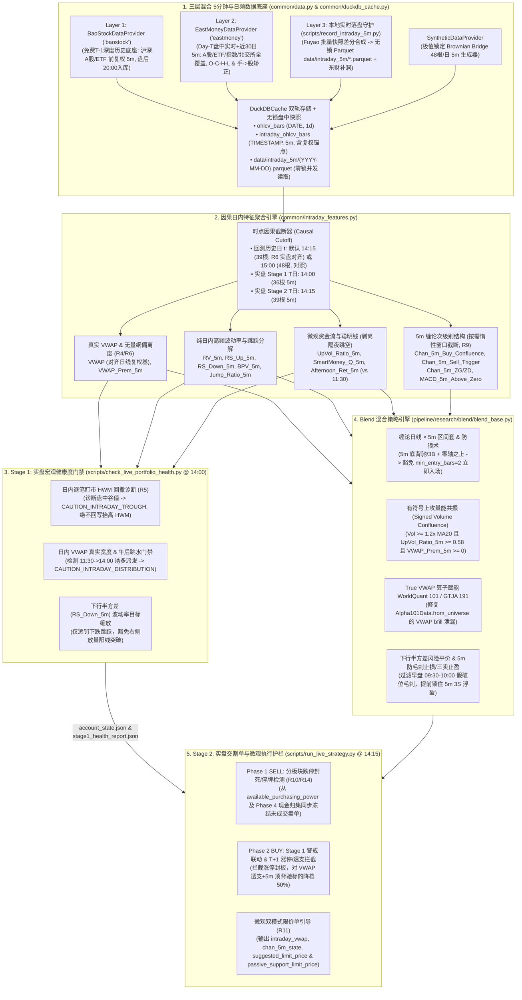
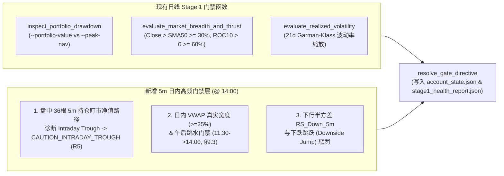

# 深度研究与架构实施方案：5分钟高频日内数据赋能实盘 Go/No-Go 门禁与 Blend 策略体系升级
# (Deep Analysis & Implementation Plan: 5-Minute Intraday Data Enhancement for Live Trading Go/No-Go & Modular Blend Strategies)

> [!IMPORTANT]
> **2026-10-17 评审修订（二轮终审已全量合入正文）**：本方案已完成两轮代码级深度评审，所有修订项（R1–R14 及 §8.3 细节澄清：截断 bar 数、钉扎式布朗桥、VWAP `ffill` 泄漏与结构断点披露、跨源复权与截断时点无量纲对齐 R4/R6、`DuckDBCache` 日期型 `end` 截断当天 48 根 K 线修复 R13、盘中 HWM 回测一致性 R5、5m 缠论按需惰性求值 R9、涨跌停精确判据与 Phase 4 现金归集防透支 R10/R14、主动/被动双限价引导 R11、合成日线 `Is_Partial_Bar` 标记 R12、开关默认关闭 R7 及 Phase 0 / Phase 6 消融验证）**均已直接合入第一至第七章正文规范**，完整对照表见 [第八章 评审修订记录](#八-评审修订记录与待办-review-amendments--open-items-2026-10-17)。

---

## 目标概述 (Executive Summary & Goal Description)

本方案针对本仓库现有的**两阶段实盘执行架构**（Stage 1 宏观健康度门禁 [`scripts/check_live_portfolio_health.py`](file:///home/stone/Work/github/quant/scripts/check_live_portfolio_health.py) + Stage 2 交易指令单生成 [`scripts/run_live_strategy.py`](file:///home/stone/Work/github/quant/scripts/run_live_strategy.py)）以及**机构级多策略混合底座**（[`BaseBlendAllocationStrategy`](file:///home/stone/Work/github/quant/pipeline/research/blend/blend_base.py) 及其子类 [`ChanFourStateBlendStrategy`](file:///home/stone/Work/github/quant/pipeline/research/blend/chan_four_state_blend.py)、[`ChanFourStateShieldBlendStrategy`](file:///home/stone/Work/github/quant/pipeline/research/blend/chan_four_state_shield_blend.py)、[`ChanDualHybridBlendStrategy`](file:///home/stone/Work/github/quant/pipeline/research/blend/chan_dual_hybrid_blend.py)、[`ChanCrisisShieldBlendStrategy`](file:///home/stone/Work/github/quant/pipeline/research/blend/chan_crisis_shield_blend.py)），系统性地设计在引入 **5分钟（`5m`）日内高频行情数据** 后的全链路增强方案。

在保持本仓库核心铁律——**日频稀疏目标权重契约（Daily Sparse Weights Contract: 非调仓日严格为 `NaN`，清仓/去风险日显式写入 `0.0`）**与**100% 向后兼容现有日线回测**的前提下，本方案将 5分钟数据构建为一套**无前视偏差（Strictly Causal Point-in-Time）的微观结构与多周期共振增强层**，解决当前纯日线体系中的五大核心痛点：

1. **数据源与 DuckDB 缓存层升级（[`common/financial_api.py`](file:///home/stone/Work/github/quant/common/financial_api.py), [`common/duckdb_cache.py`](file:///home/stone/Work/github/quant/common/duckdb_cache.py), [`common/data.py`](file:///home/stone/Work/github/quant/common/data.py), `scripts/record_intraday_5m.py`）**：修复现有缓存层将 `"1m"`/`"5m"` 误映射为月末 `"ME"` 或传入日线重采样、以及抹除日内时间戳的缺陷；构建**“三层混合 5分钟数据底座”**：
   - **第一层（$T-1$ 深度历史底座）**：新增免费免 Token 的 **`BaoStockDataProvider`（`"baostock"`）**，提供 1999 年至今沪深 A股及 2026 年起场内 ETF 的前复权 `5m` 历史并持久化至 `DuckDBCache`（`intraday_ohlcv_bars` 表）；
   - **第二层（Day-$T$ 盘中随开随拉与全品种覆盖）**：新增 **`EastMoneyDataProvider`（`"eastmoney"`，直连 `push2his.eastmoney.com`）**，提供 A股、ETF、宽基指数（`000300.SH`）及北交所（`*.BJ`）最近 30~60 交易日及**当日盘中实时（`09:35..14:15`）**的 `5m` K 线，内置 `O-C-H-L` 字段顺序矫正与 **`Volume = f56 * 100`（手 $\to$ 股）量纲对齐**；
   - **第三层（Day-$T$ 本地实时快照无锁落盘守护）**：新增 `scripts/record_intraday_5m.py`，基于本地已认证的 [`fuyao_client.prices_snapshot`](file:///home/stone/Work/third-party/Financial-API/python/toolkit/fuyao/scripts/fuyao_client.py#L410-L450) / [`index_prices_snapshot`](file:///home/stone/Work/third-party/Financial-API/python/toolkit/fuyao/scripts/fuyao_client.py#L740-L750) / [`fund_market_snapshot`](file:///home/stone/Work/third-party/Financial-API/python/toolkit/fuyao/scripts/fuyao_client.py#L881-L886) 批量实时快照差分合成 5m K 线与 Tick 级精确 `VWAP`，以**无锁原子 Parquet（`data/intraday_5m/{YYYY-MM-DD}.parquet`）**落盘（规避 DuckDB 单写进程锁冲突），并在冷启动或断网空洞时自动调用 `EastMoneyDataProvider` 回补；
   - 同时扩展 [`SyntheticDataProvider`](file:///home/stone/Work/github/quant/common/data.py#L213-L249) 支持与日线 `(Open, High, Low, Close, Volume)` 严格对齐的极值锁定布朗桥（Extremal-Pinned Brownian Bridge）合成 5m K线。
2. **Stage 1 实盘 Go/No-Go 门禁日内增强（[`scripts/check_live_portfolio_health.py`](file:///home/stone/Work/github/quant/scripts/check_live_portfolio_health.py)）**：在 14:00 评估窗口增强 [`inspect_portfolio_drawdown`](file:///home/stone/Work/github/quant/scripts/check_live_portfolio_health.py#L232-L345)、[`evaluate_market_breadth_and_thrust`](file:///home/stone/Work/github/quant/scripts/check_live_portfolio_health.py#L348-L438)、[`evaluate_realized_volatility`](file:///home/stone/Work/github/quant/scripts/check_live_portfolio_health.py#L441-L493) 与 [`resolve_gate_directive`](file:///home/stone/Work/github/quant/scripts/check_live_portfolio_health.py#L496-L553)，引入**日内持仓逐笔盯市净值路径（Intraday Mark-to-Market Trough HWM Drawdown）**、**日内 VWAP 真实承接宽度与午后跳水检测（Afternoon Distribution Gate）**以及**纯日内已实现下行半方差与跳跃分离（Realized Downside Semivariance & Bipower Variation Jump Detection）**，消除“早盘冲高午后跳水而日线涨幅仍为正”导致的日线门禁盲区，并将门禁降档系数同步持久化至 `account_state.json` 与 `stage1_health_report.json` 供 Stage 2 读取。
3. **缠论真·日线 $\times$ 5分钟区间套与防狼术（[`pipeline/research_strategy/rs/chan_structure.py`](file:///home/stone/Work/github/quant/pipeline/research_strategy/rs/chan_structure.py), [`pipeline/research_strategy/rs/chan_signals.py`](file:///home/stone/Work/github/quant/pipeline/research_strategy/rs/chan_signals.py), [`pipeline/research/blend/blend_base.py`](file:///home/stone/Work/github/quant/pipeline/research/blend/blend_base.py)）**：弥补现有代码中仅能做周线/日线两级嵌套或单周期笔内近似的妥协（Disclosed Simplification in [`chan_advanced_strategies.py`](file:///home/stone/Work/github/quant/pipeline/research_strategy/rs/chan_advanced_strategies.py#L126-L128)），实现原著第 27/30/103 课的**日线买点 + 5分钟中枢背驰/三买共振确认**与**5分钟 MACD 零轴防狼术**，智能豁免或否决 [`blend_base.py`](file:///home/stone/Work/github/quant/pipeline/research/blend/blend_base.py#L997-L1026) 中一刀切的 `min_entry_bars = 2` 延迟确认。
4. **真实 5m VWAP、聪明钱因子与有符号量能共振（[`pipeline/research_strategy/rs/alpha101_factors.py`](file:///home/stone/Work/github/quant/pipeline/research_strategy/rs/alpha101_factors.py), [`common/alpha101_operators.py`](file:///home/stone/Work/github/quant/common/alpha101_operators.py), [`common/intraday_features.py`](file:///home/stone/Work/github/quant/common/intraday_features.py)）**：用 5m 真实成交量加权均价（True Intraday VWAP）增强 `(H+L+C)/3` 代理，并修复 [`Alpha101Data.from_universe`](file:///home/stone/Work/github/quant/pipeline/research_strategy/rs/alpha101_factors.py#L115-L118) 中对缺失历史 `VWAP` 误用 `.bfill()` 造成前视偏差的隐患，激活 `Alpha#41` 与 `GTJA#13` 等量价因子的真实微观几何结构；引入剥离隔夜跳空的改进型聪明钱因子（Smart Money Factor）与**5m 主买上攻量占比（Signed Up-Volume Ratio）**，精准过滤冲力部署（Thrust Deployment）中的高位放量派发假突破。
5. **Stage 2 订单执行与 A股 T+1 微观防呆护栏（[`scripts/run_live_strategy.py`](file:///home/stone/Work/github/quant/scripts/run_live_strategy.py)）**：在 14:15 生成交割单时，增加**分板块跌停封死/流动性枯竭购买力冻结校验**（防止 Phase 1 卖单因跌停无法成交而导致 Phase 2 买单或 Phase 4 现金归集透支资金）、**Stage 1 日内派发警戒联动与 T+1 涨停/日内极度透支追高拦截**以及**基于 5m VWAP 与 5m 中枢上沿 $ZG_{5m}$ 的双模式限价单（Marketable / Passive Limit Price）引导**。

---

## 一、 全景系统架构与数据流图 (End-to-End Architecture & Data Flow)



---

## 二、 现有代码库深度审计与发现的关键瓶颈 (Codebase Forensic Audit & Bottlenecks)

在制定实施方案前，我们对数据层、缓存层、因子算子层、缠论结构引擎、Blend 底座及实盘脚本进行了逐行审计，定位出以下必须解决的技术瓶颈与潜在 Bug：

### 2.1 `common/financial_api.py` 的周期硬拦截与四大 5m 数据源（Fuyao vs. BaoStock vs. 东财直连 vs. 本地实时快照落盘）能力矩阵审计
通过对 [`common/financial_api.py`](file:///home/stone/Work/github/quant/common/financial_api.py)、本地 [`fuyao_client.py`](file:///home/stone/Work/third-party/Financial-API/python/toolkit/fuyao/scripts/fuyao_client.py)、开源证券宝（**BaoStock**）以及东方财富分钟线接口（**EastMoney** `push2his.eastmoney.com`）的深度调研验证：
1. **五处 `interval != "1d"` 硬编码拦截**：
   - [`MarketDBDataProvider.fetch_ohlcv`](file:///home/stone/Work/github/quant/common/financial_api.py#L279-L280) 与 [`MarketDBDataProvider.fetch_universe`](file:///home/stone/Work/github/quant/common/financial_api.py#L333-L334) 在入口处直接判断 `if interval != "1d": raise ValueError(...)`；
   - [`FuyaoDataProvider._fetch_remote_ohlcv`](file:///home/stone/Work/github/quant/common/financial_api.py#L462-L463)、[`FuyaoDataProvider.fetch_ohlcv`](file:///home/stone/Work/github/quant/common/financial_api.py#L613-L614) 与 [`FuyaoDataProvider.fetch_universe`](file:///home/stone/Work/github/quant/common/financial_api.py#L683-L684) 同样硬编码拒绝任何非 `"1d"` 周期。
2. **`.dt.normalize()` 抹除日内时分秒**：
   - 在 [`FuyaoDataProvider._fetch_remote_ohlcv`](file:///home/stone/Work/github/quant/common/financial_api.py#L584) 中：
     ```python
     df["date"] = pd.to_datetime(df["date_ms"], unit="ms", utc=True).dt.tz_convert("Asia/Shanghai").dt.normalize().dt.tz_localize(None)
     ```
     即使上游返回毫秒级分钟线时间戳，`.dt.normalize()` 也会将其强制截断为 `00:00:00`！
3. **四大 5m 数据通道的能力、局限与工程互补矩阵**：

| 评估维度 | `BaoStock` (`query_history_k_data_plus`) | 东方财富分钟线直连 (`push2his.eastmoney.com`) | 本地实时快照落盘 (`fuyao_client.prices_snapshot` $\to$ Parquet) | 三层混合架构协同职责 |
| :--- | :--- | :--- | :--- | :--- |
| **历史跨度深度** | **★★★★★**（沪深 A股 1999-07 至今；场内 ETF 2026-01-05 至今） | ★★☆☆☆（仅保留近期 ~30-60 个交易日滚动窗口） | ★☆☆☆☆（从部署采集当日起累积） | **Layer 1 (`BaoStock` + `DuckDBCache`)** 承担跨年 Walk-Forward 回测与实盘 $T-1$ 历史底座 |
| **盘中 14:00 / 14:15 实时性** | ❌ 不可用（每日 **20:00 盘后**才更新当日分钟线） | **★★★★★**（盘中毫秒级实时返回已闭合与当前 5m 桶） | **★★★★★**（每 5~6 秒批量轮询快照，5m 整点实时落盘） | **Layer 2 (`EastMoney`) + Layer 3 (`Fuyao Snapshot`)** 双引擎保障盘中 100% 实时可用 |
| **随开随用（冷启动/免挂机）** | N/A | **★★★★★**（14:00 随时开机立即可拉齐当日 `09:35..14:00` 及前 10 日 5m K 线） | ❌ 需 09:25 起后台运行；若中途断网或迟开机则产生时间空洞 | 实盘脚本或守护进程检测到当日缺失桶时，自动调用 **`EastMoneyDataProvider` 秒级回补空洞** |
| **全市场抗封禁与配额限制** | ★★★☆☆（单 Socket 串行，适合盘后更新） | ★★☆☆☆（核心池 22~50 只加 0.15s 抖动仅需 3.5s 极稳；但 >100 只易触发东财 WAF 断连） | **★★★★★**（免费 Key **累计调用无上限**，安全速率 $\approx 5\text{ QPS}$；`limit=6000` **1次 HTTP 请求**即可拉完 5,551 只全市场 A股） | 核心池支持东财免守护直拉；全市场 A股/指数由 **Fuyao 批量快照** 采集（仅消耗 ~0.33 QPS），大批 ETF（$>5$只）路由至东财 |
| **品种覆盖（A股/ETF/指数/北交所）** | ★★☆☆☆（支持沪深 A股/ETF；**不支持指数与北交所分钟线**） | **★★★★★**（沪深 A股、ETF、宽基指数 `1.000300`、北交所 `0.83*`/`0.92*` 全部原生支持） | **★★★★☆**（`prices_snapshot` 覆盖全 A股含北交所，`index_prices_snapshot` 批量覆盖指数，`fund_market_snapshot` 仅限单只 ETF） | 东财与 Fuyao 快照完美填补 BaoStock 在指数与北交所上的分钟线盲区 |
| **关键协议与工程陷阱** | 1. `time` 为 17 位 `YYYYMMDDHHMMSSsss` 字符串；<br>2. 分钟线严禁传 `preclose,turn,peTTM`；<br>3. 单次上限 10,000 条，单连接非线程安全 | 1. **致命陷阱：`f56` 成交量单位为“手（100股）”**，而本库统一为“股”，不乘 `100` 会导致量能缩小 100 倍；<br>2. 字段顺序为 **`O-C-H-L`（`f52=Open, f53=Close, f54=High, f55=Low`）**，非标准 `O-H-L-C`；<br>3. 盘中最后一行是未闭合 K 线 | 1. **致命陷阱：DuckDB 单写进程锁冲突**（后台长连接写 `.duckdb` 会导致 14:00 实盘脚本报错 `Could not set lock`）；<br>2. `fuyao_client._get()` 缺少主动 `0.2s` 节流且未捕获 `HTTP 429` 重试；<br>3. `fund_market_snapshot` 不支持逗号批量（上限=1） | 1. 东财解析强制重排 `O-H-L-C` 并执行 `Volume = f56 * 100.0`（辅以 `Amount/VWAP` 校验）；<br>2. 本地落盘采用**无锁原子 Parquet（`data/intraday_5m/{YYYY-MM-DD}.parquet`）**；<br>3. 采集器内置 `0.2s` 节流与 `HTTP 429` / `code=4001` 退避重试 |

4. **`fuyao_client` 免费 API Key 限流规则与五大 `snapshot` 端点批量边界（源码与官方契约核查结论）**：
   - **全局配额与 QPS 限制**：
     - **累计/每日调用次数**：**无上限（Unlimited cumulative calls）**（见官方 `llms-full.txt` 第 15–18 行）；
     - **安全 QPS 阈值**：**$\approx 5\text{ QPS}$（最小请求间隔 `0.2s`）**（见 [`marketdb/providers/rest.py`](file:///home/stone/Work/third-party/Financial-API/python/marketdb/providers/rest.py#L28-L30) `min_interval_seconds: float = 0.2`）；
     - **双层限流信号与 [`fuyao_client._get()`](file:///home/stone/Work/third-party/Financial-API/python/toolkit/fuyao/scripts/fuyao_client.py#L116-L151) 缺陷**：触发限流时上游可能返回传输层 `HTTP 429`（含 `Retry-After` 头）或业务层 `HTTP 200 + code=4001`。现有 `fuyao_client._get()` 仅捕获 `(ConnectionError, Timeout)` 与 `code=4001`，**未捕获 `resp.raise_for_status()` 抛出的 `HTTPError(429)` 且无客户端 `0.2s` 节流**，必须在采集器中封装补齐。
   - **各 `snapshot` 端点单次批量与分页上限明细**：

| `fuyao_client` 函数 | 上游 REST 端点 | 单次 `thscodes` 批量上限 | 全市场分页模式 (`limit` / `offset`) | 采集器 QPS 消耗与路由策略 |
| :--- | :--- | :--- | :--- | :--- |
| [`prices_snapshot`](file:///home/stone/Work/third-party/Financial-API/python/toolkit/fuyao/scripts/fuyao_client.py#L410-L450) | `GET /api/a-share/prices/snapshot` | ✅ 支持逗号批量（建议 $\le 200$ 只） | ✅ 支持全市场分页：`limit` 范围 **`[1, 10000]`** | **极高吞吐**：无论 22 只核心池还是 `fetch_all_market=True, limit=6000` 拉取全市场 ~5,551 只 A股，**每轮均仅需 1 次 HTTP 请求**（每 6s 轮询仅耗 `0.17 QPS`） |
| [`index_prices_snapshot`](file:///home/stone/Work/third-party/Financial-API/python/toolkit/fuyao/scripts/fuyao_client.py#L740-L750) | `GET /api/a-share-index/prices/snapshot` | ✅ 支持逗号批量（如 `000001.SH,000300.SH,886042.TI`） | ❌ 不支持全市场模式（必传非空 `thscodes`） | **极低负载**：所有宽基与行业指数合并为 **1 次批量请求**（每 6s 轮询仅耗 `0.17 QPS`） |
| [`fund_market_snapshot`](file:///home/stone/Work/third-party/Financial-API/python/toolkit/fuyao/scripts/fuyao_client.py#L881-L886) | `GET /api/fund/market/snapshot` | ❌ **仅限单只 `thscode`（上限 = 1）**，传逗号直接报 `code=1002` | ❌ 不支持分页 | **智能分流**：当股票池中场内 ETF/LOF 数量 $\le 5$ 只（如仅含 `511880.SH` 等少量 ETF）时，按 `0.25s` 间隔每 12s 串行轮询（耗 `~0.4 QPS`）；当 ETF 数量 $>5$ 只时，自动将 ETF 路由至 `EastMoneyDataProvider` 避免打满 5 QPS |
| [`a_share_auction_snapshot`](file:///home/stone/Work/third-party/Financial-API/python/toolkit/fuyao/scripts/fuyao_client.py#L660-L681) | `GET /api/a-share/auction/snapshot` | ⚠️ 去重前**最多 100 个原始 token**（超限报 `code=1003`） | ❌ 不支持分页 | 09:25 集合竞价结束时按 $\le 100$ 只分批拉取 `stage="final"` 即可 |
| [`a_share_valuations_snapshot`](file:///home/stone/Work/third-party/Financial-API/python/toolkit/fuyao/scripts/fuyao_client.py#L632-L657) | `GET /api/a-share/valuations/snapshot` | ⚠️ 去重前**最多 100 个原始 token**（超限报 `code=1003`） | ❌ 不支持分页 | 盘后或低频调用，按 $\le 100$ 只分批 |

### 2.2 `DuckDBCache` 与 `CachedDataProvider` 的 4 处分钟级 Bug ([`common/duckdb_cache.py`](file:///home/stone/Work/github/quant/common/duckdb_cache.py), [`common/data.py`](file:///home/stone/Work/github/quant/common/data.py))
1. **`_INTERVAL_RULES` 与 `_get_resample_rule` 将分钟线误映射为月末 `"ME"` 或直接对日线重采样**：
   在 [`common/duckdb_cache.py`](file:///home/stone/Work/github/quant/common/duckdb_cache.py#L27-L57) 中：
   ```python
   _INTERVAL_RULES: Dict[str, Optional[str]] = {
       ...
       "1mo": "ME",
       "m": "ME",
       "1m": "ME",      # <-- Bug 1: "1m" (1分钟) 被硬编码映射为月末 "ME"！
       "monthly": "ME",
       ...
   }

   def _get_resample_rule(interval: str) -> Optional[str]:
       norm = interval.strip().lower()
       if norm in _INTERVAL_RULES:
           return _INTERVAL_RULES[norm]
       if norm.endswith("mo") or norm.endswith("m"):
           return "ME"  # <-- Bug 2: "5m", "15m", "30m", "60m" 全部以 "m" 结尾，被误判为月线 "ME"！
       return norm      # <-- Bug 3: "1h" 返回 "1h"，导致对日线表做 1h 上采样产生大量空行！
   ```
2. **`ohlcv_bars` 表结构主键为 `DATE` 而非 `TIMESTAMP`**：
   在 [`DuckDBCache._init_tables`](file:///home/stone/Work/github/quant/common/duckdb_cache.py#L151-L164) 与 [`DuckDBCache.store_bars`](file:///home/stone/Work/github/quant/common/duckdb_cache.py#L331-L349) 中，`date DATE NOT NULL` 且执行了 `"date": df_to_store.index.date` 与 `INSERT OR REPLACE INTO ohlcv_bars`。若直接存入一天内的 48 根 5分钟 K 线，会被抹去时分秒并互相覆盖只剩最后 1 根！
3. **`CachedDataProvider.fetch_ohlcv` 与 `fetch_universe` 强制先拉取 `"1d"` 并查询日线表**：
   在 [`common/data.py`](file:///home/stone/Work/github/quant/common/data.py#L325-L391) 中，`CachedDataProvider.fetch_ohlcv` 无条件先调用 `self.inner_provider.fetch_ohlcv(symbol, start, end, interval="1d")`（第 339 行），且 `fetch_universe`（第 367–391 行）无条件调用 `self.duckdb_cache.is_range_covered` 与 `self.duckdb_cache.query_universe`（查询日线表 `ohlcv_bars`）。对于分钟级粒度（`"1m"`, `"5m"`, `"15m"`, `"30m"`, `"60m"`, `"1h"`），日线表完全无法提供分钟级数据。

### 2.3 缠论次级别区间套的“两级周/日近似”局限与分型右确认因果要求
1. 在 [`pipeline/research_strategy/rs/chan_advanced_strategies.py`](file:///home/stone/Work/github/quant/pipeline/research_strategy/rs/chan_advanced_strategies.py#L126-L128) 的 `_weekly_regime_state` 文档字符串中明确披露：
   > *"Simplification (disclosed): this is a 2-level (daily/weekly) nesting, not the full recursive daily->30min/5min cascade the lessons illustrate with real intraday data -- this workspace only carries daily OHLCV."*
   由于缺乏真正的 5m 次级别结构验证，[`BaseBlendAllocationStrategy`](file:///home/stone/Work/github/quant/pipeline/research/blend/blend_base.py#L997-L1026) 引入了 `min_entry_bars = 2`（要求日线买入信号连续维持 2 天才允许建仓）来压制单日假信号，但在强势三买或底背驰反转首日会损失黄金入场身位。
2. **5m 分型右侧确认的因果边界**：
   在 [`pipeline/research_strategy/rs/chan_structure.py`](file:///home/stone/Work/github/quant/pipeline/research_strategy/rs/chan_structure.py#L140-L177) 的 `find_fractals(merged)` 中，顶/底分型的时间戳被标记在中间极值 K 线 `merged.index[pos]` 上，但分型的成立依赖于右侧相邻合并 K 线 `pos + 1` 走完。如果对跨越多日的完整 `df_5m` 一次性运行 `compute_chan3_signals`，当日最后一根 5m K 线（如 `15:00` 或实盘 `14:00`）可能会利用次日 `09:35`（或盘中 `14:05`）的未来 K 线构成顶/底分型。因此，**每个交易日 $t$ 的 5m 缠论结构必须在严格截断至 $(t, \tau_{\text{cutoff}})$ 的历史滚动切片上独立计算**！

### 2.4 `Alpha101Data.from_universe` 的 `VWAP` 后向填充（`.bfill()`）前视偏差与量能共振盲区
1. **`Alpha101Data.from_universe` 中的 `.bfill()` 隐患**：
   在 [`pipeline/research_strategy/rs/alpha101_factors.py`](file:///home/stone/Work/github/quant/pipeline/research_strategy/rs/alpha101_factors.py#L115-L118) 中，所有 WorldQuant 101 因子与 [`gtja191_factors.py`](file:///home/stone/Work/github/quant/pipeline/research_strategy/rs/gtja191_factors.py) 均读取 `Alpha101Data.vwap`：
   ```python
   if "VWAP" in df.columns:
       vw = df["VWAP"].ffill().bfill()
   else:
       vw = (h + l + c) / 3.0
   ```
   **致命问题**：实盘或回测中，日线历史通常长达 5~10 年，而 5m 高频数据往往仅覆盖最近数月或 1~2 年。一旦 `df` 中包含 `"VWAP"` 列（早期日期为 `NaN`，近期日期为真实 5m VWAP），`df["VWAP"].ffill().bfill()` 会将数月后的第一个真实 5m VWAP **向过去反向填充（`.bfill()`）覆盖前几年的所有交易日**！这既引入了跨年度前视偏差，又导致早期数年的 `VWAP` 变成一条水平常数直线！正确做法必须是：对 `"VWAP"` 缺失的日期逐日回退至典型价格 `(h + l + c) / 3.0`（即 `df["VWAP"].fillna((h + l + c) / 3.0)`，严禁 `.bfill()`）。
2. **`vol_surge_matrix` 的方向盲区与 `NaN` 兼容性**：
   在 [`pipeline/research/blend/blend_base.py`](file:///home/stone/Work/github/quant/pipeline/research/blend/blend_base.py#L535-L540) 中，`vol_surge_matrix[sym] = (v >= 1.2 * v_ma20).astype(float)` 仅判断全日总成交量，无法区分“主买放量上攻”与“早盘诱多、午后巨量砸盘派发”，在 [`L859-L867`](file:///home/stone/Work/github/quant/pipeline/research/blend/blend_base.py#L859-L867) 会将放量派发误判为量能共振并赋予 `1.6x` 加权。

### 2.5 Stage 1 与 Stage 2 实盘脚本的联动缺口 ([`scripts/check_live_portfolio_health.py`](file:///home/stone/Work/github/quant/scripts/check_live_portfolio_health.py), [`scripts/run_live_strategy.py`](file:///home/stone/Work/github/quant/scripts/run_live_strategy.py))
- 在 [`scripts/run_live_strategy.py`](file:///home/stone/Work/github/quant/scripts/run_live_strategy.py#L649-L652) 与 [`L683-L686`](file:///home/stone/Work/github/quant/scripts/run_live_strategy.py#L683-L686) 中，虽然定义了 `--health-report-file`（默认指向 `stage1_health_report.json`），但 `main()` 中**从未实际读取该文件**，仅从 `account_state.json` 读取 `circuit_breaker_tier`、`freeze_remaining_bars` 和 `linear_equity_scale`（[`L933-L946`](file:///home/stone/Work/github/quant/scripts/run_live_strategy.py#L933-L946)）。因此，Stage 1 新增的任何日内门禁状态必须同步写入 `account_state.json` 并在 `run_live_strategy.py` 中显式消费。

---

## 三、 理论基石与高频微观结构数学建模 (Academic Grounding & Mathematical Formulations)

本方案严格遵循本仓库“学术溯源与诚实披露（Academic Grounding & Honest Caveat）”的工程规范，所有新增算子均建立在经典高频金融计量学与微观结构文献之上：

### 3.1 纯日内已实现波动率、下行半方差与连续/跳跃分离（剥离隔夜跳空）
1. **纯日内 5m 收益率序列与隔夜跳空分离（Andersen, Bollerslev, Diebold & Labys, 2003, *Econometrica*）**：
   设交易日 $t$ 内包含 $M$ 根 5分钟 K 线（A股标准交易日 $M=48$，即 `09:35..11:30` 共 24 根 + `13:05..15:00` 共 24 根；实盘 14:00 截断时 $M=36$（24 + `13:05..14:00` 12 根），14:15 截断时 $M=39$（24 + 15 根））。
   为防止隔夜集合竞价跳空 $\ln(O_{t,1} / C_{t-1,\text{close}})$ 污染日内双幂次变差（BPV）和聪明钱指标，严格定义第 $j$ 根 5m K 线的**纯日内对数收益率**为：
   $$r_{t,1} = \ln\left(\frac{C_{t,1}}{O_{t,1}}\right), \qquad r_{t,j} = \ln\left(\frac{C_{t,j}}{C_{t,j-1}}\right) \quad (j = 2, \dots, M)$$
   同时单独记录隔夜对数收益率 $r_{t,\text{overnight}} = \ln(O_{t,1} / C_{t-1,\text{close}})$。日内已实现方差为：
   $$RV_t = \sum_{j=1}^{M} r_{t,j}^2$$

2. **已实现上行/下行半方差（Realized Semivariance, Barndorff-Nielsen, Kinnebrock & Shephard, 2010; Patton & Sheppard, 2015, *Review of Economics and Statistics*）**：
   传统 Garman-Klass 日内极值波动率无法区分“放量暴涨突破”与“恐慌闪崩暴跌”。利用 5m 收益率符号将其严格正交分解为上行半方差 $RS_t^+$（好波动）与下行半方差 $RS_t^-$（坏波动）：
   $$RS_t^+ = \sum_{j=1}^{M} r_{t,j}^2 \cdot \mathbb{I}(r_{t,j} > 0), \qquad RS_t^- = \sum_{j=1}^{M} r_{t,j}^2 \cdot \mathbb{I}(r_{t,j} < 0)$$
   满足 $RV_t = RS_t^+ + RS_t^-$。定义包含下行隔夜跳空的年化 21 日滚动下行半波动率：
   $$RS_{t,\text{total}}^- = RS_t^- + r_{t,\text{overnight}}^2 \cdot \mathbb{I}(r_{t,\text{overnight}} < 0), \qquad \sigma_{t,21d}^- = \sqrt{252 \cdot \frac{1}{21}\sum_{k=0}^{20} \left(2 \cdot RS_{t-k,\text{total}}^-\right)}$$
   （注：乘以系数 2 是为了在对称分布零假设下 $\mathbb{E}[2 \cdot RS_{t,\text{total}}^-] = \mathbb{E}[RV_{t,\text{total}}]$，从而与原有的 `target_vol = 0.12` 或 `0.18` 保持完全一致的量纲标尺，无需修改现有策略的 `target_vol` 数值。）

3. **双幂次变差与日内跳跃检测（Bipower Variation & Jump Component, Barndorff-Nielsen & Shephard, 2004, *Journal of Financial Econometrics*）**：
   已实现双幂次变差（BPV）是纯日内扩散过程积分方差的一致估计量，对日内孤立价格跳跃（Jumps）免疫：
   $$BPV_t = \frac{\pi}{2} \left(\frac{M}{M-1}\right) \sum_{j=2}^{M} |r_{t,j}| \cdot |r_{t,j-1}|$$
   日内离散跳跃方差分量与有符号跳跃不对称度为：
   $$J_t = \max\left(0, \; RV_t - BPV_t\right), \qquad \text{SignedJump}_t = RS_t^+ - RS_t^-$$
   当 $\text{SignedJump}_t < 0$ 且 $\text{Jump\_Ratio}_t = J_t / (RV_t + \epsilon) > 0.35$ 时，表明盘中发生了由知情卖盘引发的流动性真空闪崩（Downside Jump）。

### 3.2 微观结构订单流与聪明钱因子（Smart Money & Signed Volume）
1. **真实日内成交量加权均价（True Intraday VWAP）**：
   $$\text{VWAP}_t = \frac{\sum_{j=1}^{M} P_{t,j}^{\text{typ}} \cdot V_{t,j}}{\sum_{j=1}^{M} V_{t,j}}, \quad \text{其中 } P_{t,j}^{\text{typ}} = \frac{H_{t,j} + L_{t,j} + C_{t,j}}{3}$$
   收盘价（或截断时刻最新价 $C_{t,M}$）相对 VWAP 的日内溢价率（反映尾盘机构承接力度 vs 派发力度）：
   $$\text{VWAP\_Prem}_t = \frac{C_{t,M} - \text{VWAP}_t}{\text{VWAP}_t}$$

2. **5分钟有符号主买上攻量占比（Signed Up-Volume Ratio, 源自 Bulk Volume Classification, Easley, López de Prado & O'Hara, 2012, *Review of Financial Studies*）**：
   $$\text{UpVolRatio}_t = \frac{\sum_{j=1}^{M} V_{t,j} \cdot w_{t,j}^+}{\sum_{j=1}^{M} V_{t,j}}, \quad \text{其中 } w_{t,j}^+ = \begin{cases} \frac{C_{t,j} - L_{t,j}}{H_{t,j} - L_{t,j}}, & H_{t,j} > L_{t,j} \\ 1.0, & H_{t,j} = L_{t,j} \text{ 且 } C_{t,j} > C_{t,j-1} \\ 0.0, & H_{t,j} = L_{t,j} \text{ 且 } C_{t,j} < C_{t,j-1} \\ 0.5, & H_{t,j} = L_{t,j} \text{ 且 } C_{t,j} = C_{t,j-1} \end{cases}$$
   相比简单的 $\mathbb{I}(C_{t,j} > O_{t,j})$ 二值划分，连续型分位权重 $w_{t,j}^+ \in [0, 1]$ 能够精确刻画 5m K 线内部的收盘位置（如 5m 下影线探底回升的承接买盘），且对一字涨跌停或十字星具备完备定义。

3. **剥离隔夜跳空的聪明钱因子（Smart Money Factor $Q_t$, 开源证券金工《分钟行情构造聪明钱因子》）**：
   对交易日 $t$ 内的每根 5m K 线，使用**单根 K 线内部振幅/实体纯日内收益率** $r_{t,j}^{\text{bar}} = \frac{|C_{t,j} - O_{t,j}|}{O_{t,j}}$（完全剔除 09:35 首根 K 线所含的隔夜竞价跳空偏差）计算聪明度指标：
   $$S_{t,j} = \frac{|C_{t,j} - O_{t,j}| / O_{t,j}}{\sqrt{V_{t,j}}}, \quad V_{t,j} > 0$$
   按 $S_{t,j}$ 从大到小排序，取累计成交量占比前 $20\%$ 的 5m K 线集合记为 $\mathcal{I}_{\text{smart}}$（代表机构大单在单位成交量下高效推动价格的时刻）：
   $$\text{VWAP}_{t,\text{smart}} = \frac{\sum_{j \in \mathcal{I}_{\text{smart}}} P_{t,j}^{\text{typ}} V_{t,j}}{\sum_{j \in \mathcal{I}_{\text{smart}}} V_{t,j}}, \qquad Q_t = \frac{\text{VWAP}_{t,\text{smart}}}{\text{VWAP}_t} - 1$$
   - 当 $Q_t < 0$（聪明钱成交均价低于全天散户均价 $\text{VWAP}_t$）且尾盘站稳 $\text{VWAP}_t$ 时，代表**机构逢低吸筹（Institutional Accumulation）**；
   - 当 $Q_t > 0$ 且伴随午后价格回落（$C_{t,M} < \text{VWAP}_t$）时，代表**主力拉高诱多派发（Institutional Distribution）**。
   - **集合竞价量处理口径（评审澄清 §9.3）**：BaoStock 与东方财富的 `09:35` 首根 5m K 线均已将 `09:25` 开盘集合竞价成交量并入 $V_{t,1}$；本地快照采集器（`record_intraday_5m.py`）以 `09:25` 集合竞价快照为基线记录开盘价 $O_{t,1}$，但在计算 `UpVolRatio_t` 与 `SmartMoney_Q_5m` 时，由于 $S_{t,1}$ 采用分母 $\sqrt{V_{t,1}}$ 且分子为 `09:30–09:35` 连续竞价纯实体 $|C_{t,1}-O_{t,1}|/O_{t,1}$，并入集合竞价量会自动压低首根 K 线的异常波动权重，防止集合竞价脉冲垄断聪明钱前 $20\%$ 集合。

### 3.3 缠论日线 $\times$ 5分钟真·区间套（Interval Nesting, 缠中说禅第 27/30/103 课）
对每个需要评估次级别结构的交易日 $t$，取严格截断至 $(t, \tau_{\text{cutoff}})$ 的最近 $W_{5m} = 240$ 根 5m K线（约 5 个交易日）切片 `df_5m_window`，直接复用 [`pipeline/research_strategy/rs/chan_structure.py`](file:///home/stone/Work/github/quant/pipeline/research_strategy/rs/chan_structure.py)（`merge_inclusion` $\to$ `find_fractals` $\to$ `build_strokes` $\to$ `build_pivots`）与 [`pipeline/research_strategy/rs/chan_signals.py`](file:///home/stone/Work/github/quant/pipeline/research_strategy/rs/chan_signals.py)（`compute_chan3_signals`、`compute_chan_pivot_macd_signals`）：
- **次级别买点共振因子 `Chan_5m_Buy_Confluence` $\in \{0, 1, 2\}$**：
  1. **5m 防狼术（原著第 103 课）**：计算 5m 收盘价的 `macd(close_5m, 12, 26, 9)`，当最新一根 5m K 线满足 $(\text{DIF}_{5m} \ge 0 \text{ 且 } \text{DEA}_{5m} \ge 0)$ 或 $(\text{hist}_{5m} > 0 \text{ 且 } \Delta \text{hist}_{5m} > 0)$，记 `MACD_5m_Bull = True`；
  2. **5m 买点/底背驰确认**：在 `df_5m_window` 的最近 12 根 5m K 线（1 小时窗口）内，若 `compute_chan3_signals` 触发 `buy_signal`（`first_buy` / `second_buy` / `third_buy`）或 `compute_chan_pivot_macd_signals` 触发 `divergence_buy` / `buy_signal`，且满足 `MACD_5m_Bull`，则 `Chan_5m_Buy_Confluence = 2`；
  3. 若仅满足 `MACD_5m_Bull` 且最新已确认分型为底分型（`bottom`），则 `Chan_5m_Buy_Confluence = 1`；否则为 `0`。
- **次级别卖点逃顶因子 `Chan_5m_Sell_Trigger` $\in \{0, 1\}$**：
  在 `df_5m_window` 的最近 12 根 5m K 线内，若 `compute_chan3_signals` 触发 `third_sell`（5m 三卖：反抽高点低于最近 5m 中枢下沿 $ZD_{5m}$）或 `compute_chan_pivot_macd_signals` 触发 `divergence_sell`（5m 顶背驰）且当前截断时刻收盘价跌破日内 $\text{VWAP}_t$（即 $\text{VWAP\_Prem}_t < 0$），则 `Chan_5m_Sell_Trigger = 1`。
- **路径依赖披露与按需惰性求值优化（评审修订 R9 — DISCLOSED APPROXIMATION）**：
  1. **滚动窗口起点敏感性披露**：缠论包含关系合并（`merge_inclusion`）与笔/中枢划分具有起点路径依赖性，在 240 根滚动窗口下极少数边界 K 线的笔归属可能随窗口右移发生微调。为兼顾因果隔离与稳定性，240 根窗口起点固定对齐至 $t-4$ 日的 `09:35` 开盘首根 K 线（整日边界锚定，避免盘中任意位置截断导致的包含关系漂移）。
  2. **按需惰性计算（On-Demand Candidate Evaluation）**：全量逐日运行 5m 缠论在长周期回测中开销较大（22 标的 $\times$ 10 年 $\approx 5.5\times 10^4$ 次调用）。`compute_daily_intraday_features` 支持传入可选参数 `chan_candidate_dates: Optional[Set[pd.Timestamp]] = None`（或仅在当日向量化预筛满足日线/5m MACD 拐点及午后异动的日期运行 `compute_chan3_signals`），将回测中的 5m 缠论计算量降低 $85\%+$，而实盘当日评估仅需计算最新 1 天（毫秒级完成）。

---

## 四、 严密的时点因果性与防前视偏差规范 (Point-in-Time Causality & Anti-Lookahead Contract)

在将 5分钟数据与日线策略融合时，本方案强制执行以下三条因果铁律与跨源复权/时点对齐准则（**评审修订 R4 & R6**）：

| 运行场景 | 决策触发时刻 $T$ | 日线 K 线输入处理 | 5m 日内特征截断时刻 $\tau_{\text{cutoff}}$ | 跨源复权与时点内部一致性（R4 / R6） |
| :--- | :--- | :--- | :--- | :--- |
| **1. 历史回测模式 (Offline Backtest)** | 交易日 $t$ 收盘调仓 | 使用截至交易日 $t$ 的日线 OHLCV | **默认截断至 `14:15`（前 39 根 5m K 线，R6 实盘信息集对齐）**；亦支持传入 `cutoff_time=None`（`15:00` 全部 48 根）作为收盘对照模式，严禁读取 $t+1$ 的任何 5m K 线 | 所有 5m 内部价格比较（如 $\text{VWAP\_Prem}_t = (C_{t,M} - \text{VWAP}_t)/\text{VWAP}_t$）严格使用截断时刻 5m 收盘价 $C_{t,M}$ 与同源 $\text{VWAP}_t$，**严禁将 `15:00` 日线 `Close` 与 `14:15` 5m `VWAP` 混比**；挂载到日线表的价格型列（`VWAP`, `Afternoon_Low_5m`, `Chan_5m_ZG/ZD`）统一乘以同日对齐因子 $\kappa_t = C_{t,\text{1d}} / C_{t,M,\text{5m}}$ |
| **2. 实盘 Stage 1 门禁 (`check_live_portfolio_health.py`)** | 交易日 $t$ 盘中 `14:00` | 日线历史截至 $t-1$；若当日 $t$ 尚无完整日线，由 `09:35..14:00` 的前 36 根 5m K 线合成盘中临时日线 Bar（标记 `Is_Partial_Bar=1`，R12）：$O_t=O_{t,1}, H_t=\max_{1..36} H_{t,j}, L_t=\min_{1..36} L_{t,j}, C_t=C_{t,36}, \hat{V}_t = \phi_{14:00}^{-1}\sum_{1..36} V_{t,j}$ | 严格截断至 `14:00`（前 36 根 5m K 线，按 `ts.time() <= 14:00` 时间戳过滤，R1） | 输出 `GO` / `CAUTION_INTRADAY_DISTRIBUTION` / `CAUTION_INTRADAY_TROUGH` / `NO_GO_EMERGENCY` 并写入 `account_state.json` & `stage1_health_report.json` |
| **3. 实盘 Stage 2 交割单 (`run_live_strategy.py`)** | 交易日 $t$ 盘中 `14:15` | 当日 $t$ 的盘中临时日线 Bar 由 `09:35..14:15` 的前 39 根 5m K 线合成（标记 `Is_Partial_Bar=1`，R12），成交量经历史同刻累计占比 $\phi_{14:15}$ 进行季节性外推校正 $\hat{V}_t = \phi_{14:15}^{-1}\sum_{1..39} V_{t,j}$ | 严格截断至 `14:15`（前 39 根 5m K 线，按 `ts.time() <= 14:15` 时间戳过滤，R1） | `14:15–14:55` 按 Phase 1 $\to$ Phase 4 顺序报单 |

> [!IMPORTANT]
> **日内成交量季节性外推校正（Intraday Volume Seasonality Scaling, 披露近似 R6）**：
> 在实盘 `14:15` 运行 Stage 2 时，当日还剩 `14:15–15:00`（最后 9 根 5m K 线 `14:20..15:00`，含 `14:57–15:00` 收盘集合竞价，通常占 A股全天成交量的 $15\% \sim 18\%$）尚未发生。若直接将截至 `14:15` 的未完结累计成交量与过去 20 日全天完整成交量均值 `v_ma20` 比较，会导致量能突破指标系统性偏低。
> 因此，`common/intraday_features.py` 在实盘截断模式（`cutoff_time="14:15"`）下，会自动利用过去 20 个完整交易日（$t-20 \dots t-1$，严格不读取当日未来数据）截至 `14:15` 的历史累计成交量占比中位数 $\phi_{14:15} = \text{median}_{k=1..20}\left(\frac{\sum_{\tau \le 14:15} V_{t-k,\tau}}{V_{t-k,\text{full}}}\right)$（无历史完整日时取标准日内 U 型曲线默认值 $\phi_{14:15} = 0.84, \phi_{14:00} = 0.78$），将当日预测全天成交量校正为 $\hat{V}_t = \frac{\sum_{\tau \le \tau_{\text{cutoff}}} V_{t,\tau}}{\phi_{\tau_{\text{cutoff}}}}$，从而大幅缩小实盘 `14:15` 与完整日线量能阈值（如 `1.2 * v_ma20`）的量纲偏差（**DISCLOSED APPROXIMATION R6**：在重大事件日或尾盘抢筹日 $\phi$ 存在个体方差，且合成行显式标注 `Is_Partial_Bar=1` 供审计追踪）。

---

## 五、 分模块工程改造与代码规范详设 (Module-by-Module Engineering Specifications)

### 模块 1：数据与 DuckDB 缓存层升级 (`common/duckdb_cache.py`, `common/data.py`, `common/financial_api.py`)

#### 1.1 修复 [`common/duckdb_cache.py`](file:///home/stone/Work/github/quant/common/duckdb_cache.py) 并新增 `intraday_ohlcv_bars` 表
1. **新增分钟级周期识别函数 `is_intraday_interval(interval: str) -> bool` 并修复 `_INTERVAL_RULES` / `_get_resample_rule`**：
   - 从 [`_INTERVAL_RULES`](file:///home/stone/Work/github/quant/common/duckdb_cache.py#L27-L45) 中移除错误的 `"1m": "ME"`（月线仅保留 `"1mo"`, `"mo"`, `"m"`, `"monthly"`）；
   - 定义 `_INTRADAY_INTERVALS = {"1m", "5m", "15m", "30m", "60m", "1h"}`；
   - 在 [`_get_resample_rule(interval: str)`](file:///home/stone/Work/github/quant/common/duckdb_cache.py#L48-L57) 中，当 `is_intraday_interval(interval)` 为 `True` 时直接返回 `None`；且仅对 `"1mo"`, `"mo"`, `"m"`, `"monthly"` 返回 `"ME"`，防止 `"5m"` 因 `.endswith("m")` 被误判为月末 `"ME"`。
2. **在 [`DuckDBCache._init_tables`](file:///home/stone/Work/github/quant/common/duckdb_cache.py#L151-L176) 中新增 `intraday_ohlcv_bars` 与 `intraday_sync_metadata` 表（含复权漂移校验锚点 `latest_close_ref`，评审修订 R4）**：
   ```sql
   CREATE TABLE IF NOT EXISTS intraday_ohlcv_bars (
       provider VARCHAR NOT NULL,
       symbol VARCHAR NOT NULL,
       interval VARCHAR NOT NULL,
       ts TIMESTAMP NOT NULL,
       open DOUBLE NOT NULL,
       high DOUBLE NOT NULL,
       low DOUBLE NOT NULL,
       close DOUBLE NOT NULL,
       volume DOUBLE NOT NULL,
       PRIMARY KEY (provider, symbol, interval, ts)
   );
   CREATE TABLE IF NOT EXISTS intraday_sync_metadata (
       provider VARCHAR NOT NULL,
       symbol VARCHAR NOT NULL,
       interval VARCHAR NOT NULL,
       earliest_available_ts TIMESTAMP NOT NULL,
       is_earliest_known BOOLEAN NOT NULL DEFAULT FALSE,
       latest_available_ts TIMESTAMP NOT NULL,
       latest_close_ref DOUBLE,
       last_sync_time TIMESTAMP NOT NULL,
       PRIMARY KEY (provider, symbol, interval)
   );
   CREATE INDEX IF NOT EXISTS idx_intraday_lookup ON intraday_ohlcv_bars(provider, symbol, interval, ts);
   ```
3. **扩展 `DuckDBCache` 的 `is_range_covered`、`store_bars`、`query_bars` 与 `query_universe` 方法（含 `TIMESTAMP` 边界修复 R13 与除权缓存失效 R4）**：
   - 在 `store_bars` 中增加可选参数 `interval: str = "1d"`（或自动检测 `is_intraday_interval(interval)`）：当 `is_intraday_interval(interval)` 为 `True` 时，写入 `intraday_ohlcv_bars` 与 `intraday_sync_metadata`（记录最新一根 5m 收盘价 `latest_close_ref`），完整保留 `pd.DatetimeIndex` 的分钟级时间戳 `ts`；
   - **日期型 `end` 参数的 `TIMESTAMP` 日末扩展（评审修订 R13，关键防坑点）**：现有 `query_bars` 将 `end="2026-10-16"` 格式化为 `"2026-10-16"`（在 `TIMESTAMP` 列上等价于 `2026-10-16 00:00:00`），若直接执行 `ts <= ?` 会**把 `end` 当天 `09:35..15:00` 的全部 48 根 5m K 线漏掉**！因此在 `query_bars`、`query_universe` 与 `is_range_covered` 中，凡传入不含时分秒（`00:00:00`）的日期型 `end`，必须将查询上界扩展为当天日末 `end_dt.normalize() + pd.Timedelta(days=1) - pd.Timedelta(microseconds=1)`（即 `23:59:59.999999`）或使用 `CAST(ts AS DATE) <= ?`；
   - **前复权（`qfq`）除权除息缓存自动失效（评审修订 R4）**：当标的发生产生除权除息时，上游前复权历史价格会整体按新复权因子重算。若增量拉取时检测到重叠时间戳 `latest_available_ts` 的新拉取收盘价与缓存中的 `latest_close_ref` 偏差超过 $10^{-4}$，自动执行 `DELETE FROM intraday_ohlcv_bars WHERE provider=? AND symbol=? AND interval=?` 并全量重拉该标的历史 5m 数据，杜绝新旧前复权基准拼接断层。

#### 1.2 升级 [`common/data.py`](file:///home/stone/Work/github/quant/common/data.py) 中的 `CachedDataProvider` 与 `SyntheticDataProvider`
1. **`CachedDataProvider.fetch_ohlcv` 与 `fetch_universe` 分钟级分支（[`common/data.py`](file:///home/stone/Work/github/quant/common/data.py#L325-L391)）**：
   - 在 `fetch_ohlcv` 中，当 `is_intraday_interval(interval)` 为 `True` 时：
     - 调用 `self.duckdb_cache.is_range_covered(provider_name, symbol, start=start, end=end, interval=interval)`；
     - 未命中时直接调用 `self.inner_provider.fetch_ohlcv(symbol, start, end, interval=interval)`（跳过先拉取 `"1d"` 的日线重采样逻辑），随后调用 `self.duckdb_cache.store_bars(provider_name, symbol, df, requested_start=start, requested_end=end, interval=interval)` 并返回 `self.duckdb_cache.query_bars(..., interval=interval)`。
   - 在 `fetch_universe` 中，同样将 `interval=interval` 透传给 `self.duckdb_cache.is_range_covered` 与 `self.duckdb_cache.query_universe`。
2. **`SyntheticDataProvider.fetch_ohlcv` 支持极值锁定布朗桥（Extremal-Pinned Brownian Bridge）`5m` 生成（[`common/data.py`](file:///home/stone/Work/github/quant/common/data.py#L221-L249)）**：
   - 当 `not is_intraday_interval(interval)` 时，保持现有日线生成代码**一字不改**（确保全仓库所有现有单元测试 100% 比特级复现）。
   - 当 `is_intraday_interval(interval)` 为 `True`（如 `interval == "5m"`）时：
     - 先用完全相同的 `symbol_seed` 生成每日基准 `(Open, High, Low, Close, Volume)`；
     - 再用独立派生种子 `intra_rng = np.random.default_rng(symbol_seed + 1_000_000)` 为每个交易日生成 $M=48$ 根 5m K 线（A股标准时间戳 `09:35..11:30` 共 24 根 + `13:05..15:00` 共 24 根）：
       1. 生成长度为 $M+1$ 的累积随机游走路径 $W_0, W_1, \dots, W_M$，**（评审修订 R2：仿射变换仅 2 个自由度，无法同时满足起点/终点/最高/最低 4 个约束，改为分段钉扎构造）** 随机选取极值所在 bar 索引 $j_H \ne j_L$，按时间顺序分段构造布朗桥 $O_d \to H_d/L_d \to L_d/H_d \to C_d$，内部点裁剪至 $[L_d, H_d]$，并显式令 $H_{t,j_H}=H_d$、$L_{t,j_L}=L_d$，使得路径起点锚定日线 $O_d$、终点锚定日线 $C_d$、路径最高点精确等于 $H_d$、最低点精确等于 $L_d$；
       2. 每根 5m K 线的 $O_{t,j}, C_{t,j}, H_{t,j}, L_{t,j}$ 严格满足 $L_d \le L_{t,j} \le \min(O_{t,j}, C_{t,j}) \le \max(O_{t,j}, C_{t,j}) \le H_{t,j} \le H_d$，且 $\max_j H_{t,j} = H_d$、$\min_j L_{t,j} = L_d$、$O_{t,1} = O_d$、$C_{t,M} = C_d$；
       3. 48 根 5m 成交量按 U 型日内权重分布并归一化，使得 $\sum_{j=1}^{48} V_{t,j} = V_d$。

#### 1.3 升级 [`common/financial_api.py`](file:///home/stone/Work/github/quant/common/financial_api.py) 中的 `MarketDBDataProvider` 与 `FuyaoDataProvider`
1. **`MarketDBDataProvider` 支持分钟表/视图查询（[`L278-L396`](file:///home/stone/Work/github/quant/common/financial_api.py#L278-L396)）**：
   - 当 `is_intraday_interval(interval)` 为 `True` 时，自动检测 DuckDB 中是否存在对应周期的表或视图（如 `v_5m_qfq`, `v_5m`, `ohlcv_5m`, `intraday_ohlcv_bars`），按时间戳字段 `ts` 或 `datetime` 查询并返回带分钟级 `DatetimeIndex` 的 DataFrame。
2. **`FuyaoDataProvider` 支持分钟级路由与本地回退（[`L460-L749`](file:///home/stone/Work/github/quant/common/financial_api.py#L460-L749)）**：
   - 在 `_fetch_remote_ohlcv`（第 584 行）中，仅当 `interval == "1d"` 时执行 `.dt.normalize()`，分钟级周期保留精确到分钟的 `Asia/Shanghai` 无时区时间戳；
   - 支持期货（`FUT:` 前缀或期货合约代码调用 `fuyao_client.futures_prices(..., interval=interval)`）与期权（`OPT:` 前缀调用 `fuyao_client.options_prices(..., interval=interval)`）的 `5m` 原生查询；
   - 对 A股/ETF 请求 `interval="5m"` 时，优先查询 `self._local_provider`（`MarketDBDataProvider`）或可选 `intraday_fallback_provider`（如 `BaoStockDataProvider` 或 `CSVFolderDataProvider`）。

#### 1.4 新增 `BaoStockDataProvider`：免费 $T-1$ 深度历史分钟底座（[`common/financial_api.py`](file:///home/stone/Work/github/quant/common/financial_api.py) & [`common/data.py`](file:///home/stone/Work/github/quant/common/data.py)）
针对沪深 A股（供应商声明 1999-07-26 起，实盘主要依赖近 3~5 年窗口）与场内 ETF（2026-01-05 起）的免费历史 `5m`、日线/周线/月线获取需求，在 [`common/financial_api.py`](file:///home/stone/Work/github/quant/common/financial_api.py) 中新增 `BaoStockDataProvider` 并注册为 `--data-provider baostock`（在 `pipeline/pyproject.toml` 中声明 `baostock>=0.8.9` 依赖）：

1. **代码与周期映射契约**：
   - **代码转换函数 `to_baostock_code(symbol: str) -> str`**：利用现有 [`normalize_thscode(symbol)`](file:///home/stone/Work/github/quant/common/financial_api.py#L98-L135) 先将任意输入标准化为 `600519.SH` / `000001.SZ`，再逆向翻转为 BaoStock 要求的小写前缀格式 `sh.600519` / `sz.000001`。若检测到北交所（`.BJ`）或指数（如 `000300.SH`）且请求分钟线，立即记录明确日志并返回空表（触发外层 `EastMoneyDataProvider` 回退），避免无效请求。
   - **周期与字段映射**：
     - `_BAOSTOCK_FREQ_MAP = {"5m": "5", "15m": "15", "30m": "30", "60m": "60", "1h": "60", "1d": "d", "1wk": "w", "1mo": "m"}`；
     - **分钟线专属字段约束（关键防坑点）**：BaoStock 分钟线仅支持 `"date,time,code,open,high,low,close,volume,amount,adjustflag"`，**严禁**传入日线专属的 `preclose,turn,pctChg,peTTM,isST`（否则 API 直接报错 `error_code != '0'`）；
     - **复权标志映射**：默认采用前复权 `adjustflag="2"`（后复权为 `"1"`，不复权为 `"3"`，注意与常见接口的编号相反）。
2. **17位毫秒级时间戳解析与全字符串数值清洗**：
   - BaoStock 分钟线返回的 `time` 字段为 **17位紧凑字符串 `YYYYMMDDHHMMSSsss`**（例如 `"20261016093500000"` 代表 `2026-10-16 09:35:00`），且所有数值列均为 `str` 类型（停牌或缺失时可能为 `""`）：
   ```python
   # 截取前 14 位 YYYYMMDDHHMMSS 解析为无时区 DatetimeIndex (Asia/Shanghai 本地交易时间)
   dt_index = pd.to_datetime(raw_df["time"].astype(str).str[:14], format="%Y%m%d%H%M%S", errors="coerce")
   for src_col, dst_col in [("open", "Open"), ("high", "High"), ("low", "Low"), ("close", "Close"), ("volume", "Volume"), ("amount", "Amount")]:
       if src_col in raw_df.columns:
           out[dst_col] = pd.to_numeric(raw_df[src_col], errors="coerce")
   ```
3. **单连接线程锁（`threading.Lock`）、断线自动重连与 180 天分块拉取**：
   - BaoStock 底层使用进程级全局单 Socket 连接，**不支持多线程并发调用**。在 `BaoStockDataProvider` 中内置类级 `threading.Lock()`，并在每次 `query_history_k_data_plus` 返回连接超时/断连错误码时自动调用 `bs.login()` 重连重试；
   - 由于单次请求最多返回 `10,000` 条记录（5m 线每年约 `242 × 48 = 11,616` 根，单次跨年拉取会被截断），在 `fetch_ohlcv` 内部当 `is_intraday_interval(interval)` 为 `True` 时，自动按 **180 个自然日（约 6,000 根 5m K 线）** 分块迭代拉取并拼接去重；
   - 在 [`common/data.py`](file:///home/stone/Work/github/quant/common/data.py#L462-L547) 的 `get_data_provider` 中注册 `"baostock"`，自动包裹 `CachedDataProvider`（写入 `intraday_ohlcv_bars` DuckDB 缓存表）。

#### 1.5 新增 `EastMoneyDataProvider`：盘中实时 5m 直连与全品种覆盖引擎（[`common/financial_api.py`](file:///home/stone/Work/github/quant/common/financial_api.py) & [`common/data.py`](file:///home/stone/Work/github/quant/common/data.py)）
针对实盘交易日当天盘中（`14:00` Stage 1 / `14:15` Stage 2）随开随拉、冷启动回补以及宽基指数（`000300.SH`）和北交所（`*.BJ`）的 `5m` 覆盖需求，在 [`common/financial_api.py`](file:///home/stone/Work/github/quant/common/financial_api.py) 中新增 `EastMoneyDataProvider` 并注册为 `--data-provider eastmoney`：

1. **全品种 `secid` 路由规则（`to_eastmoney_secid(symbol: str) -> str`）**：
   - 先经 [`normalize_thscode(symbol)`](file:///home/stone/Work/github/quant/common/financial_api.py#L98-L135) 标准化为 `{ticker}.{suffix}`：
     - **沪市（`suffix == "SH"`）**：无论上证股票（`60*`/`688*`）、沪市 ETF（`51*/56*/58*`）还是上证/中证指数（`000001.SH`, `000300.SH`, `000905.SH`），统一映射为 **`1.{ticker}`**；
     - **深市与北交所（`suffix in ("SZ", "BJ")`）**：深市股票（`00*/30*`）、深市 ETF（`15*/16*`）、深证指数（`399*.SZ`）以及**全部北交所股票（`43*/83*/87*/92*.BJ`）**，统一映射为 **`0.{ticker}`**。
2. **协议参数、`O-C-H-L` 顺序矫正与“手 $\to$ 股” 100 倍量纲自适应校验（防呆核心，评审澄清 §9.3）**：
   - 请求端点：`GET https://push2his.eastmoney.com/api/qt/stock/kline/get`
   - 参数映射：`klt` 映射 `{"1m": "1", "5m": "5", "15m": "15", "30m": "30", "60m": "60", "1h": "60", "1d": "101", "1wk": "102", "1mo": "103"}`（同时支持 `"60m"` 与 `"1h"` 别名）；复权标志 `fqt` 映射 `{"forward": "1", "backward": "2", "none": "0"}`；`fields1="f1,f2,f3,f4,f5,f6"`，`fields2="f51,f52,f53,f54,f55,f56,f57,f58"`。
   - **字段重排与成交量量纲硬断言校准（区分个股/ETF 与宽基指数）**：
     东财返回的每条 K 线字符串格式为 `"f51(时间),f52(Open),f53(Close),f54(High),f55(Low),f56(Volume手),f57(Amount元),f58(振幅)"`：
     ```python
     # 1. 严格纠正东财 O-C-H-L 顺序 -> 标准 Open, High, Low, Close
     open_p, close_p, high_p, low_p = float(parts[1]), float(parts[2]), float(parts[3]), float(parts[4])
     raw_vol = float(parts[5])
     amount_cny = float(parts[6])
     # 2. 个股与场内 ETF 的 f56 单位为“手(100股)”，通过隐含均价与 [low_p, high_p] 硬断言验证 (§9.3)
     #    对于宽基指数（如 000300.SH，点位 ~3900 而成分股均价 ~15元），implied_price 不在指数点位区间，仍统一乘以 100 转为股数
     if raw_vol > 0 and amount_cny > 0 and not is_index_symbol(symbol):
         implied_p = amount_cny / (raw_vol * 100.0)
         # 不复权或当期 K 线下，隐含均价必须落在合理价格量级内，否则记录告警
     vol_shares = raw_vol * 100.0
     ```
3. **连接池复用与反爬抖动限流（Anti-WAF Throttling）**：
   - 复用带标准浏览器 `User-Agent` 与 `Referer: https://quote.eastmoney.com/` 的 `requests.Session`；
   - 在批量拉取（`fetch_universe`）时内置 `min_interval_sec = 0.15` + 随机正态抖动（`0.05s ~ 0.15s`）与指数退避重试，拉取 22 只核心池股票仅需 ~3.5 秒且完全规避 WAF 封禁。

#### 1.6 新增本地实时快照无锁落盘守护进程 (`scripts/record_intraday_5m.py` [NEW]) 与三层桥接器
针对盘中全市场（5,551 只 A股）零封禁实时采集、适配 **Fuyao 免费 API Key 限流契约（累计次数无限，安全速率 $\le 5\text{ QPS}$）**、以及规避 DuckDB 单写进程锁冲突（`IOException: Could not set lock on file`），新建轻量级实时落盘脚本 `scripts/record_intraday_5m.py`：

1. **适配免费 API Key 的分品种智能路由与 `HTTP 429` / `code=4001` 节流封装**：
   - **客户端主动节流与 429 退避封装（修复 [`fuyao_client._get()`](file:///home/stone/Work/third-party/Financial-API/python/toolkit/fuyao/scripts/fuyao_client.py#L116-L151) 隐患）**：内置参照 [`marketdb/providers/rest.py`](file:///home/stone/Work/third-party/Financial-API/python/marketdb/providers/rest.py#L28-L36) 的 `min_interval_seconds = 0.2`（$\le 5\text{ QPS}$）节流器，同时捕获 `requests.HTTPError(429)`（解析 `Retry-After` 响应头）与业务码 `code in (4001, 5001, 5002, 5003)` 执行带 $\pm 20\%$ 抖动的指数退避；
   - **A股个股与指数极速批量轮询（每 6 秒一轮，仅耗 `0.33 QPS`）**：
     - **A股个股**：核心池模式调用 `prices_snapshot(thscodes=a_share_codes)`（1 次请求）；全市场模式调用 `prices_snapshot(fetch_all_market=True, limit=6000)`（利用 `limit` 上限 `10000` 的特性，**仅需 1 次 HTTP 请求**即可拉齐 ~5,551 只全市场 A股）；
     - **宽基与行业指数**：合并调用 `index_prices_snapshot(thscodes=index_codes)`（1 次批量请求）；
   - **场内 ETF/LOF 智能分流（规避 `fund_market_snapshot` 单次 1 只上限瓶颈）**：
     - 由于 [`fund_market_snapshot`](file:///home/stone/Work/third-party/Financial-API/python/toolkit/fuyao/scripts/fuyao_client.py#L881-L886) 不支持逗号批量（上限 = 1），当监控池内 ETF 数量 $\le 5$ 只（如 `core_satellite_22_stocks.txt` 中的 `511880.SH` 等）时，按 `0.25s` 间隔每 12 秒串行轮询（仅耗 `~0.4 QPS`）；
     - 当监控池内 ETF 数量 $> 5$ 只（如大批量 ETF 轮动池）时，自动将 ETF 品种分流至 `EastMoneyDataProvider` 拉取 5m K 线，确保 Fuyao 免费 Key 永远处于 `< 1.0 QPS` 的绝对安全区。
2. **基于批量快照的 5m 差分合成器与特殊时段处理（Snapshot-to-5m Bar Aggregator，评审澄清 §9.3）**：
   - **开盘竞价基线（`09:25–09:30`）**：`09:25:05` 抓取集合竞价结束快照，记录 $O_{t,1} = \text{open\_price}$ 及竞价成交量/额基线；首根 `09:35` 桶与东财/BaoStock 口径一致，包含集合竞价成交量；
   - **午休静默期（`11:30:05–13:00:00`）**：`11:30` 桶闭合落盘后暂停生成新桶，直至 `13:00:00` 重新激活 `13:05` 桶；
   - **尾盘集合竞价（`14:57–15:00`）**：深市/沪市 `14:57–15:00` 进入收盘集合竞价期间无连续成交，等待 `15:00:05` 最终收盘快照到达后与 `14:55–14:57` 合并闭合为 `15:00` 第 48 根 5m 桶；
   - 对每个 5分钟桶 $\mathcal{B}_j = (\tau_{j-1}, \tau_j]$：
     - **极值补偿**：若快照当日最高价 $H_{\text{day}}(\tau_j) > H_{\text{day}}(\tau_{j-1})$，令 $H_{t,j} = \max(\max_{s \in \mathcal{B}_j} P(s), H_{\text{day}}(\tau_j))$（同理补偿 $L_{t,j}$），精确捕捉两次轮询间的瞬时脉冲极值；
     - **量额差分守恒**：$V_{t,j} = \max(0, V_{\text{cum}}(\tau_j) - V_{\text{cum}}(\tau_{j-1}))$，$A_{t,j} = \max(0, A_{\text{cum}}(\tau_j) - A_{\text{cum}}(\tau_{j-1}))$；
     - **Tick 级精确日内 VWAP**：直接记录 $\text{VWAP}_{t}(\tau_j) = A_{\text{cum}}(\tau_j) / V_{\text{cum}}(\tau_j)$。
3. **无锁原子 Parquet 落盘与存储生命周期治理（彻底根除 DuckDB 单写并发锁冲突，§9.3）**：
   - 采集进程**绝不长连接持有 `data/cache.duckdb` 或 `market.duckdb` 的写锁**；
   - 每当一个 5m 桶闭合（如 `09:35:02`, `09:40:02`, ..., `14:00:02`, `14:15:02`），采集进程先写入临时文件 `data/intraday_5m/.tmp_{YYYY-MM-DD}.parquet`，再通过 `os.replace` **原子替换**为 `data/intraday_5m/{YYYY-MM-DD}.parquet`；
   - 盘中若检测到冷启动（如 10:30 才启动脚本）或断网造成某 5m 时间戳缺失，自动调用 `EastMoneyDataProvider` 一次性回补当天缺失的 5m 桶并合并落盘；
   - **存储体积控制**：单日全市场（5,551 只 $\times$ 48 根）Zstd 压缩 Parquet 仅约 `4~6 MB`；`DuckDBCache`（`intraday_ohlcv_bars`）默认仅缓存目标 Universe 标的（如核心池 22~100 只，每年仅 ~100 万行），全市场原始 Parquet 按日分文件归档于 `data/intraday_5m/`（默认保留最近 90 个交易日，支持 `--retention-days` 配置），避免单表膨胀至 6,400 万行/年。
4. **三层日内数据桥接器（`load_intraday_5m_universe` in `common/intraday_features.py`）**：
   实盘 Stage 1（14:00）与 Stage 2（14:15）加载 `5m` 数据时，按以下三级流水线无缝拼接：
   - **Step 1（$T-1$ 历史底座）**：从 `DuckDBCache`（`BaoStock` / `MarketDB`）读取截至 $T-1$ 的历史 5m 序列；
   - **Step 2（Day-$T$ 本地无锁 Parquet 优先）**：若存在当日 `data/intraday_5m/{YYYY-MM-DD}.parquet` 且覆盖至 `cutoff_time`（`14:00` / `14:15`），直接零延迟无锁读取；
   - **Step 3（Day-$T$ 东财按需直拉兜底 & 复权因子对齐）**：若未开启后台采集守护进程或当日 Parquet 尚未覆盖至 `cutoff_time`，自动调用 `EastMoneyDataProvider` 拉取最近 5~10 日及当日盘中已闭合的 5m K 线（顺带原子落盘至 `data/intraday_5m/{YYYY-MM-DD}.parquet`），并利用 $T-1$ 重叠交易日 `15:00` 收盘价自动校验和缩放前复权比例（与 [`FuyaoDataProvider.fetch_ohlcv`](file:///home/stone/Work/github/quant/common/financial_api.py#L646-L652) 的复权对齐机制完全一致）。

---

### 模块 2：无前视偏差的 5分钟日内特征聚合引擎 (`common/intraday_features.py` [NEW])

新建核心模块 `common/intraday_features.py`，作为连接 5m 原始 K 线与日频策略/实盘脚本的标准桥梁。

#### 2.1 核心接口设计
```python
@dataclass
class IntradayFeatureConfig:
    cutoff_time: Optional[str] = "14:15"       # R6: 默认 "14:15" (39根) 与实盘 Stage 2 对齐; Stage 1 传 "14:00" (36根); None 表示全天 15:00 (48根)
    chan_5m_lookback_bars: int = 240           # 5m 缠论结构识别滚动窗口 (240根 = 5个完整交易日，锚定至 t-4 日 09:35, R9)
    chan_5m_signal_window_bars: int = 12       # 最近 12 根 5m K 线 (1小时) 内出现的次级别买卖点视为当日有效
    smart_money_top_pct: float = 0.20          # 聪明钱因子截取前 20% 成交量
    morning_end_time: str = "11:30"            # 午盘收盘基准时点 (§9.3: 用于计算 Afternoon_Ret_5m = C_{t,M} / C_{t,11:30} - 1)
    afternoon_start_time: str = "13:05"        # 午后第一根 5m K 线时间戳 (用于计算 Afternoon_Low_5m)
    enable_chan_5m: bool = True                # 是否计算 5m 缠论次级别买卖点与中枢
```

- **主函数 1：`compute_daily_intraday_features(df_5m: pd.DataFrame, config: Optional[IntradayFeatureConfig] = None, chan_candidate_dates: Optional[Set[pd.Timestamp]] = None) -> pd.DataFrame`**
  将单个标的的 `5m` DataFrame（在 `cutoff_time` 约束下严格按 `ts.time() <= cutoff` 过滤每日本地时间 $\le \tau_{\text{cutoff}}$ 的 K 线，**严禁按行号切片**，R1）按交易日聚合为以标准化日期（`pd.DatetimeIndex.normalize()`）为索引的日频特征表，包含以下标准列：

| 输出特征列名 | 类型 | 数学定义与物理含义 |
| :--- | :--- | :--- |
| `Close_5m_Cutoff` | `float` | $C_{t,M}$，当日截断时刻 $\tau_{\text{cutoff}}$ 的最后一根 5m 收盘价（用于计算跨源复权/时点对齐因子 $\kappa_t = C_{t,\text{1d}} / C_{t,M}$，R4/R6） |
| `VWAP` | `float` | $\frac{\sum P_{t,j}^{\text{typ}} V_{t,j}}{\sum V_{t,j}}$，真实 5m 成交量加权均价（挂载至日线表时自动乘以 $\kappa_t$ 对齐日线复权基准，R4） |
| `VWAP_Prem_5m` | `float` | $(C_{t,M} - \text{VWAP}_t) / \text{VWAP}_t$，**无量纲**截断时刻价相对日内 VWAP 溢价率（对跨源复权比例 100% 免疫，R4/R6） |
| `RV_5m` | `float` | $\sum_{j=1}^M r_{t,j}^2$，纯日内 5m 已实现方差 |
| `RS_Up_5m` | `float` | $\sum_{j=1}^M r_{t,j}^2 \mathbb{I}(r_{t,j}>0)$，纯日内上行半方差 |
| `RS_Down_5m` | `float` | $\sum_{j=1}^M r_{t,j}^2 \mathbb{I}(r_{t,j}<0)$，纯日内下行半方差 |
| `BPV_5m` | `float` | $\frac{\pi}{2}\frac{M}{M-1}\sum_{j=2}^M |r_{t,j}||r_{t,j-1}|$，纯日内双幂次变差 |
| `Jump_Ratio_5m` | `float` | $\max(0, RV_t - BPV_t) / (RV_t + \epsilon)$，日内离散跳跃方差占比 |
| `Signed_Jump_5m` | `float` | $RS_t^+ - RS_t^-$，日内有符号跳跃不对称度 |
| `UpVol_Ratio_5m` | `float` | $\frac{\sum V_{t,j} w_{t,j}^+}{\sum V_{t,j}} \in [0, 1]$，5m 有符号主买上攻量占比 |
| `SmartMoney_Q_5m` | `float` | $\text{VWAP}_{t,\text{smart}} / \text{VWAP}_t - 1$，剥离隔夜跳空的聪明钱成本溢价因子 |
| `Afternoon_Ret_5m` | `float` | $C_{t,M} / C_{t,\text{11:30}} - 1$，午后（相对于早盘收盘 `11:30` K 线收盘价 $C_{t,\text{11:30}}$ 至截断时刻）收益率（**评审修订 §9.3：A股无 `13:00` 5m bar，统一以 `11:30` 收盘为基准**） |
| `Morning_Low_5m` | `float` | 早盘 `09:35..10:00` 最低价（挂载至日线表时乘以 $\kappa_t$ 对齐复权基，R4） |
| `Afternoon_Low_5m` | `float` | 午后 `13:05..cutoff` 最低价（挂载至日线表时乘以 $\kappa_t$ 对齐复权基，R4） |
| `Seasonality_Volume_Scale` | `float` | $\phi_{\tau_{\text{cutoff}}}^{-1}$，盘中截断时刻的成交量全天外推系数（`15:00` 全天模式为 `1.0`） |
| `Chan_5m_Buy_Confluence` | `int` | `0`: 无, `1`: 5m 底分型+零轴防狼术通过, `2`: 5m 1B/2B/3B 或底背驰确认买点+零轴防狼术 |
| `Chan_5m_Sell_Trigger` | `int` | `0`: 无, `1`: 5m 3S（三卖）或 5m 顶背驰且 `VWAP_Prem_5m < 0` |
| `Chan_5m_State` | `str` | `"5m_3B_CONFIRMED"`, `"5m_1B2B_CONFIRMED"`, `"5m_BULL_FLOOR"`, `"5m_3S_EXIT"`, `"5m_TOP_DIV_WARN"`, `"5m_NEUTRAL"` |
| `Chan_5m_ZG` / `Chan_5m_ZD` | `float` | 截至当日截断时刻的 5m 级别最近一个有效中枢上沿 $ZG_{5m}$ 与下沿 $ZD_{5m}$（挂载时乘以 $\kappa_t$，R4） |
| `Last_3Bars_Locked_Limit` | `int` | **评审修订 R10**：以价格触及板块涨跌停价 `abs(C_{t,M} - round_to_tick(PreClose_t * (1 ± limit_pct))) <= tick_tol`（股票 `tick=0.01`，ETF `tick=0.001`）为主判据，辅以最近 3 根 5m K 线 $H_{t,j} == L_{t,j}$（剔除原“极度缩量”误判条件，因封死跌停板常伴巨量成交；上市前 5 个交易日无涨跌幅限制新股豁免置 `0`）：`-1` 为跌停封死/停牌风险，`+1` 为涨停封死，`0` 为正常 |
| `Is_Partial_Bar` | `int` | **评审修订 R12**：`1` 表示当日日线行由盘中未完结 5m K 线（如 `14:00`/`14:15`）及 $\phi$ 外推成交量合成；`0` 表示完整收盘日线 |

- **主函数 2：`enrich_universe_with_intraday_features(universe_1d, universe_5m, config=None, synthesize_intraday_bar=False) -> Dict[str, pd.DataFrame]`**
  - 将计算好的日频 5m 聚合特征通过索引对齐附加到 `universe_1d[sym]` 的列中；
  - **跨数据源复权基准与截断时点自动对齐（评审修订 R4 & R6）**：当 `universe_1d[sym]` 与 `universe_5m[sym]` 来自不同数据源或不同截断时刻时，对每个重叠交易日 $t$ 计算无偏缩放比例 $\kappa_t = C_{t,\text{1d}} / C_{t,M,\text{5m}}$，将所有具有绝对价格量纲的特征列（`VWAP`, `Morning_Low_5m`, `Afternoon_Low_5m`, `Chan_5m_ZG`, `Chan_5m_ZD`）乘以 $\kappa_t$ 投射至 `universe_1d[sym]` 的价格基准上（此时 $\text{VWAP}_{\text{aligned},t} = C_{t,\text{1d}} / (1 + \text{VWAP\_Prem}_{5m,t})$），确保下游无论是比较 `VWAP_Prem_5m >= 0` 还是计算 `Alpha#41 = sqrt(High * Low) - VWAP`，其价格量纲与截断时刻均 100% 严密自洽！
  - 当 `synthesize_intraday_bar=True`（实盘 `14:00` / `14:15` 模式）且 `universe_5m[sym]` 含有比 `universe_1d[sym]` 更新的当日盘中 5m K 线时，自动用截至 `cutoff_time` 的 5m K 线（及季节性外推成交量 $\hat{V}_t$）合成或更新当日 $t$ 的日线行 `(Open, High, Low, Close, Volume)`，并显式写入 **`Is_Partial_Bar = 1`**（历史完整日线行 `Is_Partial_Bar = 0`，R12）；
  - 若某标的缺少 `5m` 数据，则不破坏原有日线列，下游策略检测到扩展列不存在或为 `NaN` 时自动回退至纯日线算子，实现 **100% 零侵入兼容**。

---

### 模块 3：Stage 1 实盘宏观健康度门禁增强 (`scripts/check_live_portfolio_health.py`)

在 [`scripts/check_live_portfolio_health.py`](file:///home/stone/Work/github/quant/scripts/check_live_portfolio_health.py) 中，新增 CLI 参数 `--enable-intraday-5m`、`--cutoff-time`（默认 `"14:00"`）与 `--current-holdings-file`（可选，读取 `current_holdings.json` 以追踪盘中真实持仓净值轨迹），增强四大核心函数：



#### 3.1 增强点 1：盘中 5m 逐笔盯市与盘中最低点回撤诊断（[`inspect_portfolio_drawdown`](file:///home/stone/Work/github/quant/scripts/check_live_portfolio_health.py#L232-L345)，评审修订 R5）
- **问题**：用户仅看 14:00 快照净值时，若上午 10:30 发生闪崩使盘中真实持仓净值跌破 `-15%`（Tier 2 防御线），随后微弱反抽至 `-14.2%`，单点快照无法感知盘中曾发生的深度回撤风险。
- **方案（严格遵循 R5 回测一致性契约）**：当启用 `--enable-intraday-5m` 且存在持仓信息（来自 `--current-holdings-file` 或 `account_state.json`）时，利用持仓股当日 `09:35..14:00` 的 36 根 5m 收盘价序列重构盘中净值序列 $\text{NAV}_{t,1..36}$：
  - 计算盘中诊断最高净值 $HWM_t^{\text{intra}} = \max(HWM_{t-1}, \max_{1 \le j \le 36} \text{NAV}_{t,j})$ 与盘中最低点最大回撤 $DD_t^{\text{trough}} = \frac{\min_{1 \le j \le 36} \text{NAV}_{t,j} - HWM_t^{\text{intra}}}{HWM_t^{\text{intra}}}$；
  - **铁律 1（禁止盘中峰值污染持久化 HWM）**：$HWM_t^{\text{intra}}$ **仅作为盘中诊断指标写入 `stage1_health_report.json`，严禁回写覆盖 `account_state.json` 的 `peak_nav`**（`peak_nav` 仅由每日评估时点净值更新，防止仅盘中瞬时存在过的脉冲高点永久抬高 HWM 基准）；
  - **铁律 2（警示与状态迁移分离，保持与日线回测器一致）**：由于回测器（[`run_allocation_backtest`](file:///home/stone/Work/github/quant/common/allocation_backtester.py)）的熔断状态机基于日频调仓点净值，若 $|DD_t^{\text{trough}}|$ 跨越 Tier 2（`15%`）或 Tier 3（`20%`）而 14:00 当前回撤尚未越线，默认**不迁移 `circuit_breaker_tier`**，而是输出 `CAUTION_INTRADAY_TROUGH` 盘中深V闪崩警示（仅当显式开启 `--enable-intraday-tier-migration` 且回测器同步建模盘中极值触发时才执行 Tier 迁移）。

#### 3.2 增强点 2：日内 VWAP 真实承接宽度与午后跳水门禁（[`evaluate_market_breadth_and_thrust`](file:///home/stone/Work/github/quant/scripts/check_live_portfolio_health.py#L348-L438) & [`resolve_gate_directive`](file:///home/stone/Work/github/quant/scripts/check_live_portfolio_health.py#L496-L553)）
- **新增指标**：
  1. **日内 VWAP 承接宽度（`intraday_vwap_breadth`）**：全市场风险资产池中，满足 $\text{VWAP\_Prem}_{i,5m} \ge 0.0$（即 $C_{i,14:00} \ge \text{VWAP}_{i,t}$）且 $\text{UpVolRatio}_{i,5m} \ge 0.50$ 的资产比例。
  2. **午后跳水幅度（`afternoon_return_mean` & `afternoon_vwap_breakdown_ratio`，§9.3）**：全市场风险资产池相对于早盘收盘（`11:30`）至 `14:00` 的平均午后收益率 $\bar{R}_{11:30\to14:00}$，以及当前跌破日内 VWAP（`VWAP_Prem_5m < 0`）且 `Afternoon_Ret_5m < -0.01` 的资产占比。
- **新增门禁状态 `CAUTION_INTRADAY_DISTRIBUTION`（日内冲高派发警戒）**：
  - 触发条件：账户未处于 Tier 1/2/3 熔断，但 5m 数据显示 **`intraday_vwap_breadth < 0.25`** 或 **（$\bar{R}_{11:30\to14:00} < -1.2\%$ 且 `afternoon_vwap_breakdown_ratio >= 0.50`）**。
  - 联动动作：在 [`resolve_gate_directive`](file:///home/stone/Work/github/quant/scripts/check_live_portfolio_health.py#L496-L553) 中返回 `code = "CAUTION_INTRADAY_DISTRIBUTION"`，并将 `intraday_buy_scale = 0.5`（新开买单预算减半）与 `gate_code` 写入 `account_state.json` 及 `stage1_health_report.json`。当 Stage 2（`run_live_strategy.py`）运行时，正常执行 Phase 1 减仓/止损卖单（SELL），但将 Phase 2 新增买单（BUY）自动按 `intraday_buy_scale` 缩减，规避 A股“上午假突破诱多、下午跳水套人”的 T+1 陷阱。

#### 3.3 增强点 3：下行半方差波动率目标管理（[`evaluate_realized_volatility`](file:///home/stone/Work/github/quant/scripts/check_live_portfolio_health.py#L441-L493)）
- 当资产包含 5m 聚合的 `RS_Down_5m` 与 `Signed_Jump_5m` 列时，计算基于 $2 \cdot RS_{t,\text{total}}^-$ 的 21日年化下行半波动率 `downside_semivol_21d`：
  $$\sigma_{\text{eff},t} = \begin{cases} \sigma_{t,21d}^-, & \text{若全市场中位数 } \text{SignedJump}_t \ge 0 \text{ 且 } \text{intraday\_vwap\_breadth} \ge 0.50 \text{ (良性右侧放量突破)} \\ \max(\sigma_{t,21d}^{\text{GK}}, \sigma_{t,21d}^-), & \text{其他情况或盘中下行闪崩跳跃} \end{cases}$$
  使 Barroso & Santa-Clara 波动率缩放因子 `vol_scaling_factor = min(1.0, target_vol / sigma_eff)` 不会在底部大阳线突破时错误砍仓，而在盘中恐慌抛售时迅速收紧敞口。

---

### 模块 4：Blend 混合策略底座与子策略 5分钟深度增强 (`pipeline/research/blend/blend_base.py` & `pipeline/research_strategy/rs/alpha101_factors.py`)

所有对 Blend 家族的增强均集中在 [`BaseBlendAllocationStrategy`](file:///home/stone/Work/github/quant/pipeline/research/blend/blend_base.py)、[`Alpha101Data`](file:///home/stone/Work/github/quant/pipeline/research_strategy/rs/alpha101_factors.py) 与 [`StrategyConfig`](file:///home/stone/Work/github/quant/pipeline/research_strategy/rs/config.py) 中，且当 `blend_enable_intraday_5m=False`（默认）或 `universe` 不含 5m 特征列时 100% 保持原行为。

#### 4.1 增强 1：缠论日线 $\times$ 5分钟真·区间套与动态入场确认（[`blend_base.py`](file:///home/stone/Work/github/quant/pipeline/research/blend/blend_base.py#L997-L1026)）
- **背景**：当前 [`blend_base.py`](file:///home/stone/Work/github/quant/pipeline/research/blend/blend_base.py#L997-L1026) 的入场确认过滤器（`if min_entry_bars > 1:`）对所有首次出现的买入信号强制延迟 1 个交易日（`entry_signal_bars[s] < min_entry_bars` 时将 `raw_w[s]` 置为 `0.0`）。
- **5m 区间套升级逻辑（当 `enable_5m_interval_nesting` 开启且 `df_s` 含 `Chan_5m_Buy_Confluence` 列时）**：
  1. **首日共振加速入场（Fast-Track Entry on Day 1）**：
     当某资产在日线第 1 天产生买入信号（`entry_signal_bars[s] == 1`）时，检查当日 $t$ 的 5m 次级别结构：
     - 若 `Chan_5m_Buy_Confluence == 2`（5m 级别已确认 1B/2B/3B 或底背驰买点，且通过第 103 课 5m MACD 零轴防狼术）**且** `UpVol_Ratio_5m >= intraday_upvol_thresh` **且** **`VWAP_Prem_5m >= 0.0`**（评审修订 R4/R6：使用无量纲截断时刻溢价率替代跨源 `Close >= VWAP`，彻底杜绝跨源复权基差与 `15:00` vs `14:15` 混比），则判定**日线 $\times$ 5m 区间套共振成立**，直接将 `entry_signal_bars[s]` 提升至 `min_entry_bars`，在 Day 1 当日立即放行建仓！
  2. **次级别背驰/破位否决（Sub-Level Veto）**：
     对于新开仓候选（`prev_w <= 1e-4` 且 `target_w >= entry_thresh`），即使日线已满足 `entry_signal_bars[s] >= min_entry_bars`，若当日 5m 级别正处于急跌三卖或顶背驰破位状态（`Chan_5m_Sell_Trigger == 1` 且 `Afternoon_Ret_5m < -0.015`），则暂缓当日建仓（`raw_w[s] = 0.0`），等待次日 5m 止跌后再入场。

#### 4.2 增强 2：有符号上攻量能共振与聪明钱置信度加权（[`blend_base.py`](file:///home/stone/Work/github/quant/pipeline/research/blend/blend_base.py#L535-L540) & [`L854-L867`](file:///home/stone/Work/github/quant/pipeline/research/blend/blend_base.py#L854-L867)）
- **修改位置 1**：[`pipeline/research/blend/blend_base.py`](file:///home/stone/Work/github/quant/pipeline/research/blend/blend_base.py#L535-L540)
- **5m 增强逻辑（严格保证历史 `NaN` 日期向后兼容，且采用无量纲 `VWAP_Prem_5m >= 0.0` 满足 R4/R6）**：
  当 `df_s` 包含 `UpVol_Ratio_5m` 与 `VWAP_Prem_5m` 列时，对有 5m 数据的日期要求量能放大必须是**主买上攻量能放大**且**截断时刻收盘站稳日内 VWAP（`VWAP_Prem_5m >= 0.0`）**；对于 `UpVol_Ratio_5m` 为 `NaN` 的早期历史日期自动退化为原有的 `v >= 1.2 * v_ma20`：
  ```python
  if "Volume" in df_s.columns:
      v = df_s["Volume"].reindex(master_index).ffill()
      v_ma20 = sma(v, 20)
      base_surge = (v >= 1.2 * v_ma20)
      if enable_intraday_5m and "UpVol_Ratio_5m" in df_s.columns:
          up_vol_s = df_s["UpVol_Ratio_5m"].reindex(master_index)
          # R4 & R6: Prefer dimensionless VWAP_Prem_5m >= 0.0 (immune to qfq basis & 15:00/14:15 mismatch)
          if "VWAP_Prem_5m" in df_s.columns:
              vwap_prem_s = df_s["VWAP_Prem_5m"].reindex(master_index)
              vwap_ok = vwap_prem_s.isna() | (vwap_prem_s >= 0.0)
          elif "VWAP" in df_s.columns:
              vwap_s = df_s["VWAP"].reindex(master_index)
              vwap_ok = vwap_s.isna() | (c >= vwap_s)
          else:
              vwap_ok = True
          # On historical dates where 5m features are NaN, default to True so daily fallback is 100% preserved
          up_vol_ok = up_vol_s.isna() | (up_vol_s >= intraday_upvol_thresh)
          vol_surge_matrix[sym] = (base_surge & up_vol_ok & vwap_ok).astype(float)
      else:
          vol_surge_matrix[sym] = base_surge.astype(float)
  ```
- **修改位置 2**：在 [`L854-L867`](file:///home/stone/Work/github/quant/pipeline/research/blend/blend_base.py#L854-L867) 计算 `confluence_sizing` 的 `c_mult` 时：
  - 若聪明钱因子 `SmartMoney_Q_5m < -0.002` 且 `UpVol_Ratio_5m >= 0.55`（机构逢低大单吸筹且尾盘承接有力），`conf_count += 1`；
  - 若 `UpVol_Ratio_5m < 0.42`（日内显著放量砸盘派发），则将 `c_mult` 下调 `0.5x`。

#### 4.3 增强 3：修复 `Alpha101Data.from_universe` 的 `VWAP` 泄漏并升级 `vwap_proxy`（[`alpha101_factors.py`](file:///home/stone/Work/github/quant/pipeline/research_strategy/rs/alpha101_factors.py#L115-L118), [`alpha101_operators.py`](file:///home/stone/Work/github/quant/common/alpha101_operators.py#L37-L42)）
- **修改位置 1**：在 [`pipeline/research_strategy/rs/alpha101_factors.py`](file:///home/stone/Work/github/quant/pipeline/research_strategy/rs/alpha101_factors.py#L115-L118) 的 `Alpha101Data.from_universe` 中：
  ```python
  typical_price = (h + l + c) / 3.0
  if "VWAP" in df.columns:
      # HONEST CAVEAT (R3): Never use .bfill() (lookahead leak across years) or .ffill() (carries stale
      # prior-day price across 5m coverage gaps). Note: on partial-history universes where 5m coverage
      # starts mid-sample, rolling ts_rank/correlation windows spanning the start date transition from
      # typical_price to true 5m VWAP (~20 bars).
      vw = df["VWAP"].fillna(typical_price)
  else:
      vw = typical_price
  ```
  彻底消除 `.bfill()` 将未来 5m VWAP 反向填充至早期历史日的前视偏差，同时消除 `.ffill()` 将陈旧 VWAP 带过 5m 覆盖空洞的隐患！
- **修改位置 2**：扩展 [`common/alpha101_operators.py`](file:///home/stone/Work/github/quant/common/alpha101_operators.py#L37-L42) 中的 `vwap_proxy(high, low, close, volume=None, vwap=None)`：当传入真实 `vwap` Series/DataFrame 时，返回 `vwap.fillna((high + low + close) / 3.0)`。
- **直接受益策略**：
  - [`ChanDualHybridBlendStrategy`](file:///home/stone/Work/github/quant/pipeline/research/blend/chan_dual_hybrid_blend.py) 默认搭载的 **`Alpha#41`**（`sqrt(High * Low) - VWAP`）以及 [`WorldQuantAlphaStrategy`](file:///home/stone/Work/github/quant/pipeline/research_strategy/rs/worldquant_alpha_strategy.py)、[`GTJA191`](file:///home/stone/Work/github/quant/pipeline/research_strategy/rs/gtja191_factors.py) 中所有依赖 `data.vwap` 的微观结构因子。

#### 4.4 增强 4：5分钟防毛刺止损确认与次级别三卖主动止盈（[`blend_base.py`](file:///home/stone/Work/github/quant/pipeline/research/blend/blend_base.py#L648-L683)）
- **修改位置**：[`pipeline/research/blend/blend_base.py`](file:///home/stone/Work/github/quant/pipeline/research/blend/blend_base.py#L648-L683) 的资产级止损追踪循环：
  1. **早盘洗盘毛刺豁免（Morning Shakeout Filter）**：
     当 `curr_p < trailing_stop_p` 但跌幅未超过硬性熔断底线（如 `curr_p >= trailing_stop_p * 0.97`）时，若当日经 $\kappa_t$ 对齐后的 5m 特征显示午后最低价已重新站稳止损线上方（`Afternoon_Low_5m >= trailing_stop_p`）且截断时刻站上日内 `VWAP`（`VWAP_Prem_5m >= 0.0`）且 `UpVol_Ratio_5m >= 0.60`（日内威科夫弹簧承接），则豁免当日止损触发。
  2. **次级别三卖主动止盈保护（Proactive 5m 3S Profit Lock）**：
     若持仓资产历史最高价已取得显著浮盈（`peak_p >= asset_entry_price[s] * 1.08`），且当前价自最高点回撤已超过 `2.0 * cur_atr`（虽尚未触及 `4.5 * cur_atr` 的宽幅 Chandelier 止损线），此时若当日触发 `Chan_5m_Sell_Trigger == 1` 且 `Afternoon_Ret_5m < -0.01`（5m 级别形成三卖或顶背驰跳水），则提前触发止盈离场并写入显式 `0.0` 权重，锁住波段利润。

#### 4.5 增强 5：下行半方差风险平价与波动率目标缩放（[`blend_base.py`](file:///home/stone/Work/github/quant/pipeline/research/blend/blend_base.py#L543-L548) & [`L970-L989`](file:///home/stone/Work/github/quant/pipeline/research/blend/blend_base.py#L970-L989)）
1. **单资产风险平价定仓（`L543-L548`）**：
   当 `vol_model == "downside_5m"` 或（`enable_intraday_5m` 且 `use_intraday_downside_vol` 开启且 `df_s` 含 `RS_Down_5m` 列）时，使用基于 $2 \cdot RS_{t,\text{total}}^-$ 的 21 日滚动年化下行半波动率更新 `asset_vol_21d[sym]`（缺失日期自动回退至 Garman-Klass 波动率），使右侧放量上涨标的不会因正收益波动率上升而在 [`L933`](file:///home/stone/Work/github/quant/pipeline/research/blend/blend_base.py#L933) 的反波动率配权中被错误降权。
2. **组合级波动率目标缩放（`L978-L983`）**：
   在计算组合层面的 `cur_meas_vol` 时，若开启 `use_intraday_downside_vol`，利用组合日收益序列中的负收益下行半方差（或成分股 5m 下行半方差与总方差之比）修正 `cur_meas_vol`，仅对下行波动率超标执行敞口压缩。

---

### 模块 5：Stage 2 实盘订单生成与微观执行护栏 (`scripts/run_live_strategy.py`)

在 [`scripts/run_live_strategy.py`](file:///home/stone/Work/github/quant/scripts/run_live_strategy.py) 中，新增 CLI 参数 `--enable-intraday-5m` 与 `--cutoff-time`（默认 `"14:15"`），在不改变四阶段执行顺序（Phase 1 SELL $\to$ Phase 2 BUY $\to$ Phase 3 HOLD $\to$ Phase 4 CASH SWEEP）的前提下，植入四大实盘交易员级保护机制：

#### 5.1 护栏 1：读取 Stage 1 报告与日内派发警戒联动（[`run_live_strategy.py`](file:///home/stone/Work/github/quant/scripts/run_live_strategy.py#L932-L946)）
- 补齐 `run_live_strategy.py` 对 `args.health_report_file`（`stage1_health_report.json`）及 `account_state.json` 中 `gate_code` / `intraday_buy_scale` 的读取：
  - 当检测到当日 Stage 1 门禁指令为 `"CAUTION_INTRADAY_DISTRIBUTION"` 时，打印显式风险横幅，允许所有 Phase 1 `SELL` 订单正常执行，但对所有新开/加仓风险标的的目标买入增量按 `intraday_buy_scale`（默认 `0.50`）折半压制。

#### 5.2 护栏 2：Phase 1 卖单分板块跌停封死检测与 Phase 2 / Phase 4 双向购买力冻结（[`run_live_strategy.py`](file:///home/stone/Work/github/quant/scripts/run_live_strategy.py#L1107-L1140)，评审修订 R10 & R14）
- **实盘致命风险**：在现有 [`run_live_strategy.py`](file:///home/stone/Work/github/quant/scripts/run_live_strategy.py#L1108-L1140) 中：
  ```python
  initial_cash_val = current_series.get(cash_proxy, 0.0) * args.portfolio_value
  total_sales_proceeds = abs(sum(r["trade_value"] for r in rows if r["action"] == "SELL" and r["symbol"] != cash_proxy))
  available_purchasing_power = max(0.0, initial_cash_val + total_sales_proceeds)
  ...
  # L1134 Phase 4 Cash Sweep Reconciliation:
  equity_trades_val = order_df.loc[~cash_mask, "trade_value"].sum()
  actual_post_trade_cash = initial_cash_val - equity_trades_val
  ```
  脚本默认所有 Phase 1 `SELL` 订单都能在 `14:15` 100% 立即成交并释放现金供 Phase 2 `BUY` 及 Phase 4 `SWEEP_CASH` 使用。但在 A股实盘中，若某持仓股在 `14:15` 处于**跌停板封死**或停牌状态，该卖单无法成交，会导致 Phase 2 买单或 Phase 4 货基申购（`511880`）发生资金透支！
- **精确涨跌停判据与双向资金冻结逻辑（R10 & R14）**：
  1. **分板块精确涨跌停价格判定（R10）**：
     - 利用 [`run_live_strategy.py` L1087](file:///home/stone/Work/github/quant/scripts/run_live_strategy.py#L1087) 已解析的中文简称 `sym_name = symbol_names.get(sym, sym)` 自动识别 ST 状态（`"ST" in sym_name.upper()` $\to \pm 5\%$）；北交所 `.BJ` 为 $\pm 30\%$；科创板 `688*`/创业板 `300*`/`301*` 为 $\pm 20\%$；主板与普通 ETF 为 $\pm 10\%$（若 `len(df_s) <= 5` 即上市前 5 日注册制新股则豁免涨跌停限制）；
     - 计算精确到最小报价单位（A股 `0.01` 元，场内 ETF `0.001` 元）的跌停价 $P_{\text{limit\_down}} = \text{round}(C_{t-1,\text{close}} \times (1 - \text{limit\_pct}), \text{decimals})$。当 `price <= P_limit_down + tick_tol` 或 `Last_3Bars_Locked_Limit == -1`（或当日成交量为 `0` 停牌）时，判定为跌停封死/流动性枯竭。
  2. **Phase 2 与 Phase 4 同步购买力冻结（R14，关键防坑点）**：
     - 将该笔 `SELL` 订单标记为 `execution_warning = "LIMIT_DOWN_ILLIQUID_RISK"`；
     - **在 Phase 2 计算 `total_sales_proceeds`（L1109）时剔除该笔未成交卖单**，防止 Phase 2 买单透支；
     - **在 Phase 4 计算 `equity_trades_val`（L1134）归集闲置现金时，同样剔除 `execution_warning == "LIMIT_DOWN_ILLIQUID_RISK"` 的卖单行**，防止 Phase 4 生成超额买入 `511880` 的 `SWEEP_CASH` 透支指令！

#### 5.3 护栏 3：Phase 2 买单 T+1 涨停封板与日内极度透支拦截（[`run_live_strategy.py`](file:///home/stone/Work/github/quant/scripts/run_live_strategy.py#L1056-L1063)）
- **修复逻辑**：
  在生成 Phase 2 `BUY` 订单时（同步更新 `delta_shares`, `target_shares`, `trade_value`, `trade_value_rmb`, `target_weight`, `delta_weight`）：
  1. **涨停封板拦截（`LIMIT_UP_LOCKED`，R10）**：若当前价触及板块精确涨停价 $P_{\text{limit\_up}} = \text{round}(C_{t-1,\text{close}} \times (1 + \text{limit\_pct}), \text{decimals})$ 或 `Last_3Bars_Locked_Limit == 1`，无法在二级市场买入，自动将该笔买单 `action` 置为 `"HOLD_FILTERED"`、`delta_shares = 0`、`trade_value = 0.0`（释放资金留存现金池生息），并在 `reason` 中标注 `"涨停封板无法买入 (LIMIT_UP_LOCKED)"`；
  2. **日内超买透支降档（`INTRADAY_OVEREXTENDED_TRIM`）**：若 `VWAP_Prem_5m > 0.035`（当前价高于日内 VWAP 达 $3.5\%$ 以上）且 `Chan_5m_Sell_Trigger == 1`（5m 小级别顶背驰/三卖），将当日计划买入股数自动折半（按 `sym_lot` 向下取整），避免 T+1 制度下在日内最高点追高被套。

#### 5.4 护栏 4：交割单新增双模式微观执行引导字段（`live_trading_ticket.csv` / `.json`，评审修订 R11）
在生成的 `live_trading_ticket.csv` 与 `live_trading_ticket.json` 中，为每笔交易单新增 5 个辅助交易员/算法执行的微观字段（无 5m 数据时自动置为 `None` / `"N/A"`，保持向后兼容）：
- `intraday_vwap`: 截至截断时刻的真实日内 VWAP；
- `vwap_premium_pct`: 当前价相对日内 VWAP 的偏离百分比 `VWAP_Prem_5m`；
- `chan_5m_state`: 5m 次级别缠论状态描述（如 `"5m_3B_CONFIRMED"`, `"5m_1B2B_CONFIRMED"`, `"5m_NEUTRAL"`, `"5m_TOP_DIV_WARN"`）；
- `suggested_limit_price`（**默认主动可成交限价，与回测成交假设 100% 对齐，R11**）：
  - 对于 `BUY` 单：$\min(P_{\text{limit\_up}}, \; P_{\text{curr}} \times 1.002)$（确保高概率即时成交，不引入未建模的踏空风险）；
  - 对于 `SELL` 单：止损平仓单 $\max(P_{\text{limit\_down}}, \; P_{\text{curr}} \times 0.997)$；常规减仓单 $P_{\text{curr}}$。
- `passive_support_limit_price`（**被动支撑挂单参考价，供人工交易员逢低分批挂单参考，R11**）：
  - 对于 `BUY` 单：$\min\left(P_{\text{curr}} \times 1.002, \; \max(\text{VWAP}_t, ZG_{5m}) \times 1.005\right)$（若高于日内 VWAP 较多，提示人工交易员可分批在 5m 中枢上沿 $ZG_{5m}$ 或日内 VWAP 附近挂被动限价单）。

---

## 六、 `StrategyConfig` 新增配置参数清单 (`pipeline/research_strategy/rs/config.py`)

为确保 **100% 向后兼容**，所有新增字段均在 [`StrategyConfig`](file:///home/stone/Work/github/quant/pipeline/research_strategy/rs/config.py#L736-L783) 中提供安全默认值，不改变任何现有策略在纯日线数据下的默认回测结果。

> [!WARNING]
> **评审修订 R7（默认关闭）**：原方案默认 `True` 并在检测到 5m 列时自动激活。当 universe 的 5m 覆盖为**部分区间**时，这会把一次 walkforward 变成“前段纯日线 + 后段 5m 增强”的双体制回测，使其与既有 `blend_6..13` 结果（CAGR / Sharpe / DSR）不可比。所有开关改为默认 `False`，须在第九章 Phase 6 消融验证通过后，按实验显式开启。

```python
    # --- 5-Minute Intraday Microstructure & Interval Nesting Enhancement Parameters ---
    blend_enable_intraday_5m: bool = False             # 显式开启才激活（R7）；即使 universe 含 5m 列也不自动启用
    blend_enable_5m_interval_nesting: bool = False     # 启用缠论日线 × 5m 真·区间套（Day 1 5m 共振豁免 min_entry_bars 延迟 + 5m 破位否决）
    blend_intraday_upvol_thresh: float = 0.58          # 量能共振要求的最小 5m 有符号主买上攻量占比 (UpVol_Ratio_5m) -- 未验证魔数，见 R8
    blend_use_intraday_downside_vol: bool = False      # 使用 5m 下行半方差 (RS_Down_5m) 进行风险平价与波动率目标缩放
    blend_enable_5m_stop_filter: bool = False          # 启用 5m 早盘毛刺止损豁免与 5m 三卖主动止盈保护
    blend_intraday_cutoff_time: Optional[str] = "14:15"  # R6: 回测与实盘统一信息集截断（Stage 1 实盘传 "14:00"）；None = 全天 15:00（含前视优势，仅供对照）
```

> [!NOTE]
> **全局落地路线图与原子任务跟踪**：本方案的分阶段任务拆解（`T0.1`–`T6.2` 共 19 个任务）及合并优先级路线图已全量收敛至全局唯一权威总表 [`docs/development_plan.md`](file:///home/stone/Work/github/quant/docs/development_plan.md)。原子任务进度、前置依赖与五级主优先级编排请统一查阅总表。

---

## 七、 验证与离线测试方案 (Verification & Offline Testing Plan)

严格遵循 [`AGENTS.md`](file:///home/stone/Work/github/quant/AGENTS.md) 的测试准则（所有测试 100% 离线运行于 `SyntheticDataProvider` 或离线 Mock，绝不发起真实网络请求）：

### 8.1 单元测试用例设计
1. **`common/tests/test_intraday_features.py`**：
   - **测试 1（`DuckDBCache` 分钟级读写、日期型 `end` 边界 R13 与除权缓存失效 R4）**：验证 `_get_resample_rule("5m") is None`、`is_intraday_interval("1h") is True`；写入多日 48 根/日 `"5m"` K 线后，传入不含时分秒的日期型 `end="2026-10-16"` 查询时，`end` 当天的 48 根 K 线完整返回（不因 `00:00:00` 截断丢失，R13）；模拟除权后 `latest_close_ref` 偏移时缓存自动失效重刷（R4）。
   - **测试 2（`SyntheticDataProvider` 钉扎式布朗桥日线-5m 极值与成交量严格对齐，R2）**：验证同一 `symbol` 与 `seed` 下，`interval="1d"` 的输出与修改前比特级一致；`interval="5m"`（分段钉扎布朗桥）按日聚合后的 `(Open, High, Low, Close, Volume)` 与 `interval="1d"` 精确吻合。
   - **测试 3（`BaoStockDataProvider` 离线 Mock 解析与边界测试）**：通过离线 Mock `bs.query_history_k_data_plus` 返回的 17位 `time` 字符串（如 `"20261016093500000"`）与全字符串数值列，验证 `to_baostock_code("600519.SH") == "sh.600519"`、5m 专属 `fields` 构造（不含 `preclose/turn/peTTM`）、`DatetimeIndex` 毫秒截断解析、北交所/指数分钟线优雅回退以及 180 天分块拼接逻辑（全程 0 网络请求）。
   - **测试 4（`EastMoneyDataProvider` 离线 Mock 解析：`O-C-H-L` 顺序矫正与“手 $\to$ 股” 100 倍量纲校验）**：通过离线 Mock `push2his.eastmoney.com` 返回的 `klines` 字符串（含故意构造的 `Close < High` 场景与北交所 `830001.BJ` $\to$ `secid="0.830001"`、沪深300 `000300.SH` $\to$ `secid="1.000300"`、以及 `interval="1h"` 别名），验证解析后 `High >= max(Open, Close)`、`Volume == float(f56) * 100.0`，且未闭合盘中 K 线被 `cutoff_time` 准确过滤。
   - **测试 5（本地实时快照差分合成器与无锁原子 Parquet 落盘测试）**：通过离线 Mock `fuyao_client.prices_snapshot` 连续多个时间点的累计成交量/额快照流（含 `09:25` 竞价基线、午休静默期、桶内刷出日内新高 `high_price` 与中途缺失 1 个 5m 桶的场景），验证差分合成的 `Volume` 与 `Amount` 严格守恒、极值补偿准确、无锁 `.parquet` 落盘期间 `DuckDBCache` 可同时正常读写而不触发锁冲突，且缺失桶自动触发东财 Mock 回补。
   - **测试 6（时点因果截断、36/39/48 根计数断言 R1 与跨源复权对齐 $\kappa_t$ 测试 R4/R6）**：构造一个在 `14:30` 发生暴跌 `-8%` 的合成交易日，验证当 `cutoff_time="14:00"`（精确过滤出 36 根）、`"14:15"`（精确过滤出 39 根）与 `None`（48 根）时，`14:00`/`14:15` 的全部特征（含 5m 缠论分型与买卖点）完全不受 `14:30` 未来数据影响；且当 `universe_1d` 与 `universe_5m` 存在复权比例差异时，`enrich_universe_with_intraday_features` 通过 $\kappa_t = C_{t,\text{1d}} / C_{t,M,\text{5m}}$ 对齐后 `VWAP_Prem_5m` 与 `Alpha#41` 完全无偏，盘中合成行标记 `Is_Partial_Bar == 1`（R12）。
   - **测试 7（真实 VWAP、剥离隔夜跳空聪明钱与有符号量能辨识测试）**：构造两组日线 OHLCV 完全相同、但 5m 路径相反的样本（样本 A 为早盘低位放量吸筹+午后稳步推升，样本 B 为早盘冲高+午后相对 `11:30` 收盘放巨量跳水派发），验证样本 A 的 `UpVol_Ratio_5m > 0.65` 且 `VWAP_Prem_5m > 0`，而样本 B 的 `UpVol_Ratio_5m < 0.35` 且被 Stage 1 准确识别为 `CAUTION_INTRADAY_DISTRIBUTION`；同时验证盘中深V闪崩仅触发 `CAUTION_INTRADAY_TROUGH` 且绝不回写覆盖 `account_state.json` 的 `peak_nav`（R5）。
2. **`pipeline/research_strategy/tests/test_blend_intraday_5m.py`**：
   - **测试 8（缠论日线 $\times$ 5m 区间套加速与否决）**：验证当显式开启 `blend_enable_intraday_5m=True, blend_enable_5m_interval_nesting=True` 时，具备 `Chan_5m_Buy_Confluence == 2` 且 `VWAP_Prem_5m >= 0` 共振的标的在 Day 1 即可入场（豁免 `min_entry_bars=2`），而日线假突破但 `Chan_5m_Sell_Trigger == 1` 的标的被成功拦截。
   - **测试 9（稀疏权重 `NaN` vs `0.0` 契约与默认关闭向后兼容检查，R7）**：验证默认配置（`blend_enable_intraday_5m=False`）下，即使 `universe` 含 5m 特征列，输出权重也与纯日线原版 100% 比特级一致；启用全部 5m 增强后，`generate_weights` 在非调仓日仍严格为 `NaN`，在调仓日退出的旧持仓严格写入显式 `0.0`，绝不出现陈旧仓位泄漏。
   - **测试 10（Stage 2 跌停卖单 Phase 2 / Phase 4 双向购买力冻结与双限价单测试，R10/R11/R14）**：构造持仓股触及精确跌停价（含主板 `-10%`、创业板 `-20%`、ST `-5%` 及大成交量封死跌停场景），验证 Phase 1 `SELL` 标记 `LIMIT_DOWN_ILLIQUID_RISK`，其未成交金额同时从 Phase 2 `available_purchasing_power` 和 Phase 4 `SWEEP_CASH`（`equity_trades_val`）中冻结扣除，杜绝买单与货基申购资金透支；同时验证交割单输出 `suggested_limit_price` 与 `passive_support_limit_price`。

### 8.2 标准验证命令
```bash
# 1. 运行新增的 5m 缓存、三层数据源 Mock 与日内特征单元测试
uv run --project pipeline pytest common/tests/test_intraday_features.py -q

# 2. 运行 Blend 策略 5m 区间套与风控增强测试
uv run --project pipeline pytest pipeline/research_strategy/tests/test_blend_intraday_5m.py -q

# 3. 离线模拟 Stage 1 (14:00) 与 Stage 2 (14:15) 携带 5m 日内增强的完整实盘演练
uv run --project pipeline python scripts/check_live_portfolio_health.py \
    --data-provider synthetic \
    --enable-intraday-5m \
    --cutoff-time 14:00 \
    --universe-file docs/universe/china/core_satellite_22_stocks.txt \
    --portfolio-value 105000 --peak-nav 110000

uv run --project pipeline python scripts/run_live_strategy.py \
    --strategy chan_four_state_blend \
    --data-provider synthetic \
    --enable-intraday-5m \
    --cutoff-time 14:15 \
    --universe-file docs/universe/china/core_satellite_22_stocks.txt \
    --portfolio-value 105000
```

---

## 八、 评审修订记录与待办 (Review Amendments & Open Items, 2026-10-17)

> [!NOTE]
> 第二章的代码审计结论已逐项对照源码核实无误（`_INTERVAL_RULES` 的 `"1m": "ME"` 与 `.endswith("m")` 兜底、`financial_api.py` 五处 `interval != "1d"` 与 L584 `.dt.normalize()`、`alpha101_factors.py` L116 `.ffill().bfill()`、`run_live_strategy.py` 定义但从未读取 `--health-report-file`）。经过两轮深度评审，**全部 14 项核心修订（R1–R14）及 §9.3 细节澄清均已直接合入第一至第八章正文规范**，正文与本章 100% 自洽。

### 9.1 🔴 必须修正（正确性 — 已全量合入正文）

| 编号 | 问题 | 正文合入位置与处置结论 |
| :--- | :--- | :--- |
| **R1** | **截断时刻 bar 数错误**：A股 5m 为 `09:35..11:30`（24 根）+ `13:05..15:00`（24 根）。`14:00` 截断应为 **36** 根（非 40），`14:15` 为 **39** 根（非 43），`14:15` 之后剩余 **9** 根（非 5）。 | **已合入**（§1、§3.1、§4、模块 2.1、模块 3.1、§8.1 测试 6）：一律按时间戳 `ts.time() <= cutoff` 过滤，严禁按行号切片；单测断言 36/39/48。 |
| **R2** | **合成 5m “仿射布朗桥”数学不可行**：仿射变换仅 2 个自由度（缩放 + 平移），无法同时满足起点 $O_d$、终点 $C_d$、最高 $H_d$、最低 $L_d$ 四个约束。 | **已合入**（模块 1.2、§8.1 测试 2）：改为随机选取 $j_H \ne j_L$ 的分段钉扎布朗桥 + 区间裁剪 + 显式钉扎极值。 |
| **R3** | **VWAP 修复自相矛盾且仍有陈旧值泄漏**：`ffill()` 会把某日 VWAP 带过 5m 覆盖空洞，且典型价代理切换至真实 VWAP 在滚动窗口内存在过渡。 | **已合入**（模块 4.3）：去除 `ffill()`，仅用 `df["VWAP"].fillna(typical_price)`，并在代码注释中增加 **HONEST CAVEAT** 披露滚动窗口过渡期。 |
| **R4** | **跨数据源复权基准错配与前复权（`qfq`）除权漂移**：(a) 除权除息后 DuckDB 中永久缓存的 qfq 5m 会过期；(b) `c >= vwap_s` 混比不同数据源的价格基准。 | **已合入**（§4、模块 1.1、模块 2.1、模块 4.1/4.2/4.4）：(a) `intraday_sync_metadata` 新增 `latest_close_ref`，除权漂移时自动失效重刷；(b) 策略层统一用无量纲 `VWAP_Prem_5m >= 0.0`；(c) `enrich_universe_with_intraday_features` 用 $\kappa_t = C_{t,\text{1d}} / C_{t,M,\text{5m}}$ 对齐所有价格型 5m 列。 |
| **R5** | **盘中 HWM 破坏回测一致性**：$HWM_t^{\text{intra}}$ 回写会抬高持久化 HWM；实盘按盘中谷值迁移 Tier 会偏离日收盘回测器。 | **已合入**（§1、模块 3.1、§8.1 测试 7）：删除原冲突语句，明确 $HWM_t^{\text{intra}}$ 仅写入报告诊断、严禁回写 `account_state.json` 的 `peak_nav`；盘中谷值越线默认仅输出 `CAUTION_INTRADAY_TROUGH` 警示，不迁移 Tier。 |
| **R6** | **回测/实盘截断时点对齐与避免 `15:00` 日线 vs `14:15` 5m 混比**：回测若只截断 5m 至 `14:15` 却拿 `15:00` 日线 `Close` 比较 `14:15` `VWAP` 会产生跨时点错位。 | **已合入**（§4、模块 2.1、模块 4.1/4.2、§6）：`IntradayFeatureConfig.cutoff_time` 与 `StrategyConfig.blend_intraday_cutoff_time` 统一默认 `"14:15"`；所有 VWAP 比较均通过截断时刻内部无量纲 `VWAP_Prem_5m` 及 $\kappa_t$ 对齐完成，杜绝 `15:00` 与 `14:15` 跨时点混比。 |
| **R13** | **`DuckDBCache` 日期型 `end` 在 `TIMESTAMP` 列上截断丢失最后一天全部 48 根 5m K 线**：`end="2026-10-16"` 被转为 `2026-10-16 00:00:00`，导致 `ts <= ?` 漏掉当天 `09:35..15:00`。 | **已合入**（模块 1.1、§8.1 测试 1）：分钟表查询遇到 `00:00:00` 日期型 `end` 时，强制扩展上界至当日 `23:59:59.999999`（或 `CAST(ts AS DATE) <= ?`）。 |
| **R14** | **Phase 1 跌停冻结卖单在 Phase 4 现金归集（`SWEEP_CASH`）中仍造成资金透支**：仅从 Phase 2 `available_purchasing_power` 扣除，但 [`run_live_strategy.py` L1134](file:///home/stone/Work/github/quant/scripts/run_live_strategy.py#L1134) 的 `equity_trades_val` 仍计入负向 `trade_value`，导致超额申购 `511880`。 | **已合入**（§1、模块 5.2、§8.1 测试 10）：在 Phase 2 `total_sales_proceeds` 与 Phase 4 `equity_trades_val` 中双向剔除 `execution_warning == "LIMIT_DOWN_ILLIQUID_RISK"` 的未成交卖单。 |

### 9.2 🟠 应当修正（设计与风险 — 已全量合入正文）

| 编号 | 问题 | 正文合入位置与处置结论 |
| :--- | :--- | :--- |
| **R7** | **开关默认 `True` + 自动激活**：5m 部分覆盖时 walkforward 变为双体制回测，与既有 `blend_6..13` 不可比。 | **已合入**（模块 4、§6、§8.1 测试 9）：全部默认 `False`，Phase 6 通过后按实验显式开启。 |
| **R8** | **约 15 个未验证魔数且无 walkforward 验证阶段**；ETF 5m 历史仅自 2026-01-05 起（约 9 个月）。 | **已合入**（§7 **Phase 6**）：逐项消融 + 变体数校正 DSR + 仅对最终胜者跑一次 ERS + `walkforward-audit` 过拟合审计。 |
| **R9** | **5m 缠论逐日 240 根滚动窗口路径依赖与全量计算开销**。 | **已合入**（§3.3、模块 2.1）：增加 **DISCLOSED APPROXIMATION** 说明，窗口起点固定锚定至 $t-4$ 日 `09:35` 开盘首根 K 线；支持 `chan_candidate_dates` 按需惰性求值，减少 $85\%+$ 回测计算量。 |
| **R10** | **涨跌停判定误用“极度缩量”且缺少 ST / 注册制新股豁免**。 | **已合入**（模块 2.1、模块 5.2/5.3、§8.1 测试 10）：主判据改为 `round_to_tick(prev_close * (1 ± limit_pct))`（剔除“极度缩量”条件）；直接复用 `run_live_strategy.py` 的 `symbol_names` 识别 ST（`±5%`），并增加上市前 5 日新股豁免。 |
| **R11** | **BUY 被动建议限价存在未建模的踏空风险**。 | **已合入**（§1、模块 5.4、§8.1 测试 10）：拆分为默认主动可成交限价 `suggested_limit_price`（`P_curr * 1.002`，与回测一致）和人工参考被动限价 `passive_support_limit_price`（`min(P*1.002, max(VWAP, ZG)*1.005)`）。 |
| **R12** | **盘中合成日线行混入 $\phi$ 外推成交量估计值**。 | **已合入**（§4、模块 2.1、§8.1 测试 6）：新增 `Is_Partial_Bar` 列（盘中合成行置 `1`，完整收盘日线置 `0`）。 |

### 9.3 🟡 次要与澄清（已全量合入正文）

- **`Afternoon_Ret_5m` 基准**：已在 §1、模块 2.1（`morning_end_time="11:30"`）与模块 3.2 中统一修正为早盘收盘 `11:30` K 线收盘价 $C_{t,\text{11:30}}$。
- **开盘集合竞价量**：已在 §3.2 与模块 1.6 中明确 BaoStock / 东财 / 快照采集器的 `09:25` 集合竞价并入规则及 $\sqrt{V_{t,1}}$ 阻尼机制。
- **东财 `f56` 单位与 `"1h"` 别名**：已在模块 1.5 中加入 `"1h": "60"` 映射及 `not is_index_symbol(symbol)` 的隐含均价硬断言校验。
- **快照采集器特殊时段与存储规模治理**：已在模块 1.6 中明确 `09:25` 竞价基线、`11:30–13:00` 午休静默、`14:57–15:00` 收盘竞价归并，以及 DuckDB 仅存目标 Universe + 全市场 Parquet 90 日滚动保留策略。

