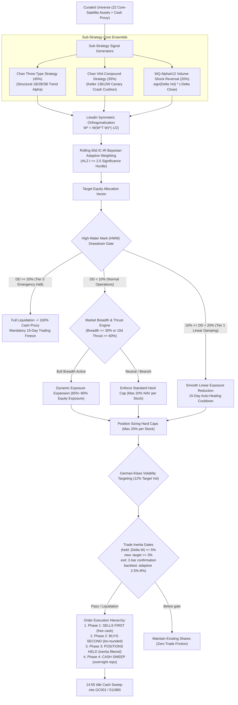

# Chan Crisis Shield Blend Strategy: Live Trading Operating Manual & Rulebook (SOP)

> **Strategy Identifier**: `chan_crisis_shield_blend` ([`ChanCrisisShieldBlendStrategy`](file:///home/stone/Work/github/quant/pipeline/research/blend/chan_crisis_shield_blend.py#L20-L104))  
> **Live Readiness Score**: **80.5 / 100 (Grade B Tactical Aggressive Live Ready / High Return Potential)**  
> **Daily Execution Tool**: [`scripts/run_live_strategy.py`](file:///home/stone/Work/github/quant/scripts/run_live_strategy.py)  
> **Target Instruments**: High-liquidity Core-Satellite Equity Universe (22 curated assets) + Cash Equivalents (`511880.SH`, `511990.SH`, `GC001` / `R-001` repo sweep; US / synthetic backtests use `BIL`)  
> **Execution Routine**: Evaluated daily at **14:00**, staged execution between **14:20 – 14:45**, idle cash sweep between **14:55 – 15:00** (avoiding open auction volatility and market-on-close distortions).  
> **Underlying Factors**: `regime_trend_strength`, `absolute_momentum_trend`, `relative_momentum`, `volatility_targeting`, `mean_reversion`  
> **Walkforward Empirical Audit Summary**:
> - **Explosive Annualized Alpha**: Demonstrates top raw CAGR and Sharpe across multiple rolling windows: `blend_8/2` CAGR **+49.7%** (Sharpe 1.349, Calmar 11.94), `blend_12/2` CAGR **+41.9%** (Sharpe 1.295, Calmar 12.91), `blend_13/2` CAGR **+31.8%** (Sharpe 1.607, Calmar 9.07);
> - **Tight Tail Drawdown Defense**: Anchored by 35% Keller VAA canary cushion, capping mean maximum drawdowns to **4.3% ~ 4.7%**;
> - **Live Execution Caveat**: Returns are concentrated around high-volatility volume-spike reversals (Alpha#12); disciplined limit-order placement is mandatory to prevent execution slippage.

---

## 1. Strategy Identity & Architecture Overview

The **Chan Crisis Shield Blend Strategy** is an institutional multi-strategy portfolio engineered to capture high-beta recovery rebounds following panic sell-offs while maintaining strict downside preservation:
- **Chan Three-Type Strategy (45%)**: Structural pivot trend alpha capturing 1B, 2B, and 3B buy points ($B_1, B_2, B_3$);
- **Chan VAA Compound Strategy (35%)**: Keller 13612W canary defensive cushion protecting capital against broad macro downtrends;
- **WorldQuant Alpha#12 Volume Shock Reversal (20%)**:
  $$\text{Alpha\#12} = \text{sign}(\Delta \text{Volume}) \times (-\Delta \text{Close})$$
  Detects institutional capitulation where volume surges on down days, initiating mean-reversion entries on exhausted selling;
- **Unified Risk Controls**: Rolling 60d Bayesian IC-IR weighting ($t \ge 2.0$), Löwdin symmetric orthogonalization, Garman-Klass volatility targeting (12%), and multi-tier drawdown circuit breakers with 15-day auto-healing cooldowns.



---

## 2. Daily Live Trading Routine (Operational SOP Timetable)

Human traders must execute the following 6-step checklist sequentially every trading day:

1. **14:00 – 14:15: Stage 1 Portfolio Health & Macro Regime Inspection**
   Run the pre-trade health gate:
   ```bash
   uv run python scripts/check_live_portfolio_health.py --data-provider marketdb
   ```
   Inspect High-Water Mark (HWM) peak-to-trough drawdown, circuit breaker tier, and market breadth.
2. **14:15 – 14:25: Stage 2 Order Ticket Generation**
   If Stage 1 directive is **🟢 GO** or **🟡 CAUTION**, generate live order tickets:
   ```bash
   uv run python scripts/run_live_strategy.py \
     --strategy chan_crisis_shield_blend \
     --current-holdings-file docs/ruleset/chan_crisis_shield_blend/current_holdings.json \
     --portfolio-value <ACCOUNT_NAV> \
     --data-provider marketdb
   ```
3. **14:25 – 14:35: Phase 1 — Execute Sells First**
   Transmit all red `SELL` orders first to unlock cash purchasing power.
4. **14:35 – 14:45: Phase 2 — Execute Buys Second**
   Deploy freed cash into green `BUY` orders. Round share quantities down to board lot size (100 shares for A-shares). Skip positions displaying `⚠️ Below minimum board lot`.
   *Execution note for Alpha#12*: Place limit orders pegged to best bid/ask to avoid chasing volatility spikes.
5. **14:45 – 14:50: Phase 3 — Verify Inertia Holds**
   Confirm that every white `HOLD` / `HOLD_FILTERED` position is left untouched — see Rule 3 for the three separate gates that produce such a row (they are **not** one 5% rule).
6. **14:55 – 15:00: Phase 4 — Cash Proxy & Overnight Yield Sweep**
   Lend any remaining idle cash into Treasury repo (`GC001` / `R-001`) or currency ETFs (`511880.SH`).

---

## 3. Decision Logic & Rulebook

### Rule 1: Drawdown Circuit Breakers & Cooldown Recovery
$$\text{Drawdown} = \frac{\text{Current NAV} - \text{Peak NAV}}{\text{Peak NAV}}$$

* **Normal Regime ($\text{Drawdown} < 10\%$)**: Full risk budget active. Single-stock position cap = 20% NAV.
* **Tier 1 Smooth Damping ($10\% \le \text{Drawdown} < 15\%$)**: Linearly scale down target equity exposure:
  $$\text{Scale} = \max\left(0.0,\ 1.0 - \frac{\text{Drawdown} - 0.10}{0.10}\right)$$
  i.e. **0% reduction at DD = 10%, exactly 50% at DD = 15%, 100% at DD = 20%** — the damping is continuous across the whole 10%–20% band, and live applies the identical formula (`scripts/check_live_portfolio_health.py:380,384`). The discrete "cut by 50% (× 0.5)" branch exists in code (`pipeline/research/blend/blend_base.py:1075-1081`) but is **not** the deployed configuration: all six blends set `smooth_drawdown: true`. Engage 15-day auto-healing cooldown tracker.
* **Tier 2 Tactical Defense ($15\% \le \text{Drawdown} < 20\%$)**: Cap total equity exposure at 30%; allocate 70% to Cash Proxy.
* **Tier 3 Emergency Halt ($\text{Drawdown} \ge 20\%$)**: Immediately liquidate 100% of all risky holdings into Cash Proxy. Enforce 15 trading days mandatory freeze.

### Rule 2: Alpha#12 Reversal Execution Safeguard
* **Entry Condition**: $\Delta \text{Close} < 0$ and $\Delta \text{Volume} > 0$, without breaking below the 3.0 ATR trailing channel.
* **Position Ceiling**: Hard cap at 20% NAV per stock to prevent single-asset tail-risk traps.
* **Order Style**: Limit orders strictly pegged to opposite-side bid/ask. No market orders.

### Rule 3: Trade Inertia — Three Live Rules (and a Different Backtest Rule Set)

For every asset, compute the signed weight change at 14:00:
$$\Delta W = W_{\text{target}} - W_{\text{current}}$$

This strategy carries **one inertia parameter** (`ccsb_min_weight_change = 0.05`) **plus a separate, looser entry gate** (`ccsb_entry_threshold = 0.03`). Apply the **first** rule below that matches the asset's situation:

| # | Situation | Live rule — what you actually do | Backtest rule — what the model did (different by design) |
| :--- | :--- | :--- | :--- |
| **1** | You **already hold** the asset and the target weight moved | Require $\lvert\Delta W\rvert \ge \mathbf{5\%}$. Below that, **do not trade**; the ticket prints `HOLD` with reason "调仓未超惰性阈值 (< 5%)". Re-evaluated every day. | Per-asset threshold is **adaptive, 2.5% – 8%**: $\mathrm{clip}\big(\tfrac{\sigma^{21d}_{\text{asset}}}{\sigma^{21d}_{\text{universe}}} \times 5\%,\ 2.5\%,\ 8\%\big)$. A second, backtester-level gate then applies the plain 5% — but **only to assets already held**. |
| **2** | You hold **nothing** in the asset (0% → new position) | Require **target weight $\ge \mathbf{3\%}$** (`ccsb_entry_threshold = 0.03`), which is **looser** than rule 1. Below 3%, **do not open**; the ticket prints `HOLD_FILTERED` with reason "目标仓位未达最低建仓/调仓门槛 (… 防微量试错损耗)". A brand-new 2.9% line is refused. | The backtester's 5% gate **does not apply to new positions** (assets not already held are exempt); the template-level inertia filter gates entries only at $\min(\text{adaptive threshold},\ 3\%)$, i.e. **2.5% – 3%**. |
| **3** | The model wants **0.0%** on an asset you hold (full exit) | The exit is **exempt** from the 5% threshold, but must **persist 2 consecutive evaluation days** (`guard_latency_bars = 2`) — relevant for the Alpha#12 reversal sleeve, whose entries are by nature one-day pulses. Day 1 prints `PENDING_EXIT` / `HOLD_FILTERED` with reason "平仓信号进入确认期 (第 1/2 日待确认)". | Exits the same day the rebalance row carries 0.0% — no persistence requirement. |
| **4** | Hard stop, structural break, ATR trailing stop, or a **Tier-3** emergency halt | **Sell 100% immediately**. These are full liquidations, so all inertia gates and the 2-day exit confirmation are bypassed outright — the threshold is not consulted, so there is no residual "0.1% floor" to honour. Buys are never granted this bypass. | The per-symbol `asset_emergency_df` mask bypasses inertia for that asset and bar. |

* **VERIFIED — the damping cut is itself gated, per asset, and is routinely refused.** The cut is applied **per asset**: every held name's weight is multiplied by the same `scale` factor, with the remainder swept into the cash proxy (`scripts/run_live_strategy.py:1766`; `pipeline/research/blend/blend_base.py:1069-1071`). Each name is therefore an **independent trim subject to its own threshold** — at DD = 15% the factor is 0.5, so a 6% position is cut to 3%, a 3pp change against the 5% gate, and is **refused that day**; the ticket shows `HOLD` with reason "调仓未超惰性阈值 (< 5%)". A 50% cut clears the gate only once the position is **≥ 10% of NAV**. This happens in **both paths**: live grants no risk-reduction exemption (the `is_stop` fast path only ever liquidates to 0.0 and only for stop-loss / `is_emergency_halt`, `common/position_lifecycle.py:363-420`; `is_emergency_halt` is Tier-3-only, `scripts/run_live_strategy.py:1927`), and the backtest's inertia filter swallows the same trim unless the asset-emergency bypass is on. Only the full-exit/stop paths in rule 3/4 liquidate regardless of size.
* **The two paths also diverge in DD ∈ (17%, 20%)**: the backtest opens its bypass at `scale_dd < 0.30`, i.e. DD > 17% (`pipeline/research/blend/blend_base.py:1072` → `is_global_emergency`, `common/allocation_templates.py:233-251`), while live only force-liquidates at DD ≥ 20% (Tier 3). Between 17% and 20% the backtest applies the cut and live keeps blocking it.
* **No override number is prescribed here.** On a Tier-1/2 day, reconcile the breaker tier against the reduction actually printed on the ticket before acting; whether to top a refused cut up manually is an account-owner policy decision, not a rule this manual can invent.

* **No relative trim hurdle for this strategy**: no `inertia_relative_ratio` is configured, so the trim gate is the plain absolute 5% and never scales with the size of the position.
* **No row-level gate in the backtest**: a rebalance row is emitted whenever *any* symbol's target moved, and it carries every symbol — per-symbol inertness within a live ticket has no backtest counterpart at row level.

> ⚠️ **The live path and the backtest path differ by design, as currently implemented.** Rule 2 refuses brand-new positions below 3% that the backtest would take at 2.5% – 3%; rule 1 gates trims at a fixed 5% where the backtest uses an adaptive 2.5% – 8%; rule 3 delays every exit by two evaluations. Consequently **live holdings may legitimately contain fewer names than the backtest for the same date.** Do not reconcile the gap by waiving rule 2, by forcing the backtest's name count, or by pre-empting the exit confirmation.

---

## 4. Human Trader Quick-Reference Card

| Phase | Metric / Trigger | Action / Order Instruction |
| :--- | :--- | :--- |
| **Stage 1: Halt** | $\text{Drawdown} \ge 20\%$ | 🔴 **Liquidate 100% of risk assets**; lock account for 15 days |
| **Stage 1: Damping**| $10\% \le \text{Drawdown} < 15\%$ | 🟡 **Smooth linear equity scaling**; engage 15-day cooldown counter |
| **Stage 1: Bull** | $\text{Breadth} \ge 30\%$ or $\text{Thrust} \ge 60\%$ | 🟢 **Bull exposure active**; deploy cash into top momentum leaders |
| **Stage 2: Sells** | Structural sell / ATR stop / target reduction | 🔴 **SELL FIRST** (14:20–14:35); execute at bid price to release cash |
| **Stage 2: Buys** | Alpha#12 reversal or Three-Type buy, target $\ge 5\%$ (new position $\ge 3\%$) | 🟢 **BUY SECOND** (14:35–14:45); floor to 100-share integer lot |
| **Stage 2: Sub-lot** | Required shares $< 100$ | ⚪ **Skip order**; wait for larger allocation or keep prior shares |
| **Stage 2: Inertia (held)** | Held asset, target change $\lvert\Delta W\rvert < 5\%$ | ⚪ **HOLD**: no order; keep prior shares |
| **Stage 2: Inertia (entry)** | New position target $< 3\%$ | ⚪ **HOLD_FILTERED**: do not open a brand-new sub-3% line |
| **Stage 2: Exit** | Model target $= 0.0\%$ on a held asset | 🕒 **WAIT**: sell only after the signal persists 2 consecutive evaluations |
| **Stage 2: Cash** | Idle cash after 14:55 | 💰 **Sweep into GC001 / R-001 repo**; earn overnight risk-free yield |

---

## 5. Standard CLI Invocation

```bash
uv run python scripts/run_live_strategy.py \
  --strategy chan_crisis_shield_blend \
  --universe-file docs/universe/china/core_satellite_22_stocks.txt \
  --output-dir docs/ruleset/chan_crisis_shield_blend \
  --portfolio-value 100000 \
  --data-provider marketdb
```
