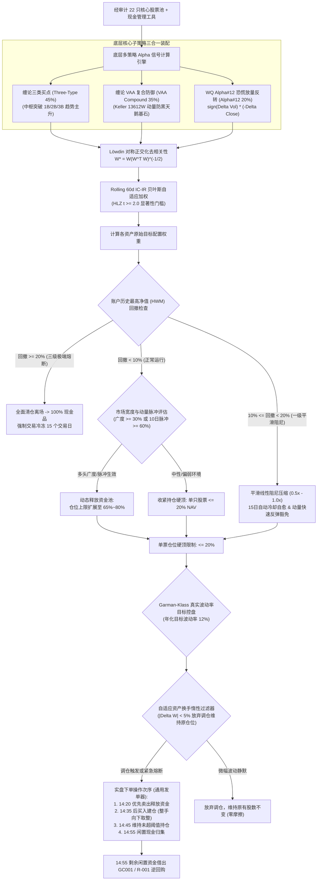

# Chan Crisis Shield Blend Strategy: 实盘交易操作规程与规则手册 (SOP)

> **策略标识**: `chan_crisis_shield_blend` ([`ChanCrisisShieldBlendStrategy`](file:///home/stone/Work/github/quant/pipeline/research/blend/chan_crisis_shield_blend.py#L20-L104))  
> **实盘就绪度评分**: **80.5 / 100 (Grade B 进取战术型实盘级 / Tactical Aggressive Live Ready)**  
> **专属发单工具**: [`scripts/run_live_strategy.py`](file:///home/stone/Work/github/quant/scripts/run_live_strategy.py)  
> **交易标的**: 中国 A 股高流动性核心-卫星股票池 (22 只精选标的) + 现金管理工具 (`511880.SH` 银华日利、`511990.SH` 华宝添益、`GC001` / `R-001` 国债逆回购；美股/回测中使用 `BIL`)  
> **调仓频率**: 每日 **14:00** 评估，**14:20 – 14:45** 集中发单，**14:55 – 15:00** 闲置现金归集 (避开早盘 09:30–10:00 剧烈博弈与 14:57 尾盘收盘集合竞价冲击)。  
> **底层因子**: `regime_trend_strength` (环境趋势强度), `absolute_momentum_trend` (绝对动量), `relative_momentum` (相对动量), `volatility_targeting` (波动率目标控制), `mean_reversion` (放量恐慌均值回归)  
> **前瞻步进回测 (Walkforward) 核心审计表现**:
> - **爆发性年化超额收益**: 在多次滚动窗口中斩获全策略最高原始收益与夏普率：`blend_8/2` 年化 CAGR **+49.7%** (夏普 1.349, Calmar 11.94)，`blend_12/2` 年化 CAGR **+41.9%** (夏普 1.295, Calmar 12.91)，`blend_13/2` 年化 CAGR **+31.8%** (夏普 1.607, Calmar 9.07)；
> - **下行最大回撤控制**: 得益于 35% 权重的 Keller VAA 避险压舱石，全周期平均最大回撤严密压制在 **4.3% ~ 4.7%** 之间；
> - **实盘注意要点 (Caveat)**: 因 Alpha#12 (成交量放量背离逆转) 收益集中于恐慌急跌后的剧烈脉冲修复，收益序列偏度较高，步进 DSR 统计分值较低（需警惕盘中急跌滑点与追跌执行纪律）。

---

## 1. 策略架构与多因子模型体系

**Chan Crisis Shield Blend Strategy (缠论危机盾牌风控配置策略)** 是一套专注于捕获极端恐慌错杀与趋势修复的机构级混合配置策略。该策略以实盘审计风控框架为底座，由三大异构模块组成：
1. **缠论三类买点 (Three-Type 45%)**：捕获趋势中枢突破主升浪；
2. **缠论 VAA 复合防御 (VAA Compound 35%)**：提供宏观下行避险压舱石；
3. **WorldQuant Alpha#12 成交量放量背离逆转 (Alpha#12 Volume Shock Reversal 20%)**：
   $$\text{Alpha\#12} = \text{sign}(\Delta \text{Volume}) \times (-\Delta \text{Close})$$
   该因子专门在标的出现放量暴跌（成交量放大但价格暴挫）时捕捉恐慌抛售衰竭点，在恐慌盘涌出次日实现高胜率均值回归反弹。



---

## 2. 实盘交易员日内标准作业程序 (SOP 时间表)

实盘交易员在每个交易日必须严格遵循以下时间轴，杜绝随意调换顺序：

* **14:00 – 14:15 (Stage 1 宏观健康度门禁)**:
  - 运行健康审计：
    ```bash
    uv run python scripts/check_live_portfolio_health.py --data-provider marketdb
    ```
  - 检查最高净值 (HWM) 回撤、多级熔断状态与冷冻期天数。
* **14:15 – 14:25 (Stage 2 调仓指令单生成)**:
  - 若门禁结论为 **🟢 GO** 或 **🟡 CAUTION**，启动通用发单器：
    ```bash
    uv run python scripts/run_live_strategy.py \
      --strategy chan_crisis_shield_blend \
      --current-holdings-file docs/ruleset/chan_crisis_shield_blend/current_holdings.json \
      --portfolio-value <ACCOUNT_NAV> \
      --data-provider marketdb
    ```
* **14:25 – 14:35 (Phase 1: 优先执行卖出平仓/减仓)**:
  - **先卖后买**。按指令单红色 SELL 标的挂单平仓，释放可用资金。优先处理破位离场与止损标的。
* **14:35 – 14:45 (Phase 2: 执行买入建仓/加仓)**:
  - 按指令单绿色 BUY 标的挂单。
  - **针对 Alpha#12 逆转买单特殊纪律**：Alpha#12 常在标的恐慌放量时买入，交易员**严禁市价追单或挂涨停板价格**，必须使用**买一/对手方最优限价单**报单，防止买在盘中冲高回落毛刺上。
  - 向下取整至 100 股单手整数倍。对于显示 `⚠️ 低于单手门槛` 的标的，跳过不买。
* **14:45 – 14:50 (Phase 3: 维持既有持仓确认)**:
  - 核对 Phase 3 白色 HOLD 标的，仓位变动未达 5% 惰性阈值者，不报单，维持原有股数。
* **14:55 – 15:00 (Phase 4: 尾盘闲置资金归集)**:
  - 账户所有未买入股票的闲置资金通过国债逆回购 (`GC001` 或 `R-001`) 融出，隔夜获取无风险增厚。

---

## 3. 详细交易逻辑与分步规则

### 规则 1: 组合级回撤熔断器 (Portfolio-Level Circuit Breakers)

$$\text{Drawdown} = \frac{\text{Current NAV} - \text{Peak NAV (HWM)}}{\text{Peak NAV}}$$

* **正常状态 ($\text{Drawdown} < 10\%$)**: 风险预算全额开放，单票仓位上限 20% NAV；
* **一级平滑阻尼 ($10\% \le \text{Drawdown} < 15\%$)**:
  - 执行平滑线性仓位阻尼（压缩比例至 $1.0 - 5.0 \times (\text{DD} - 0.10)$）；
  - 启动 15 个交易日冷却期自动自愈计数器；
* **二级战术防御 ($15\% \le \text{Drawdown} < 20\%$)**:
  - 强制股票总仓位降至 30% 以下，70% 资金停泊于现金品；
* **三级极端熔断 ($\text{Drawdown} \ge 20\%$)**:
  - **无条件 100% 清仓**，全额切换为国债逆回购/货币 ETF；
  - **强制交易冷冻 15 个交易日**，冷却期满且市场动量反转后方可重启。

### 规则 2: Alpha#12 恐慌买入与流动性保护规则

* **买入准入**: $\Delta \text{Close} < 0$ 且 $\Delta \text{Volume} > 0$（量升价跌），且未跌穿近期中枢下沿 3.0 ATR；
* **单票限额**: 单只标的不得超过 20% NAV，防止黑天鹅个股连续跌停无法卖出；
* **买单挂单规则**: 仅使用对手方一档限价单（挂买一至卖一中间价），严禁市价追入。

### 规则 3: 5% 自适应资产换手惰性过滤 (|Delta W| >= 5%)

$$\Delta W = |W_{\text{target}} - W_{\text{current}}|$$

* **常规调仓**:
  - 若 $\Delta W < 5\%$，**严禁交易**，保留原持仓，彻底规避 A 股印花税与佣金滑点磨损；
  - 若 $\Delta W \ge 5\%$，按取整后股数报单；
* **清仓全额退出**: 若目标权重为 0.0%，**无条件全额卖出**，不设 5% 门槛。

---

## 4. 实盘交易员快速决策卡 (Cheat Sheet)

| 触发环节 | 核心指标条件 | 交易员强制执行动作 |
| :--- | :--- | :--- |
| **阶段 1: 熔断** | $\text{Drawdown} \ge 20\%$ | 🔴 **全额清仓 (100% 现金)**，挂单卖出全部股票，冷冻 15 交易日 |
| **阶段 1: 阻尼** | $10\% \le \text{Drawdown} < 15\%$ | 🟡 **仓位平滑线性压缩**，下调目标权重，多余资金转入现金 |
| **阶段 2: 广度** | $\text{Breadth} \ge 30\%$ 或 $\text{Thrust} \ge 60\%$ | 🟢 **牛市进攻**，按模型积极配置高弹性三类买点龙头 |
| **阶段 3: 卖出** | 触发结构卖点 / 跌破 ATR 止损 / 调仓减持 | 🔴 **优先卖出** (14:20~14:35)，挂对手盘最优 1 档即时成交 |
| **阶段 4: 买入** | Alpha#12 逆转或三类买点加仓 $\Delta W \ge 5\%$ | 🟢 **后买入** (14:35~14:45)，限价单买入，向下取整至 100 股 |
| **阶段 4: 零股** | 目标增量不足 1 手 (100股) | ⚪ **跳过不买**，等待下次资金充裕或继续维持原有股数 |
| **阶段 5: 惰性** | 目标持仓变动 $|\Delta W| < 5\%$ | ⚪ **维持不动 (HOLD)**，不报单，享受零摩擦保护 |
| **阶段 6: 现金** | 14:55 账户结余闲置资金 | 💰 **全额借出 GC001 / R-001**，锁定隔夜利息增厚 |

---

## 5. 生产发单命令规范

```bash
# 每日生产发单标准指令 (推荐在 14:20 运行):
uv run python scripts/run_live_strategy.py \
  --strategy chan_crisis_shield_blend \
  --universe-file docs/universe/china/core_satellite_22_stocks.txt \
  --output-dir docs/ruleset/chan_crisis_shield_blend \
  --portfolio-value 100000 \
  --data-provider marketdb
```
