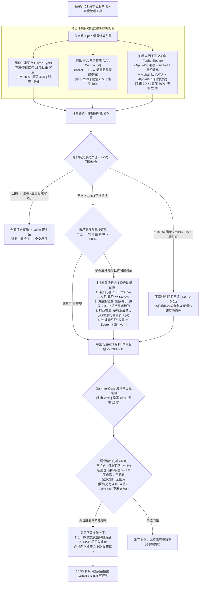
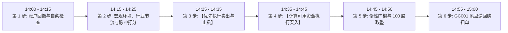

# Chan Dual Hybrid Alpha Blend Strategy: 实盘交易操作规程与规则手册 (SOP)

> **策略标识**: `chan_dual_hybrid_blend` ([`ChanDualHybridBlendStrategy`](file:///home/stone/Work/github/quant/pipeline/research_strategy/rs/chan_advanced_strategies.py#L2663-L3333))  
> **实盘就绪度评分**: **87.5 / 100 (Grade B+ 稳健实盘级别 / Institutional Live Ready)**  
> **交易标的**: 中国 A 股高流动性核心股票池 (21 只固定配置标的) + 现金管理工具 (`511880.SH` 银华日利、`511990.SH` 华宝添益、`GC001` 204001 / `R-001` 131810，美股/合成回测中使用 `BIL`)  
> **调仓频率**: 每日 **14:00** 评估，**14:20 – 14:45** 集中发单，**14:55 – 15:00** 闲置现金归集 (避开早盘 09:30–10:00 剧烈博弈与 14:57 尾盘收盘集合竞价冲击)。  
> **底层因子**: `regime_trend_strength` (环境趋势强度), `absolute_momentum_trend` (绝对动量), `relative_momentum` (相对动量), `volatility_targeting` (波动率目标控制), `mean_reversion` (均值回归)  
> **全周期与前瞻步进回测审计表现**:
> - **4 年宏观大周期 (15 折全历史, 2022-2025, `blend_4/1`)**: 平均夏普 **1.223** (调整后 1.052)，CAGR **24.64%**，最大回撤 **5.08%**，Calmar **10.43**，**100% 通过留一法 (LOO) 压力测试**（剔除前三大赢家后仍盈利 8,699 元），全周期换手 2.8x，无任何单票超配 (Max Pos 20.0%)；
> - **样本外前瞻验证 (3 折滚动测试, 2025.11-2026.09, `blend_4/2`)**: 四大混合策略横向第一 (**Rank 1 🏆**)，CAGR **+3.23%** (同期沪深300为 **-1.50%**，超额 Alpha **+4.73%**)，最大回撤 **4.61%**；**2026年夏季崩盘 (Fold 3) 大盘暴跌 -20.38%，策略逆势仅微跌 -2.00%，单季斩获 +18.38% 极端避险 Alpha**。

---

## 1. 策略架构与多因子模型体系

**Chan Dual Hybrid Alpha Blend Strategy (缠论双因子混合 Alpha 配置策略)** 是一套面向机构实盘运作的多策略量化投资组合。该策略以实盘审计冠军架构为基础，深度融合了笔段中枢级别的经典买点 (缠论三类买点)、Keller 警惕型资产配置框架 (缠论 VAA 复合防御)、4-因子正交扩展袖套 (Alpha#53, Alpha#3, Alpha#41, Alpha#101)，并配备了**动态牛熊权重自适应引擎**、**Garman-Klass 真实波动率控盘**、**ATR 动态移动追踪止损**与**自适应执行惯性门槛** (非对称卖出波段仅存在于回测中，详见第 5 步)。



### 核心数学子模型拆解

1. **缠论三类买点配置 (Three-Type)**:
   - 提取日线分型、笔 (Bi)、线段 (Segment) 及核心震荡中枢 ($ZG/ZD$)。
   - **一买 ($B_1$)**: 趋势背驰下影线竭尽点 (MACD 绿柱面积收缩与底背离)。
   - **二买 ($B_2$)**: 一买后首次次级别反弹不创新低的回踩确认点。
   - **三买 ($B_3$)**: 突破中枢高点 $ZG$ 后，次级别回抽低点严格不跌回 $ZG$ 的强力加速点。
2. **缠论 VAA 复合防御配置 (VAA Compound)**:
   - 计算 Keller 13612W 动量得分：
     $$\text{Score} = 12 \times r_{1M} + 4 \times r_{3M} + 2 \times r_{6M} + 1 \times r_{12M}$$
   - 一旦市场广度系统性走熊，该部分权重 100% 切换为避险现金品，是策略在 2026 年夏季暴跌中保全本金的“压舱石”。
3. **扩展 4-因子正交袖套 (Expanded 4-Alpha Sleeve)**:
   - **WorldQuant Alpha#53 ($7.5\%$)**: 捕获日内多空筹码博弈的引线不平衡度动量：
     $$\text{Alpha\#53} = -1 \times \Delta_9\left(\frac{(\text{Close} - \text{Low}) - (\text{High} - \text{Close})}{\text{Close} - \text{Low} + 10^{-4}}\right)$$
   - **WorldQuant Alpha#3 ($7.5\%$)**: 侦测主力资金隐蔽吸筹的量价背离信号：
     $$\text{Alpha\#3} = -1 \times \rho_{10}(\text{rank}(\text{Open}), \text{rank}(\text{Volume}))$$
   - **WorldQuant Alpha#41 ($7.5\%$)**: 均价动量与日内成交价格支撑强度：
     $$\text{Alpha\#41} = \left(\text{High} \times \text{Low}\right)^{0.5} - \text{VWAP}$$
   - **WorldQuant Alpha#101 ($7.5\%$)**: 日内有效价格趋势效率因子：
     $$\text{Alpha\#101} = \frac{\text{Close} - \text{Open}}{(\text{High} - \text{Low}) + 10^{-4}}$$
4. **动态牛熊权重自适应机制**:
   - 牛市模式 ($\text{Breadth} \ge 0.60$ 或 $\text{Thrust} \ge 0.60$): 提高三类买点 (50%) 与 Alpha 袖套 (30%) 仓位，放大弹性；
   - 熊市模式 ($\text{Breadth} < 0.30$ 且 $\text{Thrust} < 0.40$): 提高 VAA 防御 (30%)，压缩进攻仓位；
   - 震荡模式 (其余中性环境): 均衡配置 (45% / 25% / 30%)。
5. **Garman-Klass 高低价真实波动率引擎**:
   $$\sigma_{\text{GK}}^2 = 0.5 \times \left(\ln\frac{\text{High}}{\text{Low}}\right)^2 - (2\ln 2 - 1) \times \left(\ln\frac{\text{Close}}{\text{Open}}\right)^2$$
   较传统收盘价波动率能提前 3~5 日感知主力盘口异动与出货风险。

---

## 2. 实盘交易员日内标准作业程序 (SOP 时间表)

实盘交易员在每个交易日必须严格遵循以下时间轴，杜绝随意调换顺序：



* **14:00 – 14:15**: 接入行情数据，计算当前最新账户净值与历史峰值净值 (HWM)，核对回撤熔断级别及冷却计数器。
* **14:15 – 14:25**: 计算全市场个股站在 50 日均线之上的比例 (Breadth) 以及 10 日正收益个股数量 (Thrust)。检查单票 ATR 止损冷却期（15天锁）与行业分类，生成抗脆弱目标权重。
* **14:25 – 14:35**: **必须先执行卖出**。针对触发结构卖点、ATR 动态移动止损或回撤降仓的标的进行限价/对价平仓，释放可用资金。被止损标的立即打上 15 天冷却锁。
* **14:35 – 14:45**: **执行买入建仓**。基于释放出的真实可用资金与各标的目标权重，套用实盘惰性门槛 (已持仓 $\ge 5\%$、全新建仓 $\ge 3\%$，详见第 5 步) 与 100 股向下取整，挂对手方限价单买入。
* **14:45 – 14:50**: 检查订单成交回报，核对持仓股数与剩余未成交碎片资金。
* **14:55 – 15:00**: **尾盘闲置现金归集**。将账户所有可用现金通过国债逆回购 (`GC001` 或 `R-001`) 融出，实现隔夜无风险增厚。

---

## 3. 详细交易逻辑与分步规则

### 第 1 步: 账户级回撤熔断检查与自愈机制 (强制首要执行)

每日 14:00 计算当前资产净值相对于历史最高净值 (High-Water Mark) 的回撤比例：
$$\text{Drawdown} = \frac{\text{当前净值} - \text{历史最高净值}}{\text{历史最高净值}}$$

1. **正常运作区间 ($\text{Drawdown} > -10\%$)**:
   - 风险系数 = $1.0$。享有全额风险预算，单只股票仓位上限为 **20%**。
2. **一级平滑阻尼区间 ($-20\% < \text{Drawdown} \le -10\%$) — 代码 + 人工 (code + human)**:
   - **阻尼系数本身由代码执行 (code-executed)**。在 $15\%$–$20\%$ 子区间内，健康报告会**额外**打印"轮动至防守子策略"的指令 (`scripts/check_live_portfolio_health.py:618-622`)；该轮动属于**人工执行 (human-executed)**，工单生成器并不执行它。
   - **快速反弹豁免通道**: 若账户近 10 个交易日累计收益 $R_{10d} > 0$ 或市场宽度脉冲 $\ge 60\%$：
     - **直接豁免降仓**，允许模型全额运作 ($1.0$)，不错过大跌后的 V 型反转。
   - **ELSE (平滑线性阻尼降仓)**:
     $$\text{scale}_{\text{DD}} = \max\left(0.0,\ 1.0 - \frac{|\text{Drawdown}| - 0.10}{0.20 - 0.10}\right)$$
     所有股票持仓乘以 $\text{scale}_{\text{DD}}$（仓位自 **100% 线性压缩至 0%**：回撤 10% 时不减、15% 时恰好减半、20% 时减至 0），杜绝阶梯断崖式减仓造成的踏空。腾出资金转入现金管理。代码中存在"直接乘 0.5"的离散分支 (`pipeline/research/blend/blend_base.py:1075-1081`)，但**不是**当前部署配置：六个 blend 策略均设置 `smooth_drawdown: true`；实盘采用同一连续公式 (`scripts/check_live_portfolio_health.py:380,384`)。
   - **15 天自动冷却自愈**: 若账户在连续 **15 个交易日** 内处于一级阻尼状态 (`cdhb_tier1_cooldown_bars = 15`)，将最高净值基准自动重置为当前净值，解除阻尼限制，恢复主动寻机能力。
3. **三级极端硬止损区间 ($\text{Drawdown} \le -20\%$) — 代码执行 (code-executed, hard halt)**:
   - **操作**: **100% 全面清仓所有股票资产，全部转入现金管理资产**。
   - **冷冻锁定期**: **连续 21 个交易日绝对禁止开仓** (`cdhb_tier3_cooldown_bars = 21`)。
   - 第 22 个交易日将最高净值基准重置为当前净值，开始重新评估建仓。

> **注意 — Tier-2 的轮动指令不会被工单执行。** 健康报告在 Tier-2 打印的"轮动至防守子策略"只是给人工的 advisory 指令 (`scripts/check_live_portfolio_health.py:618-622`)；`scripts/run_live_strategy.py` 全文没有任何 `TIER_1` / `TIER_2` 分支，到 Tier-2 时工单只做组合层缩放（`current_targets *= live_scale`，`scripts/run_live_strategy.py:1766`；`live_scale` 取自 `account_state` / 健康报告的 `linear_equity_scale`，`scripts/check_live_portfolio_health.py:380`）。仓位轮动须人工按健康报告操作；因此**在 Tier-2 当日，工单产出的持仓结构可能仍停留在 Tier-1 的缩放形态**。

---

### 第 2 步: 市场环境评估与抗脆弱脉冲分配

1. **市场广度指标**:
   - 统计股票池中收盘价高于 50 日均线的个股比例：
     $$\text{Breadth} = \frac{\sum_{i=1}^{N} \mathbb{I}(P_{\text{Close}, i} > \text{SMA}_{50, i})}{N}$$
   - **多头环境**: $\text{Breadth} \ge 30\%$ (`cdhb_breadth_bull_thresh = 0.30`)。目标权益仓位可逐步提升至 **80%** (`cdhb_target_bull_exposure = 0.80`)。
2. **抗脆弱抢跑式多资产动量脉冲机制**:
   - 统计股票池中 10 日收益率 $R_{10d} = \frac{P_t}{P_{t-10}} - 1$。
   - **脉冲触发条件**: 正收益个股占比 $\ge 60\%$ 或**正收益个股数 $\ge 5$ 只**：
     - **准入过滤**:
       1. 收益门槛: $R_{10d, i} \ge 1.0\%$ (`cdhb_thrust_min_roc: 0.01`)；
       2. 趋势硬门槛: $P_{\text{Close}, i} \ge \text{SMA}_{50, i}$ (`cdhb_require_asset_trend: True`)；
       3. 冷静期锁: 该标的未处于 15 天 ATR 止损冷却期内。
     - **综合吸筹打分**: $\text{Score}_i = R_{10d, i} \times (1.0 + 5.0 \times W_{\text{Alpha\#3}, i})$。
     - **自适应行业集中度节流**:
       - 常规行业最多允许 1 只最强龙头；
       - 若该行业排名前两位的标的 10 日涨幅均超过 5%（高景气领涨主线），允许最多配置 **2 只**。
     - **Garman-Klass 逆波动平价加权**:
       - 权重份额比例按 $\text{Score}_i / \sigma_{\text{GK}, i}$ 计算，单票上限严格执行 **20%**。

---

### 第 3 步: 资产级卖出与止损规则 (必须【先卖后买】)

为确保账户可用资金充裕且不触犯杠杆风险，每日必须在 **14:25 – 14:35** 优先报单卖出。

若持仓标的触发以下**任意一项**条件，该股票目标持仓直接清零 (**0.0%**)：
1. **策略结构卖点**: 缠论引擎输出一卖 ($S_1$) 顶部背驰或三卖 ($S_3$) 中枢破位。
2. **ATR 动态移动追踪止损与 15 天冷静期锁**: 
   - 采用 3.0 倍 ATR 动态移动止盈止损线：
     $$\text{Stop\_Price}_t = \max(\text{Stop\_Price}_{t-1}, \ P_{\text{High}, t} - 3.0 \times \text{ATR}_{14d, t})$$
     $$P_{\text{当前}} \le \text{Stop\_Price}_t \implies \text{立即平仓离场}$$
   - **触发后即刻锁入 15 天冷静期** (`cdhb_asset_stop_cooldown_bars: 15`)，在此期间该标的绝对禁止再次开仓！
3. **时间止损**: 单只标的买入后连续持有达 **90 个交易日** 仍未创出上涨新高 $\implies$ 主动平仓释放沉淀资金。
4. **熔断与风控减仓**: 第 1 步平滑阻尼要求压缩的仓位份额。

---

### 第 4 步: 资产级买入规则与波动率目标控制

1. **仓位分配与单票限额**:
   - 依据动态自适应权重分配；
   - **单票硬顶**: 任意单只标的总持仓权重绝对不得超过账户总资产的 **20%** (`cdhb_max_single_position = 0.20`)。
2. **环境自适应波动率目标控制 (Regime Vol Targeting)**:
   - 牛市模式: 目标波动率上限 **24%**；
   - 熊市模式: 目标波动率上限 **12%**；
   - 震荡模式: 目标波动率基准 **18%**；
   - 若投资组合实测 Garman-Klass 波动率 $\sigma_{\text{Port}} > \text{Target\_Vol}$：
     $$\text{缩放系数} = \frac{\text{Target\_Vol}}{\sigma_{\text{Port}}}$$
     将所有拟买入股票的目标权重同步乘以该系数，缩减总敞口，多余资金留存现金。

---

### 第 5 步: 调仓惰性门槛与 100 股向下取整

对每只标的，在 14:00 计算带符号的权重变动：
$$\Delta W = W_{\text{目标}} - W_{\text{当前}}$$

本策略携带 **一个惰性参数** (`cdhb_min_weight_change = 0.05`) 与**一个独立且更宽松的建仓门槛** (`cdhb_entry_threshold = 0.03`)。所谓"非对称 0.5x 卖出放行"是 `blend_base.py` 的**回测专属**特性 (而且是 0.60x，不是 0.5x) —— **实盘卖出并不享有该放行**。按标的所处情形，套用**第一个**命中的规则：

| # | 适用情形 | 实盘规则 (交易员实际执行) | 回测规则 (模型当年的行为，与实盘不同) |
| :--- | :--- | :--- | :--- |
| **1** | 该标的**已有持仓**，目标权重**上调** (加仓) | 要求 $\lvert\Delta W\rvert \ge \mathbf{5\%}$。未达则**不交易**；指令单打印 `HOLD`，原因 "调仓未超惰性阈值 (< 5%)"。 | 买入阈值取逐资产自适应值 **2.5% – 8%** ($\mathrm{clip}(\tfrac{\sigma^{21d}_{\text{标的}}}{\sigma^{21d}_{\text{全池}}} \times 5\%,\ 2.5\%,\ 8\%)$)，对全新建仓进一步放宽至 $\min(\text{自适应},\ 3\%)$。 |
| **2** | 该标的**已有持仓**，目标权重**下调** (减仓/部分平仓) | 要求 $\lvert\Delta W\rvert \ge \mathbf{5\%}$ —— **与加仓完全相同**。实盘路径**不存在** 2% 或 2.5% 的"快速释放现金"波段。低于 5% 的减仓被拒绝 (`HOLD`，"调仓未超惰性阈值 (< 5%)")。**这是唯一与回测方向相反的规则**：回测减仓**更早**，实盘减仓**更晚**。 | 本策略 `asymmetric_sells` 默认为**开启**，故卖出阈值为自适应值的 $0.60 \times$，即 **1.5% – 4.8%** —— 刻意比买入更宽松。 |
| **3** | 该标的**当前无持仓** (0% -> 新建仓) | 要求**目标权重 $\ge \mathbf{3\%}$** (`cdhb_entry_threshold = 0.03`)。低于 3% 则**不开仓**；指令单打印 `HOLD_FILTERED`，原因 "目标仓位未达最低建仓/调仓门槛 (… 防微量试错损耗)"。 | 回测器自身的 5% 门槛**不适用于新建仓** (未持仓标的豁免)；模板层过滤仅按 $\min(\text{自适应},\ 3\%)$，即 **2.5% – 3%** 拦截建仓。 |
| **4** | 模型对已持仓标的给出 **0.0%** (全额清仓) | 豁免规则 1–3，但必须**连续 2 个评估日持续成立** (`guard_latency_bars = 2`)。第 1 日打印 `PENDING_EXIT` / `HOLD_FILTERED`，原因 "平仓信号进入确认期 (第 1/2 日待确认)"。 | 调仓行携带 0.0% 的当日即成交，没有持续性要求。 |
| **5** | ATR 移动止损、结构卖点或账户熔断 | **立即 100% 卖出** (见第 3 步)。所有惰性门槛被彻底绕过——不存在所谓 "0.1% 底线"。买入方向永远不享有该豁免。 | 当日该标的的 `asset_emergency_df` 掩码绕过惰性过滤。 |

* **已验证：熔断的减仓本身也要过惰性门槛，且按标的逐只判定，常被拒绝。** 减仓是**逐只标的**施加的：每个已持仓标的的权重都乘以同一个 `scale` 系数，余量归集到现金替代品 (`scripts/run_live_strategy.py:1766`; `pipeline/research/blend/blend_base.py:1069-1071`)。因此每只标的都是一次**独立的减仓，各自受自己的门槛约束** —— 回撤 15% 时系数为 0.5，6% 的仓位被砍到 3%，实际变动 3 个百分点，低于 5% 门槛，**当日被拒绝**；指令单动作显示 `HOLD`，原因 "调仓未超惰性阈值 (< 5%)"。50% 的减仓只有在**持仓占净值 $\ge 10\%$** 时才能过门槛。**实盘与回测两条路径都是如此**：实盘没有任何"风控减仓豁免"（`is_stop` 快通道只会清到 0.0，且仅限硬止损 / `is_emergency_halt`，`common/position_lifecycle.py:363-420`；`is_emergency_halt` 只有三级熔断才成立，`scripts/run_live_strategy.py:1927`），回测的惰性过滤同样会吞掉这笔减仓，除非当日资产级应急掩码被打开。只有规则 4–5 的全额清仓/止损路径才不受仓位大小限制。
* **两条路径在回撤 ∈ (17%, 20%) 区间还会分叉**：回测在 `scale_dd < 0.30` 即回撤 > 17% 时就打开豁免 (`pipeline/research/blend/blend_base.py:1072` → `is_global_emergency`，`common/allocation_templates.py:233-251`)，而实盘只在回撤 ≥ 20%（三级）才强制清仓。因此回撤落在 17%–20% 之间时，回测已执行减仓，实盘仍在拦截。
* **本文不规定任何"覆盖阈值"。** 遇到一级/二级熔断日，执行前须人工核对熔断档位与工单实际减仓量；被拒的减仓是否由人工补足，属于账户所有者的政策决定，手册不代为设定。

* **本策略没有相对减仓门槛**：未配置 `inertia_relative_ratio`，故实盘减仓门槛不随持仓占比放大。
* **回测同样没有行级门槛**：只要有**任意**一个标的的目标权重发生变化，就会产出一行调仓记录，而该行携带全部标的——因此实盘指令单里的"逐标的静默"在回测的行级别上没有对应物。

> ⚠️ **实盘路径与回测路径在当前实现下是"设计上不同"的两套规则。** 两者的非对称方向**正好相反**：回测以 1.5% – 4.8% 的阈值减仓来释放现金，而实盘对任何减仓都要求满 5%，并在 3% 以下拒绝回测愿意接受的全新仓位。因此，**同一日期实盘持仓的标的数量可能合法地少于回测，且单票仓位可能更大。** 不得为了让实盘"对齐"回测而自行制造 2% 的实盘卖出波段、放弃建仓门槛，或按回测持仓数量补齐仓位。

**A 股 100 股一手向下取整法则** (在上述所有门槛通过之后执行)：
$$\text{目标股数}_i = \left\lfloor \frac{\text{账户净值} \times W_{\text{目标}, i}}{P_{\text{收盘}, i} \times 100} \right\rfloor \times 100$$
* 因向下取整产生的碎股资金自动沉淀在可用现金中。

---

### 第 6 步: 14:55 闲置现金隔夜逆回购扫单

每日 14:55，交易员核查交易终端的“可用资金”：
- **操作**: 将全部可用现金借出为国债逆回购：
  - 上交所账户: **`GC001` (204001.SH)**
  - 深交所账户: **`R-001` (131810.SZ)**
  - 或买入场内申赎型货币 ETF: **`511880.SH`** (银华日利) / **`511990.SH`** (华宝添益)。
- **资金占用规则**: 隔夜逆回购资金在次日早晨 09:00 自动回到可用状态，完全不影响次日正常的买入发单。

---

## 4. 实盘交易股票池规范 (核心白名单与严控黑名单)

依据长周期全历史审计与样本外验证，实盘标的严格限制在经法医审计的 21 只高流动性标的内：

### 实盘推荐核心白名单 (21 只经审计固定标的)

| 资产板块 | 证券代码 | 证券简称 | 行业分类标签 | 策略角色与核心投资逻辑 | 单票上限 |
| :--- | :--- | :--- | :--- | :--- | :--- |
| **光模块与算力** | `300394.SZ` | 天孚通信 | `optics` | 全球高速光器件龙头；长周期与前瞻期双料第一核心 Alpha 功臣。 | 20% |
| **光模块与算力** | `000938.SZ` | 紫光股份 | `tech` | ICT 算力网络与服务器龙头；长周期放量突破动量支柱。 | 20% |
| **半导体封装** | `600584.SH` | 长电科技 | `semiconductor`| 先进封装龙头；Alpha#53 波动率引线动量核心标的。 | 20% |
| **通信与算力基座**| `601728.SH` | 中国电信 | `telecom` | 数字经济通信底座；稳定高股息压舱石。 | 20% |
| **通信与算力基座**| `600941.SH` | 中国移动 | `telecom` | 央企现金流航母；极低波动率与稳健防守中枢。 | 20% |
| **黄金铜超级周期**| `601899.SH` | 紫金矿业 | `metals` | 全球铜金矿业巨头；有效对冲法币通胀与资源大周期。 | 20% |
| **工业金属龙头** | `600362.SH` | 江西铜业 | `metals` | 工业铜冶炼龙头；2026 前瞻期第三大盈利功臣 (+1,484 元)。 | 20% |
| **干散油运周期** | `601872.SH` | 招商轮船 | `shipping` | 油运景气超级周期；2026 前瞻期第一大盈利功臣 (+2,193 元)。 | 20% |
| **集装箱航运** | `601919.SH` | 中远海控 | `shipping` | 集运现金流龙头；高分红派息提供强劲安全边际。 | 20% |
| **高端制造护城河**| `600660.SH` | 福耀玻璃 | `auto` | 全球汽车玻璃垄断巨头；长牛复利与海外韧性代表。 | 20% |
| **高端制造护城河**| `000157.SZ` | 中联重科 | `machinery` | 工程机械出海龙头；高股息与周期复苏弹性标的。 | 20% |
| **央企石化能源** | `600028.SH` | 中国石化 | `oil` | 炼化一体化龙头；单行业限制下能源代表标的。 | 20% |
| **央企石化能源** | `601857.SH` | 中国石油 | `oil` | 勘探开采巨头；与中石化执行同一行业节流互斥。 | 20% |
| **低波避险金融** | `601601.SH` | 中国太保 | `insurance` | 优质大型险企；受益资产端权益估值弹性修复。 | 20% |
| **低波避险金融** | `601398.SH` | 工商银行 | `bank` | 宇宙行超低波动底座；大盘剧烈震荡时资金避风港。 | 20% |
| **低波避险金融** | `601288.SH` | 农业银行 | `bank` | 低估值银行标杆；长周期第三大超额功臣。 | 20% |
| **银行与金融** | `600036.SH` | 招商银行 | `bank` | 零售银行龙头；优质资产质量代表。 | 20% |
| **高股息能源** | `601088.SH` | 中国神华 | `coal` | 煤炭长协龙头；受周期波动影响需执行 ATR 止损控制。 | 20% |
| **高股息能源** | `601225.SH` | 陕西煤业 | `coal` | 动力煤龙头；与中国神华严格执行行业 1 票节流互斥。 | 20% |
| **大交通基础设施**| `601111.SH` | 中国国航 | `transport` | 航空客运龙头；受油价汇率影响，严格遵循均线准入。 | 20% |
| **商用金融基础设施**| `600000.SH` | 浦发银行 | `bank` | 股份行流动性标的；受低换手惯性过滤器约束。 | 20% |

---

## 5. 实盘交易员便携速查表

| 维度 | 核对项目 | 触发条件 | 实盘交易员必须采取的动作 |
| :--- | :--- | :--- | :--- |
| **风控** | **三级熔断** — **代码执行 (code-executed, hard halt)** | 账户回撤 $\ge 20\%$ | **【全面清仓】**: 立即市价卖出 100% 股票资产至现金品；**冷冻 21 天**，第 22 天重置基准。 |
| **风控** | **一级平滑阻尼** — **代码 + 人工 (code + human)** | $10\% \le \text{回撤} < 20\%$ | **【线性降仓】**: 所有股票仓位乘以 $\text{scale}_{\text{DD}} = 1 - (\lvert DD\rvert - 10\%)/10\%$（回撤 10% 不减、15% 减半、20% 减至 0）。满 15 天自动冷却自愈。缩放由后端 (backend) 执行；Tier-2 的轮动指令不由工单执行。 |
| **风控** | **快速反弹豁免** | 10日收益 $> 0$ 或脉冲 $\ge 60\%$ | **【豁免阻尼】**: 立即恢复 100% 正常风险敞口运作。 |
| **风控** | **ATR 动态移动止损**| 价格跌穿 3.0 ATR 移动支撑线 | **【斩仓+冷却】**: 立即清仓该票，**锁入 15 天交易冷静期**，期间禁止再买。 |
| **环境** | **多资产脉冲** | 10日正收益标的 $\ge 5$ 只 | **【抢跑下注】**: 经趋势与行业节流筛选后，分配给龙头标的，单票最高 20%。 |
| **门槛** | **趋势准入闸门** | 现价 $< \text{SMA}_{50}$ 或 $R_{10d} < 1\%$ | **【禁止入选】**: 哪怕处于脉冲期也一律不分配资金，避免接飞刀。 |
| **节流** | **行业集中度** | 同一行业已有持仓 | **【严格节流】**: 触发节流器，常规行业跳过第二只标的（领涨主线最多 2 只）。 |
| **执行** | **惰性门槛 (加仓)** | 已持仓且加仓幅度 $\lvert\Delta W\rvert < 5\%$ | **【跳过不发单】**: 保持原持仓股数不变。 |
| **执行** | **惰性门槛 (减仓)** | 已持仓且减仓幅度 $\lvert\Delta W\rvert < 5\%$ | **【跳过不发单】**: 实盘不存在 2% 快速放行波段；保持原持仓股数不变。 |
| **执行** | **惰性门槛 (建仓)** | 新仓目标权重 $< 3\%$ | **【跳过不发单】**: 低于 3% 的全新仓位一律不开。 |
| **执行** | **平仓确认** | 已持仓标的模型目标 $= 0.0\%$ | **【等待 2 日】**: 信号连续 2 个评估日成立后才卖出。 |
| **执行** | **紧急熔断通道** | 止损或账户熔断出场 | **【0 延迟执行】**: 无条件绕过所有惰性门槛，即刻挂单平仓。 |
| **执行** | **发单次序** | 涉及多资产同时调仓 | **【先卖后买】**: 14:25 执行卖单 $\implies$ 14:35 执行买单。 |
| **现金** | **尾盘逆回购** | 14:55 剩余可用现金 | **【隔夜融出】**: 100% 借出 `GC001` 或 `R-001`。 |

---

## 6. 实盘执行细节、A 股交易微观结构与滑点控制

1. **A 股 T+1 交易规则约束**:
   - 当日 (T日) 买入的股票在 T+1 日之前绝对不可卖出。
   - 策略设定的 **3% 建仓门槛** (低于该门槛的全新仓位在实盘被直接拒绝) 有效避免了频繁日内交易，但实盘操作时单日单票买入不得超过 20%，避免流动性锁死。
2. **涨跌停板特殊处理**:
   - **卖出标的跌停板 (-10% / -20%)**: 若个股跌停无法卖出，在交易日志中记录执行异常，保留底仓，并在次日 T+1 开盘集合竞价 (09:15–09:25) 立即以跌停价挂单平仓。
   - **买入标的涨停板 (+10% / +20%)**: **严禁涨停板封板价排队追买**。直接撤销该买单，将该部分预算保留在可用现金中。
3. **订单申报类型选择**:
   - 单笔金额 $< 50$ 万元人民币: 在 14:25–14:45 窗口，使用**买一/卖一即时对手方限价单**完成报单。
   - 单笔金额 $\ge 50$ 万元人民币: 采用 15 分钟 TWAP 分批拆单算法，降低对盘口的直接冲击。
4. **分红与除权除息处理**:
   - 收到现金分红当日直接计入账户 NAV，并自动参与 14:55 的 `GC001` 逆回购，在下一次调仓日重新计算分配。

---

## 7. 生产发单命令规范

```bash
# 每日生产发单标准指令 (推荐在 14:20 运行):
uv run python scripts/run_live_strategy.py \
  --strategy chan_dual_hybrid_blend \
  --universe-file docs/universe/china/core_satellite_22_stocks.txt \
  --output-dir docs/ruleset/chan_dual_hybrid_blend \
  --portfolio-value 100000 \
  --data-provider marketdb
```
