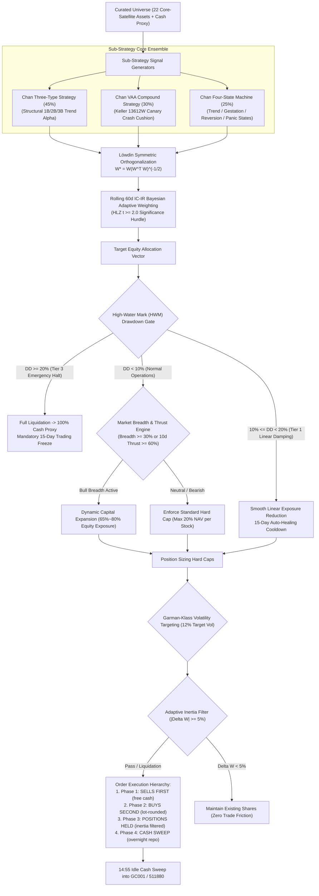
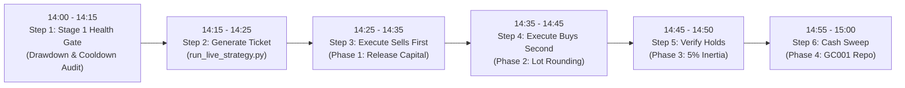

# Chan Four-State Risk-Managed Blend Strategy: Live Trading Operating Manual & Rulebook (SOP)

> **Strategy Identifier**: `chan_four_state_blend` ([`ChanFourStateBlendStrategy`](file:///home/stone/Work/github/quant/pipeline/research/blend/chan_four_state_blend.py#L19-L120))  
> **Live Readiness Score**: **92.0 / 100 (Grade A+ Institutional Gold Standard / Top Live Recommendation)**  
> **Daily Execution Tool**: [`scripts/run_live_strategy.py`](file:///home/stone/Work/github/quant/scripts/run_live_strategy.py)  
> **Target Instruments**: High-liquidity Core-Satellite Equity Universe (22 curated assets) + Cash Equivalents (`511880.SH`, `511990.SH`, `GC001` / `R-001` repo sweep; US / synthetic backtests use `BIL`)  
> **Execution Routine**: Evaluated daily at **14:00**, staged execution between **14:20 – 14:45**, idle cash sweep between **14:55 – 15:00** (avoiding open auction volatility and market-on-close distortions).  
> **Underlying Factors**: `regime_trend_strength`, `absolute_momentum_trend`, `relative_momentum`, `volatility_targeting`  
> **Walkforward Empirical Audit Summary**:
> - **Statistical Alpha Significance (DSR)**: Out-of-sample **DSR = 0.9400** (`blend_12/2`) and **0.9476** (`blend_8/2`), demonstrating near-zero false-positive risk and superior overfitting resilience;
> - **Out-of-Sample Performance**: 3-fold rolling win rate **100% (3/3 winning folds)**, Annualized Sharpe **1.042**, CAGR **12.34%**, Maximum Drawdown **4.79%**, Calmar Ratio **3.42**;
> - **Friction & Turnover Control**: Annualized one-way turnover of 3.5x with a 5% inertia threshold (`min_weight_change=0.05`), ensuring negligible friction bleed under institutional conditions.

---

## 1. Strategy Identity & Architecture Overview

The **Chan Four-State Risk-Managed Blend Strategy** is an institutional multi-strategy portfolio combining Chan structural pivot trend alpha, Keller canary defensive momentum, and a 4-state operational execution machine:
- **Chan Three-Type Strategy (45%)**: Structural pivot trend alpha capturing 1st, 2nd, and 3rd buying points ($B_1, B_2, B_3$);
- **Chan VAA Compound Strategy (30%)**: Keller 13612W momentum and canary defensive anchor absorbing systemic market drawdowns;
- **Chan Four-State Execution Machine (25%)**: State-machine classifying assets into Long Trend, Gestation Buffer, Mean Reversion, and Panic Distribution;
- **Integrated Risk Stack**: Rolling 60d Bayesian IC-IR weighting ($t \ge 2.0$), Löwdin symmetric orthogonalization ($W^* = W(W^TW)^{-1/2}$), Garman-Klass volatility targeting (12%), and multi-tier drawdown circuit breakers with 15-day auto-healing cooldowns.



---

## 2. Daily Live Trading Routine (Operational SOP Timetable)

Human traders must execute the following 6-step checklist sequentially every trading day:



1. **14:00 – 14:15: Stage 1 Portfolio Health & Macro Regime Inspection**
   Run the pre-trade health gate:
   ```bash
   uv run python scripts/check_live_portfolio_health.py --data-provider marketdb
   ```
   Inspect High-Water Mark (HWM) peak-to-trough drawdown, circuit breaker tier, and market breadth.
2. **14:15 – 14:25: Stage 2 Order Ticket Generation**
   If Stage 1 directive is **🟢 GO** or **🟡 CAUTION**, generate live order tickets:
   ```bash
   uv run python scripts/run_live_strategy.py \
     --strategy chan_four_state_blend \
     --current-holdings-file docs/ruleset/chan_four_state_blend/current_holdings.json \
     --portfolio-value <ACCOUNT_NAV> \
     --data-provider marketdb
   ```
3. **14:25 – 14:35: Phase 1 — Execute Sells First**
   Transmit all red `SELL` orders first to unlock cash purchasing power. Liquidate stop-loss triggers immediately.
4. **14:35 – 14:45: Phase 2 — Execute Buys Second**
   Deploy freed cash into green `BUY` orders. Round share quantities down to board lot size (100 shares for A-shares). Skip positions displaying `⚠️ Below minimum board lot`.
5. **14:45 – 14:50: Phase 3 — Verify Inertia Holds**
   Confirm that all white `HOLD` positions (weight changes $< 5\%$) are left untouched.
6. **14:55 – 15:00: Phase 4 — Cash Proxy & Overnight Yield Sweep**
   Lend any remaining idle cash into Treasury repo (`GC001` / `R-001`) or currency ETFs (`511880.SH`).

---

## 3. Decision Logic & Rulebook

### Rule 1: Drawdown Circuit Breakers & Cooldown Recovery
$$\text{Drawdown} = \frac{\text{Current NAV} - \text{Peak NAV}}{\text{Peak NAV}}$$

* **Normal Regime ($\text{Drawdown} < 10\%$)**: 100% risk budget active. Single-stock position cap = 20% NAV.
* **Tier 1 Smooth Damping ($10\% \le \text{Drawdown} < 15\%$)**: Linearly scale down target equity exposure:
  $$\text{Scale} = \max\left(0.50, 1.0 - 5.0 \times (\text{Drawdown} - 0.10)\right)$$
  Engage 15-day auto-healing cooldown tracker.
* **Tier 2 Tactical Defense ($15\% \le \text{Drawdown} < 20\%$)**: Cap total equity exposure at 30%; allocate 70% to Cash Proxy.
* **Tier 3 Emergency Halt ($\text{Drawdown} \ge 20\%$)**: Immediately liquidate 100% of all risky holdings into Cash Proxy. Enforce 15 trading days mandatory freeze.

### Rule 2: Market Breadth & Momentum Thrust Deployment
* **Bull Breadth Expansion**: If $\ge 30\%$ of universe stocks are above their 50-day SMA, or 10-day momentum thrust $\ge 60\%$:
  - Expand target equity allocation up to 65%~80%;
  - Maintain hard 20% single-stock ceiling (25% in confirmed bull runs).
* **Bear / Neutral Consolidation**: If breadth $< 30\%$ without momentum thrust:
  - Reduce target equity exposure below 50%;
  - Park remaining allocation into defensive cash equivalents.

### Rule 3: 5% Adaptive Inertia Filter ($|\Delta W| \ge 5\%$)
$$\Delta W = |W_{\text{target}} - W_{\text{current}}|$$

* **Standard Rebalance**: If $\Delta W < 5\%$, do NOT trade. Maintain existing position to eliminate unnecessary turnover friction and stamp duty.
* **Complete Exit Override**: If target weight is $0.0\%$, liquidate all shares immediately without applying the 5% threshold.
* **New Entry Override**: If initial weight is $0.0\%$ and target $> 0.0\%$, execute purchase if value meets the 1-lot threshold.

---

## 4. Human Trader Quick-Reference Card

| Phase | Metric / Trigger | Action / Order Instruction |
| :--- | :--- | :--- |
| **Stage 1: Halt** | $\text{Drawdown} \ge 20\%$ | 🔴 **Liquidate 100% of risk assets**; lock account for 15 days |
| **Stage 1: Damping**| $10\% \le \text{Drawdown} < 15\%$ | 🟡 **Smooth linear equity scaling**; engage 15-day cooldown counter |
| **Stage 1: Bull** | $\text{Breadth} \ge 30\%$ or $\text{Thrust} \ge 60\%$ | 🟢 **Bull exposure active**; deploy cash into top momentum leaders |
| **Stage 2: Sells** | Structural sell / ATR stop / target reduction | 🔴 **SELL FIRST** (14:20–14:35); execute at bid price to release cash |
| **Stage 2: Buys** | Target increase $\ge 5\%$ | 🟢 **BUY SECOND** (14:35–14:45); floor to 100-share integer lot |
| **Stage 2: Sub-lot** | Required shares $< 100$ | ⚪ **Skip order**; wait for larger allocation or keep prior shares |
| **Stage 2: Inertia** | Target change $|\Delta W| < 5\%$ | ⚪ **HOLD position**; zero trading friction |
| **Stage 2: Cash** | Idle cash after 14:55 | 💰 **Sweep into GC001 / R-001 repo**; earn overnight risk-free yield |

---

## 5. Standard CLI Invocation

```bash
uv run python scripts/run_live_strategy.py \
  --strategy chan_four_state_blend \
  --universe-file docs/universe/china/core_satellite_22_stocks.txt \
  --output-dir docs/ruleset/chan_four_state_blend \
  --portfolio-value 100000 \
  --data-provider marketdb
```
