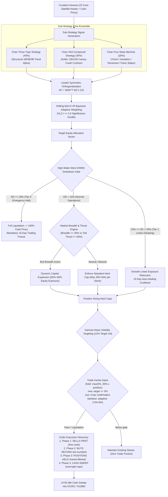
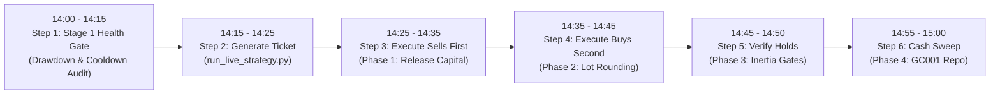

# Chan Four-State Risk-Managed Blend Strategy: Live Trading Operating Manual & Rulebook (SOP)

> **Strategy Identifier**: `chan_four_state_blend` ([`ChanFourStateBlendStrategy`](file:///home/stone/Work/github/quant/pipeline/research/blend/chan_four_state_blend.py#L19-L120))  
> **Live Readiness Score**: **92.0 / 100 (Grade A+ Institutional Gold Standard / Top Live Recommendation)**  
> **Daily Execution Tool**: [`scripts/run_live_strategy.py`](file:///home/stone/Work/github/quant/scripts/run_live_strategy.py)  
> **Target Instruments**: High-liquidity Core-Satellite Equity Universe (22 curated assets) + Cash Equivalents (`511880.SH`, `511990.SH`, `GC001` / `R-001` repo sweep; US / synthetic backtests use `BIL`)  
> **Execution Routine**: Evaluated daily at **14:00**, staged execution between **14:20 – 14:45**, idle cash sweep between **14:55 – 15:00** (avoiding open auction volatility and market-on-close distortions).  
> **Underlying Factors**: `regime_trend_strength`, `absolute_momentum_trend`, `relative_momentum`, `volatility_targeting`  
> **Walkforward Empirical Audit Summary**:
> - **Statistical Alpha Significance (DSR)**: Out-of-sample **DSR = 0.9400** (`blend_12/2`) and **0.9476** (`blend_8/2`), demonstrating near-zero false-positive risk and superior overfitting resilience;
> - **Out-of-Sample Performance**: 3-fold rolling win rate **100% (3/3 winning folds)**, Annualized Sharpe **1.042**, CAGR **12.34%**, Maximum Drawdown **4.79%**, Calmar Ratio **3.42**;
> - **Friction & Turnover Control**: Annualized one-way turnover of 3.5x on a **5% base inertia threshold** (`cfsb_min_weight_change = 0.05`), which the backtest scales per asset to an **adaptive 2.5% – 8%** band and the live runner applies as a fixed trim gate plus a 30%-of-position relative hurdle (Rule 3).

---

## 1. Strategy Identity & Architecture Overview

The **Chan Four-State Risk-Managed Blend Strategy** is an institutional multi-strategy portfolio combining Chan structural pivot trend alpha, Keller canary defensive momentum, and a 4-state operational execution machine:
- **Chan Three-Type Strategy (45%)**: Structural pivot trend alpha capturing 1st, 2nd, and 3rd buying points ($B_1, B_2, B_3$);
- **Chan VAA Compound Strategy (30%)**: Keller 13612W momentum and canary defensive anchor absorbing systemic market drawdowns;
- **Chan Four-State Execution Machine (25%)**: State-machine classifying assets into Long Trend, Gestation Buffer, Mean Reversion, and Panic Distribution;
- **Integrated Risk Stack**: Rolling 60d Bayesian IC-IR weighting ($t \ge 2.0$), Löwdin symmetric orthogonalization ($W^* = W(W^TW)^{-1/2}$), Garman-Klass volatility targeting (12%), and multi-tier drawdown circuit breakers with 15-day auto-healing cooldowns.



---

## 2. Daily Live Trading Routine (Operational SOP Timetable)

Human traders must execute the following 6-step checklist sequentially every trading day:



1. **14:00 – 14:15: Stage 1 Portfolio Health & Macro Regime Inspection**
   Run the pre-trade health gate:
   ```bash
   uv run python scripts/check_live_portfolio_health.py --data-provider marketdb
   ```
   Inspect High-Water Mark (HWM) peak-to-trough drawdown, circuit breaker tier, and market breadth.
2. **14:15 – 14:25: Stage 2 Order Ticket Generation**
   If Stage 1 directive is **🟢 GO** or **🟡 CAUTION**, generate live order tickets:
   ```bash
   uv run python scripts/run_live_strategy.py \
     --strategy chan_four_state_blend \
     --current-holdings-file docs/ruleset/chan_four_state_blend/current_holdings.json \
     --portfolio-value <ACCOUNT_NAV> \
     --data-provider marketdb
   ```
3. **14:25 – 14:35: Phase 1 — Execute Sells First**
   Transmit all red `SELL` orders first to unlock cash purchasing power. Liquidate stop-loss triggers immediately.
4. **14:35 – 14:45: Phase 2 — Execute Buys Second**
   Deploy freed cash into green `BUY` orders. Round share quantities down to board lot size (100 shares for A-shares). Skip positions displaying `⚠️ Below minimum board lot`.
5. **14:45 – 14:50: Phase 3 — Verify Inertia Holds**
   Confirm that every white `HOLD` / `HOLD_FILTERED` position is left untouched — see Rule 3 for the three separate gates that produce such a row (they are **not** one 5% rule).
6. **14:55 – 15:00: Phase 4 — Cash Proxy & Overnight Yield Sweep**
   Lend any remaining idle cash into Treasury repo (`GC001` / `R-001`) or currency ETFs (`511880.SH`).

---

## 3. Decision Logic & Rulebook

### Rule 1: Drawdown Circuit Breakers & Cooldown Recovery
$$\text{Drawdown} = \frac{\text{Current NAV} - \text{Peak NAV}}{\text{Peak NAV}}$$

* **Normal Regime ($\text{Drawdown} < 10\%$)**: 100% risk budget active. Single-stock position cap = 20% NAV.
* **Tier 1 Smooth Damping ($10\% \le \text{Drawdown} < 15\%$) — code-executed (代码执行)**: Linearly scale down target equity exposure:
  $$\text{Scale} = \max\left(0.0,\ 1.0 - \frac{\text{Drawdown} - 0.10}{0.10}\right)$$
  i.e. **0% reduction at DD = 10%, exactly 50% at DD = 15%, 100% at DD = 20%** — the damping is continuous across the whole 10%–20% band, and live applies the identical formula (`scripts/check_live_portfolio_health.py:380,384`). The discrete "cut by 50% (× 0.5)" branch exists in code (`pipeline/research/blend/blend_base.py:1075-1081`) but is **not** the deployed configuration: all six blends set `smooth_drawdown: true`. Engage 15-day auto-healing cooldown tracker.
* **Tier 2 Tactical Defense ($15\% \le \text{Drawdown} < 20\%$) — human-executed (人工执行)**: Cap total equity exposure at 30%; allocate 70% to Cash Proxy.
  - The 30%/70% split and the defensive rotation are the health report's advisory instruction to the human (`scripts/check_live_portfolio_health.py:618-622`) — **the ticket generator does not perform them**.
* **Tier 3 Emergency Halt ($\text{Drawdown} \ge 20\%$) — code-executed (代码执行, hard halt)**: Immediately liquidate 100% of all risky holdings into Cash Proxy. Enforce 15 trading days mandatory freeze.

> **Note — the Tier-2 rotation instruction is not executed by the ticket generator.** The "rotate into a defensive sub-strategy" text the health report prints at Tier 2 is an advisory action string for the human (`scripts/check_live_portfolio_health.py:618-622`); `scripts/run_live_strategy.py` contains no `TIER_1` / `TIER_2` branch at all, so on a Tier-2 day the ticket only applies the portfolio-level scaling (`current_targets *= live_scale` at `scripts/run_live_strategy.py:1766`, where `live_scale` is read from `account_state` / the health report's `linear_equity_scale`, `scripts/check_live_portfolio_health.py:380`). The rotation must be carried out by the human per the health report; therefore **on a Tier-2 day the position structure printed on the ticket may still be the Tier-1 damped shape**.

### Rule 2: Market Breadth & Momentum Thrust Deployment
* **Bull Breadth Expansion**: If $\ge 30\%$ of universe stocks are above their 50-day SMA, or 10-day momentum thrust $\ge 60\%$:
  - Expand target equity allocation up to 65%~80%;
  - Maintain hard 20% single-stock ceiling (25% in confirmed bull runs).
* **Bear / Neutral Consolidation**: If breadth $< 30\%$ without momentum thrust:
  - Reduce target equity exposure below 50%;
  - Park remaining allocation into defensive cash equivalents.

### Rule 3: Trade Inertia — Three Live Gates, One Relative Hurdle (and a Different Backtest Rule)

For every asset, compute the signed weight change at 14:00:
$$\Delta W = W_{\text{target}} - W_{\text{current}}$$

This strategy carries **one inertia parameter** (`cfsb_min_weight_change = 0.05`), **an equal but separate entry gate** (`cfsb_entry_threshold = 0.05`), and — uniquely among the blend strategies — **a relative trim hurdle** (`cfsb_inertia_relative_ratio = 0.30`). Apply the **first** rule below that matches the asset's situation:

| # | Situation | Live rule — what you actually do | Backtest rule — what the model did (different by design) |
| :--- | :--- | :--- | :--- |
| **1** | You **already hold** the asset, target **increased** (add) | Require $\lvert\Delta W\rvert \ge \mathbf{5\%}$. Below that, **do not trade**; ticket prints `HOLD`, reason "调仓未超惰性阈值 (< 5%)". | Per-asset threshold is **adaptive, 2.5% – 8%**: $\mathrm{clip}\big(\tfrac{\sigma^{21d}_{\text{asset}}}{\sigma^{21d}_{\text{universe}}} \times 5\%,\ 2.5\%,\ 8\%\big)$. A second, backtester-level gate then applies the plain 5% **only to assets already held**. |
| **2** | You **already hold** the asset, target **decreased** (trim) | Require $\lvert\Delta W\rvert \ge \max\big(\mathbf{5\%},\ \mathbf{0.30 \times \text{current weight}}\big)$. The relative leg bites above a 16.7% position: at the 20% single-stock cap a trim needs **6%**, not 5%. Below the effective gate the ticket prints `HOLD` with reason "调仓未超惰性阈值 (< 6%)" — read the printed percentage, it is the effective threshold. | Trim uses the same adaptive 2.5% – 8% threshold as a buy (asymmetric sells are **off** for this strategy). |
| **3** | You hold **nothing** in the asset (0% → new position) | Require **target weight $\ge \mathbf{5\%}$** (`cfsb_entry_threshold = 0.05`, so the entry gate equals the base trim gate). Below 5%, **do not open**; the ticket prints `HOLD_FILTERED` with reason "目标仓位未达最低建仓/调仓门槛 (… 防微量试错损耗)". A brand-new 4.9% line is refused — there is **no** "new entry override". | The backtester's 5% gate **does not apply to new positions** (assets not already held are exempt); the template-level inertia filter gates entries only at $\min(\text{adaptive threshold},\ 5\%)$, i.e. **2.5% – 5%**. |
| **4** | The model wants **0.0%** on an asset you hold (full exit) | Exempt from gates 1–3, but the exit must **persist 2 consecutive evaluation days** (`guard_latency_bars = 2`). Day 1 prints `PENDING_EXIT` / `HOLD_FILTERED` with reason "平仓信号进入确认期 (第 1/2 日待确认)". Do not sell on a single-day pulse. | Exits the same day the rebalance row carries 0.0% — no persistence requirement. |
| **5** | Hard stop ($-8\%$ from entry), structural invalidation, ATR trailing stop, or a **Tier-3** emergency halt | **Sell 100% immediately** (Stage 2 sells). These are full liquidations, so all inertia gates and the 2-day exit confirmation are bypassed outright — the threshold is not consulted, so there is no residual "0.1% floor" to honour. Buys are never granted this bypass. | The per-symbol `asset_emergency_df` mask bypasses inertia for that asset and bar. |

* **VERIFIED — the damping cut is itself gated, per asset, and is routinely refused.** The cut is applied **per asset**: every held name's weight is multiplied by the same `scale` factor, with the remainder swept into the cash proxy (`scripts/run_live_strategy.py:1766`; `pipeline/research/blend/blend_base.py:1069-1071`). Each name is therefore an **independent trim subject to its own threshold** — at DD = 15% the factor is 0.5, so a 6% position is cut to 3%, a 3pp change against the effective gate (`max(5%, 0.30 × 6%) = 5%`), and is **refused that day**; the ticket shows `HOLD` with reason "调仓未超惰性阈值 (< 5%)". A 50% cut clears the gate only once the position is **≥ 10% of NAV** (at the 20% cap the 6% relative leg is cleared by the 10pp cut). This happens in **both paths**: live grants no risk-reduction exemption (the `is_stop` fast path only ever liquidates to 0.0 and only for stop-loss / `is_emergency_halt`, `common/position_lifecycle.py:363-420`; `is_emergency_halt` is Tier-3-only, `scripts/run_live_strategy.py:1927`), and the backtest's inertia filter swallows the same trim unless the asset-emergency bypass is on. Only the full-exit/stop paths in rules 4–5 liquidate regardless of size.
* **The two paths also diverge in DD ∈ (17%, 20%)**: the backtest opens its bypass at `scale_dd < 0.30`, i.e. DD > 17% (`pipeline/research/blend/blend_base.py:1072` → `is_global_emergency`, `common/allocation_templates.py:233-251`), while live only force-liquidates at DD ≥ 20% (Tier 3). Between 17% and 20% the backtest applies the cut and live keeps blocking it.
* **No override number is prescribed here.** On a Tier-1/2 day, reconcile the breaker tier against the reduction actually printed on the ticket before acting; whether to top a refused cut up manually is an account-owner policy decision, not a rule this manual can invent.

* **Sub-lot interaction**: a gate pass can still round to 0 shares (100-share lots). The ticket marks such a line `⚠️ Below minimum board lot`; that is a sizing outcome, not an inertia decision.
* **No row-level gate in the backtest**: a rebalance row is emitted whenever *any* symbol's target moved, and it carries every symbol — per-symbol inertness within a live ticket has no backtest counterpart at row level.

> ⚠️ **The live path and the backtest path differ by design, as currently implemented.** Gate 3 refuses brand-new positions below 5% that the backtest would take at 2.5% – 5%; gate 2 imposes a position-proportional trim hurdle the backtest does not have; gate 4 delays every exit by two evaluations where the backtest exits immediately. Consequently **live holdings may legitimately contain fewer names — and larger-percentage trims — than the backtest for the same date.** Do not reconcile the gap by waiving the entry gate, by forcing the backtest's name count, or by pre-empting the exit confirmation.

---

## 4. Human Trader Quick-Reference Card

| Phase | Metric / Trigger | Action / Order Instruction |
| :--- | :--- | :--- |
| **Stage 1: Halt** — **code-executed (代码执行)** | $\text{Drawdown} \ge 20\%$ | 🔴 **Liquidate 100% of risk assets**; lock account for 15 days |
| **Stage 1: Damping** — **code-executed (代码执行)** | $10\% \le \text{Drawdown} < 15\%$ | 🟡 **Smooth linear equity scaling**; engage 15-day cooldown counter |
| **Stage 1: Bull** | $\text{Breadth} \ge 30\%$ or $\text{Thrust} \ge 60\%$ | 🟢 **Bull exposure active**; deploy cash into top momentum leaders |
| **Stage 2: Sells** | Structural sell / ATR stop / target reduction | 🔴 **SELL FIRST** (14:20–14:35); execute at bid price to release cash |
| **Stage 2: Buys** | Target increase $\ge 5\%$ (or new position $\ge 5\%$) | 🟢 **BUY SECOND** (14:35–14:45); floor to 100-share integer lot |
| **Stage 2: Sub-lot** | Required shares $< 100$ | ⚪ **Skip order**; wait for larger allocation or keep prior shares |
| **Stage 2: Inertia (add)** | Held asset, add $< 5\%$ | ⚪ **HOLD**: no order; keep prior shares |
| **Stage 2: Inertia (trim)** | Held asset, trim $< \max(5\%,\,30\%\times\text{weight})$ | ⚪ **HOLD**: no order; read the ticket's printed effective threshold |
| **Stage 2: Inertia (entry)** | New position target $< 5\%$ | ⚪ **HOLD_FILTERED**: do not open a brand-new sub-5% line |
| **Stage 2: Exit** | Model target $= 0.0\%$ on a held asset | 🕒 **WAIT**: sell only after the signal persists 2 consecutive evaluations |
| **Stage 2: Cash** | Idle cash after 14:55 | 💰 **Sweep into GC001 / R-001 repo**; earn overnight risk-free yield |

---

## 5. Standard CLI Invocation

```bash
uv run python scripts/run_live_strategy.py \
  --strategy chan_four_state_blend \
  --universe-file docs/universe/china/core_satellite_22_stocks.txt \
  --output-dir docs/ruleset/chan_four_state_blend \
  --portfolio-value 100000 \
  --data-provider marketdb
```
