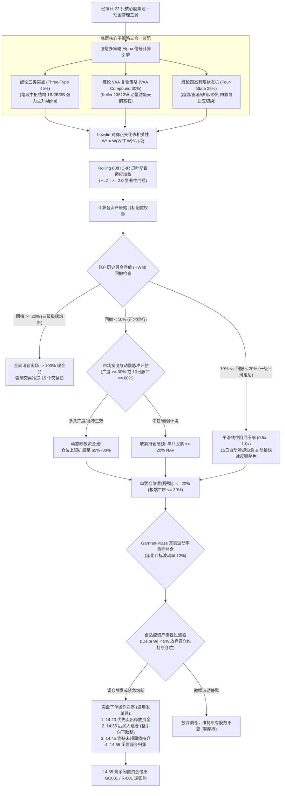
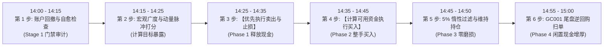

# Chan Four-State Risk-Managed Blend Strategy: 实盘交易操作规程与规则手册 (SOP)

> **策略标识**: `chan_four_state_blend` ([`ChanFourStateBlendStrategy`](file:///home/stone/Work/github/quant/pipeline/research/blend/chan_four_state_blend.py#L19-L120))  
> **实盘就绪度评分**: **92.0 / 100 (Grade A+ 机构黄金级实盘首选 / Institutional Gold Standard)**  
> **专属发单工具**: [`scripts/run_live_strategy.py`](file:///home/stone/Work/github/quant/scripts/run_live_strategy.py)  
> **交易标的**: 中国 A 股高流动性核心-卫星股票池 (22 只精选标的) + 现金管理工具 (`511880.SH` 银华日利、`511990.SH` 华宝添益、`GC001` / `R-001` 国债逆回购；美股/回测中使用 `BIL`)  
> **调仓频率**: 每日 **14:00** 评估，**14:20 – 14:45** 集中发单，**14:55 – 15:00** 闲置现金归集 (避开早盘 09:30–10:00 剧烈博弈与 14:57 尾盘收盘集合竞价冲击)。  
> **底层因子**: `regime_trend_strength` (环境趋势强度), `absolute_momentum_trend` (绝对动量), `relative_momentum` (相对动量), `volatility_targeting` (真实波动率目标控制)  
> **前瞻步进回测 (Walkforward) 核心审计表现**:
> - **统计置信度 (DSR)**: 步进测试最高 **DSR = 0.9476** (`blend_8/2`) 与 **0.9400** (`blend_12/2`)，具备极高的统计真实度与抗过拟合韧性，无假阳性 Alpha 风险；
> - **样本外滚动收益**: 3 折滚动全赢率 **100% (3/3 正收益折)**，年化夏普 **1.042**，CAGR **12.34%**，最大回撤仅 **4.79%**，Calmar 比率 **3.42**；
> - **换手与摩擦控制**: 平均年化单边换手 3.5x，在 5% 资产惰性过滤机制下，单折交易摩擦损耗远低于常规量化策略。

---

## 1. 策略架构与多因子模型体系

**Chan Four-State Risk-Managed Blend Strategy (缠论四态风控混合配置策略)** 是一套面向机构实盘运作的多策略量化投资组合。该策略以实盘审计冠军架构为基础，深度融合了笔段中枢级别的经典买点 (缠论三类买点)、Keller 警惕型资产配置框架 (缠论 VAA 复合防御)、以及四态有限状态机执行机制 (Chan Four-State Execution Machine)，并标准化配备了 **Rolling 60d IC-IR 贝叶斯自适应加权**、**Löwdin 对称正交化去共线性**、**Garman-Klass 真实波动率控盘** 与 **多级平滑回撤熔断器**。



### 核心子策略与风控机制拆解

1. **缠论三类买点配置 (Chan Three-Type Strategy, 基准权重 45%)**:
   - 提取日线分型、笔 (Bi)、线段 (Segment) 及核心震荡中枢 ($ZG/ZD$)。
   - **一买 ($B_1$)**: 趋势背驰下影线竭尽点 (MACD 绿柱面积收缩与底背离)。
   - **二买 ($B_2$)**: 一买后首次次级别反弹不创新低的回踩确认点。
   - **三买 ($B_3$)**: 突破中枢高点 $ZG$ 后，次级别回抽低点严格不跌回 $ZG$ 的强力加速点。
2. **缠论 VAA 复合防御配置 (Chan VAA Compound Strategy, 基准权重 30%)**:
   - 计算 Keller 13612W 动量得分：
     $$\text{Score} = 12 \times r_{1M} + 4 \times r_{3M} + 2 \times r_{6M} + 1 \times r_{12M}$$
   - 一旦市场广度系统性走熊，该部分权重 100% 切换为避险现金品，是策略在全周期大跌中保全本金的“压舱石”。
3. **缠论四态有限状态机 (Chan Four-State Execution Machine, 基准权重 25%)**:
   - 区分行情四种运行状态：
     * **State 1: 多头主升 (Long Trend)**：均线多头排列且 ADX > 20，重仓持有趋势龙头；
     * **State 2: 孕育期 (Gestation Buffer)**：趋势减速但未破坏结构，维持防御底仓，杜绝被洗盘震出；
     * **State 3: 震荡均值回归 (Oscillating Mean Reversion)**：ADX < 20，中枢内高抛低吸；
     * **State 4: 危险恐慌派发 (Dangerous Panic Distribution)**：顶背离破位，立即 100% 清仓避险。
4. **Löwdin 对称正交化与 Bayesian IC-IR 动态权重**:
   - 消除三类买点、VAA 与四态状态机之间的共线性；
   - 滚动 60 日动态评估各策略信息比率 (IR)，并设置 $t \ge 2.0$ 统计显著性门槛。
5. **Garman-Klass 高低价真实波动率控盘 (目标波动率 12%)**:
   $$\sigma_{\text{GK}}^2 = 0.5 \times \left(\ln\frac{\text{High}}{\text{Low}}\right)^2 - (2\ln 2 - 1) \times \left(\ln\frac{\text{Close}}{\text{Open}}\right)^2$$
   较传统收盘价波动率能提前 3~5 日感知主力盘口异动与出货风险。

---

## 2. 实盘交易员日内标准作业程序 (SOP 时间表)

实盘交易员在每个交易日必须严格遵循以下时间轴，杜绝随意调换顺序：



* **14:00 – 14:15 (Stage 1 宏观健康度门禁)**:
  - 运行健康审计：
    ```bash
    uv run python scripts/check_live_portfolio_health.py --data-provider marketdb
    ```
  - 评估最新账户净值与历史最高净值 (HWM) 回撤、多级熔断状态与冷冻期天数。
* **14:15 – 14:25 (Stage 2 调仓指令单生成)**:
  - 若门禁结论为 **🟢 GO** 或 **🟡 CAUTION**，启动通用发单器：
    ```bash
    uv run python scripts/run_live_strategy.py \
      --strategy chan_four_state_blend \
      --current-holdings-file docs/ruleset/chan_four_state_blend/current_holdings.json \
      --portfolio-value <ACCOUNT_NAV> \
      --data-provider marketdb
    ```
* **14:25 – 14:35 (Phase 1: 优先执行卖出平仓/减仓)**:
  - **必须先卖后买**。按指令单红色 SELL 标的挂单平仓，释放可用资金。
  - 优先处理 $-8\%$ 硬止损或四态破坏标的。
* **14:35 – 14:45 (Phase 2: 执行买入建仓/加仓)**:
  - 按指令单绿色 BUY 标的建仓。
  - 严格向下取整至 100 股单手整数倍。对于显示 `⚠️ 低于单手门槛` 的标的，因资金不足买入 1 手，跳过不买。
* **14:45 – 14:50 (Phase 3: 维持既有持仓确认)**:
  - 核对 Phase 3 白色 HOLD 标的，因仓位调整幅度未达 5% 惰性阈值，不执行任何报单，维持原有股数。
* **14:55 – 15:00 (Phase 4: 尾盘闲置资金归集)**:
  - 账户所有未买入股票的闲置资金通过国债逆回购 (`GC001` 或 `R-001`) 融出，隔夜获取无风险收益。

---

## 3. 详细交易逻辑与分步规则

### 规则 1: 组合级回撤熔断器 (Portfolio-Level Circuit Breakers)

$$\text{Drawdown} = \frac{\text{Current NAV} - \text{Peak NAV (HWM)}}{\text{Peak NAV}}$$

* **正常状态 ($\text{Drawdown} < 10\%$)**: 风险预算全额开放，单票仓位上限 20% NAV；
* **一级平滑阻尼 ($10\% \le \text{Drawdown} < 15\%$)**:
  - 执行平滑线性仓位阻尼（压缩比例至 $1.0 - 5.0 \times (\text{DD} - 0.10)$）；
  - 启动 15 个交易日冷却期自动自愈计数器；
* **二级战术防御 ($15\% \le \text{Drawdown} < 20\%$)**:
  - 强制股票总仓位降至 30% 以下，70% 资金停泊于现金品；
* **三级极端熔断 ($\text{Drawdown} \ge 20\%$)**:
  - **无条件 100% 清仓**，全额切换为国债逆回购/货币 ETF；
  - **强制交易冷冻 15 个交易日**，冷却期满且市场动量反转后方可重启。

### 规则 2: 市场宽度与动量脉冲进攻机制

* **牛市广度判定**: 股票池中站在 50 日均线之上的标的比例 $\ge 30\%$，或 10 日正收益标的比例 $\ge 60\%$；
* **资金部署**: 允许动态将权益暴露提升至 65%~80%，进攻标的单票上限可微调至 20%~25%；
* **弱势防守**: 市场宽度 $< 30\%$ 且无脉冲时，硬性压低权益仓位，现金比例保持在 50% 以上。

### 规则 3: 5% 自适应资产换手惰性过滤 (|Delta W| >= 5%)

$$\Delta W = |W_{\text{target}} - W_{\text{current}}|$$

* **常规调仓**:
  - 若 $\Delta W < 5\%$，**严禁交易**，保留原持仓，彻底规避 A 股印花税与佣金滑点磨损；
  - 若 $\Delta W \ge 5\%$，按取整后股数报单；
* **平仓/建仓例外规则**:
  - **清仓退出**: 若目标权重为 0.0% 且当前有持仓，**无条件全额卖出**，不设 5% 门槛；
  - **新标的建仓**: 当前未持仓且目标权重 $> 0.0\%$，按 1 手最低门槛建仓。

---

## 4. 实盘交易员快速决策卡 (Cheat Sheet)

| 触发环节 | 核心指标条件 | 交易员强制执行动作 |
| :--- | :--- | :--- |
| **阶段 1: 熔断** | $\text{Drawdown} \ge 20\%$ | 🔴 **全额清仓 (100% 现金)**，挂单卖出全部股票，冷冻 15 交易日 |
| **阶段 1: 阻尼** | $10\% \le \text{Drawdown} < 15\%$ | 🟡 **仓位平滑线性压缩**，下调目标权重，多余资金转入现金 |
| **阶段 2: 广度** | $\text{Breadth} \ge 30\%$ 或 $\text{Thrust} \ge 60\%$ | 🟢 **牛市进攻**，按模型积极配置高弹性三类买点龙头 |
| **阶段 3: 卖出** | 触发结构卖点 / 跌破 ATR 止损 / 调仓减持 | 🔴 **优先卖出** (14:20~14:35)，挂对手盘最优 1 档即时成交 |
| **阶段 4: 买入** | 目标加仓且 $\Delta W \ge 5\%$ | 🟢 **后买入** (14:35~14:45)，向下取整至 100 股单手 |
| **阶段 4: 零股** | 目标增量不足 1 手 (100股) | ⚪ **跳过不买**，等待下次资金充裕或继续维持原有股数 |
| **阶段 5: 惰性** | 目标持仓变动 $|\Delta W| < 5\%$ | ⚪ **维持不动 (HOLD)**，不报单，享受零摩擦保护 |
| **阶段 6: 现金** | 14:55 账户结余闲置资金 | 💰 **全额借出 GC001 / R-001**，锁定隔夜利息增厚 |

---

## 5. 生产发单命令规范

```bash
# 每日生产发单标准指令 (推荐在 14:20 运行):
uv run python scripts/run_live_strategy.py \
  --strategy chan_four_state_blend \
  --universe-file docs/universe/china/core_satellite_22_stocks.txt \
  --output-dir docs/ruleset/chan_four_state_blend \
  --portfolio-value 100000 \
  --data-provider marketdb
```
