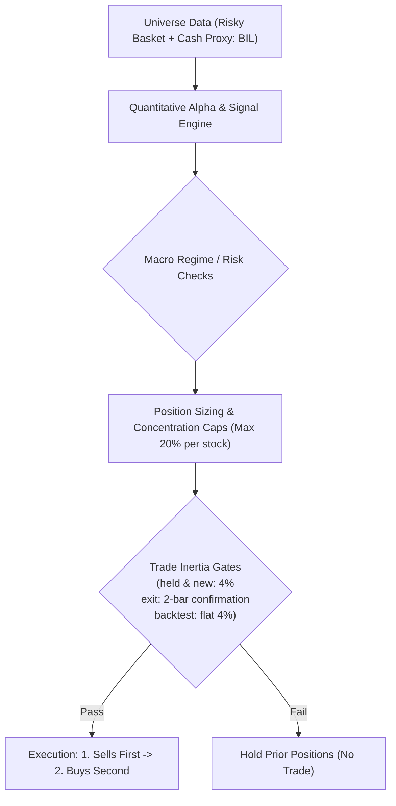
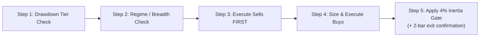

# Chan Four-State Operational Machine Strategy: Live Trading Operating Manual & Rulebook

> **Strategy Identifier**: `chan_four_state_execution` (`ChanFourStateExecutionStrategy`)  
> **Instrument Context**: Equity / ETF Universe + Cash Proxy (`BIL`)  
> **Trading Frequency**: Daily rebalance evaluation, executing between **14:00 – 14:50** (to avoid open auction volatility and end-of-day market-on-close distortions).  
> **Underlying Factors**: `regime_trend_strength`, `absolute_momentum_trend`, `mean_reversion`

---

## 1. Strategy Identity & Architecture Overview

**Chan Four-State Operational Machine Strategy** is a quantitative trading strategy designed for disciplined portfolio execution.

### Strategy Description
Industrial-grade Chan execution strategy implementing the 4-state operational machine (BUY_CANDIDATE, HOLD, HOLD_ALERT, SELL_EXIT, WAIT_OBSERVE) with deterministic structural invalidation stops (1B bar low, 2B dd low, 3B zg pivot high), ratcheting trailing stop to ZG, moving average entanglement filter, and Lesson 16 zero-consolidation drag.

---

## 2. Daily Live Trading Routine (Operational Checklist)

A human trader must follow this 5-step daily routine in strict sequential order before placing any trades:

---

## 3. Step-by-Step Decision Logic & Rules

### Step 1: Drawdown Circuit Breaker Check (Portfolio Level)
Calculate your current portfolio High-Water Mark (HWM) and peak-to-trough drawdown at 14:00:
$$\text{Drawdown} = \frac{\text{Current NAV} - \text{Peak NAV}}{\text{Peak NAV}}$$

* **IF Drawdown < 10% (Normal Regime)**:
  * Proceed to Step 2 with full risk budget. Standard single-stock cap = **20%**.
* **IF 10% <= Drawdown < 15% (Tier 1: Smooth Linear Damping) — code-executed (代码执行)**:
  * **Action**: scale every position by $\text{scale} = 1 - (\text{Drawdown} - 10\%)/10\%$ — **0% reduction at DD = 10%, exactly 50% at DD = 15%, 100% at DD = 20%** (the damping is continuous across the whole 10%–20% band, not a discrete halving). Released capital goes to the Cash Proxy (`BIL`).
  * The discrete "cut by 50% (× 0.5)" branch exists in code (`pipeline/research/blend/blend_base.py:1075-1081`) but is **not** the deployed configuration: all six blends set `smooth_drawdown: true`. Live applies the same continuous formula (`scripts/check_live_portfolio_health.py:380,384`).
* **IF 15% <= Drawdown < 20% (Tier 2: Tactical Defense) — human-executed (人工执行)**:
  * **Action**: Liquidate discretionary offensive positions.
  * Switch into defensive mode: Hold 70% in Cash Proxy, and up to 30% only in leading defensive assets.
  * This wording is the health report's advisory instruction to the human (`scripts/check_live_portfolio_health.py:618-622`) — **the ticket generator does not perform the rotation**.
* **IF Drawdown >= 20% (Tier 3: Hard Stop / Emergency Halt) — code-executed (代码执行, hard halt)**:
  * **Action**: **Liquidate 100% of all risk assets into Cash Proxy immediately**.
  * **Lockout**: **Do not buy for 21 consecutive trading days**. On Day 22, reset HWM to current NAV to allow fresh cycle re-entry.

> **Note — the Tier-2 rotation instruction is not executed by the ticket generator.** The "rotate into a defensive sub-strategy" text the health report prints at Tier 2 is an advisory action string for the human (`scripts/check_live_portfolio_health.py:618-622`); `scripts/run_live_strategy.py` contains no `TIER_1` / `TIER_2` branch at all, so on a Tier-2 day the ticket only applies the portfolio-level scaling (`current_targets *= live_scale` at `scripts/run_live_strategy.py:1766`, where `live_scale` is read from `account_state` / the health report's `linear_equity_scale`, `scripts/check_live_portfolio_health.py:380`). The rotation must be carried out by the human per the health report; therefore **on a Tier-2 day the position structure printed on the ticket may still be the Tier-1 damped shape**.

---

### Step 2: Regime & Market Breadth Check
* **IF Market Regime is Favorable**:
  * Allocate up to target equity exposure according to model conviction.
  * Dynamically deploy cash into top qualifying assets without exceeding position caps.
* **ELSE (Market Regime is Bearish or Indeterminate)**:
  * Enforce standard hard cap of **20%** per stock.
  * Retain remaining capital in Cash Proxy (`BIL`).

---

### Step 3: Asset-Level Sell Rules (Execute Sells FIRST)
Always execute sell orders before buy orders to guarantee purchasing power and avoid margin strain.

Liquidate an asset down to **0.0%** if **ANY** of the following conditions trigger:
1. **Model Sell Signal**: Formal Chan exit signal (1S / 2S / 3S sell points, or Lesson 92-99 dangerous pivot penetration).
2. **Structural Invalidation Stops (Deterministic Table 3 Rules)**:
   * **3B Breakout Positions**: Price drops below $ZG \times (1 - 1\% \text{ tolerance})$. Re-entering the pivot disproves the breakout thesis.
   * **2B Pullback Positions**: Price breaches below prior swing low $DD$.
   * **1B Divergence Positions**: Price breaches below the 1B fractal candle low.
3. **Lesson 16 Zero-Consolidation Drag Rules (Small/Medium Fund Capital Efficiency)**:
   * **1B / 2B Gestation Buffer (5 Days)**: Bottom and pullback entries are granted a **5 trading days** (`chan_fse_min_hold_bars = 5`) gestation buffer to develop toward the pivot without being prematurely churned on minor fluctuations.
   * **Stagnation Consolidation Timeout (8 Days)**: If a 1B/2B position remains stagnant inside the consolidation box ($ZD \le P \le ZG$) for **$\ge 8$ trading days** (`chan_fse_cons_timeout_bars = 8`) with non-positive stroke momentum ($\le 0$), **liquidate immediately** to avoid dead money drag. If upward stroke momentum is active ($+1$), continue holding to give the breakout attempt room to run.
4. **Ratcheting Trailing Stop**: When price trades above the pivot ($P > ZG$), the stop level automatically ratchets upward to $ZG \times 0.99$, locking in breakout gains.
5. **Hard Stop-Loss**: Asset drops **>= 8%** below entry price -> **Market exit immediately**.
6. **Time Stop**: Position held for **>= 90 trading days** without follow-through -> Close position and release capital.

---

### Step 4: Asset-Level Buy Rules (Position Sizing & Operational States)
1. **The 4 Operational States**:
   * **BUY_CANDIDATE**: Triggered on confirmed 1B (底背驰), 2B (次低点回抽), or 3B (中枢突破回踩).
     * For 3B breakouts: require moving average confirmation ($MA5 \ge MA20$, bullish arrangement).
   * **HOLD**: Price is above pivot ($P > ZG$) and stroke direction is UP ($+1$). Maintain position; trailing stop ratchets up to $ZG \times 0.99$.
   * **HOLD_ALERT**: Price is above $ZG$ but current stroke turns DOWN (minor pullback) OR moving averages entangle ($|MA5 - MA20| / P < 2\%$, Lessons 11-14 "吻"). Tighten stop strictly to $ZG \times 0.99$.
   * **WAIT_OBSERVE**: Price is in pivot ($ZD \le P \le ZG$) or below pivot without a fresh buy point -> 0.0% allocation (hold Cash Proxy `BIL`).
2. **Single-Stock Cap**: Never allocate more than **20%** of total portfolio NAV to any single ticker.
3. **Execution Size**: Max 20% per qualified stock, remaining unallocated capital sweeps 100% to Cash Proxy (`BIL`).

---

### Step 5: Trade Inertia — Three Live Rules (and a Different Backtest Rule Set)

For every asset, compute the signed weight change at 14:00:
$$\Delta W = W_{\text{target}} - W_{\text{current}}$$

This strategy's inertia parameter is `chan_fse_min_weight_change = 0.04`, and it has **no separate entry threshold** — a fresh position inherits the same 4%. Apply the **first** rule below that matches the asset's situation:

| # | Situation | Live rule — what you actually do | Backtest rule — what the model did (different by design) |
| :--- | :--- | :--- | :--- |
| **1** | You **already hold** the asset and the target weight moved | Require $\lvert\Delta W\rvert \ge \mathbf{4\%}$. Below that, **do not trade**; the ticket prints `HOLD` with reason "调仓未超惰性阈值 (< 4%)". Re-evaluated every day. | Flat per-asset $\mathbf{4\%}$ (`apply_asset_inertia(min_weight_change = 0.04)`, no volatility scaling). A second, backtester-level gate then applies the same 4% — but **only to assets already held**. |
| **2** | You hold **nothing** in the asset (0% → new position) | Require **target weight $\ge \mathbf{4\%}$** (no `entry_threshold` override exists for this strategy, so the entry gate equals the trim gate). Below 4%, **do not open**; the ticket prints `HOLD_FILTERED` with reason "目标仓位未达最低建仓/调仓门槛 (… 防微量试错损耗)". | The backtester's 4% gate **does not apply to new positions** (assets not already held are exempt), but the template-level inertia filter gates them at 4% regardless — so for this strategy live and backtest agree on the entry number. |
| **3** | The model wants **0.0%** on an asset you hold (full exit) | The exit is **exempt** from the 4% threshold, but must **persist 2 consecutive evaluation days** (`guard_latency_bars = 2`). Day 1 prints `PENDING_EXIT` / `HOLD_FILTERED` with reason "平仓信号进入确认期 (第 1/2 日待确认)". **This is the main divergence from the backtest** — do not sell on a single-day pulse. | Exits the same day the rebalance row carries 0.0% — no persistence requirement. |
| **4** | Hard stop ($-8\%$ from entry), structural invalidation, ATR trailing stop, or a **Tier-3** emergency halt | **Sell 100% immediately** (Step 3). These are full liquidations, so every inertia gate and the 2-day exit confirmation are bypassed outright — the threshold is not consulted, so there is no residual "0.1% floor" to honour. Buys are never granted this bypass. | The per-symbol emergency mask bypasses the inertia filter for that asset and bar. |

* **VERIFIED — the damping cut is itself gated, per asset, and is routinely refused.** The cut is applied **per asset**: every held name's weight is multiplied by the same `scale` factor, with the remainder swept into the cash proxy (`scripts/run_live_strategy.py:1766`; `pipeline/research/blend/blend_base.py:1069-1071`). Each name is therefore an **independent trim subject to its own threshold** — at DD = 15% the factor is 0.5, so a 6% position is cut to 3%, a 3pp change against the 4% gate, and is **refused that day**; the ticket shows `HOLD` with reason "调仓未超惰性阈值 (< 4%)". A 50% cut clears the gate only once the position is **≥ 8% of NAV**. This happens in **both paths**: live grants no risk-reduction exemption (the `is_stop` fast path only ever liquidates to 0.0 and only for stop-loss / `is_emergency_halt`, `common/position_lifecycle.py:363-420`; `is_emergency_halt` is Tier-3-only, `scripts/run_live_strategy.py:1927`), and the backtest's inertia filter swallows the same trim unless the asset-emergency bypass is on. Only the full-exit/stop paths in rule 3/4 liquidate regardless of size.
* **The two paths also diverge in DD ∈ (17%, 20%)**: the backtest opens its bypass at `scale_dd < 0.30`, i.e. DD > 17% (`pipeline/research/blend/blend_base.py:1072` → `is_global_emergency`, `common/allocation_templates.py:233-251`), while live only force-liquidates at DD ≥ 20% (Tier 3). Between 17% and 20% the backtest applies the cut and live keeps blocking it.
* **No override number is prescribed here.** On a Tier-1/2 day, reconcile the breaker tier against the reduction actually printed on the ticket before acting; whether to top a refused cut up manually is an account-owner policy decision, not a rule this manual can invent.

* **No relative trim hurdle for this strategy**: no `inertia_relative_ratio` is configured, so the trim gate is the plain absolute 4% and never scales with the size of the position.
* **No row-level gate in the backtest either**: a rebalance row is emitted whenever *any* symbol's target moved; that row carries every symbol, so per-symbol inertness inside a live ticket has no backtest counterpart at row level.

> ⚠️ **The live path and the backtest path differ by design, as currently implemented.** The live exit in rule 3 needs two consecutive confirmation days, whereas the backtest liquidates on the first 0.0% row; and the live new-entry gate in rule 2 is a hard refusal that the backtester itself does not impose. Consequently, **live holdings may legitimately contain fewer names — and keep an exiting position one day longer — than the backtest for the same date.** Do not reconcile the difference by waiving rule 2 or by pre-empting rule 3.

---

## 4. Human Trader Quick-Reference Card

| Check | Item | Condition | Human Trader Action |
| :--- | :--- | :--- | :--- |
| **Risk** | **HWM Drawdown** — **code-executed (代码执行, hard halt)** | >= 20% | **STOP ALL TRADING**: Liquidate 100% to `BIL`. Freeze 21 days (HWM resets Day 22). |
| **Risk** | **HWM Drawdown** — **code-executed (代码执行)** | 10% - 15% | **DAMP RISK**: Scale all equity weights by $1 - (\text{DD}-10\%)/10\%$ (0% cut at 10%, 50% at 15%); sweep released capital to cash. |
| **State** | **HOLD (Above ZG)** | $P > ZG$, Stroke UP | **HOLD & TRAIL**: Ratchet stop to $ZG \times 0.99$. |
| **State** | **HOLD_ALERT** | MA entanglement ($<2\%$) or Stroke DOWN | **TIGHTEN STOP**: Tighten stop strictly to $ZG \times 0.99$. |
| **Exit** | **3B Invalidation** | Close $< ZG \times 0.99$ | **EXIT**: Breakout invalidated; close position. |
| **Exit** | **2B Invalidation** | Low $< DD$ swing low | **EXIT**: Pullback thesis invalidated; sell to 0.0%. |
| **Exit** | **1B Invalidation** | Low $< 1B$ candle low | **EXIT**: Divergence low breached; sell to 0.0%. |
| **Exit** | **Stagnation Timeout**| Held $\ge 5$d, in pivot $\ge 8$d, stroke $\le 0$ | **EXIT (Lesson 16)**: Eliminate consolidation drag. |
| **Exit** | **Stop-Loss** | Loss >= 8% from entry | **EXIT IMMEDIATELY**: Sell 100% of position. |
| **Exit** | **Time Stop** | Held >= 90 days no progress | **EXIT**: Close position to release capital. |
| **Entry** | **1B / 2B Buy** | Valid bottom / pullback | **ENTER (20% cap)**: 5-day gestation buffer granted. |
| **Entry** | **3B Breakout Buy**| Valid retest + $MA5 \ge MA20$ | **ENTER (20% cap)**: Invalidation stop at $ZG \times 0.99$. |
| **Execution**| **Trim Gate (held)** | Already-held asset, $\lvert\Delta W\rvert < 4\%$ | **SKIP**: Do not place the trim order; keep prior shares. |
| **Execution**| **Entry Gate (new)** | New position target weight $< 4\%$ | **SKIP**: Do not open the position; a sub-4% new line is refused live. |
| **Execution**| **Exit Confirmation** | Model target $= 0.0\%$ on a held asset | **WAIT 2 DAYS**: Sell only after the exit signal persists 2 consecutive evaluations. |
| **Execution**| **Sequence** | Multi-asset rebalance | **SELLS FIRST** (free up cash) -> **BUYS SECOND**. |

---

## 5. Execution Nuances & Slippage Management

1. **Execution Window**: 
   * Evaluate data at **14:00**.
   * Transmit orders between **14:20 – 14:45**. 
   * Avoid trading in the first 30 minutes of the market open (09:30–10:00).
2. **Order Style**:
   * For standard liquid equities/ETFs: Use **limit orders pegged to current bid/ask** or TWAP slices over 15 minutes.
   * For emergency stop-losses or circuit breakers: Use **market or aggressive limit orders** to guarantee fills.
3. **Cash Proxy Management**:
   * Unallocated capital must be held in interest-bearing cash equivalents (`BIL`).
