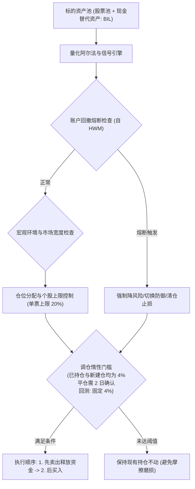
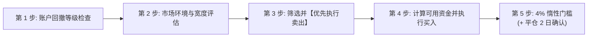

# Chan Four-State Operational Machine Strategy: 实盘交易操作规程与规则手册

> **策略标识**: `chan_four_state_execution` (`ChanFourStateExecutionStrategy`)  
> **交易标的**: 股票 / ETF 股票池 + 现金管理替代资产 (`BIL` / `511880` / `511990` / 国债逆回购)  
> **调仓频率**: 日频评估与决策，实盘下单主要集中在 **14:00 – 14:50** (避开早盘集合竞价剧烈波动及尾盘收盘集合竞价冲击)。  
> **底层因子**: `regime_trend_strength`, `absolute_momentum_trend`, `mean_reversion`

---

## 1. 策略架构与模型体系

**Chan Four-State Operational Machine Strategy** 是一套严谨的量化实盘投资策略，旨在通过结构化信号与风险控制实现可持续收益。

### 策略简介
Industrial-grade Chan execution strategy implementing the 4-state operational machine (BUY_CANDIDATE, HOLD, HOLD_ALERT, SELL_EXIT, WAIT_OBSERVE) with deterministic structural invalidation stops (1B bar low, 2B dd low, 3B zg pivot high), ratcheting trailing stop to ZG, moving average entanglement filter, and Lesson 16 zero-consolidation drag.

---

## 2. 实盘交易员日内标准作业程序 (SOP)

实盘交易员在每个交易日下午 **14:00 – 14:50** 严格按照以下五个先后次序执行检查与下单：

---

## 3. 详细交易逻辑与分步规则

### 第 1 步: 账户级回撤熔断检查 (强制首要执行)
每日 14:00 计算当前资产净值相对于历史最高净值 (High-Water Mark) 的回撤比例：
$$\text{回撤幅度 (Drawdown)} = \frac{\text{当前净值} - \text{历史峰值净值}}{\text{历史峰值净值}}$$

* **IF 回撤 < 10% (正常运作区间)**:
  * 进入第 2 步，享有完整风险预算。单个股票仓位上限为 **20%**。
* **IF 10% <= 回撤 < 15% (一级熔断: 平滑线性阻尼)**:
  * **操作**: 每只标的按 $\text{scale} = 1 - (\text{回撤} - 10\%)/10\%$ 同比例缩放 —— 即**回撤 10% 时不减、15% 时恰好减半、20% 时减至 0**（阻尼在整个 10%–20% 区间连续生效，并非离散砍半）。释放出的资金转入现金管理资产 (`BIL`)。
  * 代码中确实存在"直接砍半 (乘 0.5)"的离散分支 (`pipeline/research/blend/blend_base.py:1075-1081`)，但**不是**当前部署配置：六个 blend 策略均设置 `smooth_drawdown: true`。实盘使用同一连续公式 (`scripts/check_live_portfolio_health.py:380,384`)。
* **IF 15% <= 回撤 < 20% (二级熔断: 战术防御切换)**:
  * **操作**: 清退所有常规进攻仓位。
  * 仓位**100% 切换至防御模式**：保留至少 70% 现金管理资产，最多仅允许 30% 配置于最强防御标的。
* **IF 回撤 >= 20% (三级熔断: 极端硬止损空仓)**:
  * **操作**: **100% 全面清仓所有风险资产，全部移至现金替代品**。
  * **冷却锁定期**: **连续 21 个交易日绝对禁止开仓**。第 22 个交易日将峰值基准重置为当前净值，方可重新开始评估买入。

---

### 第 2 步: 市场环境与宽度评估
* **IF 市场环境处于多头/适宜状态**:
  * 按照模型信号正常开仓，充分利用多头风险预算。
* **ELSE (市场弱势或震荡不明确)**:
  * 严格遵守单票 **20%** 硬顶限制。
  * 剩余未用资金一律留在现金管理资产中。

---

### 第 3 步: 资产级卖出与止损规则 (必须【先卖后买】)
**必须先执行卖出订单，待可用资金到账后，再行分配买入，严禁盲目加仓拉高杠杆。**

若持仓标的触发以下**任意一项**条件，该股票目标仓位直接降为 **0.0% (清仓)**：
1. **模型结构卖点**: 缠论标准卖点（一卖/二卖/三卖，或第 92-99 课中枢逆势破坏状态）。
2. **确定性结构失效止损 (缠论 Table 3 规则)**:
   * **三买突破单 (3B)**: 收盘跌破中枢高点容差线 $ZG \times (1 - 1\%)$。重新跌回中枢即判定突破证伪，立即离场。
   * **二买回踩单 (2B)**: 盘中或收盘跌破前期笔回踩低点 $DD$。
   * **一买背驰单 (1B)**: 跌破一买分型柱最低价，判定背驰延续，立即止损。
3. **第 16 课“中小资金拒绝盘整”规则 (资金效率最大化)**:
   * **一买/二买 5 日孕育期保护 (`chan_fse_min_hold_bars = 5`)**: 一买底背驰与二买次低点天生发生在中枢下方或内部。开仓前 5 个交易日赋予结构发展孕育期，绝不在第 1 天因处于中枢内而被秒踢（硬止损与结构底止损全程生效）。
   * **中枢停滞超时平仓 (`chan_fse_cons_timeout_bars = 8`)**: 持仓满 5 日后，若价格在中枢区间内 ($ZD \le P \le ZG$) 持续停滞达 **8 个交易日** 且向上动能熄火（笔方向 $\le 0$），**立即主动平仓**，绝不参与多周横盘垃圾时间。若当前笔向上动能旺盛（笔方向 $+1$），则继续持有等待向上脱离。
4. **棘轮上移移动止损**: 只要价格在中枢上方运行 ($P > ZG$)，止损线自动机械上移锁定至 $ZG \times 0.99$，刚性锁死突破利润。
5. **个股硬止损**: 任意单只标的跌幅达到或超过成本价的 **-8%** -> **市价立即止损出局**。
6. **时间止损**: 买入后持有达 **90 个交易日** 仍未走出有效上涨 -> 主动平仓释放沉淀资金。

---

### 第 4 步: 资产级买入与四态操作机运行准则
1. **四态有限状态机 (FSM) 操作准则**:
   * **BUY_CANDIDATE (买入候选)**: 确认一买 (底背驰)、二买 (次低点回抽) 或三买 (中枢突破回踩) 时触发。
     * 三买突破必须通过均线多头排列过滤 ($MA5 \ge MA20$)，杜绝假突破。
   * **HOLD (持股)**: 价格运行在中枢上方 ($P > ZG$) 且当前笔向上 ($+1$)。保持持仓，跟踪止损锁死在 $ZG \times 0.99$。
   * **HOLD_ALERT (持股警惕)**: 价格虽在 $ZG$ 上方，但当前笔转为向下 (次级别回调) 或均线进入缠绕纠缠 ($|MA5 - MA20| / P < 2\%$，第 11-14 课“吻”)。止损线瞬间紧锁于 $ZG \times 0.99$。
   * **WAIT_OBSERVE (空仓观察 - 第 16 课中小资金法)**: 价格在中枢内部或下方且无新买点 -> 仓位强制为 0.0%，资金 100% 归集至现金品 (`BIL`)，严拒盘整消耗。
2. **单票限额**: 任意单只标的总持仓市值不得超过账户总资金的 **20%**。
3. **资金归集**: 剩余未配置资金 100% 自动划入现金品 (`BIL`)。

---

### 第 5 步: 调仓惰性 — 三条实盘规则 (与回测规则不同)

对每只标的，在 14:00 计算带符号的权重变动：
$$\Delta W = W_{\text{目标}} - W_{\text{当前}}$$

本策略的惰性参数是 `chan_fse_min_weight_change = 0.04`，**没有独立的建仓门槛**——全新仓位同样继承 4%。按标的所处情形，套用**第一个**命中的规则：

| # | 适用情形 | 实盘规则 (交易员实际执行) | 回测规则 (模型当年的行为，与实盘不同) |
| :--- | :--- | :--- | :--- |
| **1** | 该标的**已有持仓**，模型目标权重发生变化 | 要求 $\lvert\Delta W\rvert \ge \mathbf{4\%}$。未达则**不交易**；指令单打印 `HOLD`，原因 "调仓未超惰性阈值 (< 4%)"。门槛每日重算。 | 逐资产**固定 4%** (`apply_asset_inertia(min_weight_change = 0.04)`，不做波动率缩放)。随后回测器层再套一次同样的 4% —— **但仅对已持仓标的生效**。 |
| **2** | 该标的**当前无持仓** (0% -> 新建仓) | 要求**目标权重 $\ge \mathbf{4\%}$** (本策略不存在 `entry_threshold` 覆盖参数，故建仓门槛等于减仓门槛)。低于 4% 则**不开仓**；指令单打印 `HOLD_FILTERED`，原因 "目标仓位未达最低建仓/调仓门槛 (… 防微量试错损耗)"。 | 回测器层的 4% 门槛**不适用于新建仓** (未持仓标的豁免)，但模板层惰性过滤对建仓仍按 4% 拦截——因此本策略在建仓数值上实盘与回测一致。 |
| **3** | 模型对已持仓标的给出 **0.0%** (全额清仓) | 清仓**豁免** 4% 门槛，但必须**连续 2 个评估日持续成立** (`guard_latency_bars = 2`)。第 1 日打印 `PENDING_EXIT` / `HOLD_FILTERED`，原因 "平仓信号进入确认期 (第 1/2 日待确认)"。**这是与回测的主要差异**——单日脉冲不得卖出。 | 调仓行携带 0.0% 的当日即成交，没有持续性要求。 |
| **4** | 个股硬止损 (自成本 $-8\%$)、结构失效、ATR 跟踪止损或**三级**熔断 | **立即 100% 卖出** (见第 3 步)。这类指令是"全额清仓"，故所有惰性门槛与 2 日平仓确认都被彻底绕过——根本不读取阈值，因此不存在所谓 "0.1% 底线"。买入方向永远不享有该豁免。 | 当日该标的的应急掩码绕过惰性过滤。 |

* **已验证：熔断的减仓本身也要过惰性门槛，且按标的逐只判定，常被拒绝。** 减仓是**逐只标的**施加的：每个已持仓标的的权重都乘以同一个 `scale` 系数，余量归集到现金替代品 (`scripts/run_live_strategy.py:1766`; `pipeline/research/blend/blend_base.py:1069-1071`)。因此每只标的都是一次**独立的减仓，各自受自己的门槛约束** —— 回撤 15% 时系数为 0.5，6% 的仓位被砍到 3%，实际变动 3 个百分点，低于 4% 门槛，**当日被拒绝**；指令单动作显示 `HOLD`，原因 "调仓未超惰性阈值 (< 4%)"。50% 的减仓只有在**持仓占净值 $\ge 8\%$** 时才能过门槛。**实盘与回测两条路径都是如此**：实盘没有任何"风控减仓豁免"（`is_stop` 快通道只会清到 0.0，且仅限硬止损 / `is_emergency_halt`，`common/position_lifecycle.py:363-420`；`is_emergency_halt` 只有三级熔断才成立，`scripts/run_live_strategy.py:1927`），回测的惰性过滤同样会吞掉这笔减仓，除非当日资产级应急掩码被打开。只有规则 3/4 的全额清仓/止损路径才不受仓位大小限制。
* **两条路径在回撤 ∈ (17%, 20%) 区间还会分叉**：回测在 `scale_dd < 0.30` 即回撤 > 17% 时就打开豁免 (`pipeline/research/blend/blend_base.py:1072` → `is_global_emergency`，`common/allocation_templates.py:233-251`)，而实盘只在回撤 ≥ 20%（三级）才强制清仓。因此回撤落在 17%–20% 之间时，回测已执行减仓，实盘仍在拦截。
* **本文不规定任何"覆盖阈值"。** 遇到一级/二级熔断日，执行前须人工核对熔断档位与工单实际减仓量；被拒的减仓是否由人工补足，属于账户所有者的政策决定，手册不代为设定。

* **本策略没有相对减仓门槛**：未配置 `inertia_relative_ratio`，故减仓门槛就是固定的绝对 4%，不随持仓大小放大。
* **回测同样没有行级门槛**：只要有**任意**一个标的的目标权重发生变化，就会产出一行调仓记录，而该行携带全部标的——因此实盘指令单里的"逐标的静默"在回测的行级别上没有对应物。

> ⚠️ **实盘路径与回测路径在当前实现下是"设计上不同"的两套规则。** 规则 3 的实盘平仓需要连续 2 个确认日，而回测在第一行 0.0% 当日即清仓；规则 2 的实盘建仓门槛是硬拒绝，回测器本身并不施加该拒绝。因此，**同一日期实盘持仓的标的数量可能合法地少于回测，且正在退出的持仓可能多保留一天。** 不得为了让实盘"对齐"回测而放弃规则 2 或抢跑规则 3。

---

## 4. 实盘交易员便携速查表

| 维度 | 核对项目 | 触发条件 | 实盘交易员必须采取的操作 |
| :--- | :--- | :--- | :--- |
| **风控** | **账户总回撤** | >= 20% | **【三级熔断】** 全面清仓至 `BIL`；冷冻 21 天，第 22 天重置净值基准。 |
| **风控** | **账户总回撤** | 10% - 15% | **【一级熔断】** 全部持仓按 $1-(\text{回撤}-10\%)/10\%$ 同比例压缩（10% 不减、15% 减半）；腾出资金划转至现金品。 |
| **状态** | **HOLD (持有)** | $P > ZG$ 且笔方向向上 | **【持股推止损】** 止损线锁定 $ZG \times 0.99$，让利润奔跑。 |
| **状态** | **HOLD_ALERT (警惕)** | 均线纠缠 ($<2\%$) 或笔向下 | **【紧锁止损】** 止损严格盯死 $ZG \times 0.99$。 |
| **卖出** | **三买结构失效** | 收盘跌破 $ZG \times 0.99$ | **【突破被毁】** 突破证伪立即市价清仓。 |
| **卖出** | **二买结构失效** | 跌破前期回踩低点 $DD$ | **【次低点被破】** 形态失败立即清仓。 |
| **卖出** | **一买结构失效** | 跌破一买分型柱最低价 | **【背驰延续】** 抄底失败立即止损出局。 |
| **卖出** | **盘整停滞超时** | 持满 5 日，在中枢停滞 $\ge 8$ 日且笔 $\le 0$ | **【第 16 课清仓】** 拒绝盘整资金损耗，转出现金。 |
| **卖出** | **硬止损** | 单票自成本跌 >= 8% | **【立即离场】** 无论任何形态，市价或积极限价平仓 100%。 |
| **卖出** | **时间止损** | 持仓达 90 交易日停滞 | **【超时平仓】** 获利或微损平仓，释放资金效率。 |
| **买入** | **一买/二买建仓**| 确认底背驰或次低点信号 | **【建仓 (限 20%)】** 享有 5 日结构孕育期保护。 |
| **买入** | **三买突破建仓**| 确认突破回踩且 $MA5 \ge MA20$ | **【建仓 (限 20%)】** 设防守于 $ZG \times 0.99$。 |
| **执行** | **减仓门槛 (已持仓)** | 已持仓标的 $\lvert\Delta W\rvert < 4\%$ | **跳过不发单**，保持原有股数不变。 |
| **执行** | **建仓门槛 (新标的)** | 新仓目标权重 $< 4\%$ | **跳过不发单**：低于 4% 的全新仓位在实盘被拒绝。 |
| **执行** | **平仓确认** | 已持仓标的模型目标 $= 0.0\%$ | **等待 2 日**：信号连续 2 个评估日成立后才卖出。 |
| **执行** | **发单次序** | 涉及多资产同时调仓 | **【先卖出后买入】**：卖单确认成交/资金释放后再挂买单。 |

---

## 5. 实盘执行细节与冲击成本控制

1. **发单时间窗口**:
   * **14:00 – 14:15**: 汇总全天数据，计算当日回撤与市场环境。
   * **14:20 – 14:45**: 发出卖出与买入委托。
   * 严禁在早盘开盘前 30 分钟 (09:30–10:00) 追涨杀跌。
2. **订单执行类型**:
   * 高流动性标的 (大盘宽基 ETF、高成交股票): 挂买一/卖一限价单，或分批 15 分钟 TWAP 下单。
   * 紧急止损单或三级熔断平仓: 采用市价或最优五档即时成交剩余撤销单，确保绝对离场。
3. **现金替代品归集**:
   * 未买入股票的闲置资金切勿闲置在 0 利率现金账户中，应配置于 `BIL` / 货币 ETF / 逆回购获取稳健无风险收益。
