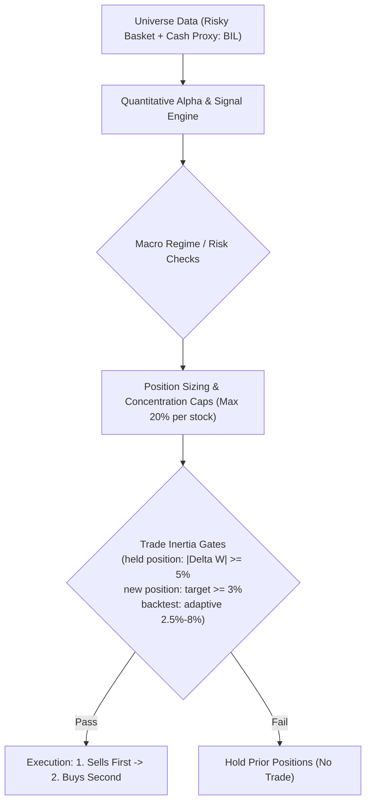
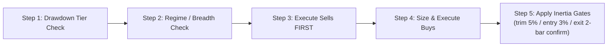

# Chan Risk-Managed Blend Strategy: Live Trading Operating Manual & Rulebook

> **Strategy Identifier**: `chan_risk_managed_blend` (`ChanRiskManagedBlendStrategy`)  
> **Instrument Context**: Equity / ETF Universe + Cash Proxy (`BIL`)  
> **Trading Frequency**: Daily rebalance evaluation, executing between **14:00 – 14:50** (to avoid open auction volatility and end-of-day market-on-close distortions).  
> **Underlying Factors**: `regime_trend_strength`, `absolute_momentum_trend`, `relative_momentum`, `volatility_targeting`

---

## 1. Strategy Identity & Architecture Overview

**Chan Risk-Managed Blend Strategy** is a quantitative trading strategy designed for disciplined portfolio execution.

### Strategy Description
Walkforward-optimized institutional ensemble blending the top 3 Chan strategies (chan_three_type 45%, chan_vaa_compound 35%, chan_composite 20%) with institutional risk controls: 20% single-stock cap, multi-level drawdown circuit breakers with 15-bar auto-healing cooldown and fast-recovery override, 5% turnover filter, 30% breadth bull threshold, and pre-emptive breadth thrust cash deployment.

---

## 2. Daily Live Trading Routine (Operational Checklist)

A human trader must follow this 5-step daily routine in strict sequential order before placing any trades:

---

## 3. Step-by-Step Decision Logic & Rules

### Step 1: Drawdown Circuit Breaker Check (Portfolio Level)
Calculate your current portfolio High-Water Mark (HWM) and peak-to-trough drawdown at 14:00:
$$\text{Drawdown} = \frac{\text{Current NAV} - \text{Peak NAV}}{\text{Peak NAV}}$$

* **IF Drawdown < 10% (Normal Regime)**:
  * Proceed to Step 2 with full risk budget. Standard single-stock cap = **20%**.
* **IF 10% <= Drawdown < 15% (Tier 1: Smooth Linear Damping)**:
  * **Action**: scale every position by $\text{scale} = 1 - (\text{Drawdown} - 10\%)/10\%$ — **0% reduction at DD = 10%, exactly 50% at DD = 15%, 100% at DD = 20%** (the damping is continuous across the whole 10%–20% band, not a discrete halving). Released capital goes to the Cash Proxy (`BIL`).
  * The discrete "cut by 50% (× 0.5)" branch exists in code (`pipeline/research/blend/blend_base.py:1075-1081`) but is **not** the deployed configuration: all six blends set `smooth_drawdown: true`. Live applies the same continuous formula (`scripts/check_live_portfolio_health.py:380,384`).
* **IF 15% <= Drawdown < 20% (Tier 2: Tactical Defense)**:
  * **Action**: Liquidate discretionary offensive positions.
  * Switch into defensive mode: Hold 70% in Cash Proxy, and up to 30% only in leading defensive assets.
* **IF Drawdown >= 20% (Tier 3: Hard Stop / Emergency Halt)**:
  * **Action**: **Liquidate 100% of all risk assets into Cash Proxy immediately**.
  * **Lockout**: **Do not buy for 21 consecutive trading days**. On Day 22, reset HWM to current NAV to allow fresh cycle re-entry.

---

### Step 2: Regime & Market Breadth Check
* **IF Market Regime is Favorable**:
  * Allocate up to target equity exposure according to model conviction.
  * Dynamically deploy cash into top qualifying assets without exceeding position caps.
* **ELSE (Market Regime is Bearish or Indeterminate)**:
  * Enforce standard hard cap of **20%** per stock.
  * Retain remaining capital in Cash Proxy (`BIL`).

---

### Step 3: Asset-Level Sell Rules (Execute Sells FIRST)
Always execute sell orders before buy orders to guarantee purchasing power and avoid margin strain.

Liquidate an asset down to **0.0%** if **ANY** of the following conditions trigger:
1. **Model Sell Signal**: Formal exit or sell signal printed by the strategy engine.
2. **Structural Invalidation**: Price action invalidates the setup or breaks key support.
3. **Hard Stop-Loss**: Asset drops **>= 8%** below entry price -> **Market exit immediately**.
4. **Time Stop**: Position held for **>= 90 trading days** without upward follow-through -> Close position and release capital.

---

### Step 4: Asset-Level Buy Rules (Position Sizing)
1. **Entry Confirmation**: Only buy when entry signals are confirmed at the 14:00 evaluation.
2. **Tranche Pyramiding**: Scale into positions progressively (e.g. 30% initial base tranche, 40% confirmation tranche, 30% breakout tranche) rather than buying 100% upfront.
3. **Single-Stock Cap**: Never allocate more than **20%** of total portfolio NAV to any single ticker.

---

### Step 5: Trade Inertia — Three Live Rules (and a Different Backtest Rule Set)

For every asset, compute the signed weight change at 14:00:
$$\Delta W = W_{\text{target}} - W_{\text{current}}$$

This strategy carries **one inertia parameter** (`crb_min_weight_change = 0.05`) **plus a separate, looser entry gate** (`crb_entry_threshold = 0.03`). They are not the same threshold and they do not point the same way. Apply the **first** rule below that matches the asset's situation:

| # | Situation | Live rule — what you actually do | Backtest rule — what the model did (different by design) |
| :--- | :--- | :--- | :--- |
| **1** | You **already hold** the asset and the target weight moved | Require $\lvert\Delta W\rvert \ge \mathbf{5\%}$. Below that, **do not trade**; the ticket prints `HOLD` with reason "调仓未超惰性阈值 (< 5%)". Re-evaluated every day — the blocked trim keeps re-appearing until it clears 5%. | Per-asset threshold is **adaptive, 2.5% – 8%**: $\mathrm{clip}\big(\tfrac{\sigma^{21d}_{\text{asset}}}{\sigma^{21d}_{\text{universe}}} \times 5\%,\ 2.5\%,\ 8\%\big)$. A second, backtester-level gate then applies the plain 5% — **but only to assets already held**. |
| **2** | You hold **nothing** in the asset (0% → new position) | Require **target weight $\ge \mathbf{3\%}$** (`crb_entry_threshold = 0.03`), which is **looser** than rule 1. Below 3%, **do not open**; the ticket prints `HOLD_FILTERED` with reason "目标仓位未达最低建仓/调仓门槛 (目标 x.x% < 门槛 3%，防微量试错损耗)". A brand-new 2.9% line is refused. | The backtester's 5% gate **does not apply to new positions** (assets not already held are exempt). The template-level inertia filter still gates entries, but only at $\min(\text{adaptive threshold},\ 3\%)$, i.e. **2.5% – 3%**. |
| **3** | The model wants **0.0%** on an asset you hold (full exit) | The exit is **exempt** from the 5% threshold, but must **persist 2 consecutive evaluation days** (`guard_latency_bars = 2`). Day 1 of a fresh exit signal prints `PENDING_EXIT` / `HOLD_FILTERED` with reason "平仓信号进入确认期 (第 1/2 日待确认)". Do **not** sell on a single-day pulse. | Exits the same day the rebalance row carries 0.0% — no persistence requirement. |
| **4** | Hard stop ($-8\%$ from entry), ATR trailing stop, or a **Tier-3** emergency halt | **Sell 100% immediately** (Step 3). These are full liquidations, so every inertia gate and the 2-day exit confirmation are bypassed outright — the threshold is not consulted, so there is no residual "0.1% floor" to honour. Buys are never granted this bypass. | The per-symbol `asset_emergency_df` mask bypasses the inertia filter for that asset and bar. |

* **VERIFIED — the damping cut is itself gated, per asset, and is routinely refused.** The cut is applied **per asset**: every held name's weight is multiplied by the same `scale` factor, with the remainder swept into the cash proxy (`scripts/run_live_strategy.py:1766`; `pipeline/research/blend/blend_base.py:1069-1071`). Each name is therefore an **independent trim subject to its own threshold** — at DD = 15% the factor is 0.5, so a 6% position is cut to 3%, a 3pp change against the 5% gate, and is **refused that day**; the ticket shows `HOLD` with reason "调仓未超惰性阈值 (< 5%)". A 50% cut clears the gate only once the position is **≥ 10% of NAV**. This happens in **both paths**: live grants no risk-reduction exemption (the `is_stop` fast path only ever liquidates to 0.0 and only for stop-loss / `is_emergency_halt`, `common/position_lifecycle.py:363-420`; `is_emergency_halt` is Tier-3-only, `scripts/run_live_strategy.py:1927`), and the backtest's inertia filter swallows the same trim unless the asset-emergency bypass is on. Only the full-exit/stop paths in rule 3/4 liquidate regardless of size.
* **The two paths also diverge in DD ∈ (17%, 20%)**: the backtest opens its bypass at `scale_dd < 0.30`, i.e. DD > 17% (`pipeline/research/blend/blend_base.py:1072` → `is_global_emergency`, `common/allocation_templates.py:233-251`), while live only force-liquidates at DD ≥ 20% (Tier 3). Between 17% and 20% the backtest applies the cut and live keeps blocking it.
* **No override number is prescribed here.** On a Tier-1/2 day, reconcile the breaker tier against the reduction actually printed on the ticket before acting; whether to top a refused cut up manually is an account-owner policy decision, not a rule this manual can invent.

* **No relative trim hurdle for this strategy**: `inertia_relative_ratio` is not set for `chan_risk_managed_blend`, so the trim gate is the plain absolute 5% and never scales with the size of the position.
* **No row-level gate in the backtest either**: a rebalance row is emitted whenever *any* symbol's target moved; that row carries every symbol, so per-symbol inertness inside a live ticket has no backtest counterpart at row level.

> ⚠️ **The live path and the backtest path differ by design, as currently implemented.** Rule 2 refuses brand-new positions that the backtest would accept (at 2.5% – 3%), and rule 1 gates trims at a fixed 5% where the backtest uses an adaptive 2.5% – 8%. Consequently, **live holdings may legitimately contain fewer names — and show smaller trims — than the backtest for the same date.** Do not reconcile the difference by waiving rule 2 or by sizing to the backtest's name count.

---

## 4. Human Trader Quick-Reference Card

| Check | Item | Condition | Human Trader Action |
| :--- | :--- | :--- | :--- |
| **Risk** | **HWM Drawdown** | >= 20% | **STOP ALL TRADING**: Liquidate 100% to `BIL`. Freeze 21 days (HWM resets Day 22). |
| **Risk** | **HWM Drawdown** | 15% - 20% | **DEFENSIVE SHIFT**: Route 100% to defensive mode (70% cash proxy buffer). |
| **Risk** | **HWM Drawdown** | 10% - 15% | **DAMP RISK**: Scale all equity weights by $1 - (\text{DD}-10\%)/10\%$ (0% cut at 10%, 50% at 15%); sweep released capital to cash. |
| **Regime** | **Regime Gate** | Bullish | **NORMAL / EXPANDED**: Target full model exposure up to caps. |
| **Regime** | **Regime Gate** | Bearish / Neutral | **CONSERVATIVE**: Keep single-stock cap at 20%; hold cash buffer. |
| **Exit** | **Stop-Loss** | Loss >= 8% from entry | **EXIT IMMEDIATELY**: Sell 100% of position. |
| **Exit** | **Time Stop** | Held >= 90 days no progress | **EXIT**: Close position to release capital. |
| **Exit** | **Signal Exit** | Model Sell / S-point | **EXIT**: Sell position to 0.0%. |
| **Entry** | **Signal Buy** | Valid Model Buy Signal | **SCALE IN**: Buy tranche up to single-stock cap (20%). |
| **Execution**| **Trim Gate (held)** | Already-held asset, $\lvert\Delta W\rvert < 5\%$ | **SKIP**: Do not place the trim/exit order; keep prior shares. |
| **Execution**| **Entry Gate (new)** | New position target weight $< 3\%$ | **SKIP**: Do not open the position; a sub-3% new line is refused live. |
| **Execution**| **Exit Confirmation** | Model target $= 0.0\%$ on a held asset | **WAIT 2 DAYS**: Sell only after the exit signal persists 2 consecutive evaluations. |
| **Execution**| **Sequence** | Multi-asset rebalance | **SELLS FIRST** (free up cash) -> **BUYS SECOND**. |

---

## 5. Execution Nuances & Slippage Management

1. **Execution Window**: 
   * Evaluate data at **14:00**.
   * Transmit orders between **14:20 – 14:45**. 
   * Avoid trading in the first 30 minutes of the market open (09:30–10:00).
2. **Order Style**:
   * For standard liquid equities/ETFs: Use **limit orders pegged to current bid/ask** or TWAP slices over 15 minutes.
   * For emergency stop-losses or circuit breakers: Use **market or aggressive limit orders** to guarantee fills.
3. **Cash Proxy Management**:
   * Unallocated capital must be held in interest-bearing cash equivalents (`BIL`).
