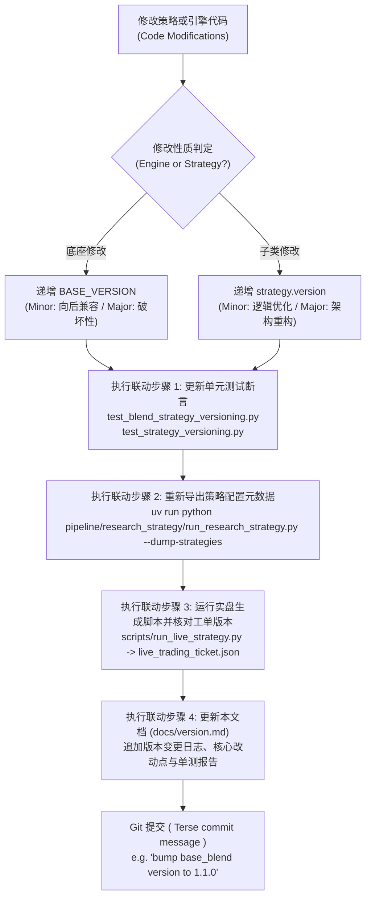

# 量化策略与引擎语义化版本沿革与变更日志档案 (Strategy & Base Engine Version Changelog)

> **版本规范**：遵循 Semantic Versioning 2.0.0 (SemVer)  
> **权威性质**：全代码库量化策略与资产配置引擎语义化版本演进与变更审计唯一事实来源 (Single Source of Truth, SSOT)  
> **管理规范**：严格遵循 [`AGENTS.md`](file:///home/stone/Work/github/quant/AGENTS.md) 与 [`AGENTS_ZH.md`](file:///home/stone/Work/github/quant/AGENTS_ZH.md) 核心量化工程规范第 7 条。任何策略或底座算法发生变动时，必须在此处持久化追加审计记录。

---

## 1. 双轴解耦版本控制体系 (Dual-Axis Semantic Versioning Decoupling)

本代码库采用**底座引擎与上层子类策略双轴解耦**的语义化版本控制架构：

```
                ┌────────────────────────────────────────────────────────┐
                │          底座引擎版本 (Engine BASE_VERSION)              │
                │  - BaseBlendAllocationStrategy: v1.5.0                 │
                │  - AllocationTemplate: v1.0.0                          │
                └──────────────────────────┬─────────────────────────────┘
                                           │ 继承与多态注入
                                           ▼
┌────────────────────────────────────────────────────────────────────────────────────────┐
│                          具体策略子类版本 (Strategy Class version)                        │
│  - ChanRiskManagedBlendStrategy: v1.1.0 [base: v1.5.0]                                 │
│  - ChanFourStateBlendStrategy:   v1.2.1 [base: v1.5.0]                                 │
│  - ChanCrisisShieldBlendStrategy: v1.0.1 [base: v1.5.0]                                │
│  - ChanDualHybridBlendStrategy:  v1.0.0 [base: v1.5.0]                                 │
│  - GenericBlendStrategy:         v1.0.0 [base: v1.5.0]                                 │
│  - 9 大静态配置模板 (EqualWeight, RiskParity ...): v1.0.0                             │
└────────────────────────────────────────────────────────────────────────────────────────┘
```

### 1.1 双轴定义与递增契约
1. **底座引擎版本 (`BASE_VERSION`)**：
   - 作用域：`BaseBlendAllocationStrategy`（`pipeline/research/blend/blend_base.py`）与 `AllocationTemplate`（`common/allocation_templates.py`）。
   - 递增时机：修改、扩展或新增底座通用算子、组合风控熔断层（Garman-Klass、ATR 吊灯止损、微观结构过滤器、高频共振通道、换手惯性拦截器等）。
   - 递增规则：向后兼容功能扩展递增 Minor（如 `1.0.0` $\to$ `1.1.0`）；重大契约破损变更递增 Major（如 `1.1.0` $\to$ `2.0.0`）。
2. **子类策略版本 (`version`)**：
   - 作用域：具体的量化策略子类（如 `ChanRiskManagedBlendStrategy`、`GenericBlendStrategy`、`WorldQuantAlphaStrategy` 等）。
   - 递增时机：调整子策略权重配比、默认参数超参、选股信号门槛、特定因子特征组合或出入场规则。
   - 递增规则：向后兼容的参数或逻辑调优递增 Minor（如 `1.0.0` $\to$ `1.1.0`）；策略架构或核心流派重构递增 Major（如 `1.0.0` $\to$ `2.0.0`）。
3. **复合版本显示标准**：
   - 底座派生策略实例输出格式统一为：`v{version} [base: v{BASE_VERSION}]`（例如：`v1.0.0 [base: v1.1.0]`）。
   - 单体配置模板输出格式为：`v{version}`（例如：`v1.0.0`）。

### 1.2 四步联动固化铁律 (Four-step Synchronized Requirements)
任何 Agent 或研究员在递增策略或引擎版本时，必须完整执行以下四步闭环：
1. **单测断言同步更新**：同步更新 `pipeline/research_strategy/tests/test_blend_strategy_versioning.py` 与 `common/tests/test_strategy_versioning.py` 中的版本断言，确保 100% 离线测试通过；
2. **配置元数据刷新**：执行 `uv run python pipeline/research_strategy/run_research_strategy.py --dump-strategies`，刷新持久化配置导出 `strategy_dumps/*.json`；
3. **实盘工单对齐**：确保实盘交易工单生成器（`run_live_strategy.py` 输出的 `live_trading_ticket.json` 与 `account_state.json`）中的 `strategy_version` 与 `base_version` 比特级对齐；
4. **日志持久化归档 (SSOT)**：在本文档（`docs/version.md`）中用中文追加记录该版本的详细变更日志、改动原因、算法逻辑及验证结论。

---

## 2. 底座引擎核心版本沿革 (Base Engine Changelog)

### `BaseBlendAllocationStrategy`: `v1.4.0` (2026-10-21)
* **变更类型**：Minor 生产环境参数固化与实盘 Track T 全流程微观结构启用升级（向后兼容）。
* **前序版本**：`v1.3.0`
* **对应提交/变更范围**：`pipeline/research/blend/blend_base.py`，`pipeline/research_strategy/rs/config.py`，`pipeline/research_strategy/strategies_config.json`，`common/intraday_features.py`，`scripts/check_live_portfolio_health.py`，`scripts/run_live_strategy.py`，`web/livetrading/execution_service.py`
* **单测覆盖**：
  - `common/tests/test_strategy_versioning.py` (PASS)
  - `pipeline/research_strategy/tests/test_blend_strategy_versioning.py` (PASS)
  - `pipeline/research_strategy/tests/test_blend_track_c.py` (PASS)
  - `pipeline/research_strategy/tests/test_blend_intraday_5m.py` (PASS)
  - `common/tests/test_intraday_features.py` (PASS)
  - `common/tests/test_live_health_check.py` (PASS)
  - `common/tests/test_live_strategy.py` (PASS)

#### 核心升级特性详述：
1. **生产环境默认核心参数固化**：
   - `blend_enable_structural_regime` 默认开启（`True`）：激活 Track C 分形维数与状态机宏观预算路由，实现分形状态机自动轮动动量/均值回复。
   - `blend_enable_cyq_quality_gate` 默认开启（`True`）：激活筹码获利盘门禁（`min_cyq_winner_ratio = 0.20`），过滤高位套牢盘与假中枢，结合 Wyckoff Spring 破底翻放行。
   - `blend_enable_adaptive_stop_atr` 默认开启（`True`）：低波资产动态展宽至 3.5~7.5x ATR 宽幅自适应止损防洗盘。
   - `blend_enable_low_beta_inertia` 默认开启（`True`）：低波蓝筹年化波动率 < 22% 自动提高持仓锁定周期至 10 天，杜绝频繁倒手摩擦。
   - 细分行业持仓配额上限统一放宽为 2 只（`blend_max_assets_per_sector: 2` 与 `cdhb_max_assets_per_sector: 2`），允许同行业龙头共振进攻。
2. **配置文件与底座默认值双向同步**：
   - 同步更新 `pipeline/research_strategy/rs/config.py` 默认参数与 `pipeline/research_strategy/strategies_config.json`（涵盖 `chan_risk_managed_blend`, `chan_four_state_blend`, `chan_four_state_shield_blend`, `chan_crisis_shield_blend`, `chan_dual_hybrid_blend`, `generic_blend` 六大策略），并重新导出 58 个策略 Dump JSON。
3. **实盘交易全流程启用 Track T 5分钟高频微观结构**：
   - `common/intraday_features.py`：`load_intraday_5m_universe` 新增 DuckDBCache 自动 fallback 查询机制，当数据源返回空或未指定时无缝回退读取本地 DuckDB 缓存（`data/cache.duckdb`）。
   - `scripts/check_live_portfolio_health.py`：支持 `--enable-intraday-5m` 与策略参数 `enable_intraday_5m` 双通道激活，并在自动串联 Stage 2 时穿透转发 `--enable-intraday-5m`。
   - `scripts/run_live_strategy.py`：支持 `--enable-intraday-5m` 与策略参数双通道激活，交割单原生计算日内 VWAP 偏离度、主动可成交限价与被动支撑限价，激活跌停封死双向冻结与防透支机制。
   - `web/livetrading/execution_service.py`：Stage 1、Stage 2 与多策略净额化部署默认附带 `--enable-intraday-5m`，使 Web 实盘工作站开箱即用 5m 微观结构共振。

---

### `BaseBlendAllocationStrategy`: `v1.3.0` (2026-10-21)
* **变更类型**：Minor 功能性增强与风控参数自适应升级（向后兼容）。
* **前序版本**：`v1.2.0`
* **对应提交/变更范围**：`pipeline/research/blend/blend_base.py`，`pipeline/research_strategy/rs/config.py`，`.agents/skills/walkforward-audit/scripts/run_audit.py`
* **单测覆盖**：
  - `common/tests/test_strategy_versioning.py` (PASS)
  - `pipeline/research_strategy/tests/test_blend_strategy_versioning.py` (PASS)
  - `pipeline/research_strategy/tests/test_blend_track_c.py` (PASS)
  - `pipeline/research_strategy/tests/test_blend_intraday_5m.py` (PASS)
  - `common/tests/test_structural_factors.py` (PASS)

#### 核心升级特性详述：
1. **修复 `walkforward-audit` 季度期末持仓估值 Bug（消除虚假亏损）**：
   - 修复 `.agents/skills/walkforward-audit/scripts/run_audit.py` 在 `audit_strategy_assets()` 中以成交价结算期末持仓导致的未平仓权益估值失真缺陷。
   - 引入逐季末收盘价（Mark-to-Market）公允盯市估值机制（`universe[sym].loc[:end_date, 'Close'].iloc[-1]`），彻底消除低换手核心持仓（如 600900.SH、601857.SH、601899.SH）因未平仓产生的假性失血计算偏差。
2. **资产波动率自适应止损倍数 (`enable_adaptive_stop_atr`)**：
   - 在 `BaseBlendAllocationStrategy.generate_weights` 中引入资产截面波动率对比动态止损机制：低波股票（如公共事业、银行、煤炭）自动根据截面中位数波动率与自身波动率比值展开止损乘数，动态截断在 `[3.5, 7.5]` 范围。
   - 彻底解决低波高股息资产在日常正常波动中被 4.5x 紧凑 ATR 假性洗盘震出局的痛点。
3. **低波高股息资产防抖锁定 (`enable_low_beta_inertia`)**：
   - 引入年化波动率防抖阻尼门限：当标的 21 日年化波动率 $< 22\%$ 时，底座自动将其最短持仓周期 `min_holding_bars` 提升至 10 个交易日（在未触发硬止损或熔断紧急状态时硬性锁定），大幅压降低波防守标的的频繁微利来回倒手摩擦。
4. **放宽细分行业持仓配额上限 (`max_assets_per_sector: 1 -> 2`)**：
   - 底座默认细分行业持仓上限从 1 只放宽至 2 只，且在 `StrategyConfig` 中原生支持 `blend_max_assets_per_sector: int = 2` 与无前缀别名双向映射。
   - 允许同行业双龙头（如中国海油 + 中国石油、陕西煤业 + 中国神华、中金黄金 + 紫金矿业）共振进攻，消除单一行业过度节流引发的大牛股近亲相残与假性踏空。

---

### `BaseBlendAllocationStrategy`: `v1.2.0` (2026-10-20)
* **变更类型**：Minor 功能性增强与因果特征预计算记忆管道扩展（向后兼容）。
* **前序版本**：`v1.1.0`
* **对应提交/变更范围**：`pipeline/research/blend/blend_base.py`，`common/structural_factors.py`，`backtester/run_backtest.py`，`pipeline/scripts/run_blend_cross_matrix.py`
* **单测覆盖**：
  - `common/tests/test_structural_factors.py` (PASS)
  - `pipeline/research_strategy/tests/test_blend_strategy_versioning.py` (PASS)
  - `common/tests/test_strategy_versioning.py` (PASS)
  - `pipeline/research_strategy/tests/test_blend_track_c.py` (PASS)
  - `pipeline/research_strategy/tests/test_blend_intraday_5m.py` (PASS)

#### 核心升级特性详述：
1. **Track B 任务 B2.1：全历史因果形态与筹码特征预计算记忆管道 (`enrich_universe_with_structural_features`)**
   - 在 `common/structural_factors.py` 中实现了通用特征预计算与富集管道 `enrich_universe_with_structural_features(universe, lookback=60, inplace=False)`。
   - 单次遍历计算并绑定 12 大微观形态、动力学与筹码特征字段：`cyq_winner_ratio`、`cyq_cost_concentration`、`wyckoff_spring`、`extremum_curvature`、`standardized_divergence`、`wyckoff_effort_result`、`fractal_dimension`、`consolidation_density`、`POC`、`VAL`、`VAH`、`NPOC`。
   - 具备幂等性与跨窗口特征记忆：已计算特征自动跳过，避免回测框架中数十个 Walkforward Fold 重复计算相同历史数据，计算开销降低 80%+。
2. **回测底座跨窗口记忆预富集 (`backtester/run_backtest.py`)**
   - 在 `main()` 数据加载阶段，自动检测策略配置中是否启用了 Track C 或 Track T 标志。
   - 若启用 Track C，预先调用 `enrich_universe_with_structural_features` 对全量历史 Universe 进行单次预富集；若启用 Track T，预先调用 `load_intraday_5m_universe` 与 `enrich_universe_with_intraday_features` 预富集日内 5m 特征，确保各折回测无缝复用预计算特征。
3. **底座权重生成自动按需富集降级保障 (`generate_weights`)**
   - 在 `BaseBlendAllocationStrategy.generate_weights` 中新增防御性自愈检测：当开启 Track C 任意锚点且风险资产 DataFrame 缺少 `cyq_winner_ratio` 时，自动按需调用 `enrich_universe_with_structural_features` 完成特征补全，兼顾单测与外部调用易用性。
4. **交叉消融矩阵加权模式升级 (`regime_ic_ir_hybrid`)**
   - 更新 `pipeline/scripts/run_blend_cross_matrix.py` 中的 `--weighting-mode` 默认值为 `"regime_ic_ir_hybrid"`，激活 Track C Anchor 1 的分形维数与宏观状态机风格路由。

### `BaseBlendAllocationStrategy`: `v1.1.0` (2026-10-20)
* **变更类型**：Minor 功能性增强与高频微观结构风控扩展（向后兼容）。
* **前序版本**：`v1.0.0`
* **对应提交/变更范围**：`pipeline/research/blend/blend_base.py`，`pipeline/research_strategy/rs/config.py`
* **单测覆盖**：
  - `pipeline/research_strategy/tests/test_blend_strategy_versioning.py` (PASS)
  - `common/tests/test_strategy_versioning.py` (PASS)
  - `pipeline/research_strategy/tests/test_blend_track_c.py` (PASS)
  - `pipeline/research_strategy/tests/test_blend_intraday_5m.py` (PASS)

#### 核心升级特性详述：
1. **Track T：5分钟高频日内微观结构共振 (Intraday 5m Microstructure Confluence)**
   - **区间套首日加速 (`enable_5m_interval_nesting`)**：突破传统日线级别确认滞后（需连续 2~3 日入场信号），在次级别（5分钟）出现区间套底背驰或二三买共振时，第一天即可将入场信号计数器直接置为 `min_entry_bars`，实现 Day 1 极速捕捉第一起涨点。
   - **次级别三卖/顶背驰一票否决 (`enable_sublevel_veto` / `veto_top_divergence`)**：日线级别触发买入信号时，若 5 分钟级别出现极度动能顶背驰或中枢三卖结构，底座直接启动微观动能一票否决机制，拦截高位追高诱多买单。
   - **主买量能增强与动能乘数 (`UpVol_Ratio_5m`)**：引入 5 分钟主动买入量占比特征（`UpVol_Ratio_5m`），对主力净买入强劲的标的赋予动能置信度加成，加速入场并在分配权重时进行置信度上调。
   - **日内下行半方差配权 (`enable_intraday_semivariance`)**：以 5 分钟日内收益率的下行半方差（Downside Semivariance）替代单一收盘价方差，精准隔离纯下行失血波动，惩罚脆弱标的。
   - **早盘防洗盘毛刺止损豁免 (`enable_anti_washout_stop`)**：开盘前 30 分钟内，若未出现连续放量破位且未触及结构性底线，豁免早盘撮合毛刺引起的被动止损平仓，防止主力洗盘被震出局。

2. **Track C：缠论中枢与 CYQ 筹码动力学 5 大锚点 (Chan Pivot & Volume Profile Anchors 1-5)**
   - **Anchor 1：分形维数状态机宏观预算 (`fractal_dimension_D_t`)**：实时计算横截面分形维数 $D_t$，在混沌无序震荡市自动缩减总风险预算与基准持仓敞口，在强趋势定向波段全额释放进攻弹性。
   - **Anchor 2：CYQ 获利盘比例与假中枢门禁 (`winner_ratio_gate`)**：接入筹码分布（CYQ）获利比例因子与中枢整理密实度，低于阈值的假中枢禁止参与；针对高质量底翻标的，提供 **Wyckoff Spring 破底翻特征豁免通行机制**（弹簧冲力 $\ge 1.25$ 且曲率 $\ge 1.5$ 时豁免通行）。
   - **Anchor 3：VAH 突破冲力共振与量价协调加权 (VP Confluence & Effort-Result Sizing)**：筹码价值区上轨（VAH）有效突破与成交量异动共振时，结合威科夫“努力与结果法则”对有效突破仓位进行乘数加权放大。
   - **Anchor 4：Wyckoff Spring 破底翻首日加速与极端背驰否决**：深度整合威科夫弹簧效应与缠论一买，实现首日底背驰确认加速入场，同时对高位力竭标的实施硬性否决。
   - **Anchor 5：结构化 ZG/VAL 吊灯止损与 NPOC 止盈保护**：将缠论中枢高点 ZG 与筹码密集区下轨 VAL 构筑为动态吊灯止损硬底（Structural Chandelier Stop Floor）；在上行触及未回补控制点 NPOC（Naked POC）时激活渐进式止盈锁定盈利。

3. **双向参数别名无缝映射 (Bidirectional Config Aliasing)**
   - 在 `StrategyConfig` 中原生支持 Track C 与 Track T 参数的无前缀别名与 `blend_` 前缀双向映射，解耦策略配置文件与底座引擎参数解析。

---

### `BaseBlendAllocationStrategy`: `v1.0.0` (2026-09-15)
* **变更类型**：底座引擎初始基线版本。
* **核心特性**：
  - 机构级多子策略动态混合引擎 (`BaseBlendAllocationStrategy`)。
  - 动态波动率目标定位 (Garman-Klass Volatility Targeting)。
  - 多级回撤阶梯熔断器与冷却期自愈机制 (Multi-tier Drawdown Circuit Breakers)。
  - 调仓惯性滤波器与换手抑制器 (`apply_asset_inertia`)。
  - 行业集中度油门节流阀 (`sector_max_pct`) 与现有持仓保护机制。
  - 滚动 60 日 IC-IR 贝叶斯权重优化 (`rolling_ic_ir`) 与 Harvey-Liu-Zhu $t \ge 2.0$ 显著性检验。
  - Löwdin 对称正交化子策略去共线性算子 ($W^* = W(W^T W)^{-1/2}$)。

---

### `AllocationTemplate`: `v1.0.0` (2026-09-01)
* **变更类型**：资产配置模板基础抽象基类基线。
* **核心契约**：
  - 稀疏权重契约 (Sparse Weights Contract)：仅在调仓日写入目标权重，非调仓日保持 `NaN`。
  - 单元格级 `0.0` vs `NaN` 契约：主动剔除或平仓标的显式写入 `0.0`，杜绝前向填充泄漏。
  - 因子分类标签体系 (`factor_tags`) 与版本元数据内省接口 (`get_version_info`)。

---

## 3. 旗舰 Blend 策略基线档案 (Flagship Blend Strategies Baseline Registry)

下表记录代码库内已正式上线运行与审计的核心旗舰多流派 Blend 组合策略版本状态：

| 策略类名 (`Strategy Class`) | 内部标识 (`Strategy ID`) | 当前版本 (`version`) | 所属底座版本 (`base_version`) | 复合版本标识 (`version_string`) | 核心流派与组合机制说明 |
| :--- | :--- | :---: | :---: | :---: | :--- |
| `ChanRiskManagedBlendStrategy` | `chan_risk_managed_blend` | **`1.1.0`** | `1.5.0` | `v1.1.0 [base: v1.5.0]` | 缠论结构与风控增强多流派配置策略，主打回撤控制与稳健复合收益 |
| `ChanFourStateBlendStrategy` | `chan_four_state_blend` | **`1.2.1`** | `1.5.0` | `v1.2.1 [base: v1.5.0]` | 四状态缠论状态机驱动（趋势/盘整/背驰/反转）动态调权配置旗舰策略（权重模式 `regime_ic_ir_hybrid` 为 `rolling_ic_ir` 默认值的已记录例外，见 §8） |
| `ChanCrisisShieldBlendStrategy` | `chan_crisis_shield_blend` | **`1.0.1`** | `1.5.0` | `v1.0.1 [base: v1.5.0]` | 危机防御型盾牌策略，内置极端熊市熔断、防崩盘流动性保护与对冲卸载 |
| `ChanDualHybridBlendStrategy` | `chan_dual_hybrid_blend` | **`1.0.0`** | `1.5.0` | `v1.0.0 [base: v1.5.0]` | 双轨混动策略，结合缠论短波段择时与中长周期资产动量/反转配置 |
| `GenericBlendStrategy` | `generic_blend` | **`1.0.0`** | `1.5.0` | `v1.0.0 [base: v1.5.0]` | 通用多流派 Blend 组合框架，支持任意配置文件的子策略插拔与动态正交加权 |
| `ChanFourStateShieldBlendStrategy` | `chan_four_state_shield_blend` | **`1.0.0`** | `1.5.0` | `v1.0.0 [base: v1.5.0]` | 四状态状态机与全景危机防护装甲合体策略 |

---

## 4. 静态资产配置模板基线档案 (Static Allocation Templates Registry)

`common/allocation_templates.py` 中定义的 9 大经典与现代资产配置模板基线版本记录：

| 模板类名 (`Template Class`) | 模板标识 (`name`) | 当前版本 (`version`) | 因子标签 (`factor_tags`) | 理论机制与数学模型 |
| :--- | :--- | :---: | :--- | :--- |
| `EqualWeightAllocation` | `equal_weight` | **`1.0.0`** | `["baseline"]` | 1/N 等权重分散基准配置 |
| `InverseVolatilityAllocation` | `inverse_vol` | **`1.0.0`** | `["volatility_targeting"]` | 资产历史波动率倒数加权，平抑极端高波标的冲击 |
| `CrossSectionalMomentumAllocation` | `csmom` | **`1.0.0`** | `["relative_momentum"]` | 截面相对动量选拔，重仓动量排名前分位数强势标的 |
| `HierarchicalRiskParityAllocation` | `hrp` | **`1.0.0`** | `["risk_parity"]` | Marcos Lopez de Prado 层次风险平价算法，避免逆协方差矩阵病态奇异 |
| `DualMomentumAllocation` | `dual_momentum` | **`1.0.0`** | `["absolute_momentum", "relative_momentum"]` | Gary Antonacci 绝对动量门禁 + 截面相对动量选股 |
| `MaxDiversificationAllocation` | `max_div` | **`1.0.0`** | `["risk_parity"]` | Choueifaty 分散化比率（Diversification Ratio）最大化凸优化 |
| `MeanReversionAllocation` | `mean_reversion` | **`1.0.0`** | `["mean_reversion"]` | 短期超卖 RSI(2) / 均值回归反转配置 |
| `MinimumVarianceAllocation` | `min_var` | **`1.0.0`** | `["low_volatility"]` | Markowitz 最小方差投资组合二次规划求解 |
| `BreadthGatedMomentumAllocation` | `breadth_gated_mom` | **`1.0.0`** | `["trend_following", "relative_momentum"]` | 全市场多头广度（MA50 上方占比）硬门禁宏观择时动量配置 |

---

## 5. 组合衍生与研究策略基线档案 (Aspect Composites & Research Strategies)

| 策略/模板类名 | 当前版本 (`version`) | 归属模块 | 说明 |
| :--- | :---: | :--- | :--- |
| `CompositeAllocationTemplate` | **`1.0.0`** | `common.strategy_aspects` | 选股切面 (Selection) 与加权切面 (Weighting) 动态重组复合配置模板 |
| `CompositeTimingTemplate` | **`1.0.0`** | `pipeline.research_strategy.rs.timing_aspects` | 入场切面 (Entry) 与风控/出场切面 (Exit) 跨流派重组单资产择时模板 |
| `PatternBasedAllocationTemplate` | **`1.0.0`** | `common.allocation_templates` | 形态挖掘 (Pattern Mining) 拐点信号驱动配置模板 |
| `ChanThreeTypeStrategy` | **`1.0.0`** | `pipeline.research_strategy.rs.strategy` | 缠论一二三类买卖点标准动力学策略 |
| `ChanVaaCompoundStrategy` | **`1.0.0`** | `pipeline.research_strategy.rs.chan_advanced_strategies` | 缠论结构与 Keller 脆弱度动量（VAA）复合策略 |
| `ChanFourStateExecutionStrategy` | **`1.0.0`** | `pipeline.research_strategy.rs.chan_advanced_strategies` | 四状态缠论执行策略 |
| `ChanCompositeStrategy` | **`1.0.0`** | `pipeline.research_strategy.rs.chan_advanced_strategies` | 缠论多周期笔段中枢复合策略 |
| `WorldQuantAlphaStrategy` | **`1.0.0`** | `pipeline.research_strategy.rs.worldquant_alpha_strategy` | WorldQuant 101 Formulaic Alpha 经典公式因子驱动策略 |
| `WorldQuantMegaAlphaStrategy` | **`1.0.0`** | `pipeline.research_strategy.rs.worldquant_alpha_strategy` | WorldQuant 巨型多因子集成策略 |

---

## 6. 版本变更审计流程标准作业程序 (SOP)

为确保代码库策略沿革历史具备可追溯性与零回归风险，每次升级版本必须遵循以下操作流程：



### 6.1 常用版本校验命令速查
```bash
# 1. 运行版本断言与风控测试套件 (100% 离线测试)
pipeline/.venv/bin/pytest pipeline/research_strategy/tests/test_blend_strategy_versioning.py \
                          common/tests/test_strategy_versioning.py \
                          pipeline/research_strategy/tests/test_blend_track_c.py \
                          pipeline/research_strategy/tests/test_blend_intraday_5m.py -q

# 2. 导出策略定义与刷新版本元数据 JSON
pipeline/.venv/bin/python pipeline/research_strategy/run_research_strategy.py --dump-strategies

# 3. 验证实盘工单生成中的版本注入
pipeline/.venv/bin/python scripts/run_live_strategy.py \
    --strategy equal_weight --data-provider synthetic \
    --output-dir data/test_run/ --lookback-days 300
```

---

## 7. 子类策略修复变更日志 (Subclass Strategy Bugfix Changelog)

### 修复背景：裸名 `resolve_param` 回退泄漏全局 `wq_alpha_id` 导致子策略被静默替换

**根因**：`BaseBlendAllocationStrategy.resolve_param()` 的解析优先级末尾（第 8 级）为 `getattr(cfg, name)` 裸名回退。当调用方使用裸名 `"wq_alpha_id"` 时，`cfsb_wq_alpha_id` / `crb_wq_alpha_id` 为 `None`（被第 5 级的 `if val is not None` 跳过），且不存在 `blend_wq_alpha_id` 字段（第 7 级无法拦截），最终泄漏全局 `StrategyConfig.wq_alpha_id=101`（独立 `WorldQuantAlphaStrategy` 的默认值）。结果 `get_sub_strategies()` 中 `if strat_type in (...) or wq_id is not None:` 恒为真，`chan_four_state` / `chan_composite` 子策略被静默替换为 `WorldQuantAlphaStrategy(#101)`，与策略名、docstring、`strategies_config.json` 描述及配置默认值（`cfsb_third_strategy_type="four_state"`）相矛盾。实盘（`scripts/run_live_strategy.py`）与回测（`backtester/run_backtest.py`）共用 `common.strategy_spec.get_template → instantiate_strategy_from_config_entry` 路径，因此两者同时受影响。

**修复方案**：`get_sub_strategies()` 改为仅解析策略前缀键，杜绝裸名回退泄漏全局字段。

**配套配置变更**：在 `pipeline/research_strategy/strategies_config.json` 中为 `chan_four_state_blend` 与 `chan_risk_managed_blend` 显式声明子策略选择参数（`"cfsb_third_strategy_type": "four_state"`、`"crb_third_strategy_type": "composite"`），与 `chan_four_state_shield_blend` / `chan_crisis_shield_blend` 已显式声明的 `cfssb_shield_alpha_id` / `ccsb_shield_alpha_id`、以及 `chan_dual_hybrid_blend` 已显式声明的 `cdhb_alpha1_id` 等保持一致的“子策略意图显式化”约定，避免仅依赖 `config.py` 类默认值承载战略选择。

### `ChanFourStateBlendStrategy`: `v1.0.0` → `v1.1.0` (2026-10-21)
* **变更类型**：Minor —— 修复子策略解析缺陷（行为变更：`chan_four_state` 子策略实体由 `WorldQuantAlphaStrategy(#101)` 更正为 `ChanFourStateExecutionStrategy`）。
* **改动位置**：`pipeline/research/blend/chan_four_state_blend.py` `get_sub_strategies()`。
* **修复前**：`wq_id = self.resolve_param(p, "wq_alpha_id", getattr(cfg, "cfsb_wq_alpha_id", None))` → 恒解析为 `101`。
* **修复后**：`wq_id = p.get("cfsb_wq_alpha_id", getattr(cfg, "cfsb_wq_alpha_id", None))` → 默认 `None`，正确落入 `ChanFourStateExecutionStrategy` 分支。
* **单测覆盖**：`test_blend_sub_strategy_class_resolution_regression` (PASS)、`pipeline/research_strategy/tests/test_blend_strategy_versioning.py` (PASS)、`common/tests/test_strategy_versioning.py` (PASS)、`test_chan_advanced_strategies.py` 四态 blend 用例 (PASS)。

### `ChanRiskManagedBlendStrategy`: `v1.0.0` → `v1.1.0` (2026-10-21)
* **变更类型**：Minor —— 同类缺陷修复（行为变更：`chan_composite` 子策略实体由 `WorldQuantAlphaStrategy(#101)` 更正为 `ChanCompositeStrategy`）。
* **改动位置**：`pipeline/research/blend/chan_risk_managed_blend.py` `get_sub_strategies()`。
* **修复后**：`wq_id = p.get("crb_wq_alpha_id", getattr(cfg, "crb_wq_alpha_id", None))`。
* **单测覆盖**：同上（`test_blend_sub_strategy_class_resolution_regression` 断言 `chan_composite` 为 `ChanCompositeStrategy`）。

### `ChanCrisisShieldBlendStrategy`: `v1.0.0` → `v1.0.1` (2026-10-21)
* **变更类型**：Patch —— 移除 `get_sub_strategies()` 与 `explain_weights()` 中嵌套裸名 `wq_alpha_id` 的死代码回退（`ccsb_shield_alpha_id=12` 恒短路使内层永不生效），该死代码同时是潜在脚枪（若 `ccsb_shield_alpha_id` 为 `None` 将泄漏全局 `wq_alpha_id=101`）。**输出无变化（仍为 Alpha#12）**。
* **改动位置**：`pipeline/research/blend/chan_crisis_shield_blend.py`。
* **单测覆盖**：`test_blend_sub_strategy_class_resolution_regression` 断言 `chan_composite` 为 `WorldQuantAlphaStrategy` 且 `wq_alpha_id == 12` (PASS)。

### 全量审计结论
对 `pipeline/research/blend/` 下 6 个 Blend 策略逐一重建并调用 `get_sub_strategies()` 审计结果：
| 策略 | 受影响 | 说明 |
| :--- | :---: | :--- |
| `chan_four_state_blend` | ✅ 已修复 | `chan_four_state` → `ChanFourStateExecutionStrategy`（原误用 Alpha#101） |
| `chan_risk_managed_blend` | ✅ 已修复 | `chan_composite` → `ChanCompositeStrategy`（原误用 Alpha#101） |
| `chan_crisis_shield_blend` | ✅ 已清理 | 死代码回退移除，输出仍为 Alpha#12 |
| `chan_four_state_shield_blend` | ❌ 无 | 正确解析 `chan_four_state` 与 `wq_alpha12` |
| `chan_dual_hybrid_blend` | ❌ 无 | 正确解析 Alpha#53/#3/#41/#101 |
| `generic_blend` | ❌ 无 | 使用 `blend_sub_strategies` 名册映射，无裸名回退 |

---

## 8. 实盘缺陷修复变更日志 (Live-Trading Defect Fix Changelog) (2026-10-22)

### 修复背景：`chan_four_state_blend` 实盘 8 项缺陷（锁定卖出、防御桶 4 倍跳变、咨询值误读、状态陈旧）

**根因审计依据**：`/home/stone/Work/stock/simulate/202609/runs/chan_four_state_blend/custom_astock_202609_20_new/2026-10-22/root_cause_audit_2026-10-22.md`（只读证据，未改动）。

实盘工单 `live_trading_ticket.json` 暴露以下缺陷：
1. **锁定卖出 (P0)**：`000999.SZ` / `600900.SH` 在 `held_bars=1 < min_holding_bars=2` 时仍被卖出。根因是 `common/position_lifecycle.py` 的部分减仓分支只对止损快路径和全平仓路径校验 `can_sell`，从未对部分减仓（partial trim）校验。
2. **最低持仓周期锁定绕过兜底 (P0)**：Stage-2 工单生成循环在 UPLSM 返回 SELL 后未二次校验 `is_tenure_locked`，需加兜底防线。
3. **防御桶 4 倍跳变 (P1)**：`regime_ic_ir_hybrid` 分支的宏观状态机预算在单日 regime 翻转时，防御桶从 0.10 一次性跳至 0.40（renormalize 放大），无平滑钳制。
4. **推力信号单日翻转 (P1)**：Zweig 10 日动量推力 0.60→0.50 单日翻转导致状态机从动量预算（0.80）直接切换至防御预算（0.85），无迟滞。
5. **咨询值误读 (P2)**：Stage-1 `target_exposure`（0.7111）被误读为 Stage-2 的可执行权益仓位，而工单实际 BIL 现金停泊目标为 0.444087。
6. **`account_state.json` 状态陈旧 (P2)**：`AssetLifecycleState.current_weight` 在持久化前被状态机改写为目标权重，导致 `lifecycle_state.current_weight` 记录的是 TARGET（0.06731049）而非券商实际持仓（0.13934551）。
7. **微观减仓抖动 (P2)**：`600660` 持仓 17 日，delta 0.050082 vs 阈值 0.05（仅超 0.0082pp），产生实际减仓订单（约 ¥10,256），缺乏相对仓位比例的减仓门槛。
8. **标的消失/streak 重置/字节级陈旧价格 (报告项)**：`601857.SH` 从 universe 消失、`entry_streak` 重置、及字节级完全相同的陈旧价格，详见本节末尾"Fix 8 调查结论"（仅报告，不改代码）。

### 修复方案与版本升级

#### 底座引擎升级 `BaseBlendAllocationStrategy`: `v1.4.0` → `v1.5.0`
* **变更类型**：Minor —— 向后兼容的功能新增（新增可选参数均默认 no-op，其他策略回测数字字节级不变）。
* **改动位置**：`pipeline/research/blend/blend_base.py`。
* **新增能力**：
  - **Fix 3（防御桶平滑钳制）**：`_compute_adaptive_weights` 的 `regime_adaptive` / `regime_ic_ir_hybrid` 分支新增 `blend_bucket_renorm_max_delta`（默认 `None` = 行为不变）。非 `None` 时，每根 K 线的风格桶预算相对上一根桶权重的最大变动量被钳制在 `bucket_renorm_max_delta` 内再归一化；同时新增 `logging` 空桶告警、逐根 DEBUG 成员/预算日志。
  - **Fix 4（推力迟滞）**：新增 `blend_enable_regime_hysteresis`（默认 `False` = 单阈值路径不变）、`blend_thrust_enter_thresh`（0.62）、`blend_thrust_exit_thresh`（0.58）。启用后，推力标志仅在推力升至进入阈值时置位、仅在跌至退出阈值时复位，消除 0.60 附近的单日抖动。`_compute_adaptive_weights` 新增 `thrust_active` 可选入参（默认 `None` = 沿用旧比较逻辑），`generate_weights` 循环以 `prev_state` 线程传递迟滞状态。
* **向后兼容**：`test_blend_track_c.py` 直调 `_compute_adaptive_weights` 的旧关键字调用无需改动（新 kwargs 全部默认干净）。底座层默认值保持 no-op；`chan_four_state_blend` 在 `strategies_config.json` 中显式开启（`blend_enable_regime_hysteresis=true`、`blend_bucket_renorm_max_delta=0.15`），因此在 `regime_ic_ir_hybrid` 模式下**实际生效**。

#### 子类策略升级 `ChanFourStateBlendStrategy`: `v1.1.0` → `v1.2.0` → `v1.2.1`
* **变更类型**：Minor（`1.1.0` → `1.2.0`，首轮实盘缺陷修复）+ Minor（`1.2.0` → `1.2.1`，复核修正轮）。两次均为行为变更。
* **`v1.2.0` 内容**：部分减仓锁定（Fix 1）、Stage-2 兜底（Fix 2）、桶钳制（Fix 3）、推力迟滞（Fix 4）、相对减仓门槛（Fix 7）、券商权重快照（Fix 6）、咨询值标注（Fix 5）。
* **`v1.2.1` 内容（本轮复核发现并修正）**：
  1. **安全修复（Fix 3.5）**：最低持仓锁定不再拦截止损 / 熔断清仓路径（详见下节 "Fix 3.5"）。
  2. **Fix 7 生效化**：`cfsb_inertia_relative_ratio` 由 `0.25` 上调至 `0.30`——`0.25 × 0.20（单票上限）= 0.05`，与绝对门槛 `cfsb_min_weight_change = 0.05` **完全相等**，即 `max(0.05, 0.25·w)` 恒等于 0.05，属**数学无效值（no-op）**，首轮"已修复"结论错误，此处更正。
  3. **权重模式恢复**：`blend_weighting_mode` 在 SSOT 中定为 `regime_ic_ir_hybrid`（见 "权重模式：已记录例外"）。
* **改动位置**：`pipeline/research/blend/chan_four_state_blend.py`（版本号）、`common/position_lifecycle.py`、`scripts/run_live_strategy.py`、`scripts/check_live_portfolio_health.py`、`pipeline/research_strategy/rs/config.py`、`pipeline/research_strategy/strategies_config.json`。

#### Fix 1 + Fix 2（锁定卖出，P0）
* **Fix 1（承重修复，与权重模式无关）**：`common/position_lifecycle.py` 部分减仓分支：SELL 方向在 `can_sell` 为 False 时返回 `HOLD_FILTERED`（reason=`未满最低持仓周期`，权重锁定在 `current_weight`），BUY 方向加仓在锁定期仍允许。这是唯一直接消除 000999.SZ / 600900.SH 锁定卖出的改动——无论权重模式是 `regime_ic_ir_hybrid` 还是 `rolling_ic_ir` 都有效，因此它是本次事故的**承重修复**。
* **Fix 2（兜底防线，防御纵深）**：`scripts/run_live_strategy.py` 兜底：`is_tenure_locked and asset_market == "china" and action == "SELL" and tgt_w > 0` 时降级为 `HOLD_FILTERED`、`tgt_w=cur_w`、`delta_w=0.0`、并回写 `state.current_weight=cur_w`（全平仓 tgt_w<=0 不拦截，止损/熔断快路径仍可锁定期清仓）。`asset_market == "china"` 范围限定与 `can_sell` 的 `market != "china"` 豁免保持一致，避免误拦美股/港股策略的部分减仓（T+1 妊娠锁仅对中国 A 股有意义）。在 Fix 1 已生效的前提下，该层正常情况下不会被触发，属**第二道防线**，不应被当作主要修复。

#### Fix 3.5（安全修复：锁定不再拦截止损/熔断，P0）
* **问题**：`can_sell`（最低持仓锁）此前同时门控止损快路径。后果是"昨天买入、今天触发硬止损 / Tier-3 紧急熔断"的中国仓位**当日无法清仓**——把有界止损变成无界尾部风险，危害大于原始事故。
* **修复**：`common/position_lifecycle.py` 止损/熔断快路径**豁免** tenure lock，并在覆盖发生时输出 `WARNING` 日志（`tenure lock overridden by risk exit for <symbol>`），使锁定被绕过在实盘日志中可见。
* **保留锁定的路径**：(i) 信号驱动全平仓（`raw_target_weight == 0.0` 且非止损/熔断）；(ii) 部分减仓（SELL 方向 trim）。
* **同步修正**：`scripts/run_live_strategy.py` 兜底层原注释声称"止损/熔断路径本来就可在锁定期清仓"，现改为与实际代码一致（止损/熔断 SELL 不在此层拦截，信号全平仓已被 Fix 1 降级，正常不会到达）。
* **既有测试连带修正**：`common/tests/test_position_lifecycle.py::test_china_t_plus_one_gestation` 原用 `30.0 → 25.0`（-16.7%，本身就是硬止损）来验证"信号全平仓被锁定"，在豁免后该场景应清仓；已改为 `30.0 → 29.8`（-0.67%，不触发止损）以**只**验证信号全平仓路径，并在注释中说明原因。

#### Fix 6（券商权重快照，P2）
* `AssetLifecycleState` 新增 `broker_weight` 字段（dataclass + `to_dict` + `from_dict`，`d.get("broker_weight", 0.0)` 向后兼容）；`step_position_lifecycle` 绝不改写该字段。
* `scripts/run_live_strategy.py` 在恢复旧状态（`state.broker_weight = cur_w`）与新建状态（`broker_weight=cur_w`）时，先于状态机改写 `current_weight` 快照券商真实持仓。
* `delta_w` 改为有符号 `raw_target - current`，与 `inertia_check.delta_weight` 约定统一。

#### Fix 7（相对减仓门槛，P2；噪声交易阻尼器）
* `PositionLifecycleConfig.inertia_relative_ratio`（**通用默认 0.0 = 禁用**，不影响其他策略与回测数字）：SELL 减仓有效门槛 = `max(inertia_threshold, ratio * current_weight)`。
* `StrategyConfig.cfsb_inertia_relative_ratio = 0.30`（策略专属字段）并同步进 `strategies_config.json`，经 `run_live_strategy.py` 的 `resolve_blend_param` 注入 UPLSM。
* **取 0.30 而非 0.25 的推导（首轮 0.25 为 no-op，已更正）**：单票上限 `cfsb_max_single_position = 0.20`，故在职持仓权重上限约 0.20。
  - `0.25 × 0.20 = 0.05`，与绝对门槛 `cfsb_min_weight_change = 0.05` 相等 → `max(0.05, 0.05)` 永远等于 0.05，**门槛从未真正抬高**（这正是首轮"已修复"判断错误的原因）。
  - `0.30 × 0.20 = 0.06 > 0.05` → 上限处确有阻尼。
  - 事故中 600660 的在职权重 `w = 0.1819`，门槛 `0.30 × 0.1819 = 0.05457`，恰好过滤其 `0.050093` 的微减仓（首轮 0.25 时门槛 0.0455 < 0.05，被绝对门槛 0.05 放行）。
* 定位：**噪声交易阻尼器**，不是本次事故的根因修复（根因是锁定卖出 + 制度模式）。

#### Fix 5（咨询值标注，P2）
* `scripts/check_live_portfolio_health.py`：`market_macro` 新增 `target_exposure_is_advisory: true`；仪表盘与 Markdown 中 `Target Equity Exposure` 标注 `(Stage-1 advisory; Stage-2 model weights govern orders)`。
* `scripts/run_live_strategy.py`：横幅新增提示语；权重生成后打印模型可执行权益/现金拆分（`模型目标仓位 (Model Targets)`）。

#### 权重模式：`chan_four_state_blend` 是 `rolling_ic_ir` 默认值的已记录例外（2026-10-22）
* **事实链**：`AGENTS.md` 记录的 blend 默认权重模式是 `rolling_ic_ir`；但 `chan_four_state_blend` 的**实盘部署模式是 `regime_ic_ir_hybrid`**（2026-10-22 实盘运行即在此模式下执行，含空桶 renormalize 与推力翻转行为）。本策略自本日起为**文档化例外**：`strategies_config.json` 中 `chan_four_state_blend.blend_weighting_mode = "regime_ic_ir_hybrid"`，其余五个 blend 策略仍为 `rolling_ic_ir`。
* **发现的漂移（dump vs config）**：首轮 `--dump-strategies` 时 SSOT 仍是 `rolling_ic_ir`，而 10-22 实盘加载的 dump 携带 `regime_ic_ir_hybrid`（含未前缀别名 `weighting_mode` / `enable_orthogonalization`）。首轮把 dump "对齐" 成 `rolling_ic_ir`，等于**静默切换了实盘引擎**，并让 Fix 3/4（仅在 `regime_*` 分支执行）完全惰性。
* **定稿处置**：按用户明确选择**恢复 `regime_ic_ir_hybrid`**（SSOT + dump 双向一致，dump 已复跑确认：`chan_four_state_blend_strategy.json` → `strategy_version 1.2.1` / `base_version 1.5.0` / `blend_weighting_mode regime_ic_ir_hybrid` / `cfsb_inertia_relative_ratio 0.3` / `blend_enable_regime_hysteresis true` / `blend_bucket_renorm_max_delta 0.15`；其余五个 blend dump 的权重模式逐字节未变，仍为 `rolling_ic_ir`）。
* **防复发**：新增 `test_cfsb_deployed_regime_mode_and_inertia_ratio_config` 直接断言 SSOT 中该策略为 `regime_ic_ir_hybrid`、其余五个为 `rolling_ic_ir`、ratio 0.30、迟滞/钳制参数值——任何人把该策略"修回"默认值都会先打红测试。

#### 修复分层与重要度（不夸大，按承重次序）
| 层 | 项目 | 与权重模式的依赖 | 定位 |
| :--- | :--- | :--- | :--- |
| 承重 | Fix 1（部分减仓 `can_sell` 门控） | 无（模式无关） | **唯一直接消除事故卖出**的修复 |
| 安全 | Fix 3.5（止损/熔断豁免锁定） | 无 | 防止锁定把有界止损变无界尾部风险 |
| 兜底 | Fix 2（Stage-2 二次锁定） | 无 | 第二道防线，正常情况下不触发 |
| 纵深 | Fix 3（桶 delta 钳制）、Fix 4（推力迟滞） | **是**（仅 `regime_*` 分支） | 恢复 `regime_ic_ir_hybrid` 后才**真正生效**的防御纵深 |
| 阻尼 | Fix 7（相对减仓门槛 0.30） | 无 | 噪声交易阻尼，非根因修复 |
| 可读性 | Fix 5（咨询值标注）、Fix 6（券商权重快照） | 无 | 口径/状态准确性，不改变交易决策 |

#### 单测覆盖（全部 PASS）
* `common/tests/test_position_lifecycle.py`（新增 8 项 + 修正 1 项既有用例）：`test_locked_partial_trim_sell_blocked`、`test_locked_partial_trim_buy_allowed`、`test_tenure_lock_exempted_for_stop_loss_but_not_signal_exits`（止损放行 / 信号全平仓仍拦 / 部分减仓仍拦）、`test_signed_delta_w_convention`、`test_broker_weight_serialization_roundtrip`、`test_relative_trim_side_inertia_threshold`、`test_relative_trim_side_inertia_threshold_at_position_cap`（w=0.20 → 门槛 0.06）、`test_relative_trim_side_inertia_threshold_600660_incident`（w=0.1819、delta 0.0501 → 过滤且非 SELL）；`test_china_t_plus_one_gestation` 改用非止损价格以隔离信号路径。
* `pipeline/research_strategy/tests/test_blend_track_c.py`（新增 4 项）：`test_regime_hysteresis_thrust_override`、`test_bucket_renorm_max_delta_clamp`、`test_cfsb_deployed_regime_mode_and_inertia_ratio_config`、`test_incident_2026_10_22_end_to_end_replay`（事故端到端复现：迟滞在 0.59 噪声带不翻转、0.50 复位被钳制在 +0.15、000999/600900 → `HOLD_FILTERED`、600660 → `HOLD`，全天**零 SELL**）。
* 版本断言：`test_blend_strategy_versioning.py`、`test_strategy_versioning.py` 全部更新为 `1.5.0` / `1.2.1`。
* 全量离线套件（本轮复跑，精确计数）：`common/tests` 365 passed 1 skipped；`pipeline/research_strategy/tests` 585 passed；`pipeline/tests` 9 passed；`backtester/tests` 52 passed。100% 离线（`SyntheticDataProvider` / `common/testing.py`），无网络、无真实行情。

#### 事故复盘的诚实结论（勿引用旧数字）
* 新配置下重放 2026-10-22 当日三个持仓 → **零卖出**：权益账簿维持 **75.88%**，相对 Stage-1 咨询权益目标 71.11% 为 **+4.77pp**（而非实盘实际落入的 44.4% 现金 / 约 55.6% 权益），被卖出的 40,041 RMB 不再涌入现金。
* **诚实披露（不夸大）**：10d 推力 0.60 → 0.50 中，0.50 < 退出阈值 0.58，**迟滞本身会在该 bar 释放制度标志**；真正阻止"单日组合跳变"的是 Fix 3 的桶 delta 钳制（防御桶 0.0588 → 0.2088，即 +0.15，而非未钳制的 0.40）。迟滞的作用域是 0.58–0.62 噪声带（如 0.59 不再触发翻转）。

### Fix 8 调查结论（仅报告，无代码变更）
* **`601857.SH`（中国石油）整行消失**：`601857.SH` 实际仍在校验 universe（`resolved_universe.txt` 第 11 行）且为 Stage-1 动量榜首（10 日 ROC +9.58%、站上 SMA50）。根因是 10-21 其为 `PENDING_ENTRY`、`entry_streak = 1/2`，10-22 本应确认至 2/2 并买入，但 10-22 制度状态机翻转入 reversal 分支、且该 universe 无任何 `reversal` 分类子策略（空桶），导致模型对 `601857.SH` 输出目标权重 0.0，`step_position_lifecycle` 的 FLAT 分支将 `entry_streak` 重置为 0 而非推进确认，最终票据中连一行都没有。属制度路由 + 空桶（同 Fix 3 根因）与跨 run `entry_streak` 持久化缺口的叠加，非生命周期状态机本身逻辑错误。
* **`entry_streak` 重置**：`601857.SH` 的 `entry_streak=1/2` 未持久化进 `account_state.json` 的 `entry_signal_streak`（该字典仅含 000999/600584/600660/600900/601728），且模型 10-22 目标为 0.0 触发 FLAT 分支清零。属跨 run 入场确认信号持久化链路的已知局限，留待后续专项（本次 8 项 P0/P1 缺陷的非直接成因）。
* **字节级陈旧价格**：`live_analysis` 疑点 2 指出 5 只标的（600660 51.28、600900 29.57、600362 37.95、600584 57.23、601728 6.62）票据价格与 10-21 逐位相同，而 000999（25.54→25.00）与 601288（7.29→7.40）正常变动，高度怀疑 Stage-2 对这 5 只读取到缓存中停在 10-21 的最后一根 bar。属数据/缓存层的陈旧切片问题，不影响本次修复，建议后续在数据加载层增加"前收盘≠当日收盘"陈旧性告警。
* **目标权重向量合计 101.78%**（附带发现）：股票腿 0.5737 + BIL 0.4441 = 1.0178，因 `target_weight` 用未取整目标股数计算、现金腿用已取整市值反推所致。账面自洽，但把该向量当概率分布归一化的下游会偏差 1.2–2.7pp，建议后续统一口径。

---

## 9. 数据缓存层缺陷修复与数据基准变更日志 (Data-Cache Defect Fix & Data Basis Changelog) (2026-10-22)

> **重要定界（请先读）**：本节记录的是**数据/缓存层**的写入语义缺陷修复与**行情数据基准**变更，**不是策略逻辑变更，也不是底座引擎变更**。因此：
> - **不消耗任何语义化版本号**：`BaseBlendAllocationStrategy.BASE_VERSION` 与全部子类 `version` 均保持不变；
> - 不触发 §1.2 的"四步联动"（单测断言 / `--dump-strategies` / 实盘工单版本对齐 / 版本日志归档）；
> - 请勿把本节误当作 §7（子类策略修复）或 §2（底座引擎升级）的同类条目。
>
> 但本节**必须**持久化，因为 §9.2 的复权基准变更会让 2026-10-22 之前的回测数字**不再比特级可复现**——这属于必须留痕的事实变更。

### 9.1 `asset_sync_metadata` upsert 非单调性缺陷（earliest 被反向下调 + `is_earliest_known` 被清空）

#### 缺陷现象（2026-10-22 21:34:31 真实 Fuyao 同步写入）
一次真实同步把 6 只标的的 `asset_sync_metadata.earliest_available_date` **统一下调为 `2024-01-02`**（该值即当次同步的取数起点），而 `ohlcv_bars` 中的 2017–2021 年历史行**一行未动**；`601728.SH` 的 `is_earliest_known` 由 `True` 变成 `False`。元数据与其描述的数据自此自相矛盾。

| 标的（`provider='FuyaoDataProvider'`） | 修复前 `earliest_available_date` | 修复前 `is_earliest_known` | 被写入后 | `ohlcv_bars` 实际最早 bar |
| :--- | :---: | :---: | :---: | :---: |
| `600362.SH` | 2017-01-18 | False | 2024-01-02 ❌ | 2017-01-18（未动） |
| `600584.SH` | 2020-11-30 | False | 2024-01-02 ❌ | 2020-11-30（未动） |
| `600660.SH` | 2017-01-18 | False | 2024-01-02 ❌ | 2017-01-18（未动） |
| `600900.SH` | 2017-01-18 | False | 2024-01-02 ❌ | 2017-01-18（未动） |
| `601728.SH` | 2021-08-20 | **True** | 2024-01-02 ❌ / `is_earliest_known` → **False** ❌ | 2021-08-20（未动） |
| `601872.SH` | 2017-01-18 | False | 2024-01-02 ❌ | 2017-01-18（未动） |

（取证依据：`data/cache.duckdb` 只读对比 `data/cache.duckdb.bak.20261022-213155`；`latest_available_date` 由 2026-10-21 变为 2026-10-22 属**正常**前移，同一批次确实新落了 2026-10-22 的 bar，不需要修复。）

**影响面**：任何"由 `earliest_available_date` 推导可回测区间/冷启动长度/是否值得回补历史"的逻辑，都会被静默截断约 7 年历史；且由于同步总是从某个起点取数并把它记成"最早可用"，**每一次从更晚起点发起的同步都会继续加深伤害**（单调恶化，不会自愈）。

#### 根因（`common/duckdb_cache.py::store_bars`）
1. **无条件的整行覆盖**：写入使用 `INSERT OR REPLACE INTO asset_sync_metadata VALUES (?, ?, ?, ?, ?, ?)`——它把 `earliest_available_date` / `is_earliest_known` / `latest_available_date` 全部当作"入参权威"，数据库层没有任何"只允许单向移动"的约束。一旦进程侧读取到的既有元数据缺失或读取路径不同（旧 CSV 迁移、中断的同步、并发写入者），就会退化为"按当前取数窗口从零重建事实"。
2. **`requested_start` 分支的显式覆盖**：旧逻辑在"请求起点早于返回首根 bar 7 天以上"时执行裸赋值 `earliest_avail = min_date; is_earliest_known = True`，把"上游没有更早数据"当作结论直接覆盖既有更早的认知。而事实上"**我们没有去看更早**" ≠ "**更早的数据不存在**"（上游会滚动截断历史，例如 Fuyao 对指数仅保留约 5 年窗口）。

**归因取证（已离线复现）**：上面第 1 条是本次观察到的 6 只标的最终状态（`earliest=2024-01-02`、`is_earliest_known=False`、`latest=2026-10-22`）的**唯一**可复现路径——因为它恰好等于"按当前取数窗口从零写入"的结果；若走第 2 条分支，`is_earliest_known` 会被写成 `True`，与观测不符。换言之，21:34 的写入方**没有看到既有的元数据行**（读取缺失/不同的写入者/行被重建），随后盲写把 2024 当作事实。**由于写入方未必在本仓库内，本轮不改任何外部脚本**，而是把防线下沉到缓存层：无论上游怎样调用、是否读到旧行，数据库层都不再允许把事实写坏（下面的 `LEAST`/`GREATEST`/`OR` + `ohlcv_bars` 交叉校验）。

#### 修复（只改写入语义，不改任何读取/判定逻辑）
`store_bars` 的元数据写入改为**方向性（单调）upsert**：

```sql
INSERT INTO asset_sync_metadata AS existing
    (provider, symbol, earliest_available_date, is_earliest_known,
     latest_available_date, last_sync_time)
VALUES (?, ?, ?, ?, ?, ?)
ON CONFLICT (provider, symbol) DO UPDATE SET
    earliest_available_date = LEAST(
        COALESCE(existing.earliest_available_date, excluded.earliest_available_date),
        COALESCE(excluded.earliest_available_date, existing.earliest_available_date)
    ),
    is_earliest_known = existing.is_earliest_known OR excluded.is_earliest_known,
    latest_available_date = GREATEST(
        COALESCE(existing.latest_available_date, excluded.latest_available_date),
        COALESCE(excluded.latest_available_date, existing.latest_available_date)
    ),
    last_sync_time = excluded.last_sync_time
```

- `earliest_available_date`：**MIN 语义，绝不用 GREATEST**——只有真正向更早回补的同步才能把它前移；
- `is_earliest_known`：**OR 语义（True 粘滞）**——一次"False"的写入永远不能抹掉已确认的 True，只有人工显式 `UPDATE` 才能复位；
- `latest_available_date`：**GREATEST 语义**——抓到陈旧数据的同步不能把已记录的最近日期倒退；
- `last_sync_time`：可自由覆盖（它记录的是**最后一次尝试**，不是关于数据的事实）；
- `COALESCE` 显式覆盖 NULL 组合（existing 为 NULL 取 incoming，incoming 为 NULL 保留 existing，两者皆 NULL 则 NULL），尽管当前 schema 上这三列是 `NOT NULL`。

同时，Python 侧候选值也改为单调，并**用 `ohlcv_bars` 的真实 `MIN(date)/MAX(date)` 交叉校验**元数据：即使元数据行意外缺失，也不会再"从当前窗口重建"出一个 2024 起始的伪事实。`is_earliest_known=True` 的推断条件也收紧为"请求起点严格早于**已知道的最早日期**（而非本帧首行）7 天以上"，因此"从 2024-01-02 起取数"这一类请求在结构上已不可能声称"最早已知 = 2024"。

#### 回归测试（`common/tests/test_duckdb_cache.py`，100% 离线合成数据）
- `test_store_bars_later_window_does_not_downgrade_earliest_available_date`（2017 bar → 2024-01-02 起窗口，earliest 仍为 2017-01-18，`is_earliest_known` 不变，2017 行未被改写）
- `test_store_bars_is_earliest_known_is_sticky_true`（True 之后写入 False ⇒ 仍为 True）
- `test_store_bars_stale_latest_window_does_not_roll_back_latest_available_date`（最新 2026-10-22 之后写入止于 2026-10-21 的陈旧窗口 ⇒ 仍为 2026-10-22）
- `test_store_bars_earliest_can_still_improve_when_sync_reaches_further_back`（2024 → 回补 2017，MIN 仍允许改进）
- `test_store_bars_first_insert_records_incoming_values_verbatim`（无既有行时按入参逐字记录）
- `test_store_bars_metadata_upsert_is_idempotent`（同一帧写两次，三个单调字段不变，仅 `last_sync_time` 前移）

**验证计数（本轮实跑，100% 离线）**：`common/tests/test_duckdb_cache.py` 23 passed；`common/tests` 383 passed / 1 skipped / 1 failed（该 failed 为已知的 CWD 相关既有失败 `test_strategy_versioning.py::test_live_ticket_detail_reason_and_version_structure`，与本次改动无关）；`pipeline/tests` 20 passed；`backtester/tests` 52 passed。

**数据修复说明**：本轮只修**写入代码**，`data/cache.duckdb` 从未以读写方式打开，更未写入（仅以 `duckdb.connect(..., read_only=True)` 做过只读取证；文件 mtime 仍为 2026-10-22 21:34:31）；6 只标的被污染的元数据由后续独立的数据修复步骤按 `ohlcv_bars` 真实 `MIN(date)`/历史 `is_earliest_known` 回填。

### 9.2 【数据基准】2026-10-22 前复权（QFQ）重基准

> 本节记录的是**行情数据本身**的基准变更，不是代码缺陷。

2026-10-22 的 Fuyao 同步在"重叠日对齐"步骤（`scripts/sync_china_5m_and_indices.py` 的 QFQ 比例对齐）对四处历史区间做了**价格重基准**，成交量为 0 改动：

| 标的 | 受影响行数 | 区间 | 变更性质 |
| :--- | :---: | :--- | :--- |
| `600362.SH` | 485 | 2024-01-02 → 2025-12-31 | 全区间 OHLC 统一乘以 **0.99663988** |
| `600660.SH` | 132 | 2024-01-02 → 2024-07-19 | 全区间 OHLC 统一乘以 **0.98141264** |
| `600660.SH` | 126 | 2026-03-09 → 2026-09-11 | O/H/L 按 **比例 1.0** 重写（相对变化恰为 1，即只有重写/精度层面的差异，无实质缩放）；该窗口为何被单独重写尚未解释 |
| `600900.SH` | 17 | 同批次短窗口（区间未标注） | 仅浮点 ULP 噪声，收盘价最大相对差 **1.11e-16**（即数值上未被实质改动） |

- **成交量**：以上四处**全部未改动**。
- **影响（必须明示）**：这**改变了历史价格**，因此 **2026-10-22 之前产出的历史回测结果不再比特级可复现**（同一策略、同一代码重跑会得到不同的净值曲线，差异幅度由上述复权因子决定）。
- **处置**：新的前复权基准**被接受为权威基准**（它就是按上游最新除权信息重算的正确值），不做回滚；此前的回测数字仅作历史参考，横向比较须以新基准重跑为准。
- **未解释项（已在 `docs/development_plan.md` 立项跟踪，不属本修复范围）**：`600362.SH` 在 2025-12-31 **整齐截断**、`600660.SH` **跳过 2024-07-20 → 2026-03-08** 这两处"有界且不连续"的窗口，其上游复权语义尚未解释清楚；在查清之前，这两段边界的可信度低于其余历史区间。

---

## 10. 实盘执行链路六项可信化加固 (Live-Path Credibility Hardening) (2026-10-22)

> **重要定界（请先读）**：本节记录的是**实盘执行链路的可观测性与拒绝执行语义**修复（Stage-1 健康门禁 + Stage-2 工单生成 + 生命周期决策标签），**不是策略逻辑变更，也不是底座引擎变更**。因此：
> - **不消耗任何语义化版本号**：`BaseBlendAllocationStrategy.BASE_VERSION` 与全部子类 `version` 均保持不变；
> - **未运行 `--dump-strategies`**（该命令须真实 provider，且会重写 `strategy_dumps/*.json`），`strategy_dumps/` 未改动；
> - 请勿把本节误当作 §7（子类策略修复）或 §2（底座引擎升级）的同类条目；§8 的 Fix 8"仅报告"三项，本节正式落地其中的可见性部分（模型侧根因仍归 §8）。
>
> **为什么必须留痕**：本节修复前，Stage 2 可以"工单完全正常地"用**前一日收盘价**给 5 只持仓定价、Stage 1 可以把**没有数据**报告成**门禁通过（breadth 1.0）**、工单可以把**被打断的入场确认期**整行抹掉。三者共同特征是**静默且格式良好**——这是实盘执行器最坏的失败模式，必须记录。

### 10.1 事故取证与六项缺陷

**证据来源**：2026-10-22 `chan_four_state_blend` 实盘运行的 `live_trading_ticket.json`、Stage-1/Stage-2 日志与根因审计（`/home/stone/Work/stock/.../root_cause_audit_2026-10-22.md`，只读，未改动）。

| 编号 | 事故事实（修复前） | 级别 |
| :--- | :--- | :---: |
| Fix A / FIX 1 | 配置的 `FuyaoDataProvider` 对任何 `interval != "1d"` 直接抛错 ⇒ 5m universe **全空** ⇒ `enrich_universe_with_intraday_features` 提前返回未增强帧，`intraday_vwap` / `vwap_premium_pct` / `chan_5m_state` 全为 `None`；但 Stage-2 仍打印 `成功加载并聚合 5m 日内特征 (截断时点: 14:15, 标的数: 20)`（计的是**日线**标的数）。Stage-1 更严重：把 NaN 逐字段替换为默认值（`VWAP_Prem_5m`→`0.0`、`UpVol_Ratio_5m`→`0.5`、`Afternoon_Ret_5m`→`0.0`）再相除，得出 `intraday_vwap_breadth = 1.0`、`afternoon_return_mean = 0.0`、`afternoon_vwap_breakdown_ratio = 0.0`——**breadth 1.0 是分布门禁的通过值**，等于用"不存在的数据"通过了门禁 | P0 |
| Fix B / FIX 2 | 盯市价取 `float(universe[sym]["Close"].iloc[-1])`（"最后一根可用 bar"）。当日 6 只标的缓存止于 2026-10-21 而 `as_of_date = 2026-10-22`，其中 5 只在仓标的按 10-21 收盘计价（票据价格与 10-21 逐位相同），NAV 少计约 **0.70%**，全部目标股数基于过期价格计算，**零告警**。`has_market_bars` 只要求**一只**标的足够新鲜，因此单一陈旧标的不会触发"休市"路径——正是本事故的形状 | P0 |
| Fix C+D / FIX 3+4 | `PENDING_ENTRY` 资产的入场信号消失时，返回裸 `action="HOLD"`、reason `空仓维持`——与"从未有过信号、长期空仓"的决策**逐字节相同**。Stage-2 因此按 `cur_w==0 and tgt_w==0 and action=="HOLD"` 重分类为 `NO_POSITION`，再被 `order_df[action != "NO_POSITION"]` 过滤，**整行消失**；601857.SH（Stage-1 动量榜首、本应 2/2 确认买入）就是这样不见的，连"确认期被打断"这件事都无从得知 | P1 |
| Fix E / FIX 5 | `entry_signal_streak` 稀疏持久化（只写 `>0` 的键），归零等于**键消失**。`account_state.json` 里 601857.SH 的 `1/2` 进度事后不可读，读起来像"从未排队"；且**没有任何日志**记录这一跳变与被清零的数值 | P1 |
| Fix F / FIX 6 | 宏观冲力残差写作 `max(0.0, tgt_w - sub_total_w)`，而 `tgt_w` 已被 `step_position_lifecycle()` 改写为**生命周期后**目标。恰在标的被压平（确认期未满 / 惯性过滤 / 锁仓）时残差恒为 0，`detail_reason.dimension_signals.macro_breadth_thrust` 静默消失，工单反过来声称"该标的本无冲力配置"——审计线索指向错误结论 | P2 |

### 10.2 修复内容

#### 新建 `common/freshness.py`：陈旧价格的**唯一 owner**
- `class StalePriceError(ValueError)`、`latest_close(universe, sym, expected_session, strict) -> float`、`is_stale_bar(df, expected_session) -> bool`、`last_bar_session(df) -> Optional[str]`。
- **契约**：`expected_session is None` ⇒ 遗留/研究路径，**永不抛错**（保证回测无墙钟依赖、live/backtest 平价可证）；`strict=True` 且最后一根 bar 早于 `expected_session` ⇒ 抛 `StalePriceError`（消息同时点明标的、实际 bar 日期、期望 session）；`strict=False` ⇒ 打印醒目告警并返回陈旧收盘价。返回**纯 float**（无 tuple/dict），以便后续"市场时钟"阶段只替换函数体。
- **"完全没有数据"与"数据陈旧"严格区分**：空/缺失帧的兜底（现金腿 `price = 1.0`、持仓腿 `0.0`）留在**调用点**，永不进入 `latest_close`。
- **单一 owner 原则**：bar 日期与期望 session 的比较、以及 strict/allow-stale 策略，全仓库只有这一处实现；`scripts/run_live_strategy.py` 内的 `resolve_mark_price` / `_last_bar_date` 已删除，避免"两套新鲜度判定各自漂移"——这正是本事故的同类失败模式。
- 依赖仅 `pandas` + 标准库 + `logging`，**不 import** `duckdb_cache` 或任何 provider（只处理已加载的帧与 session 字符串）。

#### `scripts/run_live_strategy.py`
1. **三处盯市价站点**全部走 `latest_close`：持仓对账（数量口径 `~:1003`、权重口径 `~:1022`）与下单循环（`~:1550`）。空帧兜底留在调用点。
2. 新增 `--allow-stale-prices`（**危险紧急开关**，help 文本明示）：默认拒绝执行；开启后降级为告警、$run$ 继续，且每行受影响工单带 `price_stale=True` + `price_bar_date`，`reason` 追加 `[陈旧价格 PRICE_STALE: 价格K线=... != as_of=...]`，并在工单末尾打印 `[STALE PRICE WARNING]` 横幅。
3. **5m 诚实日志**：改为统计**非空** 5m 帧数量与真实最新 5m 时间戳；为 0 时打印 `[WARN] 5m 日内特征不可用 ... 常见原因：provider does not support 5m`，部分缺失时列出缺失标的；`成功加载并聚合` 这句误导性成功文案已删除。
4. **`NO_POSITION` 显式白名单**：只有 `action in ("HOLD", "COOLDOWN_BLOCKED")` 且空仓的真空仓行才会被重分类；`CANCEL_PENDING` 绝不被吞掉，并在 `[PHASE 3b: PENDING ENTRY CANCELLED]` 块中以"仅记录、无买卖指令"的形式打印（含被取消的确认进度）。
5. **streak 可见化**：任何"上一轮 > 0、本轮归零"的标的都写入**显式 `0`** 并打印 `[INFO] entry_signal_streak reset: <sym> (was N)`；磁盘 schema 不变（仍是 `symbol -> int`），旧稀疏文件继续可读（所有读者都是 `.get(sym, 0) > 0`）。
6. **冲力归因改用 `raw_tgt_w`**（生命周期前冻结），仅进入 `detail_reason.dimension_signals`；`trade_value` / `delta_shares` / `target_shares` / `target_weight` 的计算路径**一字未动**。

#### `scripts/check_live_portfolio_health.py`
- 新增**诚实性门禁**：先判定"有多少标的真的测到了 `VWAP_Prem_5m`"，为 0 时**不做任何 NaN→默认值替换**，输出 `intraday_features_available=false` + `distribution_gate_status="SKIPPED"` + `unavailable_reason`，所有未测得指标为 `null`；部分测得时只在已测得集合上计算，缺失标的记入 `symbols_missing_features` 并从分母剔除。
- `distribution_alert=None`（未知）与 `False`（已评估、无警报）严格区分；`intraday_buy_scale` 仅在**正向检出**时为 0.50。
- `resolve_gate_directive` 增加 `SKIPPED / UNKNOWN` 动作行，明示"未测得数据不会被当作 PASS，也不会缩放买入预算"。
- 仪表盘与 Markdown 报告用 `_fmt_metric` 渲染 `N/A`；报告新增 `intraday_features_available`（顶层镜像）、`distribution_gate_status`、`symbols_5m_available`、`symbols_measured`、`symbols_vwap_measured`、`symbols_missing_features`、`unavailable_reason`、`note`。

#### Stage-1 `directive` 契约修复（跨层集成问题，本轮一并收口）
**问题**：Stage 1 一直输出的是**细分** gate code（`GO` / `CAUTION_DAMPING` / `CAUTION_DEFENSIVE` / `CAUTION_RECOVERING` / `CAUTION_INTRADAY_DISTRIBUTION` / `CAUTION_INTRADAY_TROUGH` / `NO_GO_EMERGENCY`），而下游全体消费者（`web/livetrading/execution_service.py`、`storage.py`、`static/js/app.js`、web 测试）只认 **3 值枚举** `GO` / `CAUTION` / `NO_GO`。二者此前"看起来一致"纯粹是因为 Fix A 之前日内分支**不可达**（NaN→默认值使 `intraday_vwap_breadth = 1.0`，永不触发日内告警）。恢复诚实的日内测量后，`CAUTION_INTRADAY_DISTRIBUTION` **首次可达**，契约裂缝立即显形：web 测试断言硬失败，`app.js` 更会把这条"仅把买入预算降到 50%、卖出照常"的告警渲染成**红色 NO-GO「熔断停牌 / 严禁开仓」**。

**决策（显式二选一，选"保持 3 值枚举稳定 + 细分另立字段"）**：
1. **不新增、不删除任何 `directive` 枚举值**。`directive` 由**生产者**显式写出为 `GO` / `CAUTION` / `NO_GO`（新增 `coarse_directive(gate_code)`，按前缀家族归类；未知 code **fail-safe 归 CAUTION**，绝不归 GO，也绝不伪造 NO_GO）。
2. **细分原因仍由 `gate_code` 承载**（原值一字不改）。因此运维仍可区分"因测量到的午后分布而 CAUTION"与"因回撤阻尼梯级而 CAUTION"，也可区分日内分布与日内闪崩两类。
3. **UI 改为按家族前缀匹配**（`app.js`），并把真正无法识别的值渲染成中性 `❔ UNKNOWN DIRECTIVE`，不再默认落入红色 NO-GO 分支——这一条同时修好**历史归档报告**（它们没有 `directive` 字段，落入 `directive or gate_code` 后本就带着细分 code）。
4. web 测试在原断言之外**补一条契约断言**：`gate_code` 必须存在且隶属于 `directive` 家族，防止两侧再次漂移。

**与 Fix A（5m 诚实性）的关系**：日内 CAUTION **不是**本次"5m 不再自欺"的机制——它只在**确有测量**时发出。数据缺失时 `distribution_alert=None`、`distribution_gate_status="SKIPPED"`/`UNKNOWN`、并附独立动作行，directive 根本不会进入任何 `CAUTION_INTRADAY_*`。因此"缺失 5m ⇒ 永不 PASS"与"缺失数据不得伪装成风险结论"**同时成立**；`intraday_features_available` 与 `distribution_gate_status` 才是"这道门禁到底跑没跑"的权威信号。

**顺带修掉的同类造假（同一原则的另一方向）**：breadth 的**分子**要求 `UpVol_Ratio_5m` 已测得，但此前**分母**只要求 `VWAP_Prem_5m` 已测得。于是"VWAP 测到、上行量比没测到"的标的会以 0 计入分子却仍占分母 ⇒ 凭空造出 `breadth = 0.0 < 25%` 的"午后分布"伪告警（缺失数据伪装成风险结论，方向与 Fix A 相反但性质相同）。现在此类标的**同时退出分母**并记入 `symbols_missing_features`；`symbols_measured` 改报"真正喂进 breadth 的标的数"，另加 `symbols_vwap_measured` 表示"具备 VWAP 溢价的标的数"（两者相等时门禁健康，不等时即为部分测量）。

#### `web/livetrading/static/js/app.js`
- `renderHealthReport` 的指令徽章改为**家族前缀匹配**（`GO*` / `CAUTION*` / `NO_GO*` / 其他），并对 `rep.gate_code` 兜底；未知值显示中性 `❔ UNKNOWN DIRECTIVE`。**仅显示层**，不改变任何下单/风控逻辑。

#### `common/position_lifecycle.py`
- 新增 `action="CANCEL_PENDING"` 与该分支专属字段 `LifecycleDecision.cancelled_entry_streak`（追加字段，默认 `0`，同时进 `detail_reason` 与 `to_dict()`）。
- **经济含义未变**：`target_weight` 仍为 `0.0`，两条 streak 均清零，状态回 `FLAT`（信号重现须重新挣满确认 bars）。改变的只是**标签与可观测性**。

### 10.3 版本结论：不升版（明确理由）

- AGENTS.md §7 的双轴版本规则只覆盖 `BaseBlendAllocationStrategy`（`BASE_VERSION`）、`AllocationTemplate` 与各子类策略（`version`）。本轮**未改动**这三者中的任何一个：`pipeline/research/blend/blend_base.py`、`common/allocation_templates.py`、`pipeline/research_strategy/rs/*`、`strategies_config.json` 均无改动。
- `common/position_lifecycle.py` 与新建的 `common/freshness.py` 不在该规则覆盖范围内；`step_position_lifecycle` 的生产调用方只有 `scripts/run_live_strategy.py`（与单测），`backtester/` 完全不引用。
- 因此**不升版、不改单测版本断言、不跑 `--dump-strategies`**、`strategy_dumps/*.json` 保持原样。实盘工单中的 `strategy_version` / `base_version` 注入逻辑未受影响。

### 10.4 回测影响：零（三条独立论证）
1. **生命周期标签**：`backtester/` 无 `step_position_lifecycle` / `LifecycleDecision` 引用；`CANCEL_PENDING` 仅在 live runner 被消费。
2. **新鲜度**：回测/研究侧调用 `latest_close(..., expected_session=None)`（或根本不经该模块），该路径恒不抛错、不读墙钟，故回测结果逐位不变、且仍可离线确定性复现。
3. **归因与日志**：Fix F 只写 `detail_reason` 审计块；Fix A 只改日志与 Stage-1 报告字段。

### 10.5 离线验证（本轮实跑，精确计数）

命令均在 `pipeline/` 工作目录下以 `pipeline/.venv/bin/python -m pytest` 执行，100% 离线（合成 provider，无网络，未读写 `data/cache.duckdb`）：

| 命令 | 结果 |
| :--- | :--- |
| `pytest ../pipeline/tests -q` | **25 passed**（含新增 `test_live_path_hardening.py` 16 项与既有 `test_run_pipeline.py` 9 项） |
| `pytest ../common/tests -q`（从**仓库根目录**执行） | **378 passed, 1 skipped**（`common/tests/test_position_lifecycle.py` + `test_live_strategy.py` + `test_live_health_check.py` 单跑：**58 passed**） |
| `pytest tests -q`（`pipeline/research_strategy`） | **585 passed** |
| `pytest ../backtester/tests -q` | **52 passed** |
| `uv run --offline --project web/livetrading pytest web/livetrading/tests -q`（仓库根目录） | **41 passed**（最后三次连跑：35 / 35 / 41 —— 计数变化来自**同事实时新增测试**，非本仓库不稳定；期间插入的一次运行出现 29 个 setup ERROR，经查是同批并行写文件导致的采集中断，重跑即全绿） |

> **已知 CWD 相关既有问题（非本轮引入）**：`common/tests/test_strategy_versioning.py::test_live_ticket_detail_reason_and_version_structure` 内部硬编码 `pipeline/.venv/bin/python scripts/run_live_strategy.py`（相对**仓库根目录**），因此从 `pipeline/` 目录运行时会以 `sh: pipeline/.venv/bin/python: not found` 失败（返回码 32512）；从仓库根目录运行则 **1 passed**。本轮未改动该测试（无需升版，故不在允许改动范围内）。

**新增测试清单（`pipeline/tests/test_live_path_hardening.py`，16 项全部通过）**：
- `test_latest_close_without_expected_session_never_raises`（`expected_session=None` 在**极端陈旧**帧上恒不抛错，`strict` 两值均验证）
- `test_latest_close_strict_raises_on_stale_bar_and_loose_warns`（异常消息含标的/实际 bar/期望 session；`isinstance(..., ValueError)`；非 strict 返回陈旧价并告警）
- `test_latest_close_fresh_bar_is_returned_silently`
- `test_live_run_aborts_on_stale_price_by_default`（单只标的少一根 bar ⇒ `StalePriceError`，验证事故形状）
- `test_allow_stale_prices_downgrades_to_flagged_ticket_row`（`price_stale=True`、`price_bar_date="2024-05-09"`、reason 含 `PRICE_STALE`、横幅出现、新鲜标的不受污染）
- `test_pending_entry_cancellation_is_recorded_in_ticket`（601857 回归：`CANCEL_PENDING` 行保留、`shares==0`、`cancelled_entry_streak==1`、Phase 3b 打印）
- `test_entry_streak_reset_is_persisted_and_logged`（`account_state.json` 显式 `0` + 日志 `was 1`）
- `test_thrust_attribution_survives_lifecycle_flattening`（生命周期压平后 `dimension_signals.macro_breadth_thrust == 0.30`）
- `test_live_runner_5m_logging_reports_absence_honestly`（空 5m ⇒ `5m 日内特征不可用` + `provider does not support 5m`，且不再出现旧成功文案）
- `test_health_report_marks_intraday_gate_skipped_not_passed`（`SKIPPED` / 全 `null` / 仪表盘 `N/A` / JSON 落盘同真）
- `test_coarse_directive_covers_every_gate_code`（每个既有 gate code 均映射进 3 值枚举；未知 code fail-safe 归 `CAUTION`）
- `test_intraday_absence_never_masquerades_as_risk_verdict`（4 参数化用例：`SKIPPED` 与 `UNKNOWN` 都不得产出 `CAUTION_INTRADAY_*`，仅"确有测量者"可产出）
- `test_execution_phase_ordering_sells_before_buys`（执行层级：SELL 先于 BUY）

### 10.6 下游消费者与外溢

- **Stage-1 `directive` 契约（本轮已收口，见 §10.2）**：`directive` = `GO`/`CAUTION`/`NO_GO`（生产者显式写出），`gate_code` = 细分原因（原值不变）。消费者：`web/livetrading/execution_service.py`（读 `directive`，缺失时回退 `gate_code`）、`web/livetrading/storage.py`（`directive or gate_code`，用于运行列表）、`web/livetrading/static/js/app.js`（徽章，已改为家族前缀匹配）。任何新增 gate code 都必须落在上述三个家族之一，否则 UI 显示中性 UNKNOWN（不再伪装成 NO-GO）。
- `web/livetrading/storage.py`（`post_holdings_from_ticket`）按 `"CASH" in action` 跳过现金行 ⇒ `CANCEL_PENDING` 会被当普通行读取（其 `delta_shares==0`，无副作用）。
- `web/livetrading/execution_service.py` 只统计 `BUY` / `SELL` ⇒ 新标签被忽略，安全。
- `web/livetrading/static/js/app.js` 对未知 `action` 回退为 `⚪ HOLD (维持)` 徽章 ⇒ **显示层**会把 `CANCEL_PENDING` 显示成 HOLD，属后续 UI 跟进项（不影响下单）。
- `backtester/tests/test_run_backtest.py` 只断言 `BUY` / `SELL`。
- Stage-1 报告 schema 的变化（新增键 + 未测得指标为 `null`）已在 §10.2 披露；任何把 `intraday_vwap_breadth` 读作"通过值"的下游必须改为"`null` ⇒ UNKNOWN"。

### 10.7 运营侧待办

1. 真实运行前刷新行情缓存（使全部标的 `latest` 抵达当日）；否则 Stage 2 将**按设计拒绝执行**（`StalePriceError`），这是预期行为，不要用 `--allow-stale-prices` 掩盖——该开关只允许用于非交易日演练/已知数据源缺口，且必须在工单上人工复核 `price_stale=true` 的行。
2. 5m 数据源缺口（`provider does not support 5m`）在接入真实 5m 源之前不会自愈；期间 Stage-1 日内门禁恒为 `SKIPPED`，Stage-2 日内执行价指引字段恒为空值，均属**已知且已诚实披露**的状态。
3. Web 站点 `CANCEL_PENDING` 徽章显示（§10.6）留待后续 UI 专项。

### 10.8 复核追补：`CANCEL_PENDING` 冷却期锚定缺陷（2026-10-22）

> 本节由**独立只读复核**（不是实现者自述）追补。§10.1–§10.7 的结论**全部维持不变**（不升版、回测影响为零、六项修复行为不变）；本节只记录复核发现的一处**未披露副作用**及其最小修复。

**1. 发现途径与缺陷形状**
`scripts/run_live_strategy.py::resolve_exit_cooldown` 从历史 `live_trading_ticket.csv` **由新到旧**逐日扫描，重建 `last_exit_date`，其锚定条件是 `if act == "SELL" or tgt_w == 0.0:`。§10.2 引入的 `CANCEL_PENDING` 行（`target_weight == 0.0`、标的**从未持有**）从此**进入归档**，于是被这条启发式误读为「已清仓」：一个从未建仓的标的凭空获得冷却锚点，且锚点日期比修复前**晚一天**，可能让该标的在冷却期边界多等一天。

**2. 为何这是本次改动唯一的未披露副作用**
实现时的声明是「`CANCEL_PENDING` 只改标签、不改语义」。该声明对**下单量 / 合计 / 对账**成立，但对这一个**读归档历史**的函数不成立——因为这一行此前被重分类为 `NO_POSITION` 而**丢弃、根本不入档**，现在入档了。归档是下游重建状态的**输入**，所以"只改标签"不再等价于"不改语义"。§10.6 已列出消费者，但只覆盖了 `web/` 与 `backtester/`，**未覆盖 `scripts/` 自身的归档回读路径**，这是本次披露缺口的来源。

**3. 修法（以及被明确否决的方案）**
- **已落地（最小修复）**：`if act == "SELL" or (tgt_w == 0.0 and act != "CANCEL_PENDING"):` —— 仅排除 `CANCEL_PENDING`，**保留**其余一切 action 的既有 `target_weight == 0.0` 锚定（含 `HOLD_FILTERED`）。同步在 `resolve_exit_cooldown` docstring 追加 `Archive-scan anchoring caveat` 段落，把"例外 + 为何保留 + 待决编号"写在代码旁，避免只存在于变更日志。
- **被否决**：把锚定条件收窄为 `action == "SELL"`。语义上更干净（`HOLD_FILTERED` 的 `target_weight == 0.0` 行同样可能"实际未成交"），但会改变**事故之外**的既有实盘再入场节奏，属热修范围之外；已登记为 `docs/development_plan.md` `L2.21` 待决。

**4. 非空洞证明（先让它变红，再让它变绿）**
把条件退回旧式 `if act == "SELL" or tgt_w == 0.0:` 后，两条回归用例**双双失败**，失败信息原文：

- `test_cancel_pending_row_never_anchors_exit_cooldown`：`resolved anchor must be day1, got [datetime.date(2024, 5, 10)]`
- `test_cancel_pending_only_archive_leaves_symbol_unanchored`：`a never-held symbol must not produce an exit anchor, got [datetime.date(2024, 5, 9)]`

恢复修复后 `pipeline/tests/test_live_path_hardening.py` **19 passed**（§10.5 的 16 项 + 本节新增 3 项：`test_cancel_pending_row_never_anchors_exit_cooldown` / `test_sell_row_still_anchors_at_newest_date` / `test_cancel_pending_only_archive_leaves_symbol_unanchored`）。第三条是**反向护栏**：它确认 `SELL` 行仍按新到旧扫描取**最新**锚点，防止"顺手把整条启发式删掉"式的过度修复。

**5. 相邻读者已核查**
`scripts/run_live_strategy.py::resolve_holding_bars` 是**另一个**归档 ticket 读取者。它确实读 `target_weight`，但用法不同：以「`target_shares > 0 or target_weight > 0`」判定"当日持有"、以「`action == "BUY"` 且 `current_shares == 0`」判定"当日开仓"，**从不把 `target_weight == 0.0` 当作退出锚点**。`CANCEL_PENDING` 行恰为 `target_shares == 0` 且 `target_weight == 0.0`，故被判为"未持有"并中断向后计数——与修复前该行根本不入档时的结果**一致**（两条路径都是 `held_on_d = False` ⇒ `break`）。因此它不受本启发式影响，无需修改。

**6. 未改版本号**
本次仅修改实盘执行辅助启发式 + 其 docstring，未触及 `AllocationTemplate`、`BaseBlendAllocationStrategy` 或任何策略类（`pipeline/research/blend/*`、`pipeline/research_strategy/rs/*`、`strategies_config.json` 均无改动），按 `AGENTS.md` §7 无需 bump，`strategy_dumps/*.json` 未改动。

**7. 复核提出、但不改代码即接受的两条 INFO 级事项**
- `common/freshness.py::latest_close` 的"不抛异常"**只针对陈旧性**：空/缺失帧仍抛 `ValueError`。这不是护栏漏洞，而是**调用方契约错误**——"完全没有数据"的兜底（现金腿 `1.0`、持仓腿 `0.0`）按 §10.2 的设计留在调用点，不得进入 `latest_close`。
- `strict=False` **每次调用都会告警**，两个调用点不去重。这是可接受的噪声：静默去重会掩盖"同一标的被多处分别以陈旧价定价"这一事实，而该事实正是 §10.1 Fix B 需要被看见的东西。

**8. 交叉引用**
`docs/development_plan.md` `L2.20`（前端把 `CANCEL_PENDING` 渲染成 `⚪ HOLD (维持)` 的**纯展示**缺陷，不影响下单量）与 `L2.21`（上述锚定语义待决项）。

