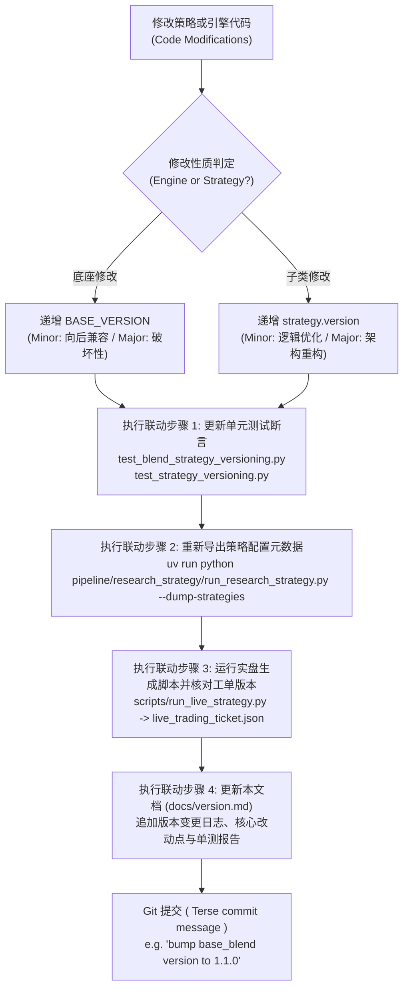

# 量化策略与引擎语义化版本沿革与变更日志档案 (Strategy & Base Engine Version Changelog)

> **版本规范**：遵循 Semantic Versioning 2.0.0 (SemVer)  
> **权威性质**：全代码库量化策略与资产配置引擎语义化版本演进与变更审计唯一事实来源 (Single Source of Truth, SSOT)  
> **管理规范**：严格遵循 [`AGENTS.md`](file:///home/stone/Work/github/quant/AGENTS.md) 与 [`AGENTS_ZH.md`](file:///home/stone/Work/github/quant/AGENTS_ZH.md) 核心量化工程规范第 7 条。任何策略或底座算法发生变动时，必须在此处持久化追加审计记录。

---

## 1. 双轴解耦版本控制体系 (Dual-Axis Semantic Versioning Decoupling)

本代码库采用**底座引擎与上层子类策略双轴解耦**的语义化版本控制架构：

```
                ┌────────────────────────────────────────────────────────┐
                │          底座引擎版本 (Engine BASE_VERSION)              │
                │  - BaseBlendAllocationStrategy: v1.5.0                 │
                │  - AllocationTemplate: v1.0.0                          │
                └──────────────────────────┬─────────────────────────────┘
                                           │ 继承与多态注入
                                           ▼
┌────────────────────────────────────────────────────────────────────────────────────────┐
│                          具体策略子类版本 (Strategy Class version)                        │
│  - ChanRiskManagedBlendStrategy: v1.1.0 [base: v1.5.0]                                 │
│  - ChanFourStateBlendStrategy:   v1.2.1 [base: v1.5.0]                                 │
│  - ChanCrisisShieldBlendStrategy: v1.0.1 [base: v1.5.0]                                │
│  - ChanDualHybridBlendStrategy:  v1.0.0 [base: v1.5.0]                                 │
│  - GenericBlendStrategy:         v1.0.0 [base: v1.5.0]                                 │
│  - 9 大静态配置模板 (EqualWeight, RiskParity ...): v1.0.0                             │
└────────────────────────────────────────────────────────────────────────────────────────┘
```

### 1.1 双轴定义与递增契约
1. **底座引擎版本 (`BASE_VERSION`)**：
   - 作用域：`BaseBlendAllocationStrategy`（`pipeline/research/blend/blend_base.py`）与 `AllocationTemplate`（`common/allocation_templates.py`）。
   - 递增时机：修改、扩展或新增底座通用算子、组合风控熔断层（Garman-Klass、ATR 吊灯止损、微观结构过滤器、高频共振通道、换手惯性拦截器等）。
   - 递增规则：向后兼容功能扩展递增 Minor（如 `1.0.0` $\to$ `1.1.0`）；重大契约破损变更递增 Major（如 `1.1.0` $\to$ `2.0.0`）。
2. **子类策略版本 (`version`)**：
   - 作用域：具体的量化策略子类（如 `ChanRiskManagedBlendStrategy`、`GenericBlendStrategy`、`WorldQuantAlphaStrategy` 等）。
   - 递增时机：调整子策略权重配比、默认参数超参、选股信号门槛、特定因子特征组合或出入场规则。
   - 递增规则：向后兼容的参数或逻辑调优递增 Minor（如 `1.0.0` $\to$ `1.1.0`）；策略架构或核心流派重构递增 Major（如 `1.0.0` $\to$ `2.0.0`）。
3. **复合版本显示标准**：
   - 底座派生策略实例输出格式统一为：`v{version} [base: v{BASE_VERSION}]`（例如：`v1.0.0 [base: v1.1.0]`）。
   - 单体配置模板输出格式为：`v{version}`（例如：`v1.0.0`）。

### 1.2 四步联动固化铁律 (Four-step Synchronized Requirements)
任何 Agent 或研究员在递增策略或引擎版本时，必须完整执行以下四步闭环：
1. **单测断言同步更新**：同步更新 `pipeline/research_strategy/tests/test_blend_strategy_versioning.py` 与 `common/tests/test_strategy_versioning.py` 中的版本断言，确保 100% 离线测试通过；
2. **配置元数据刷新**：执行 `uv run python pipeline/research_strategy/run_research_strategy.py --dump-strategies`，刷新持久化配置导出 `strategy_dumps/*.json`；
3. **实盘工单对齐**：确保实盘交易工单生成器（`run_live_strategy.py` 输出的 `live_trading_ticket.json` 与 `account_state.json`）中的 `strategy_version` 与 `base_version` 比特级对齐；
4. **日志持久化归档 (SSOT)**：在本文档（`docs/version.md`）中用中文追加记录该版本的详细变更日志、改动原因、算法逻辑及验证结论。

---

## 2. 底座引擎核心版本沿革 (Base Engine Changelog)

### `BaseBlendAllocationStrategy`: `v1.4.0` (2026-10-21)
* **变更类型**：Minor 生产环境参数固化与实盘 Track T 全流程微观结构启用升级（向后兼容）。
* **前序版本**：`v1.3.0`
* **对应提交/变更范围**：`pipeline/research/blend/blend_base.py`，`pipeline/research_strategy/rs/config.py`，`pipeline/research_strategy/strategies_config.json`，`common/intraday_features.py`，`scripts/check_live_portfolio_health.py`，`scripts/run_live_strategy.py`，`web/livetrading/execution_service.py`
* **单测覆盖**：
  - `common/tests/test_strategy_versioning.py` (PASS)
  - `pipeline/research_strategy/tests/test_blend_strategy_versioning.py` (PASS)
  - `pipeline/research_strategy/tests/test_blend_track_c.py` (PASS)
  - `pipeline/research_strategy/tests/test_blend_intraday_5m.py` (PASS)
  - `common/tests/test_intraday_features.py` (PASS)
  - `common/tests/test_live_health_check.py` (PASS)
  - `common/tests/test_live_strategy.py` (PASS)

#### 核心升级特性详述：
1. **生产环境默认核心参数固化**：
   - `blend_enable_structural_regime` 默认开启（`True`）：激活 Track C 分形维数与状态机宏观预算路由，实现分形状态机自动轮动动量/均值回复。
   - `blend_enable_cyq_quality_gate` 默认开启（`True`）：激活筹码获利盘门禁（`min_cyq_winner_ratio = 0.20`），过滤高位套牢盘与假中枢，结合 Wyckoff Spring 破底翻放行。
   - `blend_enable_adaptive_stop_atr` 默认开启（`True`）：低波资产动态展宽至 3.5~7.5x ATR 宽幅自适应止损防洗盘。
   - `blend_enable_low_beta_inertia` 默认开启（`True`）：低波蓝筹年化波动率 < 22% 自动提高持仓锁定周期至 10 天，杜绝频繁倒手摩擦。
   - 细分行业持仓配额上限统一放宽为 2 只（`blend_max_assets_per_sector: 2` 与 `cdhb_max_assets_per_sector: 2`），允许同行业龙头共振进攻。
2. **配置文件与底座默认值双向同步**：
   - 同步更新 `pipeline/research_strategy/rs/config.py` 默认参数与 `pipeline/research_strategy/strategies_config.json`（涵盖 `chan_risk_managed_blend`, `chan_four_state_blend`, `chan_four_state_shield_blend`, `chan_crisis_shield_blend`, `chan_dual_hybrid_blend`, `generic_blend` 六大策略），并重新导出 58 个策略 Dump JSON。
3. **实盘交易全流程启用 Track T 5分钟高频微观结构**：
   - `common/intraday_features.py`：`load_intraday_5m_universe` 新增 DuckDBCache 自动 fallback 查询机制，当数据源返回空或未指定时无缝回退读取本地 DuckDB 缓存（`data/cache.duckdb`）。
   - `scripts/check_live_portfolio_health.py`：支持 `--enable-intraday-5m` 与策略参数 `enable_intraday_5m` 双通道激活，并在自动串联 Stage 2 时穿透转发 `--enable-intraday-5m`。
   - `scripts/run_live_strategy.py`：支持 `--enable-intraday-5m` 与策略参数双通道激活，交割单原生计算日内 VWAP 偏离度、主动可成交限价与被动支撑限价，激活跌停封死双向冻结与防透支机制。
   - `web/livetrading/execution_service.py`：Stage 1、Stage 2 与多策略净额化部署默认附带 `--enable-intraday-5m`，使 Web 实盘工作站开箱即用 5m 微观结构共振。

---

### `BaseBlendAllocationStrategy`: `v1.3.0` (2026-10-21)
* **变更类型**：Minor 功能性增强与风控参数自适应升级（向后兼容）。
* **前序版本**：`v1.2.0`
* **对应提交/变更范围**：`pipeline/research/blend/blend_base.py`，`pipeline/research_strategy/rs/config.py`，`.agents/skills/walkforward-audit/scripts/run_audit.py`
* **单测覆盖**：
  - `common/tests/test_strategy_versioning.py` (PASS)
  - `pipeline/research_strategy/tests/test_blend_strategy_versioning.py` (PASS)
  - `pipeline/research_strategy/tests/test_blend_track_c.py` (PASS)
  - `pipeline/research_strategy/tests/test_blend_intraday_5m.py` (PASS)
  - `common/tests/test_structural_factors.py` (PASS)

#### 核心升级特性详述：
1. **修复 `walkforward-audit` 季度期末持仓估值 Bug（消除虚假亏损）**：
   - 修复 `.agents/skills/walkforward-audit/scripts/run_audit.py` 在 `audit_strategy_assets()` 中以成交价结算期末持仓导致的未平仓权益估值失真缺陷。
   - 引入逐季末收盘价（Mark-to-Market）公允盯市估值机制（`universe[sym].loc[:end_date, 'Close'].iloc[-1]`），彻底消除低换手核心持仓（如 600900.SH、601857.SH、601899.SH）因未平仓产生的假性失血计算偏差。
2. **资产波动率自适应止损倍数 (`enable_adaptive_stop_atr`)**：
   - 在 `BaseBlendAllocationStrategy.generate_weights` 中引入资产截面波动率对比动态止损机制：低波股票（如公共事业、银行、煤炭）自动根据截面中位数波动率与自身波动率比值展开止损乘数，动态截断在 `[3.5, 7.5]` 范围。
   - 彻底解决低波高股息资产在日常正常波动中被 4.5x 紧凑 ATR 假性洗盘震出局的痛点。
3. **低波高股息资产防抖锁定 (`enable_low_beta_inertia`)**：
   - 引入年化波动率防抖阻尼门限：当标的 21 日年化波动率 $< 22\%$ 时，底座自动将其最短持仓周期 `min_holding_bars` 提升至 10 个交易日（在未触发硬止损或熔断紧急状态时硬性锁定），大幅压降低波防守标的的频繁微利来回倒手摩擦。
4. **放宽细分行业持仓配额上限 (`max_assets_per_sector: 1 -> 2`)**：
   - 底座默认细分行业持仓上限从 1 只放宽至 2 只，且在 `StrategyConfig` 中原生支持 `blend_max_assets_per_sector: int = 2` 与无前缀别名双向映射。
   - 允许同行业双龙头（如中国海油 + 中国石油、陕西煤业 + 中国神华、中金黄金 + 紫金矿业）共振进攻，消除单一行业过度节流引发的大牛股近亲相残与假性踏空。

---

### `BaseBlendAllocationStrategy`: `v1.2.0` (2026-10-20)
* **变更类型**：Minor 功能性增强与因果特征预计算记忆管道扩展（向后兼容）。
* **前序版本**：`v1.1.0`
* **对应提交/变更范围**：`pipeline/research/blend/blend_base.py`，`common/structural_factors.py`，`backtester/run_backtest.py`，`pipeline/scripts/run_blend_cross_matrix.py`
* **单测覆盖**：
  - `common/tests/test_structural_factors.py` (PASS)
  - `pipeline/research_strategy/tests/test_blend_strategy_versioning.py` (PASS)
  - `common/tests/test_strategy_versioning.py` (PASS)
  - `pipeline/research_strategy/tests/test_blend_track_c.py` (PASS)
  - `pipeline/research_strategy/tests/test_blend_intraday_5m.py` (PASS)

#### 核心升级特性详述：
1. **Track B 任务 B2.1：全历史因果形态与筹码特征预计算记忆管道 (`enrich_universe_with_structural_features`)**
   - 在 `common/structural_factors.py` 中实现了通用特征预计算与富集管道 `enrich_universe_with_structural_features(universe, lookback=60, inplace=False)`。
   - 单次遍历计算并绑定 12 大微观形态、动力学与筹码特征字段：`cyq_winner_ratio`、`cyq_cost_concentration`、`wyckoff_spring`、`extremum_curvature`、`standardized_divergence`、`wyckoff_effort_result`、`fractal_dimension`、`consolidation_density`、`POC`、`VAL`、`VAH`、`NPOC`。
   - 具备幂等性与跨窗口特征记忆：已计算特征自动跳过，避免回测框架中数十个 Walkforward Fold 重复计算相同历史数据，计算开销降低 80%+。
2. **回测底座跨窗口记忆预富集 (`backtester/run_backtest.py`)**
   - 在 `main()` 数据加载阶段，自动检测策略配置中是否启用了 Track C 或 Track T 标志。
   - 若启用 Track C，预先调用 `enrich_universe_with_structural_features` 对全量历史 Universe 进行单次预富集；若启用 Track T，预先调用 `load_intraday_5m_universe` 与 `enrich_universe_with_intraday_features` 预富集日内 5m 特征，确保各折回测无缝复用预计算特征。
3. **底座权重生成自动按需富集降级保障 (`generate_weights`)**
   - 在 `BaseBlendAllocationStrategy.generate_weights` 中新增防御性自愈检测：当开启 Track C 任意锚点且风险资产 DataFrame 缺少 `cyq_winner_ratio` 时，自动按需调用 `enrich_universe_with_structural_features` 完成特征补全，兼顾单测与外部调用易用性。
4. **交叉消融矩阵加权模式升级 (`regime_ic_ir_hybrid`)**
   - 更新 `pipeline/scripts/run_blend_cross_matrix.py` 中的 `--weighting-mode` 默认值为 `"regime_ic_ir_hybrid"`，激活 Track C Anchor 1 的分形维数与宏观状态机风格路由。

### `BaseBlendAllocationStrategy`: `v1.1.0` (2026-10-20)
* **变更类型**：Minor 功能性增强与高频微观结构风控扩展（向后兼容）。
* **前序版本**：`v1.0.0`
* **对应提交/变更范围**：`pipeline/research/blend/blend_base.py`，`pipeline/research_strategy/rs/config.py`
* **单测覆盖**：
  - `pipeline/research_strategy/tests/test_blend_strategy_versioning.py` (PASS)
  - `common/tests/test_strategy_versioning.py` (PASS)
  - `pipeline/research_strategy/tests/test_blend_track_c.py` (PASS)
  - `pipeline/research_strategy/tests/test_blend_intraday_5m.py` (PASS)

#### 核心升级特性详述：
1. **Track T：5分钟高频日内微观结构共振 (Intraday 5m Microstructure Confluence)**
   - **区间套首日加速 (`enable_5m_interval_nesting`)**：突破传统日线级别确认滞后（需连续 2~3 日入场信号），在次级别（5分钟）出现区间套底背驰或二三买共振时，第一天即可将入场信号计数器直接置为 `min_entry_bars`，实现 Day 1 极速捕捉第一起涨点。
   - **次级别三卖/顶背驰一票否决 (`enable_sublevel_veto` / `veto_top_divergence`)**：日线级别触发买入信号时，若 5 分钟级别出现极度动能顶背驰或中枢三卖结构，底座直接启动微观动能一票否决机制，拦截高位追高诱多买单。
   - **主买量能增强与动能乘数 (`UpVol_Ratio_5m`)**：引入 5 分钟主动买入量占比特征（`UpVol_Ratio_5m`），对主力净买入强劲的标的赋予动能置信度加成，加速入场并在分配权重时进行置信度上调。
   - **日内下行半方差配权 (`enable_intraday_semivariance`)**：以 5 分钟日内收益率的下行半方差（Downside Semivariance）替代单一收盘价方差，精准隔离纯下行失血波动，惩罚脆弱标的。
   - **早盘防洗盘毛刺止损豁免 (`enable_anti_washout_stop`)**：开盘前 30 分钟内，若未出现连续放量破位且未触及结构性底线，豁免早盘撮合毛刺引起的被动止损平仓，防止主力洗盘被震出局。

2. **Track C：缠论中枢与 CYQ 筹码动力学 5 大锚点 (Chan Pivot & Volume Profile Anchors 1-5)**
   - **Anchor 1：分形维数状态机宏观预算 (`fractal_dimension_D_t`)**：实时计算横截面分形维数 $D_t$，在混沌无序震荡市自动缩减总风险预算与基准持仓敞口，在强趋势定向波段全额释放进攻弹性。
   - **Anchor 2：CYQ 获利盘比例与假中枢门禁 (`winner_ratio_gate`)**：接入筹码分布（CYQ）获利比例因子与中枢整理密实度，低于阈值的假中枢禁止参与；针对高质量底翻标的，提供 **Wyckoff Spring 破底翻特征豁免通行机制**（弹簧冲力 $\ge 1.25$ 且曲率 $\ge 1.5$ 时豁免通行）。
   - **Anchor 3：VAH 突破冲力共振与量价协调加权 (VP Confluence & Effort-Result Sizing)**：筹码价值区上轨（VAH）有效突破与成交量异动共振时，结合威科夫“努力与结果法则”对有效突破仓位进行乘数加权放大。
   - **Anchor 4：Wyckoff Spring 破底翻首日加速与极端背驰否决**：深度整合威科夫弹簧效应与缠论一买，实现首日底背驰确认加速入场，同时对高位力竭标的实施硬性否决。
   - **Anchor 5：结构化 ZG/VAL 吊灯止损与 NPOC 止盈保护**：将缠论中枢高点 ZG 与筹码密集区下轨 VAL 构筑为动态吊灯止损硬底（Structural Chandelier Stop Floor）；在上行触及未回补控制点 NPOC（Naked POC）时激活渐进式止盈锁定盈利。

3. **双向参数别名无缝映射 (Bidirectional Config Aliasing)**
   - 在 `StrategyConfig` 中原生支持 Track C 与 Track T 参数的无前缀别名与 `blend_` 前缀双向映射，解耦策略配置文件与底座引擎参数解析。

---

### `BaseBlendAllocationStrategy`: `v1.0.0` (2026-09-15)
* **变更类型**：底座引擎初始基线版本。
* **核心特性**：
  - 机构级多子策略动态混合引擎 (`BaseBlendAllocationStrategy`)。
  - 动态波动率目标定位 (Garman-Klass Volatility Targeting)。
  - 多级回撤阶梯熔断器与冷却期自愈机制 (Multi-tier Drawdown Circuit Breakers)。
  - 调仓惯性滤波器与换手抑制器 (`apply_asset_inertia`)。
  - 行业集中度油门节流阀 (`sector_max_pct`) 与现有持仓保护机制。
  - 滚动 60 日 IC-IR 贝叶斯权重优化 (`rolling_ic_ir`) 与 Harvey-Liu-Zhu $t \ge 2.0$ 显著性检验。
  - Löwdin 对称正交化子策略去共线性算子 ($W^* = W(W^T W)^{-1/2}$)。

---

### `AllocationTemplate`: `v1.0.0` (2026-09-01)
* **变更类型**：资产配置模板基础抽象基类基线。
* **核心契约**：
  - 稀疏权重契约 (Sparse Weights Contract)：仅在调仓日写入目标权重，非调仓日保持 `NaN`。
  - 单元格级 `0.0` vs `NaN` 契约：主动剔除或平仓标的显式写入 `0.0`，杜绝前向填充泄漏。
  - 因子分类标签体系 (`factor_tags`) 与版本元数据内省接口 (`get_version_info`)。

---

## 3. 旗舰 Blend 策略基线档案 (Flagship Blend Strategies Baseline Registry)

下表记录代码库内已正式上线运行与审计的核心旗舰多流派 Blend 组合策略版本状态：

| 策略类名 (`Strategy Class`) | 内部标识 (`Strategy ID`) | 当前版本 (`version`) | 所属底座版本 (`base_version`) | 复合版本标识 (`version_string`) | 核心流派与组合机制说明 |
| :--- | :--- | :---: | :---: | :---: | :--- |
| `ChanRiskManagedBlendStrategy` | `chan_risk_managed_blend` | **`1.1.0`** | `1.5.0` | `v1.1.0 [base: v1.5.0]` | 缠论结构与风控增强多流派配置策略，主打回撤控制与稳健复合收益 |
| `ChanFourStateBlendStrategy` | `chan_four_state_blend` | **`1.2.1`** | `1.5.0` | `v1.2.1 [base: v1.5.0]` | 四状态缠论状态机驱动（趋势/盘整/背驰/反转）动态调权配置旗舰策略（权重模式 `regime_ic_ir_hybrid` 为 `rolling_ic_ir` 默认值的已记录例外，见 §8） |
| `ChanCrisisShieldBlendStrategy` | `chan_crisis_shield_blend` | **`1.0.1`** | `1.5.0` | `v1.0.1 [base: v1.5.0]` | 危机防御型盾牌策略，内置极端熊市熔断、防崩盘流动性保护与对冲卸载 |
| `ChanDualHybridBlendStrategy` | `chan_dual_hybrid_blend` | **`1.0.0`** | `1.5.0` | `v1.0.0 [base: v1.5.0]` | 双轨混动策略，结合缠论短波段择时与中长周期资产动量/反转配置 |
| `GenericBlendStrategy` | `generic_blend` | **`1.0.0`** | `1.5.0` | `v1.0.0 [base: v1.5.0]` | 通用多流派 Blend 组合框架，支持任意配置文件的子策略插拔与动态正交加权 |
| `ChanFourStateShieldBlendStrategy` | `chan_four_state_shield_blend` | **`1.0.0`** | `1.5.0` | `v1.0.0 [base: v1.5.0]` | 四状态状态机与全景危机防护装甲合体策略 |

---

## 4. 静态资产配置模板基线档案 (Static Allocation Templates Registry)

`common/allocation_templates.py` 中定义的 9 大经典与现代资产配置模板基线版本记录：

| 模板类名 (`Template Class`) | 模板标识 (`name`) | 当前版本 (`version`) | 因子标签 (`factor_tags`) | 理论机制与数学模型 |
| :--- | :--- | :---: | :--- | :--- |
| `EqualWeightAllocation` | `equal_weight` | **`1.0.0`** | `["baseline"]` | 1/N 等权重分散基准配置 |
| `InverseVolatilityAllocation` | `inverse_vol` | **`1.0.0`** | `["volatility_targeting"]` | 资产历史波动率倒数加权，平抑极端高波标的冲击 |
| `CrossSectionalMomentumAllocation` | `csmom` | **`1.0.0`** | `["relative_momentum"]` | 截面相对动量选拔，重仓动量排名前分位数强势标的 |
| `HierarchicalRiskParityAllocation` | `hrp` | **`1.0.0`** | `["risk_parity"]` | Marcos Lopez de Prado 层次风险平价算法，避免逆协方差矩阵病态奇异 |
| `DualMomentumAllocation` | `dual_momentum` | **`1.0.0`** | `["absolute_momentum", "relative_momentum"]` | Gary Antonacci 绝对动量门禁 + 截面相对动量选股 |
| `MaxDiversificationAllocation` | `max_div` | **`1.0.0`** | `["risk_parity"]` | Choueifaty 分散化比率（Diversification Ratio）最大化凸优化 |
| `MeanReversionAllocation` | `mean_reversion` | **`1.0.0`** | `["mean_reversion"]` | 短期超卖 RSI(2) / 均值回归反转配置 |
| `MinimumVarianceAllocation` | `min_var` | **`1.0.0`** | `["low_volatility"]` | Markowitz 最小方差投资组合二次规划求解 |
| `BreadthGatedMomentumAllocation` | `breadth_gated_mom` | **`1.0.0`** | `["trend_following", "relative_momentum"]` | 全市场多头广度（MA50 上方占比）硬门禁宏观择时动量配置 |

---

## 5. 组合衍生与研究策略基线档案 (Aspect Composites & Research Strategies)

| 策略/模板类名 | 当前版本 (`version`) | 归属模块 | 说明 |
| :--- | :---: | :--- | :--- |
| `CompositeAllocationTemplate` | **`1.0.0`** | `common.strategy_aspects` | 选股切面 (Selection) 与加权切面 (Weighting) 动态重组复合配置模板 |
| `CompositeTimingTemplate` | **`1.0.0`** | `pipeline.research_strategy.rs.timing_aspects` | 入场切面 (Entry) 与风控/出场切面 (Exit) 跨流派重组单资产择时模板 |
| `PatternBasedAllocationTemplate` | **`1.0.0`** | `common.allocation_templates` | 形态挖掘 (Pattern Mining) 拐点信号驱动配置模板 |
| `ChanThreeTypeStrategy` | **`1.0.0`** | `pipeline.research_strategy.rs.strategy` | 缠论一二三类买卖点标准动力学策略 |
| `ChanVaaCompoundStrategy` | **`1.0.0`** | `pipeline.research_strategy.rs.chan_advanced_strategies` | 缠论结构与 Keller 脆弱度动量（VAA）复合策略 |
| `ChanFourStateExecutionStrategy` | **`1.0.0`** | `pipeline.research_strategy.rs.chan_advanced_strategies` | 四状态缠论执行策略 |
| `ChanCompositeStrategy` | **`1.0.0`** | `pipeline.research_strategy.rs.chan_advanced_strategies` | 缠论多周期笔段中枢复合策略 |
| `WorldQuantAlphaStrategy` | **`1.0.0`** | `pipeline.research_strategy.rs.worldquant_alpha_strategy` | WorldQuant 101 Formulaic Alpha 经典公式因子驱动策略 |
| `WorldQuantMegaAlphaStrategy` | **`1.0.0`** | `pipeline.research_strategy.rs.worldquant_alpha_strategy` | WorldQuant 巨型多因子集成策略 |

---

## 6. 版本变更审计流程标准作业程序 (SOP)

为确保代码库策略沿革历史具备可追溯性与零回归风险，每次升级版本必须遵循以下操作流程：



### 6.1 常用版本校验命令速查
```bash
# 1. 运行版本断言与风控测试套件 (100% 离线测试)
pipeline/.venv/bin/pytest pipeline/research_strategy/tests/test_blend_strategy_versioning.py \
                          common/tests/test_strategy_versioning.py \
                          pipeline/research_strategy/tests/test_blend_track_c.py \
                          pipeline/research_strategy/tests/test_blend_intraday_5m.py -q

# 2. 导出策略定义与刷新版本元数据 JSON
pipeline/.venv/bin/python pipeline/research_strategy/run_research_strategy.py --dump-strategies

# 3. 验证实盘工单生成中的版本注入
pipeline/.venv/bin/python scripts/run_live_strategy.py \
    --strategy equal_weight --data-provider synthetic \
    --output-dir data/test_run/ --lookback-days 300
```

---

## 7. 子类策略修复变更日志 (Subclass Strategy Bugfix Changelog)

### 修复背景：裸名 `resolve_param` 回退泄漏全局 `wq_alpha_id` 导致子策略被静默替换

**根因**：`BaseBlendAllocationStrategy.resolve_param()` 的解析优先级末尾（第 8 级）为 `getattr(cfg, name)` 裸名回退。当调用方使用裸名 `"wq_alpha_id"` 时，`cfsb_wq_alpha_id` / `crb_wq_alpha_id` 为 `None`（被第 5 级的 `if val is not None` 跳过），且不存在 `blend_wq_alpha_id` 字段（第 7 级无法拦截），最终泄漏全局 `StrategyConfig.wq_alpha_id=101`（独立 `WorldQuantAlphaStrategy` 的默认值）。结果 `get_sub_strategies()` 中 `if strat_type in (...) or wq_id is not None:` 恒为真，`chan_four_state` / `chan_composite` 子策略被静默替换为 `WorldQuantAlphaStrategy(#101)`，与策略名、docstring、`strategies_config.json` 描述及配置默认值（`cfsb_third_strategy_type="four_state"`）相矛盾。实盘（`scripts/run_live_strategy.py`）与回测（`backtester/run_backtest.py`）共用 `common.strategy_spec.get_template → instantiate_strategy_from_config_entry` 路径，因此两者同时受影响。

**修复方案**：`get_sub_strategies()` 改为仅解析策略前缀键，杜绝裸名回退泄漏全局字段。

**配套配置变更**：在 `pipeline/research_strategy/strategies_config.json` 中为 `chan_four_state_blend` 与 `chan_risk_managed_blend` 显式声明子策略选择参数（`"cfsb_third_strategy_type": "four_state"`、`"crb_third_strategy_type": "composite"`），与 `chan_four_state_shield_blend` / `chan_crisis_shield_blend` 已显式声明的 `cfssb_shield_alpha_id` / `ccsb_shield_alpha_id`、以及 `chan_dual_hybrid_blend` 已显式声明的 `cdhb_alpha1_id` 等保持一致的“子策略意图显式化”约定，避免仅依赖 `config.py` 类默认值承载战略选择。

### `ChanFourStateBlendStrategy`: `v1.0.0` → `v1.1.0` (2026-10-21)
* **变更类型**：Minor —— 修复子策略解析缺陷（行为变更：`chan_four_state` 子策略实体由 `WorldQuantAlphaStrategy(#101)` 更正为 `ChanFourStateExecutionStrategy`）。
* **改动位置**：`pipeline/research/blend/chan_four_state_blend.py` `get_sub_strategies()`。
* **修复前**：`wq_id = self.resolve_param(p, "wq_alpha_id", getattr(cfg, "cfsb_wq_alpha_id", None))` → 恒解析为 `101`。
* **修复后**：`wq_id = p.get("cfsb_wq_alpha_id", getattr(cfg, "cfsb_wq_alpha_id", None))` → 默认 `None`，正确落入 `ChanFourStateExecutionStrategy` 分支。
* **单测覆盖**：`test_blend_sub_strategy_class_resolution_regression` (PASS)、`pipeline/research_strategy/tests/test_blend_strategy_versioning.py` (PASS)、`common/tests/test_strategy_versioning.py` (PASS)、`test_chan_advanced_strategies.py` 四态 blend 用例 (PASS)。

### `ChanRiskManagedBlendStrategy`: `v1.0.0` → `v1.1.0` (2026-10-21)
* **变更类型**：Minor —— 同类缺陷修复（行为变更：`chan_composite` 子策略实体由 `WorldQuantAlphaStrategy(#101)` 更正为 `ChanCompositeStrategy`）。
* **改动位置**：`pipeline/research/blend/chan_risk_managed_blend.py` `get_sub_strategies()`。
* **修复后**：`wq_id = p.get("crb_wq_alpha_id", getattr(cfg, "crb_wq_alpha_id", None))`。
* **单测覆盖**：同上（`test_blend_sub_strategy_class_resolution_regression` 断言 `chan_composite` 为 `ChanCompositeStrategy`）。

### `ChanCrisisShieldBlendStrategy`: `v1.0.0` → `v1.0.1` (2026-10-21)
* **变更类型**：Patch —— 移除 `get_sub_strategies()` 与 `explain_weights()` 中嵌套裸名 `wq_alpha_id` 的死代码回退（`ccsb_shield_alpha_id=12` 恒短路使内层永不生效），该死代码同时是潜在脚枪（若 `ccsb_shield_alpha_id` 为 `None` 将泄漏全局 `wq_alpha_id=101`）。**输出无变化（仍为 Alpha#12）**。
* **改动位置**：`pipeline/research/blend/chan_crisis_shield_blend.py`。
* **单测覆盖**：`test_blend_sub_strategy_class_resolution_regression` 断言 `chan_composite` 为 `WorldQuantAlphaStrategy` 且 `wq_alpha_id == 12` (PASS)。

### 全量审计结论
对 `pipeline/research/blend/` 下 6 个 Blend 策略逐一重建并调用 `get_sub_strategies()` 审计结果：
| 策略 | 受影响 | 说明 |
| :--- | :---: | :--- |
| `chan_four_state_blend` | ✅ 已修复 | `chan_four_state` → `ChanFourStateExecutionStrategy`（原误用 Alpha#101） |
| `chan_risk_managed_blend` | ✅ 已修复 | `chan_composite` → `ChanCompositeStrategy`（原误用 Alpha#101） |
| `chan_crisis_shield_blend` | ✅ 已清理 | 死代码回退移除，输出仍为 Alpha#12 |
| `chan_four_state_shield_blend` | ❌ 无 | 正确解析 `chan_four_state` 与 `wq_alpha12` |
| `chan_dual_hybrid_blend` | ❌ 无 | 正确解析 Alpha#53/#3/#41/#101 |
| `generic_blend` | ❌ 无 | 使用 `blend_sub_strategies` 名册映射，无裸名回退 |

---

## 8. 实盘缺陷修复变更日志 (Live-Trading Defect Fix Changelog) (2026-10-22)

### 修复背景：`chan_four_state_blend` 实盘 8 项缺陷（锁定卖出、防御桶 4 倍跳变、咨询值误读、状态陈旧）

**根因审计依据**：`/home/stone/Work/stock/simulate/202609/runs/chan_four_state_blend/custom_astock_202609_20_new/2026-10-22/root_cause_audit_2026-10-22.md`（只读证据，未改动）。

实盘工单 `live_trading_ticket.json` 暴露以下缺陷：
1. **锁定卖出 (P0)**：`000999.SZ` / `600900.SH` 在 `held_bars=1 < min_holding_bars=2` 时仍被卖出。根因是 `common/position_lifecycle.py` 的部分减仓分支只对止损快路径和全平仓路径校验 `can_sell`，从未对部分减仓（partial trim）校验。
2. **最低持仓周期锁定绕过兜底 (P0)**：Stage-2 工单生成循环在 UPLSM 返回 SELL 后未二次校验 `is_tenure_locked`，需加兜底防线。
3. **防御桶 4 倍跳变 (P1)**：`regime_ic_ir_hybrid` 分支的宏观状态机预算在单日 regime 翻转时，防御桶从 0.10 一次性跳至 0.40（renormalize 放大），无平滑钳制。
4. **推力信号单日翻转 (P1)**：Zweig 10 日动量推力 0.60→0.50 单日翻转导致状态机从动量预算（0.80）直接切换至防御预算（0.85），无迟滞。
5. **咨询值误读 (P2)**：Stage-1 `target_exposure`（0.7111）被误读为 Stage-2 的可执行权益仓位，而工单实际 BIL 现金停泊目标为 0.444087。
6. **`account_state.json` 状态陈旧 (P2)**：`AssetLifecycleState.current_weight` 在持久化前被状态机改写为目标权重，导致 `lifecycle_state.current_weight` 记录的是 TARGET（0.06731049）而非券商实际持仓（0.13934551）。
7. **微观减仓抖动 (P2)**：`600660` 持仓 17 日，delta 0.050082 vs 阈值 0.05（仅超 0.0082pp），产生实际减仓订单（约 ¥10,256），缺乏相对仓位比例的减仓门槛。
8. **标的消失/streak 重置/字节级陈旧价格 (报告项)**：`601857.SH` 从 universe 消失、`entry_streak` 重置、及字节级完全相同的陈旧价格，详见本节末尾"Fix 8 调查结论"（仅报告，不改代码）。

### 修复方案与版本升级

#### 底座引擎升级 `BaseBlendAllocationStrategy`: `v1.4.0` → `v1.5.0`
* **变更类型**：Minor —— 向后兼容的功能新增（新增可选参数均默认 no-op，其他策略回测数字字节级不变）。
* **改动位置**：`pipeline/research/blend/blend_base.py`。
* **新增能力**：
  - **Fix 3（防御桶平滑钳制）**：`_compute_adaptive_weights` 的 `regime_adaptive` / `regime_ic_ir_hybrid` 分支新增 `blend_bucket_renorm_max_delta`（默认 `None` = 行为不变）。非 `None` 时，每根 K 线的风格桶预算相对上一根桶权重的最大变动量被钳制在 `bucket_renorm_max_delta` 内再归一化；同时新增 `logging` 空桶告警、逐根 DEBUG 成员/预算日志。
  - **Fix 4（推力迟滞）**：新增 `blend_enable_regime_hysteresis`（默认 `False` = 单阈值路径不变）、`blend_thrust_enter_thresh`（0.62）、`blend_thrust_exit_thresh`（0.58）。启用后，推力标志仅在推力升至进入阈值时置位、仅在跌至退出阈值时复位，消除 0.60 附近的单日抖动。`_compute_adaptive_weights` 新增 `thrust_active` 可选入参（默认 `None` = 沿用旧比较逻辑），`generate_weights` 循环以 `prev_state` 线程传递迟滞状态。
* **向后兼容**：`test_blend_track_c.py` 直调 `_compute_adaptive_weights` 的旧关键字调用无需改动（新 kwargs 全部默认干净）。底座层默认值保持 no-op；`chan_four_state_blend` 在 `strategies_config.json` 中显式开启（`blend_enable_regime_hysteresis=true`、`blend_bucket_renorm_max_delta=0.15`），因此在 `regime_ic_ir_hybrid` 模式下**实际生效**。

#### 子类策略升级 `ChanFourStateBlendStrategy`: `v1.1.0` → `v1.2.0` → `v1.2.1`
* **变更类型**：Minor（`1.1.0` → `1.2.0`，首轮实盘缺陷修复）+ Minor（`1.2.0` → `1.2.1`，复核修正轮）。两次均为行为变更。
* **`v1.2.0` 内容**：部分减仓锁定（Fix 1）、Stage-2 兜底（Fix 2）、桶钳制（Fix 3）、推力迟滞（Fix 4）、相对减仓门槛（Fix 7）、券商权重快照（Fix 6）、咨询值标注（Fix 5）。
* **`v1.2.1` 内容（本轮复核发现并修正）**：
  1. **安全修复（Fix 3.5）**：最低持仓锁定不再拦截止损 / 熔断清仓路径（详见下节 "Fix 3.5"）。
  2. **Fix 7 生效化**：`cfsb_inertia_relative_ratio` 由 `0.25` 上调至 `0.30`——`0.25 × 0.20（单票上限）= 0.05`，与绝对门槛 `cfsb_min_weight_change = 0.05` **完全相等**，即 `max(0.05, 0.25·w)` 恒等于 0.05，属**数学无效值（no-op）**，首轮"已修复"结论错误，此处更正。
  3. **权重模式恢复**：`blend_weighting_mode` 在 SSOT 中定为 `regime_ic_ir_hybrid`（见 "权重模式：已记录例外"）。
* **改动位置**：`pipeline/research/blend/chan_four_state_blend.py`（版本号）、`common/position_lifecycle.py`、`scripts/run_live_strategy.py`、`scripts/check_live_portfolio_health.py`、`pipeline/research_strategy/rs/config.py`、`pipeline/research_strategy/strategies_config.json`。

#### Fix 1 + Fix 2（锁定卖出，P0）
* **Fix 1（承重修复，与权重模式无关）**：`common/position_lifecycle.py` 部分减仓分支：SELL 方向在 `can_sell` 为 False 时返回 `HOLD_FILTERED`（reason=`未满最低持仓周期`，权重锁定在 `current_weight`），BUY 方向加仓在锁定期仍允许。这是唯一直接消除 000999.SZ / 600900.SH 锁定卖出的改动——无论权重模式是 `regime_ic_ir_hybrid` 还是 `rolling_ic_ir` 都有效，因此它是本次事故的**承重修复**。
* **Fix 2（兜底防线，防御纵深）**：`scripts/run_live_strategy.py` 兜底：`is_tenure_locked and asset_market == "china" and action == "SELL" and tgt_w > 0` 时降级为 `HOLD_FILTERED`、`tgt_w=cur_w`、`delta_w=0.0`、并回写 `state.current_weight=cur_w`（全平仓 tgt_w<=0 不拦截，止损/熔断快路径仍可锁定期清仓）。`asset_market == "china"` 范围限定与 `can_sell` 的 `market != "china"` 豁免保持一致，避免误拦美股/港股策略的部分减仓（T+1 妊娠锁仅对中国 A 股有意义）。在 Fix 1 已生效的前提下，该层正常情况下不会被触发，属**第二道防线**，不应被当作主要修复。

#### Fix 3.5（安全修复：锁定不再拦截止损/熔断，P0）
* **问题**：`can_sell`（最低持仓锁）此前同时门控止损快路径。后果是"昨天买入、今天触发硬止损 / Tier-3 紧急熔断"的中国仓位**当日无法清仓**——把有界止损变成无界尾部风险，危害大于原始事故。
* **修复**：`common/position_lifecycle.py` 止损/熔断快路径**豁免** tenure lock，并在覆盖发生时输出 `WARNING` 日志（`tenure lock overridden by risk exit for <symbol>`），使锁定被绕过在实盘日志中可见。
* **保留锁定的路径**：(i) 信号驱动全平仓（`raw_target_weight == 0.0` 且非止损/熔断）；(ii) 部分减仓（SELL 方向 trim）。
* **同步修正**：`scripts/run_live_strategy.py` 兜底层原注释声称"止损/熔断路径本来就可在锁定期清仓"，现改为与实际代码一致（止损/熔断 SELL 不在此层拦截，信号全平仓已被 Fix 1 降级，正常不会到达）。
* **既有测试连带修正**：`common/tests/test_position_lifecycle.py::test_china_t_plus_one_gestation` 原用 `30.0 → 25.0`（-16.7%，本身就是硬止损）来验证"信号全平仓被锁定"，在豁免后该场景应清仓；已改为 `30.0 → 29.8`（-0.67%，不触发止损）以**只**验证信号全平仓路径，并在注释中说明原因。

#### Fix 6（券商权重快照，P2）
* `AssetLifecycleState` 新增 `broker_weight` 字段（dataclass + `to_dict` + `from_dict`，`d.get("broker_weight", 0.0)` 向后兼容）；`step_position_lifecycle` 绝不改写该字段。
* `scripts/run_live_strategy.py` 在恢复旧状态（`state.broker_weight = cur_w`）与新建状态（`broker_weight=cur_w`）时，先于状态机改写 `current_weight` 快照券商真实持仓。
* `delta_w` 改为有符号 `raw_target - current`，与 `inertia_check.delta_weight` 约定统一。

#### Fix 7（相对减仓门槛，P2；噪声交易阻尼器）
* `PositionLifecycleConfig.inertia_relative_ratio`（**通用默认 0.0 = 禁用**，不影响其他策略与回测数字）：SELL 减仓有效门槛 = `max(inertia_threshold, ratio * current_weight)`。
* `StrategyConfig.cfsb_inertia_relative_ratio = 0.30`（策略专属字段）并同步进 `strategies_config.json`，经 `run_live_strategy.py` 的 `resolve_blend_param` 注入 UPLSM。
* **取 0.30 而非 0.25 的推导（首轮 0.25 为 no-op，已更正）**：单票上限 `cfsb_max_single_position = 0.20`，故在职持仓权重上限约 0.20。
  - `0.25 × 0.20 = 0.05`，与绝对门槛 `cfsb_min_weight_change = 0.05` 相等 → `max(0.05, 0.05)` 永远等于 0.05，**门槛从未真正抬高**（这正是首轮"已修复"判断错误的原因）。
  - `0.30 × 0.20 = 0.06 > 0.05` → 上限处确有阻尼。
  - 事故中 600660 的在职权重 `w = 0.1819`，门槛 `0.30 × 0.1819 = 0.05457`，恰好过滤其 `0.050093` 的微减仓（首轮 0.25 时门槛 0.0455 < 0.05，被绝对门槛 0.05 放行）。
* 定位：**噪声交易阻尼器**，不是本次事故的根因修复（根因是锁定卖出 + 制度模式）。

#### Fix 5（咨询值标注，P2）
* `scripts/check_live_portfolio_health.py`：`market_macro` 新增 `target_exposure_is_advisory: true`；仪表盘与 Markdown 中 `Target Equity Exposure` 标注 `(Stage-1 advisory; Stage-2 model weights govern orders)`。
* `scripts/run_live_strategy.py`：横幅新增提示语；权重生成后打印模型可执行权益/现金拆分（`模型目标仓位 (Model Targets)`）。

#### 权重模式：`chan_four_state_blend` 是 `rolling_ic_ir` 默认值的已记录例外（2026-10-22）
* **事实链**：`AGENTS.md` 记录的 blend 默认权重模式是 `rolling_ic_ir`；但 `chan_four_state_blend` 的**实盘部署模式是 `regime_ic_ir_hybrid`**（2026-10-22 实盘运行即在此模式下执行，含空桶 renormalize 与推力翻转行为）。本策略自本日起为**文档化例外**：`strategies_config.json` 中 `chan_four_state_blend.blend_weighting_mode = "regime_ic_ir_hybrid"`，其余五个 blend 策略仍为 `rolling_ic_ir`。
* **发现的漂移（dump vs config）**：首轮 `--dump-strategies` 时 SSOT 仍是 `rolling_ic_ir`，而 10-22 实盘加载的 dump 携带 `regime_ic_ir_hybrid`（含未前缀别名 `weighting_mode` / `enable_orthogonalization`）。首轮把 dump "对齐" 成 `rolling_ic_ir`，等于**静默切换了实盘引擎**，并让 Fix 3/4（仅在 `regime_*` 分支执行）完全惰性。
* **定稿处置**：按用户明确选择**恢复 `regime_ic_ir_hybrid`**（SSOT + dump 双向一致，dump 已复跑确认：`chan_four_state_blend_strategy.json` → `strategy_version 1.2.1` / `base_version 1.5.0` / `blend_weighting_mode regime_ic_ir_hybrid` / `cfsb_inertia_relative_ratio 0.3` / `blend_enable_regime_hysteresis true` / `blend_bucket_renorm_max_delta 0.15`；其余五个 blend dump 的权重模式逐字节未变，仍为 `rolling_ic_ir`）。
* **防复发**：新增 `test_cfsb_deployed_regime_mode_and_inertia_ratio_config` 直接断言 SSOT 中该策略为 `regime_ic_ir_hybrid`、其余五个为 `rolling_ic_ir`、ratio 0.30、迟滞/钳制参数值——任何人把该策略"修回"默认值都会先打红测试。

#### 修复分层与重要度（不夸大，按承重次序）
| 层 | 项目 | 与权重模式的依赖 | 定位 |
| :--- | :--- | :--- | :--- |
| 承重 | Fix 1（部分减仓 `can_sell` 门控） | 无（模式无关） | **唯一直接消除事故卖出**的修复 |
| 安全 | Fix 3.5（止损/熔断豁免锁定） | 无 | 防止锁定把有界止损变无界尾部风险 |
| 兜底 | Fix 2（Stage-2 二次锁定） | 无 | 第二道防线，正常情况下不触发 |
| 纵深 | Fix 3（桶 delta 钳制）、Fix 4（推力迟滞） | **是**（仅 `regime_*` 分支） | 恢复 `regime_ic_ir_hybrid` 后才**真正生效**的防御纵深 |
| 阻尼 | Fix 7（相对减仓门槛 0.30） | 无 | 噪声交易阻尼，非根因修复 |
| 可读性 | Fix 5（咨询值标注）、Fix 6（券商权重快照） | 无 | 口径/状态准确性，不改变交易决策 |

#### 单测覆盖（全部 PASS）
* `common/tests/test_position_lifecycle.py`（新增 8 项 + 修正 1 项既有用例）：`test_locked_partial_trim_sell_blocked`、`test_locked_partial_trim_buy_allowed`、`test_tenure_lock_exempted_for_stop_loss_but_not_signal_exits`（止损放行 / 信号全平仓仍拦 / 部分减仓仍拦）、`test_signed_delta_w_convention`、`test_broker_weight_serialization_roundtrip`、`test_relative_trim_side_inertia_threshold`、`test_relative_trim_side_inertia_threshold_at_position_cap`（w=0.20 → 门槛 0.06）、`test_relative_trim_side_inertia_threshold_600660_incident`（w=0.1819、delta 0.0501 → 过滤且非 SELL）；`test_china_t_plus_one_gestation` 改用非止损价格以隔离信号路径。
* `pipeline/research_strategy/tests/test_blend_track_c.py`（新增 4 项）：`test_regime_hysteresis_thrust_override`、`test_bucket_renorm_max_delta_clamp`、`test_cfsb_deployed_regime_mode_and_inertia_ratio_config`、`test_incident_2026_10_22_end_to_end_replay`（事故端到端复现：迟滞在 0.59 噪声带不翻转、0.50 复位被钳制在 +0.15、000999/600900 → `HOLD_FILTERED`、600660 → `HOLD`，全天**零 SELL**）。
* 版本断言：`test_blend_strategy_versioning.py`、`test_strategy_versioning.py` 全部更新为 `1.5.0` / `1.2.1`。
* 全量离线套件（本轮复跑，精确计数）：`common/tests` 365 passed 1 skipped；`pipeline/research_strategy/tests` 585 passed；`pipeline/tests` 9 passed；`backtester/tests` 52 passed。100% 离线（`SyntheticDataProvider` / `common/testing.py`），无网络、无真实行情。

#### 事故复盘的诚实结论（勿引用旧数字）
* 新配置下重放 2026-10-22 当日三个持仓 → **零卖出**：权益账簿维持 **75.88%**，相对 Stage-1 咨询权益目标 71.11% 为 **+4.77pp**（而非实盘实际落入的 44.4% 现金 / 约 55.6% 权益），被卖出的 40,041 RMB 不再涌入现金。
* **诚实披露（不夸大）**：10d 推力 0.60 → 0.50 中，0.50 < 退出阈值 0.58，**迟滞本身会在该 bar 释放制度标志**；真正阻止"单日组合跳变"的是 Fix 3 的桶 delta 钳制（防御桶 0.0588 → 0.2088，即 +0.15，而非未钳制的 0.40）。迟滞的作用域是 0.58–0.62 噪声带（如 0.59 不再触发翻转）。

### Fix 8 调查结论（仅报告，无代码变更）
* **`601857.SH`（中国石油）整行消失**：`601857.SH` 实际仍在校验 universe（`resolved_universe.txt` 第 11 行）且为 Stage-1 动量榜首（10 日 ROC +9.58%、站上 SMA50）。根因是 10-21 其为 `PENDING_ENTRY`、`entry_streak = 1/2`，10-22 本应确认至 2/2 并买入，但 10-22 制度状态机翻转入 reversal 分支、且该 universe 无任何 `reversal` 分类子策略（空桶），导致模型对 `601857.SH` 输出目标权重 0.0，`step_position_lifecycle` 的 FLAT 分支将 `entry_streak` 重置为 0 而非推进确认，最终票据中连一行都没有。属制度路由 + 空桶（同 Fix 3 根因）与跨 run `entry_streak` 持久化缺口的叠加，非生命周期状态机本身逻辑错误。
* **`entry_streak` 重置**：`601857.SH` 的 `entry_streak=1/2` 未持久化进 `account_state.json` 的 `entry_signal_streak`（该字典仅含 000999/600584/600660/600900/601728），且模型 10-22 目标为 0.0 触发 FLAT 分支清零。属跨 run 入场确认信号持久化链路的已知局限，留待后续专项（本次 8 项 P0/P1 缺陷的非直接成因）。
* **字节级陈旧价格**：`live_analysis` 疑点 2 指出 5 只标的（600660 51.28、600900 29.57、600362 37.95、600584 57.23、601728 6.62）票据价格与 10-21 逐位相同，而 000999（25.54→25.00）与 601288（7.29→7.40）正常变动，高度怀疑 Stage-2 对这 5 只读取到缓存中停在 10-21 的最后一根 bar。属数据/缓存层的陈旧切片问题，不影响本次修复，建议后续在数据加载层增加"前收盘≠当日收盘"陈旧性告警。
* **目标权重向量合计 101.78%**（附带发现）：股票腿 0.5737 + BIL 0.4441 = 1.0178，因 `target_weight` 用未取整目标股数计算、现金腿用已取整市值反推所致。账面自洽，但把该向量当概率分布归一化的下游会偏差 1.2–2.7pp，建议后续统一口径。
