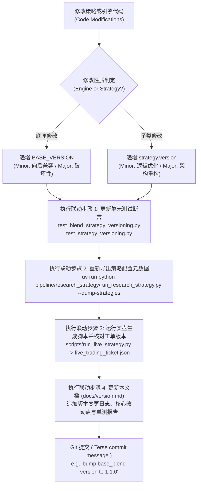

# 量化策略与引擎语义化版本沿革与变更日志档案 (Strategy & Base Engine Version Changelog)

> **版本规范**：遵循 Semantic Versioning 2.0.0 (SemVer)  
> **权威性质**：全代码库量化策略与资产配置引擎语义化版本演进与变更审计唯一事实来源 (Single Source of Truth, SSOT)  
> **管理规范**：严格遵循 [`AGENTS.md`](file:///home/stone/Work/github/quant/AGENTS.md) 与 [`AGENTS_ZH.md`](file:///home/stone/Work/github/quant/AGENTS_ZH.md) 核心量化工程规范第 7 条。任何策略或底座算法发生变动时，必须在此处持久化追加审计记录。

---

## 1. 双轴解耦版本控制体系 (Dual-Axis Semantic Versioning Decoupling)

本代码库采用**底座引擎与上层子类策略双轴解耦**的语义化版本控制架构：

```
                ┌────────────────────────────────────────────────────────┐
                │          底座引擎版本 (Engine BASE_VERSION)              │
                │  - BaseBlendAllocationStrategy: v1.1.0                 │
                │  - AllocationTemplate: v1.0.0                          │
                └──────────────────────────┬─────────────────────────────┘
                                           │ 继承与多态注入
                                           ▼
┌────────────────────────────────────────────────────────────────────────────────────────┐
│                          具体策略子类版本 (Strategy Class version)                        │
│  - ChanRiskManagedBlendStrategy: v1.0.0 [base: v1.1.0]                                 │
│  - ChanFourStateBlendStrategy:   v2.0.0 [base: v1.1.0]                                 │
│  - ChanCrisisShieldBlendStrategy: v2.1.0 [base: v1.1.0]                                │
│  - ChanDualHybridBlendStrategy:  v1.0.0 [base: v1.1.0]                                 │
│  - GenericBlendStrategy:         v1.0.0 [base: v1.1.0]                                 │
│  - 9 大静态配置模板 (EqualWeight, RiskParity ...): v1.0.0                             │
└────────────────────────────────────────────────────────────────────────────────────────┘
```

### 1.1 双轴定义与递增契约
1. **底座引擎版本 (`BASE_VERSION`)**：
   - 作用域：`BaseBlendAllocationStrategy`（`pipeline/research/blend/blend_base.py`）与 `AllocationTemplate`（`common/allocation_templates.py`）。
   - 递增时机：修改、扩展或新增底座通用算子、组合风控熔断层（Garman-Klass、ATR 吊灯止损、微观结构过滤器、高频共振通道、换手惯性拦截器等）。
   - 递增规则：向后兼容功能扩展递增 Minor（如 `1.0.0` $\to$ `1.1.0`）；重大契约破损变更递增 Major（如 `1.1.0` $\to$ `2.0.0`）。
2. **子类策略版本 (`version`)**：
   - 作用域：具体的量化策略子类（如 `ChanRiskManagedBlendStrategy`、`GenericBlendStrategy`、`WorldQuantAlphaStrategy` 等）。
   - 递增时机：调整子策略权重配比、默认参数超参、选股信号门槛、特定因子特征组合或出入场规则。
   - 递增规则：向后兼容的参数或逻辑调优递增 Minor（如 `1.0.0` $\to$ `1.1.0`）；策略架构或核心流派重构递增 Major（如 `1.0.0` $\to$ `2.0.0`）。
3. **复合版本显示标准**：
   - 底座派生策略实例输出格式统一为：`v{version} [base: v{BASE_VERSION}]`（例如：`v1.0.0 [base: v1.1.0]`）。
   - 单体配置模板输出格式为：`v{version}`（例如：`v1.0.0`）。

### 1.2 四步联动固化铁律 (Four-step Synchronized Requirements)
任何 Agent 或研究员在递增策略或引擎版本时，必须完整执行以下四步闭环：
1. **单测断言同步更新**：同步更新 `pipeline/research_strategy/tests/test_blend_strategy_versioning.py` 与 `common/tests/test_strategy_versioning.py` 中的版本断言，确保 100% 离线测试通过；
2. **配置元数据刷新**：执行 `uv run python pipeline/research_strategy/run_research_strategy.py --dump-strategies`，刷新持久化配置导出 `strategy_dumps/*.json`；
3. **实盘工单对齐**：确保实盘交易工单生成器（`run_live_strategy.py` 输出的 `live_trading_ticket.json` 与 `account_state.json`）中的 `strategy_version` 与 `base_version` 比特级对齐；
4. **日志持久化归档 (SSOT)**：在本文档（`docs/version.md`）中用中文追加记录该版本的详细变更日志、改动原因、算法逻辑及验证结论。

---

## 2. 底座引擎核心版本沿革 (Base Engine Changelog)

### `BaseBlendAllocationStrategy`: `v1.1.0` (2026-10-20)
* **变更类型**：Minor 功能性增强与高频微观结构风控扩展（向后兼容）。
* **前序版本**：`v1.0.0`
* **对应提交/变更范围**：`pipeline/research/blend/blend_base.py`，`pipeline/research_strategy/rs/config.py`
* **单测覆盖**：
  - `pipeline/research_strategy/tests/test_blend_strategy_versioning.py` (PASS)
  - `common/tests/test_strategy_versioning.py` (PASS)
  - `pipeline/research_strategy/tests/test_blend_track_c.py` (PASS)
  - `pipeline/research_strategy/tests/test_blend_intraday_5m.py` (PASS)

#### 核心升级特性详述：
1. **Track T：5分钟高频日内微观结构共振 (Intraday 5m Microstructure Confluence)**
   - **区间套首日加速 (`enable_5m_interval_nesting`)**：突破传统日线级别确认滞后（需连续 2~3 日入场信号），在次级别（5分钟）出现区间套底背驰或二三买共振时，第一天即可将入场信号计数器直接置为 `min_entry_bars`，实现 Day 1 极速捕捉第一起涨点。
   - **次级别三卖/顶背驰一票否决 (`enable_sublevel_veto` / `veto_top_divergence`)**：日线级别触发买入信号时，若 5 分钟级别出现极度动能顶背驰或中枢三卖结构，底座直接启动微观动能一票否决机制，拦截高位追高诱多买单。
   - **主买量能增强与动能乘数 (`UpVol_Ratio_5m`)**：引入 5 分钟主动买入量占比特征（`UpVol_Ratio_5m`），对主力净买入强劲的标的赋予动能置信度加成，加速入场并在分配权重时进行置信度上调。
   - **日内下行半方差配权 (`enable_intraday_semivariance`)**：以 5 分钟日内收益率的下行半方差（Downside Semivariance）替代单一收盘价方差，精准隔离纯下行失血波动，惩罚脆弱标的。
   - **早盘防洗盘毛刺止损豁免 (`enable_anti_washout_stop`)**：开盘前 30 分钟内，若未出现连续放量破位且未触及结构性底线，豁免早盘撮合毛刺引起的被动止损平仓，防止主力洗盘被震出局。

2. **Track C：缠论中枢与 CYQ 筹码动力学 5 大锚点 (Chan Pivot & Volume Profile Anchors 1-5)**
   - **Anchor 1：分形维数状态机宏观预算 (`fractal_dimension_D_t`)**：实时计算横截面分形维数 $D_t$，在混沌无序震荡市自动缩减总风险预算与基准持仓敞口，在强趋势定向波段全额释放进攻弹性。
   - **Anchor 2：CYQ 获利盘比例与假中枢门禁 (`winner_ratio_gate`)**：接入筹码分布（CYQ）获利比例因子与中枢整理密实度，低于阈值的假中枢禁止参与；针对高质量底翻标的，提供 **Wyckoff Spring 破底翻特征豁免通行机制**（弹簧冲力 $\ge 1.25$ 且曲率 $\ge 1.5$ 时豁免通行）。
   - **Anchor 3：VAH 突破冲力共振与量价协调加权 (VP Confluence & Effort-Result Sizing)**：筹码价值区上轨（VAH）有效突破与成交量异动共振时，结合威科夫“努力与结果法则”对有效突破仓位进行乘数加权放大。
   - **Anchor 4：Wyckoff Spring 破底翻首日加速与极端背驰否决**：深度整合威科夫弹簧效应与缠论一买，实现首日底背驰确认加速入场，同时对高位力竭标的实施硬性否决。
   - **Anchor 5：结构化 ZG/VAL 吊灯止损与 NPOC 止盈保护**：将缠论中枢高点 ZG 与筹码密集区下轨 VAL 构筑为动态吊灯止损硬底（Structural Chandelier Stop Floor）；在上行触及未回补控制点 NPOC（Naked POC）时激活渐进式止盈锁定盈利。

3. **双向参数别名无缝映射 (Bidirectional Config Aliasing)**
   - 在 `StrategyConfig` 中原生支持 Track C 与 Track T 参数的无前缀别名与 `blend_` 前缀双向映射，解耦策略配置文件与底座引擎参数解析。

---

### `BaseBlendAllocationStrategy`: `v1.0.0` (2026-09-15)
* **变更类型**：底座引擎初始基线版本。
* **核心特性**：
  - 机构级多子策略动态混合引擎 (`BaseBlendAllocationStrategy`)。
  - 动态波动率目标定位 (Garman-Klass Volatility Targeting)。
  - 多级回撤阶梯熔断器与冷却期自愈机制 (Multi-tier Drawdown Circuit Breakers)。
  - 调仓惯性滤波器与换手抑制器 (`apply_asset_inertia`)。
  - 行业集中度油门节流阀 (`sector_max_pct`) 与现有持仓保护机制。
  - 滚动 60 日 IC-IR 贝叶斯权重优化 (`rolling_ic_ir`) 与 Harvey-Liu-Zhu $t \ge 2.0$ 显著性检验。
  - Löwdin 对称正交化子策略去共线性算子 ($W^* = W(W^T W)^{-1/2}$)。

---

### `AllocationTemplate`: `v1.0.0` (2026-09-01)
* **变更类型**：资产配置模板基础抽象基类基线。
* **核心契约**：
  - 稀疏权重契约 (Sparse Weights Contract)：仅在调仓日写入目标权重，非调仓日保持 `NaN`。
  - 单元格级 `0.0` vs `NaN` 契约：主动剔除或平仓标的显式写入 `0.0`，杜绝前向填充泄漏。
  - 因子分类标签体系 (`factor_tags`) 与版本元数据内省接口 (`get_version_info`)。

---

## 3. 旗舰 Blend 策略基线档案 (Flagship Blend Strategies Baseline Registry)

下表记录代码库内已正式上线运行与审计的核心旗舰多流派 Blend 组合策略版本状态：

| 策略类名 (`Strategy Class`) | 内部标识 (`Strategy ID`) | 当前版本 (`version`) | 所属底座版本 (`base_version`) | 复合版本标识 (`version_string`) | 核心流派与组合机制说明 |
| :--- | :--- | :---: | :---: | :---: | :--- |
| `ChanRiskManagedBlendStrategy` | `chan_risk_managed_blend` | **`1.0.0`** | `1.1.0` | `v1.0.0 [base: v1.1.0]` | 缠论结构与风控增强多流派配置策略，主打回撤控制与稳健复合收益 |
| `ChanFourStateBlendStrategy` | `chan_four_state_blend` | **`2.0.0`** | `1.1.0` | `v2.0.0 [base: v1.1.0]` | 四状态缠论状态机驱动（趋势/盘整/背驰/反转）动态调权配置旗舰策略 |
| `ChanCrisisShieldBlendStrategy` | `chan_crisis_shield_blend` | **`2.1.0`** | `1.1.0` | `v2.1.0 [base: v1.1.0]` | 危机防御型盾牌策略，内置极端熊市熔断、防崩盘流动性保护与对冲卸载 |
| `ChanDualHybridBlendStrategy` | `chan_dual_hybrid_blend` | **`1.0.0`** | `1.1.0` | `v1.0.0 [base: v1.1.0]` | 双轨混动策略，结合缠论短波段择时与中长周期资产动量/反转配置 |
| `GenericBlendStrategy` | `generic_blend` | **`1.0.0`** | `1.1.0` | `v1.0.0 [base: v1.1.0]` | 通用多流派 Blend 组合框架，支持任意配置文件的子策略插拔与动态正交加权 |
| `ChanFourStateShieldBlendStrategy` | `chan_four_state_shield_blend` | **`1.0.0`** | `1.1.0` | `v1.0.0 [base: v1.1.0]` | 四状态状态机与全景危机防护装甲合体策略 |

---

## 4. 静态资产配置模板基线档案 (Static Allocation Templates Registry)

`common/allocation_templates.py` 中定义的 9 大经典与现代资产配置模板基线版本记录：

| 模板类名 (`Template Class`) | 模板标识 (`name`) | 当前版本 (`version`) | 因子标签 (`factor_tags`) | 理论机制与数学模型 |
| :--- | :--- | :---: | :--- | :--- |
| `EqualWeightAllocation` | `equal_weight` | **`1.0.0`** | `["baseline"]` | 1/N 等权重分散基准配置 |
| `InverseVolatilityAllocation` | `inverse_vol` | **`1.0.0`** | `["volatility_targeting"]` | 资产历史波动率倒数加权，平抑极端高波标的冲击 |
| `CrossSectionalMomentumAllocation` | `csmom` | **`1.0.0`** | `["relative_momentum"]` | 截面相对动量选拔，重仓动量排名前分位数强势标的 |
| `HierarchicalRiskParityAllocation` | `hrp` | **`1.0.0`** | `["risk_parity"]` | Marcos Lopez de Prado 层次风险平价算法，避免逆协方差矩阵病态奇异 |
| `DualMomentumAllocation` | `dual_momentum` | **`1.0.0`** | `["absolute_momentum", "relative_momentum"]` | Gary Antonacci 绝对动量门禁 + 截面相对动量选股 |
| `MaxDiversificationAllocation` | `max_div` | **`1.0.0`** | `["risk_parity"]` | Choueifaty 分散化比率（Diversification Ratio）最大化凸优化 |
| `MeanReversionAllocation` | `mean_reversion` | **`1.0.0`** | `["mean_reversion"]` | 短期超卖 RSI(2) / 均值回归反转配置 |
| `MinimumVarianceAllocation` | `min_var` | **`1.0.0`** | `["low_volatility"]` | Markowitz 最小方差投资组合二次规划求解 |
| `BreadthGatedMomentumAllocation` | `breadth_gated_mom` | **`1.0.0`** | `["trend_following", "relative_momentum"]` | 全市场多头广度（MA50 上方占比）硬门禁宏观择时动量配置 |

---

## 5. 组合衍生与研究策略基线档案 (Aspect Composites & Research Strategies)

| 策略/模板类名 | 当前版本 (`version`) | 归属模块 | 说明 |
| :--- | :---: | :--- | :--- |
| `CompositeAllocationTemplate` | **`1.0.0`** | `common.strategy_aspects` | 选股切面 (Selection) 与加权切面 (Weighting) 动态重组复合配置模板 |
| `CompositeTimingTemplate` | **`1.0.0`** | `pipeline.research_strategy.rs.timing_aspects` | 入场切面 (Entry) 与风控/出场切面 (Exit) 跨流派重组单资产择时模板 |
| `PatternBasedAllocationTemplate` | **`1.0.0`** | `common.allocation_templates` | 形态挖掘 (Pattern Mining) 拐点信号驱动配置模板 |
| `ChanThreeTypeStrategy` | **`1.0.0`** | `pipeline.research_strategy.rs.strategy` | 缠论一二三类买卖点标准动力学策略 |
| `ChanVaaCompoundStrategy` | **`1.0.0`** | `pipeline.research_strategy.rs.chan_advanced_strategies` | 缠论结构与 Keller 脆弱度动量（VAA）复合策略 |
| `ChanFourStateExecutionStrategy` | **`1.0.0`** | `pipeline.research_strategy.rs.chan_advanced_strategies` | 四状态缠论执行策略 |
| `ChanCompositeStrategy` | **`1.0.0`** | `pipeline.research_strategy.rs.chan_advanced_strategies` | 缠论多周期笔段中枢复合策略 |
| `WorldQuantAlphaStrategy` | **`1.0.0`** | `pipeline.research_strategy.rs.worldquant_alpha_strategy` | WorldQuant 101 Formulaic Alpha 经典公式因子驱动策略 |
| `WorldQuantMegaAlphaStrategy` | **`1.0.0`** | `pipeline.research_strategy.rs.worldquant_alpha_strategy` | WorldQuant 巨型多因子集成策略 |

---

## 6. 版本变更审计流程标准作业程序 (SOP)

为确保代码库策略沿革历史具备可追溯性与零回归风险，每次升级版本必须遵循以下操作流程：



### 6.1 常用版本校验命令速查
```bash
# 1. 运行版本断言与风控测试套件 (100% 离线测试)
pipeline/.venv/bin/pytest pipeline/research_strategy/tests/test_blend_strategy_versioning.py \
                          common/tests/test_strategy_versioning.py \
                          pipeline/research_strategy/tests/test_blend_track_c.py \
                          pipeline/research_strategy/tests/test_blend_intraday_5m.py -q

# 2. 导出策略定义与刷新版本元数据 JSON
pipeline/.venv/bin/python pipeline/research_strategy/run_research_strategy.py --dump-strategies

# 3. 验证实盘工单生成中的版本注入
pipeline/.venv/bin/python scripts/run_live_strategy.py \
    --strategy equal_weight --data-provider synthetic \
    --output-dir data/test_run/ --lookback-days 300
```
