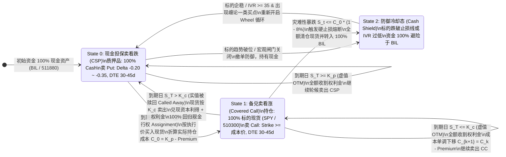

# Options Wheel Strategy (轮式期权复合策略): 理论推演与工程架构蓝图

> **文档定位**: 量化衍生品与非线性收益增强策略研究 (Quantitative Derivative Strategy Research)  
> **归属工程**: `pipeline/research_strategy/` & `common/`  
> **核心标的**: 美股/ETF (`SPY`, `QQQ`)、A股核心指数ETF (`510300`, `510050`) 及高质量流动性标的  

---

## 1. 策略概述与经济学基础 (Executive Summary & Economic Grounding)

**轮式期权策略 (Options Wheel Strategy / Triple Income Strategy)** 是一种系统化、非线性的衍生品收益收割方法。其核心逻辑在于通过在不同阶段交替卖出**现金担保看跌期权 (Cash-Secured Put, CSP)** 与**备兑看涨期权 (Covered Call, CC)**，系统性收割两类结构性阿尔法：
1. **方差风险溢价 (Variance Risk Premium, VRP)**:
   $$\text{VRP}_t = IV_t - RV_t > 0$$
   由于市场参与者对左侧尾部暴跌具有天然的风险厌恶（Crash Risk Aversion），长期来看隐含波动率 ($IV$) 系统性高于未来实际实现波动率 ($RV$)，期权卖方实质上充当了“市场保险承保人”，赚取承保净保费。
2. **正向时间价值衰减 (Theta Harvesting, $\Theta > 0$)**:
   期权的外在时间价值随到期时间加速归零（以 $\frac{1}{\sqrt{\tau}}$ 速度非线性加速），策略通过持续做空负 Gamma 换取确定的正向现金流。

然而，**散户化轮式策略存在致命的结构性缺陷——“套牢陷阱 (The Bag-Holding Trap)”**：当底层资产遭遇结构性熊市或黑天鹅深跌（例如下跌 30%–50%）时，持仓成本被套在山顶，使得后续只能以极低权利金卖出行权价高于成本的 Call，或者被迫冒被低位割肉洗劫的风险低位卖 Call，导致长期资金收益率锁死。

为此，本项目提出的**机构级增强型轮式策略 (Institutional Enhanced Wheel)** 引入了三层量化门控：
- **波动率门控 (IV Rank & VRP Gating)**: 仅在 $IVR \ge 35$ 且波动率溢价充分时卖权，低波期资金全额回归无风险利息（`BIL` / `511880`）。
- **缠论/威科夫结构底支撑 (Chan & Wyckoff Support Anchoring)**: CSP 卖点严格锚定在缠论中枢下轨 ($ZD$) 或威科夫吸筹弹簧底，利用因果级技术支撑压低行权概率。
- **主动防御与紧急熔断 (Anti-Bag-Holding Stop Loss)**: 跌破底线成本 8% 坚决清仓回归现金，拒绝无底线被动接盘。

---

## 2. 状态机模型与希腊字母剖析 (FSM Mechanics & Greeks)

### 2.1 有限状态机 (FSM) 架构



### 2.2 状态流转与资产平衡方程

1. **State 0 (CSP 阶段)**:
   - 资产分布: 100% 质押于类现金理财 (`BIL` / `GC001`)。
   - 卖出 Put: 行权价 $K_p$，到期天数 $\tau = \text{DTE} / 365.0$，目标 $\Delta_{put} \in [-0.20, -0.35]$。
   - 权利金流入: $\text{Premium}_{put} = P(S_t, K_p, \tau, \sigma, r)$。
   - 到期结果:
     - 若 $S_T \ge K_p$: 虚值作废，纯赚权利金，留存 State 0。
     - 若 $S_T < K_p$: 实值行权，买入现货，**初始净持仓成本**为:
       $$C_0 = K_p - \text{Premium}_{put}$$

2. **State 1 (Covered Call 阶段)**:
   - 资产分布: 100% 持有标的现货。
   - 卖出 Call: 行权价 $K_c \ge \max(S_t, C_0)$，目标 $\Delta_{call} \in [0.20, 0.35]$。
   - 权利金流入: $\text{Premium}_{call} = C(S_t, K_c, \tau, \sigma, r)$。
   - 到期结果:
     - 若 $S_T \le K_c$: 虚值作废，现货留存，**持仓成本动态下移**:
       $$C_{k+1} = C_k - \text{Premium}_{call, k+1} - \text{Dividends}$$
     - 若 $S_T > K_c$: 现货被赎回，单轮全循环实现利润:
       $$\Pi_{cycle} = (K_c - C_0) + \text{Premium}_{call} = (K_c - K_p) + \text{Premium}_{put} + \text{Premium}_{call} + \text{Dividends}$$
       资金 100% 回归现金，重置回 State 0。

### 2.3 希腊字母与风险收益偏度

- **Theta ($\Theta > 0$)**: 投资组合全程作为期权卖方，时间价值持续累积：
  $$\Theta_{net} \approx \frac{S \sigma}{2\sqrt{\tau}} \phi(d_1) > 0$$
- **Delta 敞口 ($\Delta \in [0, 1]$)**:
  - CSP 阶段合成 Delta: $\Delta_{CSP} = e^{-q\tau} N(-d_1) \in [0.15, 0.40]$（类同轻仓多头）。
  - CC 阶段合成 Delta: $\Delta_{CC} = 1.0 - \Delta_{call} = e^{-q\tau} N(-d_1) \in [0.60, 0.85]$（类同中重仓多头）。
- **风险不对称性（负偏度 $\gamma_1 < 0$）**:
  - 上行收益被执行价 $K_c$ 截断；
  - 下行若无止损机制，需全额承担标的深跌风险。因此，**硬止损与缠论支撑门控是消除负偏度的核心钥匙**。

---

## 3. 机构级增强过滤体系 (Institutional Overlays)

### 3.1 波动率门控与 VRP 捕获
- **252 日滚动 IV Rank (IVR)**:
  $$\text{IVR}_t = \frac{IV_t - \min_{252}(IV)}{\max_{252}(IV) - \min_{252}(IV)} \times 100$$
- **门控准则**:
  - 当 $\text{IVR} \ge 35$ 时，期权处于高波溢价期，允许卖权；
  - 当 $\text{IVR} < 35$ 时，期权外在价值贫瘠，负 Gamma 补偿不足，禁止开仓，资金 100% 停驻于类现金理财。

### 3.2 标的筛选与缠论中枢支撑底锚定
- **基本面初筛**:
  - 必须满足 Piotroski F-Score $\ge 6$、ROE $> 12\%$、资产负债率健康，杜绝流动性枯竭与退市风险。
- **缠论中枢下轨 ($ZD$) 支撑锚定**:
  - 在 State 0 卖 Put 时，计算标的的日线级缠论中枢下轨 $ZD$。
  - 强制约束 $K_p \le ZD$：由于中枢下轨具备极强的机构因果买力支撑，标的触碰 $K_p$ 的经验概率远低于标准正态分布假设，大幅降低被套风险。
  - 破位否决：若中枢下移且无底背驰，立即暂停开仓。

### 3.3 动态 Delta/DTE 自适应矩阵

| 市场环境 | 指标判定条件 | State 0 (CSP) 参数 | State 1 (CC) 参数 | 战术意图 |
| :--- | :--- | :--- | :--- | :--- |
| **强多头趋势** | $S_t > \text{SMA}_{200}, \text{RSI} > 55$ | $\Delta_{put} \approx -0.35$, DTE 21-30d | $\Delta_{call} \approx 0.15$, DTE 45d | 激进收 Put 权利金；Call 远离平值，避免过早卖飞现货 |
| **高位宽幅震荡** | $S_t \approx \text{SMA}_{200}, \text{ADX} < 20$ | $\Delta_{put} \approx -0.25$, DTE 30-45d | $\Delta_{call} \approx 0.25$, DTE 30-45d | 标的锚定中枢上下轨 ($ZD, ZG$)，最大化双边收割时间价值 |
| **高波恐慌回调** | $\text{IVR} > 65, S_t < \text{SMA}_{50}$ | $\Delta_{put} \approx -0.15$, DTE 45d | $\Delta_{call} \approx 0.40$, DTE 21-30d | 深度虚值 Put 留足安全垫；近月平值 Call 最大化提供下行缓冲 |

---

## 4. 本地量化平台工程适配 (`pipeline/research_strategy/`)

### 4.1 稀疏权重契约 (Sparse Target Weight Contract)
在当前回测引擎中，所有策略均继承自 `AllocationTemplate`，必须满足：
1. 仅在调仓日输出权重，非调仓日保持 `NaN`。
2. 绝对不可内部 `ffill()`。
3. 退出或去风险必须写入明确的 `0.0`，不可留 `NaN`（防止回测器全局列前向填充污染）。

`SyntheticWheelStrategy` 提供两种执行模式：
- **模式 A (`wheel_execution_mode="discrete_fsm"`, 主推荐模式)**:
  - State 0: 目标权重为 0.0 标的 + 1.0 现金 (`BIL`)。
  - State 1: 目标权重为 1.0 标的 + 0.0 现金。
  - 履约与被行权通过内部状态机与 BSM 虚拟定价精确推进，权利金折算为成本下移与现金分红。
- **模式 B (`wheel_execution_mode="delta_replication"`, 连续 Delta 复制模式)**:
  - 标的每日理论权重 $w_{sym, t} = \Delta_{BSM}(t)$，现金权重 $w_{cash, t} = 1.0 - w_{sym, t}$。
  - 经过 `min_weight_change=0.03` 惯性过滤器平滑，消除微小换手摩擦。

### 4.2 模块落位与类接口设计

```
pipeline/research_strategy/
├── rs/
│   ├── synthetic_wheel_strategy.py      # SyntheticWheelStrategy 类实现
│   ├── config.py                         # 扩充 wheel_* 配置字段
│   └── strategy.py                       # STRATEGY_CLASS_MAP 注册
├── tests/
│   └── test_synthetic_wheel_strategy.py  # 100% 离线合成单元与边界测试
```

---

## 5. 研发推进计划 (Development Roadmap)

在 `docs/development_plan.md` 的 Wave 4 (先进非线性收益与衍生品策略) 中新增 **Track W (Wheel 策略量化体系)**：
- [ ] **W1.1**: 在 `rs/config.py` 中扩增 `wheel_*` 参数（`wheel_symbol`, `wheel_cash_proxy`, `wheel_target_dte`, `wheel_put_delta`, `wheel_call_delta`, `wheel_ivr_threshold`, `wheel_stop_loss_pct` 等）。
- [ ] **W1.2**: 编写 `rs/synthetic_wheel_strategy.py`，实现 BSM Greeks 计算、Delta 逆求行权价、Garman-Klass 波动率代理及完整的 FSM 状态机与硬止损逻辑。
- [ ] **W1.3**: 在 `rs/strategy.py` 中注册 `SyntheticWheelStrategy` 到 `STRATEGY_CLASS_MAP`。
- [ ] **W1.4**: 编写 `tests/test_synthetic_wheel_strategy.py`，覆盖 BSM 逆解精度、状态机跳变、稀疏权重契约与硬止损清仓逻辑（100% 离线测试）。
- [ ] **W1.5**: 在 `strategies_config.json` 中添加标准预设并在 `docs/development_plan.md` 中完成闭环归档。
