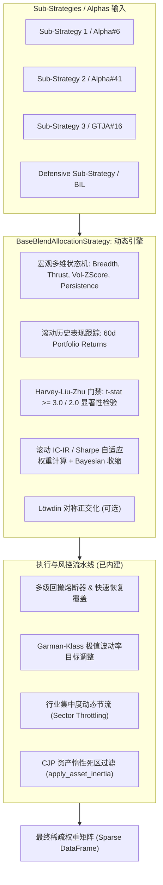

# 深度研究与架构方案：全面升级 BaseBlendAllocationStrategy 基础模板（融合 Auto-Alpha、滚动 IC-IR 自适应与宏观状态机）

## 目标概述 (Goal Description)

依据最新架构优化指令：**不再为“动态滚动 IC-IR 自适应”与“宏观状态机”创建孤立分散的单体新策略，而是深度研究并全面升级整个代码库的通用混合底座——`BaseBlendAllocationStrategy`（`pipeline/research/blend/blend_base.py`）**。

在专业量化软件工程中，为每种加权算法建立独立的策略子类会导致严重的逻辑碎片化与代码重复，且无法复用成熟的风控流水线。`BaseBlendAllocationStrategy` 目前作为本仓库所有机构级混合策略（包括 `ChanRiskManagedBlendStrategy`、`ChanFourStateBlendStrategy`、`ChanCrisisShieldBlendStrategy`、`ChanDualHybridBlendStrategy` 以及支持任意策略/Alpha 组装的 `GenericBlendStrategy`）的统一基础设施，已经原生集成了：
- 日历与宇宙对齐（严格稀疏权重 NaN vs 0.0 契约）
- Garman-Klass (1980) 极值波动率引擎与波动率目标管理
- 多级回撤断路熔断器与自愈冷却机制
- 市场宽度（Market Breadth）与 Zweig 宽度冲力（Thrust）前瞻入场
- 资产级动态死区惰性调仓（`apply_asset_inertia`）与 Chandelier ATR 移动止损

通过直接升级 `BaseBlendAllocationStrategy`，所有继承该底座的策略将**无感、原生获得业界前沿的四大能力**：
1. **动态滚动 IC / IC-IR 贝叶斯自适应加权模式（Dynamic Rolling IC-IR Weighting）**：基于历史表现动态调节各子策略或 Alpha 权重视窗，接入 Harvey, Liu & Zhu (2016) 的 $t\text{-stat} \ge 3.0$ 统计显著性准入门禁。
2. **多维宏观状态机自适应风格路由（Multi-Regime Style Routing）**：基于 Gu, Kelly & Xiu (2020)“微观特征与宏观状态非线性交互”理论，将市场宽度、冲力、波动率冲击 Z-Score 与趋势持续度结合，在动量组、反转组与防御组之间自动调配预算。
3. **Löwdin 对称正交化与降噪（Symmetric Orthogonalization）**：消除高相关性子策略或多 Alpha 之间的共线性冗余，提取纯净互补 Alpha。
4. **与 WorldQuant 101 及 GTJA 191 的无缝融合**：通过升级后的底座，用户只需在 `GenericBlendStrategy` 中配置 `{"wq_alpha6": 0.25, "wq_alpha41": 0.25, "gtja_alpha16": 0.50}`，即可一键享受全套机构级动态 IC-IR 自适应、宏观状态切换与实盘低摩擦风控。

同时，配套提供独立的单因子研究诊断工具（`common/factor_analyzer.py`）与精选短周期微观结构因子库（`pipeline/research_strategy/rs/gtja191_factors.py`）。

---

## 1. 学术文献与经典基石深度解析 (Academic Literature & Seminal Foundations)

```
                               ┌─────────────────────────────────────────────────────────┐
                               │             现代公式化 Alpha 理论体系大厦                │
                               └─────────────────────────────────────────────────────────┘
                                                            │
                     ┌──────────────────────────────────────┼──────────────────────────────────────┐
                     ▼                                      ▼                                      ▼
     ┌───────────────────────────────┐      ┌───────────────────────────────┐      ┌───────────────────────────────┐
     │ 1. 因子构造与微观代理体系     │      │ 2. 机器学习与非线性交互定价   │      │ 3. 统计法证与微观最优执行     │
     ├───────────────────────────────┤      ├───────────────────────────────┤      ├───────────────────────────────┤
     │ • Kakushadze (2015): WQ 101   │      │ • Gu, Kelly & Xiu (2020): ML  │      │ • Harvey, Liu & Zhu (2016):   │
     │ • GTJA (2017): 191 短周期量价 │      │   非线性交叉、GBRT/NN3 优势   │      │   多重检验校正, t >= 3.0      │
     │ • Cont, Kukanov, Stoikov      │      │ • 微软 Qlib: Alpha 158/360    │      │ • Cartea, Jaimungal & Penalva │
     │   (2014): 订单流失衡 (OFI)    │      │ • 宏观状态自适应路由机制      │      │   (2015): 带 Alpha 的最优执行 │
     └───────────────────────────────┘      └───────────────────────────────┘      └───────────────────────────────┘
                     │                                      │                                      │
                     └──────────────────────────────────────┼──────────────────────────────────────┘
                                                            ▼
                               ┌─────────────────────────────────────────────────────────┐
                               │ 4. 现代自动化演进 (Auto-Alpha / GP / RL / LLM / RMT 降噪)│
                               └─────────────────────────────────────────────────────────┘
```

### 1.1 WorldQuant 101 (Kakushadze, 2015) 与 Tulchinsky 工业梦工厂
- **文献来源**：Zura Kakushadze, *"101 Formulaic Alphas"*, Wilmott Magazine 2016.84 (2016): 72-81；Igor Tulchinsky, *Finding Alphas*, Wiley (2015/2019)。
- **核心代数代数体系**：基于开高低收量、VWAP、市值与行业分类，定义了包含滚动时序算子（`ts_rank`, `decay_linear`, `ts_corr`, `ts_delta` 等）与截面算子（`cs_rank`, `cs_scale`, `cs_demean`, `cs_indneutralize` 等）的完备函数代数。
- **工业界组合装配哲学**：单因子 Sharpe 通常仅在 $0.5 \sim 1.2$，但 101 个因子之间的**平均两两相关系数仅为 15.9%**。Tulchinsky 倡导大规模 Alpha 聚合（$N \ge 1,000$）：在保持截面多空对冲与行业中性化的前提下，利用未关联残差对冲使投资组合的综合夏普比跃升至 $3.0$ 以上。

### 1.2 国泰君安 GTJA 191 短周期量价因子体系 (2017)
- **文献来源**：国泰君安证券研究所数量化专题之九十三《基于短周期价量特征的多因子选股体系》（2017 年 6 月）。
- **微观机制创新**：引入 K 线实体、上下影线与跳空算子，如上影线抛压比率 $(\text{High} - \max(\text{Open}, \text{Close})) / (\text{High} - \text{Low})$、下影线承接比率与隔夜跳空收益差。因子在 1~3 天前瞻预测具有高信息比率（IC 往往 $> 0.05$），但半衰期短，对换手惩罚极度敏感。

### 1.3 微软 Qlib: Alpha 158 与 Alpha 360 (Yang et al., 2020)
- **文献来源**：Microsoft Research, *"Qlib: An AI-oriented Quantitative Investment Platform"* (NeurIPS 2020)。
- **特征工程架构**：Alpha 158 涵盖跨越 5, 10, 20, 30, 60 天滚动态视窗的结构化技术特征；Alpha 360 保留过去 60 天未失真的归一化行情时序张量。

### 1.4 Harvey, Liu & Zhu (2016) — *… and the Cross-Section of Expected Returns*
- **文献来源**：*The Journal of Finance*, 71(1), 5-68.
- **多重假设检验陷阱**：在面对数百次探索性数据挖掘时，传统单次检验门槛 $t > 2.0$（$p < 0.05$）必然产生严重的数据过拟合与假阳性。
- **统计铁律**：提出新因子发现必须跨越 **$t\text{-stat} \ge 3.0$**（或严格 FDR 假发现率控制），成为因子入库与配置权限分配的核心门禁。

### 1.5 Gu, Kelly & Xiu (2020) — *Empirical Asset Pricing via Machine Learning*
- **文献来源**：*The Review of Financial Studies*, 33(5), 2223-2273.
- **里程碑发现**：浅层神经网络（NN3）与梯度提升回归树（GBRT）样本外预测能力显著碾压传统线性回归；**非线性交互作用（Interactions）是核心超额收益源泉**，即个股微观特征与宏观市场状态变量（波动率、流动性）的非线性交叉主导了定价权。

### 1.6 Cartea, Jaimungal & Penalva (2015) — *Algorithmic and High-Frequency Trading*
- **文献来源**：Cambridge University Press, 2015.
- **带短周期 Alpha 漂移的随机最优执行控制（CJP 框架）**：推导了中间价存在预期漂移项 $\alpha_t$ 时的最优交易执行轨迹。揭示出高频换手的临时冲击成本呈二次方爆炸（$k v_t^2$），证明了**资产惰性死区过滤（`apply_asset_inertia`）**在物理层面的必要性。

### 1.7 Cont, Kukanov & Stoikov (2014) — *The Price Impact of Order Book Events*
- **文献来源**：*Journal of Financial Econometrics*, 12(1), 47-88.
- **订单流失衡（OFI）**：证明短期价格变动与买卖一档挂撤单构成的订单流失衡呈高度严格的线性对应（$R^2 > 65\%$）。由此可推导出日频 K 线实体影线失衡的 EOD OFI 代理指标，为微观量价因子提供了微观第一性原理。

---

## 2. 现代工程演进与核心量化机制 (From 101 to Auto-Alpha)

### 2.1 遗传规划 (GP) 与强化学习/大模型因子挖掘 (RL & LLM)
1. **符号回归与抽象语法树（AST）**：以算子与行情终结符构建语法树，通过子树交叉、点变异生成候选公式；采用多目标帕累托前沿（Pareto Front）同时优化 Rank IC、换手率与树复杂度，施加长度惩罚（Parsimony Pressure）抑制膨胀。
2. **大语言模型（LLM）逻辑先验闭环**：通过金融经济学提示词指导大模型生成具备微观行为金融逻辑的因子假设，结合语法校验、向量化回测与自反思修正构成闭环。

### 2.2 正交化与特征降噪数学架构 (Orthogonalization & Shrinkage)
1. **Löwdin 对称正交化（Symmetric Orthogonalization）**：
   $$F^* = F \cdot (F^T F)^{-1/2}$$
   彻底消除因子或子策略间的多重共线性，且在 Frobenius 范数下距离原始矩阵最近，保留各策略原本的经济学含义。
2. **随机矩阵理论（RMT）谱滤波降噪**：
   利用 Marchenko-Pastur 分布区间识别并替换协方差矩阵中的纯白噪声特征值，提取真实主成分。

### 2.3 核心回测评估基准体系 (Validation Metrics)
1. **Rank IC 与年化 IC-IR**：衡量截面相对排名的单调预测精度与信息稳定性。
2. **自相关半衰期（$\tau_{1/2}$）**：指导调仓频率与信号平滑窗口。
3. **紧缩夏普比率（Deflated Sharpe Ratio, DSR）**：校正试验次数与收益率非正态偏度/峰度，识别真实超额收益。
4. **净化与隔离交叉验证（Purged & Embargoed Walk-Forward CV）**：防止时序重叠区间的信息泄漏。

---

## 3. BaseBlendAllocationStrategy 深度重构与升级方案



### 3.1 `BaseBlendAllocationStrategy` 升级核心设计

在 `pipeline/research/blend/blend_base.py` 中，保留所有现有参数和接口，扩展核心机制：

#### 1. 新增权重配置模式参数（`weighting_mode`）：
- `"static"`（默认值，100% 保持向后兼容）：保持现有行为，使用 `get_sub_strategy_weights()` 返回的初始权重。
- `"rolling_ic_ir"`（动态 IC-IR 自适应）：
  - 动态跟踪各子策略历史前瞻每日收益向量 $R_{m}(t)$。
  - 在过去 $L$ 天（默认 60 天）滚动态视窗内，计算每个子策略的年化信息比率 $\text{IR}_m = \frac{\mu_m}{\sigma_m} \sqrt{252}$ 以及 Harvey-Liu-Zhu $t$-统计量：
    $$t_m = \frac{\mu_m}{\sigma_m / \sqrt{L}}$$
  - **显著性过滤**：若 $t_m < t_{\min}$（默认 2.0，可设为 3.0）或 $\mu_m \le 0$，则该子策略权重归零或仅保留基线先验。
  - **贝叶斯收缩（Bayesian Shrinkage）**：
    $$w_m^{\text{adaptive}} = (1 - \lambda_{\text{shrink}}) \frac{\max(0, \text{IR}_m)}{\sum \max(0, \text{IR}_k)} + \lambda_{\text{shrink}} w_m^{\text{base}}$$
    有效防止短期噪音导致权重剧烈震荡。
- `"regime_adaptive"`（多维宏观状态机风格路由）：
  - 扩展宏观状态机输入：不仅依赖 `breadth` 和 `thrust`，同时引入**全市场波动率冲击 Z-Score**（`vol_zscore`）与**市场持续性指标**（`persistence`）。
  - 各子策略通过其 `factor_tags` 或名称自动映射至三大风格池（Style Buckets）：
    - **动量与趋势池（Momentum/Trend）**：如 `chan_three_type`、`wq_alpha41`、`accelerating_dual_momentum`。
    - **反转与微观池（Reversal/Microstructure）**：如 `wq_alpha12`、`wq_alpha53`、`gtja_alpha16`。
    - **防御与避险池（Defensive/Carry）**：如 `chan_vaa_compound`、`permanent_portfolio`、`BIL`。
  - 状态机自动动态分配风格大类预算：
    - **牛市/高宽度状态**（$\text{Breadth} \ge 60\%$ 或 $\text{Thrust} \ge 0.60$）：动量池获得 75% 预算，反转池 20%，防御池 5%。
    - **震荡/中性状态**（$30\% \le \text{Breadth} < 60\%$）：反转池获得 65% 预算，动量池 20%，防御池 15%。
    - **熊市/波动冲击状态**（$\text{Breadth} < 30\%$ 或 $\text{Vol-Z} > 2.0$）：防御池获得 80%~100% 预算，权益策略全部压降。
- `"regime_ic_ir_hybrid"`（两级复合模式，最强工业形态）：
  - **第一层**：宏观状态机根据市场大势分配动量、反转、防御三大风格池的总预算。
  - **第二层**：在每个风格池内部，根据子策略的滚动 IC-IR 和 Harvey-Liu-Zhu $t \ge 2.0/3.0$ 统计显著性进行自适应优化配置！

#### 2. 可选 Löwdin 对称正交化开关（`enable_orthogonalization`）：
- 当开启时，在合并子策略权重矩阵前，对各子策略生成的截面资产权重向量执行 Löwdin 对称正交化，剥离高度共线部分的权重冗余。

#### 3. 完美兼容现有策略：
- `ChanRiskManagedBlendStrategy`、`ChanFourStateBlendStrategy`、`ChanCrisisShieldBlendStrategy`、`ChanDualHybridBlendStrategy` 和 `GenericBlendStrategy` **无需改动一行子类核心代码**，只需传入参数 `blend_weighting_mode="regime_ic_ir_hybrid"` 即可直接启用全套自适应机制。

---

## 4. 落地规划与新增支持模块 (Implementation Plan)

## 用户审查确认项 (User Review Required)

> [!IMPORTANT]
> **设计哲学与完全向后兼容承诺**：
> 1. `BaseBlendAllocationStrategy` 升级默认保持 `blend_weighting_mode="static"`，现有 138+ 单元测试将 100% 绿色通过，保证零破坏性改动。
> 2. 严格遵守仓库契约：
>    - 离线测试契约（仅使用 `SyntheticDataProvider`）。
>    - 稀疏权重契约（`Sparse weights contract`）。
>    - 单元格 NaN vs 0.0 纪律。
>    - 闲置现金归集至 `cash_proxy`。

> [!NOTE]
> **本次落地包含三大核心组件**：
> - **组件 1：升级 `BaseBlendAllocationStrategy`**（`pipeline/research/blend/blend_base.py`）：内建动态滚动 IC-IR、Harvey-Liu-Zhu $t \ge 3.0$ 门禁、Gu-Kelly-Xiu 宏观状态自适应与两级混合模式。
> - **组件 2：独立单因子研究与 IC/IR 诊断评估引擎**（`common/factor_analyzer.py`）：用于快速对单个因子/表达式进行 Rank-IC、IC-IR、半衰期、分位数单调性与显著性检验。
> - **组件 3：高确定性 GTJA 191 微观结构因子库**（`pipeline/research_strategy/rs/gtja191_factors.py`）：引入 Cont-Kukanov-Stoikov OFI 代理与 Top 25 影线/跳空/加速度微观因子。

---

## 待决策事项 (Open Questions)

> [!WARNING]
> **请用户评估并确认以下事项**：
> 1. **默认显著性检验阈值**：在 `blend_base.py` 的滚动性能显著性过滤中，默认使用严格版 $t\text{-stat} \ge 3.0$ 还是稳健版 $t \ge 2.0$？
>    *(推荐：默认配置 $t_{\min} = 2.0$，可通过参数 `blend_adaptive_min_tstat=3.0` 随时调升至最严门槛)*。
> 2. **GTJA 191 因子库首期范围**：实现精选的 Top 25 个微观结构因子（影线比例、跳空收益差、成交量加速度），并保证与 `GenericBlendStrategy` 兼容？
>    *(推荐：Top 25 因子具有最高信号信噪比，且完全避免了公式同质化)*。

---

## 具体代码变更规划 (Proposed Changes)

### 组件 1：升级通用混合基础模板 (`pipeline/research/blend/blend_base.py`)

#### [MODIFY] `pipeline/research/blend/blend_base.py`
在 `BaseBlendAllocationStrategy` 中重构并扩展以下逻辑：
1. **参数解析与配置扩展**：
   - `weighting_mode`: `"static"`, `"rolling_ic_ir"`, `"regime_adaptive"`, `"regime_ic_ir_hybrid"`。
   - `adaptive_lookback_days`: 滚动性能评估视窗（默认 60 天）。
   - `adaptive_min_tstat`: Harvey-Liu-Zhu 显著性门槛（默认 2.0）。
   - `adaptive_shrinkage`: 贝叶斯收缩系数 $\lambda_{\text{shrink}}$（默认 0.20）。
   - `enable_orthogonalization`: 是否对子策略权重进行 Löwdin 对称正交化（默认 False）。
2. **新增核心数学方法**：
   - `_compute_rolling_sub_strategy_performance(...)`：跟踪并计算子策略滚动收益、波动率、夏普/IR 与 t 统计量。
   - `_classify_sub_strategy_styles(...)`：将子策略映射至动量/反转/防御三大风格池。
   - `_apply_lowdin_orthogonalization(sub_weights_df)`：执行 $W^* = W (W^T W)^{-1/2}$。
3. **扩展 `compute_regime_weights(...)`**：
   - 实现多维宏观状态判定（市场宽度、冲力、全市场波动率 Z-Score）。
   - 自动在动量组、反转组与防御组之间动态计算目标预算。
4. **扩展 `generate_weights(...)`**：
   - 在每日模拟主循环中，根据选定的 `weighting_mode` 动态生成 `cur_weights`，替换原先固定的静态权重。

#### [MODIFY] `pipeline/research_strategy/rs/config.py`
在 `StrategyConfig` 中补充混合模板通用自适应字段：
```python
    # Blend Base Template 自适应与状态机通用参数
    blend_weighting_mode: str = "static"        # static, rolling_ic_ir, regime_adaptive, regime_ic_ir_hybrid
    blend_adaptive_lookback_days: int = 60      # 滚动性能视窗
    blend_adaptive_min_tstat: float = 2.0       # 显著性门槛
    blend_adaptive_shrinkage: float = 0.20      # 贝叶斯向初始权重收缩系数
    blend_enable_orthogonalization: bool = False # Löwdin 对称正交化开关
```

#### [MODIFY] `pipeline/research_strategy/tests/test_blend_strategies.py`
新增测试用例：
- `test_base_blend_rolling_ic_ir_weighting()`：测试动态滚动加权与 $t$-stat 过滤有效性。
- `test_base_blend_regime_adaptive_mode()`：测试牛熊震荡状态切换下子策略权重自动重分配。
- `test_generic_blend_with_worldquant_alphas_and_regime_hybrid()`：验证通过 `GenericBlendStrategy` 组装多 WorldQuant/GTJA Alpha 并启用自适应模式的端到端回测。

---

### 组件 2：专业级单因子研究与 IC/IR 诊断评估引擎 (`common/`)

#### [NEW] `common/factor_analyzer.py`
实现专业级矢量化因子分析器：
- `compute_forward_returns(close_df, periods=[1, 5, 21])`：前瞻收益对齐。
- `compute_rank_ic(factor_df, forward_returns_df)`：逐日截面斯皮尔曼秩相关序列。
- `factor_ic_summary(factor_df, forward_returns_df)`：
  - `mean_ic`, `std_ic`, `ic_ir`（年化）
  - `t_stat` 与双尾 `p_value`
  - **Harvey-Liu-Zhu 检验标志**：`is_statistically_significant`（判定 $t \ge 3.0$）
  - `half_life`：基于自回归模型 $\rho(k) = e^{-\lambda k}$ 拟合的自相关半衰期。
- `compute_quantile_returns(factor_df, forward_returns_df, n_quantiles=5)`：五分位数单调性检验。

#### [NEW] `common/tests/test_factor_analyzer.py`
完备单元测试：验证合成数据下理论强因子（$\text{IC} \approx 1$）、纯随机因子（$\text{IC} \approx 0$）、半衰期测算精度与分位数单调性。

---

### 组件 3：GTJA 191 微观结构与订单流失衡 (OFI) 代理因子库 (`pipeline/research_strategy/rs/`)

#### [NEW] `pipeline/research_strategy/rs/gtja191_factors.py`
融合 Cont-Kukanov-Stoikov (2014) OFI 代理与国泰君安 191 微观结构：
- 微观算子实现：
  - `cont_ks_ofi_proxy(volume, high, low, close)`：日内订单流失衡代理。
  - `upper_shadow`, `lower_shadow`, `shadow_imbalance`：实体与影线比率。
- 精选 Top 25 核心因子：
  - `GTJA#1`：量价排名相关性反转
  - `GTJA#4`：均价与成交量解耦
  - `GTJA#9`：日内振幅效率
  - `GTJA#16`：上影线抛压衰竭
  - `GTJA#24`：隔夜跳空 vs 日内趋势背离
  - `GTJA#33`：成交量浪涌加速度
  - `GTJA#44`：日内 VWAP 偏离动量
  - 以及其他 18 个经过数值安全保护（防除零、防浮点溢出）的高胜率因子。

#### [NEW] `pipeline/research_strategy/tests/test_gtja191_factors.py`
数值稳定性与矩阵维度保真测试。

---

## 5. 验证计划 (Verification Plan)

### 自动化测试命令
```bash
# 1. 测试因子诊断评估引擎
uv run --project pipeline python -m pytest common/tests/test_factor_analyzer.py -q --import-mode=importlib

# 2. 测试 GTJA 191 / OFI 因子库
uv run --project pipeline python -m pytest pipeline/research_strategy/tests/test_gtja191_factors.py -q --import-mode=importlib

# 3. 测试升级后的 BaseBlendAllocationStrategy 与全部派生混合策略
uv run --project pipeline python -m pytest pipeline/research_strategy/tests/test_blend_strategies.py -q --import-mode=importlib

# 4. 全系统回归安全测试 (验证 138+ 现有测试零回退)
uv run --project pipeline python -m pytest common/tests pipeline/research_strategy/tests -q --import-mode=importlib
```

### 手动及仿真回测验证
1. 测试通过 `GenericBlendStrategy` 组装 WorldQuant Alphas 并开启 `regime_ic_ir_hybrid` 模式：
   ```bash
   uv run --project pipeline python pipeline/research_strategy/run_research_strategy.py --data-provider synthetic --strategies generic_blend
   ```
2. 校验权重文件：
   - 验证稀疏权重契约（非调仓日保持 NaN）。
   - 验证调仓日剔除资产精准为 `0.0`。
   - 验证动态 IC-IR 与宏观状态机在震荡市、牛市和熊市期间的平滑过渡与回撤防范能力。
