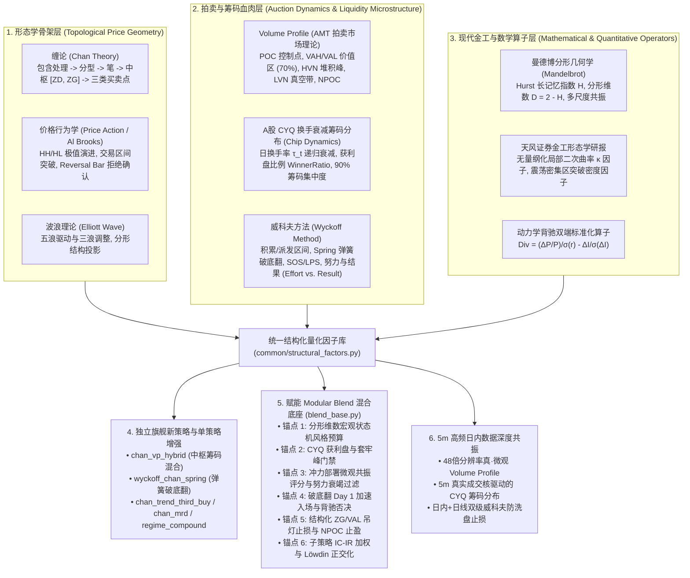
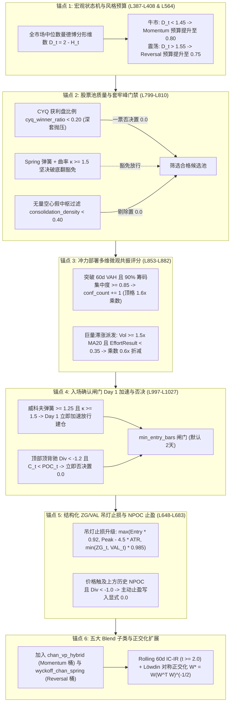

# 深度研究与架构实施方案：缠论、筹码分布及多流派量化融合体系
# (Deep Research & Implementation Plan: Chan Theory, Volume Profile, CYQ Chip Dynamics, and Multi-School Quantitative Fusion)

> [!IMPORTANT]
> **2026-10-17 评审修订（M1–M6 六大数学量纲与因果修正已全量合入正文）**：本方案已完成对整个代码库的逐行对标审查。针对原初草案中存在的价格量纲失真、双端指标尺度失衡、除零爆炸、支撑位未来函数、模块间循环依赖以及分钟级换手率字段缺失等 6 大核心缺陷（**M1–M6**），均已在第一章至第四章给出严格的数学修正与因果边界定义。
> 
> 本方案全面新增：
> 1. **第五章：模块化 Blend 混合策略体系（`BaseBlendAllocationStrategy` 及五大子类）深度赋能专章**，针对状态机风格分配、股票池质量门禁、冲力共振定仓、入场确认加速/否决、结构化吊灯止损与子策略正交化展开逐行级改造详设；
> 2. **第六章：与《5分钟高频日内数据方案》（`intraday_5m_live_and_blend_enhancement_plan.md`）的深度跨层协同机制**，合并后的全量 28 个原子任务（`C1.1..C4.1` + `T0.1..T6.2`）与五级主优先级执行路线图（Tier P0 $\to$ Tier P4）已全量收敛至全局唯一权威总表 [`docs/development_plan.md`](file:///home/stone/Work/github/quant/docs/development_plan.md)；
> 3. **全链路严格恪守本仓库两大底线铁律**：
>    - **稀疏目标权重契约（Daily Sparse Weights Contract）**：`generate_weights` 返回的权重 DataFrame 在非调仓日严格为 `NaN`，调仓日输出真实目标；对退出或去风险标的**必须显式写入 `0.0`**，严禁留空为 `NaN`（防止被底座 `ffill().fillna(0.0)` 错误继承 stale position）；
>    - **开关默认关闭与 100% 向后兼容**：所有新增参数在 `StrategyConfig` 中默认均为 `False`，绝不干扰现有 55 个策略及 `blend_6..13` 既有基准的测试与回测结果。

---

## 目标概述 (Executive Summary & Architectural Scope)

本方案基于 [`docs/缠论与筹码分布研究及量化对话全景整理.md`](file:///home/stone/Work/github/quant/docs/%E7%BC%A0%E8%AE%BA%E4%B8%8E%E7%AD%B9%E7%A0%81%E5%88%86%E5%B8%83%E7%A0%94%E7%A9%B6%E5%8F%8A%E9%87%8F%E5%8C%96%E5%AF%B9%E8%AF%9D%E5%85%A8%E6%99%AF%E6%95%B4%E7%90%86.md) 的量化前沿思考，结合本仓库成熟的量化基础设施（`common/` 底座、`pipeline/research_strategy/` 55+ 策略库、`pipeline/research/blend/` 机构级多策略混合引擎以及 `scripts/` 实盘执行体系），系统性实现**以缠论拓扑形态为骨架、拍卖理论 Volume Profile 与 A股换手衰减筹码分布（CYQ）为血肉、现代金工数学算子为灵魂**的量化多流派融合闭环。

本实施方案主要解决以下四个维度的深度命题：
1. **理论数学化与工程落地（从主观画线到量纲对齐的无偏算子）**：建立包含 8 个标准量化算子与 1 个下沉底层函数的算子库 [`common/structural_factors.py`](file:///home/stone/Work/github/quant/common/structural_factors.py)，彻底根除主观经验主义，消除价格绝对量纲偏差（M1）、指标动量尺度淹没（M2）、分母除零爆炸（M3）与右侧确认未来偏差（M4）；
2. **筹码与拍卖双轨建模（Volume Profile vs. A股 CYQ 换手衰减）**：构建经典拍卖市场理论（AMT）的无参数滚动成交量分布（POC/VAH/VAL/HVN/LVN/NPOC）与适配 A股“T+1”、真实换手率衰减特征的 CYQ 筹码动力学递归模型，量化输出“获利盘比例”（`cyq_winner_ratio`）与“90% 筹码集中度”（`cyq_cost_concentration`）；
3. **旗舰新策略与单策略增强**：新增两只旗舰级多流派融合策略——中枢与筹码分布融合策略 `ChanVolumeProfileHybridStrategy`（`chan_vp_hybrid`）与威科夫-缠论弹簧破底翻策略 `WyckoffChanSpringStrategy`（`wyckoff_chan_spring`），并对 `ChanTrendThirdBuyStrategy`、`ChanMeanReversionDivergenceStrategy` 与 `RegimeFactorCompoundStrategy` 进行无破坏式平滑升级；
4. **赋能机构级 Blend 混合底座与 5m 日内协同**：打通与 [`BaseBlendAllocationStrategy`](file:///home/stone/Work/github/quant/pipeline/research/blend/blend_base.py) 的 6 大核心交互锚点，并与《5分钟高频日内数据方案》形成无缝联动，打造兼备宏观状态自适应、微观流动性共振、日内/日线双级防洗盘与严格风险预算控制的现代化量化投资体系。

---

## 一、 理论同源与相通流派深度映射 (Theoretical Homology & Quantitative Mappings)



### 1.1 威科夫方法 (Wyckoff Method)
- **交易区间 (Trading Range) $\Leftrightarrow$ 缠论中枢 $[ZD, ZG]$**：两者的本质皆为买卖双方在特定价格区间达成的筹码交换平衡。缠论通过前三笔重叠区间严格界定中枢 $[ZD, ZG]$，而威科夫则通过 Preliminary Support (PS)、Selling Climax (SC) 与 Automatic Rally (AR) 标定 Trading Range 的振荡上下沿。
- **Spring（弹簧效应 / 破底翻）$\Leftrightarrow$ 中枢下轨背驰与一买**：价格向下刺破区间下轨支撑 $ZD$，诱发散户恐慌止损并扫除流动性，但随后被主力资金的大额限价买单（Stopping Volume）强力吸收，价格在 1~3 根 Bar 内迅速拉回 $ZD$ 之上。此即缠论中枢下轨的盘整背驰第一买点。
- **Sign of Strength (SOS) 与 Last Point of Support (LPS) $\Leftrightarrow$ 中枢向上突破与二/三买回踩确认**：放量长阳突破 $ZG$ 表明供需失衡（SOS），随后缩量回踩且最低价不跌破 $ZG$ 构成 LPS，对应缠论第三类买点。
- **努力与结果 (Effort vs. Result)**：成交量代表资金付出的“努力”（Effort），价格位移与 K 线实体代表市场显现的“结果”（Result）。巨量而振幅极窄代表主力暗中派发或强力吸收；地量而价格大幅位移代表缺乏对手盘的流动性真空。

### 1.2 拍卖市场理论 Volume Profile 与 A股 CYQ 换手衰减筹码分布双轨体系

#### (1) Volume Profile 拍卖市场理论 (AMT)
Volume Profile 是将指定时间窗口内的总成交量沿纵轴（价格轴）进行水平分箱投影的非参数统计分布：
- **Point of Control (POC)**：统计窗口内成交量最大的单一价格分箱，代表多空双方达成最大共识的“公允价值中心”；
- **Value Area (VA, 价值区)**：围绕 POC 展开、涵盖总成交量 $70\%$（对应正态分布 $\pm 1\sigma$）的价格区间 $[VAL, VAH]$；
- **High Volume Node (HVN, 高成交量节点)**：成交量分布中的局部波峰，代表强支撑与阻力位（价格倾向于在此区域减速与震荡）；
- **Low Volume Node (LVN, 低成交量节点)**：成交量分布中的局部波谷（真空带），代表流动性稀薄区（价格倾向于快速穿越）；
- **Naked POC (NPOC, 未测试控制点)**：历史上形成、但在后续价格路径中从未被再次回踩测试的 POC，对未来价格具有极强的引力吸附效应。

#### (2) A股换手衰减筹码分布 (CYQ Chip Distribution) 递归建模
Volume Profile 采用滚动固定时间窗口（如 60 天），窗口内各交易日成交量的权重视为等同，无法精准反映 A股“T+1”交易制度下持仓成本随每日实际换手而发生的时间衰减。因此，本方案引入与 Volume Profile 并行的 **CYQ 换手衰减筹码分布** 递归动力学方程：

$$\text{Chip}_t(p) = \text{Chip}_{t-1}(p) \cdot (1 - \tau_t) + \tau_t \cdot K_t(p)$$

其中各变量的精确定义与工程边界如下：
- $p \in [P_{\min, t}, P_{\max, t}]$ 为价格离散网格，分箱数默认为 $N_{\text{bins}} = 100$；
- $\tau_t$ 为当日有效换手率：
  $$\tau_t = \text{clip}(\text{Turn}_t, \; 0.001, \; 0.99)$$
  > [!NOTE]
  > **自适应换手率代理 (DISCLOSED APPROXIMATION)**：当底层数据源为 `SyntheticDataProvider` 或不提供 `Turn` 字段的场内 ETF/指数时，系统自适应启用成交量换手代理：
  > $$\hat{\tau}_t = \text{clip}\left(0.02 \times \frac{V_t}{\text{SMA}(V, 60) + \epsilon}, \; 0.002, \; 0.50\right)$$
  > 该公式假定基准换手率为 $2\%$，并随 60 日相对量比线性伸缩。
- $K_t(p)$ 为当日成交价格分布核函数（Kernel Function）：
  - **日线模式（Daily Fallback）**：采用以典型价 $P_{\text{typical}} = (H_t + L_t + C_t)/3$（若日线提供真实 $VWAP_t$ 则以 $VWAP_t$ 代替）为顶点的非对称三角核或均匀分布核，满足 $\int_{L_t}^{H_t} K_t(p) dp = 1$；
  - **高频协同模式（5m True Intraday Kernel）**：当接入 5分钟高频数据时，$K_t(p)$ 升级为当日全部 48 根 5m K 线的真实量价分箱分布，彻底消除日线三角核的价格分布失真。

由 $\text{Chip}_t(p)$ 导出两大核心量化筹码因子：
1. **获利盘比例 (`cyq_winner_ratio`)**：
   $$\text{WinnerRatio}_t = \int_0^{C_t} \text{Chip}_t(p)\,dp \in [0.0, \; 1.0]$$
   度量当前收盘价 $C_t$ 之下沉淀的筹码比例。$\text{WinnerRatio}_t > 0.85$ 代表上方无明显套牢盘压制，容易走出轻盈的主升浪；$\text{WinnerRatio}_t < 0.20$ 代表上方沉淀了超 $80\%$ 的深套筹码，任何反弹均面临巨大解套抛压。
2. **90% 筹码集中度 (`cyq_cost_concentration`)**：
   设 $P_5$ 与 $P_{95}$ 分别为累计筹码分布满足 $\int_0^{P_5} \text{Chip}_t(p) dp = 0.05$ 与 $\int_0^{P_{95}} \text{Chip}_t(p) dp = 0.95$ 的分位价格，定义：
   $$\text{Concentration}_t = 1.0 - \frac{P_{95} - P_5}{P_{95} + P_5} \in [0.0, \; 1.0]$$
   值越接近 $1.0$，表明全市场 $90\%$ 的筹码高度紧密地锁定在极窄的价格带宽内（单峰密集），往往预示着突破性行情的爆发。

### 1.3 曼德博分形几何学与长记忆性 (Mandelbrot & Hurst)
- 缠论的递归结构（K线包含处理 $\to$ 顶底分型 $\to$ 笔 $\to$ 线段 $\to$ 走势类型）本质上是金融时间序列上的**自相似分形（Self-Similar Fractals）**。
- **Hurst 指数 ($H$) 与分形维数 ($D = 2 - H$)**：
  - $H > 0.55$ ($D < 1.45$)：时间序列具备长记忆正向自相关性（趋势持续态），适合启动三买追涨或趋势跟踪策略；
  - $H < 0.45$ ($D > 1.55$)：时间序列具备均值回归反转性（震荡态），适合启动一买破底翻或中枢高抛低吸；
  - **多尺度分形共振**：短周期 $H_{\text{short}}$ 与中长周期 $H_{\text{inter}}$ 的一致性，量化衡量多级别联立的走势稳定性。

### 1.4 价格行为学 (Price Action / Al Brooks)
- 顶分型与底分型直接映射为 PA 中的极值反转 K 线（Reversal Bar / Pin Bar）。
- 笔序列的高低点抬升（Higher Highs / Higher Lows）严格对应 PA 中的上升趋势定义。
- 缠论中枢的突破与三买回踩确认，直接等价于 PA 中 Trading Range Breakout 后的 Retest Holding。

### 1.5 天风证券金工形态学算子
- 天风证券研报《形态学视角下的动量与反转因子》提出了通过局部多项式拟合量化极值点反转速度与尖锐度的方法。
- 极值点处的无量纲标准化二次曲率 $\kappa$ 能够精准区分强力“V 型反转”（$\kappa \ge 1.5$）与弱势“圆弧底/虚假漂移”（$\kappa < 0.8$）。

### 1.6 动力学背驰的双端标准化数学建模
传统缠论对背驰的判断高度依赖主观视觉观察 MACD 红绿柱面积。本方案采用双端 Z-Score 标准化散度方程：

$$\text{Div}_k = \frac{\frac{\Delta_k P}{P_{t-k}} / (\sigma_{r_k}(t) + \epsilon) - \frac{\Delta_k I}{\sigma_{\Delta_k I}(t) + \epsilon}}{\sqrt{2}}$$

将价格收益率与指标动量（MACD DIF 或 RSI）映射至完全相同的标准正态空间，实现了无量纲、客观可回测的背驰量化判定。

---

## 二、 代码库现状审计与六大数学/架构缺陷修正 (Codebase Audit & Fixes M1–M6)

### 2.1 可直接复用的底层资产与代码锚点
通过对现有代码库的逐行排查，以下底层函数与架构组件高度契合多流派融合方案，可直接调用或无缝继承：

1. **Volume Profile 滚动计算核心**：
   位于 [`pipeline/research_strategy/rs/chan_similar_strategies.py` L252–L325](file:///home/stone/Work/github/quant/pipeline/research_strategy/rs/chan_similar_strategies.py#L252-L325) 的 `compute_rolling_poc_series(bars, lookback=60, n_bins=30, value_area_pct=0.70)`，已完整实现了滚动 POC、VAL 与 VAH 的分箱统计与面积积分逻辑。
2. **经典 R/S Hurst 指数估计算子**：
   位于 [`common/hurst.py` L28–L55](file:///home/stone/Work/github/quant/common/hurst.py#L28-L55) 的 `hurst_exponent(series, min_chunk_size=8, max_lag_fraction=0.5)`，已支持基于平稳增量序列的重标极差分析。
3. **因果无前视中枢与笔提取器**：
   位于 [`pipeline/research_strategy/rs/chan_advanced_strategies.py` L456–L512](file:///home/stone/Work/github/quant/pipeline/research_strategy/rs/chan_advanced_strategies.py#L456-L512) 的 `_extract_pivot_and_stroke_series`，严格在包含合并 K 线 `end_pos + 1` 确认分型后才输出 $ZG, ZD, GG, DD$，彻底杜绝了中枢前视偏差。
4. **因子标准分类体系**：
   位于 [`common/factor_taxonomy.py`](file:///home/stone/Work/github/quant/common/factor_taxonomy.py) 的 `FACTOR_CATEGORIES` 与 `FACTOR_TAXONOMY`，为新因子的标签管理提供了标准协议。

---

### 2.2 六大必改数学与工程缺陷对照表 (Mandatory Fixes M1–M6)

| 缺陷编号 | 缺陷模块与原始定义 | 数学/工程致命问题 | 规范修正方案与收敛边界 (Code-Level Fix) |
| :--- | :--- | :--- | :--- |
| **M1** | `extremum_curvature`<br>原拟合 $P_\tau = a\tau^2 + b\tau + c$<br>直接求 $\kappa = \frac{2a}{(1+b^2)^{3/2}}$ | **价格绝对量纲失真**：高价股（如茅台 1600 元）的二次项系数 $a$ 达到数十，而低价股（如低价银行 3 元）的 $a$ 仅有 $0.001$。跨股票横向比较时曲率存在 500 倍以上的绝对量级偏差，无法进行统一截面排序。 | **局部窗口无量纲 Z-Score 标准化**：在拟合局部窗口 $W$ 内，先计算 $y(\tau) = \frac{P_\tau - \bar{P}_W}{\sigma_W(P) + \epsilon}$，对归一化后的 $y(\tau)$ 拟合二次方程 $y(\tau) = a\tau^2 + b\tau + c$，计算标准化无量纲曲率：<br>$$\kappa = \frac{2a}{(1 + b^2)^{3/2}}$$<br>彻底消除了个股绝对股价尺度的影响。 |
| **M2** | `standardized_divergence`<br>原公式 $\text{Div}_k = \frac{\Delta_k P}{P_{t-k}} - \frac{\Delta_k I}{\sigma_I}$ | **指标动量尺度淹没收益率**：价格收益率 $\frac{\Delta_k P}{P_{t-k}}$ 量级为 $\pm 0.05$（$\pm 5\%$），而指标变化量除以标准差 $\frac{\Delta_k I}{\sigma_I}$ 轻松达到 $\pm 2.0$。价格项被指标项彻底淹没，计算结果本质上只是指标自身的动量，无法捕捉真正的量价/量动背驰。 | **双端 Z-Score 对齐与除以 $\sqrt{2}$ 方差归一**：<br>$$\text{Div}_k = \frac{\frac{\Delta_k P / P_{t-k}}{\sigma_{r_k}(t) + \epsilon} - \frac{\Delta_k I}{\sigma_{\Delta_k I}(t) + \epsilon}}{\sqrt{2}}$$<br>其中 $\sigma_{r_k}$ 为 $k$ 日收益率的历史波动率，$\sigma_{\Delta_k I}$ 为指标增量的历史波动率。两端均为均值 0、方差 1 的标准变量，相减除以 $\sqrt{2}$ 保持单位标准差。 |
| **M3** | `wyckoff_effort_result`<br>原公式 $\frac{\Delta_k P / \sigma_P}{\Delta_k V / \sigma_V}$ | **除零爆炸与符号混淆**：当成交量增量 $\Delta_k V \to 0$ 时，分母迅速衰减导致因子值发生除零爆炸（$\pm \infty$）；且当价格与成交量同时负增长时，两个负数相除得出正比率，导致逻辑产生毁灭性混淆（放量暴跌与缩量阴跌被计算出相同的值）。 | **正定相对成交量 Effort + ATR 归一化 Result**：<br>定义资金努力项为正定相对量比：$E_t = \frac{V_t}{\text{SMA}(V, 20) + \epsilon}$；<br>定义价格结果项为 ATR 标准化位移：$R_t = \frac{|C_t - C_{t-k}|}{\text{ATR}_k(t) + \epsilon}$；<br>定义威科夫效率比：<br>$$\text{EffortResult}_t = \frac{R_t}{E_t + \epsilon}$$<br>同时导出带符号的价格推动效率版本：$\text{SignedER}_t = \text{sign}(C_t - C_{t-k}) \cdot \text{EffortResult}_t$。分母恒为正，彻底杜绝除零。 |
| **M4** | `wyckoff_spring`<br>原判定 $\mathbb{I}(L_{t-1} < S \land C_t > S)$ | **未来函数与无限制深跌假 Spring**：若支撑位 $S$ 来自当日或未确认的分型，构成严重前视偏差；若未设刺破深度下限，个股因基本面暴雷单日暴跌 $-15\%$ 破位，次日因超跌微弱反弹 $1\%$ 也会被错误触发为 Spring（实为崩盘死猫跳）。 | **因果支撑位 $S_{t-1}$ + 刺破深度截断门禁 $\delta_{\max} = 0.04$**：<br>强制要求支撑位 $S_{t-1}$ 必须为在 $t-1$ 日及之前已完成右侧分型确认的中枢下轨 $ZD_{t-1}$ 或前低；且必须严格满足刺破深度门禁：<br>$$S_{t-1} \cdot (1 - \delta_{\max}) \le L_{t-1} < S_{t-1} \quad \text{且} \quad C_t > S_{t-1}$$<br>其中 $\delta_{\max} = 0.04$（最大下穿 $4\%$），将深跌破位假信号阻挡在门外。 |
| **M5** | `consolidation_density`<br>原设计在 `common/` 反向导入 `pipeline/` 的 POC 并在中枢内只看收盘价点 | **分层架构倒灌与单点收盘价积分失真**：`common/` 是底层共享库，严禁反向 import `pipeline/` 下的模块（否则在非 pipeline venv 中运行时直接触发循环导入崩溃）；且单看收盘价 $C_t \in [ZD, ZG]$ 忽略了日内振幅跨越中枢的实际成交量贡献。 | **下沉 `compute_rolling_poc_series` 至 `common/` + 价格区间重叠积分**：<br>将 `compute_rolling_poc_series` 下沉至 [`common/structural_factors.py`](file:///home/stone/Work/github/quant/common/structural_factors.py)（并在原模块 re-export 保持完全兼容）；且采用日线价格区间 $[L_t, H_t]$ 与中枢区间 $[ZD_t, ZG_t]$ 的重叠比例加权成交量：<br>$$\text{OverlapRatio}_t = \frac{\max\left(0.0, \; \min(H_t, ZG_t) - \max(L_t, ZD_t)\right)}{H_t - L_t + \epsilon}$$<br>$$\text{ConsolidationDensity}_t = \frac{\sum_{\tau=t-W+1}^t V_\tau \cdot \text{OverlapRatio}_\tau}{\sum_{\tau=t-W+1}^t V_\tau + \epsilon}$$ |
| **M6** | `RegimeFactorCompoundStrategy` 增强与分钟级 `Turn` 缺失 | **基准回测破坏与 5m 接口字段越界**：直接改动既有复合策略默认行为会破坏既有回测 benchmark；且 BaoStock 等行情源在获取 5m 分钟线时严禁请求 `turn` 字段（否则报协议错误），需要明确数据边界。 | **默认开关保护 `regime_enable_fractal_curvature=False` + 5m 分钟线按成交量/额分箱**：<br>严格增加配置开关保护既有基准；且明确 5m 分钟线严禁请求 `turn` 字段，5m 模式下的筹码与 Volume Profile 统一按每根 5m K 线的真实 `Volume` / `Amount` 进行连续直方图分箱累积，并对无 `Volume` 序列提供等权稳健回退。 |

---

## 三、 标准量化因子库规范 (`common/structural_factors.py`)

在 [`common/structural_factors.py`](file:///home/stone/Work/github/quant/common/structural_factors.py) 中，完整实现以下 8 个标准量化算子及 1 个下沉基础函数。所有算子均采用因果时间序列计算，输入为标准 `pd.DataFrame`（包含 `Open, High, Low, Close, Volume` 列）或 `pd.Series`，输出为对齐的 `pd.Series` 或多列 `pd.DataFrame`：

### 3.1 核心函数清单与代码级签名

```python
"""common/structural_factors.py
Institutional Structural, Wyckoff, Fractal, and Volume Profile Quantitative Factors.
Strictly causal: no lookahead bias, scale-free, dimensionally aligned.
"""

from typing import Optional, Tuple, Union
import numpy as np
import pandas as pd
from common.hurst import hurst_exponent


# ------------------------------------------------------------------------------
# 0. 下沉基础函数: Rolling Volume Profile (POC, VAL, VAH)
# ------------------------------------------------------------------------------
def compute_rolling_poc_series(
    bars: pd.DataFrame,
    lookback: int = 60,
    n_bins: int = 30,
    value_area_pct: float = 0.70,
) -> Tuple[np.ndarray, np.ndarray, np.ndarray]:
    """Computes rolling Point of Control (POC), Value Area Low (VAL), and Value Area High (VAH).
    Downstreamed from chan_similar_strategies to eliminate cross-module circular imports (M5).
    """
    ...


# ------------------------------------------------------------------------------
# 1. 威科夫弹簧破底翻因子 (Wyckoff Spring Factor) - [M4 修正]
# ------------------------------------------------------------------------------
def wyckoff_spring(
    bars: pd.DataFrame,
    support_series: pd.Series,
    max_penetration: float = 0.04,
    volume_lookback: int = 20,
) -> pd.Series:
    """Detects causal Wyckoff Spring (Shakeout followed by reclaim above support).
    Formula:
        Spring_t = (S_{t-1} * (1 - max_penetration) <= L_{t-1} < S_{t-1})
                   & (C_t > S_{t-1})
                   * (V_t / SMA(V, volume_lookback))
    Taxonomy: mean_reversion
    """
    ...


# ------------------------------------------------------------------------------
# 2. 极值点标准化无量纲二次曲率因子 (Extremum Curvature Factor) - [M1 修正]
# ------------------------------------------------------------------------------
def extremum_curvature(
    price: pd.Series,
    window: int = 5,
    min_periods: int = 3,
) -> pd.Series:
    """Computes scale-free local turning point curvature via quadratic fitting on z-scored prices.
    Formula:
        y(tau) = (P_tau - mean(P_W)) / (std(P_W) + eps)
        Fit: y(tau) = a * tau^2 + b * tau + c over tau in [-k, k]
        kappa = 2 * a / (1 + b^2)^(3/2)
    Taxonomy: regime_trend_strength
    """
    ...


# ------------------------------------------------------------------------------
# 3. 动力学双端标准化背驰因子 (Standardized Dynamical Divergence) - [M2 修正]
# ------------------------------------------------------------------------------
def standardized_divergence(
    price: pd.Series,
    indicator: pd.Series,
    lag: int = 5,
    vol_lookback: int = 20,
) -> pd.Series:
    """Computes dimensionless z-score normalized divergence between price return and indicator momentum.
    Formula:
        ret_z = (Delta_k P / P_{t-k}) / (std(ret_k, vol_lookback) + eps)
        ind_z = Delta_k I / (std(Delta_k I, vol_lookback) + eps)
        Div = (ret_z - ind_z) / sqrt(2)
    Taxonomy: mean_reversion
    """
    ...


# ------------------------------------------------------------------------------
# 4. 威科夫努力与结果效率因子 (Wyckoff Effort vs. Result Ratio) - [M3 修正]
# ------------------------------------------------------------------------------
def wyckoff_effort_result(
    bars: pd.DataFrame,
    lag: int = 5,
    volume_lookback: int = 20,
    signed: bool = False,
) -> pd.Series:
    """Computes price advancement achieved per unit of trading effort (strictly positive denominator).
    Formula:
        Effort_t = V_t / (SMA(V, volume_lookback) + eps)
        Result_t = |C_t - C_{t-k}| / (ATR_k(t) + eps)
        EffortResult_t = Result_t / (Effort_t + eps)
        If signed is True, multiplied by sign(C_t - C_{t-k}).
    Taxonomy: relative_momentum
    """
    ...


# ------------------------------------------------------------------------------
# 5. 曼德博分形维数因子 (Mandelbrot Fractal Dimension)
# ------------------------------------------------------------------------------
def fractal_dimension(
    price: pd.Series,
    window: int = 60,
    min_chunk_size: int = 8,
) -> pd.Series:
    """Computes rolling Mandelbrot fractal dimension D = 2 - H(P) from log returns via R/S Hurst estimator.
    D < 1.45: Persistent directional expansion (trend).
    D > 1.55: Anti-persistent noisy chop (mean reversion).
    Taxonomy: regime_trend_strength
    """
    ...


# ------------------------------------------------------------------------------
# 6. 中枢成交量区间重叠密集度因子 (Consolidation Overlap Density) - [M5 修正]
# ------------------------------------------------------------------------------
def consolidation_density(
    bars: pd.DataFrame,
    zd: pd.Series,
    zg: pd.Series,
    window: int = 20,
) -> pd.Series:
    """Measures volume density overlapping the confirmed Chan pivot range [ZD, ZG].
    Formula:
        overlap_ratio_t = max(0.0, min(H_t, ZG_t) - max(L_t, ZD_t)) / (H_t - L_t + eps)
        density = sum_{W} (V_tau * overlap_ratio_tau) / sum_{W} V_tau
    Taxonomy: regime_trend_strength
    """
    ...


# ------------------------------------------------------------------------------
# 7. CYQ 换手衰减筹码分布递归引擎及获利盘比例与集中度因子
# ------------------------------------------------------------------------------
def cyq_chip_distribution(
    bars: pd.DataFrame,
    n_bins: int = 100,
    decay_mode: str = "turnover",  # "turnover" or "relative_volume_proxy"
    kernel: str = "triangular",    # "triangular" or "uniform"
) -> Tuple[pd.Series, pd.Series]:
    """Computes recursive A-share turnover decay chip distribution and exports two core factors:
    1. cyq_winner_ratio: Winner profit ratio in [0.0, 1.0] (int_0^{C_t} Chip_t(p) dp).
    2. cyq_cost_concentration: 90% cost concentration in [0.0, 1.0] (1.0 - (P_95 - P_5) / (P_95 + P_5)).
    Taxonomy:
        cyq_winner_ratio: relative_momentum
        cyq_cost_concentration: regime_trend_strength
    """
    ...
```

### 3.2 因子与 `common/factor_taxonomy.py` 映射全景

| 因子标识 (Factor Key) | 标准分类 (Category) | 适用市场阶段 | 信号极性与金融含义 |
| :--- | :--- | :--- | :--- |
| `wyckoff_spring` | `mean_reversion` | 震荡箱体底部 / 深度回调末端 | 极值正值：刺破支撑洗盘后带量强力收回，多头强烈入场信号。 |
| `extremum_curvature` | `regime_trend_strength` | 拐点确认 / 动能爆发 | $\kappa \ge 1.5$：高尖锐度 V 型反转；$\kappa < 0.8$：圆弧底钝化或无动能漂移。 |
| `standardized_divergence` | `mean_reversion` | 走势极值点 / 趋势衰竭段 | 正值（$>1.2$）：底背驰（价格破新低而动量抬升）；负值（$<-1.2$）：顶背驰。 |
| `wyckoff_effort_result` | `relative_momentum` | 突破段 / 派发段 | 极小值（$<0.35$ 且放量）：巨量滞涨派发；极大值（$>1.8$ 且放量）：极高价格推动效率。 |
| `fractal_dimension` | `regime_trend_strength` | 宏观状态机 / 风格切换 | $D < 1.45$：持续平滑趋势态；$D > 1.55$：高粗糙度布朗噪声均值回归态。 |
| `consolidation_density` | `regime_trend_strength` | 中枢成型 / 真假突破 | $\ge 0.50$：扎实筹码高量中枢（HVN）；$<0.30$：无量空心假中枢。 |
| `cyq_winner_ratio` | `relative_momentum` | 主升浪启动 / 阻力测算 | $>0.80$：轻盈无套牢盘主升状态；$<0.20$：上方深套抛压极重。 |
| `cyq_cost_concentration` | `regime_trend_strength` | 筹码沉淀 / 爆发前夜 | $>0.85$：单峰极致密集锁定；$<0.60$：筹码发散多峰互搏。 |

---

## 四、 独立旗舰新策略与单策略增强详设 (`pipeline/research_strategy/rs/`)

### 4.1 旗舰新策略一：`ChanVolumeProfileHybridStrategy` (`chan_vp_hybrid`)
- **文件路径**: `pipeline/research_strategy/rs/chan_vp_hybrid_strategy.py`
- **核心逻辑与三步过滤**:
  1. **HVN 中枢有效性过滤**：基于 `_extract_pivot_and_stroke_series` 提取已确认中枢 $[ZD, ZG]$，调用 `consolidation_density` 要求中枢内成交量密集度 $\ge 45\%$，且滚动 60 日 $POC \in [ZD, ZG]$，过滤无资金参与的“空心形态”；
  2. **三买微观 POC 接受确认 (SanMai Value Acceptance)**：离开段以高效率比（`wyckoff_effort_result > 1.0`）穿过上方 LVN 真空带，回踩不跌破 $ZG$ 与 $VAH$，在中枢上方沉淀出**新的微观 POC**；
  3. **动态 NPOC 止盈锚定与离场**：持仓目标锚定上方历史未测试控制点（Naked POC），一旦触及 NPOC 或出现动力学顶背驰（`standardized_divergence < -1.0`），执行平仓并写入显式 `0.0`。

### 4.2 旗舰新策略二：`WyckoffChanSpringStrategy` (`wyckoff_chan_spring`)
- **文件路径**: `pipeline/research_strategy/rs/wyckoff_chan_strategy.py`
- **设计初衷与量化创新**：
  广发证券《基于缠论与形态识别的量化策略》明确指出：传统缠论“一买”（盘整背驰左侧摸底）在 A股单边下跌市中往往胜率不足 $38\%$，抄底极易被套在半山腰。
  本策略将**因果支撑位 $S_{t-1} = ZD_{t-1}$ 的威科夫弹簧破底翻（`wyckoff_spring >= 1.2`）**与**天风极值高正曲率（`extremum_curvature >= 1.5`）**形成强约束交集：
  1. **入场条件**：在下降笔末端，前一日最低价刺破 $ZD$（刺破幅度在 $0.5\% \sim 4.0\%$ 之间），当日放量中阳线强力收回 $ZD$ 之上，且满足拐点无量纲二次曲率 $\kappa \ge 1.5$；
  2. **精准止损**：止损位严格设置在弹簧最低点下方 $0.5\%$（风险敞口极小，盈亏比通常 $>3.5$）；
  3. **出场目标**：第一目标位看至中枢上沿 $ZG$（触及后平仓一半锁定利润），第二目标位看至中枢上方 $1.2 \times (ZG - ZD)$ 高度。

### 4.3 既有策略向后兼容平滑升级
1. **`ChanTrendThirdBuyStrategy` (`chan_trend_third_buy`)**:
   - 新增参数 `chan_b3_enable_vp_filter: bool = False`（默认关闭）；
   - 开启时，在确认三买前置中枢时，叠加 `consolidation_density >= 0.40` 门禁，避免在缺乏筹码堆积的虚假三买处追高。
2. **`ChanMeanReversionDivergenceStrategy` (`chan_mean_reversion_divergence`)**:
   - 扩展入场模式 `chan_mrd_entry_mode: str = "classic"`（默认保持原样）；
   - 支持 `"wyckoff_spring"`、`"curvature_v_bottom"` 与 `"spring_curvature_combined"`，用因果弹簧与标准化曲率替代粗糙的单日反转判据。
3. **`RegimeFactorCompoundStrategy` (`regime_factor_compound`)**:
   - 新增参数 `regime_enable_fractal_curvature: bool = False`（默认关闭，M6 约束）；
   - 开启后，将 `fractal_dimension`（$D < 1.45$ 为趋势态）与 `extremum_curvature` 纳入宏观因子状态判别矩阵。

---

## 五、 赋能模块化 Blend 混合策略体系详设 (`pipeline/research/blend/blend_base.py` 及五大子类)

本章为方案的**核心重点架构专章**。多策略混合底座 [`BaseBlendAllocationStrategy`](file:///home/stone/Work/github/quant/pipeline/research/blend/blend_base.py) 承载着机构级的资金配置、动态状态机、冲力部署、单资产止损与调仓惯性逻辑。通过注入本方案的形态学与筹码因子，将在底座的 **6 大核心锚点（带精确源码行号）** 实现质的飞跃：



### 5.1 锚点 1：宏观状态机与风格预算分配（[`blend_base.py` L387–L408 & L564](file:///home/stone/Work/github/quant/pipeline/research/blend/blend_base.py#L387-L408)）
- **现有源码逻辑**：
  在 `L564` 中：`persistence_series = (basket_ret > 0).astype(float).rolling(20, min_periods=5).mean().fillna(0.50)`，仅简单用 20 日上涨天数比例作为市场“动量持续性”代理，极易受局部锯齿扰动；在 `L387-L408` 中根据 `breadth_val`、`thrust` 与 `persistence` 硬编码切分 `momentum / reversal / defensive` 风格预算。
- **融合升级规范**：
  引入**全市场中位数曼德博分形维数 $\bar{D}_t = 2 - \bar{H}_t$** 增强状态机判决：
  ```python
  # blend_base.py L390-L395 升级增强 (当开启 blend_enable_structural_regime 时)
  if blend_enable_structural_regime and "fractal_dimension" in market_macro_df:
      median_d = market_macro_df["fractal_dimension"].loc[date]
      if (breadth_val >= 0.60) or (thrust >= thrust_thresh) or (median_d < 1.45 and vol_z < 1.0):
          # 强趋势自相似膨胀态: 将动量预算顶格提升至 0.80
          budgets = {"momentum": 0.80, "reversal": 0.15, "defensive": 0.05}
      elif (breadth_val >= breadth_bull_thresh and vol_z <= 2.0) or (median_d > 1.55):
          # 高分形维数布朗噪声震荡态: 将均值反转预算提升至 0.75
          budgets = {"momentum": 0.15, "reversal": 0.75, "defensive": 0.10}
      else:
          budgets = {"momentum": 0.05, "reversal": 0.10, "defensive": 0.85}
  ```

### 5.2 锚点 2：股票池质量与套牢峰门禁（[`blend_base.py` L799–L810](file:///home/stone/Work/github/quant/pipeline/research/blend/blend_base.py#L799-L810)）
- **现有源码逻辑**：
  在 `L805-L810` 中，对新开仓候选股票仅通过 `trend_50 < 0.5 and slope < 0.5 and roc60 < roc60_median` 进行一票否决。
- **融合升级规范**：
  引入 **CYQ 获利盘比例门禁** 与 **无量空心假中枢过滤**：
  1. **套牢盘抛压否决**：若候选股票 `cyq_winner_ratio < blend_min_cyq_winner_ratio`（默认 `0.20`，表明上方存在超 $80\%$ 的历史套牢筹码），除非触发“威科夫弹簧破底翻豁免”（`wyckoff_spring >= 1.25 and extremum_curvature >= 1.5`），否则判定为重度受阻反弹，直接一票否决写入显式 `0.0`；
  2. **无量假中枢否决**：若标的前置中枢的 `consolidation_density < 0.40`，表明中枢内部成交量空心化，不具备真实资金承接壁垒，禁止开仓（写入 `0.0`）。

### 5.3 锚点 3：冲力部署与多维微观共振评分 `confluence_sizing`（[`blend_base.py` L853–L882](file:///home/stone/Work/github/quant/pipeline/research/blend/blend_base.py#L853-L882)）
- **现有源码逻辑**：
  在 `L853-L868` 的 `confluence_sizing` 逻辑中，仅根据子策略重合数与日线放量 `vol_surge` 评定 `conf_count`（$\ge 3$ 得 `1.6x`，$\ge 2$ 得 `1.1x`，否则 `0.6x`）。
- **融合升级规范**：
  1. **筹码与拍卖突破顶格共振**：当价格突破 60 日滚动 `VAH`（$C_t \ge VAH_t$）且满足 90% 筹码单峰密集（`cyq_cost_concentration >= 0.85`）时，额外计入 `conf_count += 1`，使高质量筹码突破标的轻松斩获 `1.6x` 顶格冲力配资；
  2. **威科夫努力与结果防派发折减**：当某标的日线显著放量（$V_t \ge 1.5 \times \text{SMA}(V, 20)$），但 `wyckoff_effort_result < 0.35` 且收盘位于当日振幅下半区（典型的主力高位巨量滞涨、隐蔽派发），强制将 `c_mult` 乘以 `0.6x` 折减系数，杜绝在派发假突破中加重仓位。

### 5.4 锚点 4：入场确认闸门 `min_entry_bars` 的破底翻加速与背驰否决（[`blend_base.py` L997–L1027](file:///home/stone/Work/github/quant/pipeline/research/blend/blend_base.py#L997-L1027)）
- **现有源码逻辑**：
  为避免单日脉冲交易，`min_entry_bars = 2` 一刀切地要求所有新开仓标的信号必须连续维持 2 天才允许建仓，导致在 V 型尖锐反转或强势三买的首日必然踏空 $3\%\sim 5\%$ 的利润。
- **融合升级规范**：
  1. **首日放量破底翻加速放行（Day 1 Fast-Track Acceleration）**：
     当 `entry_signal_bars[s] == 1`（Day 1）时，若检测到该标的满足 `wyckoff_spring >= 1.25` 且 `extremum_curvature >= 1.5`（坚决的 V 型放量承接破底翻），系统直接将 `entry_signal_bars[s]` 强制赋值为 `min_entry_bars`，在 Day 1 **立即放行建仓**！这与 5m 日内区间套共振形成了日频与高频双通道加速互补；
  2. **极端动力学顶背驰否决**：
     若新开仓候选标的正处于极端顶部动力学背驰状态（`standardized_divergence < -1.2` 且收盘价跌破 POC $C_t < POC_t$），即使其他子策略发出买入信号，也判定为诱多假突破，强行将该标的 `raw_w[s]` 压制为 `0.0`。

### 5.5 锚点 5：结构化 $ZG / VAL$ 吊灯止损与 Naked POC 真空止盈（[`blend_base.py` L648–L683](file:///home/stone/Work/github/quant/pipeline/research/blend/blend_base.py#L648-L683)）
- **现有源码逻辑**：
  在 `L664-L667` 中，吊灯止损线为固定数值计算：`trailing_stop_p = max(entry_p * 0.92, peak_p - stop_atr_mult * cur_atr)`，完全忽略了价格下方的真实成交量密集区与中枢几何支撑。
- **融合升级规范**：
  1. **中枢与价值区结构化下界支撑合成**：
     对浮盈超过 $+5\%$ 且已确认向上脱离中枢的持仓，吊灯止损线升级为：
     $$\text{StopPrice}_t = \max\left(\text{Entry} \times 0.92, \; \text{Peak} - 4.5 \times \text{ATR}, \; \min(ZG_t, VAL_t) \times 0.985\right)$$
     只要价格未实质性跌破中枢上沿 $ZG$ 或价值区下沿 $VAL$，均视为正常技术性回踩，避免被宽幅 ATR 噪音洗出筹码；
  2. **Naked POC 真空带止盈保护**：
     当持仓标的浮盈超过 $+10\%$，价格触及上方历史未测试控制点（`NPOC`），且当日 `standardized_divergence < -1.0`（动能衰竭），系统主动触发止盈平仓，并在调仓日写入显式 `0.0`。

### 5.6 锚点 6：五大 Blend 子类与子策略正交化扩展
1. **五大 Blend 子类全量赋能**：
   - [`ChanFourStateBlendStrategy`](file:///home/stone/Work/github/quant/pipeline/research/blend/chan_four_state_blend.py)
   - [`ChanDualHybridBlendStrategy`](file:///home/stone/Work/github/quant/pipeline/research/blend/chan_dual_hybrid_blend.py)
   - [`ChanCrisisShieldBlendStrategy`](file:///home/stone/Work/github/quant/pipeline/research/blend/chan_crisis_shield_blend.py)
   - [`ChanFourStateShieldBlendStrategy`](file:///home/stone/Work/github/quant/pipeline/research/blend/chan_four_state_shield_blend.py)
   - [`ChanRiskManagedBlendStrategy`](file:///home/stone/Work/github/quant/pipeline/research/blend/chan_risk_managed_blend.py)
   上述子类均继承自 `BaseBlendAllocationStrategy`，只要在 `StrategyConfig` 中激活对应配置参数，上述 5 大底座增强将在五大子类中全自动生效，且在关闭参数时保持比特级向后兼容。
2. **多策略池扩充与 Löwdin 对称正交化**：
   - 将新研发的 `chan_vp_hybrid` 注册进子策略池并归入 `momentum` 风格桶；
   - 将新研发的 `wyckoff_chan_spring` 注册进子策略池并归入 `reversal` 风格桶；
   - 在 `blend_weighting_mode="rolling_ic_ir"`（Rolling 60d IC-IR 贝叶斯加权 + Harvey-Liu-Zhu $t \ge 2.0$ 统计显著性门槛）与 `blend_enable_orthogonalization=True` 下，通过 Löwdin 对称正交化矩阵：
     $$W^* = W(W^T W)^{-1/2}$$
     剥离两只新策略与既有 6 大子策略之间的共线性信息，实现真正低相关的机构级多策略复合收益。

---

## 六、 与《5分钟高频日内数据方案》深度协同与 `StrategyConfig` 新增参数清单

### 6.1 三大跨方案深度协同机制

| 协同维度 | 《5分钟高频日内数据方案》底层提供 | 本融合方案（形态学/筹码）升级承接 | 最终产生量化复合效益 |
| :--- | :--- | :--- | :--- |
| **协同 1：48倍分辨率真·微观 Volume Profile** | `common/intraday_features.py` 提供截断时刻前完整的 36/39/48 根 5m K 线 | 在日内特征引擎中复用下沉后的 `compute_rolling_poc_series`，直接对 5m K 线做微观分箱计算，输出 `POC_5m`, `VAH_5m`, `VAL_5m` | 彻底消除日线均匀分布假设的失真，并赋能 Stage 2 限价单引导：<br>`passive_support_limit_price = min(P_curr * 1.002, max(VWAP_t, POC_5m, ZG_5m) * 1.005)` |
| **协同 2：5m 真实成交核驱动的 CYQ 筹码动力学** | 提供日内各 5m 桶精确的成交量与成交额分布 | 筹码递归方程中的核函数 $K_t(p)$ 升级为当日全部 5m K 线的离散加权直方图核，废除日线三角核代理 | 无论当日盘中是“早盘脉冲午后滑落”还是“早盘急杀午后低吸”，CYQ 均能真实反映筹码锁定的真实微观价位 |
| **协同 3：日内 + 日线双级威科夫防洗盘止损** | 提供 5m 级别的 `Afternoon_Low_5m`、`VWAP_Prem_5m` 与 `UpVol_Ratio_5m` | 将 `blend_base.py` L648 的早盘毛刺止损豁免与本方案的 `wyckoff_spring` 及 `extremum_curvature` 逻辑深度统一 | 严密识别“早盘故意打穿止损线扫损、午后迅速收回站上 VWAP”的主力洗盘阴谋，杜绝因假破位被洗出大牛股 |

---

### 6.2 `StrategyConfig` 新增配置参数代码块 (`pipeline/research_strategy/rs/config.py`)

所有新增参数均在 [`StrategyConfig`](file:///home/stone/Work/github/quant/pipeline/research_strategy/rs/config.py) 中定义，**严格保持全部默认值为 `False` / 安全基准值**，确保 100% 向后兼容：

```python
    # ==========================================================================
    # Multi-Theory Quantitative Synthesis & Structural Factor Parameters
    # (Chan Theory, Volume Profile, CYQ Chip Dynamics & Wyckoff Synthesis)
    # ==========================================================================
    # 1. 独立新策略专属参数
    chan_vp_lookback: int = 60                          # Volume Profile 滚动窗口大小 (默认 60 日)
    chan_vp_n_bins: int = 30                            # Volume Profile 价格分箱数 (默认 30)
    chan_vp_val_pct: float = 0.70                       # 价值区 (Value Area) 成交量覆盖比例 (默认 70%)
    chan_vp_min_consolidation_density: float = 0.45     # 有效中枢要求的最小成交量重叠密集度 (默认 0.45)
    wyckoff_spring_max_penetration: float = 0.04        # 弹簧破底翻最大允许刺破深度 (默认 4%, M4 约束)
    wyckoff_spring_min_curvature: float = 1.5           # 弹簧破底翻要求拐点最小无量纲二次曲率 (默认 1.5, M1 约束)

    # 2. 既有单策略向后兼容增强开关 (全部默认 False / 原始模式)
    chan_b3_enable_vp_filter: bool = False              # ChanTrendThirdBuy 启用 VP 高量中枢密集度校验
    chan_mrd_entry_mode: str = "classic"                # ChanMeanReversionDivergence 入场模式: "classic", "wyckoff_spring", "curvature_v_bottom"
    regime_enable_fractal_curvature: bool = False       # RegimeFactorCompound 启用分形维数与二次曲率宏观状态扩展 (M6 约束)

    # 3. 赋能 Modular Blend 混合策略底座参数 (全部默认 False / 原版逻辑)
    blend_enable_structural_regime: bool = False        # 锚点 1: 启用全市场分形维数 D_t 宏观状态机风格预算
    blend_enable_cyq_quality_gate: bool = False         # 锚点 2: 启用 CYQ 获利盘比例与假中枢质量门禁
    blend_min_cyq_winner_ratio: float = 0.20            # 锚点 2: 新开仓要求的最低 CYQ 获利盘比例 (默认 0.20)
    blend_enable_vp_confluence_sizing: bool = False     # 锚点 3: 启用 VAH 突破与单峰密集冲力部署共振评分
    blend_enable_spring_fast_entry: bool = False        # 锚点 4: 启用威科夫弹簧破底翻 Day 1 加速建仓 (豁免 min_entry_bars)
    blend_enable_structural_chandelier_stop: bool = False # 锚点 5: 启用中枢 ZG/VAL 结构化吊灯止损与 NPOC 止盈
```

> [!NOTE]
> **全局落地路线图与原子任务跟踪**：本方案的 9 个原子任务拆解（`C1.1`–`C4.1`）以及与《5分钟高频日内数据方案》合并后的 28 个原子任务五级主优先级路线图，已全量收敛至全局唯一权威总表 [`docs/development_plan.md`](file:///home/stone/Work/github/quant/docs/development_plan.md)。原子任务进度、前置依赖与执行波次编排请统一查阅总表。

---

## 七、 离线测试矩阵与 Walkforward / ERS 终审门禁 (Offline Testing & Audit Gates)

### 7.1 100% 离线单元测试矩阵
严格恪守 [`AGENTS.md`](file:///home/stone/Work/github/quant/AGENTS.md) 铁律，全部测试套件 100% 基于 `SyntheticDataProvider` 与离线 Mock 数据运行，严禁在自动化测试中发起任何网络请求或真实行情拉取：

```bash
# 1. 运行结构化算子库与数学量纲修正单元测试 (M1-M5 验证)
uv run --project pipeline pytest pipeline/research_strategy/tests/test_structural_factors.py -v

# 2. 运行缠论筹码融合策略单元测试 (稀疏权重 NaN vs 0.0 契约验证)
uv run --project pipeline pytest pipeline/research_strategy/tests/test_chan_vp_hybrid.py -v

# 3. 运行威科夫弹簧破底翻策略单元测试
uv run --project pipeline pytest pipeline/research_strategy/tests/test_wyckoff_chan_strategy.py -v

# 4. 回归测试现有 55+ 策略库与高级缠论策略 (100% 向后兼容验证)
uv run --project pipeline pytest pipeline/research_strategy/tests/test_chan_advanced_strategies.py -q
uv run --project pipeline pytest pipeline/research_strategy/tests/test_allocation_templates.py -q

# 5. 运行 5m 日内特征与 Blend 混合策略协同测试
uv run --project pipeline pytest common/tests/test_intraday_features.py -q
uv run --project pipeline pytest pipeline/research_strategy/tests/test_blend_intraday_5m.py -q

# 6. 离线合成数据实盘全流程模拟演练 (Stage 1 @ 14:00 + Stage 2 @ 14:15)
uv run --project pipeline python scripts/check_live_portfolio_health.py \
    --data-provider synthetic \
    --universe-file docs/universe/china/core_satellite_22_stocks.txt \
    --portfolio-value 105000 --peak-nav 110000

uv run --project pipeline python scripts/run_live_strategy.py \
    --strategy chan_four_state_blend \
    --data-provider synthetic \
    --universe-file docs/universe/china/core_satellite_22_stocks.txt \
    --portfolio-value 105000
```

---

### 7.2 Phase 6 Walkforward 逐项消融、DSR 与 ERS 终审门禁

在所有代码与测试合入后，默认配置开关保持 `False`。若需翻转默认值或在生产环境中正式激活，必须严格通过以下终审门禁：

1. **Walkforward 逐项消融验证 (Ablation Study)**：
   在标准 Walkforward 框架（2019–2026，包含牛、熊、震荡全周期）下，对以下 6 项增强逐项进行 on/off 消融测试：
   - 基础对照组：纯日线原版 `ChanFourStateBlendStrategy`（`blend_6..13` 基准）；
   - 变体 1：仅开启 `blend_enable_structural_regime`（分形维数状态机）；
   - 变体 2：叠加 `blend_enable_cyq_quality_gate`（CYQ 获利盘门禁）；
   - 变体 3：叠加 `blend_enable_vp_confluence_sizing`（VAH 突破冲力共振）；
   - 变体 4：叠加 `blend_enable_spring_fast_entry`（弹簧破底翻首日加速）；
   - 变体 5：叠加 `blend_enable_structural_chandelier_stop`（结构化吊灯止损）；
   - 变体 6：全开（包含 5m 高频日内特征协同）。
   每一项增量必须在**不劣化最大回撤（MDD）的前提下显著提升夏普比率（Sharpe Ratio）或卡玛比率（Calmar Ratio）**。
2. **Deflated Sharpe Ratio (DSR) 变体数惩罚校正**：
   根据 Harvey, Liu & Zhu (2016) 准则，将消融实验中尝试的全部配置变体数 $N$ 纳入多重假设检验惩罚，要求最终胜出策略的 $DSR \ge 0.95$（$t \ge 2.0$）。
3. **单次 ERS 随机基准检验（遵循 `AGENTS.md` 铁律）**：
   严格遵循本仓库核心规则——**全流程仅对最终胜出配置运行一次 Equivalent Random Search (ERS)**，对比 1,000 组等权与随机配权组合，要求胜出策略的夏普分位数达到前 $5\%$（Percentile $\ge 95\%$），且经历调仓期数充分。
4. **`walkforward-audit` Leave-One-Out (LOO) 资产脆弱性审计**：
   调用 [`walkforward-audit`](file:///home/stone/Work/github/quant/.agents/skills/walkforward-audit/SKILL.md) 技能，剔除组合中收益贡献最高的“超级明星股”，验证策略在剩余股票池上的稳健性，确保策略超额收益来源于结构性多流派 Alpha，而非单一牛股的幸存者偏差。
