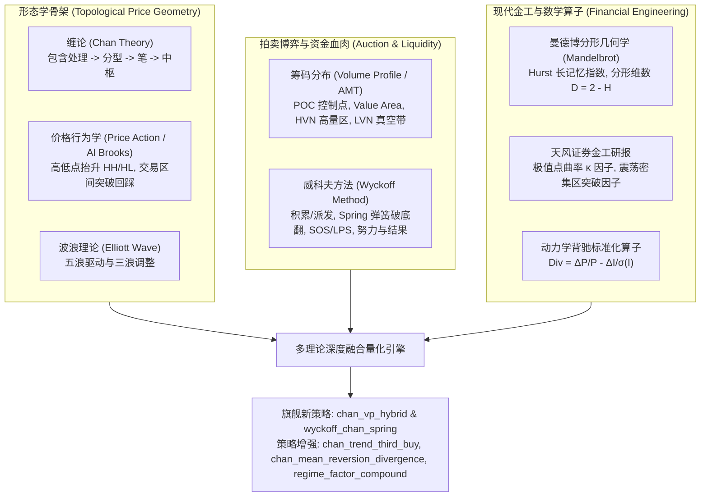

# 缠论与筹码分布及多流派量化融合深度研究与实施方案

本方案基于 [`docs/缠论与筹码分布研究及量化对话全景整理.md`](file:///home/stone/Work/github/quant/docs/%E7%BC%A0%E8%AE%BA%E4%B8%8E%E7%AD%B9%E7%A0%81%E5%88%86%E5%B8%83%E7%A0%94%E7%A9%B6%E5%8F%8A%E9%87%8F%E5%8C%96%E5%AF%B9%E8%AF%9D%E5%85%A8%E6%99%AF%E6%95%B4%E7%90%86.md)，对文档中提及的所有理论流派（威科夫方法、分形几何学与长记忆性、价格行为学、波浪理论、券商金工专题研报算子化等）进行全景深度梳理，提取标准量化因子，并设计新策略与现有策略升级蓝图。

---

## 一、 理论同源与相通流派深度映射



### 1. 威科夫方法 (Wyckoff Method)
* **核心映射**：
  - **积累/派发区间 (Trading Range)** $\Leftrightarrow$ 缠论中枢 $[ZD, ZG]$。
  - **Spring（弹簧效应 / 破底翻）** $\Leftrightarrow$ 中枢下轨背驰与一买。价格下破支撑 $ZD$ 触发散户止损，随即被主力巨量承接快速拉回 $ZD$ 之上。
  - **Sign of Strength (SOS) 与 Last Point of Support (LPS)** $\Leftrightarrow$ 中枢向上突破与二/三买回踩确认。
  - **努力与结果 (Effort vs Result)**：巨量但振幅极窄代表主力吸收（无下跌结果），地量宽振幅代表流动性真空。

### 2. 曼德博分形几何学与长记忆性 (Mandelbrot & Hurst)
* **核心映射**：
  - 递归系统（K线包含 $\to$ 分型 $\to$ 笔 $\to$ 线段 $\to$ 走势类型）本质上就是**时间序列上的自相似几何分形**。
  - **Hurst 指数 ($H$) 与分形维数 ($D = 2 - H$)**：
    - $H > 0.55$ ($D < 1.45$)：强趋势持续态（适合三买趋势跟踪）。
    - $H < 0.45$ ($D > 1.55$): 均值回归震荡态（适合中枢震荡套利）。
    - **多尺度分形共振**：短周期与长周期 Hurst 一致性度量多级别联立共振。

### 3. 价格行为学 (Price Action / Al Brooks)
* **核心映射**：
  - 顶底分型即 PA 极值反转 K 线（Pin Bar / Reversal Bar）。
  - 高低点抬升（HH/HL）对应上升笔序列。
  - 交易区间突破与二次回踩对应缠论三买。

### 4. 天风证券金工研报体系
* **核心成果**：
  - **极值点曲率因子 (Extremum Curvature Factor $\kappa$)**：
    $$\kappa = \frac{y''(t)}{\left(1 + (y'(t))^2\right)^{3/2}}$$
    V 型尖底具有高正曲率（$\kappa > 2.0$），代表坚决的承接反转；圆弧钝底曲率接近零。
  - **震荡密集区突破因子 (Consolidation Density Breakout)**：
    测量四分位价格密集度与突破时成交量倍率的乘积。

### 5. 动力学背驰的标准化数学建模
* **核心公式**：
  $$\text{Divergence}_k = \frac{P_t - P_{t-k}}{P_{t-k}} - \frac{I_t - I_{t-k}}{\sigma_I(t)}$$
  将指标动量（MACD DIF 或 RSI）与价格变化进行标准化 z-score 散度对比，替代主观视觉看山脉面积。

---

## 二、 提取的标准量化因子库 (`common/structural_factors.py`)

| 因子标识 (Key) | 数学定义 | 金融与微观结构含义 | 对应因子分类 |
| :--- | :--- | :--- | :--- |
| `wyckoff_spring` | $\mathbb{I}(L_{t-1} < S \land C_t > S) \times \frac{V_t}{\text{SMA}(V, 20)}$ | 跌破下轨洗盘并迅速放量收回（弹簧破底翻） | `mean_reversion` |
| `extremum_curvature` | $\kappa = \frac{2a}{(1 + b^2)^{3/2}}$ (局部二次拟合) | 拐点加速度与尖锐度，区分强力V反与弱震荡 | `regime_trend_strength` |
| `standardized_divergence` | $\text{Div}_k = \frac{\Delta_k P}{P_{t-k}} - \frac{\Delta_k I}{\sigma_I}$ | 价格与动量标准化散度，无量纲背驰测算 | `mean_reversion` |
| `wyckoff_effort_result` | $\frac{\Delta_k P / \sigma_P}{\Delta_k V / \sigma_V}$ | 努力与结果比率，探测主力吸收与衰竭 | `relative_momentum` |
| `fractal_dimension` | $D = 2 - H(P)$ (R/S Hurst 估计) | 分形维数，度量曲线粗糙度与趋势自相似性 | `regime_trend_strength` |
| `consolidation_density` | $\frac{\sum_{t \in W} V_t \cdot \mathbb{I}(P_t \in [ZD, ZG])}{\sum_{t \in W} V_t}$ | 中枢成交量密集度，验证高量节点 (HVN) | `regime_trend_strength` |

---

## 三、 策略设计与现有策略增强方案

### 1. 旗舰新策略一：缠论中枢与筹码分布融合策略 (`chan_vp_hybrid`)
* **路径**: `pipeline/research_strategy/rs/chan_vp_hybrid_strategy.py`
* **核心机制**:
  1. **HVN 中枢有效性过滤**: 仅承认筹码密集度 $\ge 50\%$ 且包含 POC 的真实中枢，剔除无量假中枢。
  2. **三买二次确认**: 离开段快速穿过 LVN，回踩不跌破 $ZG$ 与 $VAH$，在中枢上方沉淀出**新的微观 POC (价值接受)**。
  3. **动态未测试控制点止盈 (Naked POC Target)**: 目标位锚定上方未回踩的历史巨量筹码峰 (NPOC)，吃透真空带利润。

### 2. 旗舰新策略二：威科夫-缠论弹簧破底翻策略 (`wyckoff_chan_spring`)
* **路径**: `pipeline/research_strategy/rs/wyckoff_chan_strategy.py`
* **解决痛点**: 广发证券研报指出传统缠论纯一买（逆势背驰）胜率低、回撤大。本策略通过威科夫弹簧（破底洗盘 + 止跌巨量收回）与天风极值高曲率（V 反确认）形成双重约束，大幅提升一买胜率与盈亏比。
* **核心机制**:
  1. 识别趋势下跌段或中枢下轨 $ZD$。
  2. 触发条件：价格刺破 $ZD$（幅度在 1%~4% 之间）后即刻以阳线收回 $ZD$ 之上，伴随放量或长下影线。
  3. 曲率检验：要求拐点曲率 $\kappa \ge 1.5$。
  4. 止损精准设于弹簧最低点下方，目标位看至中枢上沿 $ZG$ 或 $1.5$ 倍箱体高度。

### 3. 现有策略增强
* **`ChanTrendThirdBuyStrategy` (`chan_trend_third_buy`)**:
  增加可选参数 `chan_b3_enable_vp_filter`（默认 False 保障 100% 向后兼容），开启后对三买前置中枢进行 HVN 密集度校验。
* **`ChanMeanReversionDivergenceStrategy` (`chan_mean_reversion_divergence`)**:
  扩展入场模式 `entry_mode`：支持 `'wyckoff_spring'`、`'curvature_v_bottom'` 与 `'spring_curvature_combined'`。
* **`RegimeFactorCompoundStrategy` (`regime_factor_compound`)**:
  将 `fractal_dimension` 与 `extremum_curvature` 纳入宏观状态识别矩阵。

---

## 四、 自动化测试与验证

```bash
# 1. 运行结构化因子库单元测试
uv run --project pipeline pytest pipeline/research_strategy/tests/test_structural_factors.py -v

# 2. 运行缠论筹码融合策略测试
uv run --project pipeline pytest pipeline/research_strategy/tests/test_chan_vp_hybrid.py -v

# 3. 运行威科夫弹簧破底翻策略测试
uv run --project pipeline pytest pipeline/research_strategy/tests/test_wyckoff_chan_strategy.py -v

# 4. 回归测试现有缠论高级策略
uv run --project pipeline pytest pipeline/research_strategy/tests/test_chan_advanced_strategies.py -q

# 5. CLI 合成数据实盘模拟与报告验证
uv run --project pipeline python pipeline/research_strategy/run_research_strategy.py --strategy chan_vp_hybrid --data-provider synthetic --n-days 300
uv run --project pipeline python pipeline/research_strategy/run_research_strategy.py --strategy wyckoff_chan_spring --data-provider synthetic --n-days 300
```
